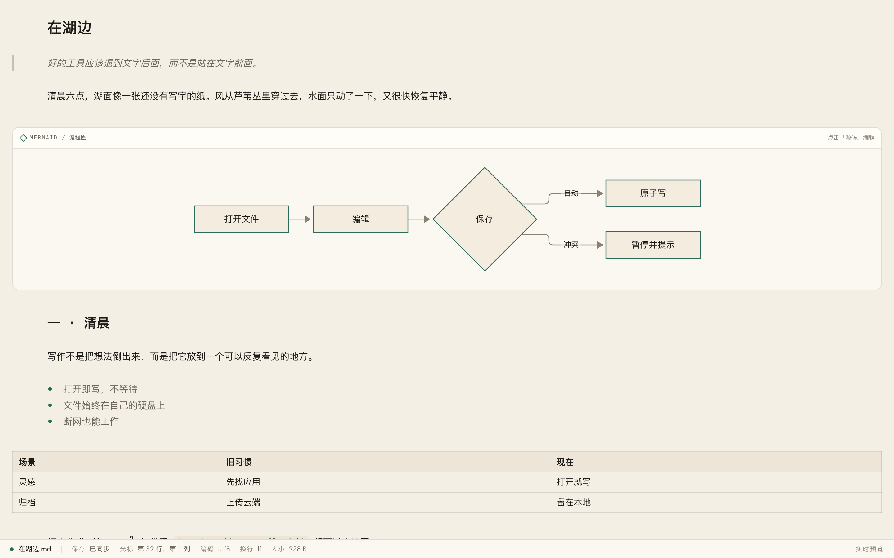
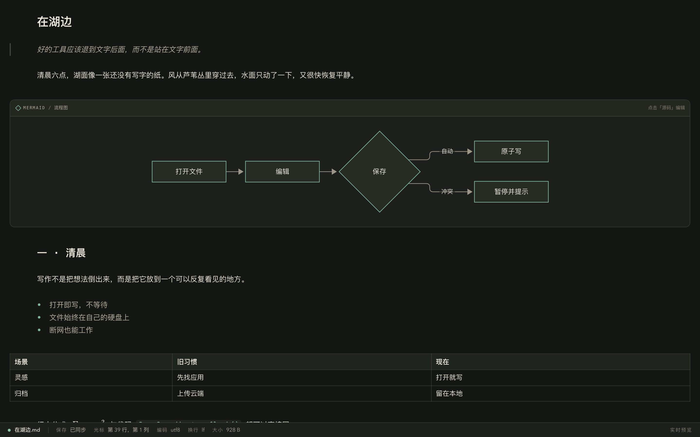
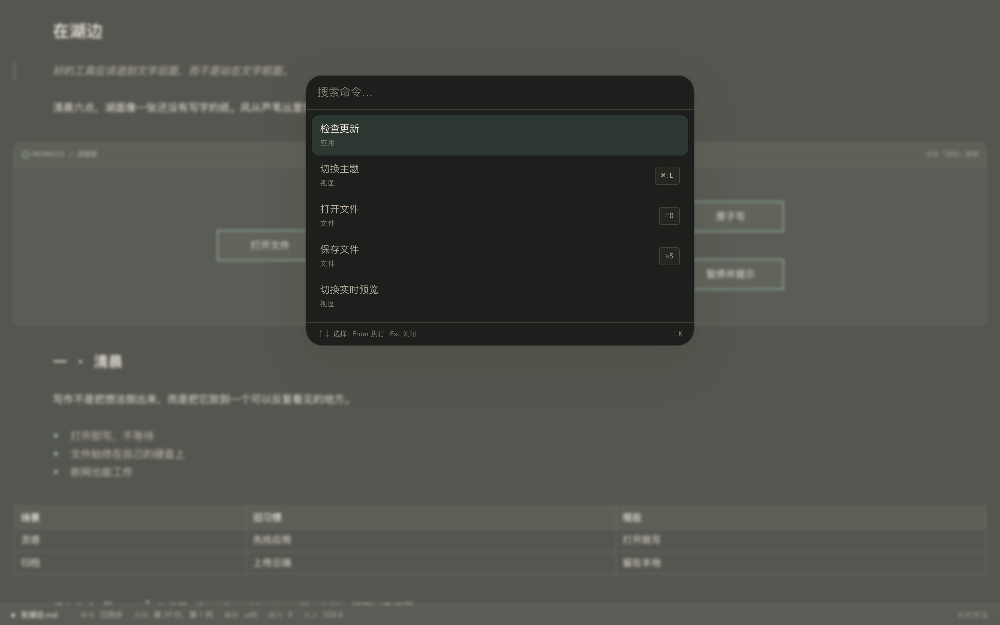
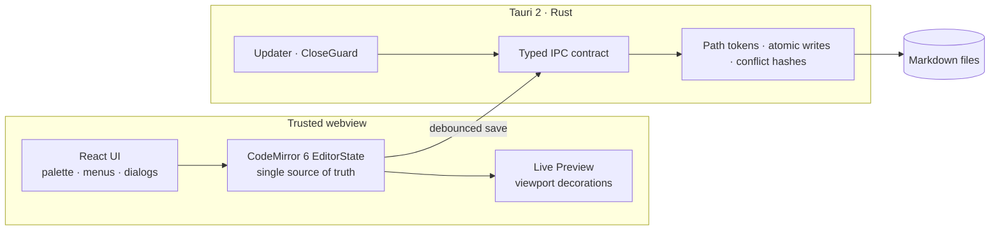

# Qingmo · 青墨

**English** · [简体中文](README.zh-CN.md)

> As quiet as paper, as fast as a code editor.

[](https://github.com/wavexzore/Qingmo/actions/workflows/ci.yml)
[](LICENSE)
[](#project-status)
[](#platform-support)

Qingmo is a **local-first, source-of-truth Markdown editor** for people who write for a living. It opens a file and gets out of the way: no account, no cloud dependency, no document lock-in. Your Markdown stays plain text on your own disk and remains readable by every other editor.

The editor is built around three non-negotiable goals:

1. **Typing stays under 16 ms p95.** The document lives in one CodeMirror 6 `EditorState`; React never owns the text.
2. **A 10 MB Markdown file stays editable.** Large documents shed preview work instead of freezing or refusing to open.
3. **Third-party code never runs on the main thread.** The future plugin runtime is designed around a Web Worker, a sandboxed iframe and a capability broker.



<details>
<summary>More screenshots</summary>

**Dark theme**



**Command palette**



</details>

## Features

### Writing, without leaving the source

- **Live Preview** renders CommonMark and GitHub Flavored Markdown in place: headings, emphasis, strikethrough, tables, task lists, code fences with language labels, images, block quotes and rules.
- **Beyond GFM**: KaTeX math (inline and display), Mermaid diagrams, footnotes, definition lists, abbreviations, collapsible `<details>`, alert callouts, emoji shortcodes, wiki links, heading anchors, frontmatter and attribute blocks.
- **Source when you need it.** Toggle Live Preview at any time; markers reappear around the cursor instead of hiding the syntax forever.
- **Typography and theme**: light, dark and system themes, with a reading-oriented type scale.
- **Simplified Chinese and English UI** out of the box.

### Built for real files

- Open and save through native dialogs. Markdown files are the only source of truth — no database export, no proprietary container.
- **Debounced autosave** with single-flight writes, save-state feedback and hash-based conflict protection. A conflict pauses saving and offers reload or overwrite instead of silently losing work.
- **Live external-change detection**: Rust checks the disk version of every open document. A clean buffer reloads automatically, unsaved edits raise the conflict banner immediately, and a deleted file keeps the editor text with a warning.
- **Atomic writes** in Rust, so an interrupted save never leaves a truncated file.
- **Encoding and line-ending aware**: UTF-8 and BOM-marked UTF-16, LF/CRLF preserved. MDX and mixed line endings open read-only with an explicit reason.
- **Large-file mode** above 2M UTF-16 units: Live Preview turns off, the status bar says so, and editing continues up to the 10 MiB limit.
- **One window per document**, native menus, `Mod+O` / `Mod+S` / `Mod+Shift+L`, and a filterable command palette on `Mod+K`.
- **Save-then-quit**: close and quit go through a Rust `CloseGuard` that flushes pending saves before the window disappears.

### Quiet, private, secure

- **Local-first by default.** No account, no telemetry, no background sync; everything works offline.
- The webview never picks paths. Rust issues path tokens, validates extensions and owns all file IO.
- A restrictive CSP, a minimal Tauri capability allowlist, and no filesystem permission exposed to the frontend.
- **Signed macOS updates** through the official Tauri updater: Developer ID, notarized app and DMG, minisign signatures and `requireSignedVersion`.
- ARIA status roles, keyboard focus restoration, IME-safe save shortcuts, and an error boundary around the shell.

## Project status

Qingmo is **pre-1.0** and under active development. The editor MVP is usable today; the wider product is not finished.

| Area | State |
| --- | --- |
| Editor MVP (open, edit, save, Live Preview, themes, palette, large files) | ✅ Implemented and covered by unit, Rust integration and Playwright E2E tests |
| Save reliability (autosave, atomic write, conflict banner, live external-change detection, close guard) | ✅ Implemented |
| Native menu, multi-window, runtime i18n (zh-CN / en) | ✅ Implemented and covered by unit, Rust contract, Playwright E2E and macOS real-device menu smoke; Windows build, 122 Rust tests, 469 unit tests and 80 E2E pass (native GUI not automated) |
| macOS signed auto-update | ✅ Local release chain validated; real-device install smoke test still pending |
| Workspace file tree, full-text search, SQLite index, crash recovery | 🚧 Planned for P2 |
| Plugin SDK, Worker/iframe runtime, capability broker, plugin market | 🚧 Designed for P3, not shipped |
| Windows and Linux release builds | 🚧 Compile-checked in CI; packaging and release verification pending |

### Platform support

macOS is the primary target and the only platform with a verified release/update path today. Windows and Linux are compile-checked in CI, but remain compile-only until their installers and release flows are validated.

## Install and build

### Prerequisites

- Node.js `>= 22.12` (the repo pins `26.12.1` in `.nvmrc`)
- pnpm `>= 10` (`corepack enable` is recommended)
- Rust `1.91.1` (installed automatically from `rust-toolchain.toml`)
- macOS: Xcode Command Line Tools
- Linux: the [Tauri 2 system dependencies](https://v2.tauri.app/start/prerequisites/)

### Run from source

```bash
pnpm install
pnpm tauri dev     # desktop app with real file IO
```

`pnpm dev` starts the webview alone against in-memory adapters. Use it for UI work; use `pnpm tauri dev` whenever you need native dialogs or real files.

### Build

```bash
pnpm build              # frontend production build
pnpm tauri build        # desktop bundle
make build              # macOS release + Windows installer
make build-mac          # macOS release only: version/notes checks + sign + notarize + latest.json
make build-win          # Windows NSIS installer only (cargo-xwin, unsigned Authenticode)
make build-arch         # lightweight macOS DMG, unsigned (Apple Silicon by default)
make build-arch MAC_ARCH=x86_64
```

Windows cross-compilation needs `cargo-xwin`, the `x86_64-pc-windows-msvc` Rust target and `makensis` (for example `brew install makensis`). `make build` runs the Windows build first so the macOS pipeline can checksum the installer and add a `windows-x86_64` entry to `latest.json`.

### Distribution and install (macOS)

Ship release builds as the DMG, never as a bare `.app` folder: WeChat, archive tools and cloud sync can drop extended attributes, executable permissions and signature resources, and the receiver then sees "青墨.app is damaged and can't be opened". The certificate is not at fault.

- Distribute: `release-artifacts/v<version>/Qingmo_<version>_universal.dmg` (Developer ID signed; app and DMG notarized and stapled)
- Install: open the DMG, drag `青墨.app` into Applications, and verify the DMG against `SHA256SUMS.txt`
- If a bare `.app` already fails, try `xattr -dr com.apple.quarantine /Applications/青墨.app` first; if `codesign --verify --deep --strict /Applications/青墨.app` still fails, send the DMG again
- `make build` runs the full local release pipeline (prefers `.release/release.sh`, falls back to `scripts/release/build-local.sh`), signing, notarizing and generating `latest.json`; `make build-arch` is an unsigned local DMG

### Distribution and install (Windows)

- Distribute: `release-artifacts/v<version>/Qingmo_<version>_x64-setup.exe` (NSIS, built with `cargo-xwin` from macOS)
- The installer has no Authenticode signature because Tauri cannot sign Windows binaries off a Windows host, so SmartScreen may warn; the updater (minisign) signature is still generated, so Windows auto-update works
- `make build-win` builds only the installer; `make build` runs it before the macOS pipeline so the DMG, installer, signatures and `SHA256SUMS.txt` land in the same directory

### Releasing locally

`make build` builds the Windows installer first, then builds, signs and notarizes the macOS universal app and writes `release-artifacts/v<version>/` with the DMG, updater tarball, NSIS installer, `latest.json` and `SHA256SUMS.txt`. When the installer and its updater signature are present, `latest.json` also carries a `windows-x86_64` entry (the Authenticode signature is not required for updates). The outer asset names are ASCII (`Qingmo.app.tar.gz`, `Qingmo_<version>_universal.dmg`, `Qingmo_<version>_x64-setup.exe`) because GitHub strips non-ASCII characters from release assets; the app bundle inside is `青墨.app`.

Publish manually after validating the artifacts:

```bash
gh release create v<version> --draft --title "青墨 v<version>" \
  --notes-file release-artifacts/v<version>/RELEASE-NOTES.txt
gh release upload v<version> release-artifacts/v<version>/* --clobber
gh release edit v<version> --draft=false --latest
```

Linux packaging remains pending.

### Release notes

Every version being released must have a bilingual entry in `resources/notes.json`. `make build` checks this before building and fails when the entry is missing:

```json
{
  "releaseNotesUrl": "https://github.com/wavexzore/Qingmo/releases/tag/v",
  "versions": [
    {
      "version": "0.2.0",
      "date": "2026-11-01",
      "notes": {
        "zh-CN": ["中文说明"],
        "en-US": ["English note"]
      }
    }
  ]
}
```

Check and render:

```bash
pnpm release:check-notes
pnpm release:test-notes
node scripts/release/check-release-notes.mjs --out /tmp/notes.txt
```

### Quality gates

```bash
pnpm typecheck      # TypeScript, unit and E2E projects
pnpm lint
pnpm test           # Vitest
pnpm test:e2e       # Playwright
pnpm ci:rust        # rustfmt, clippy -D warnings, cargo test
pnpm ci:local       # the full local gate: web, Rust, generated types, negative contracts, E2E
pnpm bench          # deterministic 10 KiB / 1 MiB / 10 MiB benchmarks
```

CI runs four jobs: Ubuntu web + E2E, Ubuntu contract/generated-file/negative tests, macOS format/clippy/test/debug build, and Windows compile-only.

## Architecture



A few invariants shape the codebase:

- **The document is a CodeMirror `EditorState`**, not React state. React renders chrome only.
- **Every cross-boundary payload is generated and validated** from a single IPC contract (Rust `ts-rs` → TypeScript, checked in CI).
- **Saving has exactly one path**: `SaveCoordinator` → `file.save` → Rust atomic writer. Shortcuts, menu, autosave and quit all use it.
- **Live Preview is a viewport decoration pass**, never a rich-text round trip. Parsing is limited to visible ranges; large files drop the pass entirely.
- **Ports isolate the platform**: `IpcPort`, `PlatformPort` and `UpdatePort` have Tauri and fake implementations, so browser tests and Playwright never touch native APIs.

The full design — blueprint, runtime topology, research notes and implementation ADRs — is kept in `docs/` during development. That directory is intentionally **not versioned in Git**; the sections above summarize the parts contributors need. ADR filenames still follow `docs/adr/NNNN-*.md`.

### Repository layout

```text
apps/desktop/        React shell, editor session, commands, update UI, E2E bridge
packages/editor-core/ CodeMirror extensions, Live Preview planners and widgets
packages/shared/     IPC types (generated), Result/AppError contracts
packages/ui/         Design tokens and shared primitives
src-tauri/           Rust commands, atomic IO, close guard, updater state machine
e2e/                 Playwright specs and fixtures
bench/               Deterministic performance fixtures and runner
docs/                Local design docs and task records (not versioned)
```

## Roadmap

- **P2 — Workspace**: file tree, indexed search, recovery, workspace-wide file watching, unified settings.
- **P3 — Plugins**: signed manifests, Worker logic host, sandboxed iframe UI, capability broker, three first-party plugins (Mermaid, math, export).
- **Release engineering**: Windows/Linux installers, cross-platform updates, real-device update verification, changelog automation.

Explicit non-goals for v1: real-time collaboration, mobile apps, built-in AI, and a first-party cloud sync service.

## Contributing

Issues and pull requests are welcome. Please read [CONTRIBUTING.md](CONTRIBUTING.md) first; it covers the development loop, architecture invariants, test expectations and commit format.

```bash
git clone https://github.com/wavexzore/Qingmo.git
cd Qingmo
pnpm install
pnpm tauri dev
```

Before opening a PR, run `pnpm ci:local`. Changes to save, close or path handling must update the matching ADR.

## License

Licensed under the [Apache License, Version 2.0](LICENSE). You may use, modify and distribute Qingmo, including commercially, provided you keep the copyright and license notices. The license also includes an express patent grant and a trademark policy; see [NOTICE](NOTICE) for attribution.

Qingmo bundles or links against open-source dependencies including CodeMirror, React, Tauri, Mermaid, KaTeX and Tailwind CSS. Their licenses remain with their respective authors.
