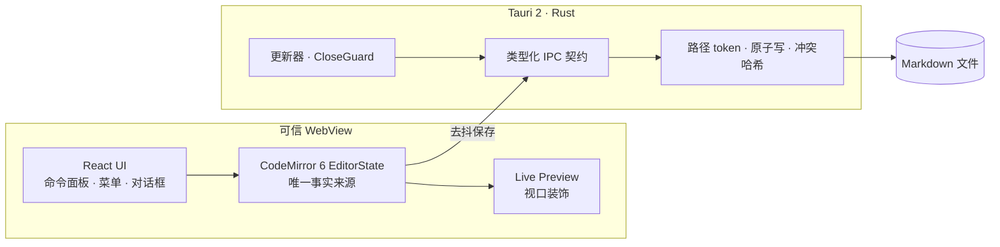

# 青墨 Qingmo

[English](README.md) · **简体中文**

> 像纸一样安静，像代码编辑器一样快。

[](https://github.com/wavexzore/Qingmo/actions/workflows/ci.yml)
[](LICENSE)
[](#项目状态)
[](#平台支持)

青墨是一个**本地优先、源码为真**的 Markdown 编辑器，面向以写作为生的人。它打开文件，然后退到文字后面：没有账号，不依赖云端，也不把文档锁进专有格式。Markdown 始终是你硬盘上的纯文本，任何其他编辑器都能打开。

编辑器围绕三条不可妥协的指标构建：

1. **按键延迟 p95 低于 16 ms。** 文档只存在于一个 CodeMirror 6 `EditorState` 中，React 从不持有正文。
2. **10 MB 的 Markdown 仍然可编辑。** 大文档通过关闭预览计算来降级，而不是卡死或拒绝打开。
3. **第三方代码不进入主线程。** 未来的插件运行时以 Web Worker、sandbox iframe 和能力代理（Capability Broker）为边界。


<details>
<summary>更多截图</summary>

**深色主题**


**命令面板**


</details>

## 特性

### 不离开源码的写作

- **Live Preview** 在编辑器内就地渲染 CommonMark 与 GitHub Flavored Markdown：标题、强调、删除线、表格、任务列表、带语言标签的代码块、图片、引用和分隔线。
- **超出 GFM**：KaTeX 行内/块级公式、Mermaid 图表、脚注、定义列表、缩写、可折叠 `<details>`、Alerts 提示块、Emoji 短代码、Wiki Link、标题锚点、Front Matter 与属性块。
- **随时回到源码。** Live Preview 可一键切换；光标附近的标记会重新显示，而不是永久隐藏语法。
- **排版与主题**：浅色、深色、跟随系统，以及为长文阅读设计的字号阶梯。
- **内置简体中文与英文界面。**

### 为真实文件而做

- 通过原生对话框打开和保存。Markdown 文件是唯一事实来源——没有数据库导出，也没有专有容器。
- **去抖自动保存**：单飞写入、保存状态反馈、基于哈希的冲突保护。冲突时暂停保存并提供重新加载或覆盖，而不是静默丢字。
- **外部变更感知**：Rust 持续检查每个打开文档的磁盘版本；缓冲区干净时自动重新加载，有未保存修改时立即显示冲突横幅，文件被删除时保留正文并提示。
- **Rust 原子写**：保存中断也不会留下被截断的文件。
- **编码与换行感知**：支持 UTF-8 与带 BOM 的 UTF-16，保留 LF/CRLF。MDX 与混合换行文档以只读方式打开，并给出明确原因。
- **大文件降级**：超过 2M UTF-16 单元后关闭 Live Preview，状态栏明确提示，10 MiB 以内仍可编辑。
- **一个文档一个窗口**、中文原生菜单、`Mod+O` / `Mod+S` / `Mod+Shift+L` 快捷键，以及 `Mod+K` 可过滤命令面板。
- **先落盘再退出**：关闭和退出都经过 Rust `CloseGuard`，在窗口消失前冲刷待保存内容。

### 安静、私密、安全

- **默认本地优先。** 没有账号、没有遥测、没有后台同步，断网可用。
- WebView 不接触路径。Rust 发放路径 token、校验扩展名并独占文件 IO。
- 严格 CSP、最小 Tauri capability 白名单，前端不开放文件系统权限。
- **macOS 签名更新**：走官方 Tauri updater，使用 Developer ID、App 与 DMG 公证、minisign 签名和 `requireSignedVersion`。
- 无障碍状态语义、快捷键焦点恢复、IME 安全保存，以及外壳级错误边界。

## 项目状态

青墨处于 **pre-1.0**，正在积极开发。编辑器 MVP 今天已经可用，但完整产品尚未完成。

| 领域 | 状态 |
| --- | --- |
| 编辑器 MVP（打开、编辑、保存、Live Preview、主题、命令面板、大文件） | ✅ 已实现，并有单元、Rust 集成与 Playwright E2E 覆盖 |
| 保存可靠性（自动保存、原子写、冲突横幅、外部变更感知、关闭守卫） | ✅ 已实现 |
| 原生菜单、多窗口、运行时 i18n（zh-CN / en） | ✅ 已实现，并有单元、Rust 契约、Playwright E2E 与 macOS 真机菜单冒烟；Windows 构建、122 Rust 测试、469 单测与 80 E2E 通过（原生 GUI 未自动化） |
| macOS 签名自动更新 | ✅ 本地发布链路已验证；真机安装冒烟仍待执行 |
| 工作区文件树、全文搜索、SQLite 索引、崩溃恢复 | 🚧 计划于 P2 |
| 插件 SDK、Worker/iframe 运行时、能力代理、插件市场 | 🚧 已设计，P3 交付 |
| Windows / Linux 发布构建 | 🚧 已加入 tag 触发工作流（NSIS / AppImage + deb）；首次 CI 运行待验证 |

### 平台支持

macOS 是当前主目标，也是唯一验证过发布/更新链路的平台。推送 `v*` tag 会触发全平台发布工作流；Windows 与 Linux 安装器由该工作流构建，首次 CI 运行待验证。

## 安装与构建

### 前置要求

- Node.js `>= 22.12`（仓库在 `.nvmrc` 中固定 `26.12.1`）
- pnpm `>= 10`（推荐先执行 `corepack enable`）
- Rust `1.91.1`（由 `rust-toolchain.toml` 自动安装）
- macOS：Xcode Command Line Tools
- Linux：[Tauri 2 系统依赖](https://v2.tauri.app/start/prerequisites/)

### 从源码运行

```bash
pnpm install
pnpm tauri dev     # 带真实文件 IO 的桌面应用
```

`pnpm dev` 只启动 WebView，并接内存适配器。做界面开发时使用它；需要原生对话框或真实文件时使用 `pnpm tauri dev`。

### 构建

```bash
pnpm build              # 前端生产构建
pnpm tauri build        # 桌面安装包
make build-mac          # 本地发布：版本/说明检查 + 签名 + 公证 + latest.json
make build-mac-arch     # 轻量 macOS DMG，不签名、不公证（默认 Apple Silicon）
make build-mac-arch MAC_ARCH=x86_64
```

### 分发与安装（macOS）

正式版本只通过 DMG 分发，不要直接发送 `.app` 文件夹：微信、压缩工具或网盘同步可能丢掉扩展属性、可执行权限和签名资源，接收方就会看到“青墨.app 已损坏，无法打开”。这不是证书失效。

- 分发：`release-artifacts/v<version>/青墨_<version>_universal.dmg`（Developer ID 签名、App 与 DMG 公证并 stapled）
- 安装：打开 DMG，把 `青墨.app` 拖入“应用程序”，并按 `SHA256SUMS.txt` 校验 DMG
- 已经拿到损坏的 `.app` 时，先尝试 `xattr -dr com.apple.quarantine /Applications/青墨.app`；若 `codesign --verify --deep --strict /Applications/青墨.app` 仍失败，重新发送 DMG
- `make build-mac` 走完整本地发布链路（优先 `.release/release.sh`，缺失时用 `scripts/release/build-local.sh`），会签名、公证并生成 `latest.json`；`make build-mac-arch` 只是未签名的本地 DMG

### 全平台发布

确认所有版本文件与 `resources/notes.json` 一致后，推送 `vX.Y.Z` tag。`.github/workflows/release.yml` 会创建草稿 Release，构建 macOS universal、Windows NSIS 与 Linux AppImage + deb，生成并校验 `latest.json`，再下载已上传的资产做一次独立校验，全部通过后才正式发布。

必需 secrets（仓库级或 `release` Environment 级）：`TAURI_SIGNING_PRIVATE_KEY`、`TAURI_SIGNING_PRIVATE_KEY_PASSWORD`。可选的 Apple secrets（`APPLE_CERTIFICATE`、`APPLE_CERTIFICATE_PASSWORD`、`APPLE_SIGNING_IDENTITY`、`APPLE_ID`、`APPLE_PASSWORD`、`APPLE_TEAM_ID`）用于 macOS 签名与公证；未配置时 macOS 构建不签名。失败后可用 `workflow_dispatch` 指定已有 tag 重跑。

### 发布说明

每个待发布版本都必须在 `resources/notes.json` 中有中英双语条目，`make build-mac` 和发布流程会在构建前强制校验，缺失即失败：

```json
{
  "releaseNotesUrl": "https://github.com/wavexzore/Qingmo/releases/tag/v",
  "versions": [
    {
      "version": "0.2.0",
      "date": "2026-11-01",
      "notes": {
        "zh-CN": ["中文说明"],
        "en-US": ["English note"]
      }
    }
  ]
}
```

校验与渲染：

```bash
pnpm release:check-notes
pnpm release:test-notes
node scripts/release/check-release-notes.mjs --out /tmp/notes.txt
```

### 质量门禁

```bash
pnpm typecheck      # TypeScript、单元与 E2E 工程
pnpm lint
pnpm test           # Vitest
pnpm test:e2e       # Playwright
pnpm ci:rust        # rustfmt、clippy -D warnings、cargo test
pnpm ci:local       # 完整本地门禁：Web、Rust、生成类型、契约负例、E2E
pnpm bench          # 确定性的 10 KiB / 1 MiB / 10 MiB 基准
```

CI 运行四个 job：Ubuntu Web + E2E、Ubuntu 契约/生成文件/负例、macOS format/clippy/test/debug build、Windows compile-only。

## 架构



几条不变量决定了代码形状：

- **文档是 CodeMirror `EditorState`**，不是 React state。React 只渲染外壳。
- **所有跨边界数据都由单一 IPC 契约生成并校验**（Rust `ts-rs` → TypeScript，CI 检查漂移）。
- **保存只有一条路径**：`SaveCoordinator` → `file.save` → Rust 原子写。快捷键、菜单、自动保存和退出都走它。
- **Live Preview 是视口装饰**，不是富文本双向同步。解析只覆盖可见范围；大文件直接关闭这一遍。
- **端口隔离平台**：`IpcPort`、`PlatformPort`、`UpdatePort` 都有 Tauri 与 fake 实现，浏览器测试和 Playwright 从不触碰原生 API。

完整的蓝图、运行拓扑、调研与实施级 ADR 在开发期保存在 `docs/`。该目录**不纳入 Git**；上面的架构小节已经保留贡献者需要知道的部分。ADR 文件名仍沿用 `docs/adr/NNNN-*.md`。

### 仓库结构

```text
apps/desktop/        React 外壳、编辑会话、命令、更新 UI、E2E bridge
packages/editor-core/ CodeMirror 扩展、Live Preview 规划器与 Widget
packages/shared/     IPC 类型（生成）、Result/AppError 契约
packages/ui/         设计 token 与共享原语
src-tauri/           Rust 命令、原子 IO、关闭守卫、更新状态机
e2e/                 Playwright 用例与 fixtures
bench/               确定性性能 fixtures 与 runner
docs/                本地设计文档与任务记录（不入库）
```

## 路线图

- **P2 —— 工作区**：文件树、索引搜索、恢复、外部变更监听、统一设置。
- **P3 —— 插件**：签名 manifest、Worker 逻辑宿主、sandbox iframe UI、能力代理、三个第一方插件（Mermaid、数学、导出）。
- **发布工程**：Windows/Linux 安装器、跨平台更新、真机更新验证、变更日志自动化。

v1 明确不做：实时协作、移动端、内置 AI、第一方云同步服务。

## 贡献

欢迎提交 Issue 和 Pull Request。请先阅读 [CONTRIBUTING.md](CONTRIBUTING.md)，其中说明开发循环、架构不变量、测试要求和提交格式。

```bash
git clone https://github.com/wavexzore/Qingmo.git
cd Qingmo
pnpm install
pnpm tauri dev
```

提交 PR 前请运行 `pnpm ci:local`。改动保存、关闭或路径处理时，必须同步更新对应 ADR。

## 许可证

以 [Apache License 2.0](LICENSE) 授权。你可以使用、修改和分发青墨，包括商业用途，但需保留版权与许可声明。该许可证还包含明确的专利授权与商标条款；署名信息见 [NOTICE](NOTICE)。

青墨捆绑或链接了 CodeMirror、React、Tauri、Mermaid、KaTeX、Tailwind CSS 等开源依赖，其许可证归各自作者所有。
