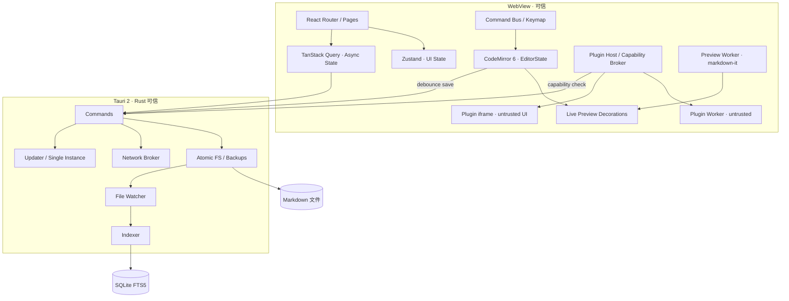
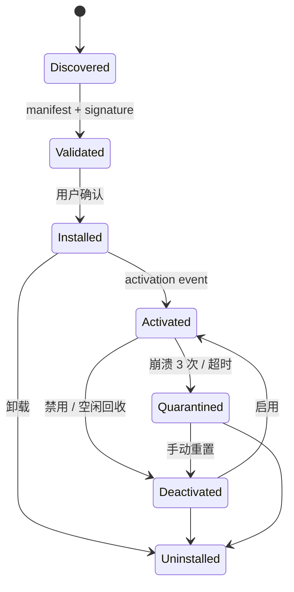
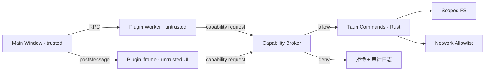

# Qingmo（轻墨）项目蓝图

| 项目 | 内容 |
|---|---|
| 版本 | 0.1 / Draft |
| 日期 | 2026-10-26 |
| 状态 | 待评审，未开始编码 |
| 目标平台 | macOS / Windows / Linux（Tauri 2） |
| 核心栈 | Tauri 2 + React + Vite + TypeScript + TailwindCSS + CodeMirror 6 |
| 配套文档 | [调研与参考](RESEARCH.md) |

---

## 0. 摘要

Qingmo 是一个**本地优先、源码为真、支持沙箱化插件**的 Markdown 编辑器。

三条不可妥协的产品指标：

1. **输入延迟**：p95 < 16ms，打字不粘手。
2. **大文件**：10MB Markdown 可正常编辑，不崩、不卡死。
3. **插件安全**：第三方插件默认无文件、无网络、无 Tauri 权限。

对应的架构结论：

- **Tauri 2 + Rust** 负责文件、索引、搜索、网络代理、更新等系统能力。
- **React** 只做界面，不承载文档状态；文档唯一事实来源是 **CodeMirror 6 `EditorState`**。
- **Live Preview** 用 CM6 的 `Decoration` 做视口级渲染，而不是把 Markdown 转成富文本再双向同步。
- **用户插件**运行在 **Web Worker（逻辑）+ sandbox iframe（UI）**，通过 **Capability Broker** 访问宿主能力；主线程不执行任何第三方代码。
- **Markdown 文件是唯一事实来源**，SQLite 只做索引、搜索、插件状态与恢复记录。

---

## 1. 产品定义

### 1.1 愿景

> 像纸一样安静，像代码编辑器一样快。

Qingmo 面向长期写作与知识管理：打开即写、随时可带走、插件可扩展，但不牺牲性能与安全。

### 1.2 目标用户

| 用户 | 核心诉求 | 对应设计 |
|---|---|---|
| 开发者 / 技术写作者 | 快、键盘操作、代码块、Git 友好 | CM6、命令面板、源码模式、纯文本文件 |
| 长文作者 / 研究者 | 排版好看、专注、引用、导出 | Live Preview、主题、Typography、Pandoc 插件 |
| 知识管理者 | 双链、标签、搜索、本地数据 | Wiki Link、SQLite FTS、Backlinks |
| 插件作者 | API 稳定、调试方便、能发布 | Plugin SDK、dev mode、市场、签名 |

### 1.3 体验原则

1. **Local-first**：断网可用，文件可被任何编辑器打开。
2. **Source of truth**：Markdown 源码是真身，预览只是视图。
3. **Keyboard-first**：所有高频操作都有快捷键，命令面板可发现。
4. **Progressive disclosure**：默认干净，复杂功能按需出现。
5. **No spinners**：本地操作不应出现加载转圈；重活放后台。
6. **可逆**：自动保存、版本备份、崩溃恢复，默认不丢字。

### 1.4 非目标（v1）

- 实时多人协作（数据模型预留，不在 v1 实现）。
- 移动端（Tauri 2 支持移动，但 v1 不做）。
- 与 Typora 100% 一致的 WYSIWYG。
- 运行时加载原生 Rust 插件。
- 内置 AI 功能（以插件形式提供）。
- 自带云同步服务（只提供可选适配器接口）。

---

## 2. 研究结论

完整证据与引用见 [RESEARCH.md](RESEARCH.md)。这里只保留对架构有约束力的结论。

### 2.1 开源项目给我们的 8 条经验

| 来源 | 经验 |
|---|---|
| MarkEdit | 原生外壳 + CodeMirror 6 可以做到 4MB 安装包、10MB 文件流畅；大文档不做全量语法树 |
| Milkdown | `Ctx` + `Slice` + `Timer` 适合内部扩展的依赖注入与生命周期协调 |
| Tiptap | 贡献点必须分类、可排序、每个扩展有独立 storage |
| Yank Note | Markdown 编辑器需要 markdown-it 插件、命令、状态栏、设置等完整贡献点 |
| Logseq | 运行时插件最低基线：iframe sandbox + 白名单 API + 插件私有存储目录 |
| SiYuan | 权限要按数据字段/目录粒度授权，卸载即撤销 |
| NoteGen / MarkFlowy | Tauri 侧承担 IO、SQLite、搜索、重任务；前端只做 UI |
| Mark Text | Electron 能做出漂亮界面，但资源占用是长期代价 |

### 2.2 论文给我们的 5 条约束

| 主题 | 结论 | 约束 |
|---|---|---|
| Local-first（Kleppmann 2019） | 本地副本是主副本，协作是可选增强 | 文件为源，云同步后置 |
| OT vs CRDT（Sun 2020） | CRDT 并非天然可交换，存在隐藏复杂度 | v1 不自研协作算法 |
| Eg-walker（2024） | 比 CRDT 省内存、加载快，合并长分支远快于 OT | 未来协作优先评估成熟算法/库 |
| 增量解析（Wagner & Graham 1998） | 增量解析可复用未受影响的语法树 | 采用 Lezer，大文件只解析视口 |
| Wasm 沙箱（WaVe 2023） | 宿主与 WASI 边界才是安全关键 | 插件隔离不能只靠“跑在 Wasm 里” |

### 2.3 设计约束清单

1. 文档不进 React state。
2. 用户插件不进主线程。
3. 插件不得直接 `invoke` Tauri。
4. 插件默认零权限，敏感能力逐项授权。
5. 插件懒激活，启动时不加载全部插件。
6. 插件崩溃可隔离、可禁用、可安全模式启动。
7. 自动保存必须原子写 + 可恢复。
8. 大文件自动降级，保证“还能编辑”。
9. 所有跨边界数据用 Zod / serde 校验。
10. 先建立基准，再谈优化。

---

## 3. 总体架构

> 完整拓扑图见 [TOPOLOGY.md](TOPOLOGY.md)（含 `.drawio` / `.svg` / `.png`）。

### 3.1 系统分层



### 3.2 分层职责

| 层 | 负责 | 不负责 |
|---|---|---|
| React UI | 布局、主题、设置、命令面板、对话框 | 文档内容、逐键状态 |
| Editor Core | 文档状态、事务、撤销、装饰、选区 | 业务数据、网络 |
| App State | UI 状态、工作区元数据、查询缓存 | 文档正文 |
| Plugin Host | 插件发现、激活、RPC、权限、隔离 | 业务逻辑 |
| Rust Core | 文件、索引、搜索、网络、更新、系统集成 | 界面渲染 |
| Data | Markdown 文件、SQLite 索引、配置 | 作为文档主存储 |

### 3.3 关键架构决策（ADR）

#### ADR-001：编辑器内核选 CodeMirror 6，不选 ProseMirror/Milkdown 作为主内核

| 方案 | 优点 | 缺点 | 结论 |
|---|---|---|---|
| CodeMirror 6 | 视口渲染、Lezer 增量解析、源码保真、包体小、10MB 级验证 | Live Preview 需自己实现装饰 | **采用** |
| ProseMirror / Milkdown | WYSIWYG 成熟、富文本 schema 强 | Markdown 往返有损；大文档压力大；双状态源 | 仅作为未来可选“富文本模式”插件 |
| textarea | 最简单 | 无语法高亮、无装饰、无大文件能力 | 否 |
| 原生 NSTextView | macOS 性能最好 | 仅 macOS，跨平台成本高 | 否（macOS 可做可选后端） |

**理由**：Qingmo 的核心是 Markdown 源码与长期可维护性。CM6 的 `EditorState` 可以直接作为唯一事实来源，Live Preview 只是 decoration，不需要第二套文档模型。

#### ADR-002：文件为源，SQLite 只做索引

- Markdown 文件可被 Git、其他编辑器、脚本直接使用。
- SQLite 存文档元数据、全文索引、链接图、标签、插件状态、恢复记录。
- 绝不把正文只存数据库；数据库损坏可重建。

#### ADR-003：用户插件采用 Worker + iframe 混合隔离

- 主线程零第三方代码。
- 逻辑、解析、网络请求在 Worker。
- 需要 DOM 的 UI 在 sandbox iframe。
- 所有能力经 Capability Broker，不直接暴露 Tauri IPC。

#### ADR-004：Tauri 原生插件只用于可信系统集成

- Tauri 的 Rust 插件是编译期依赖，适合 fs / updater / sql / global shortcut 等。
- 用户插件是运行期 JS/WASM，不能编译进二进制。
- 两者在文档与权限模型中明确区分，避免概念混淆。

#### ADR-005：React 不参与逐键渲染

- 编辑器实例用 `ref` 持有，只创建一次。
- 光标、选区、字数等派生 UI 通过 `useSyncExternalStore` + 节流订阅。
- 任何 `onChange` 都不触发整页 `setState`。

#### ADR-006：预览在 Worker 中生成并消毒

- markdown-it 在 Preview Worker 中执行。
- `sanitize-html` 在 Worker 内完成，主线程只接收安全 HTML。
- 自定义 fence 渲染器同样在插件 Worker 中执行，输出必须消毒。

#### ADR-007：pnpm workspace + 共享 Zod schema

- `app`、`editor-core`、`plugin-sdk`、`plugin-host`、`shared`、`ui` 分包。
- `plugin-sdk` 不依赖 React/Tauri，保证可独立发布。
- `shared` 只放 Zod schema、类型、纯函数。

---

## 4. 技术栈与工程结构

### 4.1 技术栈分工

| 技术 | 角色 | 使用约束 |
|---|---|---|
| **Vite** | 构建、HMR、Worker 打包 | `?worker` 引入 Worker；`manualChunks` 拆 editor/preview/plugins |
| **React** | UI 渲染 | 不承载文档；路由级懒加载 |
| **TypeScript** | 全链路类型 | `strict: true`；IPC 类型由 Rust 生成 |
| **TailwindCSS** | 样式与设计 token | 用 CSS 变量 + `@theme`；禁止运行时拼接类名 |
| **React Router DOM** | 页面路由 | Tauri 下用 `createHashRouter`，避免 custom protocol 刷新 404 |
| **Zustand** | UI/应用状态 | 按 slice 拆分；不存文档正文 |
| **TanStack Query** | 异步资源状态 | 文件树、搜索、插件市场、Git 状态；fs 事件驱动失效 |
| **i18next + react-i18next** | 国际化 | 命名空间拆分；插件语言包运行时加载 |
| **Zod** | 边界校验 | IPC、插件 manifest、设置、文件 frontmatter |
| **Lucide React** | 图标 | 按需导入；插件图标走名称白名单 |
| **Tauri 2** | 桌面外壳 | 最小 capabilities；严格 CSP；关闭 `withGlobalTauri` |
| **CodeMirror 6** | 编辑内核 | 唯一文档状态；Compartment 动态配置 |
| **markdown-it** | 预览渲染 | 在 Worker 中运行；插件化 renderer |
| **sanitize-html** | HTML 消毒 | Worker 内执行；白名单标签/属性 |
| **KaTeX** | 数学公式 | 编辑器内小公式同步渲染；预览在 Worker |
| **Shiki** | 代码高亮 | 懒加载语言与主题；Preview Worker |
| **SQLite (rusqlite)** | 索引/搜索 | FTS5；只存元数据，不存正文唯一副本 |
| **notify** | 文件监听 | Rust 侧去抖、批量事件 |
| **blake3** | 内容哈希 | 冲突检测、索引去重 |
| **tokio / rayon** | 异步/并行 | IO 与索引分离；避免阻塞 UI |
| **tracing** | 日志 | 结构化日志；插件日志分通道 |
| **tauri-specta**（建议） | IPC 类型生成 | Rust command → TS 类型，减少手写漂移 |

### 4.2 Monorepo 结构

```text
Qingmo/
├─ apps/
│  └─ desktop/
│     ├─ src/
│     │  ├─ app/                 # bootstrap, providers, router
│     │  ├─ features/
│     │  │  ├─ editor/
│     │  │  ├─ workspace/
│     │  │  ├─ search/
│     │  │  ├─ settings/
│     │  │  ├─ plugins/
│     │  │  └─ command-palette/
│     │  ├─ components/ui/       # 基础组件
│     │  ├─ stores/              # Zustand slices
│     │  ├─ lib/                 # query client, ipc, keymap
│     │  ├─ i18n/
│     │  └─ styles/
│     ├─ src-tauri/
│     │  ├─ src/
│     │  │  ├─ commands/
│     │  │  ├─ services/         # fs, index, search, net, backup
│     │  │  ├─ watcher.rs
│     │  │  ├─ error.rs
│     │  │  └─ lib.rs
│     │  ├─ capabilities/
│     │  └─ tauri.conf.json
│     ├─ index.html
│     └─ vite.config.ts
├─ packages/
│  ├─ editor-core/               # CM6 setup, Lezer, decorations
│  ├─ plugin-sdk/                # manifest schema, RPC types, definePlugin
│  ├─ plugin-host/               # worker/iframe host, broker
│  ├─ shared/                    # zod schemas, result, utils
│  └─ ui/                        # design system
├─ plugins/                      # 第一方插件
│  ├─ mermaid/
│  ├─ math/
│  └─ export-pandoc/
├─ bench/                        # 性能基准与 fixtures
├─ docs/
└─ package.json
```

### 4.3 依赖边界

```text
app        → editor-core, plugin-sdk, plugin-host, shared, ui
editor-core→ shared（不得依赖 React / Tauri）
plugin-host→ plugin-sdk, shared（不得依赖 app）
plugin-sdk → 无运行时依赖（zod 可选 peer）
ui         → shared
shared     → 无 React / Tauri / DOM 依赖
```

用 ESLint `import/no-restricted-paths` 或 `dependency-cruiser` 在 CI 中强制。

---

## 5. 编辑器内核

### 5.1 CodeMirror 6 组合

```ts
// packages/editor-core/src/createEditor.ts
export function createEditorExtensions(opts: EditorOptions): Extension[] {
  return [
    lineNumbers(),
    history(),
    drawSelection(),
    dropCursor(),
    rectangularSelection(),
    crosshairCursor(),
    EditorState.allowMultipleSelections.of(true),
    markdown({ base: markdownLanguage, codeLanguages: languages }),
    syntaxHighlighting(markdownHighlightStyle),
    livePreview(opts.livePreview),
    themeCompartment.of(themeExtension(opts.theme)),
    modeCompartment.of(modeExtension(opts.mode)),
    keymap.of([...defaultKeymap, ...historyKeymap, ...searchKeymap, ...opts.keymap]),
    EditorView.lineWrapping,
    EditorView.updateListener.of(opts.onUpdate),
  ];
}
```

### 5.2 文档状态

- `EditorState` 持有文档、选区、配置、扩展状态。
- 所有修改通过 `view.dispatch(transaction)`。
- undo/redo 用 `history()`；保存点用 `history` 的 `isolateHistory` 或自定义 `savePoint`。
- React 只订阅必要派生值：

```ts
// 只订阅光标/选区/脏状态，不订阅全文
const cursor = useEditorSelector((state) => state.selection.main.head);
```

- 禁止：`onChange={(v) => setContent(v)}`。
- 禁止：把全文放进 Zustand persist。
- 允许：把 `docId`、`dirty`、`mode`、`cursor` 存入会话状态，用于恢复。

### 5.3 Live Preview 装饰系统

目标：接近 Typora / Obsidian Live Preview 的观感，但保持源码为真。

**渲染策略**

1. 只处理 `view.visibleRanges`（视口 + 边缘）。
2. 用 `syntaxTree(state).iterate({ from, to })` 获取节点。
3. 用 `RangeSetBuilder` 构建 `DecorationSet`。
4. 语法标记（`**`、`#`、`[]()`）在光标不在该行时隐藏，光标进入时显示。
5. Widget：图片、行内公式、Mermaid、表格、Callout、Frontmatter。
6. `EditorView.atomicRanges` 让光标跳过 Widget。
7. `WidgetType.eq()` 必须实现，避免重复创建 DOM。
8. 文档变化、视口变化、选区跨行变化、语法树更新时重算；用 `requestAnimationFrame` 合并。

**性能红线**

- 不对全文构建 decoration。
- 不在每次按键时同步解析全文。
- 大文件降级：只保留标题/粗体/斜体，关闭图片/表格/Mermaid Widget。
- 装饰缓存按「文档版本 + 视口 + 光标行」失效。

**插件扩展方式**

- v1：插件不能直接写 CM6 装饰代码；只能注册**声明式规则**或内置 Widget 类型。
- v2：开放受限 DSL（正则/AST 选择器 → CSS 类/内置 Widget），仍不在主线程执行任意 JS。
- 只有第一方、随包编译的扩展可以直接写 CM6 `ViewPlugin`。

### 5.4 Markdown 解析与预览

| 场景 | 解析器 | 运行位置 | 说明 |
|---|---|---|---|
| 编辑器语法高亮 / 装饰 | Lezer Markdown | 主线程 | CM6 内置增量解析 |
| 预览 HTML | markdown-it | Preview Worker | 快、插件生态成熟 |
| 自定义 fence | markdown-it renderer / 插件 Worker | Worker | 输出必须消毒 |
| 数学 | KaTeX `renderToString` | Worker / 主线程小公式 | 预览与行内 widget |
| 代码高亮 | Shiki | Preview Worker | 懒加载语言/主题 |
| Mermaid | 独立 sandbox iframe | iframe | 需要 DOM，返回 SVG 后消毒 |

**安全管线**

```text
Markdown → markdown-it (+ plugins) → HTML → sanitize-html → postMessage → 主线程插入
```

- 禁止直接 `dangerouslySetInnerHTML` 未消毒内容。
- 允许的标签/属性用白名单；链接强制 `rel="noopener noreferrer"`。
- 外链点击走 `shell.openExternal` 或系统浏览器，不在 WebView 内导航。
- 图片只允许 `asset:` / `https:` / `data:image/*`，禁止 `javascript:`。

### 5.5 大文件策略

| 文档大小 | 策略 |
|---|---|
| < 256KB | 全量语法树、完整 Live Preview、实时字数、大纲 |
| 256KB – 2MB | 视口解析、关闭部分 Widget、字数/大纲节流到 500ms |
| 2MB – 10MB | 仅标题/粗体/斜体装饰；关闭图片/表格/Mermaid；关闭拼写检查 |
| > 10MB | 大文件模式：源码 + 语法高亮；提示用户；禁止全量搜索高亮 |

实现要点：

- `syntaxTree` 只在需要时 `ensureSyntaxTree`；超过阈值不请求全量。
- 预览默认关闭或手动触发。
- 字数、大纲、链接提取在 Worker 中做，按 500ms 去抖。
- 打开文件时只读首屏 + 元数据，不扫描全文。
- 保存时流式写入（大文件分块），避免一次性 IPC 大字符串。

### 5.6 模式

| 模式 | 说明 | 实现 |
|---|---|---|
| Source | 纯源码 + 语法高亮 | 默认 CM6 |
| Live Preview | 源码 + 装饰/Widget | `livePreview` 扩展 |
| Preview | 只读渲染 | 独立面板/路由，Worker 渲染 |
| Split | 左编辑右预览 | 布局层，非编辑器内核 |

模式切换用 `Compartment.reconfigure()`，不重建 `EditorView`，保留撤销历史与选区。

### 5.7 IME 与可访问性

- 不拦截 `compositionstart/update/end`；CM6 自带 IME 处理。
- 中文/日文输入法下不做逐键装饰重算，等 composition 结束。
- 键盘导航完整；焦点可见；`aria-label`；高对比主题。
- 支持 `prefers-reduced-motion`；动画不超过 200ms。

---

## 6. 插件系统（核心设计）

### 6.1 两类插件，必须区分

| 类型 | 语言 | 安装方式 | 信任级别 | 用途 |
|---|---|---|---|---|
| **Native Plugin** | Rust | 编译期，随应用发布 | 完全可信 | fs、updater、sql、快捷键、系统集成 |
| **User Plugin** | JS/TS（未来 WASM） | 运行期安装 | 不可信 | 主题、命令、渲染器、导出、工作流 |

> Tauri 的插件系统属于前者，不是用户插件市场。Qingmo 的用户插件必须自己实现宿主。

**与现有项目的隔离模型对比**

| 项目 | 插件运行位置 | 隔离强度 | 权限模型 | 评价 |
|---|---|---|---|---|
| Milkdown / Tiptap | 主线程，构建期 | 无 | 构建者完全信任 | 适合框架扩展，不适合用户插件 |
| Yank Note | 主线程，同 JS 上下文 | 低 | 可访问整个应用 | 灵活但一旦插件作恶无法阻止 |
| Logseq | 默认 sandbox iframe | 中高 | 白名单 API + 插件私有存储 | 目前最接近可用的用户插件模型 |
| **Qingmo** | **Worker（逻辑）+ iframe（UI）** | **高** | **Capability Broker + 逐项授权** | 复杂，但能同时保证性能与安全 |

### 6.2 插件生命周期



状态持久化在 SQLite `plugins` 表；启动时只加载 `Installed` 且满足激活条件的插件。

**激活事件**

- `onStartup`（慎用，只给主题/核心增强）
- `onCommand:<id>`
- `onLanguage:markdown`
- `onFileOpen:<glob>`
- `onView:<id>`
- `onFence:<language>`
- `onSettings`

### 6.3 Manifest

```json
{
  "id": "com.qingmo.mermaid",
  "name": { "en": "Mermaid Diagrams", "zh-CN": "Mermaid 图表" },
  "version": "1.0.0",
  "apiVersion": 1,
  "engines": { "qingmo": ">=1.0.0 <2.0.0" },
  "main": "dist/worker.js",
  "ui": "dist/ui.html",
  "permissions": ["preview:render", "clipboard:write"],
  "activationEvents": ["onCommand:mermaid.insert", "onFence:mermaid"],
  "contributes": {
    "commands": [
      { "id": "mermaid.insert", "title": "Insert Mermaid diagram", "category": "Diagram" }
    ],
    "fenceRenderers": [
      { "language": "mermaid", "entry": "dist/render.js" }
    ],
    "markdownItPlugins": ["dist/markdown-it.js"],
    "settings": "settings.schema.json",
    "themes": ["themes/light.json", "themes/dark.json"],
    "locales": ["locales/en.json", "locales/zh-CN.json"]
  }
}
```

**Zod 校验要点**

- `id`：反向域名，`^[a-z0-9]+(\.[a-z0-9-]+)+$`。
- `version` / `engines`：semver。
- `main` / `ui` / 资源路径：禁止 `..`、绝对路径、符号链接逃逸。
- 权限：枚举白名单，未知权限直接拒绝。
- 贡献点：按 `apiVersion` 校验字段，未知字段警告但不崩溃。

### 6.4 贡献点

| 贡献点 | v1 | v2 | 说明 |
|---|---|---|---|
| `commands` | ✅ | ✅ | 命令面板、快捷键、菜单 |
| `keybindings` | ✅ | ✅ | 冲突检测，用户可覆盖 |
| `menus` | ✅ | ✅ | 主菜单/上下文菜单声明式插入 |
| `statusBar` | ✅ | ✅ | 文本/图标/点击命令 |
| `settings` | ✅ | ✅ | JSON Schema 生成设置界面 |
| `themes` | ✅ | ✅ | 只允许 CSS 变量，不接受全局 CSS |
| `locales` | ✅ | ✅ | 插件语言包 |
| `markdownItPlugins` | ✅ | ✅ | 在 Preview Worker 中执行 |
| `fenceRenderers` | ✅ | ✅ | 自定义代码块渲染 |
| `exporters` | ✅ | ✅ | 导出 PDF/HTML/DOCX（外部工具） |
| `fileHandlers` | ⏳ | ✅ | 打开/保存特定扩展名 |
| `editorDecorations` | ❌ | ✅ | 声明式 DSL，非任意 JS |
| `sidebarViews` | ❌ | ✅ | sandbox iframe |
| `hoverProviders` | ❌ | ✅ | 节流 RPC |
| `aiTools` | ❌ | ✅ | 通过统一 AI 代理 |

**v1 明确不做**：插件直接注入 React 组件、全局 CSS、CM6 扩展对象、任意 `invoke`。

### 6.5 运行时隔离

| 方案 | DOM 访问 | 性能 | 安全 | 适用 |
|---|---|---|---|---|
| 主线程同上下文 | 完全 | 最高 | 最低 | 仅第一方 |
| Web Worker | 无 | 高 | 中 | 逻辑、解析、网络 |
| sandbox iframe | 有（自己的） | 中 | 高 | 插件 UI |
| WASM + WASI | 无 | 高 | 最高 | 不可信重计算（v2+） |

**Qingmo 选择：Worker + iframe 混合。**



- **Worker**：没有 DOM，没有 `window.__TAURI_INTERNALS__`，无法直接调用 Tauri。
- **iframe**：`sandbox="allow-scripts"`，不加 `allow-same-origin`，得到 opaque origin；无法读父页面 DOM/Cookie。
- **Broker**：主线程唯一入口，做权限检查、路径规范化、速率限制、审计。
- **资源**：插件资源通过自定义协议 `plugin://<id>/...` 提供，scope 限定在插件目录。

### 6.6 RPC 协议

```ts
type RpcRequest = {
  id: string;
  method: string;
  params?: unknown;
  generation?: number;
};

type RpcResponse =
  | { id: string; ok: true; result?: unknown }
  | { id: string; ok: false; error: { code: string; message: string; details?: unknown } };

type HostEvent =
  | { type: "file:changed"; path: string }
  | { type: "editor:selection"; from: number; to: number }
  | { type: "settings:changed"; key: string }
  | { type: "theme:changed"; theme: "light" | "dark" | "system" };
```

**方法白名单（v1）**

| 方法 | 权限 | 说明 |
|---|---|---|
| `workspace.readText(path)` | `workspace:read` | 路径必须在工作区内 |
| `workspace.writeText(path, text)` | `workspace:write` | 原子写；大文件分块 |
| `workspace.list(dir)` | `workspace:read` | 忽略规则生效 |
| `editor.getSelection()` | `editor:read` | 只读选区 |
| `editor.applyEdit(edit)` | `editor:edit` | 需用户手势或显式确认 |
| `preview.render(markdown)` | `preview:render` | 在 Preview Worker 中 |
| `storage.get/set` | 自动授予 | 插件私有目录，键值隔离 |
| `net.fetch(req)` | `network:<origin>` | 宿主代理，超时/大小限制 |
| `clipboard.writeText` | `clipboard:write` | 需用户手势 |
| `ui.showNotice` | 自动授予 | 轻提示 |
| `commands.execute(id)` | 自动授予 | 只能执行已注册命令 |

**超时与背压**

- 激活：5s。
- 命令：10s。
- 预览单块：2s。
- 网络：30s，响应体上限 10MB。
- 预览队列最多 2 个并发；新请求带 `generation`，旧结果丢弃。
- 高频事件（选区变化）默认 100ms 节流，插件可申请更低频率。

### 6.7 能力与权限

| 权限 | 粒度 | 授权时机 | 备注 |
|---|---|---|---|
| `workspace:read` | 当前工作区 | 安装时 + 首次使用 | 可细化为目录 |
| `workspace:write` | 当前工作区 | 首次写入前 | 必须用户确认 |
| `editor:read` | 当前文档 | 自动 | 只读 |
| `editor:edit` | 当前文档 | 首次编辑前 | 可撤销，显示 diff |
| `preview:render` | 无 | 自动 | 输出必须消毒 |
| `clipboard:write` | 系统剪贴板 | 首次使用 | 用户手势 |
| `network:<origin>` | 单 origin | 安装时声明 + 首次请求 | 不允许 `*` |
| `shell:openExternal` | URL scheme 白名单 | 首次使用 | 禁止 `file://` |
| `storage` | 插件私有目录 | 自动 | 路径 jail |

**UX 原则**

- 安装页明确列出权限，用人类可读文案，不展示内部枚举。
- 首次敏感操作弹出确认，提供「仅本次 / 始终 / 拒绝」。
- 设置页可查看每个插件的权限与最近访问记录，一键撤销。
- 撤销后插件立即失去能力，相关调用返回 `PERMISSION_DENIED`。

### 6.8 版本与兼容

- `apiVersion` 是整数，宿主同时支持当前版与上一版。
- `engines.qingmo` 用 semver 约束应用版本。
- 贡献点字段只增不改；废弃字段保留至少 6 个月，并在开发模式告警。
- 插件 SDK 独立发版；宿主启动时记录 API 版本，便于市场筛选。
- 破坏性变更必须提升 `apiVersion`，并提供迁移指南。

### 6.9 失败处理

- **激活失败**：记录错误，状态置 `ERROR`，不影响其他插件。
- **运行崩溃**：Worker `onerror` / `unhandledrejection` 捕获；3 次崩溃进入 `Quarantined`。
- **超时**：命令超时后终止 Worker，重建实例；连续超时同样隔离。
- **内存泄漏**：心跳 + 定期重建空闲 Worker；记录堆大小（可用时）。
- **安全模式**：启动时按住 Shift 或检测到连续崩溃，禁用所有第三方插件，只加载第一方。
- **日志**：每插件独立 ring buffer（最近 1000 行），设置页可导出。

### 6.10 安装、签名与市场

**包格式**：`.qingmo-plugin`（zip）

```text
manifest.json
dist/worker.js
dist/ui.html
dist/*.js
settings.schema.json
locales/*.json
themes/*.json
signature.ed25519
```

**安装流程**

1. 读取 zip，限制条目数/解压后大小（防 zip bomb）。
2. 校验 manifest（Zod）。
3. 校验签名（Ed25519）与 SHA-256。
4. 检查路径穿越、符号链接、可执行文件。
5. 解压到 `$APPDATA/Qingmo/plugins/<id>/<version>/`。
6. 写入 SQLite，状态 `Installed`，等待激活事件。

**市场**

- 静态索引 JSON，带签名与 ETag；客户端定期拉取。
- 插件详情页展示权限、下载量、更新时间、签名者。
- 下架/撤回：索引标记 `revoked`，客户端禁用并提示。
- 开发模式：加载本地目录，跳过签名，显示醒目警告。

### 6.11 反模式（明确禁止）

- ❌ 插件直接 `import { invoke } from '@tauri-apps/api'`。
- ❌ 插件向主窗口注入全局 CSS 或 React 组件。
- ❌ 插件在每次按键时同步执行任意代码。
- ❌ 插件之间硬依赖（v1 不支持；v2 用能力发现，不直接 import）。
- ❌ 用 `eval` / `new Function` 加载插件代码。
- ❌ 安装即授予全部权限。
- ❌ 把插件日志和主应用日志混在一起。

---

## 7. 工作区与数据

### 7.1 文件为源

```text
my-workspace/
├─ notes/
│  ├─ welcome.md
│  └─ ideas.md
├─ assets/
│  └─ diagram.png
└─ .qingmo/
   └─ workspace.json      # 可选：可移植的工作区设置
```

- 文档：`.md` / `.markdown` / `.mdx`（v1 只读 MDX）。
- 资源：相对路径，基于当前文档目录解析。
- 工作区设置：`.qingmo/workspace.json`（可选，便于 Git 共享）。
- 应用级缓存/索引：`$APPDATA/Qingmo/`，不进工作区，避免同步冲突。

### 7.2 SQLite 索引

数据库位于 `$APPDATA/Qingmo/index.sqlite`。

```sql
CREATE TABLE documents (
  id TEXT PRIMARY KEY,
  path TEXT NOT NULL UNIQUE,
  title TEXT,
  mtime INTEGER NOT NULL,
  size INTEGER NOT NULL,
  hash TEXT NOT NULL,
  indexed_at INTEGER
);

CREATE VIRTUAL TABLE documents_fts USING fts5(
  title, body, tags,
  content='documents',
  content_rowid='rowid',
  tokenize='trigram'
);

CREATE TABLE links (
  source_id TEXT NOT NULL,
  target TEXT NOT NULL,
  line INTEGER,
  PRIMARY KEY (source_id, target, line)
);

CREATE TABLE tags (
  document_id TEXT NOT NULL,
  tag TEXT NOT NULL,
  PRIMARY KEY (document_id, tag)
);

CREATE TABLE plugins (
  id TEXT PRIMARY KEY,
  version TEXT NOT NULL,
  enabled INTEGER NOT NULL DEFAULT 1,
  status TEXT NOT NULL,
  permissions TEXT NOT NULL,
  installed_at INTEGER NOT NULL
);

CREATE TABLE recovery (
  document_id TEXT PRIMARY KEY,
  path TEXT NOT NULL,
  content TEXT NOT NULL,
  saved_at INTEGER NOT NULL
);
```

**中文搜索**

- FTS5 默认 `unicode61` 对中文分词不友好。
- v1 用 `tokenize='trigram'`，支持中文子串匹配；索引会变大，需基准。
- 若性能不达标，改用 `jieba-rs` 预分词 + 普通 FTS5，或引入 Tantivy。
- 搜索结果用 `bm25()` 排序；摘要用 `snippet()`。

### 7.3 自动保存、恢复、冲突

**自动保存状态机**

```text
clean → dirty（文档变化）
dirty → saving（800ms 去抖 / 5s 最大延迟 / 失焦 / 关闭）
saving → clean（成功）
saving → dirty（保存期间又有修改）
saving → error（失败，指数退避重试）
```

**原子写**

```text
1. 写入同目录临时文件 .qingmo-tmp-<random>
2. fsync 临时文件
3. rename 覆盖目标文件
4. fsync 目录
5. 更新索引与备份
```

- 备份保留最近 N 个版本（默认 20），位于 `$APPDATA/Qingmo/backups/<docId>/`。
- 崩溃恢复：启动时检查 `recovery` 表与未完成临时文件，提示恢复。
- 保存失败：保留内存内容，状态栏红色提示，禁止静默丢失。

**冲突检测**

- 打开时记录 `baseHash` 与 `mtime`。
- 保存前比较当前文件 `hash`；不一致则弹出：
  - 重新加载（丢弃本地）
  - 覆盖（保留本地）
  - 另存为
  - 查看差异（v1.1）
- 外部变更由 watcher 触发；如果当前文档无未保存修改，自动重载。

### 7.4 文件监听

- Rust `notify`，按工作区注册；去抖 200ms。
- 批量事件：`fs://changed { added, modified, removed, renamed }`。
- 忽略：`.git`、`node_modules`、`.qingmo/cache`、系统临时文件、可配置 glob。
- 重命名配对：优先用 inode（Unix）/ file ID（Windows）；失败则按路径推断。
- 前端收到事件后：
  - 失效 TanStack Query 的 `tree` / `search` / `backlinks`。
  - 如果涉及当前文档，进入冲突检测流程。
  - 不刷新编辑器全文，除非用户确认。

### 7.5 搜索

- 查询语法：`tag:#idea`、`path:notes/`、`"exact phrase"`、`-exclude`。
- FTS5 + `bm25`；结果高亮用 `snippet()`。
- 100k 文件目标 < 200ms（索引预热后）。
- 索引队列：Rust 后台任务，批量 50 个文件提交一次事务。
- 首次索引显示进度，不阻塞编辑。
- 搜索面板支持键盘上下选择、回车打开、`Cmd+Enter` 在新标签打开。

---

## 8. 前端架构

### 8.1 路由

Tauri 使用 custom protocol，刷新时 history API 可能 404；用 **Hash Router**。

| 路由 | 页面 | 说明 |
|---|---|---|
| `/` | Welcome | 最近工作区、打开文件夹 |
| `/workspace/:workspaceId` | Workspace | 主编辑界面 |
| `/workspace/:workspaceId/doc/:docId` | Workspace | 深链接到文档 |
| `/settings/:section?` | Settings | general/editor/plugins/keybindings |
| `/plugins` | Plugin Market | 浏览/安装 |
| `/plugins/:pluginId` | Plugin Detail | 权限、版本、更新 |
| `*` | NotFound | 返回首页 |

命令面板、快速打开、搜索是 overlay，不占路由。

### 8.2 Zustand 切片

| Slice | 内容 | 持久化 |
|---|---|---|
| `ui` | 侧栏宽度、主题、缩放、面板开关 | ✅（localStorage / store） |
| `workspace` | 根路径、最近工作区、当前文档 ID | ✅ |
| `editor` | 模式、dirty、光标、选区、滚动位置 | 会话级 |
| `plugins` | 已安装、启用、权限、运行状态 | ❌（SQLite 为准） |
| `commands` | 命令注册表、快捷键覆盖 | ✅ |
| `notifications` | 队列 | ❌ |

**禁止**：`documents: Record<string, string>`、`content`、`markdown` 等正文字段。

### 8.3 TanStack Query

| Query Key | 数据 | 失效时机 |
|---|---|---|
| `['workspace', root]` | 工作区元数据 | 打开/切换 |
| `['tree', root]` | 文件树 | fs 事件 |
| `['file', path]` | 文件元数据（非正文） | 保存/外部变更 |
| `['search', root, query]` | 搜索结果 | 查询变化 / fs 事件 |
| `['backlinks', docId]` | 反向链接 | 保存 / fs 事件 |
| `['plugins']` | 已安装插件 | 安装/卸载/更新 |
| `['market', query]` | 市场列表 | 手动刷新 / 定时 |
| `['git', root]` | Git 状态（可选） | fs 事件 / 手动 |

- 文件正文由编辑器直接通过 Rust 命令读取，不进 Query 缓存（避免大字符串复制）。
- Mutation：`saveFile`、`renameFile`、`deleteFile`、`installPlugin`、`togglePlugin`。
- 乐观更新只用于重命名/移动，失败回滚。

### 8.4 国际化

```text
src/i18n/
├─ index.ts
├─ locales/
│  ├─ en/
│  │  ├─ common.json
│  │  ├─ editor.json
│  │  ├─ settings.json
│  │  └─ plugins.json
│  └─ zh-CN/
└─ pluginLoader.ts
```

- `i18next` + `initReactI18next`；默认 `zh-CN`，回退 `en`。
- 命名空间按功能拆分，路由级懒加载。
- 插件语言包命名空间 `plugin.<id>`，加载失败回退 manifest 默认名。
- 日期/数字用 `Intl`；不硬编码格式。
- RTL 预留：布局用 logical properties（`margin-inline` 等）。

### 8.5 Zod 边界校验

```ts
// packages/shared/src/schemas/plugin.ts
export const PluginManifest = z.object({
  id: z.string().regex(/^[a-z0-9]+(\.[a-z0-9-]+)+$/),
  version: z.string(),
  apiVersion: z.literal(1),
  engines: z.object({ qingmo: z.string() }),
  main: z.string(),
  ui: z.string().optional(),
  permissions: z.array(Permission).default([]),
  activationEvents: z.array(z.string()).default([]),
  contributes: Contributions.default({}),
});
```

校验点：

- Rust → TS 的 IPC 返回值（开发模式校验，生产模式可选）。
- 插件 manifest、settings schema、市场索引。
- 文件 frontmatter（YAML → Zod）。
- 用户输入（工作区名、快捷键、路径）。

错误映射：Zod issue → i18n key + 字段路径，表单内联展示。

表单层建议追加 `react-hook-form` + `@hookform/resolvers`（Zod resolver）；如果不希望增加依赖，则用受控 `Field` 组件 + `safeParse`，但不要在每次按键时全表单校验，失焦/提交时校验即可。

### 8.6 UI / 设计系统

**布局**

```text
┌──────────────────────────────────────────────────────┐
│ Title Bar / Tabs                                     │
├──────────┬──────────────────────────┬────────────────┤
│ Sidebar  │ Editor                   │ Inspector      │
│ 文件/大纲 │ Live Preview / Source    │ 反链/属性/预览  │
│ 搜索/标签 │                          │                │
├──────────┴──────────────────────────┴────────────────┤
│ Status Bar: 字数 · 模式 · 插件 · 保存状态             │
└──────────────────────────────────────────────────────┘
```

**设计 token**

- 颜色：背景、表面、边框、文本、弱文本、强调、成功/警告/危险；全部 CSS 变量。
- 字体：正文默认系统 UI；写作模式可选衬线；代码 `JetBrains Mono` / `SF Mono`。
- 字号：14/15/16px 可选；行高 1.7；最大阅读宽度 72ch。
- 圆角：6/8/12；阴影克制；暗色模式用分层表面而非纯黑。
- 动效：120–180ms `ease-out`；尊重 `prefers-reduced-motion`。
- 图标：Lucide，16/18/20px；插件图标只允许 Lucide 名称或内置占位图。

**审美方向**

- 安静、留白、低饱和；强调色只用于焦点与状态。
- 编辑区无多余边框；侧栏可折叠；状态栏信息密度高但不喧闹。
- 启动页展示最近工作区，不放营销内容。

### 8.7 命令面板与快捷键

- 统一 `CommandRegistry`：`id`、`title`、`category`、`keybinding`、`when`、`run`。
- 第一方命令与插件命令同表；插件命令带来源标记。
- 冲突检测：同一 `when` 条件下重复快捷键，设置页高亮。
- 上下文键：`editorFocus`、`hasSelection`、`isDirty`、`plugin:<id>.active`。
- 命令面板支持模糊搜索、最近使用、分类过滤。
- 快捷键存储为用户覆盖层，不修改默认表。

---

## 9. Rust / Tauri 后端

### 9.1 命令清单

| 命令 | 参数 | 返回 | 权限/说明 |
|---|---|---|---|
| `workspace_open` | `path` | `WorkspaceInfo` | 规范化路径，写入 recent |
| `workspace_list` | `root`, `dir` | `Entry[]` | 忽略规则 |
| `file_read` | `path` | `FilePayload` | 大小限制；大文件分块 |
| `file_write_atomic` | `path`, `content`, `baseHash` | `SaveResult` | 冲突检测 |
| `file_rename` | `from`, `to` | `()` | 更新索引 |
| `file_delete` | `path`, `toTrash` | `()` | 默认进回收站 |
| `file_watch_start/stop` | `root` | `()` | 每工作区一个 watcher |
| `search_query` | `root`, `query`, `limit` | `SearchHit[]` | FTS5 |
| `index_rebuild` | `root` | `JobId` | 后台任务 |
| `backlinks` | `docId` | `Link[]` | 链接图 |
| `settings_get/set` | `key`, `value` | `()` | Zod/serde 校验 |
| `plugin_install` | `archivePath` | `PluginInfo` | 签名/解压校验 |
| `plugin_uninstall` | `id` | `()` | 清理权限与数据 |
| `plugin_read_asset` | `id`, `path` | `Vec<u8>` | 路径 jail |
| `net_request` | `req` | `Response` | origin 白名单、大小限制 |
| `reveal_in_os` | `path` | `()` | 仅工作区内 |
| `open_external` | `url` | `()` | scheme 白名单 |

### 9.2 模块

```text
src-tauri/src/
├─ commands/
│  ├─ workspace.rs
│  ├─ document.rs
│  ├─ search.rs
│  ├─ plugin.rs
│  └─ system.rs
├─ services/
│  ├─ fs_atomic.rs
│  ├─ indexer.rs
│  ├─ search.rs
│  ├─ backup.rs
│  ├─ net_broker.rs
│  └─ plugin_store.rs
├─ watcher.rs
├─ error.rs
├─ state.rs
└─ lib.rs
```

- IO 用 `tokio::task::spawn_blocking`；索引用 `rayon`。
- 大文件不要一次性跨 IPC；用路径 + 分块读取/写入命令。
- 所有路径先 `canonicalize`，再校验是否在工作区根内。
- 错误统一 `AppError`，序列化为 `{ code, message, details }`。

### 9.3 安全配置

`src-tauri/capabilities/default.json`：

```json
{
  "$schema": "../gen/schemas/desktop-schema.json",
  "identifier": "default",
  "description": "Main window capability",
  "windows": ["main"],
  "permissions": [
    "core:default",
    "dialog:allow-open",
    "dialog:allow-save",
    "fs:allow-read-text-file",
    "fs:allow-write-text-file",
    "store:default",
    "allow-app-update-status",
    "allow-app-update-check",
    "allow-app-update-download",
    "allow-app-update-install"
  ]
}
```

注意：

- **更新不授予 `updater:*`。** 更新由 Rust `UpdateManager` 通过 4 条 `app_update_*` 命令驱动；WebView 只拿快照/事件，不接触下载 URL、签名或安装路径。
- 上例的 `fs`/`dialog`/`store` 权限是 P2/P3 目标；P1 当前 capability 只有 2 条 core event 权限 + 9 条 `allow-app-*`，不开放 fs/dialog 前端权限（见 ADR-0003）。
- 不授予 `fs:scope **`；工作区路径通过 dialog 选择后加入 scope，并用 `tauri-plugin-persisted-scope` 持久化。
- 文件读写优先走自定义命令，命令内做路径校验；这样比直接暴露 fs 插件更可控。
- `withGlobalTauri: false`；前端只用 `@tauri-apps/api` 的模块导入。
- asset protocol 只允许工作区、插件资源、应用数据目录，不写 `**`。

`tauri.conf.json` 安全片段：

```json
{
  "app": {
    "withGlobalTauri": false,
    "security": {
      "csp": "default-src 'self'; img-src 'self' asset: data: https:; style-src 'self' 'unsafe-inline'; script-src 'self'; worker-src 'self' blob:; frame-src 'self' plugin:; connect-src ipc: http://ipc.localhost",
      "assetProtocol": {
        "enable": true,
        "scope": ["$APPDATA/**", "$APPLOCALDATA/**"]
      }
    }
  }
}
```

> CSP 需要按 Tauri 2 当前版本的 IPC scheme 调整；上线前用真实构建验证 `connect-src`，不要直接复制。

### 9.4 更新与系统集成

- `tauri-plugin-updater`：**macOS universal + stable 单通道**；Rust `UpdateManager` 是唯一状态机；WebView 只通过 4 条 `app_update_*` 命令与 2 条事件观察，不授予 `updater:*`。
- 信任根分离：应用代码用 Xcode `Developer ID Application` 签名并公证；更新产物用独立 minisign 私钥签名。两者不得复用。
- `latest.json` 作为文档**不签名**；每个平台产物的 `signature` 是 minisign 签名，`requireSignedVersion=true` 将签名中的 `version:` 与清单版本绑定；只接受更高 semver，`allowDowngrades=false`。
- 静态 `latest.json` 不支持百分比灰度；首版全量 stable，beta/灰度进入 `NEXT-AU-002`。安装失败尽量保留旧版本，**无自动跨版本回滚**。
- 安装前必须复用 `SaveCoordinator.flush("close")`；安装中 `CloseGuard` 阻断关闭。
- `tauri-plugin-single-instance`：第二次启动聚焦已有窗口，并处理 `qingmo://` 深链接。
- 托盘：最近文件、新建窗口、退出。
- 崩溃日志：本地 ring buffer + 可选上传；默认关闭。
- 隐私：不上传文档内容、路径、搜索词。

---

## 10. 性能预算

> 以下为**目标值**，需用固定 fixtures 在 CI 中测量；不是当前实测结果。

| 指标 | 目标 | 测量方式 |
|---|---|---|
| 冷启动（M1，无插件） | < 800ms | 进程启动 → 首屏可交互 |
| 热启动 | < 400ms | 二次启动 |
| 按键延迟 p95 | < 16ms | `keydown` → 下一帧 |
| 输入到绘制 p95 | < 50ms | PerformanceObserver |
| 打开 1MB 文档 | < 100ms | `file_read` → 首屏 |
| 打开 10MB 文档 | < 1s | 大文件模式 |
| 空闲内存 | < 150MB | 主进程 + WebView |
| 10MB 文档内存 | < 500MB | 编辑 + 预览关闭 |
| 搜索 100k 文件 | < 200ms | 索引预热后 |
| 首屏 JS（gzip） | < 300KB | 不含按需 chunk |
| 插件激活 | < 100ms | 懒激活 |
| 预览 1MB 文档 | < 300ms | Worker 渲染 + 消毒 |

**手段**

- 路由懒加载；编辑器/预览/市场分 chunk。
- CM6 视口渲染；装饰只算视口。
- 大文件降级；关闭 Widget/预览。
- Rust 做 IO/索引；前端不做全量扫描。
- React 不逐键渲染；派生值节流。
- 字体子集化；图标按需；避免大图进首屏。
- 预览去抖 200ms；取消过期请求。
- 插件懒激活；启动不加载第三方代码。

---

## 11. 测试与基准

| 层级 | 工具 | 覆盖 |
|---|---|---|
| 单元 | Vitest | 纯函数、schema、命令注册、权限判断 |
| 组件 | Testing Library | 设置表单、命令面板、插件卡片 |
| E2E | Playwright | 打开/编辑/保存/搜索/安装插件 |
| 桌面冒烟 | `tauri-driver` + WebDriver | 启动、窗口、菜单、更新检查 |
| Rust | `cargo test` | 原子写、路径校验、索引、搜索 |
| Rust 基准 | `criterion` | 索引 10k 文件、FTS 查询、哈希 |
| 前端基准 | `tinybench` / Performance API | 事务、装饰、预览 |
| 插件契约 | Mock Host + 合约测试 | manifest、RPC、权限拒绝 |
| 模糊测试 | `fast-check` | manifest、路径、搜索语法 |
| 可访问性 | axe-core | 关键页面 |

**固定 fixtures**

```text
bench/fixtures/
├─ small.md        # 10KB
├─ medium.md       # 1MB
├─ large.md        # 10MB
├─ huge.md         # 50MB
└─ corpus/         # 1000 篇真实结构文档
```

**CI 门禁**

- 首屏 JS 超预算 → 失败。
- 10MB 打开时间回退 > 20% → 失败。
- 按键延迟 p95 > 20ms → 警告/失败。
- 插件权限测试缺失 → 失败。

---

## 12. 发布与更新

> **MVP 范围（2026-10-27）：** 自动更新首版仅 macOS universal + stable；Windows/Linux 构建与安装语义进入 `NEXT-AU-007`。下表的后两平台是产品长期目标，不是首版交付。

- **构建矩阵**：macOS universal（x64 + arm64）；Windows x64/arm64、Linux AppImage/deb/rpm 为后续阶段。
- **签名**：Apple Developer ID + notarization；Windows Azure Trusted Signing / EV；Linux 可选签名。
- **更新**：Tauri updater；产物 minisign 签名 + `requireSignedVersion` 绑定版本；`latest.json` 文档本身不签名；stable 单通道，无百分比灰度；安装失败保留旧版本，**无自动回滚**（坏版本撤下 + hotfix）。
- **版本**：应用 semver；插件 API `apiVersion` 独立；插件自身 semver。
- **崩溃与日志**：本地优先；上传需显式 opt-in；不包含文档内容。
- **发布说明**：自动从 changeset 生成；标注插件 API 变更。

---

## 13. 路线图

| 阶段 | 周期 | 交付 | 退出标准 |
|---|---|---|---|
| **P0 骨架** | 第 1 周 | pnpm workspace、Vite + React + Tauri 2、Tailwind token、CI、ADR | `pnpm dev` 启动；CI 绿；空窗口 < 800ms |
| **P1 编辑器 MVP** | 第 2–4 周 | CM6、打开/保存、Source/Live Preview、主题、命令面板、快捷键 | 1MB 文档流畅；按键 p95 < 16ms；保存原子性测试通过 |
| **P2 工作区** | 第 5–6 周 | 文件树、搜索、自动保存、恢复、冲突检测、watcher | 1000 文件工作区可用；外部修改不丢字 |
| **P3 插件 MVP** | 第 7–9 周 | Plugin SDK、Worker host、iframe UI、权限、3 个第一方插件（Mermaid/Math/Export） | 插件无法直接 invoke；权限拒绝有测试；插件崩溃不影响主界面 |
| **P4 市场与安全** | 第 10–11 周 | 市场、签名、安装/卸载、权限管理、审计日志、更新器 | 安装恶意路径包被拒绝；更新签名/版本绑定校验通过；安装前保存与关闭门闩生效 |
| **P5 Beta 硬化** | 第 12 周 | 性能基准、可访问性、跨平台测试、文档 | 10MB 文档达标；三平台冒烟通过 |
| **P6 1.0 之后** | — | 协作（Yjs/Eg-walker 评估）、移动端、WYSIWYG 插件、AI 插件 | 单独立项 |

**MVP 范围（P1–P3）**

- 打开文件夹、编辑/保存 Markdown。
- Live Preview、主题、命令面板。
- 文件树、搜索、自动保存、恢复。
- 插件安装/启用/禁用、命令/主题/渲染器贡献点。
- Mermaid、Math、Export 三个第一方插件。

---

## 14. 风险登记

| 风险 | 概率 | 影响 | 缓解 |
|---|---|---|---|
| Live Preview 在 10MB 文档下退化 | 中 | 高 | 视口装饰 + 阈值降级 + 基准门禁 |
| WebView 差异导致 Worker/iframe 行为不一致 | 中 | 高 | 三平台实机矩阵；module worker 回退方案 |
| 插件权限模型过度复杂，作者不愿开发 | 中 | 中 | v1 只开放低风险贡献点；提供模板与调试器 |
| 市场冷启动 | 高 | 中 | 第一方插件先行；兼容 VS Code/TextMate 主题降低迁移成本 |
| Tauri CSP/asset scope 配置错误 | 中 | 高 | 安全评审 + 自动化扫描 + 最小权限默认 |
| 中文搜索性能/分词不佳 | 中 | 中 | trigram 与 jieba 预分词做 A/B 基准 |
| 大文件 IPC 复制导致卡顿 | 中 | 高 | 路径 + 分块 + 流式；避免大字符串跨边界 |
| 自动保存与外部编辑冲突 | 中 | 高 | 哈希 + mtime + 冲突对话框 + 备份 |
| 范围蔓延（协作/AI/移动） | 高 | 中 | 明确非目标；1.0 后再立项 |

---

## 15. 参考资料

完整列表与结论见 [RESEARCH.md](RESEARCH.md)。核心文献：

1. Kleppmann et al. *Local-first software*. Onward! 2019. DOI: 10.1145/3359591.3359737
2. Sun et al. *Real Differences between OT and CRDT...*. CSCW 2020. DOI: 10.1145/3392825
3. Gentle & Kleppmann. *Collaborative Text Editing with Eg-walker*. 2024. DOI: 10.17863/cam.112203
4. Wagner & Graham. *Efficient and flexible incremental parsing*. TOPLAS 1998. DOI: 10.1145/293677.293678
5. Johnson et al. *WaVe: a verifiably secure WebAssembly sandboxing runtime*. IEEE S&P 2023. DOI: 10.1109/SP46215.2023.10179357
6. Marquardt. *Patterns for Plug-Ins*. EuroPLoP 1999.
7. Birsan. *On Plug-ins and Extensible Architectures*. ACM Queue 2005. DOI: 10.1145/1053331.1053345
8. Flynn. *Why writers don't use XML*. Balisage 2009. DOI: 10.4242/BalisageVol3.Flynn01

---

## 附录 A：Plugin API 草案

```ts
// packages/plugin-sdk/src/index.ts
export interface PluginContext {
  readonly manifest: PluginManifest;
  readonly storage: PluginStorage;
  readonly commands: CommandApi;
  readonly ui: UiApi;
  readonly editor: EditorApi;
  readonly preview: PreviewApi;
  readonly net: NetApi;
  readonly log: Logger;
}

export interface PluginStorage {
  get<T>(key: string): Promise<T | undefined>;
  set<T>(key: string, value: T): Promise<void>;
  delete(key: string): Promise<void>;
  keys(): Promise<string[]>;
}

export interface CommandApi {
  register(command: {
    id: string;
    title: string;
    run: (args?: unknown) => Promise<void> | void;
  }): Disposable;
  execute(id: string, args?: unknown): Promise<unknown>;
}

export interface EditorApi {
  getSelection(): Promise<{ from: number; to: number; text: string }>;
  applyEdit(edit: { from: number; to: number; insert: string }): Promise<void>;
  getActiveDocument(): Promise<{ path: string; language: string } | null>;
}

export interface PreviewApi {
  registerFenceRenderer(language: string, render: (code: string, meta: string) => Promise<string>): Disposable;
  registerMarkdownItPlugin(plugin: MarkdownItPlugin): Disposable;
}

export interface NetApi {
  fetch(input: {
    url: string;
    method?: "GET" | "POST";
    headers?: Record<string, string>;
    body?: string;
  }): Promise<{ status: number; headers: Record<string, string>; body: string }>;
}

export function definePlugin(plugin: {
  activate(ctx: PluginContext): Promise<void> | void;
  deactivate?(): Promise<void> | void;
}): Plugin;
```

**使用示例**

```ts
export default definePlugin({
  async activate(ctx) {
    ctx.commands.register({
      id: "mermaid.insert",
      title: "Insert Mermaid diagram",
      async run() {
        await ctx.editor.applyEdit({
          from: 0,
          to: 0,
          insert: "```mermaid\ngraph TD;\n  A-->B;\n```\n",
        });
      },
    });

    ctx.preview.registerFenceRenderer("mermaid", async (code) => {
      return renderMermaidToSvg(code); // 输出会被宿主消毒
    });
  },
});
```

---

## 附录 B：关键配置片段

### B.1 Vite Worker

```ts
// apps/desktop/vite.config.ts
export default defineConfig({
  worker: {
    format: "es",
  },
  build: {
    rollupOptions: {
      output: {
        manualChunks: {
          editor: ["@codemirror/view", "@codemirror/state", "@codemirror/lang-markdown"],
          preview: ["markdown-it", "sanitize-html", "katex"],
          vendor: ["react", "react-dom", "react-router-dom"],
        },
      },
    },
  },
});
```

### B.2 Query Client

```ts
export const queryClient = new QueryClient({
  defaultOptions: {
    queries: {
      staleTime: 30_000,
      gcTime: 5 * 60_000,
      retry: 1,
      refetchOnWindowFocus: false,
    },
  },
});
```

### B.3 保存命令签名

```rust
#[tauri::command]
pub async fn file_write_atomic(
    state: tauri::State<'_, AppState>,
    path: String,
    content: String,
    base_hash: Option<String>,
) -> Result<SaveResult, AppError> {
    let path = state.workspace.resolve_existing(&path)?;
    state.fs.write_atomic(&path, content.as_bytes(), base_hash.as_deref()).await
}
```

---

## 附录 C：术语

| 术语 | 含义 |
|---|---|
| Live Preview | 源码编辑 + 装饰/Widget 的即时预览，不隐藏源码真身 |
| Capability Broker | 插件能力代理，所有敏感调用的唯一入口 |
| 贡献点 | 插件向宿主声明功能的位置，如命令、主题、渲染器 |
| 激活事件 | 触发插件加载的条件，避免启动全量加载 |
| 安全模式 | 禁用第三方插件的最小启动模式 |
| 大文件模式 | 超过阈值后自动降级的编辑模式 |
