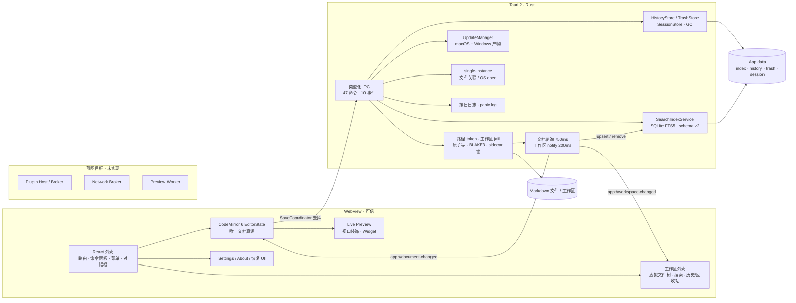
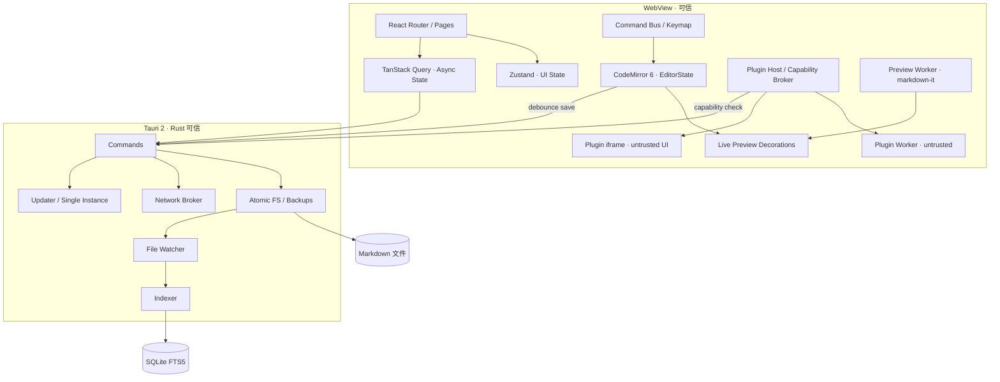
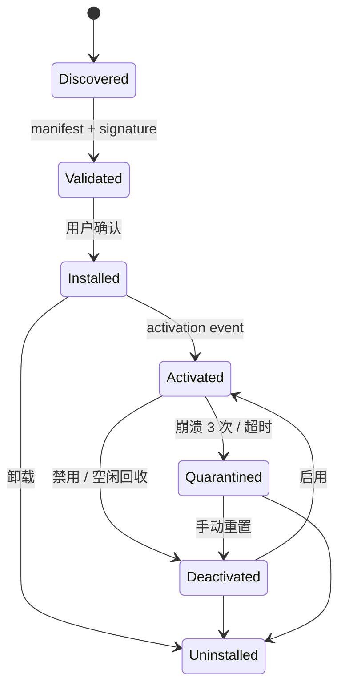
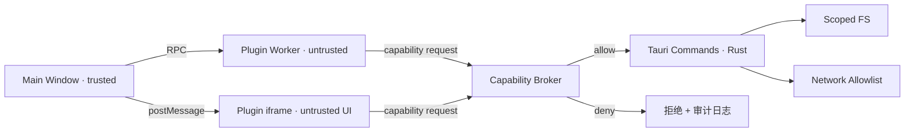

# Qingmo（轻墨）项目蓝图

| 项目 | 内容 |
|---|---|
| 版本 | 0.3 / Living |
| 日期 | 2026-11-13（初版 2026-10-26） |
| 状态 | 实施中：P1 已交付（v0.1.4），P2 工作区/数据安全/本地搜索已交付，P0/P1 收尾审查修复完成，插件系统未开始 |
| 代码基线 | `feat/p0-p1-closure`（v0.1.4，以分支 HEAD 为准）；审查修复记录见 `docs/todo/meeting-minutes/05-多轮评审记录.md`（目录已随功能删除） |
| 目标平台 | macOS / Windows / Linux（Tauri 2）；macOS 是唯一完整发布/更新链路 |
| 核心栈 | Tauri 2 + React 19 + Vite 7 + TypeScript 5.9 + TailwindCSS 4 + CodeMirror 6 |
| 配套文档 | [调研](RESEARCH.md) · [拓扑](TOPOLOGY.md) · [业务路线图](roadmap.md) · [功能审计](analysis/04-qingmo-feature-status.md) · [实施级 ADR](adr/README.md) |

> **维护规则：** 本文档同时描述“目标架构”和“当前实现”。§0.1 是唯一的进度快照；各章节中的“实施现状”必须与代码、测试和 ADR 一致。未实现的能力可以保留在设计章节，但必须显式标注，不得按现状引用。

---

## 0. 摘要

Qingmo 是一个**本地优先、源码为真、支持沙箱化插件**的 Markdown 编辑器。

三条不可妥协的产品指标：

1. **输入延迟**：p95 < 16ms，打字不粘手。
2. **大文件**：10MB Markdown 可正常编辑，不崩、不卡死。
3. **插件安全**：第三方插件默认无文件、无网络、无 Tauri 权限。

对应的架构结论：

- **Tauri 2 + Rust** 负责文件、索引、搜索、网络代理、更新等系统能力。
- **React** 只做界面，不承载文档状态；文档唯一事实来源是 **CodeMirror 6 `EditorState`**。
- **Live Preview** 用 CM6 的 `Decoration` 做视口级渲染，而不是把 Markdown 转成富文本再双向同步。
- **用户插件**运行在 **Web Worker（逻辑）+ sandbox iframe（UI）**，通过 **Capability Broker** 访问宿主能力；主线程不执行任何第三方代码。
- **Markdown 文件是唯一事实来源**，SQLite 只做可重建的索引与搜索；历史、回收站、会话是文件存储，插件状态尚未实现。

### 0.1 实施进度快照（2026-11-10）

> **基线：** `feat/p0-p1-closure`（以分支 HEAD 为准），应用版本 `0.1.4`；P0/P1 收尾与审查修复已通过 `pnpm ci:local`。本快照只记录有生产代码或测试证据的能力；设计稿、ADR、未合并分支和 `docs/todo` 中的计划不计入“已交付”。

**状态口径**

| 状态 | 含义 |
|---|---|
| **已交付** | 生产代码可用，关键路径有自动化测试 |
| **部分交付** | 有生产代码，但范围小于蓝图，或只在 macOS 验证 |
| **未开始** | 只有设计/ADR/路线图，没有生产代码 |

**按蓝图域对照**

| 蓝图域 | 状态 | 已落地 | 主要缺口 |
|---|---|---|---|
| 编辑内核与单文件闭环（§5、§7.3） | 已交付 | CM6 单一真源；打开/新建/保存/另存为/重载；原子写；BLAKE3 冲突检测；800ms 自动保存；关闭守卫；统一 16 MiB 打开/写入/索引/watcher 边界；UTF-8 / UTF-16（带 BOM）；LF/CRLF 保真；MDX/混合 EOL 只读；多窗口 token；图片粘贴/拖入落盘；崩溃草稿；视图状态恢复；版本历史恢复；持久 DocumentId；句柄身份复核；外部文件/目录 rename 配对 | 无分块/流式读写；跨重启全盘身份扫描（NEXT-003）；`openat2`/Windows 句柄级 root jail（NEXT-001） |
| Live Preview（§5.3–5.5） | 已交付（超出蓝图 v1） | 视口装饰；CommonMark/GFM；KaTeX；Mermaid；脚注；定义列表；`<details>`；Alerts；Emoji；Wiki Link；标题锚点；Front Matter/属性块；表格原位编辑；代码块内嵌编辑；本地图片；外链点击；大纲；Minimap；分级降级 | 独立 Preview/Split 面板；Preview Worker；Shiki；拼写检查 |
| React 外壳（§8） | 部分交付 | Hash Router；命令面板；原生菜单；状态栏；主题；设置窗口（语言 + 字号/字体）；About；日志；更新提示；恢复横幅/对话框；多窗口；运行时 i18n；工作区布局；虚拟文件树；搜索面板；历史/回收站对话框；单实例与文件关联打开 | 欢迎页；路由化工作区与深链接；文档标签页；标签/反链面板；用户快捷键覆盖；完整设置页；托盘 |
| 工作区与数据（§7.1–7.2、7.4–7.5） | 已交付（P2 核心） | 工作区根与懒加载文件树；工作区 watcher；SQLite/FTS5 双表索引；全局搜索；版本历史（50 版/30 天）；应用回收站（200 项/30 天）；会话/打开意图恢复（不含窗口几何）；统一 GC；路径锁；持久文档身份与 history/view ID 桶；identity 回滚工具 | `.qingmo/workspace.json`；标签/反链；跨工作区搜索；文档标签页 |
| 文件监听（§7.4） | 已交付 | 已打开文档 750ms 轮询 + BLAKE3；工作区级 `notify` 200ms 去抖；`app://workspace-changed`；`app://document-relocated`；文件/目录 rename 配对；索引 upsert/remove/rename fan-out | 事件仍以空载荷刷新为主，无 added/modified/removed 明细 |
| 插件系统（§6） | 未开始 | 无 `plugin-sdk` / `plugin-host` / Broker / 市场；Mermaid、Math 是内置能力，不是插件 | 全部 |
| 安全边界（§9.3） | 已交付（应用边界） | 路径 token；工作区路径 jail（段校验、符号链接/越界拒绝）；verified open/save/reload（句柄身份 + 父目录身份 + expected target）；trash trusted roots；Rust 原生 dialog；最小 capability；严格 CSP；`withGlobalTauri:false`；外链 scheme 白名单；asset scope 按文档目录授权；SQLite 仅 Rust 访问 | 插件能力代理；网络代理；完整 `openat2` 级句柄 root jail（NEXT-001）；Windows/Linux 运行时验证 |
| 更新与发布（§9.4、§12） | 部分交付 | macOS universal 签名/公证/stapling；minisign 更新产物；`requireSignedVersion`；Rust `UpdateManager`；安装前保存门闩；Windows NSIS 交叉编译 + 更新产物；单实例；本地发布脚本 | `qingmo://` 深链接；托盘；Windows Authenticode；Linux 打包；beta/灰度；自动回滚 |
| 性能与基准（§10–11） | 部分交付 | `bench/` 固定 fixtures；Node/jsdom + Rust 原子写基准；真实 Tauri 手动 AX/RSS 记录；Minimap/Outline 性能用例；10k/100k 搜索基准；真实 Tauri E2E | CI 性能门禁；真实键盘端到端 p95；1 MiB 打开 <100ms 未达标 |
| 测试与 CI（§11） | 已交付（自动化） | Vitest 100 文件 / 882 用例；Playwright 24 spec / 160 passed + 4 skipped；Rust 430 项（lib 192 + 集成/示例）；真实 Tauri WDIO 7 项；`ci:web` / `ci:rust` / `ci:generated` / `ci:negative` / `ci:tauri` / E2E；提交后 `pnpm ci:local` 全绿（含 `ci:generated`）；四 job CI（Windows 定向测试、Linux `--all-targets`） | axe 可访问性审计；模糊测试；插件契约测试；VoiceOver 14 项手测（B-003）；Windows/Linux 真实 E2E；Windows/Linux CI run URL 待外部环境（B-002） |
| 平台（§12） | 部分交付 | macOS 完整发布/更新链路；2026-11-10 universal DMG 已签名、公证并校验；Windows 编译 + NSIS 安装包 + 更新产物；Linux 仅编译/Web 契约 | Windows 运行时手测；Linux 桌面打包与验证；VoiceOver 手测（B-003） |

**与蓝图的关键偏差**

1. **IPC 类型不用 Zod**：改用 `ts-rs` 生成 DTO + 手写 TS 镜像 + 契约测试；Rust `serde` 是边界权威（ADR-0003）。
2. **没有 Zustand / TanStack Query**：当前是 `UiStore` + React Context + 端口适配器；工作区树/搜索直接走 `IpcPort`，未引入异步资源缓存层。
3. **没有 Preview Worker / markdown-it / sanitize-html / Shiki**：预览由 CM6 装饰直接完成；Mermaid 在独立 sandbox iframe 中渲染后消毒；代码高亮用 CM6 语言包。
4. **SQLite 只做可重建索引**：不是正文或恢复记录的主存储。索引 schema v2 使用 trigram 主表 + unicode61 short 表；查询按表取 rowid 集合后在 Rust 求交，避免跨 FTS 表 JOIN 的 rank 退化（10k 实测曾退化到 31s）。历史、回收站、会话仍是 app data 下的文件（ADR-0008/0009）。
5. **工作区 watcher 已存在**：`notify-debouncer-full` 按工作区注册，200ms 去抖；`app://workspace-changed` 仍以空载荷刷新为主；索引在同一批事件里 upsert/remove/rename。文件与目录 rename 已按 FileIdentity 配对并触发 `document-relocated`，单边事件回退 rescan。
6. **没有插件包**：`packages/plugin-sdk`、`packages/plugin-host`、`plugins/` 均不存在；P3 才引入。
7. **设置不是统一设置文件**：主题、语言、字体分别持久化在 `localStorage` 的 `qingmo.ui.*` 键；没有 `settings.json` 或 SQLite 设置表。
8. **工作区没有可移植配置文件**：当前没有 `.qingmo/workspace.json`；工作区归属是每个窗口的运行时状态，不写入工作区目录。
9. **搜索有明确取舍**：2 字 CJK 用 short 表 bigram；命中 >2000 不计算 bm25，按 mtime 倒序；每次查询 500ms 超时并映射 `SEARCH_TIMEOUT`；100k 首次索引可能需要两轮扫描。
10. **16 MiB 是统一边界**：打开/保存/索引/watcher 使用同一 `MAX_DOCUMENT_BYTES`；10 MiB + 1 字符保存后可以重开，超过 16 MiB 明确拒绝。仍全量进入 CM6/IPC，无分块/流式读写（NEXT-006）。
11. **真实 Tauri E2E 使用独立 identifier**：`com.wavexzore.qingmo.e2e` 并禁用 single-instance，避免测试版吞掉正式 app；单 worker 顺序执行。原生“另存为”对话框与原生 Cmd+Q 取消弹窗无法由 embedded WebDriver 合成，分别由集成/Playwright/状态机测试覆盖。
12. **更新范围已扩大**：发布链路同时产出 macOS 和 Windows 更新产物；仍无 Linux 打包、beta 通道或自动回滚。
13. **`docs/` 默认不随仓库发布**：`.gitignore` 忽略 `docs/`，只有少数 ADR/专题文档被强制跟踪；蓝图是本地设计文档。

### 0.1.1 剩余待办（2026-11-10）

**立即收口（发布前）**

| 项 | 当前状态 | 下一步 |
|---|---|---|
| B-002 Windows/Linux CI run URL | 工作流已配置；本机只有 macOS | push/PR 后记录 `windows` / `contract` job URL |
| B-003 VoiceOver 14 项 | 自动化 ARIA/键盘/10k 证据已有；无人工记录 | 按 `02 §10` 清单执行并回填 PASS/FAIL/N/A |
| v0.1.4 DMG 发布 | 2026-11-10 universal DMG 已签名、公证、校验；未上传 | 评审后 `gh release create/upload`；不覆盖已有 `v0.1.4` 产物 |

**后续路线图**

| 域 | 待办 | 说明 |
|---|---|---|
| P2 产品化 | 标签/反链、文档标签页、`.qingmo/workspace.json` | 稳定 DocumentId 已交付，不再是剩余项 |
| P3 插件 | Plugin SDK、Worker host、iframe UI、权限、Broker、首批插件 | 权限/路径 jail/网络代理/签名链路就绪前不启动 |
| P4 市场与安全 | 深链接、托盘、插件市场、权限管理、审计日志、beta/灰度、自动回滚 | macOS 签名/公证/更新链路已交付 |
| P5 Beta 硬化 | axe 可访问性、三平台冒烟、CI 性能门禁、10 MiB 边界 CI、模糊测试、插件契约测试 | 真实 Tauri E2E 已覆盖 7 项 |
| 性能 | 1 MiB 打开 <100ms 未达标；真实键盘端到端 p95；16 MiB 全量跨 IPC | NEXT-006 路径 + 分块 + 流式 |
| 安全 | NEXT-001 句柄级 root jail、NEXT-003 跨重启身份扫描、NEXT-011 app data 进程锁、NEXT-012 compare-and-rename、NEXT-013 symlink 自动修复 | 按风险优先级排期 |
| 平台 | Windows 运行时手测、Windows Authenticode、Linux AppImage/deb/rpm | Windows 已有 NSIS + 更新产物 |

### 0.2 当前实现架构（v0.1.4）

> 下图只画当前生产代码；`FUTURE` 区域是蓝图目标但尚未实现的组件。



当前已存在 SQLite FTS5、工作区 watcher、文件树与全局搜索；`FUTURE` 只剩 Plugin Host / Capability Broker、Network Broker 与 Preview Worker。历史/回收站是 app data 下的文件存储，不是 SQLite 表（ADR-0008）；SQLite 只保存可重建索引（ADR-0009）。

---

## 1. 产品定义

### 1.1 愿景

> 像纸一样安静，像代码编辑器一样快。

Qingmo 面向长期写作与知识管理：打开即写、随时可带走、插件可扩展，但不牺牲性能与安全。

### 1.2 目标用户

| 用户 | 核心诉求 | 对应设计 |
|---|---|---|
| 开发者 / 技术写作者 | 快、键盘操作、代码块、Git 友好 | CM6、命令面板、源码模式、纯文本文件 |
| 长文作者 / 研究者 | 排版好看、专注、引用、导出 | Live Preview、主题、Typography、Pandoc 插件 |
| 知识管理者 | 双链、标签、搜索、本地数据 | Wiki Link、SQLite FTS、Backlinks |
| 插件作者 | API 稳定、调试方便、能发布 | Plugin SDK、dev mode、市场、签名 |

### 1.3 体验原则

1. **Local-first**：断网可用，文件可被任何编辑器打开。
2. **Source of truth**：Markdown 源码是真身，预览只是视图。
3. **Keyboard-first**：所有高频操作都有快捷键，命令面板可发现。
4. **Progressive disclosure**：默认干净，复杂功能按需出现。
5. **No spinners**：本地操作不应出现加载转圈；重活放后台。
6. **可逆**：自动保存、版本备份、崩溃恢复，默认不丢字。

### 1.4 非目标（v1）

- 实时多人协作（数据模型预留，不在 v1 实现）。
- 移动端（Tauri 2 支持移动，但 v1 不做）。
- 与 Typora 100% 一致的 WYSIWYG。
- 运行时加载原生 Rust 插件。
- 通用 AI 助手（通用对话/续写以插件形式后置）。
- 自带云同步服务（只提供可选适配器接口）。

---

## 2. 研究结论

完整证据与引用见 [RESEARCH.md](RESEARCH.md)。这里只保留对架构有约束力的结论。

### 2.1 开源项目给我们的 8 条经验

| 来源 | 经验 |
|---|---|
| MarkEdit | 原生外壳 + CodeMirror 6 可以做到 4MB 安装包、10MB 文件流畅；大文档不做全量语法树 |
| Milkdown | `Ctx` + `Slice` + `Timer` 适合内部扩展的依赖注入与生命周期协调 |
| Tiptap | 贡献点必须分类、可排序、每个扩展有独立 storage |
| Yank Note | Markdown 编辑器需要 markdown-it 插件、命令、状态栏、设置等完整贡献点 |
| Logseq | 运行时插件最低基线：iframe sandbox + 白名单 API + 插件私有存储目录 |
| SiYuan | 权限要按数据字段/目录粒度授权，卸载即撤销 |
| NoteGen / MarkFlowy | Tauri 侧承担 IO、SQLite、搜索、重任务；前端只做 UI |
| Mark Text | Electron 能做出漂亮界面，但资源占用是长期代价 |

### 2.2 论文给我们的 5 条约束

| 主题 | 结论 | 约束 |
|---|---|---|
| Local-first（Kleppmann 2019） | 本地副本是主副本，协作是可选增强 | 文件为源，云同步后置 |
| OT vs CRDT（Sun 2020） | CRDT 并非天然可交换，存在隐藏复杂度 | v1 不自研协作算法 |
| Eg-walker（2024） | 比 CRDT 省内存、加载快，合并长分支远快于 OT | 未来协作优先评估成熟算法/库 |
| 增量解析（Wagner & Graham 1998） | 增量解析可复用未受影响的语法树 | 采用 Lezer，大文件只解析视口 |
| Wasm 沙箱（WaVe 2023） | 宿主与 WASI 边界才是安全关键 | 插件隔离不能只靠“跑在 Wasm 里” |

### 2.3 设计约束清单

1. 文档不进 React state。
2. 用户插件不进主线程。
3. 插件不得直接 `invoke` Tauri。
4. 插件默认零权限，敏感能力逐项授权。
5. 插件懒激活，启动时不加载全部插件。
6. 插件崩溃可隔离、可禁用、可安全模式启动。
7. 自动保存必须原子写 + 可恢复。
8. 大文件自动降级，保证“还能编辑”。
9. 所有跨边界数据用 serde / 生成类型校验；Zod 只在未来插件边界评估。
10. 先建立基准，再谈优化。

---

## 3. 总体架构

> 完整拓扑图见 [TOPOLOGY.md](TOPOLOGY.md)（含 `.drawio` / `.svg` / `.png`）。

### 3.1 目标系统分层（长期架构）

> 下图是**目标架构**，不是当前实现。当前实现见 §0.2；未实现组件已在 §0.1 标注。



### 3.2 分层职责

| 层 | 负责 | 不负责 | 当前状态 |
|---|---|---|---|
| React UI | 布局、主题、设置、命令面板、对话框、工作区侧栏 | 文档内容、逐键状态 | 已交付（工作区外壳） |
| Editor Core | 文档状态、事务、撤销、装饰、选区 | 业务数据、网络 | 已交付 |
| App State | UI 状态、工作区元数据、查询缓存 | 文档正文 | 部分：`UiStore` + Context + `IpcPort`；无 Query |
| Plugin Host | 插件发现、激活、RPC、权限、隔离 | 业务逻辑 | 未开始 |
| Rust Core | 文件、索引、搜索、网络、更新、系统集成 | 界面渲染 | 部分：文件/工作区/索引/搜索/更新/日志/会话；无网络代理 |
| Data | Markdown 文件、SQLite 索引、配置 | 作为文档主存储 | 部分：Markdown 文件 + SQLite 可重建索引 + 历史/回收站/会话文件；无可移植工作区配置 |

### 3.3 关键架构决策（ADR）

#### ADR-001：编辑器内核选 CodeMirror 6，不选 ProseMirror/Milkdown 作为主内核

| 方案 | 优点 | 缺点 | 结论 |
|---|---|---|---|
| CodeMirror 6 | 视口渲染、Lezer 增量解析、源码保真、包体小、10MB 级验证 | Live Preview 需自己实现装饰 | **采用** |
| ProseMirror / Milkdown | WYSIWYG 成熟、富文本 schema 强 | Markdown 往返有损；大文档压力大；双状态源 | 仅作为未来可选“富文本模式”插件 |
| textarea | 最简单 | 无语法高亮、无装饰、无大文件能力 | 否 |
| 原生 NSTextView | macOS 性能最好 | 仅 macOS，跨平台成本高 | 否（macOS 可做可选后端） |

**理由**：Qingmo 的核心是 Markdown 源码与长期可维护性。CM6 的 `EditorState` 可以直接作为唯一事实来源，Live Preview 只是 decoration，不需要第二套文档模型。

#### ADR-002：文件为源，SQLite 只做索引

- Markdown 文件可被 Git、其他编辑器、脚本直接使用。
- SQLite 存工作区键、文档元数据与全文索引；当前只覆盖 `workspaces` / `documents` / `documents_fts` / `documents_fts_short`，索引可随时删除重建（ADR-0009）。
- 历史、回收站、会话与草稿是 app data 下的文件存储（ADR-0008），不是 SQLite 表。
- 绝不把正文只存数据库；数据库损坏可重建。

#### ADR-003：用户插件采用 Worker + iframe 混合隔离

- 主线程零第三方代码。
- 逻辑、解析、网络请求在 Worker。
- 需要 DOM 的 UI 在 sandbox iframe。
- 所有能力经 Capability Broker，不直接暴露 Tauri IPC。

#### ADR-004：Tauri 原生插件只用于可信系统集成

- Tauri 的 Rust 插件是编译期依赖，适合 fs / updater / sql / global shortcut 等。
- 用户插件是运行期 JS/WASM，不能编译进二进制。
- 两者在文档与权限模型中明确区分，避免概念混淆。

#### ADR-005：React 不参与逐键渲染

- 编辑器实例用 `ref` 持有，只创建一次。
- 光标、选区、字数等派生 UI 通过 `useSyncExternalStore` + 节流订阅。
- 任何 `onChange` 都不触发整页 `setState`。

#### ADR-006：预览在 Worker 中生成并消毒（目标；当前未采用）

> 当前实现是 CM6 装饰 + 独立 Mermaid sandbox iframe；Preview Worker 尚未实现。以下为 P3/P4 目标。

- markdown-it 在 Preview Worker 中执行。
- `sanitize-html` 在 Worker 内完成，主线程只接收安全 HTML。
- 自定义 fence 渲染器同样在插件 Worker 中执行，输出必须消毒。

#### ADR-007：pnpm workspace + 共享 Zod schema（已被 ADR-0003 部分修订）

- `app`、`editor-core`、`plugin-sdk`、`plugin-host`、`shared`、`ui` 分包（当前只建 `app`、`editor-core`、`shared`、`ui`）。
- `plugin-sdk` 不依赖 React/Tauri，保证可独立发布（P3）。
- `shared` 只放 schema、类型、纯函数；**当前用 `ts-rs` 生成 DTO，未引入 Zod**。

---

## 4. 技术栈与工程结构

### 4.1 技术栈分工（目标与现状）

**当前实际依赖（v0.1.4）**

| 领域 | 已采用 | 未采用/规划 |
|---|---|---|
| 桌面外壳 | Tauri 2.12、`tauri-plugin-dialog`、`tauri-plugin-opener`、`tauri-plugin-updater`、`tauri-plugin-single-instance` | tray、`qingmo://` deep-link |
| 前端 | React 19.3、React Router 7.18、i18next 26.5 + react-i18next 17.1、TailwindCSS 4.3、Vite 7.3、TypeScript 5.9 | Zustand、TanStack Query、Zod、Lucide |
| 编辑与渲染 | CodeMirror 6（state 6.7 / view 6.43）、Lezer Markdown、KaTeX、Mermaid 12 | markdown-it、sanitize-html、Shiki、Preview Worker |
| Rust | `atomic-write-file`、`blake3`、`encoding_rs`、`serde`、`ts-rs`、`tokio`、`tracing`、`uuid`、`rusqlite`（bundled + FTS5）、`notify-debouncer-full` | `rayon`、`criterion`、Tantivy |
| 测试与质量 | Vitest 5、Testing Library、Playwright 1.64、WebdriverIO + `tauri-plugin-wdio`、`cargo test`/clippy/rustfmt、dependency-cruiser、ESLint 9、Prettier 3 | axe-core、fast-check、tinybench |

> 下表保留为**目标技术栈**，用于说明长期分工；不要把“未采用/规划”列写进现状描述。

| 技术 | 角色 | 使用约束 |
|---|---|---|
| **Vite** | 构建、HMR、Worker 打包 | `?worker` 引入 Worker；`manualChunks` 拆 editor/preview/plugins |
| **React** | UI 渲染 | 不承载文档；路由级懒加载 |
| **TypeScript** | 全链路类型 | `strict: true`；IPC 类型由 Rust 生成 |
| **TailwindCSS** | 样式与设计 token | 用 CSS 变量 + `@theme`；禁止运行时拼接类名 |
| **React Router DOM** | 页面路由 | Tauri 下用 `createHashRouter`，避免 custom protocol 刷新 404 |
| **Zustand** | UI/应用状态 | 按 slice 拆分；不存文档正文 |
| **TanStack Query** | 异步资源状态 | 文件树、搜索、插件市场、Git 状态；fs 事件驱动失效 |
| **i18next + react-i18next** | 国际化 | 静态打包资源 + 运行时切换；默认 `zh-CN`，不引入语言探测/第二存储 |
| **Zod** | 边界校验 | IPC、插件 manifest、设置、文件 frontmatter |
| **Lucide React** | 图标 | 按需导入；插件图标走名称白名单 |
| **Tauri 2** | 桌面外壳 | 最小 capabilities；严格 CSP；关闭 `withGlobalTauri` |
| **CodeMirror 6** | 编辑内核 | 唯一文档状态；Compartment 动态配置 |
| **markdown-it** | 预览渲染 | 在 Worker 中运行；插件化 renderer |
| **sanitize-html** | HTML 消毒 | Worker 内执行；白名单标签/属性 |
| **KaTeX** | 数学公式 | 编辑器内小公式同步渲染；预览在 Worker |
| **Shiki** | 代码高亮 | 懒加载语言与主题；Preview Worker |
| **SQLite (rusqlite)** | 索引/搜索 | FTS5；只存元数据，不存正文唯一副本 |
| **notify** | 文件监听 | Rust 侧去抖、批量事件 |
| **blake3** | 内容哈希 | 冲突检测、索引去重 |
| **tokio / rayon** | 异步/并行 | IO 与索引分离；避免阻塞 UI |
| **tracing** | 日志 | 结构化日志；插件日志分通道 |
| **tauri-specta**（建议） | IPC 类型生成 | Rust command → TS 类型，减少手写漂移 |

> 实际采用 `ts-rs` + 手写 TS 镜像 + 契约测试；`tauri-specta` 在 P1 时仍是 RC，未采用（ADR-0003）。

### 4.2 Monorepo 结构

```text
Qingmo/
├─ apps/
│  └─ desktop/
│     ├─ src/
│     │  ├─ app/                 # bootstrap, providers, router, close guard, locale/theme/typography
│     │  ├─ about/               # About 窗口入口
│     │  ├─ settings/            # Settings 窗口（语言 + 字号/字体）
│     │  ├─ features/
│     │  │  ├─ editor/           # 会话、保存、恢复、大纲、Live Preview 菜单
│     │  │  ├─ workspace/        # open/new、菜单分发、窗口布局
│     │  │  ├─ commands/         # registry、palette、keybindings
│     │  │  ├─ update/           # 更新 UI / 控制器
│     │  │  └─ logs/             # 日志对话框
│     │  ├─ components/          # StatusBar、Toast、ErrorBoundary
│     │  ├─ lib/                 # ipc/platform/settings/update/log/about 端口与 Tauri 适配器
│     │  ├─ i18n/                # i18next 资源、原生菜单与编辑器投影
│     │  ├─ stores/              # UiStore（主题/语言/字体）
│     │  └─ styles.css
│     ├─ index.html
│     ├─ about.html
│     ├─ settings.html
│     ├─ mermaid-renderer.html
│     └─ vite.config.ts
├─ packages/
│  ├─ editor-core/               # CM6 组合、Live Preview、大纲、Minimap、排版
│  ├─ shared/                    # ts-rs 生成 DTO、文档键、字体模型、Result
│  └─ ui/                        # Button、cx、设计 token
├─ src-tauri/
│  ├─ src/
│  │  ├─ commands/               # document/close/session/settings/update/logs/about/locale/view/external
│  │  ├─ services/               # atomic_writer/encoding/file_service/logging/session_store
│  │  ├─ state/                  # registry/window_sessions/close_guard/watcher/update_manager/locale
│  │  ├─ ipc/                    # contract.rs + dto.rs
│  │  ├─ error.rs
│  │  └─ lib.rs
│  ├─ capabilities/              # default/about/settings/recovery
│  └─ tauri.conf.json
├─ e2e/                          # Playwright spec + fixtures
├─ bench/                        # fixtures、基准、结果
├─ scripts/                      # CI 与发布脚本
├─ docs/                         # 本地设计文档（.gitignore，默认不随仓库发布）
└─ package.json
```

### 4.3 依赖边界

```text
apps/desktop → editor-core, shared, ui
editor-core  → shared（不得依赖 React / Tauri）
ui           → shared
shared       → 无 React / Tauri 依赖
（plugin-sdk / plugin-host 尚未创建；P3 引入后再补边界）
```

`dependency-cruiser.config.cjs` 当前强制：

- 无循环依赖；
- `@tauri-apps/*` 只能出现在 `apps/desktop/src/lib/*/tauri.ts`；
- `packages/*` 不得依赖 Tauri。

ESLint 另做基础规则；P3 增加插件包后，再补 `plugin-sdk`/`plugin-host` 的独立边界。

---

## 5. 编辑器内核

### 5.1 CodeMirror 6 组合

**实施现状（v0.1.4）：** 实际工厂是 `createEditorState`（`packages/editor-core/src/createEditor.ts`），不是早期草案的 `createEditorExtensions`。主题、排版、只读、模式、placeholder、UI 文案、图片解析器都通过 `Compartment` 注入。

```ts
// packages/editor-core/src/createEditor.ts（节选）
export function createEditorState({
  doc, selection, readOnly = false, typography, extraExtensions = [],
  placeholder, uiCopy, imageSrcResolver: resolver, previewEnabled,
}: CreateEditorStateOptions): EditorState {
  const normalized = normalizeLineEndings(doc);
  const previewOn = previewEnabled ?? previewTierFor(normalized.length) !== "source";
  const initialSelection = selection
    ? {
        anchor: Math.min(normalized.length, Math.max(0, Math.trunc(selection.anchor))),
        head: Math.min(normalized.length, Math.max(0, Math.trunc(selection.head))),
      }
    : undefined;

  return EditorState.create({
    doc: normalized,
    ...(initialSelection ? { selection: initialSelection } : {}),
    extensions: [
      ...basicExtensions,
      ...markdownExtensions,
      headingOutline,
      outlineParseDriver,
      codeBlockSelectAll,
      themeCompartment.of(qingmoEditorTheme),
      typographyCompartment.of(typographyExtension(typography)),
      readOnlyCompartment.of(readOnlyExtensions(readOnly)),
      modeCompartment.of(previewOn ? livePreview() : []),
      placeholderCompartment.of(placeholder ? cmPlaceholder(placeholder) : []),
      uiCopyCompartment.of(editorUiCopy.of(uiCopy)),
      imageSrcCompartment.of(resolver ? imageSrcResolver.of(resolver) : []),
      ...extraExtensions,
    ],
  });
}
```

### 5.2 文档状态

- `EditorState` 持有文档、选区、配置、扩展状态。
- 所有修改通过 `view.dispatch(transaction)`。
- undo/redo 用 `history()`；保存点用 `history` 的 `isolateHistory` 或自定义 `savePoint`。
- React 只订阅必要派生值：

```ts
// 只订阅光标/选区/脏状态，不订阅全文
const cursor = useEditorSelector((state) => state.selection.main.head);
```

- 禁止：`onChange={(v) => setContent(v)}`。
- 禁止：把全文放进 Zustand persist。
- 允许：把 `docId`、`dirty`、`mode`、`cursor` 存入会话状态，用于恢复。

### 5.3 Live Preview 装饰系统

目标：接近 Typora / Obsidian Live Preview 的观感，但保持源码为真。

**实施现状（v0.1.4）：已交付。** 除下列策略外，已覆盖 KaTeX、Mermaid、脚注、定义列表、`<details>`、Alerts、Emoji、Wiki Link、标题锚点、Front Matter/属性块、表格原位编辑、代码块内嵌编辑、本地图片和外链点击；Minimap 与大纲也消费同一份 `EditorState`。尚未实现独立 Preview/Split 和 Preview Worker。

**渲染策略**

1. 只处理 `view.visibleRanges`（视口 + 边缘）。
2. 用 `syntaxTree(state).iterate({ from, to })` 获取节点。
3. 用 `RangeSetBuilder` 构建 `DecorationSet`。
4. 语法标记（`**`、`#`、`[]()`）在光标不在该行时隐藏，光标进入时显示。
5. Widget：图片、行内公式、Mermaid、表格、Callout、Frontmatter。
6. `EditorView.atomicRanges` 让光标跳过 Widget。
7. `WidgetType.eq()` 必须实现，避免重复创建 DOM。
8. 文档变化、视口变化、选区跨行变化、语法树更新时重算；用 `requestAnimationFrame` 合并。

**性能红线**

- 不对全文构建 decoration。
- 不在每次按键时同步解析全文。
- 大文件降级：超过 200k UTF-16 单元关闭块级 Widget；超过 2M 单元完全关闭 Live Preview（见 §5.5）。
- 装饰缓存按「文档版本 + 视口 + 光标行」失效。

**插件扩展方式**

- v1：插件不能直接写 CM6 装饰代码；只能注册**声明式规则**或内置 Widget 类型。
- v2：开放受限 DSL（正则/AST 选择器 → CSS 类/内置 Widget），仍不在主线程执行任意 JS。
- 只有第一方、随包编译的扩展可以直接写 CM6 `ViewPlugin`。

### 5.4 Markdown 解析与预览

**实施现状（v0.1.4）：** 当前没有 Preview Worker、markdown-it、sanitize-html 或 Shiki。预览就是 CM6 装饰；数学用 KaTeX，Mermaid 在独立 sandbox iframe（`mermaid-renderer.html`）中渲染后消毒；代码高亮使用 CM6/Lezer 的语言包。

| 场景 | 当前实现 | 运行位置 | 蓝图目标 |
|---|---|---|---|
| 编辑器语法高亮 / 装饰 | Lezer Markdown + CM6 | 主线程 | 同左 |
| 行内/块级公式 | KaTeX | 主线程 | Worker / 主线程小公式 |
| Mermaid | sandbox iframe renderer + SVG 消毒 | sandbox iframe | sandbox iframe |
| 代码高亮 | CM6 语言包 | 主线程 | Shiki / Preview Worker |
| 预览 HTML | 无独立预览；Live Preview 装饰 | 主线程 | markdown-it + sanitize-html in Worker |
| 自定义 fence | 内置 Mermaid/代码块；无插件 renderer | 主线程 | 插件 Worker |

**当前安全管线**

```text
Markdown → CM6/Lezer 装饰 → DOM（KaTeX/Mermaid 输出经消毒/白名单）
```

**目标安全管线（P3/P4）**

```text
Markdown → markdown-it (+ plugins) → HTML → sanitize-html → postMessage → 主线程插入
```

- 禁止直接 `dangerouslySetInnerHTML` 未消毒内容。
- 允许的标签/属性用白名单；链接强制 `rel="noopener noreferrer"`。
- 外链点击走 Rust `app_open_external`（`tauri-plugin-opener`），不在 WebView 内导航。
- 图片只允许 `asset:` / `http(s):` / `data:image/*` / `blob:`，禁止 `javascript:`。

### 5.5 大文件策略

**实施现状（v0.1.4）：** 已按 UTF-16 单元分级落地；Rust 的字节上限统一为 16 MiB（打开/写入/索引/watcher 共用 `MAX_DOCUMENT_BYTES`），与预览分档相互独立。

| 文档规模（UTF-16 单元） | 策略 |
|---|---|
| ≤ 200,000 | **full**：行内 + 块级 Widget、完整 Live Preview、大纲 |
| 200,001 – 2,000,000 | **partial**：仅行内装饰；代码块、表格、图片、Mermaid 等块级组件回退源码；Minimap 仍可用（≤100k 行 / ≤2M 单元） |
| > 2,000,000 | **source**：关闭 Live Preview；源码 + 语法高亮；状态栏提示 |
| 文件字节 > 16 MiB | Rust 拒绝**打开**；保存上限同为 16 MiB；不是预览分档 |

实现要点：

- 常量：`PREVIEW_FULL_MAX_UNITS=200_000`、`PREVIEW_PARTIAL_MAX_UNITS=2_000_000`、`SYNTAX_TREE_BUDGET_MS=8`。
- `syntaxTree` 只在需要时 `ensureSyntaxTree`；超过阈值不请求全量。
- 当前没有独立预览面板；因此“预览默认关闭”只对 Live Preview 生效。
- 大纲在 200k 单元内扫描；Minimap 限制 100k 行。
- 保存当前是整篇文本原子写，未做分块/流式；打开/写入上限同为 16 MiB。
- 10 MiB + 1 字符保存后可以重新打开；精确 16 MiB 可打开，16 MiB + 1 字符明确拒绝并返回 `FILE_TOO_LARGE`。
- 真实 Tauri 基准（release，16 MiB）：open 615.0ms、save 205.2ms、RSS 352.5MB（3 次中位数）；debug build 的 open 上界为 1954.9ms、RSS 403.9MB。
- 打开文件时 Rust 读取整篇并校验；未实现“只读首屏 + 元数据”。

### 5.6 模式

| 模式 | 状态 | 实现 |
|---|---|---|
| Source | 已交付 | CM6 + 语法高亮 |
| Live Preview | 已交付 | `livePreview` 扩展 |
| Preview | 未实现 | 计划独立 Worker 渲染 |
| Split | 未实现 | 计划布局层 |

Source / Live Preview 切换用 `Compartment.reconfigure()`，不重建 `EditorView`，保留撤销历史与选区。

### 5.7 IME 与可访问性

- 不拦截 `compositionstart/update/end`；CM6 自带 IME 处理。
- 中文/日文输入法下不做逐键装饰重算，等 composition 结束。
- 键盘导航完整；焦点可见；`aria-label`；高对比主题。
- 支持 `prefers-reduced-motion`；动画不超过 200ms。

**实施现状（v0.1.4）：** 基础键盘/焦点/IME 已可用；尚未做 axe 审计、高对比主题和 RTL 验收。

---

## 6. 插件系统（核心设计）

> **实施现状（v0.1.4）：未开始。** 仓库没有 `packages/plugin-sdk`、`packages/plugin-host`、Worker/iframe 宿主、Capability Broker、签名安装或市场。Mermaid 与 Math 是内置编辑器能力，不属于插件。以下内容仍是 P3 设计目标，不得按现状引用。

### 6.1 两类插件，必须区分

| 类型 | 语言 | 安装方式 | 信任级别 | 用途 |
|---|---|---|---|---|
| **Native Plugin** | Rust | 编译期，随应用发布 | 完全可信 | fs、updater、sql、快捷键、系统集成 |
| **User Plugin** | JS/TS（未来 WASM） | 运行期安装 | 不可信 | 主题、命令、渲染器、导出、工作流 |

> Tauri 的插件系统属于前者，不是用户插件市场。Qingmo 的用户插件必须自己实现宿主。

**与现有项目的隔离模型对比**

| 项目 | 插件运行位置 | 隔离强度 | 权限模型 | 评价 |
|---|---|---|---|---|
| Milkdown / Tiptap | 主线程，构建期 | 无 | 构建者完全信任 | 适合框架扩展，不适合用户插件 |
| Yank Note | 主线程，同 JS 上下文 | 低 | 可访问整个应用 | 灵活但一旦插件作恶无法阻止 |
| Logseq | 默认 sandbox iframe | 中高 | 白名单 API + 插件私有存储 | 目前最接近可用的用户插件模型 |
| **Qingmo** | **Worker（逻辑）+ iframe（UI）** | **高** | **Capability Broker + 逐项授权** | 复杂，但能同时保证性能与安全 |

### 6.2 插件生命周期



状态持久化在 SQLite `plugins` 表；启动时只加载 `Installed` 且满足激活条件的插件。

**激活事件**

- `onStartup`（慎用，只给主题/核心增强）
- `onCommand:<id>`
- `onLanguage:markdown`
- `onFileOpen:<glob>`
- `onView:<id>`
- `onFence:<language>`
- `onSettings`

### 6.3 Manifest

```json
{
  "id": "com.qingmo.mermaid",
  "name": { "en": "Mermaid Diagrams", "zh-CN": "Mermaid 图表" },
  "version": "1.0.0",
  "apiVersion": 1,
  "engines": { "qingmo": ">=1.0.0 <2.0.0" },
  "main": "dist/worker.js",
  "ui": "dist/ui.html",
  "permissions": ["preview:render", "clipboard:write"],
  "activationEvents": ["onCommand:mermaid.insert", "onFence:mermaid"],
  "contributes": {
    "commands": [
      { "id": "mermaid.insert", "title": "Insert Mermaid diagram", "category": "Diagram" }
    ],
    "fenceRenderers": [
      { "language": "mermaid", "entry": "dist/render.js" }
    ],
    "markdownItPlugins": ["dist/markdown-it.js"],
    "settings": "settings.schema.json",
    "themes": ["themes/light.json", "themes/dark.json"],
    "locales": ["locales/en.json", "locales/zh-CN.json"]
  }
}
```

**Zod 校验要点**

- `id`：反向域名，`^[a-z0-9]+(\.[a-z0-9-]+)+$`。
- `version` / `engines`：semver。
- `main` / `ui` / 资源路径：禁止 `..`、绝对路径、符号链接逃逸。
- 权限：枚举白名单，未知权限直接拒绝。
- 贡献点：按 `apiVersion` 校验字段，未知字段警告但不崩溃。

### 6.4 贡献点

| 贡献点 | v1 | v2 | 说明 |
|---|---|---|---|
| `commands` | ✅ | ✅ | 命令面板、快捷键、菜单 |
| `keybindings` | ✅ | ✅ | 冲突检测，用户可覆盖 |
| `menus` | ✅ | ✅ | 主菜单/上下文菜单声明式插入 |
| `statusBar` | ✅ | ✅ | 文本/图标/点击命令 |
| `settings` | ✅ | ✅ | JSON Schema 生成设置界面 |
| `themes` | ✅ | ✅ | 只允许 CSS 变量，不接受全局 CSS |
| `locales` | ✅ | ✅ | 插件语言包 |
| `markdownItPlugins` | ✅ | ✅ | 在 Preview Worker 中执行 |
| `fenceRenderers` | ✅ | ✅ | 自定义代码块渲染 |
| `exporters` | ✅ | ✅ | 导出 PDF/HTML/DOCX（外部工具） |
| `fileHandlers` | ⏳ | ✅ | 打开/保存特定扩展名 |
| `editorDecorations` | ❌ | ✅ | 声明式 DSL，非任意 JS |
| `sidebarViews` | ❌ | ✅ | sandbox iframe |
| `hoverProviders` | ❌ | ✅ | 节流 RPC |
| `aiTools` | ❌ | ✅ | 通过统一 AI 代理 |

**v1 明确不做**：插件直接注入 React 组件、全局 CSS、CM6 扩展对象、任意 `invoke`。

### 6.5 运行时隔离

| 方案 | DOM 访问 | 性能 | 安全 | 适用 |
|---|---|---|---|---|
| 主线程同上下文 | 完全 | 最高 | 最低 | 仅第一方 |
| Web Worker | 无 | 高 | 中 | 逻辑、解析、网络 |
| sandbox iframe | 有（自己的） | 中 | 高 | 插件 UI |
| WASM + WASI | 无 | 高 | 最高 | 不可信重计算（v2+） |

**Qingmo 选择：Worker + iframe 混合。**



- **Worker**：没有 DOM，没有 `window.__TAURI_INTERNALS__`，无法直接调用 Tauri。
- **iframe**：`sandbox="allow-scripts"`，不加 `allow-same-origin`，得到 opaque origin；无法读父页面 DOM/Cookie。
- **Broker**：主线程唯一入口，做权限检查、路径规范化、速率限制、审计。
- **资源**：插件资源通过自定义协议 `plugin://<id>/...` 提供，scope 限定在插件目录。

### 6.6 RPC 协议

```ts
type RpcRequest = {
  id: string;
  method: string;
  params?: unknown;
  generation?: number;
};

type RpcResponse =
  | { id: string; ok: true; result?: unknown }
  | { id: string; ok: false; error: { code: string; message: string; details?: unknown } };

type HostEvent =
  | { type: "file:changed"; path: string }
  | { type: "editor:selection"; from: number; to: number }
  | { type: "settings:changed"; key: string }
  | { type: "theme:changed"; theme: "light" | "dark" | "system" };
```

**方法白名单（v1）**

| 方法 | 权限 | 说明 |
|---|---|---|
| `workspace.readText(path)` | `workspace:read` | 路径必须在工作区内 |
| `workspace.writeText(path, text)` | `workspace:write` | 原子写；大文件分块 |
| `workspace.list(dir)` | `workspace:read` | 忽略规则生效 |
| `editor.getSelection()` | `editor:read` | 只读选区 |
| `editor.applyEdit(edit)` | `editor:edit` | 需用户手势或显式确认 |
| `preview.render(markdown)` | `preview:render` | 在 Preview Worker 中 |
| `storage.get/set` | 自动授予 | 插件私有目录，键值隔离 |
| `net.fetch(req)` | `network:<origin>` | 宿主代理，超时/大小限制 |
| `clipboard.writeText` | `clipboard:write` | 需用户手势 |
| `ui.showNotice` | 自动授予 | 轻提示 |
| `commands.execute(id)` | 自动授予 | 只能执行已注册命令 |

**超时与背压**

- 激活：5s。
- 命令：10s。
- 预览单块：2s。
- 网络：30s，响应体上限 10MB。
- 预览队列最多 2 个并发；新请求带 `generation`，旧结果丢弃。
- 高频事件（选区变化）默认 100ms 节流，插件可申请更低频率。

### 6.7 能力与权限

| 权限 | 粒度 | 授权时机 | 备注 |
|---|---|---|---|
| `workspace:read` | 当前工作区 | 安装时 + 首次使用 | 可细化为目录 |
| `workspace:write` | 当前工作区 | 首次写入前 | 必须用户确认 |
| `editor:read` | 当前文档 | 自动 | 只读 |
| `editor:edit` | 当前文档 | 首次编辑前 | 可撤销，显示 diff |
| `preview:render` | 无 | 自动 | 输出必须消毒 |
| `clipboard:write` | 系统剪贴板 | 首次使用 | 用户手势 |
| `network:<origin>` | 单 origin | 安装时声明 + 首次请求 | 不允许 `*` |
| `shell:openExternal` | URL scheme 白名单 | 首次使用 | 禁止 `file://` |
| `storage` | 插件私有目录 | 自动 | 路径 jail |

**UX 原则**

- 安装页明确列出权限，用人类可读文案，不展示内部枚举。
- 首次敏感操作弹出确认，提供「仅本次 / 始终 / 拒绝」。
- 设置页可查看每个插件的权限与最近访问记录，一键撤销。
- 撤销后插件立即失去能力，相关调用返回 `PERMISSION_DENIED`。

### 6.8 版本与兼容

- `apiVersion` 是整数，宿主同时支持当前版与上一版。
- `engines.qingmo` 用 semver 约束应用版本。
- 贡献点字段只增不改；废弃字段保留至少 6 个月，并在开发模式告警。
- 插件 SDK 独立发版；宿主启动时记录 API 版本，便于市场筛选。
- 破坏性变更必须提升 `apiVersion`，并提供迁移指南。

### 6.9 失败处理

- **激活失败**：记录错误，状态置 `ERROR`，不影响其他插件。
- **运行崩溃**：Worker `onerror` / `unhandledrejection` 捕获；3 次崩溃进入 `Quarantined`。
- **超时**：命令超时后终止 Worker，重建实例；连续超时同样隔离。
- **内存泄漏**：心跳 + 定期重建空闲 Worker；记录堆大小（可用时）。
- **安全模式**：启动时按住 Shift 或检测到连续崩溃，禁用所有第三方插件，只加载第一方。
- **日志**：每插件独立 ring buffer（最近 1000 行），设置页可导出。

### 6.10 安装、签名与市场

**包格式**：`.qingmo-plugin`（zip）

```text
manifest.json
dist/worker.js
dist/ui.html
dist/*.js
settings.schema.json
locales/*.json
themes/*.json
signature.ed25519
```

**安装流程**

1. 读取 zip，限制条目数/解压后大小（防 zip bomb）。
2. 校验 manifest（Zod）。
3. 校验签名（Ed25519）与 SHA-256。
4. 检查路径穿越、符号链接、可执行文件。
5. 解压到 `$APPDATA/Qingmo/plugins/<id>/<version>/`。
6. 写入 SQLite，状态 `Installed`，等待激活事件。

**市场**

- 静态索引 JSON，带签名与 ETag；客户端定期拉取。
- 插件详情页展示权限、下载量、更新时间、签名者。
- 下架/撤回：索引标记 `revoked`，客户端禁用并提示。
- 开发模式：加载本地目录，跳过签名，显示醒目警告。

### 6.11 反模式（明确禁止）

- ❌ 插件直接 `import { invoke } from '@tauri-apps/api'`。
- ❌ 插件向主窗口注入全局 CSS 或 React 组件。
- ❌ 插件在每次按键时同步执行任意代码。
- ❌ 插件之间硬依赖（v1 不支持；v2 用能力发现，不直接 import）。
- ❌ 用 `eval` / `new Function` 加载插件代码。
- ❌ 安装即授予全部权限。
- ❌ 把插件日志和主应用日志混在一起。

---

## 7. 工作区与数据

> **实施现状（v0.1.4）：工作区核心已交付。** 支持打开工作区根、懒加载虚拟文件树、工作区级 watcher、SQLite/FTS5 全局搜索、版本历史、应用回收站、会话/打开意图恢复与统一 GC。每个窗口绑定一个工作区；工作区归属不持久化到工作区目录。Markdown 文件仍是唯一正文来源，SQLite 只保存可重建索引，历史/回收站/会话是 app data 下的文件（ADR-0008/0009）。

### 7.1 文件为源

```text
my-workspace/
├─ notes/
│  ├─ welcome.md
│  └─ ideas.md
├─ assets/
│  └─ diagram.png
└─ .qingmo/
   └─ workspace.json      # 可选：可移植的工作区设置
```

- 文档：`.md` / `.markdown` / `.mdx`（v1 只读 MDX）。
- 资源：相对路径，基于当前文档目录解析；粘贴/拖入图片写入**当前文档同目录**的 `assets/`，单图上限 10 MiB，同名不覆盖。
- **未实现：** `.qingmo/workspace.json`。当前工作区根由原生目录选择器打开，按窗口保存在 Rust 运行时状态；没有可移植工作区设置文件。
- 应用级缓存/索引：`$APPDATA/Qingmo/`（macOS 为 app local data），不进工作区，避免同步冲突；删除 `index/` 可重建，删除 `history/`/`trash/` 会失去恢复能力。

### 7.2 SQLite 索引（已交付）

> **实施现状（v0.1.4）：** `SearchIndexService` 使用 bundled SQLite + FTS5；数据库位于 `app_local_data_dir/index/index.sqlite`，`INDEX_SCHEMA_VERSION = 2`。索引是缓存：删除 `index/` 后下次打开工作区自动重建；更高版本 schema 返回 `INDEX_DISABLED`，旧版本直接删表重建。历史、回收站、会话与草稿不在 SQLite。

**实际 schema（节选）**

```sql
CREATE TABLE workspaces (
  key TEXT PRIMARY KEY,
  root TEXT NOT NULL,
  last_seen_ms INTEGER NOT NULL
);

CREATE TABLE documents (
  id INTEGER PRIMARY KEY AUTOINCREMENT,
  workspace_key TEXT NOT NULL REFERENCES workspaces(key) ON DELETE CASCADE,
  path TEXT NOT NULL,
  abs_path TEXT NOT NULL,
  title TEXT NOT NULL,
  mtime_ms INTEGER NOT NULL,
  size_bytes INTEGER NOT NULL,
  hash TEXT NOT NULL,
  indexed_at_ms INTEGER NOT NULL,
  UNIQUE(workspace_key, path)
);

CREATE VIRTUAL TABLE documents_fts USING fts5(
  title, body, tokenize='trigram'
);

CREATE VIRTUAL TABLE documents_fts_short USING fts5(
  terms, tokenize='unicode61', content='', contentless_delete=1
);
```

**实现要点**

- 两个连接：一个写连接（`Mutex`）、一个 WAL 读连接（`Mutex`）；`journal_mode=WAL`、`synchronous=NORMAL`、`busy_timeout=5000`。
- 全量扫描按 `hash + mtime + size` 去重；上限 100,000 文件 / 512 MiB 正文 / 单文件 10 MiB；超出置 `truncated=true`。
- 增量：工作区 watcher 与保存成功路径 upsert/remove；扫描 generation 可被新扫描取代。
- 索引目录 0700、文件 0600；日志不记录查询词或正文；查询强制 `workspace_key`，不跨工作区泄漏。
- 故障：DB/`quick_check` 失败备份为 `.corrupt` 后重建；只读/不可写时降级 `disabled()`，搜索返回 `INDEX_DISABLED`。

**中文搜索（ADR-0009）**

- CJK 1 字 → short 表 unigram；2 字 → short 表 **bigram**（精确相邻，避免 phrase 两 token 的全量扫描）；≥3 字 → trigram。
- 拉丁 1–2 字符 → short 前缀；≥3 字符 → trigram。
- 每个词分别查询对应 FTS 表，取 `rowid → mtime` 集合，再在 Rust 求交；**不做跨 FTS 表 SQL JOIN**。
- 命中数 ≤ 2,000 才计算 bm25 并加权；超过视为 broad term，只过滤并按 mtime 倒序。
- 查询安装 500ms `progress_handler`，中断映射 `SEARCH_TIMEOUT`；排除词是全集语义。
- `path:` / `tag:` / `OR` 等语法尚未实现（NEXT-009）。

### 7.3 自动保存、恢复、冲突

**自动保存状态机**

```text
clean → dirty（文档变化）
dirty → saving（800ms 去抖 / 5s 最大延迟 / 失焦 / 关闭）
saving → clean（成功）
saving → dirty（保存期间又有修改）
saving → error（失败，指数退避重试）
```

**原子写（当前实现）**

```text
1. SaveCoordinator.flush(reason) 统一入口（手动/自动/失焦/关闭）
2. Rust 在文档状态锁内重读当前文件并计算 BLAKE3
3. 按打开时的 TextFormat 还原 UTF-8/UTF-16 与 EOL
4. atomic-write-file 同目录 temp + commit（fsync/rename）
5. 更新 base_hash / size / mtime
```

- **版本历史已交付：** `HistoryStore` 在 `AtomicWriter` 读取当前磁盘字节后、提交新字节前捕获；每文档 50 版、30 天、64 MiB，全局 512 MiB，相邻内容 10s 合并去重。历史失败只记 `warn`，不阻塞主保存；恢复前先把“当前版本”再写入历史，恢复本身可再次恢复。
- 崩溃恢复：`session/drafts/*.json`，单篇上限 2 MiB、最多 20 篇 / 8 MiB、7 天 TTL；视图状态 200 条 / 30 天；`windows.json` 只存打开意图（20 窗口 / 256 KiB）。
- 保存失败保留内存内容，状态栏提示；冲突暂停自动保存，直到强制保存/重载；只读与终态错误同样暂停。
- 保存前始终重读全文并哈希；没有 mtime/size 快路径。
- 跨进程 sidecar 锁：`app_local_data_dir/locks/<blake3(path)>.lock`；`File::try_lock` + 10ms 轮询 + 2s 超时，超时返回 `BUSY`；锁随进程退出/崩溃由 OS 释放。它是 advisory 锁，只协调 Qingmo 实例（ADR-0008）。
- 应用回收站：同卷 `rename`，跨卷 copy → fsync → hash 校验 → rename；200 项 / 30 天 / 512 MiB；同名恢复不覆盖，`orphaned` 保留到显式 purge。

**冲突检测（当前实现）**

- 打开时记录 `baseHash`；保存前比较当前文件 hash。
- 不一致时提供：重新加载（丢弃本地）、覆盖（保留本地）、另存为；当前无 diff 视图。
- 外部变更由 750ms 轮询触发：缓冲区干净时自动重载；有未保存修改时显示冲突横幅；文件删除时保留正文并提示。

### 7.4 文件监听

**实施现状（v0.1.4）：双层监听已交付。**

**已打开文档（冲突检测）**

- Rust `DocumentWatcher` 每 750ms 轮询每个打开文档的 size/mtime；变化后重读并计算 BLAKE3。
- 连续两次缺失才报告删除，避免其他编辑器的原子保存被误判。
- 事件：`app://document-changed { docToken, kind, currentHash?, currentSize?, currentMtimeMs? }`。
- 前端：干净缓冲区自动重载；脏缓冲区显示冲突横幅；删除时保留正文并提示。

**工作区（文件树与索引）**

- `notify-debouncer-full` 按工作区 root 递归注册，去抖 200ms；构建失败只记录静态 kind，不记录路径。
- 事件：`app://workspace-changed`，**载荷为空**；前端收到后重新列目录，不解析路径或 token。
- 同一批事件驱动索引 upsert/remove；忽略任何隐藏路径（`.` 开头）与 `node_modules`，只索引 `.md/.markdown/.mdx`。
- 前端不因 workspace 事件刷新编辑器全文；当前文档仍由 `document-changed` 冲突检测处理。
- **未实现：** 重命名配对（Unix inode / Windows file ID）、`added/modified/removed/renamed` 明细事件、可配置忽略 glob。当前重命名表现为 remove + add。

### 7.5 搜索（已交付）

> **实施现状（v0.1.4）：** 工作区侧栏提供全局搜索；CM6 页内查找仍独立存在。搜索完全在 Rust + SQLite FTS5 内完成，前端只拿到结果 DTO。

- 支持：普通词、`"exact phrase"`、`-exclude`；中英文混合；1–2 字 CJK。
- **未实现：** `tag:#idea`、`path:notes/`、`OR`、标签/反链面板。
- 排序：命中 ≤ 2,000 用 bm25 加权；超过按 mtime 倒序（broad term 取舍）。
- `snippet` 在最终页正文中生成，最多 240 字符；不把整篇正文返回前端。
- 100k 文件查询 p95 122ms（本机基准，预算 200ms）；10k p95 6ms。
- 首次索引在后台扫描，不阻塞编辑；状态通过 `app://workspace-index-status` 与响应 `indexing` 暴露。
- 搜索面板 200ms 去抖，支持方向键选择与 Enter 打开；`Cmd+Enter` 新标签未实现（当前无文档标签页）。

---

## 8. 前端架构

### 8.1 路由

Tauri 使用 custom protocol，刷新时 history API 可能 404；用 **Hash Router**。

| 路由 | 页面 | 状态 |
|---|---|---|
| `/` | 未命名编辑器（启动即编辑） | 已交付 |
| `/editor` | 已打开文档的编辑器路由 | 已交付 |
| `*` | 重定向 `/` | 已交付 |
| `/workspace/:workspaceId` | 工作区路由 | 未实现（工作区 UI 已挂在 `/` 布局，不按路由区分） |
| `/workspace/:workspaceId/doc/:docId` | 深链接到文档 | 未实现 |
| `/settings/:section?` | 设置 | 独立窗口 `settings.html`，不占主路由 |
| `/plugins`、`/plugins/:pluginId` | 插件市场 | 未实现 |

Settings / About 是独立 WebView 窗口（`settings.html` / `about.html`），不占主路由；命令面板是 overlay。工作区侧栏、文件树、搜索、历史/回收站都在主布局内，当前没有 `/workspace` 路由或 `qingmo://` 深链接。

### 8.2 状态管理（现状与目标）

**实施现状：未引入 Zustand。** 当前状态分为以下几类：

| 状态 | 当前实现 | 持久化 |
|---|---|---|
| UI 偏好（主题/语言/字体） | `UiStore` + `useSyncExternalStore` | `localStorage`：`qingmo.ui.theme`、`qingmo.ui.language`、`qingmo.ui.editorTypography` |
| 文档会话 | `DocumentSessionContext` + `EditorSession` | 内存；视图状态/草稿走 Rust `SessionStore` |
| 编辑器派生值 | `useEditorStatus` 等节流订阅 | 不持久化 |
| 命令表 | `CommandRegistry` | 内存 |
| 工作区树/搜索 | `useWorkspaceNavigation` + `IpcPort` + 本地组件状态 | 窗口级工作区 token 在 Rust；树不缓存正文 |
| 插件/通知 | 未实现 | — |

**禁止**：`documents: Record<string, string>`、`content`、`markdown` 等正文字段。后续若引入 Zustand，仍沿用此约束。

### 8.3 TanStack Query（规划）

> 当前仍未引入 TanStack Query。工作区文件树与搜索已经存在，但由 `IpcPort` 直接调用 + 组件状态驱动；`workspace-changed` 触发重新列目录，搜索每次查询重新请求。文件正文不进任何缓存，避免大字符串复制。下表保留为插件/更大规模资源缓存阶段的目标设计。

| Query Key | 数据 | 失效时机 |
|---|---|---|
| `['workspace', root]` | 工作区元数据 | 打开/切换 |
| `['tree', root]` | 文件树 | fs 事件 |
| `['file', path]` | 文件元数据（非正文） | 保存/外部变更 |
| `['search', root, query]` | 搜索结果 | 查询变化 / fs 事件 |
| `['backlinks', docId]` | 反向链接 | 保存 / fs 事件 |
| `['plugins']` | 已安装插件 | 安装/卸载/更新 |
| `['market', query]` | 市场列表 | 手动刷新 / 定时 |
| `['git', root]` | Git 状态（可选） | fs 事件 / 手动 |

- 文件正文由编辑器直接通过 Rust 命令读取，不进 Query 缓存（避免大字符串复制）。
- Mutation：`saveFile`、`renameFile`、`deleteFile`、`installPlugin`、`togglePlugin`。
- 乐观更新只用于重命名/移动，失败回滚。

### 8.4 国际化

**实施现状（v0.1.4）：已交付。** 运行时中英切换、原生菜单、窗口标题、About、设置窗口与编辑器 Widget 文案均已本地化；切换语言不重建 `EditorState`/`EditorView`。

```text
apps/desktop/src/i18n/
├─ index.ts          # i18next 初始化、resources、document.lang
├─ language.ts       # SupportedLanguage / normalizeLanguage
├─ native.ts         # buildNativeShellLabels 唯一投影
├─ editorCopy.ts     # buildEditorUiCopy 唯一编辑器投影
└─ locales/
   ├─ zh-CN.ts
   └─ en.ts
```

- `i18next` + `initReactI18next`；默认 `zh-CN`，回退 `en`；资源随构建静态打包，不做路由级/插件级懒加载。
- namespace：`common`、`editor`、`errors`、`commands`、`update`、`about`、`settings`、`logs`、`menu`。插件语言包 `plugin.<id>` 属于后续 P3，当前不实现。
- 语言是 UI 偏好：只持久化在现有 `UiStore` 的 `qingmo.ui.language`；不新增 settings 文件、数据表、`tauri-plugin-store` 或 `i18nextLng`。
- `LocaleController` 是唯一运行时协调器：串行投影到 i18next/原生外壳，合并快速切换，写后重读 storage；`watchUiStorage` 让 main/doc-*/about/settings 窗口通过 `storage` 事件一致。
- Rust 不持有第二份文案表：前端生成类型化 `NativeShellLabels`，通过 `app_apply_locale` 投影；Rust 只校验并重建菜单/标题。原生“显示 > 语言”与命令面板共用 `UiStore.setLanguage`。
- `packages/editor-core` 不 import i18next：通过 `EditorUiCopy` Facet 接收 Widget/块级文案，`version` 纳入 Widget `eq` 与 decoration cache key；切换语言不重建 EditorState/View，不丢撤销历史。
- 日期/数字/字节统一用 `Intl` + `lib/format` 单实现；格式标识（UTF-8/LF）保持规范值，不翻译。
- RTL 预留：布局使用 logical properties（`margin-inline` 等）；当前未做 RTL 验收。
- 可访问性：Widget 的可见文案、`title`、`aria-label` 全部来自 `EditorUiCopy`；非测试源码由 `text-scan.test.ts` 扫描汉字与第二持久化键。

### 8.5 边界校验（ts-rs + serde，未引入 Zod）

**实施现状：** 未引入 Zod。IPC 边界由 Rust `serde` + 命令实现校验；DTO 由 `ts-rs` 生成到 `packages/shared/src/generated/`，前端保留手写镜像并由契约测试校验。ADR-0003 记录了这一偏差。

- Rust → TS：`ts-rs` 生成 DTO；`build.rs`/契约测试保证命令、事件、权限、capability 不漂移。
- 文件 frontmatter：当前 Live Preview 只做解析展示，不进入持久化 schema。
- 用户输入：设置窗口只接受受控枚举/数值范围；语言与字体模型在 `packages/shared` 做规范化。
- 插件 manifest / 市场索引 / 设置 schema：P3 再评估 Zod 或 serde 单一真源，不提前引入第二份类型系统。

**未来插件 manifest 草案（P3 目标）**

```ts
// packages/plugin-sdk/src/manifest.ts（尚未创建）
export const PluginManifest = z.object({
  id: z.string().regex(/^[a-z0-9]+(\.[a-z0-9-]+)+$/),
  version: z.string(),
  apiVersion: z.literal(1),
  engines: z.object({ qingmo: z.string() }),
  main: z.string(),
  ui: z.string().optional(),
  permissions: z.array(Permission).default([]),
  activationEvents: z.array(z.string()).default([]),
  contributes: Contributions.default({}),
});
```

错误映射：Zod issue → i18n key + 字段路径，表单内联展示。表单层若引入 Zod，再评估 `react-hook-form` + `@hookform/resolvers`；当前设置表单是受控组件，不需要全表单 schema。

### 8.6 UI / 设计系统

**实施现状（v0.1.4）：** 当前布局是单编辑区 + 可折叠 SidebarDock（工作区文件树 / 大纲 / 搜索三视图）+ Minimap；没有 Inspector、文档标签页或路由化工作区。Settings 与 About 是独立窗口。历史与回收站以对话框形式打开。下表是目标布局。

**布局**

```text
┌──────────────────────────────────────────────────────┐
│ Title Bar / Tabs                                     │
├──────────┬──────────────────────────┬────────────────┤
│ Sidebar  │ Editor                   │ Inspector      │
│ 文件/大纲 │ Live Preview / Source    │ 反链/属性/预览  │
│ 搜索/标签 │                          │                │
├──────────┴──────────────────────────┴────────────────┤
│ Status Bar: 字数 · 模式 · 插件 · 保存状态             │
└──────────────────────────────────────────────────────┘
```

**设计 token**

- 颜色：背景、表面、边框、文本、弱文本、强调、成功/警告/危险；全部 CSS 变量。
- 字体：已交付 `mono/sans/serif` 三档（默认 `mono`）；字体族只接受 token，不接受自由文本。
- 字号：已交付 12–30px（默认 15px，步进 1px）；行高固定 1.75；最大阅读宽度 72ch 仍是目标。
- 圆角：6/8/12；阴影克制；暗色模式用分层表面而非纯黑。
- 动效：120–180ms `ease-out`；尊重 `prefers-reduced-motion`。
- 图标：Lucide，16/18/20px；插件图标只允许 Lucide 名称或内置占位图。

**审美方向**

- 安静、留白、低饱和；强调色只用于焦点与状态。
- 编辑区无多余边框；侧栏可折叠；状态栏信息密度高但不喧闹。
- 启动页展示最近工作区，不放营销内容。

### 8.7 命令面板与快捷键

**实施现状（v0.1.4）：** `CommandRegistry`、命令面板、快捷键冲突告警已交付；命令覆盖新建/打开/打开文件夹/保存/切换 Live Preview/大纲/工作区侧栏/搜索/历史/回收站/主题/日志/检查更新等。未实现用户快捷键覆盖层、插件命令来源标记、文档标签页命令与最近使用列表。

- 统一 `CommandRegistry`：`id`、`title`、`category`、`keybinding`、`when`、`run`。
- 第一方命令与插件命令同表；插件命令带来源标记。
- 冲突检测：同一 `when` 条件下重复快捷键，设置页高亮。
- 上下文键：`editorFocus`、`hasSelection`、`isDirty`、`plugin:<id>.active`。
- 命令面板支持模糊搜索、最近使用、分类过滤。
- 快捷键存储为用户覆盖层，不修改默认表。

---

## 9. Rust / Tauri 后端

### 9.1 命令清单

**实施现状（v0.1.4）：47 条命令 / 10 条事件。** 唯一源是 `src-tauri/src/ipc/contract.rs`；前端镜像、capability 与契约测试都从同一常量集合校验。工作区与搜索命令已实现；插件与网络命令仍未实现。

| 分组 | 命令 | 说明 |
|---|---|---|
| 文档 | `document_open`, `document_new`, `document_take_pending`, `document_activate`, `document_reload`, `document_save_as`, `document_write_atomic`, `document_save_image` | 原生 dialog 在 Rust；前端只拿 `docToken`；保存只传 token + LF 文本 + 可选的精确覆盖 hash；图片落盘到文档同目录 `assets/` |
| 历史 | `document_history_list`, `document_history_read`, `document_history_restore` | 版本历史读取与恢复；恢复走 `AtomicWriter` 并保留当前版本 |
| 工作区 | `workspace_open`, `workspace_current`, `workspace_list`, `workspace_open_document`, `workspace_locate_document`, `workspace_delete`, `workspace_trash_list`, `workspace_trash_restore`, `workspace_trash_purge`, `workspace_search`, `workspace_search_rebuild` | 工作区根、逐层列目录、工作区文档打开/定位、删除到应用回收站、搜索与重建索引 |
| 关闭/视图 | `app_close_confirm`, `app_set_live_preview` | CloseGuard 唯一确认入口；Live Preview 偏好投影 |
| 窗口 | `app_about_info`, `app_about_close`, `app_about_open_link`, `app_settings_info`, `app_settings_close` | About/Settings 独立窗口，权限按窗口隔离 |
| 更新 | `app_update_status`, `app_update_check`, `app_update_download`, `app_update_install`, `app_update_flush_ack` | Rust `UpdateManager` 状态机；安装前跨窗口 flush；不授予 `updater:*` |
| 日志 | `app_logs_list`, `app_logs_stats`, `app_logs_export`, `app_logs_open_dir`, `app_logs_clear` | 本地按日日志；`panic.log` 单独保留 |
| 国际化/外链 | `app_apply_locale`, `app_open_external` | 原生菜单/标题投影；外链 scheme 白名单 |
| 会话 | `session_view_state_get`, `session_view_state_set`, `session_draft_write`, `session_draft_list`, `session_draft_read`, `session_draft_discard` | 视图状态、窗口意图与崩溃草稿；JSON 文件存储 |

**事件（10 条）：** `app://close-requested`、`app://close-cancelled`、`app://workspace-index-status`、`app://update-state`、`app://update-progress`、`app://update-flush-request`、`app://menu-action`、`app://document-changed`、`app://document-new-failed`、`app://workspace-changed`。

### 9.2 模块（当前实现）

```text
src-tauri/src/
├─ commands/
│  ├─ about.rs        # About 窗口
│  ├─ close.rs        # CloseGuard / 关闭确认
│  ├─ document.rs     # open/new/take_pending/activate/reload/save_as/write_atomic/save_image/history
│  ├─ external.rs     # 外链 scheme 白名单
│  ├─ locale.rs       # 原生菜单/标题语言投影
│  ├─ logs.rs         # 日志查询/导出/清理
│  ├─ search.rs       # 工作区搜索/重建
│  ├─ session.rs      # 视图状态 + 窗口意图 + 崩溃草稿
│  ├─ settings.rs     # Settings 窗口生命周期
│  ├─ trash.rs        # 回收站 list/restore/purge
│  ├─ update.rs       # 更新命令
│  ├─ view.rs         # Live Preview 偏好
│  └─ workspace.rs    # 工作区根/列目录/打开/定位/删除
├─ services/
│  ├─ atomic_writer.rs
│  ├─ encoding.rs
│  ├─ file_lock.rs
│  ├─ file_service.rs
│  ├─ history_store.rs
│  ├─ image_assets.rs
│  ├─ launch_services.rs
│  ├─ logging.rs
│  ├─ search_index.rs
│  ├─ search_query.rs
│  ├─ session_store.rs
│  ├─ storage_gc.rs
│  ├─ trash_store.rs
│  └─ workspace_service.rs
├─ state/
│  ├─ close_guard.rs
│  ├─ document_registry.rs
│  ├─ document_watcher.rs
│  ├─ focus_tracker.rs
│  ├─ preview_modes.rs
│  ├─ session_restore.rs
│  ├─ shell_locale.rs
│  ├─ startup_open_queue.rs
│  ├─ startup_window.rs
│  ├─ update_flush.rs
│  ├─ update_manager.rs
│  ├─ window_sessions.rs
│  ├─ workspace_registry.rs
│  └─ workspace_watcher.rs
├─ ipc/
│  ├─ contract.rs     # 命令/事件/权限单一源
│  └─ dto.rs          # serde + ts-rs DTO
├─ error.rs
├─ startup_locale.rs
└─ lib.rs
```

- IO 用 `tokio::task::spawn_blocking`；SQLite 查询/扫描在 Rust 内完成，前端不接触 SQL、数据库路径或 `rusqlite` 类型。
- 大文件当前整篇跨 IPC；打开/写入 16 MiB 统一上限；未实现路径 + 分块。
- 文档路径由 Rust 原生 dialog 选择；token + `canonicalize` + 扩展名/大小校验。工作区路径用 `workspaceToken` + 逐段校验，拒绝 `..`、分隔符、控制字符、双向控制符、Windows 保留名，并限制 64 段 / 单段 255 字节 / 单次最多返回 10,000 项（扫描 50,000 项后截断）。
- 错误统一 `AppError`，序列化为 `{ code, message, details }`；搜索超时为 `SEARCH_TIMEOUT`，索引不可用为 `INDEX_DISABLED`。

### 9.3 安全配置

`src-tauri/capabilities/default.json`：

```json
{
  "$schema": "../gen/schemas/desktop-schema.json",
  "identifier": "default",
  "description": "Minimal permissions for Qingmo document windows: core event listen/unlisten plus the application commands.",
  "windows": ["main", "doc-*"],
  "permissions": [
    "core:event:allow-listen",
    "core:event:allow-unlisten",
    "allow-document-open",
    "allow-document-new",
    "allow-document-take-pending",
    "allow-document-activate",
    "allow-document-reload",
    "allow-document-save-as",
    "allow-document-write-atomic",
    "allow-document-save-image",
    "allow-document-history-list",
    "allow-document-history-read",
    "allow-document-history-restore",
    "allow-workspace-open",
    "allow-workspace-current",
    "allow-workspace-list",
    "allow-workspace-open-document",
    "allow-workspace-locate-document",
    "allow-workspace-delete",
    "allow-workspace-trash-list",
    "allow-workspace-trash-restore",
    "allow-workspace-trash-purge",
    "allow-workspace-search",
    "allow-workspace-search-rebuild",
    "allow-app-close-confirm",
    "allow-app-set-live-preview",
    "allow-app-apply-locale",
    "allow-app-open-external",
    "allow-app-update-status",
    "allow-app-update-check",
    "allow-app-update-download",
    "allow-app-update-install",
    "allow-app-update-flush-ack",
    "allow-app-logs-list",
    "allow-app-logs-stats",
    "allow-app-logs-export",
    "allow-app-logs-open-dir",
    "allow-app-logs-clear",
    "allow-session-view-state-get",
    "allow-session-view-state-set",
    "allow-session-draft-write",
    "allow-session-draft-discard",
    "allow-session-draft-list",
    "allow-session-draft-read"
  ]
}
```

注意：

- **更新不授予 `updater:*`。** 更新由 Rust `UpdateManager` 通过 5 条 `app_update_*` 命令与 3 条事件驱动；WebView 只拿快照/事件，不接触下载 URL、签名或安装路径。
- **不开放 `fs`/`dialog`/`store` 前端权限。** 原生 dialog 在 Rust 内调用；前端只持有不透明 `docToken` / `workspaceToken`，不接收/提交 path（ADR-0004）。SQLite 也不暴露给 WebView。
- **asset protocol scope 默认空。** `document_open` / `document_save_as` 成功后按文档目录递归授权，并对最多 3 层祖先目录做非递归授权（支持 `../image.png`）；scope 在进程内是累加的，不会随窗口关闭自动撤销。符号链接/越界路径仍由 Rust 校验；工作区列目录走独立段校验，不扩大 asset scope。
- **工作区 jail：** 所有工作区路径先按段校验（拒绝 `..`、分隔符、NUL、控制/双向控制字符、Windows 保留名），再 canonicalize 并确认仍在 root 内；符号链接/越界返回 `OUTSIDE_SCOPE` 一类错误。
- `withGlobalTauri: false`；前端只用 `@tauri-apps/api` 的模块导入。
- capability 分窗口：`default`（main + doc-*）、`about`、`settings`、`recovery`（main 的草稿列表/读取）。

`tauri.conf.json` 安全片段：

```json
{
  "app": {
    "withGlobalTauri": false,
    "security": {
      "csp": "default-src 'self'; script-src 'self'; style-src 'self' 'unsafe-inline'; img-src 'self' data: blob: https: asset: http://asset.localhost; media-src 'self' data: blob: https: asset: http://asset.localhost; font-src 'self' data:; connect-src 'self' ipc: http://ipc.localhost; frame-src 'self'; object-src 'none'; base-uri 'none'; form-action 'none'; frame-ancestors 'self'",
      "assetProtocol": {
        "enable": true,
        "scope": {
          "allow": [],
          "deny": [],
          "requireLiteralLeadingDot": false
        }
      },
      "capabilities": ["default", "about", "settings", "recovery"]
    }
  }
}
```

> 以上是 v0.1.4 的生产 CSP。`devCsp` 额外允许 Vite HMR 的 `ws://localhost:1420` 与 `unsafe-eval`；不要复制到生产。CSP 需要按 Tauri 2 当前版本的 IPC scheme 调整；上线前用真实构建验证 `connect-src`。

### 9.4 更新与系统集成

**实施现状（v0.1.4）：部分交付。**

- `tauri-plugin-updater`：stable 单通道；Rust `UpdateManager` 是唯一状态机；WebView 只通过 5 条 `app_update_*` 命令与 3 条事件观察，不授予 `updater:*`。
- 产物范围：macOS universal（`darwin-aarch64` + `darwin-x86_64`）与 Windows `windows-x86_64`；Linux 未打包。v0.1.4 已生成并公证 universal DMG（`release-artifacts/v0.1.4/Qingmo_0.1.4_universal.dmg`，本地产物，gitignored）。
- 信任根分离：应用代码用 Xcode `Developer ID Application` 签名并公证；更新产物用独立 minisign 私钥签名。两者不得复用。
- `latest.json` 作为文档**不签名**；每个平台产物的 `signature` 是 minisign 签名，`requireSignedVersion=true` 将签名中的 `version:` 与清单版本绑定；只接受更高 semver。
- 静态 `latest.json` 不支持百分比灰度；当前全量 stable，beta/灰度未实现。安装失败尽量保留旧版本，**无自动跨版本回滚**。
- 安装前必须复用 `SaveCoordinator.flush("close")`；安装中 `CloseGuard` 阻断关闭；跨窗口通过 `app://update-flush-request` / `app_update_flush_ack` 协调。
- **已交付：** `tauri-plugin-single-instance`、macOS/Windows 文件关联（`.md/.markdown/.mdx`）、OS open 优先于会话恢复。
- **未实现：** `qingmo://` 深链接、托盘、Windows Authenticode 签名。
- **与 ADR-0005 的偏差：** ADR 写“仅 macOS”；当前发布脚本已产出 Windows 更新产物，但 Windows 未做 Authenticode 签名，也没有 Windows 真机更新验收。
- 日志：本地按日文件，保留 7 天；`panic.log` 单独保留；不上传。
- 隐私：不上传文档内容、路径、搜索词。

---

## 10. 性能预算

**已测基线（2026-10-26，`bench/results/2026-10-26.md`，commit `8b2f905`）**

> 这是编辑/打开路径的自动化 + 真实 Tauri 基线；搜索有独立基准（下表）。比较时必须用同一机器、同一 fixture、同一构建模式。

| Fixture | 大小 | 状态创建 open p50/p95 | 真实 Tauri open（AX 上界） | 真实 Tauri save（UI 上界） | 打开后 RSS | Live Preview |
|---|---:|---:|---:|---:|---:|---|
| small | 10 KiB | 1.10 / 6.82 ms | 328.3 ms | 23.4 ms | 171.1 MB | 开 |
| medium | 1 MiB | 2.81 / 6.22 ms | 304.7 ms | 112.4 ms | 175.4 MB | 开 |
| large | 10 MiB | 25.9 / 70.17 ms | 853.2 ms | 449.1 ms | 250.1 MB | 关 |

补充：Minimap 100k 行 Chromium CPU rebuild p50 8.60ms / p95 10.80ms（2026-10-30）；统一 16 MiB 后，10 MiB + 1 字符保存后可以重新打开，精确 16 MiB 可打开、16 MiB + 1 拒绝；现有打开/保存基准仍用替换/前向删除，精确边界由 `document_roundtrip`/`atomic_writer` 覆盖。

**搜索基线（2026-11-08，`bench/results/search-10000.json` / `search-100000.json`，本机 macOS + bundled SQLite）**

| 语料 | 文件 | 正文 | 全量扫描 | 轮次 | DB/正文 | 查询 p95 最高 |
|---|---:|---:|---:|---:|---:|---:|
| 10k | 10,000 | 21.3 MiB | 6.7s | 1 | 3.97× | 6ms |
| 100k | 100,000 | 450 MiB | 105.7s | 2 | 2.88× | 122ms |

- 10k 门禁：扫描 <60s。100k 门禁：全量 100,000/100,000、p95 <200ms、DB/正文 ≤4×；每轮 60s 预算导致首次全量分两轮，最终 `truncated=false`。
- 100k 索引约 1.3 GiB；这是磁盘占用限制，不是查询失败。broad term 超过 2,000 命中时不计算 bm25，按 mtime 排序。

**与目标对照：**

- 10 MiB 打开 853ms，达到 <1s 目标；
- 1 MiB 打开 305ms，未达到 <100ms 目标；
- 100k 搜索 p95 122ms，达到 <200ms 目标；10k 扫描 6.7s，达到 <60s 门禁；
- 打开后 RSS 171–250MB；空闲内存目标 <150MB 尚未单独验证；
- 按键 p95 是 jsdom/状态级数据，不是端到端键盘延迟。

> 以下为**目标值**，需用固定 fixtures 在 CI 中测量；当前未设性能门禁。

| 指标 | 目标 | 测量方式 |
|---|---|---|
| 冷启动（M1，无插件） | < 800ms | 进程启动 → 首屏可交互 |
| 热启动 | < 400ms | 二次启动 |
| 按键延迟 p95 | < 16ms | `keydown` → 下一帧 |
| 输入到绘制 p95 | < 50ms | PerformanceObserver |
| 打开 1MB 文档 | < 100ms | `file_read` → 首屏 |
| 打开 10MB 文档 | < 1s | 大文件模式 |
| 空闲内存 | < 150MB | 主进程 + WebView |
| 10MB 文档内存 | < 500MB | 编辑 + 预览关闭 |
| 搜索 100k 文件 | < 200ms | 索引预热后 |
| 首屏 JS（gzip） | < 300KB | 不含按需 chunk |
| 插件激活 | < 100ms | 懒激活 |
| 预览 1MB 文档 | < 300ms | Worker 渲染 + 消毒 |

**手段**

- 路由懒加载；编辑器/预览/市场分 chunk。
- CM6 视口渲染；装饰只算视口。
- 大文件降级；关闭 Widget/预览。
- Rust 做 IO/索引；前端不做全量扫描。
- React 不逐键渲染；派生值节流。
- 字体子集化；图标按需；避免大图进首屏。
- 预览去抖 200ms；取消过期请求。
- 插件懒激活；启动不加载第三方代码。

---

## 11. 测试与基准

**实施现状（v0.1.4）：**

| 层级 | 工具 | 当前覆盖 |
|---|---|---|
| 单元/组件 | Vitest + Testing Library | 100 文件 / 871 用例；编辑器、保存、恢复、历史、回收站、搜索、工作区树、i18n、设置、更新、日志 |
| E2E | Playwright（Vite preview，非原生 WebView） | 23 spec / 158 passed + 4 skipped；打开/编辑/保存/冲突/关闭/恢复/设置/主题/大纲/Minimap/工作区/搜索/历史/回收站 |
| Rust | `cargo test` | 341 项；原子写、编码、冲突、路径锁、历史、回收站、会话恢复、GC、搜索索引/查询/恢复、监听、契约、安全配置 |
| 真实 Tauri E2E | WebdriverIO + `tauri-plugin-wdio` | 5 spec / 7 项；打开/保存/冲突/图片 asset/搜索/再索引/窗口关闭；独立 identifier、单 worker |
| 性能 | `bench/` + 搜索基准 | 固定 10KB/1MB/10MB fixtures；10k/100k 搜索；真实 Tauri 手动 AX/RSS |
| 契约 | Rust + TS 镜像 + capability | 命令/事件/DTO/权限/生成文件；负例门禁 |
| 未实现 | axe-core、fast-check、criterion、插件契约、Windows/Linux 真机 E2E | 蓝图目标 |

**固定 fixtures（当前）**

```text
bench/fixtures/
├─ small.md        # 10 KiB
├─ medium.md       # 1 MiB
├─ large.md        # 10 MiB（运行时生成，不入库）
└─ generated/
   ├─ search-10000/    # 搜索基准，按需生成
   └─ search-100000/   # 搜索基准，按需生成
```

`huge.md`（50MB）尚未建立；搜索语料由 `bench/search.mjs --fixtures 10k|100k` 生成，不入库。

**当前 CI 门禁**

- `pnpm ci:web`：typecheck、lint、Vitest、build、dependency-cruiser、format check。
- `pnpm ci:rust`：rustfmt、clippy `-D warnings`、`cargo test --all-targets`。
- `pnpm ci:generated`：`ts-rs` 生成文件无漂移。
- `pnpm ci:negative`：契约与 capability 负例。
- `pnpm test:e2e`：Playwright。
- `pnpm ci:tauri`：构建 e2e 二进制并跑真实 Tauri WDIO（7 项）；不在 `ci:local` 内，需显式执行。
- `pnpm ci:local`：`ci:web` + `ci:rust` + `ci:generated` + `ci:negative` + Playwright；搜索基准不在 CI 内。
- **未设置**性能回归门禁、插件权限门禁、axe 可访问性门禁；Windows/Linux 无真实 E2E。

---

## 12. 发布与更新

> **当前范围（v0.1.4）：** macOS universal 完整签名/公证/更新；Windows x86_64 NSIS 安装包（未 Authenticode 签名）+ 更新产物；Linux 未打包。

- **构建矩阵**：macOS universal（x64 + arm64）；Windows x86_64 NSIS 交叉编译；Linux AppImage/deb/rpm 未实现。
- **签名**：macOS `Developer ID Application` + notarization + stapling；Windows 未做 Authenticode（SmartScreen 可能提示）；Linux 未签名。
- **已产出（v0.1.4，2026-11-10 重建）**：`release-artifacts/v0.1.4-20261110/Qingmo_0.1.4_universal.dmg`（21 MB，SHA-256 `917257db4cafc9ac9f1672b6329844093f1b398e61329474c5212aed0f2df860`，universal x86_64/arm64）；Developer ID 签名，Apple 公证 Accepted，staple/validate/`hdiutil verify`/`spctl` 均通过。旧的 `release-artifacts/v0.1.4/` 保留不动；产物在本地，`release-artifacts/` 被 gitignore，发布脚本不上传。
- **更新**：Tauri updater；产物 minisign 签名 + `requireSignedVersion` 绑定版本；`latest.json` 文档本身不签名；stable 单通道，无百分比灰度；安装失败保留旧版本，**无自动回滚**（坏版本撤下 + hotfix）。
- **版本**：应用 semver；插件 API `apiVersion` 独立；插件尚未实现。
- **崩溃与日志**：本地按日日志 + `panic.log`；不上传、不包含文档内容。
- **发布说明**：`resources/notes.json` 维护中英双语条目，`scripts/release/check-release-notes.mjs` 在构建前强制校验；不是 changeset 自动生成。

---

## 13. 路线图

| 阶段 | 原计划 | 当前状态（2026-11-10） | 实际交付 / 剩余 |
|---|---|---|---|
| **P0 骨架** | 第 1 周 | 已完成 | pnpm workspace、Vite + React + Tauri 2、Tailwind token、CI、ADR |
| **P1 编辑器 MVP** | 第 2–4 周 | 已完成并超出 | CM6、打开/新建/保存/另存为、Source/Live Preview、主题、命令面板、多窗口、i18n、本地图片、大纲、Minimap、恢复、设置、日志、更新 |
| **P2 工作区** | 第 5–6 周 | 已完成（核心） | 已交付：自动保存、冲突检测、外部变更轮询、会话恢复、多窗口、工作区根、虚拟文件树、工作区 watcher、SQLite/FTS5 搜索、版本历史、回收站、路径锁、统一 GC、稳定 DocumentId、rename 配对；剩余：标签/反链、文档标签页、`.qingmo/workspace.json`、跨工作区搜索 |
| **P3 插件 MVP** | 第 7–9 周 | 未开始 | Plugin SDK、Worker host、iframe UI、权限、Broker、首批插件全部未实现 |
| **P4 市场与安全** | 第 10–11 周 | 部分完成 | 更新器、macOS 签名/公证、2026-11-10 universal DMG 重建、Windows 安装包、发布脚本、单实例、文件关联已交付；插件市场、权限管理、审计日志、深链接/托盘未实现 |
| **P5 Beta 硬化** | 第 12 周 | 部分完成 | 性能基线、i18n、macOS 真机验证、真实 Tauri E2E 7 项、提交后 `ci:local` 全绿、10k/100k 搜索基准已交付；axe 可访问性、三平台冒烟、CI 性能门禁、10 MiB 边界 CI、VoiceOver 14 项未完成 |
| **P6 1.0 之后** | — | 未开始 | 协作、移动端、WYSIWYG 插件、AI 插件 |

**原 MVP 范围（P1–P3）现状**

- 打开文件夹、文件树、全局搜索：**已实现**（工作区根 + 懒加载虚拟树 + FTS5 搜索）。
- 编辑/保存 Markdown、Live Preview、主题、命令面板：**已实现**。
- 自动保存、恢复、冲突检测、外部变更、版本历史、回收站：**已实现**。
- 插件安装/启用/禁用、贡献点、Mermaid/Math/Export 插件：**未实现**；Mermaid/Math 为内置能力。
- 因此当前实际可交付范围是**工作区 Markdown 编辑器**；插件仍是下一阶段的主要缺口。

**下一步建议：** 先关闭 B-002/B-003 并评审、发布 2026-11-10 重建的 DMG；进入 P3 插件前，补 P2 剩余的产品化能力（标签/反链、文档标签页、工作区设置、跨工作区搜索）与 P5 的 CI 性能/a11y 门禁。稳定 DocumentId 与 rename 配对已交付，不再是前置缺口。插件系统在权限、路径 jail、网络代理和签名链路未就绪前不启动。

---

## 14. 风险登记

| 风险 | 概率 | 影响 | 当前状态 | 缓解 |
|---|---|---|---|---|
| Live Preview 在 10MB 文档下退化 | 中 | 高 | 已缓解：200k/2M 分档，10MiB 关闭 LP | 视口装饰 + 阈值降级 + 补 CI 基准门禁 |
| WebView 差异导致 Worker/iframe 行为不一致 | 中 | 高 | 未发生（无插件运行时） | P3 前三平台实机矩阵；module worker 回退方案 |
| 插件权限模型过度复杂 | 中 | 中 | 未验证（P3） | v1 只开放低风险贡献点；提供模板与调试器 |
| 市场冷启动 | 高 | 中 | 未开始 | 第一方插件先行；兼容 VS Code/TextMate 主题 |
| CSP / asset scope 配置错误 | 中 | 高 | 部分缓解：严格 CSP、按文档目录授权、负例测试 | 安全评审 + 自动化扫描 + 最小权限默认 |
| 中文搜索性能/分词不佳 | 中 | 中 | 已缓解：short bigram + trigram；10k p95 6ms、100k p95 122ms | 保持基准；评估 jieba/Tantivy 作为后续替代 |
| 100k 索引磁盘占用偏大 | 中 | 中 | 存在：约 1.3 GiB，DB/正文 2.88× | FTS 外部内容表/segment 压缩（NEXT-010）；文档说明可删除重建 |
| broad term 相关性退化 | 中 | 中 | 已知取舍：>2,000 命中按 mtime 排序 | UI 标注“结果较多按时间排序”；后续评估分层 bm25 |
| 大文件 IPC 复制导致卡顿 | 中 | 高 | 存在：当前整篇文本跨 IPC，16MiB 统一上限 | 路径 + 分块 + 流式；避免大字符串跨边界 |
| 自动保存与外部编辑冲突 | 中 | 高 | 已大幅缓解：哈希 + 750ms 轮询 + 横幅 + 草稿 + sidecar 锁 + 工作区 watcher | 稳定 ID 与 rename 配对已交付；继续补跨重启身份扫描与故障注入 |
| 多窗口与草稿竞态 | 高 | 高 | 存在：14 轮复审修复后仍有复杂状态机 | 保持 token 单一归属；补充故障注入用例 |
| Windows 安装包未签名 | 高 | 中 | 存在：SmartScreen 会提示 | Authenticode/EV 签名；文档说明校验方式 |
| 真实 Tauri E2E 覆盖有限 | 中 | 中 | 已缓解：macOS WDIO 7 项（打开/保存/冲突/图片/搜索/再索引/关闭）；原生对话框与 Cmd+Q 未覆盖 | 扩到 Windows/Linux；原生对话框用平台脚本补验收 |
| `docs/` 不进 Git 导致蓝图漂移 | 中 | 中 | 存在：蓝图与实现需手工同步 | 定期按 §0.1 校准；关键 ADR 强制跟踪 |
| 16 MiB 上限仍全量进入内存 | 中 | 中 | 已知：整篇文本跨 IPC，无分块/流式；精确 16 MiB 可打开，+1 拒绝 | NEXT-006 路径 + 分块 + 流式；避免大字符串跨边界 |
| Linux 未打包 | 高 | 中 | 存在：只有编译/Web 契约 | P5 补 AppImage/deb/rpm 与运行时验证 |
| 范围蔓延（工作区/插件/AI） | 高 | 中 | 已发生：P1 超出蓝图 | 按 `roadmap.md` 分批；未达退出标准不扩面 |

---

## 15. 参考资料

完整列表与结论见 [RESEARCH.md](RESEARCH.md)。核心文献：

1. Kleppmann et al. *Local-first software*. Onward! 2019. DOI: 10.1145/3359591.3359737
2. Sun et al. *Real Differences between OT and CRDT...*. CSCW 2020. DOI: 10.1145/3392825
3. Gentle & Kleppmann. *Collaborative Text Editing with Eg-walker*. 2024. DOI: 10.17863/cam.112203
4. Wagner & Graham. *Efficient and flexible incremental parsing*. TOPLAS 1998. DOI: 10.1145/293677.293678
5. Johnson et al. *WaVe: a verifiably secure WebAssembly sandboxing runtime*. IEEE S&P 2023. DOI: 10.1109/SP46215.2023.10179357
6. Marquardt. *Patterns for Plug-Ins*. EuroPLoP 1999.
7. Birsan. *On Plug-ins and Extensible Architectures*. ACM Queue 2005. DOI: 10.1145/1053331.1053345
8. Flynn. *Why writers don't use XML*. Balisage 2009. DOI: 10.4242/BalisageVol3.Flynn01

---

## 附录 A：Plugin API 草案

> 以下为 P3 草案，当前没有 `packages/plugin-sdk` 或对应运行时。

```ts
// packages/plugin-sdk/src/index.ts
export interface PluginContext {
  readonly manifest: PluginManifest;
  readonly storage: PluginStorage;
  readonly commands: CommandApi;
  readonly ui: UiApi;
  readonly editor: EditorApi;
  readonly preview: PreviewApi;
  readonly net: NetApi;
  readonly log: Logger;
}

export interface PluginStorage {
  get<T>(key: string): Promise<T | undefined>;
  set<T>(key: string, value: T): Promise<void>;
  delete(key: string): Promise<void>;
  keys(): Promise<string[]>;
}

export interface CommandApi {
  register(command: {
    id: string;
    title: string;
    run: (args?: unknown) => Promise<void> | void;
  }): Disposable;
  execute(id: string, args?: unknown): Promise<unknown>;
}

export interface EditorApi {
  getSelection(): Promise<{ from: number; to: number; text: string }>;
  applyEdit(edit: { from: number; to: number; insert: string }): Promise<void>;
  getActiveDocument(): Promise<{ path: string; language: string } | null>;
}

export interface PreviewApi {
  registerFenceRenderer(language: string, render: (code: string, meta: string) => Promise<string>): Disposable;
  registerMarkdownItPlugin(plugin: MarkdownItPlugin): Disposable;
}

export interface NetApi {
  fetch(input: {
    url: string;
    method?: "GET" | "POST";
    headers?: Record<string, string>;
    body?: string;
  }): Promise<{ status: number; headers: Record<string, string>; body: string }>;
}

export function definePlugin(plugin: {
  activate(ctx: PluginContext): Promise<void> | void;
  deactivate?(): Promise<void> | void;
}): Plugin;
```

**使用示例**

```ts
export default definePlugin({
  async activate(ctx) {
    ctx.commands.register({
      id: "mermaid.insert",
      title: "Insert Mermaid diagram",
      async run() {
        await ctx.editor.applyEdit({
          from: 0,
          to: 0,
          insert: "```mermaid\ngraph TD;\n  A-->B;\n```\n",
        });
      },
    });

    ctx.preview.registerFenceRenderer("mermaid", async (code) => {
      return renderMermaidToSvg(code); // 输出会被宿主消毒
    });
  },
});
```

---

## 附录 B：关键配置片段

### B.1 Vite 配置（当前）

```ts
// apps/desktop/vite.config.ts（节选）
export default defineConfig({
  plugins: [react(), tailwindcss()],
  worker: { format: "es" },
  build: {
    rollupOptions: {
      input: {
        main: "index.html",
        about: "about.html",
        settings: "settings.html",
        "mermaid-renderer": "mermaid-renderer.html",
      },
      output: {
        manualChunks(id) {
          if (id.includes("node_modules")) {
            if (/@codemirror\/(lang-markdown|lang-html|lang-css|lang-javascript)/.test(id)) {
              return "markdown";
            }
            if (/@codemirror\/(state|view|language|commands|search)|@lezer\//.test(id)) {
              return "codemirror";
            }
            if (/react-dom|scheduler|\/react\//.test(id)) return "react";
            if (/react-router/.test(id)) return "router";
            if (/i18next/.test(id)) return "i18n";
            if (/@tauri-apps/.test(id)) return "tauri";
          }
        },
      },
    },
  },
});
```

当前没有 Preview Worker chunk；`mermaid-renderer` 是独立 HTML 入口。

### B.2 Query Client（未采用）

当前没有 TanStack Query，也没有全局 Query Client；工作区树与搜索用 `IpcPort` 直接请求。插件/更大规模资源缓存阶段引入时，再按以下目标配置：

```ts
export const queryClient = new QueryClient({
  defaultOptions: {
    queries: {
      staleTime: 30_000,
      gcTime: 5 * 60_000,
      retry: 1,
      refetchOnWindowFocus: false,
    },
  },
});
```

### B.3 保存命令签名（当前）

```rust
#[tauri::command(rename_all = "camelCase")]
pub async fn document_write_atomic(
    doc_token: String,
    text: String,
    expected_current_hash: Option<String>,
    registry: State<'_, DocumentRegistry>,
) -> Result<SaveResult, AppError> {
    let registry = registry.inner().clone();
    tauri::async_runtime::spawn_blocking(move || {
        let record = registry.get(&doc_token)?;
        AtomicWriter::write(&record, &text, expected_current_hash.as_deref())
    })
    .await
    .map_err(|error| AppError::new(
        AppErrorCode::Io,
        format!("document write task failed: {error}"),
    ))?
}
```

前端只发送 `docToken`、LF-only `text` 和可选的 `expectedCurrentHash`；不发送 path/format/force。

---

## 附录 C：术语

| 术语 | 含义 |
|---|---|
| Live Preview | 源码编辑 + 装饰/Widget 的即时预览，不隐藏源码真身 |
| Capability Broker | 插件能力代理，所有敏感调用的唯一入口 |
| 贡献点 | 插件向宿主声明功能的位置，如命令、主题、渲染器 |
| 激活事件 | 触发插件加载的条件，避免启动全量加载 |
| 安全模式 | 禁用第三方插件的最小启动模式 |
| 大文件模式 | 超过阈值后自动降级的编辑模式 |
