# Markdown 语法完全指南（含 Mermaid 图表）

> 一份可直接渲染的 Markdown 语法示例集，覆盖 CommonMark 基础语法、GitHub Flavored Markdown（GFM）扩展、常见方言扩展，以及 Mermaid 全部主流图表类型。
>
> 适用场景：文档写作、README、Wiki、技术方案、PR 描述、知识库。


## 目录

- [0. 前置说明](#0-前置说明)
- [1. 标题](#1-标题)
- [2. 段落与换行](#2-段落与换行)
- [3. 强调](#3-强调)
- [4. 删除线、高亮、上下标](#4-删除线高亮上下标)
- [5. 列表](#5-列表)
- [6. 任务列表](#6-任务列表)
- [7. 引用](#7-引用)
- [8. 代码](#8-代码)
- [9. 链接](#9-链接)
- [10. 图片](#10-图片)
- [11. 表格](#11-表格)
- [12. 分隔线](#12-分隔线)
- [13. 转义与实体](#13-转义与实体)
- [14. 内联 HTML](#14-内联-html)
- [15. 脚注](#15-脚注)
- [16. 定义列表与缩写](#16-定义列表与缩写)
- [17. 目录](#17-目录)
- [18. 数学公式](#18-数学公式)
- [19. 提示块 Alerts](#19-提示块-alerts)
- [20. 折叠块](#20-折叠块)
- [21. 键盘与 Emoji](#21-键盘与-emoji)
- [22. 注释与 Front Matter](#22-注释与-front-matter)
- [23. Mermaid 图表](#23-mermaid-图表)
- [24. 图表替代方案](#24-图表替代方案)
- [25. 速查表与最佳实践](#25-速查表与最佳实践)

---

## 0. 前置说明

Markdown 没有唯一的官方标准，实际能力取决于**渲染器**。本文件覆盖以下三层：

| 层级 | 标准 / 方言 | 代表实现 |
| --- | --- | --- |
| 基础 | CommonMark | 绝大多数解析器 |
| 扩展 | GitHub Flavored Markdown (GFM) | GitHub、GitLab、Gitea |
| 方言 | Obsidian / Typora / Pandoc / MDX 扩展 | 各自生态 |

常见差异对照：

| 语法 | CommonMark | GFM | Obsidian | Typora | VS Code |
| --- | :---: | :---: | :---: | :---: | :---: |
| 表格 | ❌ | ✅ | ✅ | ✅ | ✅ |
| 任务列表 | ❌ | ✅ | ✅ | ✅ | ✅ |
| 删除线 | ❌ | ✅ | ✅ | ✅ | ✅ |
| 脚注 | ❌ | ✅ | ✅ | ✅ | ✅ |
| 数学公式 | ❌ | ✅ | ✅ | ✅ | 需插件 |
| 提示块 Alert | ❌ | ✅ | 部分 | 部分 | 部分 |
| Mermaid | ❌ | ✅ | ✅ | ✅ | 需插件 |
| 高亮 `==` | ❌ | ❌ | ✅ | ✅ | 部分 |

> [!TIP]
> 写文档时优先使用 **CommonMark + GFM 交集**，可移植性最好；只有确认目标平台支持时，再使用方言扩展语法。

---

## 1. 标题

### 1.1 ATX 风格（推荐）

```markdown
# 一级标题
## 二级标题
### 三级标题
#### 四级标题
##### 五级标题
###### 六级标题
```

渲染效果：

# 一级标题
## 二级标题
### 三级标题
#### 四级标题
##### 五级标题
###### 六级标题

> 规范建议：一个文档只保留一个 `#` 一级标题；`#` 与文字之间保留一个空格；不要跳级使用（如 `##` 直接到 `####`）。

### 1.2 Setext 风格

```markdown
一级标题
========

二级标题
--------
```

渲染效果：

一级标题（Setext）
==================

二级标题（Setext）
------------------

> Setext 只支持两级，且容易被 `---` 分隔线误伤，除老文档外不建议使用。

### 1.3 标题序号与锚点

```markdown
## 1. 安装
## 2.1 环境要求
```

多数渲染器会根据标题文本自动生成锚点，可这样跳转：

```markdown
[跳转到安装](#1-安装)
[跳转到环境要求](#21-环境要求)
```

需要固定锚点时，可显式指定：

```markdown
<a id="install"></a>
## 安装

[跳转到安装](#install)
```

---

## 2. 段落与换行

Markdown 中**一个或多个空行**分隔段落，段落内的单个换行会被合并为空格。

```markdown
这是第一段。
这一行仍在第一段内。

这是第二段。
```

这是第一段。
这一行仍在第一段内。

这是第二段。

### 2.1 强制换行

三种方式：

```markdown
方式一：行尾两个空格  
第二行

方式二：行尾反斜杠\
第二行

方式三：使用 HTML 标签<br>
第二行
```

方式一：行尾两个空格  
第二行

方式二：行尾反斜杠\
第二行

方式三：使用 HTML 标签<br>
第二行

> 注意：方式一的两个行尾空格在编辑器中不可见，容易被格式化工具清除，团队协作建议使用方式二。

---

## 3. 强调

```markdown
*斜体* 或 _斜体_
**粗体** 或 __粗体__
***粗斜体*** 或 ___粗斜体___
```

渲染效果：*斜体* / _斜体_ / **粗体** / __粗体__ / ***粗斜体*** / ___粗斜体___

### 3.1 边界规则

- 下划线形式在**单词内部不生效**：`snake_case_name` 不会被解析。
- 星号形式在单词内部也生效：`snake*case*name` 会变成 snake*case*name。
- 强调符号与文字之间**不能有空格**：`** 无效 **` 会原样输出。

```markdown
snake_case_name        → 原样输出
snake*case*name        → snake*case*name（斜体生效）
** 无效 **             → 原样输出
```

### 3.2 嵌套

```markdown
**粗体中的 *斜体* 文本**
*斜体中的 **粗体** 文本*
```

渲染效果：**粗体中的 *斜体* 文本** / *斜体中的 **粗体** 文本*

---

## 4. 删除线、高亮、上下标

| 语法 | 写法 | 渲染 | 支持度 |
| --- | --- | --- | --- |
| 删除线 | `~~文本~~` | ~~文本~~ | GFM |
| 高亮 | `==文本==` | ==文本== | 方言 |
| 下标 | `H~2~O` | H~2~O | 方言 |
| 上标 | `x^2^` | x^2^ | 方言 |
| 下标（HTML） | `H<sub>2</sub>O` | H<sub>2</sub>O | 通用 |
| 上标（HTML） | `x<sup>2</sup>` | x<sup>2</sup> | 通用 |
| 下划线 | `<u>文本</u>` | <u>文本</u> | HTML |
| 标记 | `<mark>文本</mark>` | <mark>文本</mark> | HTML |
| 插入 | `<ins>文本</ins>` | <ins>文本</ins> | HTML |

> `==高亮==`、`~下标~`、`^上标^` 属于方言语法，GitHub 不渲染，跨平台请使用 HTML 形式。

---

## 5. 列表

### 5.1 无序列表

```markdown
- 项目一
- 项目二
  - 子项 A
  - 子项 B
    - 孙项 a
- 项目三
```

渲染效果：

- 项目一
- 项目二
  - 子项 A
  - 子项 B
    - 孙项 a
- 项目三

可用符号：`-`、`*`、`+`，同一列表建议只用一种。

### 5.2 有序列表

```markdown
1. 第一步
2. 第二步
3. 第三步
```

渲染效果：

1. 第一步
2. 第二步
3. 第三步

支持自定义起始编号：

```markdown
5. 从五开始
6. 六
```

5. 从五开始
6. 六

也支持右括号形式：

```markdown
1) 第一步
2) 第二步
```

> 多数渲染器会忽略中间的数字，只按顺序渲染；但为了可读性，仍建议按真实序号书写。

### 5.3 松散列表与紧凑列表

列表项之间**没有空行**为紧凑列表；**有空行**为松散列表（每项被包裹为段落，间距更大）。

```markdown
紧凑：
- A
- B

松散：
- A

- B
```

### 5.4 列表项中包含多段落与代码

列表项内的后续内容需要缩进 **4 个空格**（或与内容起始列对齐）：

````markdown
1. 第一段内容。

   第二段内容（缩进 4 空格）。

   ```js
   console.log("代码块需要缩进或与内容对齐");
   ```

2. 下一项。
````

### 5.5 列表与嵌套组合

```markdown
- 前端
  1. React
  2. Vue
- 后端
  - Rust
  - Go
    - 子模块
```

渲染效果：

- 前端
  1. React
  2. Vue
- 后端
  - Rust
  - Go
    - 子模块

---

## 6. 任务列表

```markdown
- [x] 已完成任务
- [ ] 未完成任务
- [ ] 父任务
  - [x] 子任务一
  - [ ] 子任务二
```

渲染效果：

- [x] 已完成任务
- [ ] 未完成任务
- [ ] 父任务
  - [x] 子任务一
  - [ ] 子任务二

> GFM 扩展。`[x]` 不区分大小写；`[ ]` 中必须有一个空格。仅 GitHub、GitLab、Obsidian 等支持交互勾选。

---

## 7. 引用

### 7.1 基本引用

```markdown
> 这是一段引用。
> 引用可以有多行。

> 这是另一段引用。
```

渲染效果：

> 这是一段引用。
> 引用可以有多行。

> 这是另一段引用。

### 7.2 嵌套引用

```markdown
> 第一层
>
> > 第二层
> >
> > > 第三层
```

渲染效果：

> 第一层
>
> > 第二层
> >
> > > 第三层

### 7.3 引用中嵌套其他元素

```markdown
> ## 引用中的标题
>
> - 列表项
> - 列表项
>
> ```js
> console.log("引用中的代码块");
> ```
>
> **粗体**、[链接](https://example.com)
```

渲染效果：

> ## 引用中的标题
>
> - 列表项
> - 列表项
>
> ```js
> console.log("引用中的代码块");
> ```
>
> **粗体**、[链接](https://example.com)

### 7.4 引用署名

```markdown
> 引用内容。
>
> —— 出处
```

> 引用内容。
>
> —— 出处

---

## 8. 代码

### 8.1 行内代码

```markdown
使用 `console.log()` 输出日志。
```

渲染效果：使用 `console.log()` 输出日志。

当内容本身包含反引号时，用更多反引号包裹：

```markdown
``代码中包含 ` 反引号``
```

``代码中包含 ` 反引号``

### 8.2 围栏代码块

**如何书写围栏：** 外层使用四个反引号，内部展示三个反引号。

````markdown
```js
console.log("hello");
```
````

渲染效果：

```js
console.log("hello");
```

也支持波浪线围栏（适合内容里大量出现反引号时）：

```markdown
~~~python
print("hello")
~~~
```

### 8.3 指定语言与高亮

```ts
interface User {
  id: string;
  name: string;
}

export function greet(user: User): string {
  return `Hello, ${user.name}`;
}
```

支持的语言名常见有：`bash`、`shell`、`zsh`、`js`、`ts`、`jsx`、`tsx`、`json`、`yaml`、`toml`、`python`、`go`、`rust`、`java`、`c`、`cpp`、`csharp`、`sql`、`html`、`css`、`scss`、`diff`、`dockerfile`、`ini`、`xml`、`markdown`、`mermaid`、`math`、`text`。

### 8.4 代码块标题与行高亮（部分渲染器）

````markdown
```js title="app.js" {2,4-5}
const a = 1;
console.log(a); // 高亮
const b = 2;
console.log(b); // 高亮
console.log(a + b); // 高亮
```
````

### 8.5 Diff 代码块

```diff
- const port = 3000;
+ const port = 8080;
  const host = "localhost";
```

### 8.6 缩进式代码块

在行首缩进 **4 个空格**或 **1 个 Tab**：

```markdown
    这是缩进式代码块
    不参与 Markdown 解析
```

渲染效果：

    这是缩进式代码块
    不参与 Markdown 解析

> 缩进式代码块无法指定语言，且容易与列表缩进冲突，现代文档建议统一使用围栏代码块。

### 8.7 嵌套代码块

在列表、引用、表格中嵌套代码块时，需要同时满足外层缩进与围栏规则：

````markdown
> 引用中的代码：
>
> ```bash
> pnpm install
> ```
````

---

## 9. 链接

### 9.1 行内链接

```markdown
[OpenAI](https://openai.com)
[带标题的链接](https://example.com "鼠标悬停时显示")
```

渲染效果：[OpenAI](https://openai.com) / [带标题的链接](https://example.com "鼠标悬停时显示")

### 9.2 自动链接

```markdown
<https://example.com>
<mailto:hello@example.com>
```

渲染效果：<https://example.com> / <mailto:hello@example.com>

GFM 还支持裸 URL 自动识别：https://example.com

### 9.3 引用式链接

```markdown
[OpenAI][openai]
[OpenAI 官网][]

[openai]: https://openai.com "OpenAI"
[openai 官网]: https://openai.com "OpenAI 官网"
```

渲染效果：[OpenAI][openai] / [OpenAI 官网][]

[openai]: https://openai.com "OpenAI"
[openai 官网]: https://openai.com "OpenAI 官网"

复用同一链接可减少重复书写，适合参考文献较多的长文档。

### 9.4 锚点链接

```markdown
[返回目录](#目录)
[跳转到代码章节](#8-代码)
```

渲染效果：[返回目录](#目录) / [跳转到代码章节](#8-代码)

### 9.5 相对路径链接

```markdown
[其他文档](./OTHER.md)
[同级目录图片](../assets/logo.png)
[仓库根目录](../../README.md)
```

### 9.6 链接内嵌格式

```markdown
[**粗体链接**](https://example.com)
[`行内代码链接`](https://example.com)
[](https://example.com)
```

渲染效果：[**粗体链接**](https://example.com) / [`行内代码链接`](https://example.com) / [](https://example.com)

### 9.7 转义括号与空格

URL 中含有空格或括号时，使用尖括号或百分号编码：

```markdown
[示例](<https://example.com/path with space>)
[示例](https://example.com/a%20b)
```

---

## 10. 图片

### 10.1 基本图片

```markdown

```

渲染效果：


- `替代文本`（alt）：图片无法加载时显示，也是无障碍访问的关键。
- `"图片标题"`：悬停提示，可省略。

### 10.2 引用式图片

```markdown
![Logo][logo]

[logo]: https://picsum.photos/80/80 "Logo"
```

![Logo][logo]

[logo]: https://picsum.photos/80/80 "Logo"

### 10.3 控制尺寸（HTML）

Markdown 原生不支持尺寸，可用 HTML：

```html


```


### 10.4 图片配文

```html
<figure>
  
  <figcaption>图 1：系统架构示意</figcaption>
</figure>
```

<figure>
  
  <figcaption>图 1：系统架构示意</figcaption>
</figure>

### 10.5 徽章

```markdown


```


### 10.6 图片居中

```html
<div align="center">
  
</div>
```

<div align="center">
  
</div>

---

## 11. 表格

### 11.1 基本表格

```markdown
| 姓名 | 年龄 | 城市 |
| --- | --- | --- |
| 张三 | 28 | 北京 |
| 李四 | 32 | 上海 |
```

渲染效果：

| 姓名 | 年龄 | 城市 |
| --- | --- | --- |
| 张三 | 28 | 北京 |
| 李四 | 32 | 上海 |

### 11.2 对齐

```markdown
| 左对齐 | 居中对齐 | 右对齐 |
| :--- | :---: | ---: |
| A | B | C |
| 100 | 200 | 300 |
```

渲染效果：

| 左对齐 | 居中对齐 | 右对齐 |
| :--- | :---: | ---: |
| A | B | C |
| 100 | 200 | 300 |

### 11.3 表格中的特殊内容

```markdown
| 场景 | 写法 |
| --- | --- |
| 行内代码 | `npm run build` |
| 转义竖线 | a \| b |
| 换行 | 第一行<br>第二行 |
| 粗体与链接 | **粗体**、[链接](https://example.com) |
| 空单元格 |  |
```

渲染效果：

| 场景 | 写法 |
| --- | --- |
| 行内代码 | `npm run build` |
| 转义竖线 | a \| b |
| 换行 | 第一行<br>第二行 |
| 粗体与链接 | **粗体**、[链接](https://example.com) |
| 空单元格 |  |

### 11.4 省略首尾竖线

```markdown
姓名 | 年龄
--- | ---
张三 | 28
```

渲染效果：

姓名 | 年龄
--- | ---
张三 | 28

### 11.5 表格排版建议

- 表格前后各保留一个空行，否则可能不被识别。
- 分隔行至少需要 3 个 `-`（部分渲染器可接受更少）。
- 单元格内不要直接写 `|`，使用 `\|` 转义。
- 列宽无需对齐，但源码对齐可提升可读性。
- Markdown 表格不支持合并单元格、表头分组；需要时改用 HTML `<table>`（`rowspan` / `colspan` 在 GitHub 中可用）。

---

## 12. 分隔线

```markdown
---
***
___
```

三种写法渲染效果一致：

---

> 注意：`---` 紧跟在文字下方会被解析为 Setext 二级标题，因此**分隔线前必须有空行**。

---

## 13. 转义与实体

### 13.1 反斜杠转义

可转义的字符：

```markdown
\\ ` * _ { } [ ] ( ) # + - . ! | > ~
```

示例：

```markdown
\*这不是斜体\*
\`这不是代码\`
\[这不是链接\](https://example.com)
```

渲染效果：\*这不是斜体\* / \`这不是代码\` / \[这不是链接\](https://example.com)

### 13.2 HTML 实体

```markdown
&amp; &lt; &gt; &quot; &apos; &nbsp; &copy; &reg; &trade; &mdash; &hellip;
```

渲染效果：&amp; &lt; &gt; &quot; &apos; &nbsp; &copy; &reg; &trade; &mdash; &hellip;

数字实体：

```markdown
&#169; &#x2764; &#128512;
```

渲染效果：&#169; &#x2764; &#128512;

### 13.3 特殊字符对照

| 字符 | 实体 | 说明 |
| --- | --- | --- |
| `<` | `&lt;` | 避免被当作 HTML |
| `>` | `&gt;` | 避免被当作引用 |
| `&` | `&amp;` | 避免被当作实体 |
| 空格 | `&nbsp;` | 不换行空格 |
| `©` | `&copy;` | 版权 |
| `——` | `&mdash;` | 长破折号 |

---

## 14. 内联 HTML

Markdown 允许直接嵌入 HTML，用于实现原生语法不支持的效果。

### 14.1 常用标签

```html
<kbd>Ctrl</kbd> + <kbd>C</kbd>

<sub>下标</sub> / <sup>上标</sup>

<mark>高亮</mark> / <u>下划线</u> / <s>删除线</s>

<br>

<hr>

<details>
  <summary>点击展开</summary>
  隐藏内容
</details>
```

渲染效果：

<kbd>Ctrl</kbd> + <kbd>C</kbd>

<sub>下标</sub> / <sup>上标</sup>

<mark>高亮</mark> / <u>下划线</u> / <s>删除线</s>

### 14.2 多媒体

```html
<video src="./demo.mp4" controls width="480"></video>

<audio src="./demo.mp3" controls></audio>

<iframe src="https://example.com" width="480" height="270"></iframe>

<picture>
  <source srcset="./logo-dark.png" media="(prefers-color-scheme: dark)" />
  
</picture>
```

### 14.3 折叠与分栏

```html
<details open>
  <summary>默认展开</summary>

  Markdown 内容需要与标签之间保留空行。

</details>
```

### 14.4 安全限制

> GitHub 等平台会过滤 `<script>`、`<style>`、`onclick` 等危险内容；HTML 内联在不同平台表现差异较大，正式文档中应谨慎使用。

---

## 15. 脚注

```markdown
Markdown 由 John Gruber 于 2004 年创建[^1]，CommonMark 后来统一了规范[^2]。

[^1]: John Gruber, "Markdown", 2004.
[^2]: CommonMark Spec, https://commonmark.org/
```

渲染效果：

Markdown 由 John Gruber 于 2004 年创建[^1]，CommonMark 后来统一了规范[^2]。

[^1]: John Gruber, "Markdown", 2004.
[^2]: CommonMark Spec, https://commonmark.org/

多次引用同一脚注：

```markdown
这里再次引用[^1]。
```

这里再次引用[^1]。

行内脚注（Pandoc / 部分渲染器）：

```markdown
这是一段带行内脚注的文字^[脚注内容直接写在正文中。]。
```

---

## 16. 定义列表与缩写

### 16.1 定义列表（Pandoc / PHP Markdown Extra）

```markdown
Markdown
: 一种轻量级标记语言。

CommonMark
: 一个标准化的 Markdown 规范。
: 由多方共同维护。
```

渲染效果（需渲染器支持）：

Markdown
: 一种轻量级标记语言。

CommonMark
: 一个标准化的 Markdown 规范。
: 由多方共同维护。

### 16.2 缩写（Pandoc / 部分渲染器）

```markdown
*[HTML]: HyperText Markup Language

HTML 是一种标记语言。
```

### 16.3 属性块（Pandoc / kramdown）

```markdown
{width=200 height=100}

一段文字
{: .warning #custom-id}
```

### 16.4 Obsidian 扩展

```markdown
[[笔记名称]]                 <!-- 内部链接 -->
[[笔记名称|显示文字]]        <!-- 带别名 -->
[[笔记名称#标题]]            <!-- 链接到指定标题 -->
![[图片.png]]                <!-- 嵌入图片 -->
![[笔记名称]]                <!-- 嵌入整篇笔记 -->
%% 这是 Obsidian 注释 %%      <!-- 不渲染的注释 -->
```

### 16.5 MDX 扩展

```mdx
import { Callout } from "./components/Callout";

# 标题

<Callout type="warning">
  Markdown 中可以直接使用 React 组件。
</Callout>
```

> 以上均属方言扩展，GitHub 不支持。跨平台请改用 HTML 或普通语法；MDX 仅在 Next.js、Docusaurus、Astro 等支持 MDX 的框架中生效。

---

## 17. 目录

### 17.1 自动目录

不同平台写法不同：

```markdown
[TOC]          <!-- Typora / 部分 Markdown 工具 -->
[[_TOC_]]      <!-- GitLab -->
<!-- toc -->   <!-- markdown-toc 等工具 -->
```

### 17.2 手动目录

```markdown
- [第一节](#第一节)
  - [子节](#子节)
- [第二节](#第二节)
```

### 17.3 生成工具

| 工具 | 命令 |
| --- | --- |
| markdown-toc | `npx markdown-toc -i README.md` |
| doctoc | `npx doctoc .` |
| VS Code | 命令面板 → `Markdown: Create Table of Contents` |

---

## 18. 数学公式

基于 LaTeX 语法，GitHub、Obsidian、Typora、Jupyter 等支持。

### 18.1 行内公式

```markdown
质能方程：$E = mc^2$

当 $a \ne 0$ 时，方程 $ax^2 + bx + c = 0$ 有两个解。
```

渲染效果：质能方程 $E = mc^2$，当 $a \ne 0$ 时，方程 $ax^2 + bx + c = 0$ 有两个解。

### 18.2 块级公式

```markdown
$$
\int_{-\infty}^{\infty} e^{-x^2} \, dx = \sqrt{\pi}
$$
```

渲染效果：

$$
\int_{-\infty}^{\infty} e^{-x^2} \, dx = \sqrt{\pi}
$$

### 18.3 多行对齐

```markdown
$$
\begin{aligned}
\nabla \cdot \mathbf{E} &= \frac{\rho}{\varepsilon_0} \\
\nabla \cdot \mathbf{B} &= 0 \\
\nabla \times \mathbf{E} &= -\frac{\partial \mathbf{B}}{\partial t} \\
\nabla \times \mathbf{B} &= \mu_0 \mathbf{J} + \mu_0 \varepsilon_0 \frac{\partial \mathbf{E}}{\partial t}
\end{aligned}
$$
```

渲染效果：

$$
\begin{aligned}
\nabla \cdot \mathbf{E} &= \frac{\rho}{\varepsilon_0} \\
\nabla \cdot \mathbf{B} &= 0 \\
\nabla \times \mathbf{E} &= -\frac{\partial \mathbf{B}}{\partial t} \\
\nabla \times \mathbf{B} &= \mu_0 \mathbf{J} + \mu_0 \varepsilon_0 \frac{\partial \mathbf{E}}{\partial t}
\end{aligned}
$$

### 18.4 矩阵与分段函数

```markdown
$$
A = \begin{pmatrix}
a_{11} & a_{12} \\
a_{21} & a_{22}
\end{pmatrix}
\quad
f(x) = \begin{cases}
x^2, & x \ge 0 \\
-x, & x < 0
\end{cases}
$$
```

渲染效果：

$$
A = \begin{pmatrix}
a_{11} & a_{12} \\
a_{21} & a_{22}
\end{pmatrix}
\quad
f(x) = \begin{cases}
x^2, & x \ge 0 \\
-x, & x < 0
\end{cases}
$$

### 18.5 代码式公式块

````markdown
```math
\sum_{i=1}^{n} i = \frac{n(n+1)}{2}
```
````

### 18.6 常见问题

- `$` 被当作货币符号时，用 `\$` 转义。
- 公式与正文之间建议保留空行，避免解析歧义。
- GitHub 不支持 `\label` / `\ref` 交叉引用。
- 部分平台需要开启设置（如 Obsidian 的 "MathJax"）。

---

## 19. 提示块 Alerts

GitHub、Obsidian 等支持五种提示块。

```markdown
> [!NOTE]
> 有用的补充信息。

> [!TIP]
> 提升效率的小技巧。

> [!IMPORTANT]
> 必须了解的关键信息。

> [!WARNING]
> 可能造成问题的风险提示。

> [!CAUTION]
> 可能导致数据丢失或严重后果的操作。
```

渲染效果：

> [!NOTE]
> 有用的补充信息。

> [!TIP]
> 提升效率的小技巧。

> [!IMPORTANT]
> 必须了解的关键信息。

> [!WARNING]
> 可能造成问题的风险提示。

> [!CAUTION]
> 可能导致数据丢失或严重后果的操作。

不支持 Alerts 的平台可退化为普通引用，或使用兼容写法：

```markdown
> **Note**
> 这是旧版 GitHub 的写法。

> **⚠️ 警告**
> 使用加粗文字模拟提示块。
```

---

## 20. 折叠块

使用 HTML `details` / `summary`，适合隐藏长日志、附录、答案。

````html
<details>
<summary>点击查看完整日志</summary>

```text
2026-01-01 10:00:00 INFO  server started
2026-01-01 10:00:01 ERROR connection refused
```

</details>
````

渲染效果：

<details>
<summary>点击查看完整日志</summary>

```text
2026-01-01 10:00:00 INFO  server started
2026-01-01 10:00:01 ERROR connection refused
```

</details>

默认展开：

```html
<details open>
<summary>默认展开</summary>

内容

</details>
```

> 要点：`<summary>` 与 Markdown 内容之间必须留空行，否则内部 Markdown 不会被解析。

---

## 21. 键盘与 Emoji

### 21.1 键盘按键

```html
<kbd>Ctrl</kbd> + <kbd>Shift</kbd> + <kbd>P</kbd>
```

渲染效果：<kbd>Ctrl</kbd> + <kbd>Shift</kbd> + <kbd>P</kbd>

### 21.2 Emoji 短代码

```markdown
:smile: :rocket: :warning: :white_check_mark: :x: :bulb: :memo: :fire:
```

渲染效果：:smile: :rocket: :warning: :white_check_mark: :x: :bulb: :memo: :fire:

> GitHub、GitLab、Obsidian 支持短代码；CommonMark 不支持，会原样显示。

### 21.3 Unicode Emoji

```markdown
😀 🚀 ✅ ❌ 💡 📝 🔥
```

渲染效果：😀 🚀 ✅ ❌ 💡 📝 🔥

### 21.4 平台提及与引用

```markdown
@username          <!-- GitHub 提及 -->
#123               <!-- 引用 Issue / PR -->
GH-123             <!-- 引用 Issue -->
commit SHA         <!-- 自动链接提交 -->
```

---

## 22. 注释与 Front Matter

### 22.1 HTML 注释

```markdown
<!-- 这是注释，不会渲染 -->

正文内容。

<!--
多行注释
也不会渲染
-->
```

渲染效果（注释不可见）：

<!-- 这是注释，不会渲染 -->

正文内容。

### 22.2 YAML Front Matter

用于静态站点（Hugo、Jekyll、VitePress、Docusaurus）与 Obsidian：

```yaml
---
title: Markdown 语法完全指南
description: 覆盖 CommonMark、GFM 与 Mermaid
date: 2026-10-27
tags:
  - markdown
  - mermaid
  - docs
author: Qingmo
draft: false
---
```

### 22.3 TOML Front Matter

```toml
+++
title = "Markdown 语法完全指南"
date = 2026-10-27
tags = ["markdown", "mermaid"]
+++
```

### 22.4 JSON Front Matter

```json
{
  "title": "Markdown 语法完全指南",
  "date": "2026-10-27",
  "tags": ["markdown", "mermaid"]
}
```

> Front Matter 必须位于文件**第一行**，且前后用 `---` 包裹，否则会被当作普通内容渲染。

---

## 23. Mermaid 图表

Mermaid 通过 `mermaid` 语言标记的围栏代码块渲染，GitHub、GitLab、Obsidian、Typora、VS Code（插件）均支持。

### 23.1 基本结构

````markdown

````

渲染效果：


通用要点：

- 第一行声明图表类型，如 `flowchart`、`sequenceDiagram`。
- 使用 `%%` 写注释。
- 使用 `%%{init: {...}}%%` 设置主题与配置。
- 节点 ID 使用英文，显示文本写在括号中。
- 文本包含特殊字符时用双引号包裹：`A["含 (括号) 的文本"]`。


### 23.2 流程图 flowchart

#### 方向

| 写法 | 含义 |
| --- | --- |
| `flowchart TD` / `TB` | 从上到下 |
| `flowchart BT` | 从下到上 |
| `flowchart LR` | 从左到右 |
| `flowchart RL` | 从右到左 |

#### 节点形状

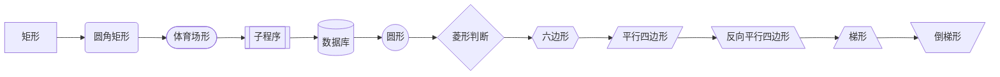

#### 连线类型

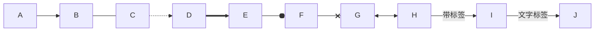

#### 子图

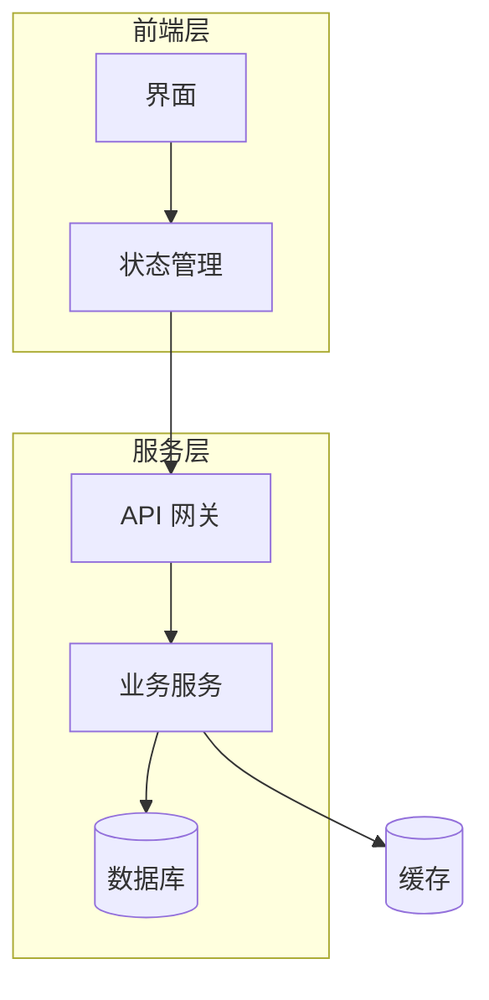

#### 样式与类

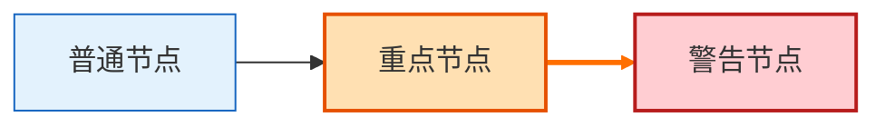

#### 点击交互


#### 综合示例

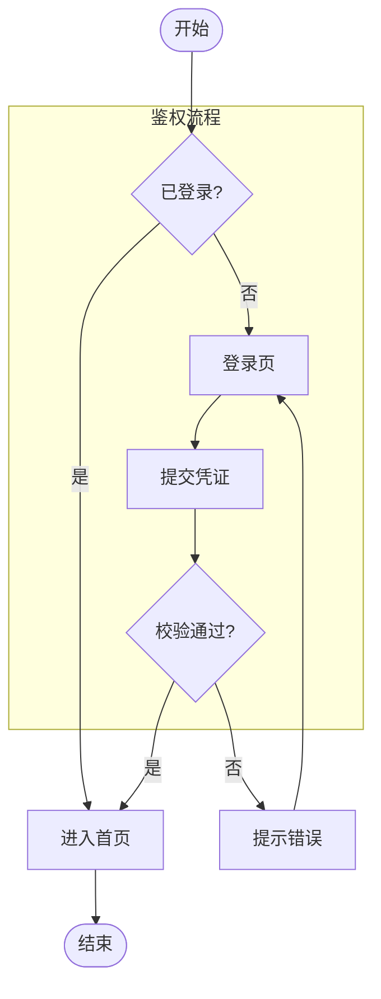

### 23.3 时序图 sequenceDiagram

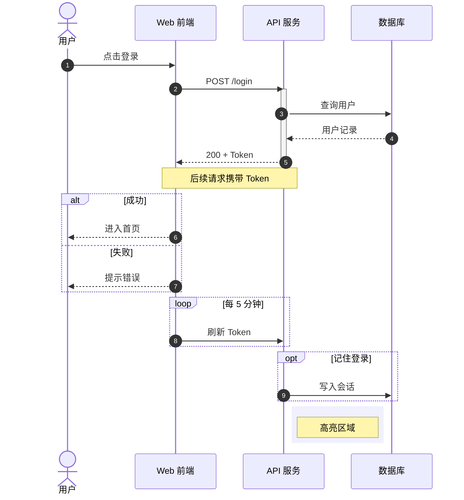

箭头类型：

| 写法 | 含义 |
| --- | --- |
| `->` | 实线无箭头 |
| `->>` | 实线箭头 |
| `-->>` | 虚线箭头 |
| `-x` | 实线叉号 |
| `--x` | 虚线叉号 |
| `-)` | 异步消息 |

### 23.4 类图 classDiagram

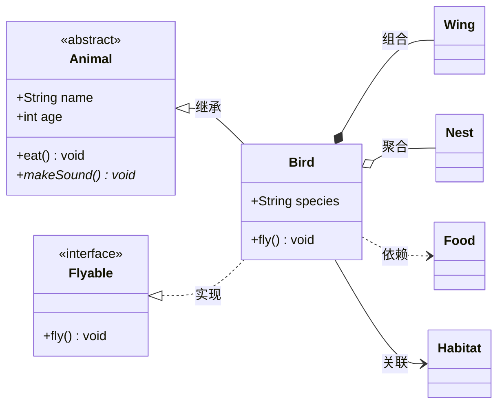

关系符号：

| 语法 | 关系 | 说明 |
| --- | --- | --- |
| `<|--` | 继承 | 实线空心三角 |
| `<|..` | 实现 | 虚线空心三角 |
| `*--` | 组合 | 实线实心菱形 |
| `o--` | 聚合 | 实线空心菱形 |
| `-->` | 关联 | 实线箭头 |
| `..>` | 依赖 | 虚线箭头 |
| `--` | 连接 | 无箭头实线 |
| `..` | 连接 | 无箭头虚线 |

可见性修饰符：`+` 公有、`-` 私有、`#` 受保护、`~` 包内可见。

### 23.5 状态图 stateDiagram-v2

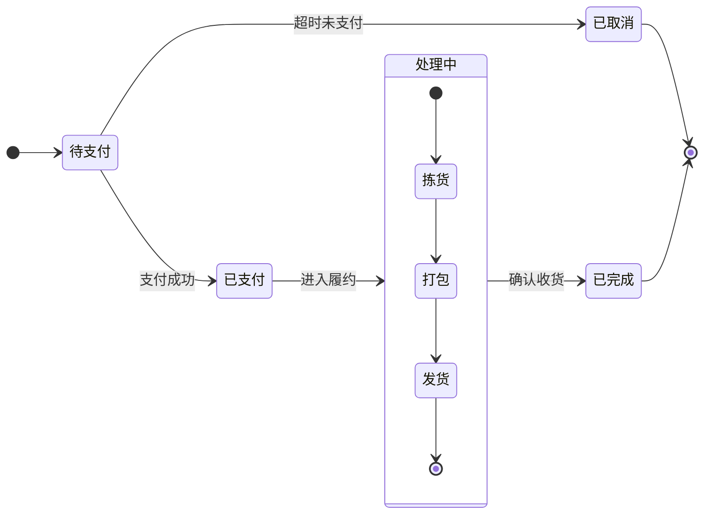

说明：

- `[*]` 表示初始状态或终止状态。
- 组合状态用 `state 名称 { ... }`。
- 并发区域用 `--` 分隔。
- 状态描述可用 `state "长文本描述" as S1`。

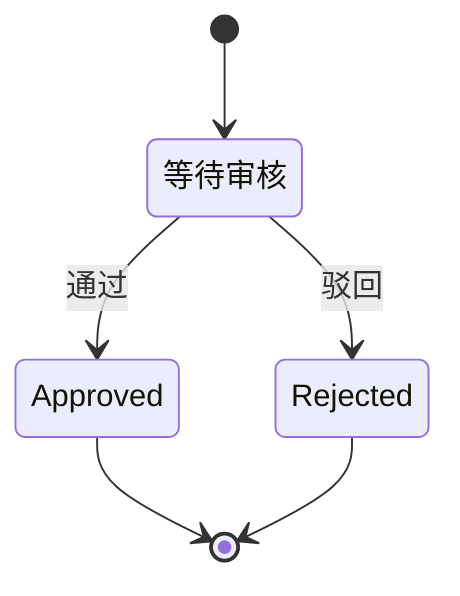

### 23.6 实体关系图 erDiagram

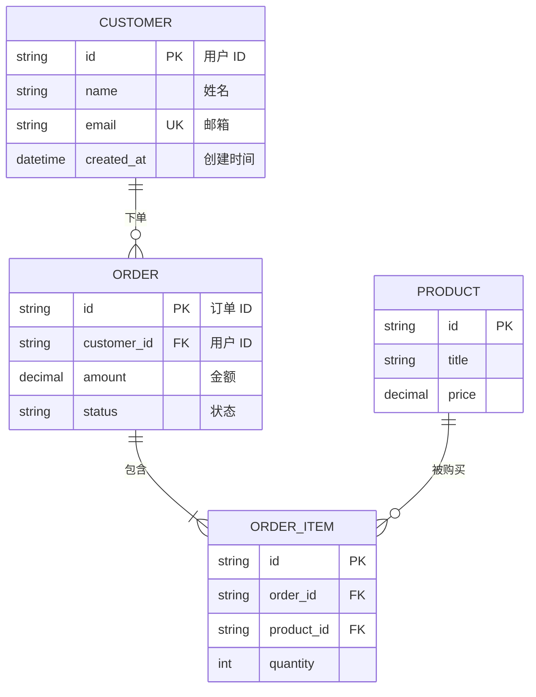

基数符号：

| 左侧 | 右侧 | 含义 |
| --- | --- | --- |
| `\|o` | `o\|` | 零或一 |
| `\|\|` | `\|\|` | 恰好一 |
| `}o` | `o{` | 零或多 |
| `}\|` | `\|{` | 一或多 |

### 23.7 甘特图 gantt

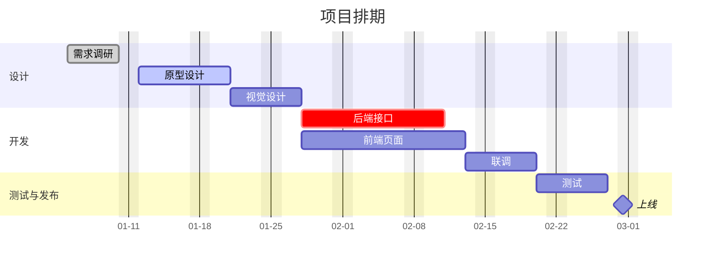

任务状态关键字：`done`、`active`、`crit`、`milestone`。

### 23.8 饼图 pie

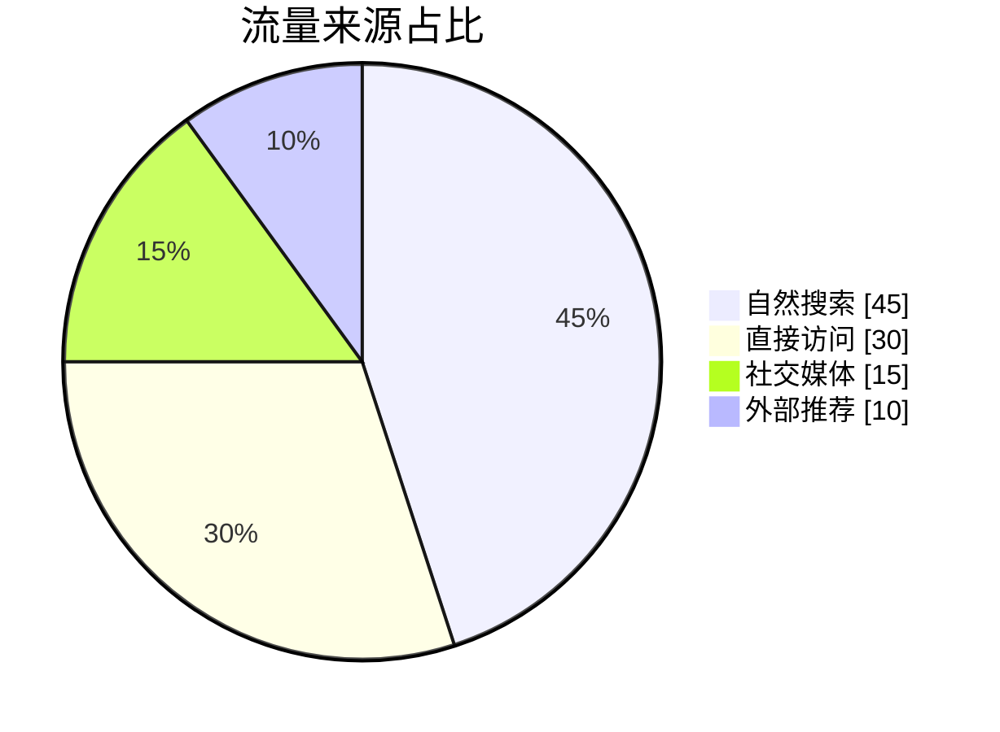

### 23.9 用户旅程图 journey

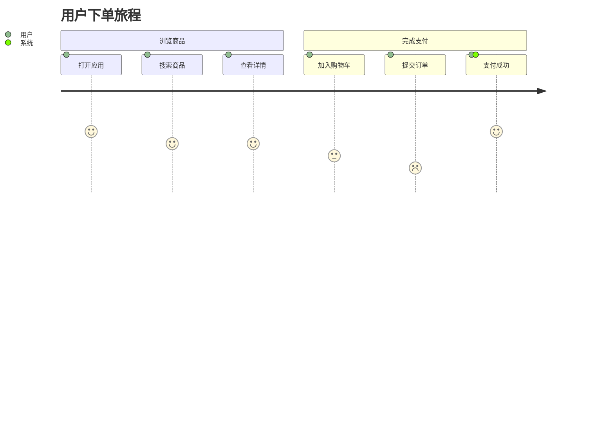

每个任务格式为 `任务名: 评分(1-5): 参与者1, 参与者2`。

### 23.10 象限图 quadrantChart

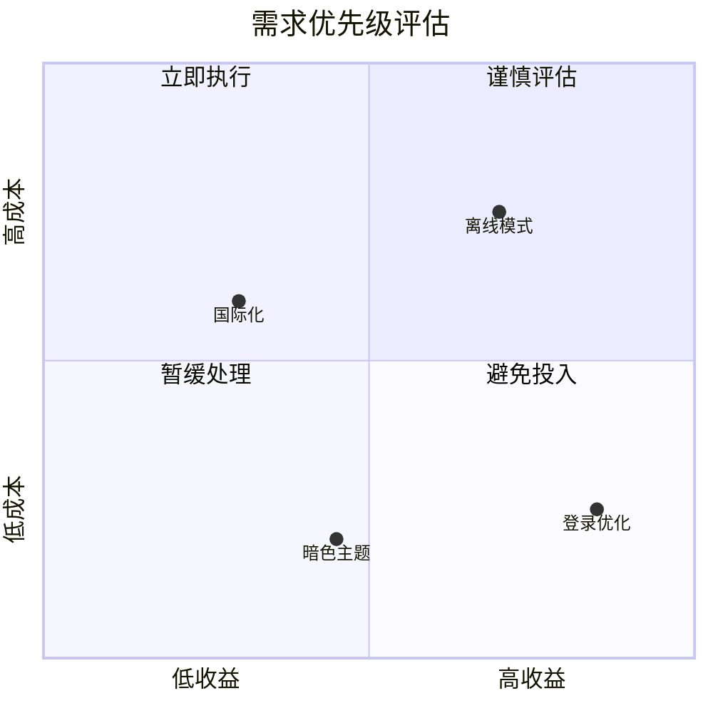

坐标格式为 `[x, y]`，取值范围 `0 ~ 1`。

### 23.11 Git 图 gitGraph

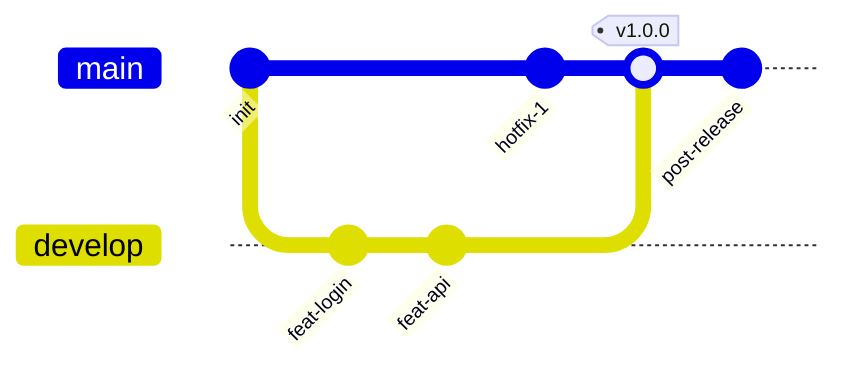

### 23.12 思维导图 mindmap

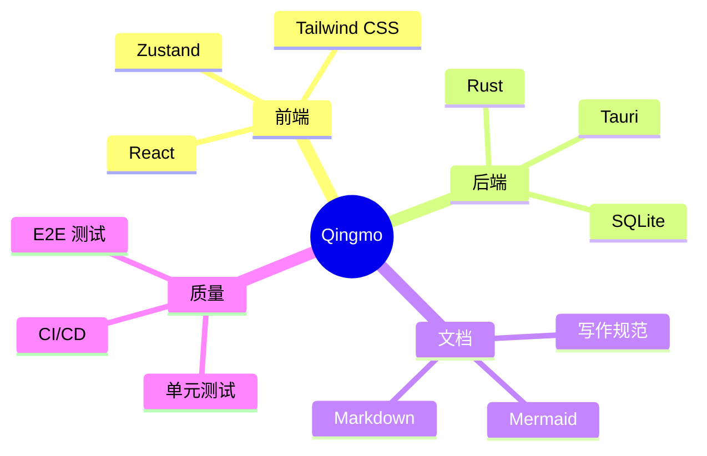

缩进决定层级，根节点使用 `root((文本))`，其余节点直接写文本。

### 23.13 时间线 timeline

```mermaid
timeline
    title 项目里程碑
    section 第一阶段
        2026-01 : 立项 : 完成调研
        2026-03 : 核心开发 : 首个可用版本
    section 第二阶段
        2026-06 : 公开测试 : 收集反馈
        2026-09 : 正式发布 : v1.0
```

格式：`时间 : 事件 : 事件`，同一时间点可挂多个事件。

### 23.14 需求图 requirementDiagram

```mermaid
requirementDiagram
    requirement login_req {
        id: 1
        text: "用户必须能够登录"
        risk: medium
        verifymethod: test
    }

    functionalRequirement mfa_req {
        id: 2
        text: "支持多因素认证"
        risk: high
        verifymethod: demonstration
    }

    element login_page {
        type: ui
    }

    element auth_service {
        type: service
    }

    login_page - satisfies -> login_req
    auth_service - satisfies -> mfa_req
    login_req - derives -> mfa_req
```

常用关系：`contains`、`derives`、`satisfies`、`verifies`、`refines`、`traces`、`copies`。

### 23.15 C4 架构图 C4Context

```mermaid
C4Context
    title 系统上下文图
    Person(user, "用户", "使用产品的最终用户")
    System(app, "Qingmo", "核心桌面应用")
    System_Ext(mail, "邮件服务", "发送通知邮件")
    System_Ext(idp, "身份提供方", "OAuth2 登录")

    Rel(user, app, "使用", "桌面客户端")
    Rel(app, mail, "发送", "SMTP")
    Rel(app, idp, "认证", "HTTPS")
    UpdateLayoutConfig($c4ShapeInRow="3", $c4BoundaryInRow="1")
```

C4 系列还包含：`C4Container`、`C4Component`、`C4Dynamic`、`C4Deployment`。

### 23.16 桑基图 sankey-beta

```mermaid
sankey-beta

Coal,Power,40
Gas,Power,25
Power,Industry,35
Power,Residential,30
Industry,GDP,35
Residential,Living,30
```

格式为 CSV：`源,目标,数值`；含逗号的名称需要加引号。

> 注意：部分 Mermaid 版本对 `sankey-beta` 的非 ASCII 标签存在解析缺陷，中文标签可能报错。建议使用英文标签，或先在目标渲染环境验证。

### 23.17 块图 block-beta

```mermaid
block-beta
    columns 3
    采集["数据采集"] 清洗["数据清洗"] 入库["数据入库"]
    分析["数据分析"]:2 展示["可视化"]
    space
    存储["对象存储"]:3
```

`columns N` 定义列数，`:N` 表示跨列，`space` 表示空位。

### 23.18 XY 图表 xychart-beta

```mermaid
xychart-beta
    title "月度销售额"
    x-axis ["1月", "2月", "3月", "4月", "5月"]
    y-axis "销售额（万元）" 0 --> 100
    bar [30, 52, 71, 90, 96]
    line [30, 45, 68, 88, 95]
```

支持 `bar` 柱状图与 `line` 折线图叠加，可选 `horizontal` 切换横向。

### 23.19 数据包图 packet-beta

```mermaid
packet-beta
    0-7: "源端口"
    8-15: "目的端口"
    16-31: "序列号"
    32-63: "确认号"
    64-67: "数据偏移"
    68-72: "保留位"
    73-79: "标志位"
    80-95: "窗口大小"
```

按比特位定义字段，支持绝对区间 `0-7` 与相对长度 `+8`。

### 23.20 架构图 architecture-beta

```mermaid
architecture-beta
    group cloud(cloud)[云环境]

    service web(server)[Web 服务] in cloud
    service api(server)[API 服务] in cloud
    service db(database)[数据库] in cloud
    service cdn(disk)[静态资源] in cloud

    service user(internet)[用户]

    user:R -- L:web
    web:R -- L:api
    api:R -- L:db
    cdn:B -- T:web
```

连接写法 `服务A:方位 -- 方位:服务B`，方位可取 `L`、`R`、`T`、`B`。

### 23.21 看板图 kanban

```mermaid
kanban
    todo[待办]
        设计接口
        编写文档
    doing[进行中]
        实现功能
        联调测试
    done[已完成]
        搭建项目
        接入 CI
```

列名用 `id[显示名称]` 定义，缩进的内容即为卡片。适合任务看板、迭代计划。

### 23.22 雷达图 radar-beta

```mermaid
radar-beta
    title 团队技能评估
    axis front["前端"], back["后端"], db["数据库"], ops["运维"], design["设计"]
    curve team["当前"]{4, 3, 3, 2, 4}
    curve target["目标"]{5, 4, 4, 4, 5}
    max 5
    min 0
```

`axis` 定义维度，`curve` 定义数据系列，每组数值数量需与维度数一致。

### 23.23 矩形树图 treemap-beta

```mermaid
treemap-beta
"产品线"
    "桌面端": 40
    "移动端": 25
    "开放平台"
      "API": 20
      "SDK": 15
```

通过缩进表达层级，叶子节点使用 `"名称": 数值` 定义面积。

### 23.24 鱼骨图 ishikawa-beta

```mermaid
ishikawa-beta
    "服务不可用"
        "数据库"
            "连接池耗尽"
            "慢查询"
        "网络"
            "DNS 超时"
            "带宽不足"
        "应用"
            "内存泄漏"
            "线程阻塞"
```

根因分析专用，第一层为问题（鱼头），后续层级为原因分支。

### 23.25 战略地图 wardley-beta

```mermaid
wardley-beta
    title 示例战略地图
    anchor "用户" [0.95, 0.60]
    component "应用" [0.80, 0.55]
    component "数据库" [0.70, 0.80]
    "用户" -> "应用"
    "应用" -> "数据库"
```

坐标格式为 `[可见度, 演化度]`，取值范围 `0 ~ 1`，用于表达组件的价值链位置与成熟度。

### 23.26 主题与配置

在图表开头插入初始化指令：

```mermaid
%%{init: {"theme": "forest", "themeVariables": {"primaryColor": "#e8f5e9", "lineColor": "#2e7d32"}}}%%
flowchart LR
    A[绿色主题] --> B[配置生效]
```

可选主题：`default`、`neutral`、`dark`、`forest`、`base`、`null`。

### 23.27 配色与可访问性

```mermaid
flowchart LR
    A[高对比度] --> B[低饱和背景]
    B --> C[清晰字号]

    classDef highContrast fill:#212121,stroke:#ffffff,stroke-width:2px,color:#ffffff
    classDef soft fill:#f5f5f5,stroke:#616161,color:#212121

    class A highContrast
    class B,C soft
```

建议：

- 不要仅用颜色区分含义，配合文字或线型。
- 深色背景下使用浅色节点，反之亦然。
- 节点文字控制在 20 字符以内，长文本换行。
- 图表超过 30 个节点时，拆分为多张图。

### 23.28 常见问题排查

| 现象 | 原因 | 解决 |
| --- | --- | --- |
| 显示为纯代码块 | 渲染器不支持 Mermaid | 换平台或导出为 SVG/PNG |
| 语法错误 | 节点文本含未转义括号 | 用 `["文本"]` 包裹 |
| 中文乱码 | 字体缺失 | 配置 `fontFamily` |
| 图表过宽 | 节点过多或 LR 方向 | 改 `TD`、拆图或设置 `wrap` |
| 首行报错 | 混入空行或注释位置错误 | 首行必须是图表类型声明 |
| 渲染失败无提示 | 版本过旧 | 升级渲染器 / Mermaid 版本 |

### 23.29 导出为图片

```bash
# 安装 CLI
npm i -g @mermaid-js/mermaid-cli

# 导出 SVG
mmdc -i diagram.mmd -o diagram.svg

# 导出 PNG，指定背景与宽度
mmdc -i diagram.mmd -o diagram.png -b transparent -w 1600

# 批量导出
mmdc -i ./diagrams -o ./out -e svg
```

在 Markdown 中引用导出结果：

```markdown

```

---

## 24. 图表替代方案

除 Mermaid 外，常见图表方案及适用场景：

| 方案 | 写法 | 优点 | 缺点 |
| --- | --- | --- | --- |
| Mermaid | ` ```mermaid ` | 文本化、可版本控制 | 样式能力有限 |
| PlantUML | ` ```plantuml ` | 图类型丰富、UML 完整 | 需服务端渲染 |
| Graphviz DOT | ` ```dot ` | 自动布局强 | 语法陡峭 |
| D2 | ` ```d2 ` | 现代语法、布局好 | 生态较新 |
| draw.io | 嵌入 `.drawio.svg` | 可视化编辑 | 二进制/大文件 |
| Excalidraw | 嵌入 `.excalidraw.svg` | 手绘风格 | 需外部工具 |
| ASCII | 纯文本 | 到处可读 | 复杂图难维护 |

ASCII 示意图示例：

```text
┌─────────┐      ┌─────────┐      ┌─────────┐
│  Client │─────▶│  Server │─────▶│   DB    │
└─────────┘      └─────────┘      └─────────┘
```

PlantUML 示例：

````markdown
```plantuml
@startuml
Alice -> Bob: Hello
Bob --> Alice: Hi
@enduml
```
````

---

## 25. 速查表与最佳实践

### 25.1 语法速查表

| 需求 | 语法 | 备注 |
| --- | --- | --- |
| 标题 | `# 标题` | 1~6 级 |
| 粗体 | `**文本**` | 通用 |
| 斜体 | `*文本*` | 通用 |
| 粗斜体 | `***文本***` | 通用 |
| 删除线 | `~~文本~~` | GFM |
| 高亮 | `==文本==` | 方言 |
| 行内代码 | `` `code` `` | 通用 |
| 代码块 | ` ```lang ` | 通用 |
| 链接 | `[文本](URL)` | 通用 |
| 图片 | `` | 通用 |
| 引用 | `> 文本` | 通用 |
| 无序列表 | `- 文本` | 通用 |
| 有序列表 | `1. 文本` | 通用 |
| 任务列表 | `- [x] 文本` | GFM |
| 表格 | `\| a \| b \|` | GFM |
| 分隔线 | `---` | 前后留空行 |
| 脚注 | `[^1]` | GFM |
| 数学 | `$...$` / `$$...$$` | 需支持 |
| 提示块 | `> [!NOTE]` | GFM |
| 折叠 | `<details>` | HTML |
| 目录 | `[TOC]` | 平台相关 |
| 锚点 | `[文本](#id)` | 通用 |
| 注释 | `<!-- -->` | 通用 |
| 换行 | 行尾两空格 / `\` | 通用 |
| 转义 | `\*` | 通用 |
| 图表 | ` ```mermaid ` | 需支持 |

### 25.2 写作规范建议

**结构与层级**

- 一个文件只用一个一级标题。
- 标题层级连续，不跳级。
- 章节长度控制在 300 行以内，过长则拆分文件。

**排版**

- 中英文之间保留一个空格：`使用 React 开发`。
- 中文标点使用全角，英文与代码使用半角。
- 列表项结尾不加句号（除非是完整句子）。
- 代码块、表格、引用、列表前后各留一个空行。

**链接与引用**

- 链接文字要有语义，避免"点击这里"。
- 外部链接优先使用 HTTPS。
- 引用式链接适合重复出现的 URL。

**图表**

- 优先 Mermaid，保证可 diff、可版本控制。
- 图表要有标题，节点命名统一语言。
- 复杂图拆分为多张，避免单图信息过载。

**兼容性**

- 跨平台文档只使用 CommonMark + GFM。
- 使用方言语法时，在文档开头注明目标平台。
- 重要内容不要依赖颜色或纯 HTML 布局。

### 25.3 常见错误

| 错误写法 | 问题 | 正确写法 |
| --- | --- | --- |
| `#标题` | 缺少空格 | `# 标题` |
| `** 粗体 **` | 符号内侧有空格 | `**粗体**` |
| 表格前无空行 | 不被识别为表格 | 表格前加空行 |
| `---` 紧跟文字 | 被解析为 Setext 标题 | 前面加空行 |
| 列表项内代码未缩进 | 代码块脱离列表 | 缩进 4 空格 |
| 表格内直接写 `\|` | 列被截断 | 写成 `\|` |
| `[链接](url "标题")` 中含空格 | 解析失败 | 用 `<url>` 包裹 |
| `<details>` 内无空行 | Markdown 不解析 | 标签后加空行 |
| 中文全角括号做链接 | 不识别 | 使用半角 `()` |
| 图片路径用反斜杠 | Windows 路径失效 | 使用 `/` |

### 25.4 工具链

| 工具 | 用途 |
| --- | --- |
| Prettier | 格式化 Markdown |
| markdownlint | 规范检查 |
| markdown-toc | 生成目录 |
| mermaid-cli | 导出图表 |
| Vale | 文案风格检查 |
| lychee | 死链检查 |

```bash
# 格式化
npx prettier --write "**/*.md"

# 规范检查
npx markdownlint-cli2 "**/*.md"

# 死链检查
npx lychee "**/*.md"
```

---

## 附录 A：完整示例文档骨架

````markdown
---
title: 文档标题
description: 一句话描述
date: 2026-10-27
tags: [docs, guide]
---

# 文档标题

> 一句话摘要。

## 目录

- [背景](#背景)
- [方案](#方案)
- [结论](#结论)

## 背景

问题描述与目标。

## 方案

| 方案 | 优点 | 缺点 |
| --- | --- | --- |
| A | 简单 | 扩展性差 |
| B | 灵活 | 复杂度高 |

```mermaid
flowchart LR
    A[输入] --> B[处理]
    B --> C[输出]
```

## 结论

结论与后续计划。

[^1]: 参考资料。
````

## 附录 B：Mermaid 图表类型索引

| 类型 | 声明 | 典型用途 |
| --- | --- | --- |
| 流程图 | `flowchart` / `graph` | 业务流程、系统流程 |
| 时序图 | `sequenceDiagram` | 接口交互、调用链 |
| 类图 | `classDiagram` | 领域模型、代码结构 |
| 状态图 | `stateDiagram-v2` | 状态机、订单流转 |
| ER 图 | `erDiagram` | 数据库设计 |
| 甘特图 | `gantt` | 项目排期 |
| 饼图 | `pie` | 占比分析 |
| 旅程图 | `journey` | 用户体验路径 |
| 象限图 | `quadrantChart` | 优先级矩阵 |
| Git 图 | `gitGraph` | 分支与发布策略 |
| 思维导图 | `mindmap` | 知识梳理 |
| 时间线 | `timeline` | 里程碑、历史演进 |
| 需求图 | `requirementDiagram` | 需求追踪 |
| C4 图 | `C4Context` 等 | 系统架构 |
| 桑基图 | `sankey-beta` | 流量与能量流向 |
| 块图 | `block-beta` | 布局与模块划分 |
| XY 图 | `xychart-beta` | 趋势与对比 |
| 数据包图 | `packet-beta` | 协议字段结构 |
| 架构图 | `architecture-beta` | 云架构与部署 |
| 看板图 | `kanban` | 任务看板、迭代管理 |
| 雷达图 | `radar-beta` | 多维能力评估 |
| 矩形树图 | `treemap-beta` | 层级占比 |
| 鱼骨图 | `ishikawa-beta` | 根因分析 |
| 战略地图 | `wardley-beta` | 价值链与成熟度 |

---

> 文档结束。建议将本文件作为团队 Markdown 写作的参考基线，按需裁剪方言语法。


```mermaid
graph TB
  subgraph ENTRY["进程入口"]
    MAIN["main<br/>cmd/unified_main.cpp:111"]
    CFG["parseUnifiedConfig<br/>config.cpp"]
    RG["RuntimeGraph::build/start/stop<br/>app/runtime_graph.cpp"]
    MAIN --> CFG --> RG
  end

  subgraph CTRL["控制面（明文 HTTP）"]
    HS["HttpServer (raw socket)<br/>control/http_server.cpp"]
    HM["HttpManager + Router<br/>http_manager.cpp / http_router.cpp"]
    MW["Auth / JSON middleware<br/>http_middleware.cpp"]
    H1["initialize"]:::h
    H2["restart"]:::h
    H3["task/create"]:::h
    H4["task/update"]:::h
    H5["task/stop"]:::h
    H6["task/select"]:::h
    H7["alarm/push · debug/stats"]:::h
    TS["TaskStore / TaskManager<br/>task/task_store.cpp · task_manager.cpp"]
    RG --> HS --> HM --> MW
    MW --> H1 & H2 & H3 & H4 & H5 & H6 & H7
    H1 & H2 & H3 & H5 & H6 --> TS
    H3 -->|"startSendTask*"| TE
    H5 -->|"stopSendTasksByTaskIds<br/>仅 sendTasks_"| TE
    H4 -->|"updateSendTaskRateLimitByTaskId<br/>返回值被丢弃"| TE
    H6 -.->|"缺表时回查快照"| TE
  end

  subgraph ENGINE["传输引擎（god class 10k 行）"]
    TE["TransferEngine<br/>transfer_engine.cpp"]
    ADM["QuicConnectionAdmission 租约<br/>transfer/connection_admission.cpp"]
    SUP["SendRetrySupervisor"]
    REAP["cleanup reaper (1s)"]
    TRM["terminal reaper"]
    EXEC["ReceiveLifecycleExecutor (4)"]
    TE --> ADM
    TE --> SUP
    TE --> REAP
    TE --> TRM
    TE --> EXEC
  end

  subgraph TRANS["传输层抽象"]
    REG["TransportRegistry<br/>transfer/transport_registry.cpp"]
    QP["QuicTransportProvider<br/>quic_transport_provider.cpp"]
    TP["TcpTransportProvider<br/>tcp_transport_provider.cpp"]
    QS["quic_settings（profile/超时）<br/>quic_settings.cpp"]
    RG --> REG --> QP & TP
    QS --> QP
    QS --> TP
  end

  subgraph SEND["发送数据面"]
    SP["SendPipeline<br/>pipeline/send_pipeline.cpp"]
    RD["Reader 线程<br/>local_file_block_reader / s3_block_reader"]
    CMP["Compressor ×N<br/>codec_registry"]
    SND["Sender ×N"]
    WIN["byte_budget + send_window_arbiter/controller"]
    FC["frame_codec + protocol.cpp"]
    TE --> SP --> RD --> CMP --> SND --> FC
    WIN --> SP
    SP -.->|"零拷贝分支 slice 恒空 †"| FC
  end

  subgraph RECV["接收数据面"]
    US["UnifiedServer accept/stream<br/>unified_server.cpp"]
    FD["frame_dispatcher<br/>transfer/frame_dispatcher.cpp"]
    RP["RecvPipeline<br/>pipeline/recv_pipeline.cpp"]
    DEC["decompressor ×N"]
    WR["writer ×N"]
    SINK{"StorageBackendFactory::createSink<br/>storage_backend_factory.cpp:182"}
    LS["LocalFileBlockSink<br/>staging → fsync → rename"]
    S3["S3MultipartBlockSink<br/>Create/UploadPart/Complete"]
    RES["resume manifest / checkpoint"]
    US --> FD --> RP --> DEC --> WR --> SINK
    SINK --> LS & S3
    LS --> RES
    RP -->|"durable outcome"| TE
    FD -->|"NAK / BlockRequest"| TE
  end

  subgraph STORE["存储与完整性"]
    URI["storage_uri（+ 号按空格解码）"]
    INT["integrity_mode（任一 S3 → crc32c_only）"]
    PROBE["storage_probe / write_profile / mountinfo"]
    OBJECT["object_set / object_enumerator"]
    URI --> SINK
    INT --> RP
    PROBE --> LS
    OBJECT --> TE
  end

  subgraph OBS["可观测"]
    DBG["/debug/stats<br/>handler_debug.cpp"]
    OBSV["传输连接观测<br/>observeSendConnection"]
    DBG --> TE
    TE --> OBSV
    DBG -.->|"zeroCopyBlocks 恒 0 †"| SP
  end

  %% 死路径
  TE -.->|"✗ localBridge 永假<br/>requiresStandardIntegrityPipeline 恒 true"| S3DP["s3DataPlaneWork 113 行"]
  BAT["BatchTransferCoordinator"] -.->|"✗ useLocalS3DataPlaneBatch 永假<br/>182-385 约 204 行"| BRIDGE["本地桥接 worker 池"]
  BAT -->|"正常 child 路径"| TE
  H3 -->|"集合源/目的"| BAT
```
