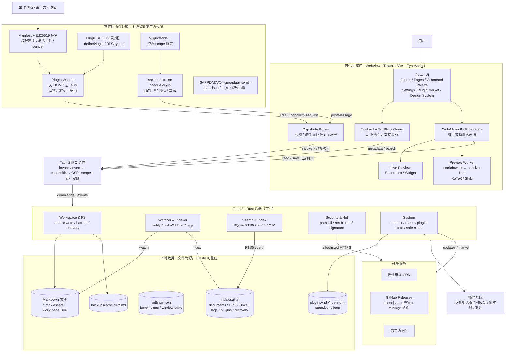

# Qingmo 项目目标拓扑图

- 版本：0.2
- 日期：2026-10-27
- 关联文档：[项目蓝图](BLUEPRINT.md) · [调研与参考](RESEARCH.md)
- 图形文件：
  - `docs/qingmo-topology.drawio` —— draw.io 源文件，可继续编辑
  - `docs/qingmo-topology.drawio.svg` —— 矢量图，内嵌 diagram XML
  - `docs/qingmo-topology.drawio.png` —— 位图预览
- 重新生成：`node docs/topology-gen.js`

> SQLite 保留。它只做**可重建的索引与状态存储**，Markdown 文件仍是唯一事实来源。

---

## 1. 总览



---

## 2. 分层说明

| 层 | 组件 | 职责 | 信任级别 |
|---|---|---|---|
| 入口 | 用户、插件作者 | 编辑、安装插件、开发插件 | 外部 |
| 展示层 | React Router、Pages、Command Palette、Settings、Market UI | 界面与交互 | 可信 |
| 编辑层 | CodeMirror 6、Lezer、Live Preview、Preview Worker | 文档状态、增量解析、装饰、预览 | 可信 |
| 应用状态 | Zustand、TanStack Query、Zod、IPC client | UI 状态、异步元数据、边界校验 | 可信 |
| 插件宿主 | Plugin Host、Capability Broker、Plugin SDK | 插件加载、RPC、权限、隔离 | 可信 |
| 插件运行 | Plugin Worker、sandbox iframe | 插件逻辑与 UI | **不可信** |
| IPC | Tauri commands / events | 前后端边界、capabilities、CSP | 可信 |
| 系统层 | Rust：FS、Watcher、Indexer、Search、Net、System | 文件、索引、搜索、网络代理、更新 | 可信 |
| 数据层 | Markdown 文件、SQLite、配置、插件数据、备份 | 持久化 | 本地 |
| 外部 | 市场、更新、第三方 API、OS | 网络与系统集成 | 外部 |

---

## 3. 关键数据流

### 3.1 编辑 → 保存 → 索引

```text
键盘输入
  → CodeMirror transaction（增量）
  → EditorState 更新
  → 800ms 去抖 / 5s 最大延迟
  → Tauri IPC: file_write_atomic(path, content, baseHash)
  → Rust: 临时文件 + fsync + rename
  → 更新 mtime / hash / 备份
  → Watcher 事件（去抖 200ms）
  → Indexer 更新 SQLite（FTS5 / links / tags）
  → 前端失效 TanStack Query（tree / search / backlinks）
```

### 3.2 插件调用

```text
Plugin Worker / iframe
  → RPC（postMessage）
  → Capability Broker
      ├─ 校验 manifest 与权限
      ├─ 校验路径是否在工作区 / 插件私有目录
      ├─ 校验网络 origin 是否在白名单
      ├─ 速率与大小限制
      └─ 写审计日志
  → Tauri IPC（已校验的命令）
  → Rust 执行
  → 返回结果（结构化克隆）
```

### 3.3 搜索

```text
用户输入查询
  → TanStack Query
  → Tauri IPC: search_query
  → Rust: SQLite FTS5 + bm25 + snippet
  → 返回命中列表与高亮片段
  → 前端渲染结果面板
```

### 3.4 插件安装

```text
.qingmo-plugin（zip）
  → Rust plugin_store: 限制条目/解压大小
  → 校验 manifest + Ed25519 签名 + SHA-256
  → 检查路径穿越 / 符号链接 / 可执行文件
  → 解压到 $APPDATA/Qingmo/plugins/<id>/<version>
  → 写入 SQLite plugins 表
  → 等待 activation event
```

### 3.5 应用更新（macOS universal / stable）

```text
启动 8s 后 / 用户命令
  → Tauri IPC: app_update_check
  → Rust UpdateManager: Checking（单飞，30s 超时，HTTPS only）
  → GitHub Releases: latest.json（文档不签名）
  → 有更新 → Available；无更新/失败 → Idle（静默无感）
  → 用户确认 → app_update_download
  → 下载 .app.tar.gz（10min 超时，进度 100ms 节流）
  → minisign 验签 + requireSignedVersion 绑定清单版本
  → Ready
  → 保存：SaveCoordinator.flush("close")
  → app_update_install（CloseGuard 进入 Installing）
  → macOS 交换 .app / 授权 → request_restart()
```

信任根分离：应用代码由 Xcode `Developer ID Application` 签名并公证；更新产物由独立 minisign 私钥签名。`latest.json` 是未签名文档，只有各产物的 `signature` 受 minisign 保护；静态清单无百分比灰度，安装失败保留旧版本，无自动回滚。

---

## 4. 信任边界

| 边界 | 允许 | 禁止 |
|---|---|---|
| 主窗口 ↔ 插件 Worker | RPC、结构化数据 | 共享 DOM、直接 `invoke`、读任意文件 |
| 主窗口 ↔ 插件 iframe | `postMessage`、声明式 UI | same-origin、父页面 DOM、全局 CSS |
| 插件 ↔ Rust | 经 Broker 的受控命令 | 直接调用 Tauri IPC、直接访问 SQLite |
| 插件 ↔ 网络 | 经 Broker 的 origin 白名单 | 任意 URL、任意请求体大小 |
| 插件 ↔ 文件 | 工作区（授权后）或插件私有目录 | 应用数据目录、系统目录、符号链接逃逸 |
| 主窗口 ↔ Rust 更新器 | 4 条 `app_update_*` 命令 + 2 条快照/进度事件 | `updater:*`、下载 URL、签名、安装路径、直接安装 |

---

## 5. 为什么保留 SQLite

| 能力 | 没有 SQLite | 有 SQLite |
|---|---|---|
| 10k 文件搜索 | 50–200ms（按需扫描） | < 50ms |
| 100k 文件搜索 | 1–3s | < 200ms |
| 反链 / 标签 | 内存或重复扫描 | 索引查询 |
| 插件状态 | JSON 文件 | 表 + 事务 |
| 崩溃恢复 | JSON 文件 | 表 + 时间戳 |
| 数据可移植性 | 文件本身可带走 | SQLite 可删除重建 |
| 复杂度 | 低 | 中（schema / 迁移 / 重建） |

结论：**SQLite 作为索引与状态存储，Markdown 作为唯一事实来源。** 用户删除 `index.sqlite` 不会丢失任何文档。

---

## 6. 图形文件说明

- `qingmo-topology.drawio`：可用 draw.io 打开继续编辑；包含完整细节、颜色、信任边界。
- `qingmo-topology.drawio.svg`：适合放入文档 / 网页；内嵌 diagram XML，可重新导入 draw.io。
- `qingmo-topology.drawio.png`：适合快速预览 / 分享。
- `topology-gen.js`：生成 `.drawio` 的脚本，修改坐标或组件后重新运行即可。
