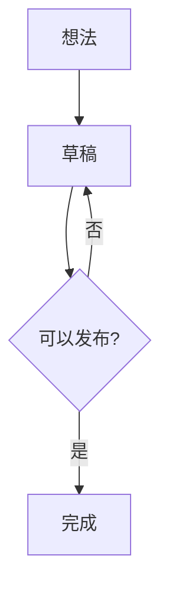

# Mermaid 图表渲染 · 设计提案

> 高保真原型：[`prototype.html`](./prototype.html)  
> 直接在浏览器打开即可；示例 SVG 已固化在 `assets/`，不依赖网络或构建。

## 1. 设计方向

**纸面图版（Paper Plate）**：图表不是嵌在文档里的“另一个应用”，而是一块安静地放在正文中的图版。

- 继承轻墨的暖纸色、墨绿强调色、细线边框和低饱和色板。
- 容器语言与现有 Details / 代码块一致：细线、窄标题栏、无重阴影。
- 默认状态只保留图版与一枚“点击「源码」编辑”提示；缩放、源码等操作在悬停时出现。
- 图表使用更克制的字号与连线，不出现默认的紫色、蓝色或投影。
- 所有状态都保留图版骨架：加载不塌陷、失败不空白、主题切换不跳版。

## 2. 参考项目与取舍

参考：`/Users/wangxc/Code/思特奇运营助手`

重点参考 `src/teamshub/editor.js` 的 Mermaid 处理：

| 参考点 | 做法 | 轻墨的取舍 |
| --- | --- | --- |
| 安全配置 | `securityLevel: 'strict'` | 保留；继续配合 SVG 白名单过滤 |
| 主题变量 | `theme: 'base'` + `primaryColor` / `primaryBorderColor` / `lineColor` / `fontFamily` | 保留，扩展为轻墨完整的 light/dark 主题变量 |
| 失败降级 | Mermaid 加载或渲染失败时保留原代码块 | 保留；错误态提供“编辑源码”，不渲染空白 |
| 尺寸归一 | 读取 SVG 后去掉固定尺寸，最大宽度 100%，居中 | 保留；但使用内联 SVG 而不是 base64 ``，以便主题切换、缩放与可访问性 |
| 图表卡片 | 白底、细边框、圆角、内边距 | 借鉴“图版”思路，改用轻墨的纸面/墨线/标题栏语言 |

未采用参考项目的 CKEditor 专用实现：base64 图片会把图表变成不可交互的位图，也无法在切换主题时直接替换内部颜色。

## 3. 结构

```text
┌─ 34px ───────────────────────────────────────────────┐
│ ◇  MERMAID  /  流程图              [− 100% + │ 源码] │
├──────────────────────────────────────────────────────┤
│                                                      │
│                    SVG 图版（居中）                   │
│                                                      │
└──────────────────────────────────────────────────────┘
```

- 外框：`1px var(--qm-line)`，圆角 `10px`，背景 `var(--qm-surface)`。
- 标题栏：`34px`，背景 `var(--qm-surface-raised)`，底边 `1px var(--qm-line)`。
- 标题栏左侧：14px 节点图标 + `MERMAID`（8.5px mono，字距 0.16em）+ `/` + 中文类型（9.5px）。
- 标题栏右侧：默认显示 `点击「源码」编辑`；悬停时替换为工具条。
- 画布：内边距 `22px 26px`；图表最大宽度 100%，超宽时可横向滚动。
- 图表在画布中居中；窄图不拉伸，宽图按容器收缩或由用户缩放。
- 图版之间保持 `14px / 18px` 的上下间距，不额外插入分隔线。

## 4. 交互状态

| 状态 | 行为 |
| --- | --- |
| 默认 | 图版 + 类型 + “点击「源码」编辑”；无按钮噪音 |
| 悬停 / 键盘聚焦 | 工具条淡入：缩小、当前比例、放大、源码；不改变画布高度 |
| 缩放 | 60%–200%，步进 10%；点击比例恢复 100%；只改图片宽度，不重新渲染 Mermaid |
| 点击图表 / 源码 | 回到 CodeMirror 原生源码；不新开编辑器或模态框 |
| 源码态 | 原生 fence + 语法高亮；按 Esc 或移开选择恢复预览 |
| 主题切换 | 图表按 light/dark 重新着色；缓存键包含主题；切换期间保留旧图高度 |
| 加载 | 抽象节点 + 虚线动画；`prefers-reduced-motion` 下静止 |
| 渲染失败 | 标题栏显示“渲染失败”；画布内一行错误 + “编辑源码”；不替换整段文档 |
| 超限 / 外部图表 | 超过 200k 单元或 PlantUML/DOT/D2/draw.io/Excalidraw 保持源码块，不尝试外部渲染 |

### 回流边

`flowchart LR` 中，Mermaid 会把前进边和直接回边接到同一个锚点，形成双箭头；`flowchart TB` 则默认把回边放到右侧。已验证 `curve`、ELK、间距、子图方向、显式修订节点等方案，均无法在“不加节点、不改源码”的前提下得到参考图的左侧回流。

因此渲染器增加一个**受控的回流边路由层**，在沙箱内、Mermaid 渲染之后、白名单过滤之前执行：

- 只处理满足以下条件的边：实线、顶层节点、目标在源上方、两节点列向重叠、回流通道不穿过其他节点。
- 把回流边改成左侧 gutter 的圆角正交路径，并把边标签移到竖向段中点。
- 同一对节点的反向前进边若没有标签、同列且不穿过其他节点，则拉直为中心线，消除 Mermaid 为避让回流边留下的折角。
- 其他边、节点、子图和图表类型完全不动；`viewBox` 只为新增几何扩展。
- 源码保持标准 Mermaid，不要求用户添加隐藏节点或“修订”节点。



限制：跨子图、斜向回流、带标签的前进边、非实线边仍使用 Mermaid 原生路由；`LR` 的直接回边不在本期范围内，表达回流时建议使用 `TB`。

原型中的 `assets/flow-*.svg` 就是该路由层的输出；`assets/branch-*.svg` 是悬停状态用的无回流分支示例。

## 5. 复杂样例

`prototype.html` 末尾的「04 复杂样例」用同一套图版骨架覆盖 10 种类型；宽图占满整行，窄图保持原始尺寸。

| 类型 | 语法要点 | 样张 |
| --- | --- | --- |
| C4 架构图 | `Person`、`System`、`System_Ext`、`Rel` | `c4-diagram-*.svg` |
| 子图流程图 | `subgraph`、数据库 / 缓存节点 | `flow-subgraph-*.svg` |
| 时序图 | `activate`、`note`、`alt`、`loop`、`opt` | `sequence-complex-*.svg` |
| 类图 | 继承、实现、组合、聚合、依赖、关联 | `class-diagram-*.svg` |
| 状态图 | 组合状态、终止态 | `state-diagram-*.svg` |
| ER 图 | 实体、PK / FK、基数 | `er-diagram-*.svg` |
| Git 图 | 三车道、细线分支、合并、标签、水平提交标签 | `git-graph-*.svg` |
| 思维导图 | 多级主题、四色分支胶囊、曲线连接 | `mind-map-*.svg` |
| 象限图 | 二维坐标、四象限 | `quadrant-chart-*.svg` |
| 甘特图 | 完成 / 进行中 / 关键任务、里程碑、周末排除 | `gantt-chart-*.svg` |

主题覆盖：

- 类图、状态图、ER、象限图直接复用 `primaryColor` / `nodeBorder` / `lineColor` / `cScale*` 变量。
- Git 图复用 `git0…7` 分类色，并固定 `diagramPadding:12`、`rotateCommitLabel:false`：三个分支各占一条车道，commit 标签水平排列；`themeCSS` 把 Mermaid 默认 8px 的 `.arrow` 收到 2.5px。
- 思维导图使用四色低饱和分支调色板（苔绿 / 黛蓝 / 赭石 / 陶土）：主分支为填充胶囊 + 白字，子节点为纸面填充 + 墨色文字；连线按分支着色，主分支 2.5px、子节点 1.5px，并用轻微侧弯的二次曲线替代直线。
- 思维导图在渲染后按层级补充 `mind-depth-*` 类，把节点背景改写成全圆角 `rect`，移除节点下划线，再按分支重写连线路径；这些样式只注入思维导图，不影响其他图表。
- 甘特图新增 `sectionBkgColor`、`taskBkgColor`、`doneTaskBkgColor`、`activeTaskBkgColor`、`critBkgColor`、`milestoneBkgColor`、`gridColor` 等映射：完成 = 苔绿、进行中 = 砂金、关键 = 陶土、里程碑 = 赭石。
- C4 通过 `c4` 配置的 `person_bg_color` / `system_bg_color` / `external_system_bg_color` 等变量使用深色形状与白字；标题、关系标签、关系线、箭头由 C4 专属 `themeCSS` 按主题覆盖。示例用 `UpdateRelStyle(user, app, $offsetX="12")` 与 `UpdateRelStyle(app, mail, $offsetX="-18")` 把标签放回节点间隙，并把技术标签缩短为 `桌面端`；`System_Ext` 的类型文案修正为 `[External System]`；Person 的头部圆形与身体圆角矩形合并为一条连续轮廓路径，消除内部叠压的弧线。渲染后按内容裁切，并以 960px 宽重新输出，避免卡片留白过大。根节点保留 `aria-roledescription="c4"` 作为语义标记，但选择器不依赖它，避免与其他图表互相污染。
- 宽图（C4、时序、状态、甘特）占满整行；窄图保持原始尺寸，不放大字号。

未纳入本页：journey、timeline、requirement、sankey、block、xychart、packet、architecture、kanban、radar、treemap、ishikawa、wardley。它们仍走同一图版骨架，但需要单独的宽图 / 主题核对。

## 6. Mermaid 主题映射

使用 Mermaid `base` 主题，由宿主把轻墨语义令牌解析为十六进制后传入沙箱。渲染器不直接读取应用 DOM，缓存键包含主题名。

| Mermaid 变量 | 轻墨令牌 | 说明 |
| --- | --- | --- |
| `background` | `--qm-surface` | 画布 |
| `mainBkg` / `primaryColor` | `--qm-diagram-node` | 节点填充 |
| `nodeBorder` / `primaryBorderColor` | `--qm-accent` | 节点描边 |
| `lineColor` | `--qm-diagram-line` | 连线、箭头 |
| `textColor` | `--qm-ink` | 图形文字 |
| `edgeLabelBackground` | `--qm-surface` | 连线标签 |
| `clusterBkg` | `--qm-paper` | 子图背景 |
| `clusterBorder` | `--qm-line-strong` | 子图边框 |
| `actorBkg` / `actorBorder` | 节点填充 / 强调色 | 时序图参与者 |
| `noteBkgColor` | `--qm-highlight` | 便笺 |
| `pie1…8` / `git0…7` / `cScale0…7` | 分类色板；思维导图 cScale 为浅色节点底，四色分支另存于 `mindmap.branches` | 多色图表 |
| `sectionBkgColor` / `gridColor` | `--qm-paper` / `--qm-line` | 甘特图分区、网格 |
| `doneTaskBkgColor` / `activeTaskBkgColor` / `critBkgColor` | 分类色：苔绿 / 砂金 / 陶土 | 甘特任务状态 |
| `milestoneBkgColor` | 赭石 | 甘特里程碑 |
| `person_bg_color` / `system_bg_color` / `external_system_bg_color` | 墨绿 / 黛蓝 / 暖灰 | C4 人员、系统、外部系统 |

新增令牌建议：

```css
--qm-diagram-node: #f3ecdf;      /* dark: #262b24 */
--qm-diagram-line: #8a8172;      /* dark: #9d9689 */
```

分类色板（低饱和、同明度）：

- Light：`#2c6a5a` `#b08a45` `#5f7480` `#a65f45` `#7a5a66` `#6f7a4e` `#c9b48a`
- Dark：`#7fb5a2` `#d4ac63` `#8fa8b3` `#d18e75` `#b58a9a` `#a8b77f` `#c3a86b`

完整样张变量见 [`assets/theme-reference.json`](./assets/theme-reference.json)；其中 `mindmap` 额外记录根节点、叶子节点与四色分支的 `pill` / `line` 取值。该文件只用于固化设计样张；落地时应由宿主从语义令牌解析，避免生产代码复制十六进制。

其他统一处理：

- 移除 Mermaid 默认投影：`filter: none !important`。
- 节点文字 14px、连线标签 12px、时序消息 13px；统一使用正文 sans。
- 时序图编号圆点使用强调色，编号文字使用画布色。
- 连线使用 1.25px 描边；子图使用 1.25px 虚线。
- 思维导图主分支用四色胶囊，子节点用纸面胶囊遮住线端；隐藏 `.node-line-` 下划线，分支路径按 `section-edge-*` 着色并改写成侧弯曲线。
- Git 图使用三车道布局、2.5px 细分支线与水平 commit 标签，避免旋转标签挤压车厢高度。
- 甘特图完成 / 进行中 / 关键任务分别使用苔绿 / 砂金 / 陶土，里程碑使用赭石；周末排除区使用纸面次层。
- C4 用 `themeCSS` 覆盖标题、关系标签、关系线与箭头颜色；形状底色继续走 `c4` 配置色板。
- 不支持 `htmlLabels`，保持纯 SVG，便于白名单过滤。
- 状态图外层 `viewBox` 使用 18px 内边距（Mermaid 默认 8px），避免底部终态圆点贴住图版边缘。
- 状态图中多条边汇入同一终态时，若末端箭头重叠 ≥80%，只保留一个箭头，并把重复边的末端直线吸附到保留边，消除平行双线；两条路径与标签仍保留。
- 超大图优先保证可读性：按宽度适配后若低于 70%，保留自然尺寸并在画布内横向滚动，而不是把文字压到不可读。
- 画布不限制高度，图版随图表自然展开；工具栏提供「适应」宽度，便于先看全列再局部放大。
- 含 3 个及以上子图的流程图使用 ELK 的 `modelOrder` 预设：每个子图独立成区，层内尽量保持声明顺序；边绕开节点正交走线，并在交叉处显示跳线，避免长斜线与穿节点线。代价是图版更高。其他图表保留 Mermaid 默认布局。

## 7. 落地位置

1. `packages/ui/src/tokens.css`
   - 新增 `--qm-diagram-node`、`--qm-diagram-line` 与分类色板。
2. `packages/editor-core/src/live-preview/mermaid-theme.ts`（新增）
   - `mermaidTheme(theme)`：解析令牌，返回 variables 与 themeCSS。
   - `diagramKind(code)`：识别 flowchart / sequence / class / state / er / gantt / pie / …，返回中文类型。
3. `packages/editor-core/src/live-preview/mermaid-render.ts`
   - 渲染请求携带解析后的主题变量；缓存键加入主题版本。
4. `packages/editor-core/src/live-preview/mermaid-blocks.ts`
   - 重构图版 DOM：标题栏、类型、提示、工具条、画布、加载/错误态。
   - 工具条事件 `stopPropagation`；只有「源码」按钮回到源码，画布点击、拖拽与滚动不改变选区。
   - 缩放仅改 SVG 宽度，不触发 Mermaid 重渲染；超大图保留自然尺寸，画布仅横向滚动。
5. `packages/editor-core/src/live-preview/theme.ts`
   - 增加 `.cm-md-mermaid-head`、`.cm-md-mermaid-kind`、`.cm-md-mermaid-tools`、`.cm-md-mermaid-canvas` 等样式；颜色全部走语义令牌。
6. `apps/desktop/src/mermaid-renderer.ts`
   - `theme: 'base'` + 传入的 variables；加入 themeCSS、flowchart/sequence 配置；保持 `securityLevel: 'strict'` 与 `htmlLabels: false`。
   - 在 `mermaid.render` 之后调用 `routeBackEdges(svg)`（新增 `apps/desktop/src/mermaid-route.ts`），再回传 SVG。
7. 测试
   - 单测：类型识别、主题映射、分类色板、工具条事件不触发源码切换。
   - 单测：回流边路由——直接回流、无回流、跨子图、斜向回流、带标签前进边、虚线回边。
   - E2E：浅/深色截图、悬停工具条、缩放与「适应」、源码返回、失败态、超大图横向滚动、状态图汇合箭头去重、35 个图仍全部渲染。

## 8. 验收标准

- 35 个 Mermaid 图表在 light/dark 下均使用轻墨主题，无默认紫色/蓝色。
- 图表卡片与 Details、代码块、表格的边框、圆角、字号语言一致。
- 悬停工具条不改变布局；缩放 60%–200% 可用；源码态可返回预览。
- 超大图不压缩到不可读：默认保留自然宽度并横向滚动，「适应」可先看全列；图版高度随图表自然展开。
- 含 3 个及以上子图的流程图按连接关系分区，层内保持声明顺序；边绕开节点正交走线并在交叉处显示跳线，不出现穿过节点的长线。
- 渲染失败、加载、超限、外部图表都有明确降级，不出现空白区域。
- 复杂样例 10 种类型在 light/dark 下无默认紫 / 蓝 / 红；甘特任务状态、Git 分支与 C4 形状使用轻墨色板，思维导图使用四色低饱和分支色。
- C4 标题、关系线与箭头在浅 / 深主题下可读；SMTP 等较长的关系标签不被相邻节点遮挡。
- 思维导图主分支为四色胶囊、子节点无下划线，连线按分支着色且为轻微曲线；Git 分支线宽 2.5px，commit 标签水平可读。
- 竖向直接回流边统一走左侧，不增加“修订”等额外节点；其他图表路径不变。
- 状态图中多条边汇入同一终态时只保留一个箭头，末端平行双线吸附为一条；两条边的路径与标签仍然完整。
- `securityLevel: 'strict'`、SVG 白名单、200k 单元限制保持不变。
- `pnpm test`、`pnpm test:e2e`、`pnpm ci:web` 通过。

## 9. 原型文件

```text
docs/design/mermaid-renderer/
├── README.md
├── prototype.html
├── assets/
│   ├── flow-light.svg / flow-dark.svg
│   ├── branch-*.svg
│   ├── flow-subgraph-*.svg
│   ├── sequence-*.svg
│   ├── class-diagram-*.svg
│   ├── state-diagram-*.svg
│   ├── er-diagram-*.svg
│   ├── c4-diagram-*.svg
│   ├── git-graph-*.svg
│   ├── mind-map-*.svg
│   ├── quadrant-chart-*.svg
│   ├── gantt-chart-*.svg
│   ├── pie-*.svg
│   └── theme-reference.json
└── screenshots/
    ├── 01-context-light.png
    ├── 02-context-dark.png
    ├── 03-states.png
    ├── 04-spec.png
    ├── 05-gallery-light.png
    └── 05-gallery-dark.png
```
