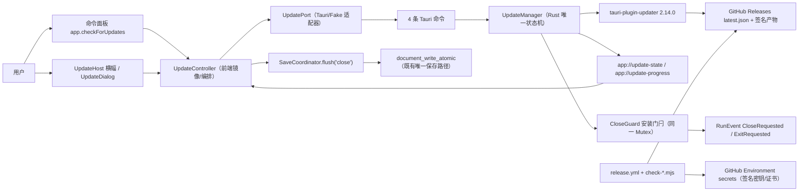
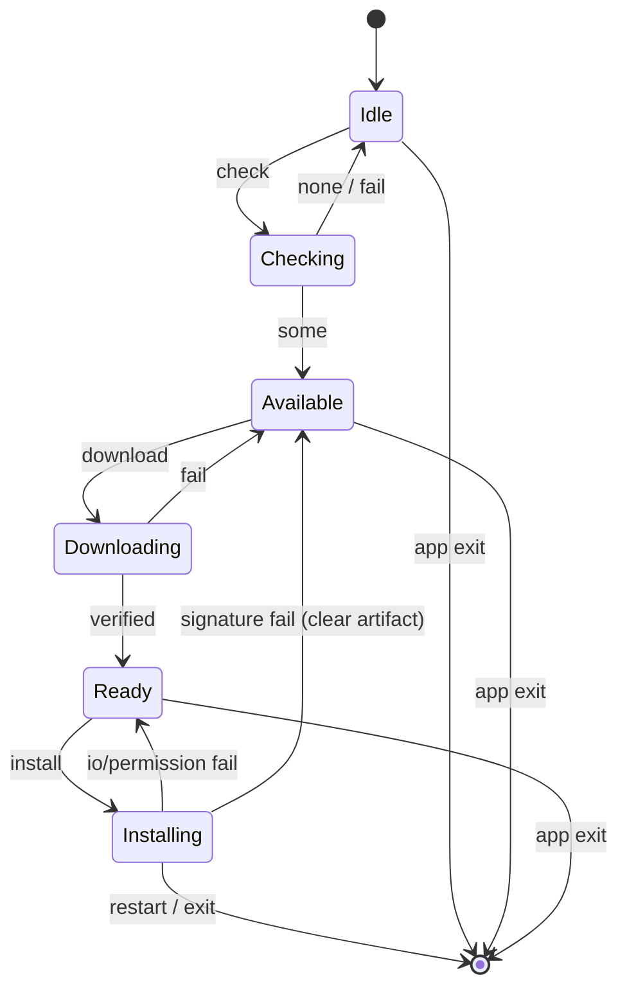
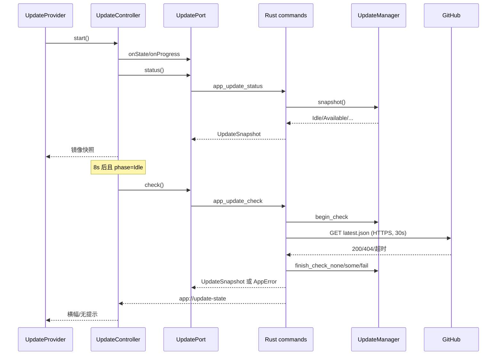
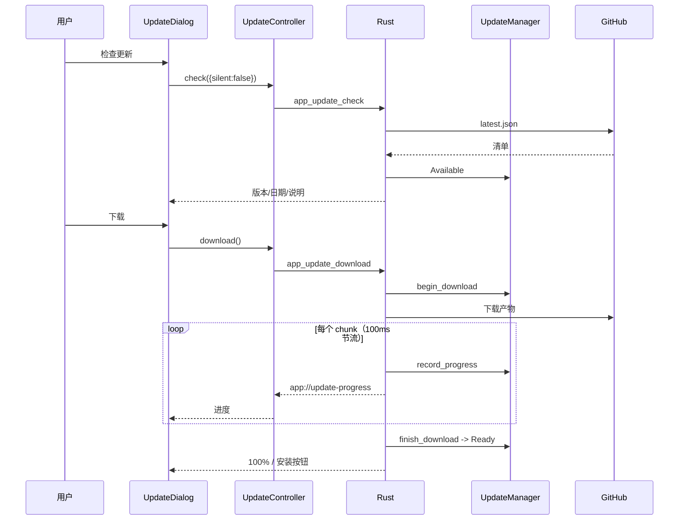
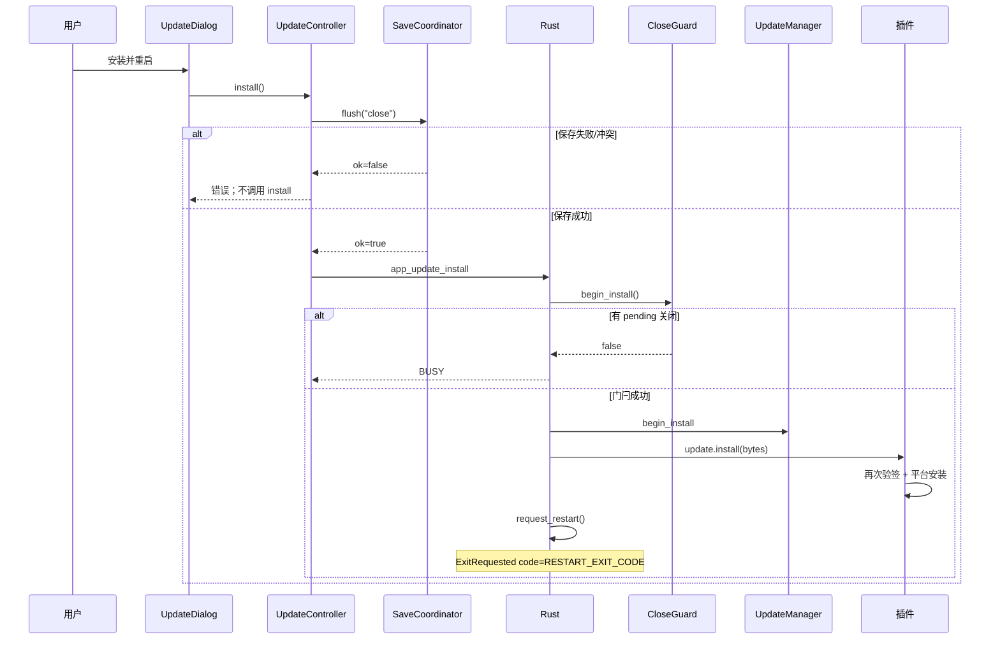
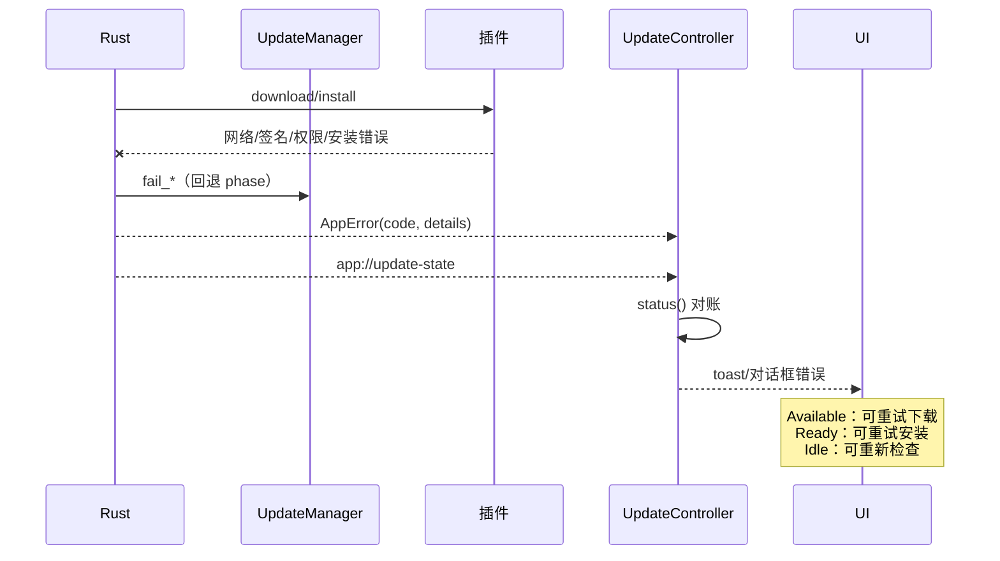

# 应用自动更新设计方案

> **文档用途：** 面向技术评审、开发、测试和运维人员的设计说明
> **功能 ID：** `app-auto-update`
> **对应需求：** `R-001 ~ R-012`（见 §2.3）
> **对应实施计划：** [`01-实施计划.md`](01-实施计划.md)
> **代码基线：** `main@7655d4932c709fa36f747aa4b267ac17b2bd9766`（与 `origin/main` 一致）
> **设计版本：** `v1.2`
> **日期：** `2026-10-27`
> **状态：** `已批准`（2026-10-27 人工决策：仅 macOS universal，Xcode Developer ID 签名 + 公证；设计层见 `05`）

---

## 1. 摘要

Qingmo 当前没有任何应用内更新能力：没有 updater 插件、没有签名发布链路、没有 `latest.json`、没有更新 UI；版本号还分散在 7 个声明位置。用户只能手工下载新版本，发布者也无法证明“用户装到的包确实由本项目构建并签名”。

本方案采用 **Tauri 官方 `tauri-plugin-updater` 2.14.0 的 Rust API**，不引入 JS updater 插件、不授予 `updater:*` 权限；Rust 侧 `UpdateManager` 是更新生命周期的唯一状态机，前端 `UpdateController` 只镜像快照与事件。安装前复用现有 `SaveCoordinator.flush("close")`，关闭守卫仍由 `CloseGuard` 单一入口控制。按 2026-10-27 决策，MVP **仅支持 macOS universal**，使用 **Xcode 中的 Developer ID Application 证书签名 + Apple 公证**；发布侧使用 GitHub Releases + `tauri-action@1.0.0` + draft + `check-latest-json` 门禁，并开启 `requireSignedVersion`，把清单版本绑定到 minisign 签名的 trusted comment。

明确不做：自动静默安装、自动回滚、stable/beta 用户切换、百分比灰度、完整 TUF 元数据、移动端自更新、增量更新。这些能力要么超出官方插件边界，要么需要新增服务端、用户配置或数据表，必须先经过人工决策。

一句话方案：

> 在保留现有单一保存路径、单一关闭守卫和契约单一源的前提下，用官方 updater 的 Rust API + Rust 单一更新状态机 + 前端只读镜像，解决“安全地发现、下载、验签、安装并重启”的问题；用签名版本绑定和发布门禁补齐供应链的最低安全闭环。

---

## 2. 问题定义

### 2.1 业务背景与故障特征

当前用户升级 Qingmo 的唯一方式是手工访问发布页、下载安装包、覆盖安装。这个链路没有应用内提示、没有完整性校验、没有版本绑定，也无法在安装前统一处理未保存文档。

```text
发布新版本
  -> 用户不知道有新版本（无检查/无提示）
  -> 用户手工下载，可能拿错平台包或旧包
  -> 覆盖安装前没有统一的保存/关闭编排
  -> 发布者无法证明包来源；用户无法验证签名
```

现有代码证据：

- 启动入口只注册 dialog 插件，没有 updater：`src-tauri/src/lib.rs:56`。
- IPC 只有 5 条命令、1 条事件：`src-tauri/src/ipc/contract.rs:6-14`；`src-tauri/src/commands/mod.rs:5-13`。
- capability 只有 2 条 core 事件权限 + 5 条应用命令权限：`src-tauri/capabilities/default.json:5-13`。
- 唯一保存路径是 `SaveCoordinator.flush`：`apps/desktop/src/features/editor/save/SaveCoordinator.ts:220-222`。
- 关闭唯一入口是 Rust `CloseGuard` + `request_close`：`src-tauri/src/commands/close.rs:12-47`；`src-tauri/src/state/close_guard.rs:10-47`。
- 发布 workflow 只有 CI，没有 tag 触发、签名或 `latest.json`：`.github/workflows/ci.yml`。
- 版本声明分布在 7 处：根 `package.json:3`、`apps/desktop/package.json:3`、`packages/{editor-core,shared,ui}/package.json:3`、`src-tauri/Cargo.toml:3`、`src-tauri/tauri.conf.json:4`。

### 2.2 当前实现与主要缺口

| 缺口 | 当前行为 | 根因/证据 | 导致的问题 |
|---|---|---|---|
| GAP-001 无 updater 插件/状态/命令 | 只有 dialog 插件与 5 条文档命令 | `src-tauri/src/lib.rs:56`；`ipc/contract.rs:6-14` | 应用内无法检查/下载/安装 |
| GAP-002 无更新 UI/入口 | 命令面板只注册打开/保存/预览/主题 | `WorkspaceLayout.tsx:96-142`；`routes.tsx:6-15` | 即使有后端也无处触发与展示 |
| GAP-003 无签名/发布链路 | 只有 `ci.yml`，无 tag/签名/draft | `.github/workflows/ci.yml`；`tauri.conf.json:35-45` | 无法安全分发，无法验签 |
| GAP-004 版本 7 处漂移 | 7 处声明均为 `0.1.0`，手工维护 | 见 §2.1 版本证据 | `latest.json` 与 app 版本不一致会导致“永远有更新”或“永不更新” |
| GAP-005 无 `latest.json` 校验 | 无脚本、无平台键/签名版本检查 | 无 | 平台键缺失、URL 错误、签名未绑定版本只在用户端暴露 |
| GAP-006 无更新错误码/DTO | 前端只能拿到文档错误码 | `src-tauri/src/error.rs:10-24` | 无法区分可重试、签名失败、平台不支持 |
| GAP-007 无 fake updater/E2E | fake 只有文档/平台端口 | `apps/desktop/src/lib/ipc/fake.ts`；`apps/desktop/src/e2e/bridge.ts` | 更新流程无法零网络测试 |
| GAP-008 无安装前保存编排 | 关闭时才 flush | `SaveCoordinator.ts:220-222`；`useCloseGuard.ts:52-77` | 更新重启可能丢未保存内容 |
| GAP-009 无安装中关闭抑制 | 红叉/Cmd+Q 始终进入 CloseGuard | `close.rs:12-23`；`lib.rs:82-87` | 安装/关闭竞态可能二次退出或中断安装 |
| GAP-010 无密钥托管/轮换 runbook | 仓库无私钥，也无文档 | 无 | 私钥丢失会永久阻断已安装用户更新 |
| GAP-011 蓝图能力描述偏差 | 蓝图写“签名 manifest / 失败自动回滚 / 灰度比例” | `docs/BLUEPRINT.md:1085,1164` | 与官方插件实际能力不符，误导实施 |
| GAP-012 无统一 settings | 唯一持久化键是主题 | `docs/adr/0001-editor-mvp-boundaries.md:24`；`docs/todo/p0-p1-editor-mvp/03-复盘与交接.md:211` | 随手加更新偏好会形成第二配置源 |

### 2.3 设计目标

| R-ID | 目标 | 可度量成功标准 |
|---|---|---|
| R-001 | 命令面板可手动检查更新，显示当前版本、最新版本、发布日期和发布说明 | 组件/E2E：有更新时版本/日期/说明可见；无更新时显示“已是最新”；`AC-001` |
| R-002 | 启动后静默检查一次；失败无感；发现更新用非模态横幅提示 | 单测/E2E：失败无 toast/无弹窗、启动不阻塞；有更新只出现横幅；`AC-002` |
| R-003 | 下载显示累计进度与总大小；总大小未知时显示不确定进度；事件节流 | Rust 单测：累计等于分块之和；事件 ≤ 10 次/秒 + 最终 100%；`AC-003` |
| R-004 | 安装前必须走现有 `SaveCoordinator.flush("close")`；冲突/终态错误阻止安装 | 单测/E2E：flush 失败时 `app_update_install` 零调用；`AC-006`/`AC-007` |
| R-005 | 安装/重启不绕过 Rust `CloseGuard`；安装中忽略关闭请求；安装失败保留旧版本 | Rust 单测：Installing 期间 `begin` 返回 false；macOS 冒烟旧版本仍可启动；`AC-008`/`AC-009` |
| R-006 | Rust 是更新生命周期唯一权威；单飞、状态机、稳定错误码；非法转换明确失败 | 状态机全转移测试；并发命令返回 `BUSY`/`UPDATE_NOT_READY`；`AC-010` |
| R-007 | minisign 验签 + 签名版本绑定（`requireSignedVersion`）；只允许 HTTPS；不允许降级 | 配置测试 + 签名负例 + `https_only(true)`；`AC-004`/`AC-005` |
| R-008 | 不新增用户配置/数据表/localStorage 键；不授予 `updater:*` JS 权限；CSP 不变 | `security_config.rs` 断言权限/CSP/配置；`AC-011` |
| R-009 | 命令/事件/DTO/权限/生成类型继续单一源，契约测试防漂移 | 9 命令/3 事件/19 错误码/生成无 diff；`AC-012` |
| R-010 | 版本单一源检查 + 签名发布流水线 + `latest.json` 平台键/签名版本门禁 | 脚本正负例 + draft 发布 dry-run；`AC-013`/`AC-014` |
| R-011 | 可测试：Rust 状态机、前端 fake/controller/组件、浏览器 E2E 零真实网络 | 单测/E2E 全绿；Playwright 断言无 GitHub 请求；`AC-015` |
| R-012 | ADR、蓝图偏差、回滚、密钥托管/轮换、交接文档齐全 | 文档评审 + 链接/ID 检查；`AC-016` |

### 2.4 非目标

- 不实现自动静默安装或退出时强制安装；安装必须由用户显式确认，因为可能丢失未保存内容并破坏用户信任（`Q-003`）。
- 不实现自动回滚到上一版本；官方插件只在安装失败时尽量保留旧应用，不提供跨版本回滚（`Q-010`）。
- 不实现 stable/beta 用户切换、百分比灰度；静态 `latest.json` 不支持按比例分流（`Q-005`，`NEXT-AU-002`）。
- 不新增用户级更新偏好、跳过版本、自动检查开关；当前没有统一 settings，新增键会形成第二配置源（`Q-004`，`NEXT-006`）。
- 不实现完整 TUF/Uptane 元数据、阈值签名、冻结保护；作为威胁模型参考，不作为 MVP 实现（`NEXT-AU-001`）。
- 不实现 Windows/Linux 桌面更新；2026-10-27 决策为 MVP 仅 macOS，平台扩展统一进入 `NEXT-AU-007`。
- 不实现增量更新、移动端自更新、遥测成功率；官方插件与当前分发边界不支持（`NEXT-AU-004`/`NEXT-009`/`NEXT-AU-003`）。
- 不新增设置页/关于页/原生菜单项；复用命令面板、横幅、对话框（`Q-012`）。
- 不在运行时清洗 AppleDouble；发布门禁拒绝 `._*`，安装包由 Tauri bundler 直接生成（`D-020`）。

### 2.5 前置假设与约束

| 类型 | 内容 | 验证方式 | 假设失效后的处理 |
|---|---|---|---|
| 业务 | 发布仓库/Release 对匿名用户可读（否则插件无法下载） | `Q-001`；curl 未认证访问 `latest.json` | 改用自建 HTTPS/CDN 或带认证代理；不能把 token 嵌入客户端 |
| 业务 | 首版仅支持 macOS universal | `Q-002`（已确认）；`lipo -archs`/真机 | Windows/Linux 移入 `NEXT-AU-007` |
| 技术 | `tauri-plugin-updater = 2.14.0` 与 Tauri 2.12.5、Rust 1.91.1 兼容 | `cargo check`；插件 `Cargo.toml` | 回退 2.13.3；记录偏差并重评签名版本能力 |
| 技术 | CLI 2.12.4 在 `tauri build` 时把 app version 写入 trusted comment | CLI 2.12.0 changelog；签名解码检查 | 手动 `tauri signer sign --app-version`；否则拒绝发布 |
| 技术 | 插件 `Update::download` 回调参数是分块长度，不是累计值 | 插件源码 `updater.rs:886` | 若升级插件改变语义，必须重跑进度单测 |
| 技术 | macOS `install` 完成 swap 后返回，需要应用自行 `request_restart()` | 插件源码 `install` 文档；`updater.rs:1009` | 只在 macOS 调 `request_restart`；真机冒烟 |
| 技术 | `request_restart` 触发 `RESTART_EXIT_CODE`，不进入现有 `code: None` 分支 | Tauri `app.rs:633-639`；`lib.rs:82-87` | 若 Tauri 改语义，安装前 flush 仍是兜底；需重评关闭守卫 |
| 部署 | GitHub Actions 可用，release Environment 可配置 required reviewers | `Q-007`；workflow dry-run | 改用自建 runner/签名服务；不降低密钥保护 |
| 部署 | 维护者能在 Xcode 中提供 Developer ID Application 证书并完成 Apple 公证 | `Q-006`（已确认）；`codesign`/`notarytool` dry-run | 未签名/未公证构建只能内部测试，不对外发布 |
| 兼容 | 首个带 updater 的版本仍需用户手工安装；旧版本无法被自动更新 | 发布说明；`RK-018` | 提供一次性手动下载公告 |
| 安全 | 应用不读取用户配置来决定更新源/密钥；全部编译期固定 | `security_config.rs` | 任何动态源/密钥都必须先过 ADR 与人工批准 |

---

## 3. 总体设计

### 3.1 设计原则

| 原则 | 含义 | 对实现的约束 |
|---|---|---|
| 单一状态权威 | Rust `UpdateManager` 是 phase/进度/错误上下文的唯一来源 | 前端不得推断/跳转 phase；只能替换为 Rust 返回的快照或事件 |
| 单一保存路径 | 安装前只调用现有 `SaveCoordinator.flush("close")` | 不新增 `saveBeforeUpdate`、不改 `SaveCoordinator` 状态机 |
| 单一关闭门 | 所有关闭仍走 `CloseGuard.begin`；安装期由同一把锁阻断 | 不新建第二套关闭标志；不在前端直接 `exit` |
| 单一契约源 | 命令/事件/权限/DTO 从 `contract.rs`/`dto.rs` 派生 | 组件不得直接 `invoke`；前端镜像文件必须与 Rust 契约测试一致 |
| 最小权限 | WebView 不直接访问 GitHub，不授予 `updater:*` | 网络只在 Rust；capability 只加 4 条应用命令 |
| 默认安全 | 无签名、版本不匹配、非 HTTPS、未就绪、保存失败、关闭 pending 一律拒绝 | 所有失败路径 fail-closed；不提供“仍然安装” |
| 无隐藏副作用 | 启动检查失败静默；不自动下载；不自动重启 | 下载/安装必须用户显式触发 |
| 可证据化 | 每个结论绑定源码/官方文档/测试/运行证据 | 设计、计划、状态、评审 ID 可互相追踪 |

### 3.2 系统架构



架构说明：

- **入口层：** 命令面板、启动静默检查、横幅按钮。入口只负责“用户意图”，不做状态判断。
- **编排层：** 前端 `UpdateController` 负责订阅、快照镜像、安装前 flush；它不维护第二套 phase 转换。
- **核心层：** Rust `UpdateManager` 负责单飞、phase、generation、进度、错误回退；`commands/update.rs` 负责插件调用、超时和错误分类。
- **依赖层：** 官方插件负责清单获取、下载、minisign 验签、平台安装；保存/关闭依赖既有 `SaveCoordinator`/`CloseGuard`。
- **观测层：** 状态快照命令 + 两条事件 + 结构化 tracing；无远程遥测。
- **发布层：** GitHub Actions 单一 macOS universal 构建、Xcode 证书签名/公证、draft、`latest.json` 校验、人工 publish；证书/私钥只在 Environment secret 中。

### 3.3 职责边界

| 模块/层 | 负责 | 不负责 | 依赖 |
|---|---|---|---|
| `UpdateManager`（Rust） | phase/generation/进度/artifact 内存、单飞、失败回退、`is_installing` | 网络请求、插件错误细节、UI 文案、保存 | `tauri_plugin_updater::Update`、`Arc<[u8]>` |
| `commands/update.rs` | 4 条命令、插件调用、超时、错误分类、事件发送 | 状态转换规则、保存、关闭策略 | `UpdateManager`、`CloseGuard`、插件 |
| `SaveCoordinator`（既有） | 唯一保存循环、冲突/重试/终态 | 更新状态、安装、重启 | `IpcPort`、`EditorSession` |
| `CloseGuard`（既有，小改） | 唯一关闭 pending；安装期阻断新关闭 | 保存、插件安装 | `Mutex<Option<CloseReason>>` + 安装标志 |
| `UpdatePort`（前端） | 命令/事件适配、fake | 业务状态机、保存 | `@tauri-apps/api`（仅 `lib/update/tauri.ts`） |
| `UpdateController` | 订阅、快照镜像、generation 过滤、安装前 flush | 直接 `invoke`、直接读写文件、推断 phase | `UpdatePort`、`SaveCoordinator` 回调 |
| `UpdateHost`/`UpdateDialog` | 横幅/对话框/命令注册/可访问性 | 网络、状态转换、保存 | `UpdateController`、`@qingmo/ui` |
| 发布脚本/workflow | 版本/latest.json/签名门禁、draft/publish | 应用运行时逻辑 | GitHub Actions、tauri-action、secrets |

### 3.4 当前链路与目标链路

当前链路：

```text
启动
  -> main.rs -> qingmo_lib::run
  -> Builder.plugin(dialog) -> manage(DocumentRegistry/CloseGuard)
  -> invoke_handler(5 commands)
  -> RunEvent(CloseRequested/ExitRequested code=None) -> request_close -> CloseGuard

升级
  -> 用户手工访问 GitHub Releases
  -> 下载对应平台安装包
  -> 覆盖安装（无应用内保存/关闭编排、无签名验证）
```

目标链路：

```text
启动
  -> Builder.plugin(dialog + updater) -> manage(UpdateManager)
  -> invoke_handler(9 commands)
  -> UpdateProvider.start -> app_update_status -> 订阅两条事件
  -> 8s 后静默 app_update_check（失败无感）

检查
  -> UpdateManager.begin_check（Idle -> Checking，generation+1）
  -> app.updater_builder().timeout(30s).configure_client(https_only).build()?.check()
  -> None：fail_check -> Idle + app://update-state
  -> Some：finish_check_some -> Available + UpdateInfo + app://update-state

下载
  -> begin_download（Available -> Downloading）
  -> update.timeout = 10min；update.download(on_chunk, on_finish)
  -> 累计 downloaded、100ms 节流 app://update-progress
  -> 插件 verify 成功 -> finish_download(Arc<[u8]>) -> Ready + 100%
  -> 失败 -> fail_download -> Available + 稳定错误码

安装
  -> UpdateController.install(prepareInstall)
  -> SaveCoordinator.flush("close")（唯一保存路径）
  -> 失败：阻断，保留 Ready，不调用 install
  -> 成功：app_update_install
  -> close_guard.begin_install()（同一 Mutex，阻断新关闭）
  -> begin_install（Ready -> Installing）+ app://update-state
  -> update.install(&bytes)（插件再次验签）
  -> macOS：app.request_restart()（RESTART_EXIT_CODE）
```

---

## 4. 修复方式与修改点

> 本章适用于缺陷修复；本功能是**新增能力**，不存在“修复前失败点”。为保持实施可追踪，4.1/4.2 描述接入前链路与缺口，4.3/4.4 用 `MP-ID` 列出新增/修改接入点。正常打开/保存/关闭路径不变；关闭侧只增加安装/退出终态，安装中的关闭请求被有意忽略。

### 4.1 接入方式概述

| 项 | 内容 |
|---|---|
| 根因 | 当前代码没有 updater 依赖、状态、命令、UI、发布链路；版本分散且无可验证签名 |
| 接入策略 | 在启动入口注册官方插件与 `UpdateManager`；在 contract 单一源增加 4 命令/2 事件；前端新增独立 `UpdatePort`/Controller/UI；安装前复用既有 flush；发布侧增加签名与 draft 门禁 |
| 保持不变 | `SaveCoordinator` 状态机、`useCloseGuard` 流程、`IpcPort` 文档通道、CSP、用户配置/数据表、主题 localStorage |
| 被否决的替代方案 | JS updater 插件（需 `updater:*` 权限）、自建 HTTP 安装器（重复官方平台逻辑）、前端独立状态机（双源竞态）、扩展 `IpcPort`（污染文档边界）；见 §14 |

### 4.2 接入前链路

```text
main.rs
  -> qingmo_lib::run
  -> Builder.plugin(dialog).manage(DocumentRegistry/CloseGuard)
  -> invoke_handler(5 commands)
  -> RunEvent(CloseRequested/ExitRequested)
  -> request_close -> CloseGuard.begin -> app://close-requested
  -> useCloseGuard -> SaveCoordinator.flush("close") -> app_close_confirm -> exit

【缺口】没有任何更新入口；没有签名发布；版本 7 处手工维护。
```

### 4.3 接入后链路

```text
main.rs
  -> qingmo_lib::run
  -> Builder.plugin(dialog + updater)
  -> setup: manage(UpdateManager)          【MP-003】
  -> invoke_handler(9 commands)            【MP-004/008】

检查/下载/安装
  -> UpdateController                      【MP-016】
  -> UpdatePort -> invoke                  【MP-015】
  -> commands/update.rs                    【MP-008】
  -> UpdateManager                         【MP-007】
  -> tauri-plugin-updater                  【MP-001/002】
  -> GitHub Releases

安装前
  -> SaveCoordinator.flush("close")        【复用，不改】
  -> CloseGuard.begin_install()            【MP-009】
  -> update.install -> request_restart/exit
```

### 4.4 修改点清单

| MP-ID | 文件/符号 | 修改类型 | 修改内容 | 影响的调用链节点 | 关联决策/任务 | 风险 |
|---|---|---|---|---|---|---|
| MP-001 | `src-tauri/Cargo.toml`、`Cargo.lock` | 修改 | 增加 `tauri-plugin-updater = "=2.14.0"`；`tokio` 增加 `time`/`rt`/`macros` feature（`spawn_blocking`/`select!`/`timeout`） | 插件依赖/超时 | `D-001`/`T-003` | 中 |
| MP-002 | `src-tauri/tauri.conf.json` | 修改 | `bundle.createUpdaterArtifacts=true`；`plugins.updater.pubkey/endpoints/requireSignedVersion=true`；不设置 dangerous/allowDowngrades/installMode | 构建/信任根 | `D-008`/`T-003` | 高 |
| MP-003 | `src-tauri/src/lib.rs:run` | 修改 | 注册 `tauri_plugin_updater::Builder`；setup 中 `manage(UpdateManager::new(package_info.version))` | 启动/状态注册 | `D-001`/`D-002`/`T-003`/`T-007` | 高 |
| MP-004 | `src-tauri/src/ipc/contract.rs` | 修改 | `COMMANDS` 追加 4 条；`EVENTS` 追加 2 条；增加事件名常量，避免 `EVENTS[1]` 索引 | 契约单一源 | `D-013`/`T-004` | 高 |
| MP-005 | `src-tauri/src/ipc/dto.rs`、`ipc/mod.rs` | 修改 | 新增 `UpdatePhase`/`UpdateInfo`/`UpdateProgress`/`UpdateProgressPayload`/`UpdateSnapshot`；导出 | IPC DTO | `D-012`/`T-004` | 中 |
| MP-006 | `src-tauri/src/error.rs` | 修改 | 新增 6 个 `AppErrorCode`：`UPDATE_CHECK_FAILED`/`UPDATE_DOWNLOAD_FAILED`/`UPDATE_SIGNATURE_INVALID`/`UPDATE_INSTALL_FAILED`/`UPDATE_UNSUPPORTED`/`UPDATE_NOT_READY` | 错误分类 | `D-012`/`T-004` | 中 |
| MP-007 | `src-tauri/src/state/update_manager.rs`、`state/mod.rs` | 新增 | 唯一状态机：phase/generation/进度/`Update`/`Arc<[u8]>`；单飞；失败回退；`is_installing` | 核心状态 | `D-002`/`D-018`/`T-006` | 高 |
| MP-008 | `src-tauri/src/commands/update.rs`、`commands/mod.rs` | 新增/修改 | T-004 放 4 个 stub；T-007 替换为插件调用；30s/10min 超时；HTTPS 校验；进度累计/节流；错误分类；事件 | 命令/网络/安装 | `D-001`/`D-008`/`D-018`/`D-019`/`D-021`/`T-004`/`T-007` | 高 |
| MP-009 | `src-tauri/src/state/close_guard.rs` | 修改 | 增加安装/退出终态：`begin_install`/`end_install`/`confirm`/`is_installing`；`begin`/`begin_install`/`confirm` 在同一 Mutex 内互斥 | 关闭竞态 | `D-019`/`D-022`/`T-007` | 高 |
| MP-010 | `src-tauri/src/commands/close.rs` | 修改 | `request_close` 使用命名的 close 事件常量；`app_close_confirm` 改用 `guard.confirm(allow)`；安装/退出期返回 BUSY | 关闭入口 | `D-019`/`T-007` | 中 |
| MP-011 | `src-tauri/capabilities/default.json` | 修改 | 追加 4 条 `allow-app-update-*`；保持 2 条 core 事件权限；不加 `updater:*` | 权限 | `D-005`/`D-013`/`T-004` | 高 |
| MP-012 | `src-tauri/tests/commands_contract.rs`、`security_config.rs`、`export_bindings.rs` | 修改 | 9 命令/3 事件/19 错误码/DTO wire/capability exact/配置断言；显式导出新 DTO | 契约/安全测试 | `D-013`/`T-004`/`T-012` | 中 |
| MP-013 | `packages/shared/src/generated/**`、`generated/index.ts` | 修改 | ts-rs 生成新 DTO；手工索引 | 前端类型 | `D-012`/`T-004` | 中 |
| MP-014 | `apps/desktop/src/lib/ipc/commands.ts`、`errors.ts`、`index.ts` | 修改 | 4 命令/2 事件/请求响应 map/权限 map；6 个错误码 + runtime array | 前端契约镜像 | `D-013`/`D-012`/`T-005` | 高 |
| MP-015 | `apps/desktop/src/lib/update/{port,tauri,fake,index}.ts` | 新增 | `UpdatePort` + Tauri/Fake 适配器；fake 可控状态/进度/错误/零网络 | 前端边界 | `D-014`/`T-005` | 中 |
| MP-016 | `apps/desktop/src/features/update/{UpdateController,UpdateProvider,useUpdate,UpdateHost,UpdateDialog}.tsx/ts` | 新增 | 快照镜像、generation 过滤、启动静默检查、`registerPrepareInstall` + flush 结果检查、横幅/对话框/命令 | UI/编排 | `D-002`/`D-003`/`D-015`/`T-008`/`T-009` | 高 |
| MP-017 | `apps/desktop/src/app/AppServices.tsx`、`AppShell.tsx`、`app-services.test.ts`、`apps/desktop/src/e2e/bridge.ts`、`open-flow.test.tsx`、`document-session.test.tsx` | 修改 | `AppServices` 增加 `updates`；AppShell 内挂 `UpdateProvider`；同步 E2E/fixture | 装配根 | `D-014`/`T-005`/`T-008` | 中 |
| MP-018 | `apps/desktop/src/features/workspace/WorkspaceLayout.tsx`、`apps/desktop/src/app/useCloseGuard.ts`、`useCommandKeybindings.ts` | 修改 | 挂载 `UpdateHost`；注册 live `prepareInstall`；`closing` 观察位；关闭确认/更新对话框/快捷键互斥 | UI 编排 | `D-015`/`T-009` | 高 |
| MP-019 | `apps/desktop/src/i18n/locales/{zh-CN,en}.ts`、`i18n.test.ts` | 修改 | `update` namespace + 6 错误文案 + 对话框/横幅/命令标签 | 文案/可访问性 | `D-016`/`T-009` | 低 |
| MP-020 | `dependency-cruiser.config.cjs` | 修改 | 允许 `lib/update/tauri.ts` import `@tauri-apps`；仍禁止其他前端文件 | 边界 | `D-014`/`T-005` | 中 |
| MP-021 | `scripts/release/check-versions.mjs`、`check-latest-json.mjs` | 新增 | 7 处版本 + Cargo.lock；tag/`darwin-*` 平台键/URL/公钥验签/签名版本/AppleDouble/notes 上限 | 发布门禁 | `D-009`/`D-011`/`T-002`/`T-011` | 中 |
| MP-022 | `.github/workflows/release.yml` | 新增 | tag 触发、create draft、单一 macOS universal 构建、Xcode 签名/公证、validate、两阶段审批 publish、最小权限/SHA pin | 发布 | `D-009`/`T-011` | 高 |
| MP-023 | `scripts/ci/negative-*.sh`、`.github/workflows/ci.yml` | 修改 | 更新命令/权限负例；`check-versions` 进 CI | CI 门禁 | `D-013`/`T-012` | 中 |
| MP-024 | `docs/adr/0005-app-auto-update.md`、`docs/BLUEPRINT.md`、`docs/TOPOLOGY.md`、`README.md` | 新增/修改 | 记录范围/信任根/退出语义/无 settings；修正“签名 manifest/自动回滚/灰度”偏差 | 文档 | `D-004`/`D-008`/`D-010`/`T-001`/`T-013` | 低 |
| MP-025 | `apps/desktop/src/e2e/bridge.ts`、`e2e/types.ts`、`e2e/helpers.ts`、`e2e/update.spec.ts` | 新增/修改 | FakeUpdatePort 注入；手动检查/进度/保存阻断/零网络 | E2E | `D-015`/`T-010` | 中 |
| MP-026 | `package.json` | 修改 | 增加 `release:check-*` 脚本；不新增运行时依赖 | 脚本入口 | `D-011`/`T-002`/`T-011` | 低 |

> `MP-###` 与 `T-###` 的映射在 `01-实施计划.md §2.3` 的 MP 映射表维护；实施时每次改 `lib.rs`/`close.rs`/`contract.rs` 前必须重跑 GitNexus impact。

---

## 5. 核心组件

### 5.1 `UpdateManager`（Rust 唯一状态机）

职责：把“检查/下载/安装”收敛为一个进程内状态机，提供单飞、generation、进度快照、失败回退和安装期关闭门闩判断。

| 项 | 设计 |
|---|---|
| 输入 | `begin_check()`、`begin_download()`、`begin_install()`；`finish_*`/`fail_*`；`record_progress(generation, downloaded, total)` |
| 输出 | `UpdateSnapshot`（phase/generation/currentVersion/update/progress）；`current_update()` 返回 `Update` 克隆；`artifact()` 返回 `Arc<[u8]>` |
| 依赖 | `tauri_plugin_updater::Update`、`Arc<[u8]>`、`std::sync::Mutex` |
| 状态 | 进程级；不持久化；应用退出即丢失 |
| 并发 | 单飞；所有转换在短临界区内完成；**绝不跨 await 持锁**；generation 丢弃迟到回调 |
| 失败策略 | 检查失败回 Idle；下载失败回 Available（保留 update）；安装失败回 Ready（保留 artifact，签名错误除外） |
| 测试 | `#[cfg(test)]` fixture 注入 phase/artifact；`cargo test --manifest-path src-tauri/Cargo.toml update_manager` 覆盖合法/非法转换、generation、进度、回退 |

```rust
pub enum UpdatePhase {
    Idle,
    Checking,
    Available,
    Downloading,
    Ready,
    Installing,
}

pub struct UpdateManager {
    inner: Mutex<Inner>,
}

struct Inner {
    phase: UpdatePhase,
    generation: u64,
    current_version: String,
    update: Option<tauri_plugin_updater::Update>,
    artifact: Option<Arc<[u8]>>,
    progress: Option<UpdateProgress>,
}

impl UpdateManager {
    pub fn snapshot(&self) -> UpdateSnapshot;
    pub fn begin_check(&self) -> Result<u64, AppError>;       // Idle -> Checking
    pub fn finish_check_none(&self, gen: u64) -> Result<UpdateSnapshot, AppError>;
    pub fn finish_check_some(&self, gen: u64, update: Update) -> Result<UpdateSnapshot, AppError>;
    pub fn fail_check(&self, gen: u64, error: AppError) -> Result<UpdateSnapshot, AppError>;

    pub fn begin_download(&self) -> Result<u64, AppError>;    // Available -> Downloading
    pub fn current_update(&self) -> Option<tauri_plugin_updater::Update>;
    pub fn record_progress(&self, gen: u64, downloaded: u64, total: Option<u64>) -> Option<UpdateProgress>;
    pub fn finish_download(&self, gen: u64, bytes: Vec<u8>) -> Result<UpdateSnapshot, AppError>;
    pub fn fail_download(&self, gen: u64, error: AppError) -> Result<UpdateSnapshot, AppError>;

    pub fn begin_install(&self) -> Result<u64, AppError>;     // Ready -> Installing
    pub fn artifact(&self) -> Option<Arc<[u8]>>;
    pub fn fail_install(&self, gen: u64, error: AppError, clear_artifact: bool) -> Result<UpdateSnapshot, AppError>;
    pub fn is_installing(&self) -> bool;
}
```

关键约束：

1. `begin_*` 只允许从唯一前置 phase 进入，其余返回 `BUSY` 或 `UPDATE_NOT_READY`。
2. 每次 phase 变化 `generation += 1`；进度事件携带 generation；前端只接受当前 generation。
3. `finish_download` 把 `Vec<u8>` 转为 `Arc<[u8]>`，安装时克隆 Arc，不复制整包字节。
4. `fail_download` 回 Available 并保留 `Update`，用户可以重试下载而无需重新检查。
5. 安装失败默认保留 artifact（可重试）；签名错误清空 artifact 并回 Available（强制重新下载）。
6. `Installing` 是进程终止前的终态；成功安装后不再回到 Idle。

### 5.2 `commands/update.rs`（插件接线与协议适配）

职责：把 4 条 IPC 命令映射到 `UpdateManager` 与插件；负责超时、错误分类、事件发送和平台分支。

| 项 | 设计 |
|---|---|
| 输入 | `app_update_status` 无参；`check`/`download`/`install` 无参（更新目标由 Rust 状态持有） |
| 输出 | `UpdateSnapshot`；`install` 成功后 macOS 触发 restart，命令可能不返回 |
| 依赖 | `UpdaterExt`、`UpdateManager`、`CloseGuard`、`AppHandle` |
| 生命周期 | 每个命令一个异步任务；`install` 用 `spawn_blocking` 执行同步安装 |
| 失败策略 | 分类为 6 个稳定错误码；事件发送失败只记日志，不影响命令结果 |
| 测试 | 错误分类单测 + macOS 冒烟；超时用 `tokio::time::pause` 或注入短超时 |

```rust
#[tauri::command(rename_all = "camelCase")]
pub fn app_update_status(manager: State<'_, UpdateManager>) -> Result<UpdateSnapshot, AppError> {
    Ok(manager.snapshot())
}

#[tauri::command(rename_all = "camelCase")]
pub async fn app_update_check<R: Runtime>(
    app: AppHandle<R>,
    manager: State<'_, UpdateManager>,
) -> Result<UpdateSnapshot, AppError> {
    let generation = manager.begin_check()?;
    emit_state(&app, &manager);
    let updater = match app.updater_builder()
        .timeout(Duration::from_secs(30))
        .configure_client(|client| client.https_only(true))
        .build()
    {
        Ok(updater) => updater,
        Err(error) => {
            let app_error = classify_check(error);
            let snapshot = manager.fail_check(generation, app_error.clone())?;
            emit_state(&app, &snapshot);
            return Err(app_error);
        }
    };
    match timeout(Duration::from_secs(30), updater.check()).await {
        Ok(Ok(Some(update))) => { let snapshot = manager.finish_check_some(generation, update)?; emit_state(&app, &snapshot); Ok(snapshot) }
        Ok(Ok(None)) => { let snapshot = manager.finish_check_none(generation)?; emit_state(&app, &snapshot); Ok(snapshot) }
        Ok(Err(error)) => { let app_error = classify_check(error); let snapshot = manager.fail_check(generation, app_error.clone())?; emit_state(&app, &snapshot); Err(app_error) }
        Err(_) => { let app_error = timeout_error("check"); let snapshot = manager.fail_check(generation, app_error.clone())?; emit_state(&app, &snapshot); Err(app_error) }
    }
}
```

安装命令的关键顺序（不可交换）：

```text
1. close_guard.begin_install()       // 同一 Mutex 内检查 pending/installing/exiting + 设置 installing
   - false => 返回 BUSY（有 pending 关闭或正在退出）
2. manager.begin_install()           // Ready -> Installing；失败则 end_install
3. emit app://update-state(Installing)
4. update.install(&bytes)            // 插件再次验签；macOS 完成 swap 后返回
5. 成功：macOS request_restart()
6. 失败：manager.fail_install(...) + close_guard.end_install() + emit Ready/Available
```

`InstallLease` 用 RAII 保证第 2~6 步的任意错误路径都会 `end_install`；成功路径 `commit()` 后不再解锁，因为进程即将退出/重启，`Installing` 是终态。`update.install` 是同步阻塞调用，必须放在 `spawn_blocking`；不设“安装超时”（无法安全取消 swap），超时只做日志/UI 提示，不自动解锁关闭门。

### 5.3 `SaveCoordinator`（复用，不修改）

职责：安装前把当前文档保存到“clean/readonly”或返回冲突/终态错误。

| 项 | 设计 |
|---|---|
| 输入 | `flush("close")` |
| 输出 | `FlushResult { ok, state, failure?, error?, conflict? }` |
| 依赖 | 现有 `IpcPort.documentWriteAtomic/documentReload/documentSaveAs` |
| 状态 | 现有保存状态机；更新流程不读写其内部字段 |
| 并发 | `flush` 内部串行队列；更新安装不会与手动保存并发写同一文档 |
| 测试 | 既有 `SaveCoordinator` 测试 + 新增 Controller 测试断言“flush 失败时 install 未被调用” |

使用方式（由 `UpdateController.install` 统一调用，组件不直接 install）：

```ts
// WorkspaceLayout 注册；有 session 但 coordinator 为空时 fail-closed
registerPrepareInstall(async () => {
  const coordinator = coordinatorRef.current;
  if (!hasSession) return { ok: true, state: "clean" };
  if (!coordinator) return { ok: false, state: "error", failure: "error" };
  return coordinator.flush("close");
});

// 用户点击“安装并重启”
await updates.install(); // 内部检查 FlushResult.ok，失败不调用 app_update_install
```

明确边界：

- **保存是 UI 保证，不是 Rust 安全边界。** `allow-app-update-install` 允许主窗口直接 invoke；被 XSS 控制的前端可以跳过 flush。若要把它变成安全属性，需要把“文档 dirty/保存中”状态迁到 Rust 或增加 Rust 可验证的 arm 令牌；本 MVP 不做，记录在 §13.2 残余风险。
- 不给 `SaveCoordinator` 增加 `reason="update"`；`close` 语义已覆盖“退出前保存”。
- 不复制 `flushLoop`/`saveOnce`/重试逻辑到更新模块。
- 不在安装前调用 `documentSaveAs` 或直接写文件。

### 5.4 `CloseGuard` 安装门闩（小改）

职责：继续做唯一关闭 pending 守卫，同时让“安装中”与“关闭请求”在同一把锁内互斥，消除 check-then-act 竞态。

| 项 | 设计 |
|---|---|
| 输入 | `begin(reason)`、`begin_install()`、`end_install()`、`confirm(allow)`、`cancel()` |
| 输出 | `begin`/`begin_install` 返回 bool；`confirm` 返回 `Option<CloseReason>`；`is_installing()` 供日志 |
| 状态 | `Mutex<Inner>`，`Inner { pending: Option<CloseReason>, installing: bool, exiting: bool }` |
| 并发 | `begin`/`begin_install`/`confirm` 都在同一 Mutex 内完成“检查 + 设置”；`exiting` 是终态 |
| 失败策略 | `confirm(false)` 清 pending、不置 exiting；安装失败/取消必须 `end_install`；成功保持 Installing 直到进程退出 |
| 测试 | pending 时 install 被拒；installing/exiting 时 begin 被拒；`confirm(true)` 后 install 被拒；`end_install` 后恢复；并发线程测试 |

```rust
struct Inner {
    pending: Option<CloseReason>,
    installing: bool,
    exiting: bool,
}

pub fn begin(&self, reason: CloseReason) -> bool {
    let mut inner = self.lock();
    if inner.installing || inner.exiting || inner.pending.is_some() {
        return false;
    }
    inner.pending = Some(reason);
    true
}

pub fn begin_install(&self) -> bool {
    let mut inner = self.lock();
    if inner.installing || inner.exiting || inner.pending.is_some() {
        return false;
    }
    inner.installing = true;
    true
}

/// `allow=true` 时在锁内清 pending 并置 exiting；之后任何安装/关闭都被拒绝。
pub fn confirm(&self, allow: bool) -> Option<CloseReason> {
    let mut inner = self.lock();
    if inner.installing || inner.exiting {
        return None;
    }
    let reason = inner.pending.take()?;
    if allow {
        inner.exiting = true;
    }
    Some(reason)
}

pub fn end_install(&self) {
    self.lock().installing = false;
}
```

为什么不能只在前端/命令层检查：

- 若先检查 `pending` 再设置 `Installing`，关闭请求可能恰好落在两步之间并 arm，随后用户确认关闭会中断安装。
- 只把 `begin`/`begin_install` 放同一把锁还不够：`app_close_confirm` 的 `take()` 清掉 pending 到 `app.exit(0)` 之间仍有窗口，安装可以在此期间开始。增加 `exiting` 并在 `confirm(true)` 的同一临界区置位，才能封住“已确认关闭、尚未退出”。
- `confirm` 在 installing/exiting 时返回 None，`app_close_confirm` 映射为 `BUSY`；这不改变正常关闭流程，只是让关闭确认与安装共享同一终态。
- 这不改变保存/关闭语义，只是给唯一关闭门增加安装/退出终态。

### 5.5 `UpdatePort` 与适配器

职责：把更新命令/事件从 UI 中隔离，提供 Tauri 与 Fake 两种实现。

| 项 | 设计 |
|---|---|
| 输入 | `status()`、`check()`、`download()`、`install()`、`onState()`、`onProgress()` |
| 输出 | 生成的 `UpdateSnapshot`/`UpdateProgressPayload`；取消订阅函数 |
| 依赖 | `@tauri-apps/api/core`、`@tauri-apps/api/event`（仅 `lib/update/tauri.ts`） |
| 状态 | 无状态适配器；Tauri 侧不缓存 phase |
| 测试 | `FakeUpdatePort` 可控状态/进度/错误/调用次数；默认零网络 |

```ts
export interface UpdatePort {
  status(): Promise<UpdateSnapshot>;
  check(): Promise<UpdateSnapshot>;
  download(): Promise<UpdateSnapshot>;
  install(): Promise<void>;
  onState(handler: (snapshot: UpdateSnapshot) => void): Promise<() => void>;
  onProgress(handler: (progress: UpdateProgressPayload) => void): Promise<() => void>;
}
```

### 5.6 `UpdateController`（前端镜像与编排）

职责：订阅 Rust 状态、镜像快照、启动静默检查、安装前 flush、错误对账；不推断 phase。

| 项 | 设计 |
|---|---|
| 输入 | `UpdatePort`；`registerPrepareInstall(() => Promise<FlushResult>)`（由 WorkspaceLayout 注册） |
| 输出 | `useSyncExternalStore` 快照；`check/download/install` 方法；`start/stop` |
| 依赖 | `UpdatePort`、`normalizeError`、`AppError`、`FlushResult` 类型 |
| 状态 | `snapshot`（`UpdateSnapshot` 或 null）、`started`、`runId`、`installInFlight`、`unlisten[]`、`pendingUnlisten[]`、`timer`、`prepareInstall` |
| 并发 | `start` 幂等；`installInFlight` 防双击；generation 过滤迟到事件；`runId` 取消未完成的订阅 |
| 失败策略 | 命令失败后用 `status()` 对账；静默检查失败只记 debug；没有注册 prepareInstall 时 install fail-closed |

```ts
type PrepareInstall = () => Promise<FlushResult>;

class UpdateController {
  private snapshot: UpdateSnapshot | null = null;
  private started = false;
  private runId = 0;
  private installInFlight = false;
  private unlisten: Array<() => void> = [];
  private pendingUnlisten: Array<Promise<() => void>> = [];
  private prepareInstall: PrepareInstall | null = null;
  private autoCheckTimer: ReturnType<typeof setTimeout> | null = null;
  private readonly autoCheck: boolean;

  constructor(private readonly port: UpdatePort, options: { autoCheck: boolean }) {
    this.autoCheck = options.autoCheck;
  }

  registerPrepareInstall(prepare: PrepareInstall): () => void {
    this.prepareInstall = prepare;
    return () => { if (this.prepareInstall === prepare) this.prepareInstall = null; };
  }

  start(): void {
    if (this.started) return;
    this.started = true;
    const run = ++this.runId;
    void this.bootstrap(run);
  }

  stop(): void {
    this.started = false;
    this.runId++;
    this.detachAll();
  }

  /** 取消所有已建立/正在建立的订阅，并清理自动检查计时器。 */
  private detachAll(): void {
    this.unlisten.forEach((fn) => fn());
    this.unlisten = [];
    for (const pending of this.pendingUnlisten) {
      void pending.then((fn) => fn()).catch(() => undefined);
    }
    this.pendingUnlisten = [];
    if (this.autoCheckTimer !== null) clearTimeout(this.autoCheckTimer);
    this.autoCheckTimer = null;
  }

  private trackUnlisten(promise: Promise<() => void>): Promise<() => void> {
    this.pendingUnlisten.push(promise);
    void promise
      .finally(() => {
        this.pendingUnlisten = this.pendingUnlisten.filter((entry) => entry !== promise);
      })
      .catch(() => undefined);
    return promise;
  }

  private async bootstrap(run: number): Promise<void> {
    try {
      const state = this.trackUnlisten(this.port.onState((next) => this.publish(next)));
      const progress = this.trackUnlisten(this.port.onProgress((next) => this.publishProgress(next)));
      const [offState, offProgress] = await Promise.all([state, progress]);
      // stop() 已为 pending 订阅挂了取消回调，这里不要重复调用。
      if (run !== this.runId) return;
      this.unlisten.push(offState, offProgress);
      const current = await this.port.status();
      if (run !== this.runId) return;
      this.publish(current);
      if (!this.autoCheck) return;
      this.autoCheckTimer = setTimeout(() => {
        if (run === this.runId && this.snapshot?.phase === "idle") {
          void this.check({ silent: true });
        }
      }, 8_000);
    } catch (error) {
      if (run !== this.runId) return;
      // 订阅/status 失败时释放本轮资源，允许下一次 start() 重试。
      this.started = false;
      this.runId++;
      this.detachAll();
      console.debug("update bootstrap failed", normalizeError(error));
    }
  }

  async check(options: { silent: boolean }): Promise<UpdateSnapshot | null> {
    try {
      const next = await this.port.check();
      this.publish(next);
      return next;
    } catch (error) {
      const normalized = normalizeError(error);
      await this.reconcile();
      if (!options.silent) throw normalized;
      return this.snapshot;
    }
  }

  async download(): Promise<UpdateSnapshot> {
    try {
      const next = await this.port.download();
      this.publish(next);
      return next;
    } catch (error) {
      await this.reconcile();
      throw normalizeError(error);
    }
  }

  async install(): Promise<void> {
    if (this.installInFlight) throw new AppError("BUSY", "update install already running");
    const prepare = this.prepareInstall;
    if (!prepare) throw new AppError("BUSY", "document save gate is not registered");
    this.installInFlight = true;
    try {
      const result = await prepare(); // SaveCoordinator.flush("close")
      if (!result.ok) {
        throw result.error ?? new AppError(
          result.failure === "conflict" ? "CONFLICT" : "IO",
          "document save blocked the update install",
        );
      }
      await this.port.install();
    } catch (error) {
      await this.reconcile();
      throw normalizeError(error);
    } finally {
      this.installInFlight = false;
    }
  }

  private async reconcile(): Promise<void> {
    const current = await this.port.status().catch(() => null);
    if (current) this.publish(current);
  }
}
```

装配方式：`UpdateProvider` 在 `AppShell` 创建 controller；`WorkspaceLayout` 通过 `useEffect` 调 `registerPrepareInstall`，回调读取 live `coordinatorRef`。有 session 但 coordinator 为空时返回 `{ok:false, state:"error", failure:"error"}`，不得当成“已保存”；无 session 时返回 `{ok:true, state:"clean"}`。这解决了 AppShell（Provider）与 WorkspaceLayout（coordinator）跨层装配问题。

启动顺序：`onState`/`onProgress` 先订阅，再 `status()`，避免启动期事件丢失；若 `stop()` 发生在 `listen()` resolve 之前，`detachAll` 会为 `pendingUnlisten` 挂取消回调，`bootstrap` 发现 `runId` 变化后直接返回，避免重复取消。StrictMode 的 setup/cleanup/setup 通过 `start/stop` + `runId` 处理；`bootstrap` 的订阅或 `status()` 失败会复位 `started`、递增 `runId` 并释放本轮资源，下一次 `start()` 可重试。自动检查由构造参数 `autoCheck` 控制（production Tauri 开启，dev/E2E 关闭），不在 controller 内读环境变量。

### 5.7 `UpdateHost` / `UpdateDialog` / 命令

职责：展示更新、承接用户动作、保持可访问性；不直接调用 `invoke`。

| 表面 | 行为 |
|---|---|
| 非模态横幅 | `Available`：版本 + “查看/下载”；`Downloading`：进度；`Ready`：`安装并重启`/`稍后`；`Installing`：禁用操作并提示不要关闭 |
| 对话框 | 当前版本、最新版本、发布日期、发布说明（纯文本、可滚动）；主按钮随 phase 变化；`Installing` 全部禁用 |
| 命令面板 | `app.checkForUpdates`，分类 `app`；`Idle` 时检查，`Available/Ready` 时只打开对话框，`Checking/Downloading/Installing` 时提示忙 |
| Toast | 手动检查“已是最新”、错误摘要；静默检查失败不弹 |
| 关闭互斥 | `closeGuard.closing` 或 `closeGuard.prompt` 存在时隐藏/禁用更新对话框与安装按钮，避免两个 `role=dialog` 叠加；关闭确认优先 |
| 可访问性 | `role="dialog"`/`aria-modal`/标题/描述；焦点回到触发按钮；按钮有 `data-testid`；说明文本 `white-space: pre-wrap` |

### 5.8 发布门禁与 workflow

职责：把“版本、签名、平台键、URL、draft、人工发布”变成可重复、可审计的流水线。

| 组件 | 设计 |
|---|---|
| `check-versions.mjs` | 读取 5 个 `package.json` + `Cargo.toml` + `tauri.conf.json` + `Cargo.lock`；与 `--expect <tag>` 比较；不一致非 0 退出 |
| `check-latest-json.mjs` | 接收 `--latest-json`/`--tag`/`--pubkey`/`--artifacts`；校验版本/`pub_date`/notes 字节上限/平台键/URL 主机/签名 base64；**用公钥做 minisign 验签**；验证 trusted comment 的 `version:`；断言 URL 属于本 release 资产；拒绝 `._*`；`--no-network` 只做结构 lint，不能替代验签 |
| `release.yml` | tag 触发；`create-release` 建 draft；单一 `build` job（`macos-15`，`environment: release`，取 Xcode 证书/公证 secret）；`validate` 下载 draft 资产并验签/验公证；`publish`（再次 `environment: release` 审批，不接触签名私钥）取消 draft |
| macOS 签名 | 使用 Xcode 中的 `Developer ID Application` 证书；从钥匙串导出 `.p12`，base64 存 `APPLE_CERTIFICATE`，密码存 `APPLE_CERTIFICATE_PASSWORD`；Tauri CLI 导入临时 keychain 并调用 `codesign` |
| 公证 | `APPLE_ID`/`APPLE_PASSWORD`/`APPLE_TEAM_ID` 或 App Store Connect API key；Tauri CLI 调用 `notarytool` 并 stapling；凭据只在 `release` Environment |
| updater 密钥 | `TAURI_SIGNING_PRIVATE_KEY(_PASSWORD)` 只在 release Environment；私钥不入库、不打印；与 Xcode 代码签名证书是两套信任根 |
| 权限 | `contents: write` 仅 build/publish job；actions 全 SHA pin；无 PR 触发 |
| 回滚 | 优先 `gh release edit --prerelease`（immutable release 下仍可用）；`--draft` 仅用于非 immutable 仓库；已安装坏版本只能 hotfix |

macOS 平台参数：

| 平台 | Runner | `args` | latest.json 必需键 |
|---|---|---|---|
| macOS universal | `macos-15`（或 `macos-latest`） | `--target universal-apple-darwin --bundles app,dmg`；需 `rustup target add aarch64-apple-darwin x86_64-apple-darwin` | `darwin-aarch64`、`darwin-x86_64`（action 同时写 `darwin-universal*`，白名单需允许） |

`tauri-action` 使用完整 commit SHA（注释 `# action-v1.0.0`），不要用可移动 tag。universal 的 `latest.json` 行为已在 action 源码 `upload-version-json.ts` 中确认（同时写 `darwin-aarch64`/`darwin-x86_64`/`darwin-universal*`）。`dmg` 只作为手工下载资产，不进入 `latest.json`。

Xcode 的 automatic signing 依赖 Xcode 工程/账号，`cargo build` 不会自动使用它；CI 必须使用从 Xcode 导出的证书与明确的 `APPLE_SIGNING_IDENTITY`。这是本方案对“使用 Xcode 中的签名”的具体落地方式。

`check-latest-json` 允许的下载主机：`api.github.com`、`github.com`、`objects.githubusercontent.com`、`release-assets.githubusercontent.com`；action 默认写 `api.github.com/repos/.../releases/assets/<id>`，再由 GitHub 302 到 `objects.githubusercontent.com`。不要只允许 `github.com`，否则 validate 会假红；也不要允许任意主机，否则清单可把下载引到第三方（签名仍能挡代码执行，但会泄露 IP/可用性）。

发布审批是**两个阶段**：build 阶段审批（取得 Xcode 证书/公证凭据；单 job 只需一次），publish 前再审批一次（发布动作，不接触签名私钥）。不要写成“validate 后一次审批”，因为 required reviewers 是 job 开始前生效。

---

## 6. 数据模型、接口与核心机制

### 6.1 核心数据模型

```rust
#[derive(Serialize, Deserialize, TS)]
#[serde(rename_all = "camelCase")]
pub enum UpdatePhase {
    Idle,
    Checking,
    Available,
    Downloading,
    Ready,
    Installing,
}

#[derive(Serialize, Deserialize, TS)]
#[serde(rename_all = "camelCase")]
pub struct UpdateInfo {
    pub version: String,
    pub date: Option<String>,   // RFC3339；来自插件 OffsetDateTime.to_string()
    pub body: Option<String>,   // 纯文本；DTO 侧最多 64 KiB
}

#[derive(Serialize, Deserialize, TS)]
#[serde(rename_all = "camelCase")]
pub struct UpdateProgress {
    pub downloaded: u64,
    pub total: Option<u64>,
}

#[derive(Serialize, Deserialize, TS)]
#[serde(rename_all = "camelCase")]
pub struct UpdateSnapshot {
    pub phase: UpdatePhase,
    pub generation: u64,
    pub current_version: String,
    pub update: Option<UpdateInfo>,
    pub progress: Option<UpdateProgress>,
}

#[derive(Serialize, Deserialize, TS)]
#[serde(rename_all = "camelCase")]
pub struct UpdateProgressPayload {
    pub generation: u64,
    pub downloaded: u64,
    pub total: Option<u64>,
}
```

字段语义：

| 字段 | 类型 | 来源 | 语义 | 校验/约束 |
|---|---|---|---|---|
| `phase` | enum | `UpdateManager` | 唯一生命周期状态 | 只允许 6 个值；前端不得自造 |
| `generation` | u64 | `UpdateManager` | 状态快照版本/操作代次 | 单调递增；事件与命令返回用其丢弃迟到数据 |
| `currentVersion` | string | `app.package_info().version` | 当前运行版本 | semver；与 `tauri.conf.json` 一致 |
| `update.version` | string | 插件清单 | 最新版本 | semver；必须 > 当前版本（插件默认比较） |
| `update.date` | string? | 插件 `pub_date` | 发布日期 | 用 `time::format_description::well_known::Rfc3339` 格式化；仅展示，不参与排序 |
| `update.body` | string? | 插件 `notes` | 发布说明 | 纯文本渲染；按 UTF-8 字符边界截断到 64 KiB 并追加省略号；不解析 HTML |
| `progress.downloaded` | u64 | 累计 chunk | 已下载字节 | ≤ 实际字节；最终等于 artifact 长度 |
| `progress.total` | u64? | `Content-Length` | 总字节 | 未知为 null；不用于安全判断 |
| `progressPayload.generation` | u64 | 当前 generation | 进度归属 | 与快照 generation 不一致则丢弃 |

不进入 DTO 的字段：下载 URL、签名、`raw_json`、安装路径、token、发布说明 HTML、用户文档内容。唯一例外：`UPDATE_INSTALL_FAILED` 且 reason=`restore_failed` 时，允许返回受控 `details.recoveryPath`（由插件 `PreviousAppNotRestored` 提供，仅用于让用户找回旧应用）；其他错误不得包含路径。

### 6.2 核心规则或算法

检查：

```text
begin_check
  -> 仅 Idle；否则 BUSY
  -> phase=Checking; generation++; 清空旧 update/artifact/progress
  -> 发送 state
  -> updater_builder(timeout=30s, https_only).build()
  -> timeout(30s, check())
  -> Some(update): finish_check_some -> Available
  -> None: finish_check_none -> Idle
  -> Err/Timeout: fail_check -> Idle + 分类错误
```

下载：

```text
begin_download
  -> 仅 Available；否则 UPDATE_NOT_READY/BUSY
  -> phase=Downloading; generation++; progress=0/unknown
  -> 发送 state
  -> update = current_update()（克隆）
  -> update.timeout = Some(10min)
  -> 校验 update.download_url.scheme() == "https"（否则拒绝）
  -> timeout(10min, update.download(on_chunk, on_finish))
       on_chunk(chunk_len, content_length):
         downloaded += chunk_len（同时写 AtomicU64）
         total = content_length
         if content_length > MAX_ARTIFACT_BYTES（如 512 MiB）:
           over_limit.store(true)  // 回调不能直接 drop future，由 watchdog 取消
         if now - last_emit >= 100ms:
           record_progress(generation, downloaded, total)
           emit progress
  -> 并行 watchdog（tokio::select!）：每 50ms 检查 over_limit || AtomicU64 > MAX_ARTIFACT_BYTES
       -> 超限：drop download future（取消请求）-> 回 Available + 错误
  -> 成功: finish_download(bytes) -> Ready + progress=100%（Ready 快照即最终进度，不再发旧 generation 的进度事件）
  -> 失败: fail_download -> Available + 清 progress + 分类错误
```

安装：

```text
install gate
  -> close_guard.begin_install()（同一 Mutex：pending/installing/exiting 互斥）
  -> manager.begin_install()（Ready -> Installing）
  -> emit state(Installing)
  -> spawn_blocking { update.install(&artifact) }（插件再次验签）
  -> 成功:
       macOS: app.request_restart()  // RESTART_EXIT_CODE
  -> 失败:
       manager.fail_install（签名错误清 artifact 回 Available；IO/权限保留 artifact 回 Ready）
       close_guard.end_install()
       emit state(Ready/Available)
       返回稳定错误码
```

错误分类（只映射，不泄露原始 URL/路径）：

```text
Minisign/Base64/SignatureUtf8/SignedVersionMismatch/MissingSignedVersion
  -> UPDATE_SIGNATURE_INVALID, reason=signature, retryable=false

UnsupportedOs/UnsupportedArch/TargetNotFound/TargetsNotFound
  -> UPDATE_UNSUPPORTED, reason=platform, retryable=false

Reqwest/Network/ReleaseNotFound
  -> check: UPDATE_CHECK_FAILED / download: UPDATE_DOWNLOAD_FAILED, reason=network, retryable=true

EmptyEndpoints/InsecureTransportProtocol/UrlParse
  -> check/download failed, reason=config, retryable=false

Io/PreviousAppNotRestored/AuthenticationFailed/InvalidUpdaterFormat/TempDir*
  -> UPDATE_INSTALL_FAILED, reason=io|restore_failed|authentication|format, retryable=false

下载超过 MAX_ARTIFACT_BYTES
  -> UPDATE_DOWNLOAD_FAILED, reason=too_large, retryable=false

phase 不允许
  -> BUSY / UPDATE_NOT_READY
```

版本与签名绑定（由插件执行，本项目只负责开启与验证发布）：

- `requireSignedVersion=true` 时，插件从 minisign trusted comment 读取 `version:`，与清单 `version` 做 semver 比较；缺失或不等即拒绝（插件 `updater.rs:1925-1954`）。
- 插件在 `download` 结束和 `install` 开始都会验签（`updater.rs:893-921`）。
- 清单本身不签名；`requireSignedVersion` 阻止“新版本号 + 旧签名包”的降级重放，但不阻止冻结（继续提供旧清单）或私钥泄露（`RK-001`/`RK-002`）。

HTTPS：

- 配置端点由插件 `validate_endpoints` 校验；生产构建非 HTTPS 直接拒绝。
- 插件对 `download_url` 的非 HTTPS 只打 warning（`updater.rs:826-832`），因此本项目在下载前显式检查 scheme，并用 `configure_client(|c| c.https_only(true))` 阻止重定向降级。
- WebView 不访问 GitHub；CSP 不变。

### 6.3 数据一致性与并发

- **一致性模型：** 进程内强一致；phase/update/artifact 在同一 Mutex 下更新；事件是尽力通知，命令返回/`status()` 是对账源。
- **事务边界：** 没有数据库事务；状态转换是单次临界区；安装是外部副作用，失败通过 `fail_install` 回退到 Ready。
- **幂等键：** `generation`；迟到回调/事件用 generation 丢弃；重复命令由 phase 单飞拒绝。
- **并发控制：** `UpdateManager` 的 Mutex + phase 前置条件；`CloseGuard` 同一 Mutex 的安装门闩；前端 `installInFlight` 防双击。
- **缓存策略：** 不缓存更新元数据/字节到磁盘；Ready 只在内存；应用重启后回 Idle，需重新检查/下载。
- **时间语义：** 超时用单调时钟（`tokio::time`/`Instant`）；`pub_date` 只展示；不做基于时间的回滚判断。

事件顺序：

1. 状态事件携带完整快照 + generation；前端只在 `next.generation >= current.generation` 时替换。
2. 进度事件只携带 generation/downloaded/total；generation 不匹配直接丢弃。
3. `finish_download` 先把 phase 置 Ready（generation+1），快照内 `progress={downloaded: len, total: Some(len)}`，再发 Ready 状态；不再发旧 generation 的“最终 100%”进度事件，避免被前端 generation 过滤丢弃。
4. 事件发送失败只记 warning；前端可在下次启动/重连时 `status()` 对账。

内存与持久化：

- 应用自身不持久化下载字节：`Arc<[u8]>` 只在内存，退出即释放；不写应用数据目录/不写用户文档目录。
- 安装阶段由官方插件写系统临时目录/备份（macOS swap 备份/解包目录）；清理由插件负责，失败时可能残留。这不是应用持久化层，但排查时需检查临时目录。
- macOS universal 包可能 40–80 MB，会带来峰值内存；`RK-017` 记录并测量。
- 不做跨重启续传/缓存；`NEXT-AU-004` 再评估。

### 6.4 API / 事件 / 外部接口

| 接口 | 输入 | 输出 | 兼容性 | 权限/安全 |
|---|---|---|---|---|
| `app_update_status` | 无 | `UpdateSnapshot` | 追加；旧前端不调用 | `allow-app-update-status`；无网络 |
| `app_update_check` | 无 | `UpdateSnapshot` | 追加 | `allow-app-update-check`；仅 Idle；HTTPS/30s |
| `app_update_download` | 无 | `UpdateSnapshot` | 追加 | `allow-app-update-download`；仅 Available；HTTPS/10min |
| `app_update_install` | 无 | `null` | 追加；macOS 成功后重启，命令可能不返回 | `allow-app-update-install`；仅 Ready；安装门闩 |
| `app://update-state` | 无 | `UpdateSnapshot` | 追加 | 只监听；不新增 emit 权限 |
| `app://update-progress` | 无 | `UpdateProgressPayload` | 追加 | 只监听；100ms 节流 |

契约总量：**9 条命令**（既有 5 + 新增 4）、**3 条事件**（既有 1 + 新增 2）、**9 条应用权限**（既有 5 + 新增 4）。不新增 `updater:*`。

---

## 7. 状态机与决策策略

### 7.1 状态机



| 状态 | 含义 | 允许动作 | 退出条件 |
|---|---|---|---|
| `Idle` | 无更新/未检查 | `check` | 检查开始 -> Checking；应用退出 |
| `Checking` | 正在请求清单 | `status` | 有更新 -> Available；无更新/失败 -> Idle |
| `Available` | 有可用更新，未下载 | `download`、`status` | 下载开始 -> Downloading；应用退出 |
| `Downloading` | 下载/验签中 | `status`（进度事件） | 成功 -> Ready；失败 -> Available |
| `Ready` | 已下载并通过验签 | `install`、`status` | 安装开始 -> Installing；应用退出 |
| `Installing` | 安装/重启中 | `status` | IO/权限失败 -> Ready；签名失败 -> Available；成功 -> 进程退出/重启 |

非法转换统一返回：`BUSY`（已有操作进行中）或 `UPDATE_NOT_READY`（前置 phase 不满足）。不使用 `panic!`/隐式忽略。

### 7.2 决策优先级

| 优先级 | 条件 | 动作 | 原因 |
|---|---|---|---|
| P0 | 签名/签名版本不匹配、非 HTTPS、配置危险项 | 拒绝，`UPDATE_SIGNATURE_INVALID`/`UPDATE_*_FAILED` | 代码执行/降级风险优先于可用性 |
| P0 | 保存冲突/终态错误 | 阻止安装，保留 Ready | 数据丢失不可接受 |
| P0 | 关闭请求 pending | 安装返回 `BUSY` | 避免关闭/安装竞态 |
| P1 | 已有操作进行中（Checking/Downloading/Installing） | 返回 `BUSY` | 单飞，避免双下载/双安装 |
| P1 | 前置 phase 不满足 | 返回 `UPDATE_NOT_READY` | 协议明确，前端可提示 |
| P2 | 静默检查失败/离线 | 回 Idle，不打扰 | 启动体验与隐私 |
| P2 | 手动检查无更新 | 回 Idle + toast | 用户显式操作需要反馈 |

### 7.3 阈值、默认值与依据

| 参数 | 初始值 | 单位 | 依据 | 调整方式 |
|---|---:|---|---|---|
| `CHECK_TIMEOUT` | 30 | 秒 | 插件/reqwest 未设置默认超时；30s 覆盖 DNS/TLS/慢网络 | 代码常量；用真实网络观测校准 |
| `DOWNLOAD_TIMEOUT` | 10 | 分钟 | macOS universal 包/慢网络；避免无限挂起 | 代码常量；按包体/网络 P95 校准 |
| `MAX_ARTIFACT_BYTES` | 512 | MiB | 防 endless data/OOM；合法包远小于此 | 代码常量；按实际包体校准 |
| `PROGRESS_THROTTLE` | 100 | 毫秒 | 最多 10 次/秒 IPC，避免事件洪泛 | 代码常量；按 UI 帧率/日志量校准 |
| `AUTO_CHECK_DELAY` | 8 | 秒 | 让首屏/文件打开优先，避免启动竞争 | 代码常量；按启动 P95 校准 |
| `NOTES_MAX_BYTES` | 64 | KiB | 防止异常大说明导致 DOM/IPC 压力；按 UTF-8 字符边界截断并追加省略号 | DTO 截断 |
| `LATEST_JSON_NOTES_MAX` | 100 | KiB | 发布侧硬上限；超过则拒绝发布，避免进入 64 KiB 截断分支 | `check-latest-json.mjs` |
| `TOAST_DURATION` | 3.2 | 秒 | 复用现有 ToastHost | 不调整 |

> 这些是工程初值，不是行业标准；上线后用真实网络/包体/启动耗时校准，并在 `02` 记录测量。

---

## 8. 数据流与关键时序

### 8.1 启动静默检查



### 8.2 手动检查与下载



### 8.3 安装与重启



### 8.4 失败与恢复



### 8.5 停止、取消或资源释放顺序

```text
应用关闭/重启
  -> 停止接受新的更新命令（phase=Installing 或进程退出）
  -> 等待当前 spawn_blocking 安装返回（或进程被 OS 终止）
  -> 释放 Arc<[u8]> / Update / HTTP 连接
  -> 关闭事件订阅（前端 stop）
  -> 退出进程
```

安装成功时不做“清理临时文件”之外的额外操作：macOS 插件在 swap 后清理备份/解包目录；应用侧不持有文件句柄。

---

## 9. 特殊路径与边界场景

| 场景 | 预期行为 | 不允许的行为 | 验证方式 |
|---|---|---|---|
| 首次安装（无旧版本） | 启动静默检查；有更新显示横幅 | 自动下载/自动重启 | E2E fake + 真机 |
| 无网络/离线 | 静默检查失败回 Idle，不弹窗 | 阻塞启动、反复重试 | 单测/断网冒烟 |
| GitHub 限流/403 | 归类网络错误；手动检查显示可重试 | 把 403 当“已是最新” | 错误分类单测 |
| 清单无当前平台键 | 若有更新，`UPDATE_UNSUPPORTED`；否则无更新 | 下载错误平台包 | `check-latest-json` + 单测 |
| 已是最新 | 手动检查 toast“已是最新”；静默无提示 | 显示空对话框/错误 | 组件/E2E |
| 版本相同/更低 | 插件返回 None；不安装 | `allowDowngrades` | 单测/配置测试 |
| draft/prerelease | `/releases/latest` 不返回；客户端无更新 | 把 draft 当稳定版 | 发布流程检查 |
| 清单 URL 为 HTTP | 拒绝，`UPDATE_*_FAILED` reason=config | 明文下载 | 配置/命令单测 |
| 下载 URL 为 HTTP/重定向降级 | 显式拒绝 + `https_only(true)` | 仅 warning 后继续 | 命令单测 + 负例 |
| 签名缺失/错误 | `UPDATE_SIGNATURE_INVALID`，回 Available | 安装未验签包 | 插件负例 + 单测 |
| 签名版本缺失/不匹配 | 拒绝；提示重新发布 | 用旧签名包升级 | `requireSignedVersion` + 发布门禁 |
| 下载中断/超时 | 回 Available，清进度，可重试 | 保留半包/伪报 Ready | 单测/断网 |
| 下载字节被篡改 | 插件 `download` 验签失败；不进入 Ready | 把字节写入磁盘 | 单测/负例 |
| 安装时磁盘满/权限不足 | `UPDATE_INSTALL_FAILED`，旧版本保留 | 删除旧应用后失败 | 真机/故障注入 |
| macOS 非 /Applications 或只读卷 | 插件走授权/恢复路径；失败保留旧应用 | 静默删除旧应用 | 真机 |
| macOS 管理员授权取消 | `AuthenticationFailed` -> 安装失败；旧版本保留 | 重试风暴 | 真机 |
| Xcode 证书缺失/过期 | 发布前 `codesign`/`security find-identity` 失败；阻止发布 | 用过期证书签名 | CI 预检/真机 Gatekeeper |
| Apple 公证失败 | `notarytool` 返回非 0；draft 保留，不 publish | 把未公证包当成功 | validate/`stapler validate` |
| macOS universal 架构缺失 | `lipo -archs` 缺 arm64/x86_64；平台键与产物不一致 | 只发单架构却写双键 | `check-latest-json` + `lipo` |
| 安装长时间无响应 | 日志/UI 提示；不自动解除关闭门 | 在 swap 中强制退出导致半安装 | 真机/故障注入 |
| 下载超过上限 | `Content-Length`/累计字节 > MAX | 中止、回 Available | 单测/恶意端点 |
| 安装中用户点红叉/Cmd+Q | `CloseGuard.begin` 返回 false；请求被忽略 | 二次退出/中断安装 | Rust 单测 + 真机 |
| 关闭 pending 时点安装 | `begin_install` 返回 false -> BUSY | 同时关闭+安装 | Rust 单测 |
| 安装失败后关闭 | `end_install` 恢复；正常关闭流程 | 永久无法关闭 | Rust 单测 |
| 下载中关闭应用 | 正常 flush 后退出；下载丢失 | 阻塞关闭 | E2E/真机 |
| Ready 后应用重启 | 回 Idle；需重新检查/下载 | 伪造 Ready/使用旧字节 | 单测 |
| 多窗口 | 只有 `main` 窗口有权限；其他窗口不可调用 | 多窗口重复安装 | capability exact |
| WebView 被 XSS | 只能调用 4 条更新命令；不能指定 URL/路径；**可跳过前端 flush 直接 install**（UI 保证，不是 Rust 安全边界） | 任意下载/任意文件写/绕过保存 | 安全测试/代码审查/§13.2 |
| 发布说明含 HTML/脚本 | 纯文本渲染 | `dangerouslySetInnerHTML` | 组件测试 |
| 发布说明超大 | DTO 截断 64 KiB；发布门禁 100 KiB | DOM 卡死 | 组件/脚本测试 |
| 时钟错误 | 只影响日期展示，不影响 semver/签名 | 基于时间判断降级 | 单测 |
| 代理/企业 TLS | 使用系统代理；TLS 失败归类网络错误 | 关闭证书校验 | 真机/配置审查 |
| 系统休眠/唤醒 | 请求超时/失败；回退可重试 | 挂起线程/死锁 | 真机 |
| 首版带 updater 前的老用户 | 无法自动更新；需一次性手动安装 | 声称已覆盖全部用户 | 发布说明/RK-018 |

---

## 10. 失效与降级策略

| 异常 | 检测方式 | 处理 | 用户/调用方可见结果 | 告警/证据 |
|---|---|---|---|---|
| 检查网络失败/超时 | `reqwest`/`tokio::time::timeout` | 回 Idle；静默不提示 | 手动检查显示“检查失败，可重试” | `tracing::warn`（无 URL） |
| 清单格式/平台键错误 | 插件 `Serialization`/`TargetsNotFound` | 回 Idle/Available；分类错误 | `UPDATE_UNSUPPORTED`/`UPDATE_CHECK_FAILED` | 错误码 + details.reason |
| 下载网络失败 | `Update::download` 错误/超时 | 回 Available，清进度 | 可重试下载 | `UPDATE_DOWNLOAD_FAILED` |
| 签名/版本绑定失败 | 插件 `Minisign`/`SignedVersionMismatch` | 回 Available，清 artifact | 明确“签名校验失败”，不提供绕过 | `UPDATE_SIGNATURE_INVALID` |
| 安装 IO/权限失败 | 插件 `Io`/`AuthenticationFailed` | 回 Ready；旧版本保留 | 可重试安装/手动下载 | `UPDATE_INSTALL_FAILED` + reason |
| 公证/签名失败 | `codesign`/`notarytool`/`stapler` 非 0 | 阻止 publish；draft 保留 | 发布失败，旧版本不受影响 | validate 日志 + `spctl`/`stapler` |
| 安装长时间无响应 | UI/日志计时 | 不自动解除关闭门；提示用户不要强退 | 可能需强制退出 | `UPDATE_INSTALL_FAILED`/日志 |
| macOS 恢复失败 | `PreviousAppNotRestored` | 回 Ready；错误 details 提供受控 `recoveryPath`（仅此错误） | 安装失败，提示旧版本保留位置 | reason=restore_failed + 受控路径 |
| 保存冲突/终态错误 | `FlushResult.ok=false` | 不调用 install；保留 Ready | 现有保存冲突 UI/错误 toast | 前端单测/E2E |
| 关闭 pending | `CloseGuard.begin_install` false | 返回 BUSY | “请先处理关闭请求” | Rust 单测 |
| 配置错误（空端点/非 HTTPS） | 插件 `EmptyEndpoints`/`InsecureTransportProtocol` | 检查/下载失败；不联网降级 | 配置错误提示 | CI 安全测试 + 运行时错误 |
| 发布被撤下 | `/releases/latest` 指向旧版 | 新用户不再被提供坏版本；已安装坏版本需 hotfix | 无更新/等待 hotfix | 发布 runbook |
| 私钥泄露 | 外部情报/审计 | 停止发布；评估旧客户端；过渡发布 | 安全公告 | `03` 轮换 runbook |

降级原则：

1. **安全优先于可用性：** 签名/HTTPS/版本绑定失败一律拒绝，不提供“忽略并安装”。
2. **失败保留 last-known-safe：** 下载失败保留 Available；安装失败保留 Ready/旧版本；不自动删除用户应用。
3. **自动恢复仅限无副作用路径：** 检查失败回 Idle 可重试；下载/安装失败不自动重试，由用户显式触发。
4. **错误语义唯一：** 已下载（Ready）、已安装（进程退出）、部分成功（安装失败但旧版本保留）必须区分，不能伪报成功。

---

## 11. 配置设计

### 11.1 核心配置

```json
{
  "bundle": {
    "createUpdaterArtifacts": true
  },
  "plugins": {
    "updater": {
      "pubkey": "<minisign public key；Q-007/Q-008 批准后写入>",
      "endpoints": [
        "https://github.com/<owner>/qingmo/releases/latest/download/latest.json"
      ],
      "requireSignedVersion": true
    }
  }
}
```

> 以上是**构建/发布配置**，不是用户配置。`<owner>` 与公钥必须在 `Q-001`/`Q-007`/`Q-008` 确认后替换；确认前不得写入仓库。

### 11.2 配置语义与校验

| 配置 | 类型 | 默认值 | 语义 | 合法范围 | 动态生效 |
|---|---|---|---|---|---|
| `bundle.createUpdaterArtifacts` | bool | 未设置 | 生成 `.sig`/更新包 | `true` | 否（构建期） |
| `plugins.updater.pubkey` | string | 无 | minisign 公钥 | 非空、base64 可解码 | 否（编译期） |
| `plugins.updater.endpoints` | string[] | `[]` | 清单 URL | 仅 HTTPS、非空 | 否 |
| `plugins.updater.requireSignedVersion` | bool | `false`（插件默认） | 绑定清单版本与签名版本 | `true` | 否 |
| `dangerousInsecureTransportProtocol` | bool | `false` | 允许 HTTP | **不设置** | 否 |
| `dangerousAcceptInvalidCerts/Hostnames` | bool | `false` | 关闭 TLS 校验 | **不设置** | 否 |
| `allowDowngrades` | bool | `false` | 允许非更高版本 | **不设置** | 否 |
| `plugins.updater.windows.installMode` | enum | — | Windows 安装 UI | **MVP 不适用**（仅 macOS） | 否 |
| 用户级更新偏好 | — | — | 自动检查/跳过版本/通道 | **MVP 不新增** | — |

配置边界：

- **来源优先级：** 编译期 `tauri.conf.json` 唯一来源；应用运行时不读环境变量/用户文件来决定更新源或密钥。
- **非法值：** CI 安全测试失败；运行时 `build()`/`check()` 返回配置错误，不静默回退到 HTTP 或空端点。
- **热更新：** 不适用；更新配置需要重新构建/发布。
- **敏感值：** 私钥/密码只在 CI Environment；公钥可公开；日志不得打印私钥、token、URL 查询参数。

---

## 12. 可观测性设计

### 12.1 查询快照或状态接口

```json
{
  "phase": "available",
  "generation": 3,
  "currentVersion": "0.1.0",
  "update": {
    "version": "0.1.1",
    "date": "2026-10-27T10:00:00Z",
    "body": "修复…"
  },
  "progress": null
}
```

- `app_update_status` 无网络副作用；前端启动/重连/错误对账时调用。
- 字段可选：`update`/`progress` 可为 null；旧前端不调用即不受影响。
- 权限边界：只有 `main` 窗口有 `allow-app-update-status`；不返回 URL/签名/路径。
- 脱敏：`body` 是发布说明纯文本；不含用户文档内容。

### 12.2 日志

- **统一前缀/事件名：** `update.check.*`、`update.download.*`、`update.install.*`。
- **info：** 状态迁移、检查结果（有/无更新）、下载完成字节数/耗时、安装开始。
- **warning/error：** 网络失败、签名失败、安装失败、关闭被安装阻断。
- **debug：** 事件节流丢弃、status 对账、前端 generation 丢弃。
- **限频规则：** 进度不逐 chunk 打日志；只在开始/完成/失败记录；错误按命令聚合。

核心结构化字段：

```text
generation, fromPhase, toPhase, version, durationMs,
downloadedBytes, totalBytes, reason, retryable, platform
```

禁止记录：下载 URL、签名、私钥、token、用户文件路径、发布说明全文。唯一例外：`restore_failed` 的受控 `recoveryPath` 可写一条专用日志（便于支持），不得记录其他文档/用户路径。禁止直接 `tracing!(?error)` 打印插件原始错误（`reqwest::Error` Display 含 URL，`PreviousAppNotRestored` Display 含路径）；必须先分类，只记录 code/reason/phase。

### 12.3 指标与告警

| 指标 | 类型 | 标签 | 用途 | 告警条件 |
|---|---|---|---|---|
| `update_check_total` | 本地计数（可选） | `result` | 观察检查成功率 | 无远程告警；本地日志 |
| `update_download_bytes` | 本地直方图（可选） | `platform` | 观察包体/耗时 | 无 |
| `update_install_total` | 本地计数（可选） | `result,reason` | 观察安装失败 | 无 |
| `update_state` | 快照 | `phase` | UI/诊断 | 无 |

> 本项目没有遥测后端；上表是“如未来接入本地诊断/可选上报”的字段设计，MVP 只写 tracing，不上传。符合 `NEXT-AU-003`（遥测默认关闭）。

---

## 13. 兼容性与安全边界

### 13.1 兼容性

| 边界 | 设计 | 验证 |
|---|---|---|
| 默认行为 | 无更新/离线/静默失败时完全无感；正常打开/保存/关闭不变（仅安装中关闭被忽略） | 回归/E2E |
| API/协议 | 只追加 4 命令/2 事件；旧前端不调用即不受影响 | 契约测试 |
| 数据库/存储 | 不新增数据库/表/迁移；应用不写应用数据目录；安装阶段临时文件由插件管理 | 代码审查/真机 |
| 配置 | 不新增用户配置；构建配置只影响发布构建 | 配置测试 |
| 滚动升级 | 新旧客户端共存；旧客户端无 updater；新客户端只接受更高 semver + 签名版本 | 发布冒烟 |
| 外部依赖版本 | Tauri 2.12.5 / plugin 2.14.0 / CLI 2.12.4 / Rust 1.91.1 | `cargo check`/build |
| 平台 | 仅 macOS universal；Windows/Linux 与移动端命令返回 `UPDATE_UNSUPPORTED` | CI/冒烟 |
| 首次 updater 版本 | 之前版本需手工安装一次；发布说明明确 | `RK-018` |

### 13.2 安全边界

| 风险面 | 设计 |
|---|---|
| 认证与鉴权 | 无用户认证；信任根是 minisign 公钥 + HTTPS + GitHub Release 权限；WebView 只有 4 条命令权限 |
| 租户/数据隔离 | 单用户桌面应用；不读取文档内容；不做跨用户共享 |
| 输入校验 | 清单版本 semver；URL 必须 HTTPS；端点/下载 URL 主机校验；notes 上限；签名 base64；平台键白名单 |
| 敏感信息 | 私钥/密码只在 CI；日志/DTO 不含 URL/签名/路径/token；发布说明纯文本；唯一例外是 `restore_failed` 的受控 `recoveryPath` |
| 注入与执行 | 不执行清单中的命令/脚本；安装器路径由插件从官方 bundle 解析；不把 URL/路径传给 WebView |
| 资源滥用 | 单飞、30s/10min 超时、100ms 节流、`MAX_ARTIFACT_BYTES=512 MiB` + watchdog、notes 上限、单次下载、内存峰值记录 |
| 供应链 | 依赖精确 pin + lockfile；GitHub Actions SHA pin；Environment 保护；构建可追溯（SLSA 方向） |
| 降级/回滚 | `allowDowngrades=false`；`requireSignedVersion=true`；不提供旧版本回退；坏版本用 hotfix |
| 发布权限 | tag 保护；release Environment required reviewers；`contents: write` 最小化；无 PR secret |
| WebView/XSS | 更新说明纯文本；CSP 不变；WebView 不直接访问 GitHub；**XSS 可跳过前端 flush 直接 install（保存是 UI 保证，不是安全边界）** |
| 平台安装 | macOS 使用插件 swap/授权；Xcode Developer ID 签名 + Apple 公证；拒绝 AppleDouble 资产名；Windows/Linux 不在 MVP |

威胁模型（对齐 USENIX Security 2026 的 R1–R4）：

| 威胁 | 规则 | 本方案 | 残余风险 |
|---|---|---|---|
| 明文传输/降级到 HTTP | R1 Secure Transport | HTTPS 端点校验 + `https_only(true)` + 下载 URL scheme 检查 | 企业代理 TLS 拦截需用户信任根；不可完全消除 |
| 清单被篡改（版本/URL/签名组合） | R2 Metadata Integrity | `requireSignedVersion` 绑定版本；签名覆盖 artifact | 清单仍未签名；冻结攻击（持续提供旧清单）无法阻止 |
| 产物伪造/篡改 | R3 Payload Authenticity | minisign 验签（下载 + 安装各一次） | 私钥泄露则失效 |
| 安装路径/安装器劫持 | R4 Path Integrity | 官方插件平台安装分支；不手工拼路径；不运行时清洗 | 本机恶意软件/管理员权限攻击不在范围内 |
| 重放旧签名包 | R2/降级 | 签名版本绑定 + 只接受更高 semver | 攻击者若拿到更高版本的合法签名包，仍可重放（但内容是真实发布） |
| repo-write 持久 DoS | R2/可用性 | 撤下 release + hotfix；无最低版本 floor | 可发布“高版本 + 无效签名”阻止所有更新，直到人工撤下 |
| 发布说明社工 | R2/完整性 | notes 纯文本、发布前人工审核 | notes 未签名，仓库写入者可改文案 |
| 跨架构/跨 bundle mix-and-match | R2/R4 | `darwin-*` 平台键 + universal 产物检查 | 签名不绑定架构；错放资产通常只导致安装失败（DoS） |
| 代理/MITM 改元数据 | R2 | HTTPS + 签名版本绑定 | 只能改版本/URL/notes，不能改载荷；可造成 DoS/社工 |
| 密钥泄露 | 供应链 | 离线生成、Environment、轮换 runbook | 旧客户端无法撤销已泄露 key；需安全公告/过渡发布 |

---

## 14. 方案对比与决策记录

| 方案 | 优点 | 缺点/风险 | 适用条件 | 结论 |
|---|---|---|---|---|
| A. 官方插件 Rust API + 自建 IPC/UI | 官方验签/平台安装；最小权限；可控状态机 | 需要自己写状态/命令/UI；插件 API 约束 | 当前 Tauri 2 桌面应用 | **推荐** |
| B. 官方 JS guest 插件 | 代码少；社区示例多 | 需要 `updater:*` 权限；组件直连 Tauri；与 depcruise/最小权限冲突 | 快速原型 | 拒绝 |
| C. 自建 HTTP + minisign + 安装器 | 完全可控；可做自定义协议 | 重复官方平台逻辑；权限/回滚/平台差异复杂；安全风险高 | 有专职发布团队/特殊协议 | 拒绝（MVP） |
| D. 仅手工下载 | 零实现 | 无应用内提示/验签/保存编排 | 无发布需求 | 不满足目标 |
| E. 完整 TUF/Uptane | 最强元数据安全 | 自建元数据/密钥角色/运维成本高 | 高对抗/合规场景 | 后续 `NEXT-AU-001` |
| F. 自动静默安装 | 用户无感 | 丢数据/信任风险；插件不支持完整回滚 | 受控企业环境 | 拒绝（`Q-003`） |

关键决策：

| D-ID | 决策 | 理由 | 代价 | 重新评估条件 |
|---|---|---|---|---|
| D-001 | 采用官方 `tauri-plugin-updater` 2.14.0 Rust API | 官方维护/验签/平台安装；避免自建 | 依赖体积/编译时间 | 插件不再维护或平台不支持 |
| D-002 | Rust `UpdateManager` 唯一 phase 权威 | 单飞/并发/恢复集中；前端不双源 | Rust 状态机复杂度 | 需要跨进程/多窗口共享状态 |
| D-003 | 前端 Controller 安装前只调 `SaveCoordinator.flush("close")` | 复用唯一保存路径；防丢数据 | 依赖 WorkspaceLayout 注入 | 保存架构改变 |
| D-004 | 不新增用户配置/数据表/localStorage | 遵守 ADR-0001/NEXT-006 | 不能记住“跳过版本” | 统一 settings 落地 |
| D-005 | 不引入 JS updater/`updater:*` | 最小权限；网络留在 Rust | 自己写 IPC/UI | 需要 WebView 直接控制更新 |
| D-006 | 首版仅 stable | 静态 latest.json 不支持百分比灰度 | 无 beta 用户切换 | 有服务端/通道需求 |
| D-007 | GitHub Releases 公共 latest.json（Q-001 已确认） | 零服务端、HTTPS、与 action 匹配 | 依赖 GitHub 可用性/限流 | 私有分发/合规要求 |
| D-008 | `requireSignedVersion=true`；禁止 HTTP/降级 | 绑定版本，防降级重放 | 旧签名（无 version）被拒 | 插件/CLI 语义改变 |
| D-009 | release draft + validate + 手动 publish | 避免构建未完成就暴露 latest.json | 发布多一步人工 | 发布频率极高 |
| D-010 | 仅 macOS universal（已确认） | 聚焦 Xcode 签名/公证；避免跨平台 key/安装分支 | 平台覆盖较窄 | 需要 Windows/Linux 时走 `NEXT-AU-007` |
| D-011 | 版本单一源检查（7 处 + Cargo.lock） | 避免版本漂移 | 发布需同步 7 处 | 引入 changesets/单一版本工具 |
| D-012 | 6 个更新错误码 + 结构化 details | 前端可区分重试/签名/平台 | 契约联动 | 错误语义需要更细 |
| D-013 | 4 命令/2 新事件/4 capability，走 contract | 防漂移；契约测试可锁定 | 契约改动多 | 需要批量命令 |
| D-014 | 新增独立 `UpdatePort` | 不污染文档 `IpcPort`；fake 可测 | 多一层适配 | 端口合并 |
| D-015 | 命令面板 + 横幅 + 对话框；不加设置/关于页 | 复用现有表面；范围最小 | 无集中设置入口 | 设置页落地 |
| D-016 | 发布说明纯文本 | 防 XSS；无 sanitizer 依赖 | 不支持 Markdown 富文本 | 引入安全 Markdown 渲染 |
| D-017 | 不自动重试下载；失败后用户显式重试 | 进度/错误语义确定；避免隐藏循环 | 用户多一步 | 有可靠退避/后台任务 |
| D-018 | 进度累计 chunk + 100ms 节流 + 最终 100% | 插件回调是 chunk 长度 | 需要本地累计 | 插件改为累计语义 |
| D-019 | 安装中阻断关闭；安装前 flush；macOS `request_restart` | 防二次退出/丢数据；MVP 仅 macOS | 关闭门闩小改 | Tauri 退出语义改变 |
| D-020 | 不做运行时 AppleDouble 清洗；发布门禁拒绝 `._*` | 官方 bundler 直接产物；运行时清洗是兜底 | 极端构建环境可能漏 | 出现真实 AppleDouble 故障 |
| D-021 | 下载前显式设置 `Update.timeout=10min` | 插件 `UpdaterBuilder.timeout` 只用于 check，`Update.timeout` 默认 None（源码 `update_from_release`） | 代码多一行 | 插件修复该行为 |
| D-022 | `CloseGuard` 增加安装门闩（同一 Mutex） | 消除 pending/Installing 的 check-then-act 竞态 | 改既有状态文件 | 关闭架构重构 |

---

## 15. 验证方案

### 15.1 单元测试

1. `UpdateManager` 全转移：Idle→Checking→Idle/Available→Downloading→Available/Ready→Installing→Ready；非法转移返回 `BUSY`/`UPDATE_NOT_READY`。
2. generation：旧 generation 的 `finish_*`/`record_progress` 被丢弃；新操作不被旧事件覆盖。
3. 进度：分块累计等于总和；total 未知不 panic；最终 100%；节流逻辑（注入 clock）。
4. 错误分类：minisign/base64/signature/version mismatch/unsupported/network/timeout/config/install IO 的 code/reason/retryable。
5. `CloseGuard`：pending 时 install 拒绝；installing 时 begin 拒绝；end 后恢复；并发线程不双开。
6. 前端 `UpdateController`：start/stop 幂等；事件 generation 过滤；命令失败后 status 对账；flush 失败时 install 零调用；StrictMode 双挂载。
7. `UpdateDialog/UpdateHost`：phase 对应按钮；notes 纯文本；关闭 prompt 优先；可访问性角色/焦点。
8. `FakeUpdatePort`：状态/进度/错误/调用记录；默认零网络。

### 15.2 集成测试

1. Rust 契约：9 命令/3 事件/DTO wire/错误 wire/handler 源文本/capability exact。
2. 安全配置：无 `updater:*`；CSP 不变；`requireSignedVersion=true`；端点 HTTPS；无 dangerous/allowDowngrades。
3. 生成文件：ts-rs 重跑无 diff；`generated/index.ts` 索引完整。
4. 前端契约镜像：`commands.ts`/`errors.ts` 与 Rust 契约测试一致；`APP_ERROR_CODES` 包含 6 个新码。
5. Fake 装配：`AppServices` 在 Tauri/browser/E2E 三种环境返回正确 `updates`。
6. 发布脚本：版本 7 处一致/不一致；latest.json 平台键/URL/签名版本/AppleDouble/notes 上限正负例。

### 15.3 端到端与故障注入

| 场景 | 环境/注入方式 | 验证点 | 成功标准 |
|---|---|---|---|
| 基线 | 现有 E2E（无更新） | 打开/保存/关闭/命令面板不回归 | 全绿 |
| 手动检查（有更新） | FakeUpdatePort 返回 Available | 版本/日期/说明/下载按钮 | UI 正确 |
| 手动检查（无更新） | Fake 返回 Idle | “已是最新” toast | 无错误 |
| 静默检查失败 | Fake 抛网络错误 + 8s timer | 无弹窗/无 toast，启动正常 | 无阻断 |
| 下载进度 | Fake 分块 + 未知 total | 累计/不确定进度/100% | 无崩溃 |
| 安装前保存成功 | Fake + 真实 SaveCoordinator | flush 后 install 调用一次 | 调用顺序正确 |
| 安装前保存冲突 | 真实冲突 fixture | install 零调用；Ready 保留 | 阻断 |
| 关闭 pending | Fake/Rust 单测 | install 返回 BUSY | 不二次退出 |
| 安装中关闭 | Rust 单测/真机 | begin 被忽略；安装继续 | 无竞态 |
| 零网络 | Playwright request 断言 | 无 GitHub 请求 | 0 请求 |
| 真机更新 | 旧版本 + 测试 release | 检查/下载/安装/重启 | 新版本启动 |
| macOS Xcode 签名/公证 | Gatekeeper 真机；`codesign`/`spctl`/`stapler` | 打开/更新不被拦截 | 通过 |
| macOS 双架构 | Apple Silicon + Intel/Rosetta | 检查/安装/重启 | 两架构均可启动 |

### 15.4 验收映射

| AC-ID | 验收项 | 覆盖需求 | 测试/命令 | 证据位置 |
|---|---|---|---|---|
| AC-001 | 手动检查显示版本/说明；无更新提示 | R-001 | Vitest + E2E `update.spec.ts` | `02` |
| AC-002 | 静默检查失败无感；有更新仅横幅 | R-002 | 单测 + E2E | `02` |
| AC-003 | 进度累计/节流/未知总大小 | R-003 | Rust 单测 + E2E | `02` |
| AC-004 | 签名错误不安装 | R-007 | 错误分类单测 + 负例 | `02` |
| AC-005 | 清单版本与签名版本不一致不安装 | R-007 | 插件测试 + `check-latest-json` 负例 | `02` |
| AC-006 | dirty 安装前 flush，成功后 install | R-004 | Controller 单测 + E2E | `02` |
| AC-007 | 冲突/终态错误阻止安装 | R-004 | 单测 + E2E | `02` |
| AC-008 | CloseGuard pending 时 install BUSY | R-005 | Rust 单测 | `02` |
| AC-009 | Installing 忽略关闭；失败恢复 | R-005 | Rust 单测 + 真机 | `02` |
| AC-010 | 并发 check/download/install 返回 BUSY/NOT_READY | R-006 | 状态机单测 | `02` |
| AC-011 | 无 `updater:*`；CSP 不变；无 HTTP/降级 | R-008 | `security_config.rs` | `02` |
| AC-012 | 9 命令/3 事件/DTO/生成/负例全绿 | R-009 | `cargo test` + Vitest + `ci:negative` | `02` |
| AC-013 | latest.json 门禁通过 | R-010 | `check-latest-json.mjs` | `02` |
| AC-014 | 7 处版本一致；tag 与 tauri.conf 一致 | R-010 | `check-versions.mjs` | `02` |
| AC-015 | E2E 零真实更新网络 | R-011 | Playwright request 断言 | `02` |
| AC-016 | ADR/蓝图/回滚/密钥/交接完整 | R-012 | 文档评审 + 链接检查 | `02` |

---

## 16. 灰度与回滚

### 16.1 发布顺序

```text
内部 dry-run（draft，不公开）
  -> 维护者用上一版本真机更新
  -> 小范围公开（发布但暂不公告）
  -> 全量公开
```

| 阶段 | 范围 | 重点观察 | 放量条件 | 停止条件 |
|---|---|---|---|---|
| 阶段 0 | draft/内部 | latest.json 键/签名/公证/安装/重启 | macOS 双架构冒烟通过 | 任一架构安装失败 |
| 阶段 1 | 维护者/内部用户 | 检查/下载/保存/关闭/重启 | 无 P0/P1 问题 | 丢数据/无法启动/签名失败 |
| 阶段 2 | 小范围公开 | GitHub issue/手动反馈 | 24h 无阻断问题 | 安装失败率异常/崩溃 |
| 阶段 3 | 全量 | 同上 | 稳定 | 回滚/撤下 |

限制：静态 `latest.json` 无法按百分比灰度；阶段 2 是“发布但不公告”的软灰度，不是流量比例。`Q-005`/`NEXT-AU-002` 再评估服务端通道。

### 16.2 回滚

首选回滚（immutable release 下仍可用）：

```bash
# 1) 撤下坏版本：标记 prerelease（并从 latest 移除），使 /releases/latest 不返回它
gh release edit vX.Y.Z --prerelease --latest=false
# 2) 非 immutable 仓库可进一步改 draft；immutable 仓库资产不可改删，只能撤 latest + hotfix
gh release edit vX.Y.Z --draft   # 仅非 immutable 仓库
# 3) 确认 latest 回到上一稳定版，而不是只看 version 存在
curl -fsSL https://github.com/<owner>/qingmo/releases/latest/download/latest.json | jq -r '.version'
# 4) 旧版本用户不再被提供坏版本；已安装坏版本的用户需要更高版本 hotfix
git revert <bad-commit>
# 5) 重新构建/发布更高版本
```

> GitHub 开启 immutable releases 后，资产不可改删、release 不能改回 draft，但 `prerelease`/`latest` 标记仍可改。`/releases/latest` 按 `created_at`（commit 日期）而非 semver 选择；hotfix 必须显式 `--latest` 或确认它是最新创建的非 prerelease。

回滚步骤：

1. 停止新发布/公告；immutable 仓库把坏 release 改 `prerelease`（`--latest=false`），非 immutable 仓库才可再改 draft。
2. 确认 `/releases/latest/download/latest.json` 已回到上一个稳定版。
3. 处理在途下载/安装：无需服务端操作；客户端下载失败/安装失败会回退。
4. 已安装坏版本的用户：不能自动降级（`allowDowngrades=false`），必须发布更高版本 hotfix。
5. 运行 `check-latest-json`/`check-versions`，验证 latest 指向正确版本；观察 issue/崩溃。

不可逆变更：无数据库/用户配置迁移；唯一不可逆是“已安装的坏版本”，只能 hotfix。

密钥轮换（摘要，完整 runbook 见 `03`）：

1. 用旧 key 签名一个“过渡版本”，其二进制内置新公钥；用户安装后才信任新 key。
2. 之后用新 key 签名更高版本。
3. 跳过过渡版本的旧客户端无法更新到新 key 版本；发布说明必须明确。
4. 若旧 key 已泄露，旧客户端仍可能被攻击；需要安全公告/系统级缓解，不能假装已撤销。

---

## 17. 风险与缓解

| RK-ID | 风险 | 级别 | 触发信号 | 缓解措施 | 回滚/应急动作 |
|---|---|---|---|---|---|
| RK-001 | 清单未签名/冻结/伪造版本 | 中 | 版本异常/签名版本不匹配 | `requireSignedVersion`；HTTPS；发布门禁；记录残余 | 撤下 release；hotfix |
| RK-002 | 私钥丢失/泄露 | 高 | 无法签名/异常发布 | 离线备份；Environment；轮换 runbook | 过渡发布；安全公告 |
| RK-003 | 安装前未保存 | 高 | 用户报告丢内容 | 唯一 Controller flush；冲突阻断；E2E | 回滚代码；恢复旧版本 |
| RK-004 | 安装/关闭竞态 | 高 | 二次退出/安装中断 | CloseGuard 同锁门闩；单测；真机 | 回滚 close 分支 |
| RK-005 | Xcode 证书/签名/公证失败 | 高 | 无法签名/Gatekeeper 拦截 | Xcode 导出证书；`codesign`/`notarytool`/`spctl`；真机 | 撤回 release；修复证书后重发 |
| RK-006 | macOS universal 架构键/产物不匹配 | 中 | 下载错包/安装失败 | `lipo` + `darwin-*` 键校验；双架构冒烟 | 撤下平台键；重发 universal 包 |
| RK-007 | 版本漂移（7 处） | 中 | `check-versions` 失败 | 脚本 + CI + 发布清单 | 修正版本重跑 |
| RK-008 | CI secrets 泄露 | 高 | 异常 workflow/审计 | Environment/SHA pin/最小权限 | 轮换 secrets；审计 |
| RK-009 | 自动检查隐私/失败 | 低 | 用户反馈网络请求 | 只检查清单；静默；不自动下载 | 关闭端点/hotfix |
| RK-010 | 发布说明 XSS | 中 | 注入测试 | 纯文本渲染 | 回滚 UI |
| RK-011 | 体积/编译时间增加 | 低 | 构建时间/包体 | 只加官方插件；测量 | 回滚依赖 |
| RK-012 | 无百分比灰度 | 中 | 坏版本影响面 | stable 全量 + draft/公告软灰度 | 撤下 + hotfix |
| RK-013 | 更新端点不可用 | 中 | 检查失败率 | 静默失败；手动重试；不阻塞启动 | 切换镜像/端点 |
| RK-014 | Tauri 宏/图盲区漏改 | 中 | 契约测试失败/运行时 404 | 契约/文本测试；impact 复查 | 回滚 + 补测试 |
| RK-015 | 插件 2.14 与 Tauri 2.12.5 不兼容 | 低 | `cargo check`/运行错误 | 精确 pin；回退 2.13.3 | 回滚依赖 |
| RK-016 | 移动端误用桌面 updater | 低 | 移动端构建 | 明确不支持；命令返回 UNSUPPORTED | 文档/构建排除 |
| RK-017 | 下载包常驻内存/转换峰值 | 中 | RSS 峰值 | `Arc<[u8]>` 单份 + 512 MiB 上限 + watchdog；测量 RSS；`Vec<u8>`→`Arc` 峰值约 2× | 后续改临时文件/流式安装 |
| RK-018 | 首版 updater 前用户无法自动更新 | 中 | 旧版本用户无提示 | 发布说明/一次性手动下载公告 | 手工安装指引 |

---

## 18. 评审重点

评审时优先确认：

1. **问题边界与根因：** 是否承认“无 updater/无签名/版本漂移/无保存编排”是四个独立缺口，而不是只加一个检查按钮？
2. **状态所有权：** Rust `UpdateManager` 是否唯一？前端是否只镜像？`CloseGuard` 是否仍是唯一关闭门？
3. **默认值与证据：** 30s/10min/100ms/8s 是否标注为工程初值？`requireSignedVersion`/HTTPS/降级是否有源码依据？
4. **并发与恢复：** 单飞、generation、安装门闩、保存阻断、失败回退是否唯一明确？是否覆盖“关闭与安装同时发生”？
5. **兼容性：** 只追加命令/事件；不新增用户配置/数据表；旧前端/旧客户端/macOS 双架构是否兼容？
6. **安全边界：** 清单未签名、冻结、私钥泄露的残余风险是否显式？WebView 是否无法指定 URL/路径？权限是否最小？
7. **测试真实性：** 浏览器 E2E 是否零网络？真机是否覆盖 macOS Xcode 签名/公证/双架构？是否区分“文档验证”和“运行时验证”？
8. **灰度与回滚：** 是否承认没有百分比灰度？坏版本撤下与 hotfix 路径是否可执行？密钥轮换是否说明旧客户端不可撤销？

评审结论：`PASS_WITH_FIXES（设计层）`。设计 blockers（版本计数、事件计数、关闭/安装竞态、下载超时、HTTPS 重定向、错误信息泄露）已在 `05-多轮评审记录.md` 处置。`Q-001~Q-012` 已于 2026-10-27 确认（Q-011 为 N/A），`B-001` 关闭；实施前仍需 `B-002`（Xcode 证书/公证/updater key/Environment）。

---

## 19. 实施与验收关系

本文档解释“为什么这样设计”和“系统将如何工作”。实际执行和证据记录以下列文档为准：

| 文档 | 用途 |
|---|---|
| [`README.md`](README.md) | 当前状态、目标、范围、验收和下一步 |
| [`00-使用说明.md`](00-使用说明.md) | LLM 执行协议、状态枚举和证据规范 |
| [`01-实施计划.md`](01-实施计划.md) | `T-###` 任务、文件范围、依赖、步骤和验证命令 |
| [`02-实施状态与验证.md`](02-实施状态与验证.md) | 执行证据、失败记录、质量门和最终 `VERDICT` |
| [`03-复盘与交接.md`](03-复盘与交接.md) | 决策、回滚、已知限制、维护和交接 |
| [`05-多轮评审记录.md`](05-多轮评审记录.md) | 三轮评审发现、处置、复核 |
| [`prototype/index.html`](prototype/index.html) | 高保真交互原型（UI/状态评审；非运行时验收） |

一致性要求：

- `04` 的 R/D/MP/AC/RK ID 必须能在 `README`/`01`/`02`/`05` 追踪。
- 设计变更后，同步更新任务、验收命令、状态和变更日志。
- 实施发现设计假设失效时，先记录偏差和新证据，再修改方案，不得静默偏离。

---

## 20. 参考资料

### 20.1 当前系统证据

- `src-tauri/src/lib.rs:56,63-69,73-89`：dialog 插件、managed state、5 命令 handler、CloseRequested/ExitRequested 分支。
- `src-tauri/src/ipc/contract.rs:6-14`：5 命令/1 事件单一源；`commands/mod.rs:5-13` 注册。
- `src-tauri/capabilities/default.json:5-13`：2 core 事件 + 5 应用命令权限。
- `src-tauri/src/commands/close.rs:12-47`：`request_close` 与 `app_close_confirm` 唯一关闭入口。
- `src-tauri/src/state/close_guard.rs:10-47`：单 pending Mutex。
- `apps/desktop/src/features/editor/save/SaveCoordinator.ts:102-222`：唯一保存路径与 `flush`。
- `apps/desktop/src/app/useCloseGuard.ts:52-77`：关闭事件 -> flush -> confirm。
- `apps/desktop/src/features/workspace/WorkspaceLayout.tsx:96-154`：命令注册与对话框挂载。
- `apps/desktop/src/app/AppServices.tsx:12-38`：服务装配根；`AppShell.tsx:12-24`：Provider 顺序。
- `apps/desktop/src/lib/ipc/{port,tauri,commands,errors}.ts`：文档通道/适配器/契约镜像/错误归一化。
- `src-tauri/tauri.conf.json:4,26-31,35-45`：版本、CSP、bundle。
- `docs/BLUEPRINT.md:1085,1164`：需要修正的“签名 manifest/自动回滚/灰度比例”表述。
- `docs/adr/0001-editor-mvp-boundaries.md`：无 settings/DB 的边界。

### 20.2 官方文档与标准

- [Tauri Updater](https://v2.tauri.app/plugin/updater/)：插件配置、签名、`createUpdaterArtifacts`、平台产物。
- [tauri-plugin-updater 2.14.0 源码](https://github.com/tauri-apps/plugins-workspace/tree/v2/plugins/updater)：`require_signed_version`、`download` 回调、`install` 平台分支、`restore_update`。
- [Tauri CLI v2.12.0 changelog](https://v2.tauri.app/release/tauri-cli/v2.12.0/)：签名 trusted comment 写入 app version。
- [tauri-action v1.0.0](https://github.com/tauri-apps/tauri-action/releases/tag/action-v1.0.0)：`uploadUpdaterJson`/`updaterJsonPreferNsis`/draft；`upload-version-json.ts` 的 universal 平台键。
- [Tauri macOS 签名/公证](https://v2.tauri.app/distribute/sign/macos/)：Developer ID + notarization。
- [Tauri 分发概览](https://v2.tauri.app/distribute/)：各平台代码签名要求。
- [TUF 规范 v1.0.33](https://theupdateframework.github.io/specification/v1.0.33/index.html)：元数据/角色/阈值/冻结/回滚。
- [SLSA v1.2](https://slsa.dev/spec/v1.2/)：构建 provenance 等级。
- [GitHub Actions 安全硬化](https://docs.github.com/en/actions/security-for-github-actions/security-guides/security-hardening-for-github-actions)：SHA pin/最小权限/Environment。

### 20.3 论文、专利与开源实现

- [TUF CCS 2010](https://doi.org/10.1145/1866307.1866315)：更新系统必须认证内容/新鲜度/一致性。
- [Uptane](https://uptane.org/papers/uptane-standard.2.1.0.pdf)：冻结/回滚/混搭/部分安装攻击与角色分离。
- [USENIX Security 2026 “When Updates Backfire”](https://www.usenix.org/conference/usenixsecurity26/presentation/wan)：R1 Secure Transport / R2 Metadata Integrity / R3 Payload Authenticity / R4 Path Integrity；作者 Jie Wan/Pengcheng Xia/Haoyu Wang。
- [tauri-apps/plugins-workspace](https://github.com/tauri-apps/plugins-workspace)：官方信任根；不作为 JS guest 直接复用。
- [tauri-apps/tauri-action](https://github.com/tauri-apps/tauri-action)：macOS release / latest.json / draft；本方案只用官方 action，不复制脚本。
- [screenpipe/screenpipe](https://github.com/screenpipe/screenpipe)：Rust manager + 事件 + 并发保护；拒绝其自定义后端/auth/付费门控。
- [spacedriveapp/spacedrive](https://github.com/spacedriveapp/spacedrive)：前端状态/进度 UX 参考；拒绝 JS 插件直连。
- [codexu/note-gen](https://github.com/codexu/note-gen)：关于页/忽略版本 UX 参考；GPL 不直接复用，拒绝 HTTP endpoint。
- [pot-app/pot-desktop](https://github.com/pot-app/pot-desktop)：Tauri v1 更新窗口/manifest 思路；已 archived，不直接复用。
- `Go-Sitech-VPN`（参考项目，MIT）：Rust 三阶段/超时/发布门禁可借鉴；拒绝内网 HTTP、客户端 token、未签名清单、chunk 当累计、运行时 AppleDouble 兜底。

---

## 21. 变更日志

| 时间 | 版本 | 变更 | 作者/Agent | 证据 |
|---|---|---|---|---|
| 2026-10-27 | v1.0 | 创建设计方案：架构/状态机/时序/边界/安全/发布/回滚 | OpenCode / DeepSeek V4.1 | 基线 `7655d49`；调研/调用链见 `01`/`02`/`05` |
| 2026-10-27 | v1.1 | 回改三轮评审发现：版本 7 处/事件 3 条/D-021/D-022/CloseGuard exiting/下载 HTTPS 与上限/Windows 安装失败模型/bootstrap 生命周期 | OpenCode / DeepSeek V4.1 | `05` R1/R2/R3；插件 2.14 与 action v1.0.0 源码 |
| 2026-10-27 | v1.2 | 仅 macOS universal；Xcode Developer ID 签名 + Apple 公证；移除 Windows/Linux/NSIS/AppImage/GLIBC 路径；Windows/Linux 移入 NEXT-AU-007 | OpenCode / DeepSeek V4.1 | 用户 2026-10-27 决策；`01` v1.2 |
