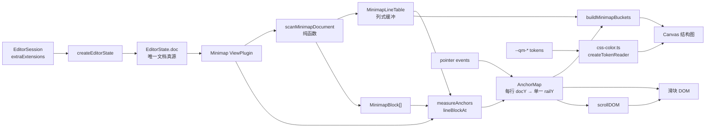
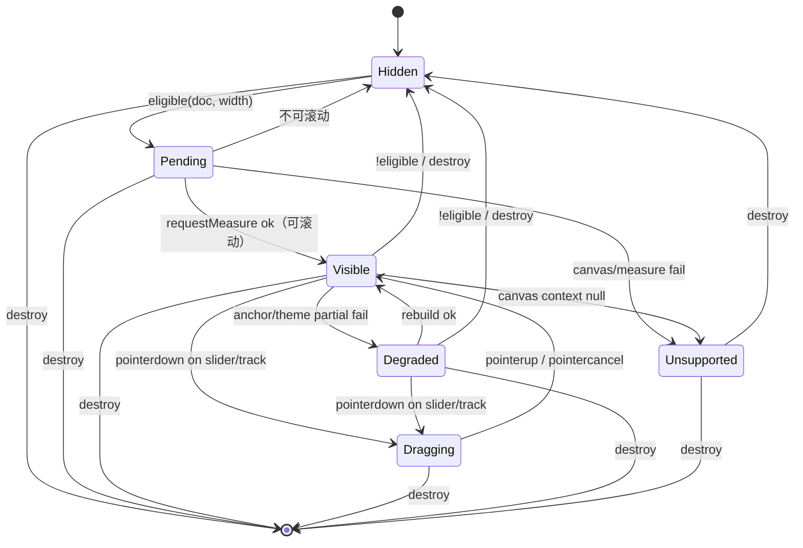
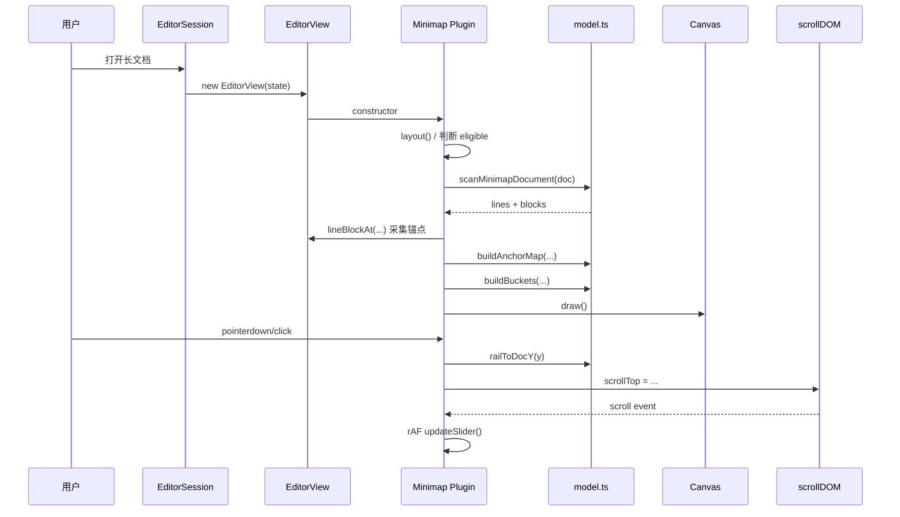
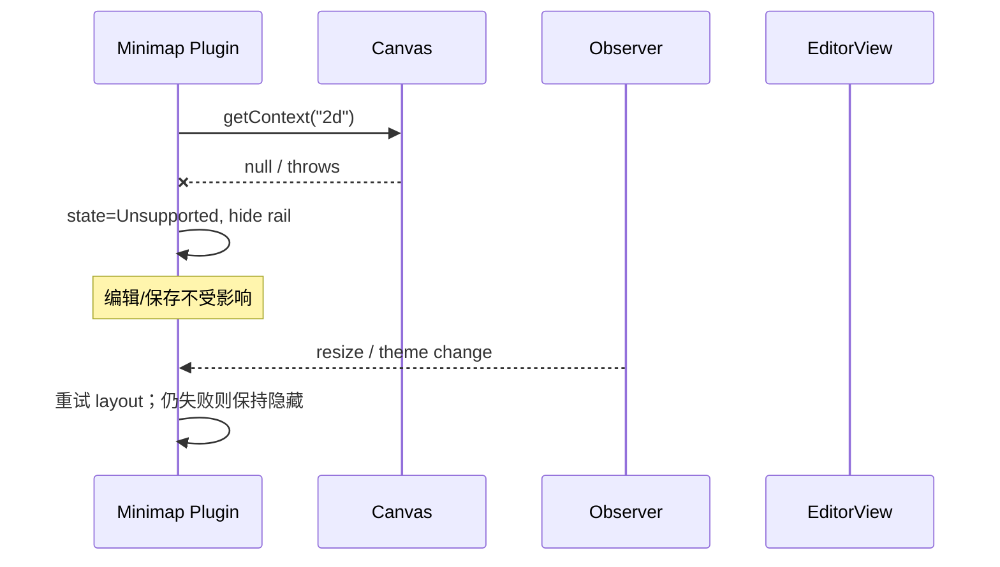

# 编辑器缩略图（Minimap）设计方案

> **文档用途：** 面向技术评审、开发、测试和运维人员的设计说明  
> **功能 ID：** `editor-minimap`  
> **对应需求：** R-001 ~ R-006  
> **对应实施计划：** [`01-实施计划.md`](01-实施计划.md)  
> **代码基线：** `main@43659b1`  
> **设计版本：** `v1.5`
> **日期：** `2026-10-30`  
> **状态：** 方案已冻结（R1~R4）；实施与验证已完成（`VERDICT: PASS`）

---

## 1. 摘要

青墨当前的编辑器是 CM6 单一真源，Live Preview 会把标题、代码块、表格、Mermaid、图片等渲染成高度不一的块，但右侧只有 20px 文本 inset 和窗口滚动条，没有任何全文导航辅助。长文写作时，用户只能依赖滚动条、查找或未来的大纲；滚动条只表达位置比例，不表达文档结构。

本方案新增一个**右侧全文 minimap**：Source 模式把真实源文本按固定比例缩小绘制（字符约 1px、行高约 3px）；Live Preview 模式去掉 Markdown 标记，按真实渲染块高绘制标题带、正文、代码卡、表格网格、引用、列表、媒体占位和公式块。一个固定在右侧的滑块表示当前可见范围；点击、拖拽、滚轮可把编辑器滚动到对应位置。minimap 与滑块共用**同一套文档坐标纵轴**：Canvas 每行的 `docY` 由块边界/标题/固定间隔锚点估算，滑块直接由 `scrollTop - paddingTop` 得到，两者都经同一个 `docYToRail` 映射。不使用行数均分，也不使用滚动行程比例，因此滑块始终覆盖它真正对应的内容。

关键边界：

- 不克隆 DOM、不读取真实字体轮廓、不做 DOM 像素级镜像、不新增第三方依赖。
- 不修改 `createEditorState`、`EditorHost`、`ViewStateRecorder`、`basicExtensions`、`qingmoEditorTheme`。
- 只在 `EditorSession.extraExtensions` 追加一个 `ViewPlugin`。
- 不新增持久化配置、数据库表、Rust 命令、IPC、共享类型。
- 默认只在长文档显示；短文档、空文档、超限文档不预留任何宽度。
- 主题色复用 `--qm-*` token；把 Mermaid 已有的 `tokenReader` 抽到共享 `css-color.ts`，不复制第二套 palette。

一句话方案：

> 在保留 `EditorState`、`scrollDOM`、`ViewStateRecorder`、`--qm-*` 四个单一真源的前提下，通过 `EditorSession.extraExtensions` 挂载一个 Canvas `ViewPlugin`，用“模式感知缩略图（Source 1:1 文本 / Live Preview 渲染块 + 真实块高）+ 视口窗口 + 锚点校准的单一文档纵轴 + 内容区让位”实现长文档全文导航。

---

## 2. 问题定义

### 2.1 业务背景与现状

```text
用户打开一篇 200+ 行 Markdown
  -> 编辑器只显示当前视口
  -> 右侧原生滚动条只有位置比例，没有标题/代码块/表格结构
  -> 用户想跳到“第三章”或“那个表格”
  -> 只能滚动、查找或记忆大致位置
  -> 长文导航成本高，空间记忆无法建立
```

青墨的定位是“像纸一样安静，像代码编辑器一样快”。VS Code 式 minimap 是代码编辑器的成熟导航 affordance；Markdown 写作同样需要“整篇形状”的 overview，但不需要可读字符。

### 2.2 当前实现与缺口

| GAP-ID | 缺口 | 当前行为 | 根因/证据 | 影响 |
|---|---|---|---|---|
| GAP-001 | 没有全文缩略导航 | 右侧只有原生滚动条 | 全仓无 minimap 实现；`styles.css:10-21` 只有左侧 gutter | 长文只能按比例滚动 |
| GAP-002 | 滚动条不表达结构 | 原生 thumb 只有位置/比例 | 浏览器滚动条不读取 Markdown 结构 | 无法快速定位标题/代码块/表格 |
| GAP-003 | Live Preview 高度不均 | 表格/Mermaid/图片是块级 widget | `packages/editor-core/src/live-preview/*`；`createEditorState` 只按字符数分档 | 行数均分与滚动行程比例都会让滑块与内容错位 |
| GAP-004 | 右侧没有预留空间 | `.cm-content` 左右各 20px | `extensions/theme.ts` 的 `WRITING_INSET_PX=20` | 直接覆盖会遮住正文 |
| GAP-005 | 主题色不能直接进 Canvas | 主题全部是 CSS 变量 | `tokens.css`；`mermaid-theme.ts` 有私有 `tokenReader` | 复制 palette 会形成第二套颜色真源 |
| GAP-006 | 大文档性能边界 | Live Preview 按 200k/2M units 分档 | `limits.ts` | minimap 必须有自己的行数/单元上限，不能无限绘制 |

### 2.3 设计目标

| R-ID | 目标 | 可度量成功标准 |
|---|---|---|
| R-001 | 长文档右侧显示与当前模式一致的缩略图 | 212 行 fixture 可见；6 行 fixture 不可见；Source 为 `data-minimap-render=text`，Live Preview 为 `rendered` |
| R-002 | 点击/拖拽/滚轮导航，位置与内容对齐；rail 显示时原生纵向滚动条由 slider 取代 | 点击 25/50/75% 后 `scrollTop` 落在锚点容差内；拖拽单调；E2E-017 滚动条隐藏 |
| R-003 | 不破坏现有单一真源 | 无新增 view-state 写入；无第二份文档；`replacePayload` 后仍 1 个 rail |
| R-004 | 大文档降级与性能预算 | T-007 实测 100k 完整 rebuild CPU p95 10.80ms；满足 ≤16ms；滚动更新 ≤ 1ms |
| R-005 | 主题/布局/可访问性与现有约定一致 | 主题切换 Canvas 变色；`.cm-editor` 宽度不变；rail `aria-hidden` |
| R-006 | 可测试、可回滚、零持久化配置 | 单测/E2E/bench 覆盖；回滚只需移除一个扩展；无 DB/Rust 变更 |

### 2.4 非目标

- 不实现图片缩略图、文件树缩略图、文档画廊；本功能明确是编辑器全文 minimap。
- 不读取真实字体轮廓、不做语法高亮级 minimap；字符用 1px 列 + 上下半行墨迹近似。
- 不克隆 Live Preview DOM 做像素级镜像；渲染模式用语义块/真实块高近似。
- 不克隆 Live Preview DOM，不做“所见即所得”的缩略镜像。
- 不显示搜索命中、诊断、Git 标记、协作光标。
- 不支持左右侧切换、宽度拖拽、透明度/缩放设置。
- 不新增持久化开关；不在 `UiStore`、`localStorage`、Rust `EditorViewState`、SQLite 中增加字段。
- 不替代查找、大纲、键盘滚动；minimap 是辅助导航。
- 不在嵌套代码块编辑器里显示 minimap。

### 2.5 前置假设与约束

| 类型 | 内容 | 验证方式 | 假设失效后的处理 |
|---|---|---|---|
| 技术 | CM6 `ViewPlugin` 可在 `view.dom` 内挂绝对定位 DOM | 本地 `@codemirror/view@6.43.15` 类型与源码 | 退回 `scrollDOM` flex 子项方案（需另评） |
| 技术 | `lineBlockAt(pos).top` 与 `scrollTop` 相差 `documentPadding.top`，可稳定换算 | CM6 `documentTop/documentPadding` 源码 + `ViewStateRecorder` + E2E `topOffset=28` | 若换算不稳定，退回 `documentTop` 实时计算 |
| 技术 | `view.setState` 会销毁旧插件并创建新插件 | CM6 生命周期；T-005 单测 | 改为显式 compartment 重配 |
| 技术 | 主题切换只改 `documentElement[data-theme]` | `uiStore.ts:282`；`useThemeService` | 监听更多属性/自定义事件 |
| 产品 | 长文档阈值 80 行合理 | dogfood + E2E | 调整 `MIN_LINES` |
| 性能 | 100k 行完整 rebuild 的 CPU p95 目标 ≤ 16ms（T-007 实测 10.80ms） | C-011 真实 Chromium bench | 增大 stride、降低锚点上限、降低 `MAX_LINES`、隐藏 |
| 兼容 | Tauri WebView 支持 Canvas/PointerEvent/ResizeObserver | 真机 T-006 | 降级为只读装饰/隐藏 |

---

## 3. 总体设计

### 3.1 设计原则

| 原则 | 含义 | 对实现的约束 |
|---|---|---|
| 单一真源 | 文档、滚动、主题、持久化各只有一个来源 | 只读 `EditorState.doc` / `scrollDOM` / `--qm-*`；不新增持久化 |
| 最小侵入 | 只改一个汇合点 | 只改 `EditorSession.extraExtensions`；不改 `createEditorState`/`EditorHost` |
| 结构优先 | 76px 下字符不可读，画结构 | 标题/代码/表格/引用色块；不画 glyph |
| 单一纵轴 | Canvas 与滑块共用 `docYToRail` | 禁止 Canvas 行数均分、滑块另一套比例 |
| 锚点校准 | 用锚点估算每行 `docY` | 标题/块边界/固定间隔；只校准定位，不改纵轴 |
| 失败降级 | 任何测量/Canvas 失败不影响编辑 | 隐藏 rail、中性灰、不抛错 |
| 可测试 | 核心算法纯函数化 | `model.ts` 不依赖 DOM；jsdom 可测 |

### 3.2 系统架构



### 3.3 职责边界

| 模块 | 负责 | 不负责 | 依赖 |
|---|---|---|---|
| `EditorSession` | 在 `extraExtensions` 追加 minimap 扩展 | 不管理 rail DOM、不监听滚动 | `@qingmo/editor-core` |
| `minimap.ts` | ViewPlugin 生命周期、DOM、Canvas、事件、observer | 不解析 Markdown 语义、不写文档 | CM6 view/state、model、theme |
| `model.ts` | 行分类、块范围、锚点、映射、桶、滑块数学 | 不访问 DOM/Canvas | 纯 TypeScript |
| `theme.ts` | 从 `--qm-*` 解析 concrete palette | 不拥有颜色 token | `css-color.ts` |
| `css-color.ts` | 隐藏 probe + `getComputedStyle` 解析 | 不定义业务 palette | DOM |
| `EditorState` | 文档内容、选区、undo | 不持有 minimap 状态 | CM6 state |
| `scrollDOM` | 唯一滚动位置 | 不持有 minimap 状态 | CM6 view |
| `ViewStateRecorder` | 唯一持久化滚动/选区 | 不渲染 minimap | IPC |
| `--qm-*` tokens | 唯一颜色真源 | 不感知 Canvas | `packages/ui` |

### 3.4 当前链路与目标链路

当前链路：

```text
EditorSession.create
  -> createEditorState
  -> EditorHost new EditorView
  -> 用户只能使用原生滚动条/查找
```

目标链路：

```text
EditorSession.create
  -> extraExtensions 数组追加 minimapExtension()
  -> createEditorState
  -> EditorHost new EditorView
  -> Minimap ViewPlugin constructor
     -> rail DOM + canvas
     -> scan doc -> anchors -> mode-aware window -> draw
  -> scroll/pointer/theme/resize
     -> slider / redraw / scrollDOM.scrollTop
  -> ViewStateRecorder 照常持久化（不变）
```

---

## 4. 修复方式与修改点

> 本章按模板面向缺陷修复；本功能是**纯新增能力**，不存在“修复前失败链路”。因此 4.1~4.3 不适用，保留 4.4 修改点清单用于追踪。

### 4.1 修复方式概述

| 项 | 内容 |
|---|---|
| 根因 | 不适用（纯新增） |
| 修复策略 | 不适用 |
| 保持不变 | `createEditorState`、`EditorHost`、`ViewStateRecorder`、`basicExtensions`、`qingmoEditorTheme`、Rust/IPC/DB |
| 被否决的替代方案 | D-001~D-015 |

### 4.2 修复前调用链

不适用。

### 4.3 修复后调用链

见 §3.4 与 §8.1。

### 4.4 修改点清单

| MP-ID | 文件/符号 | 修改类型 | 修改内容 | 影响的调用链节点 | 关联决策/任务 | 风险 |
|---|---|---|---|---|---|---|
| MP-001 | `packages/editor-core/src/css-color.ts` | 新增 | 从 `mermaid-theme.ts` 抽出 `createTokenReader` / `normalizeCssColor` | 主题解析 | D-005 / T-002 | 低 |
| MP-002 | `packages/editor-core/src/live-preview/mermaid-theme.ts` | 修改 | 改为 import 共享 reader；保留 `normalizeMermaidColor` 导出兼容 | Mermaid 主题 | D-005 / T-002 | 中 |
| MP-003 | `packages/editor-core/src/minimap/model.ts` | 新增 | 行分类、块范围、锚点、映射、文本窗口、降级桶、滑块纯函数 | 核心算法 | D-002/D-006/D-008 / T-003 | 中 |
| MP-004 | `packages/editor-core/src/minimap/theme.ts` | 新增 | `MinimapPalette` 与 token 解析 | Canvas 颜色 | D-005/D-012 / T-004 | 低 |
| MP-005 | `packages/editor-core/src/minimap/minimap.ts` | 新增 | `ViewPlugin`、rail DOM、Canvas、事件、observer、CSS | 渲染/交互 | D-001/D-003/D-009/D-013 / T-004 | 中 |
| MP-006 | `packages/editor-core/src/index.ts` | 修改 | 导出 `minimapExtension` 与类型 | 包边界 | D-004 / T-004 | 低 |
| MP-007 | `apps/desktop/src/features/editor/EditorSession.ts` | 修改 | `extraExtensions` 追加 `minimapExtension()` | 顶层 session | D-004 / T-005 | **高** |
| MP-008 | `packages/editor-core/src/minimap/*.test.ts`、`css-color.test.ts`、`apps/desktop/src/features/editor/{editor-session.test.ts,editor-binding.test.tsx}` | 新增/修改 | 纯函数/生命周期/主题/session/StrictMode 单测 | 验证 | T-001/T-002/T-003/T-004/T-005 | 低 |
| MP-009 | `e2e/minimap.spec.ts`、`e2e/minimap-perf.spec.ts` | 新增 | 可见性/点击/拖拽/主题/布局/降级 + 100k rebuild 采样 | 验证 | T-006/T-007 | 中 |
| MP-010 | `bench/minimap.bench.ts` | 新增 | 扫描/窗口/降级桶/锚点性能记录 | 验证 | T-007 | 低 |
| MP-011 | `apps/desktop/src/features/workspace/WorkspaceLayout.tsx`、`i18n/locales/{zh-CN,en}.ts` | 不修改 | Q-002=B 已确认，不新增 `view.toggleMinimap` | 命令 | D-010 / T-008（skipped） | 低 |
| MP-012 | `docs/todo/editor-minimap/**` | 新增/修改 | 方案与证据 | 文档 | 全部 | 无 |

> 明确不改：`packages/editor-core/src/createEditor.ts`、`apps/desktop/src/features/editor/EditorHost.tsx`、`.../session/ViewStateRecorder.ts`、`.../extensions/basic.ts`、`.../extensions/theme.ts`、`apps/desktop/src/styles.css`、`packages/ui/src/tokens.css`、`src-tauri/**`、`packages/shared/**`。

---

## 5. 核心组件

### 5.1 `css-color.ts`

职责：把 CSS token 解析为 Canvas 可用的 concrete color，并负责清理 probe。

| 项 | 设计 |
|---|---|
| 输入 | 可选 `root: HTMLElement`；token 名 + fallback |
| 输出 | `rgb()` / `rgba()` / hex 字符串 |
| 依赖 | `document`、`getComputedStyle` |
| 生命周期 | `createTokenReader()` 创建 probe；`dispose()` 移除 |
| 失败策略 | 无 DOM/无 `getComputedStyle` 返回 `null`；调用方隐藏 rail |

```ts
export interface TokenReader {
  color(token: string, fallback: string): string;
  raw(token: string, fallback: string): string;
  dispose(): void;
}

export function createTokenReader(root?: HTMLElement): TokenReader | null;
export function normalizeCssColor(value: string): string;
```

实现从 `mermaid-theme.ts:338-382` 原样迁移，行为不变：

- token 原始值不是 `light-dark()`/`var()`/`color-mix()` 时直接返回；
- 否则把 `var(--token, fallback)` 设到隐藏 probe 的 `color` 上，读 computed color；
- `dispose()` 移除 probe。

命名迁移：现有 `mermaid-theme.ts` 的 `normalizeMermaidColor` 原样移入 `css-color.ts` 并改名 `normalizeCssColor`；`mermaid-theme.ts` 改为导入它（若仍需保留旧导出，用 `export { normalizeCssColor as normalizeMermaidColor }` 别名），行为与测试断言不变。

### 5.2 `model.ts` — 行模型与分类

职责：把 `EditorState.doc` 转成 presentation-only 的 `MinimapLineTable` / `MinimapBlock[]`。

```ts
export type MinimapLineKind =
  | "blank"
  | "text"
  | "heading"
  | "code"
  | "diagram"
  | "table"
  | "quote"
  | "list"
  | "rule"
  | "frontmatter"
  | "html";

/** 数值编码写入 Uint8Array；顺序即绘制优先级，数值越大越优先。 */
export const KIND = {
  blank: 0,
  text: 1,
  list: 2,
  quote: 3,
  html: 4,
  rule: 5,
  table: 6,
  code: 7,
  diagram: 8,
  heading: 9,
  frontmatter: 10,
} as const;

/**
 * 列式存储：10 万行不分配 10 万个对象，避免每次 rebuild 触发 GC。
 * 缓冲区由插件实例复用，只在行数变化时重新分配。
 */
export interface MinimapLineTable {
  count: number;
  /** MinimapLineKind 的数值编码，见 KIND。 */
  kind: Uint8Array;
  /** 1-6 for headings, 0 otherwise. */
  headingLevel: Uint8Array;
  /** Leading whitespace; tabs expanded to state.tabSize (default 4). */
  indent: Uint8Array;
  /** Visual width proxy: ASCII + 1.6 * non-ASCII, capped to 65535. */
  density: Uint16Array;
}

export interface MinimapBlock {
  kind: "fence" | "table" | "frontmatter" | "math" | "media" | "html";
  fromLine: number;
  toLine: number;
  /** Fence info string, e.g. "mermaid". */
  info: string;
}

export function scanMinimapDocument(
  text: Text | string,
  tabSize: number,          // view.state.tabSize；默认 4
): { lines: MinimapLineTable; blocks: MinimapBlock[] };
```

分类优先级（从高到低）：

1. front matter（首行 `---`，到闭合 `---`/`...`）
2. fenced code（``` / ~~~，闭合标记同字符且长度不短于 opening）
3. table（header 行 + delimiter 行 + 连续 `|` 行）
4. media（独立图片 ``、`/<video>/<audio>/<iframe>/<picture>` 行；单行块，fromLine=toLine）
5. setext heading（`===`/`---` 提升前一行）
6. ATX heading（`^ {0,3}#{1,6}\s`）
7. thematic break（`***`/`---`/`___`）
8. blockquote（`>`）
9. list（`-`/`+`/`*`/`1.`）
10. math block（`$$` 成对）
11. html（`<details>`/`</details>` 之间的范围，或单行块级标签）
12. text / blank

**边界**：

- Setext 判定必须先于 thematic break，避免把标题下划线误判为分隔线。
- Fence 内的 `#` 不参与标题判定。
- Table 判定只在 delimiter 行存在时成立，避免普通含 `|` 的段落误判。
- Fence 的 info string 以 `mermaid` 开头时，行 kind 记为 `diagram`（仍属于 `fence` block），用于区分 Mermaid 与普通代码块。
- `MinimapBlock.toLine` 为闭区间；锚点使用 `min(toLine + 1, lineCount - 1)`，避免越过末行。
- 图片/媒体行必须生成 block 边界锚点；否则 Live Preview 的图片 widget 会让整段源码行共享同一个 `docY`，Canvas 在图片附近错位。
- 分类器不改变 Markdown 语义；它只服务绘制。
- 行模型使用 `Uint8Array`/`Uint16Array` 列式存储并复用缓冲区；`MinimapBlock[]` 的数量与块数成正比，通常远小于行数。
- 缩进按 `view.state.tabSize` 展开（本应用默认 4），与编辑器实际 tab 宽度一致；不硬编码 2。

### 5.3 `AnchorMap` — 锚点校准的单一文档映射

职责：为 Canvas 的每一行估算真实文档纵坐标 `docY`，并提供一个 Canvas 与滑块共用的线性 `docY ↔ railY` 映射。**只有一套纵轴**，滑块永远覆盖它实际对应的结构。

```ts
export interface AnchorSample {
  /** 0-based source line. */
  line: number;
  /** Editor document coordinate: 0 = top of first line, excludes padding. */
  docY: number;
}

export interface AnchorMap {
  samples: readonly AnchorSample[];
  /** 每行 docY，按行号在样本之间线性插值；Float64Array(doc.lines)。 */
  lineDocY: Float64Array;
  /** Canvas 与滑块共用的纵轴映射。 */
  docYToRail(docY: number): number;
  railToDocY(railY: number): number;
}
```

构建：

```text
pt = view.documentPadding.top
pb = view.documentPadding.bottom
docHeight = max(1, view.contentHeight - pt - pb)

候选行 = {0, lastLine}
       ∪ 每个 block 的 fromLine、min(toLine + 1, lastLine)
       ∪ 每个 heading 的 line
       ∪ 每 stride 行（stride = max(40, ceil(lineCount / ANCHOR_TARGET)))
       ∪ 滚动停止后：当前视口首尾行 + 视口内每 4 行（viewportLines 已精确测量）
       - 重复行
  -> 若候选数 > ANCHOR_MAX：先保留所有 block 边界/标题，再均匀抽样 stride 候选；
     仍超限则整体均匀抽样，但必须保留首尾
  -> 在 view.requestMeasure 的 read 阶段逐行
     view.lineBlockAt(doc.line(line + 1).from).top
  -> 丢弃 docY <= prev.docY + EPS 的重复采样（大 widget 内部会重复）
  -> 起点固定为 line=0, docY=0
  -> 终点固定为 line=doc.lines（虚拟，不写入 lineDocY）, docY=docHeight
  -> 保证 line、docY 都严格递增；零长度段直接跳过
  -> 视口行使用 lineBlockAt 的当前块；视口外使用 heightMap 估算
```

每行 `docY`（只用于 Canvas 定位）：

```text
lineDocY[0] = 0
对相邻样本 (l0,y0) -> (l1,y1)，l1 > l0，对 l0 <= l < l1：
  lineDocY[l] = y0 + (l - l0) * (y1 - y0) / (l1 - l0)
未被样本覆盖的行 clamp 到最近的已知 docY
```

**终端样本必须存在**：`(line=doc.lines, docY=docHeight)` 是虚拟端点，只用于插值最后一行到轨道底部。若缺少它，文末的 fence/table/Mermaid 块内行会全部落在块起点，最后一行与轨道底部之间出现空档。候选数超过 `ANCHOR_MAX` 时，抽样也必须保留 `line=0` 与 `line=doc.lines` 两个端点。

共享纵轴（Canvas 与滑块调用同一个函数）：

```text
docYToRail(y) = trackTop + clamp(y, 0, docHeight) / docHeight * trackHeight
railToDocY(r) = clamp((r - trackTop) / trackHeight, 0, 1) * docHeight

// 纯函数，单独 UT；pt = documentPadding.top
scrollTopToDocY(scrollTop, pt, docHeight) =
  clamp(scrollTop - pt, 0, docHeight)
docYToScrollTop(docY, pt, maxScroll, viewportOffset = 0) =
  clamp(docY + pt - viewportOffset, 0, maxScroll)
```

点击居中传 `viewportOffset = clientHeight / 2`；拖拽（视口顶部对齐）传 `0`。两者都调用同一个函数，禁止在事件处理器里重复写 `+/- 28`。

`docHeight` 以 `contentHeight - pt - pb` 为准；`maxScroll` 以 `scrollHeight - clientHeight` 为准。两者来源不同（前者含 heightMap 估算，后者是浏览器实际滚动范围），差值由 E2E-004 的端点断言暴露；若差值 >1px，以 E2E 实测为准并记录到 `02`。

滑块：

```text
viewportTopDoc    = clamp(scrollTop - pt, 0, docHeight)
viewportBottomDoc = clamp(scrollTop - pt + clientHeight, 0, docHeight)
sliderTop  = docYToRail(viewportTopDoc)
sliderRawH = docYToRail(viewportBottomDoc) - sliderTop
sliderH    = min(trackHeight, max(SLIDER_MIN_PX, sliderRawH))   // 轨道比 24px 还短时取 trackHeight
sliderTop  = clamp(sliderTop, trackTop, trackTop + trackHeight - sliderH)
```

为什么不是“行数均分 + 锚点滑块”两套纵轴：

- 如果 Canvas 按源码行数均分、滑块按真实像素映射，滑块在 2000px 的 Mermaid/图片块上会覆盖大片正文结构，视觉上对不上。
- 如果 Canvas 与滑块都按真实 `docY` 映射，二者永远一致；巨型 widget 占用它实际占用的高度，正文被压缩但仍通过颜色/宽度/桶优先级保留可辨识结构（每桶至少 1px）。
- 锚点不改变纵轴比例，只负责用 O(anchors) 次测量估算每行 `docY`；否则需要对 10 万行逐一 `lineBlockAt`。
- 不使用 `scrollTop / (scrollHeight - clientHeight)` 这类“滚动行程比例”：它把 padding 与视口高度混进映射，滑块会在首尾提前/延后到顶。这里统一使用文档坐标。

端点与 clamp：

- `docY <= 0` → `trackTop`
- `docY >= docHeight` → `trackTop + trackHeight`
- 若 `view.contentHeight <= 0` 或 `docHeight <= 1`：隐藏 rail，等待下一次 `geometryChanged`，**不**退回第二套比例。

> 坐标基准：`lineBlockAt(pos).top` 以**首行顶部**为 0，不含 `.cm-content` 的上 padding；`scrollTop` 是 scroller 偏移。二者换算必须经过 `documentPadding.top`，不能直接相等。

### 5.4 `theme.ts` — Minimap palette

职责：把当前主题的 `--qm-*` 解析成 Canvas 颜色。

```ts
export interface MinimapPalette {
  text: string;
  heading: string;
  muted: string;
  code: string;
  diagram: string;
  table: string;
  rule: string;
  selection: string;
}
```

| 字段 | token | 用途 |
|---|---|---|
| `text` | `--qm-ink` | 普通段落 |
| `heading` | `--qm-accent` | 标题 |
| `muted` | `--qm-ink-muted` | 引用/列表/HTML |
| `code` | `--qm-diagram-accent-3` | 代码块 |
| `diagram` | `--qm-diagram-accent-4` | Mermaid |
| `table` | `--qm-diagram-accent-2` | 表格 |
| `rule` | `--qm-ink-faint` | 分隔线/front matter |
| `selection` | `--qm-accent-strong` | 光标标记 |

> 11 个 `MinimapLineKind` 只映射到 6 个**视觉族**：`text` → text、`list/quote/html` → muted、`heading` → heading、`code` → code、`diagram` → diagram、`table` → table、`rule/frontmatter` → rule。`selection` 是 caret，不算结构色；这样 76px 宽度内不会出现超过 6 种结构颜色。

单个 token 解析失败时退回中性灰 `#808080`（仅保证可绘制，不复制任何主题色）；`createTokenReader` 返回 null 时直接隐藏 rail（`unsupported`），不使用第二套 palette。

主题刷新：

```text
MutationObserver(documentElement, { attributes: true, attributeFilter: ["data-theme"] })
  -> palette = resolveMinimapPalette(view.dom)
  -> draw()
```

`resolveMinimapPalette` 必须：

```ts
const reader = createTokenReader(root);
if (!reader) return null;   // 调用方隐藏 rail
try {
  return { /* reader.color(token, "#808080") */ };
} finally {
  reader.dispose();   // 每次主题切换都不能残留隐藏 probe
}
```

Canvas 每次 `draw()` 先画到离屏 canvas（`clearRect` + 文本窗口/渲染窗口/降级条带/光标），成功后一次性 `drawImage` 到可见 canvas；文本绘制抛错时在同一帧内降级为结构条带并标记 `data-minimap-render=blocks`，绘制整体抛错时保留上一帧并把 `data-minimap-state` 置为 `degraded`。这样既不会把上一帧清空后失败，也不会出现半帧。

若 `MutationObserver` 不可用，降级为：每次 `scheduleRebuild()` 时重新解析 palette；主题单独切换时可能延迟到下一次文档/几何变化，记录为已知降级。

### 5.5 `minimap.ts` — ViewPlugin / Controller

职责：拥有 rail DOM、Canvas、滑块、光标标记、事件和 observer。

```ts
// 模块级常量：所有 session 共享同一个 StyleModule，避免重复注入 CSS。
const minimapTheme = EditorView.theme({ /* §5.5 的 CSS；key 用 & 开头 */ });

// 内部 options facet：生产只传默认值；测试用 geometry 覆盖。
const minimapOptions = Facet.define<MinimapOptions, MinimapOptions>({
  combine: (values) => values[0] ?? {},
});

const MinimapPlugin = ViewPlugin.fromClass(class { /* ... */ }, { /* ... */ });

export function minimapExtension(options?: MinimapOptions): Extension {
  return [minimapTheme, minimapOptions.of(options ?? {}), MinimapPlugin];
}
```

> `ViewPlugin.fromClass` 必须是模块级常量：每次调用都新建 plugin 类型，会让同一 state 出现两个插件实例/两个 rail。同时 `minimapExtension()` 只能在 `EditorSession.extraExtensions` 注入一次；重复注入同样会产生两个 rail，UT-016 必须断言数量为 1。

> 主题只在模块加载时构造一次；`minimapExtension()` 每次返回同一个 `minimapTheme` 引用。若每个 session 都 `EditorView.theme(...)`，会产生多个仅类名不同的重复样式表。

DOM：

```html
<div class="qm-minimap" aria-hidden="true" data-minimap-state="off" style="display:none">
  <canvas class="qm-minimap-canvas"></canvas>
  <div class="qm-minimap-caret"></div>
  <div class="qm-minimap-slider"></div>
</div>
```

挂载：

```ts
view.dom.appendChild(rail);
```

`view.dom` 是 `.cm-editor`（`position: relative !important`、`box-sizing: border-box`），rail 绝对定位；不放进 `scrollDOM`，避免横向滚动带走 rail。

尺寸与让位（**用编辑器自身 inline padding，而不是 `.cm-content` padding，也不使用 `view.dom` class**）：

```text
railWidth = 76                         // 可由 MinimapOptions 覆盖，写入 CSS 变量
railGap = 12
reserve = railWidth + railGap          // 88

// 关键：CM6 拥有 view.dom 的 class 属性（updateAttrs() 会在构造、focus、
// 主题切换、setState 时重写 class），因此不能用 class 控制布局。
view.dom.style.setProperty("--qm-minimap-width", `${railWidth}px`)
rail.style.top = `${scrollerRect.top - editorRect.top}px`
rail.style.height = `${scrollerRect.height}px`
// rail.style.right = "0" 由主题 CSS 固定；不要写 scrollbarWidth

// 隐藏（off/unsupported）
rail.style.display = "none"
view.dom.style.paddingRight = ""

// 显示（已有有效帧，或 rebuild 中保留旧帧）
rail.style.display = "block"
rail.style.visibility = "visible"
view.dom.style.paddingRight = `${reserve}px`

// 首次挂载（Pending）：先占位/测量，但不要闪空 canvas
rail.style.display = "block"
rail.style.visibility = "hidden"
view.dom.style.paddingRight = `${reserve}px`
// 首次 draw 成功后：rail.style.visibility = "visible"; state = "on"
```

> `Pending` 首次挂载必须同时写 padding 与 `display:block`，否则 `rail.clientWidth/clientHeight` 为 0，Canvas 只能得到 1×1 backing store；用 `visibility:hidden` 保证测量期间不闪空帧。已有 rail 的后续 rebuild 保持 `visibility:visible`，只更新 `data-minimap-state="pending"`，旧帧继续显示到新帧 blit 成功。

**为什么不能用 `view.dom.classList.add("qm-minimap-on")`**：CM6 的 `updateAttrs()` 会用 `editorAttributes` facet 重新计算并写回 `class`（`cm-editor` + `cm-focused` + theme classes）。构造末尾、每次 focus 变化、主题切换和 `view.setState()` 都会调用它，插件加的 class 会被抹掉，padding/rail CSS 随之失效。inline `style` 不在 `editorAttrs` 中，`updateAttrs()` 不会清除它（`node_modules/@codemirror/view/dist/index.js:79-99, 8335-8357`）。

**可见性**：不要依赖 `hidden` 属性配 author `display:block`（author 样式优先级高于 UA `[hidden]`）。统一用 inline `rail.style.display`/`visibility`：`Hidden/off/unsupported` → `display:none`、`paddingRight=""`；首次 `Pending` → `display:block`、`visibility:hidden`、写 padding；`Visible/Degraded` → `display:block`、`visibility:visible`。`data-minimap-state` 只用于观测，不参与布局。

**原生滚动条替换**：rail 进入 `Pending`/`Visible`/`Degraded` 时，在 `view.scrollDOM` 写 `data-minimap-scrollbar="hidden"`；主题对该属性使用 `scrollbar-width: none` 与 `::-webkit-scrollbar { width: 0; height: 0 }`。`hidden`/`off`/`unsupported`/`destroy` 时删除属性。只改变原生 thumb 的可见性，不修改 `overflow: auto` 或任何滚动状态：滚轮、键盘、拖拽和 `ViewStateRecorder` 仍以 `scrollDOM` 为唯一真源。短文档、超限文档和 `unsupported` 不隐藏，保留系统滚动条。

为什么用 `.cm-editor` padding：

- `.cm-scroller` 的宽度会缩小 `reserve`，宽 table/code 都在 rail 左侧，不会在横向滚动时钻到 rail 下面；
- rail 显示时原生纵向滚动条被 CSS 隐藏，不再与 slider 并排；`scrollDOM` 的滚动容器语义不变；
- 嵌套代码块的 `.cm-editor` 没有 inline padding，也不会命中直接子级滚动条规则；
- 不需要读取 `scrollbarWidth`，避免 overlay/classic 滚动条差异。

**布局取舍**：这个方案把 rail 放在窗口最右侧，`.cm-editor` 用 inline `padding-right: 88px` 让正文让位；rail 显示时再隐藏 `.cm-scroller` 的原生纵向滚动条，由 rail 内的 slider 独占纵向导航。VS Code 的顺序是“正文 → minimap → 滚动条”，本项目选择“正文 → 12px gap → minimap（含 slider）”，因为 `basicExtensions` 已启用 `EditorView.lineWrapping`，正文不需要常驻纵向滚动条。若未来需要同时保留原生滚动条，可删除 `data-minimap-scrollbar` 规则并重新评估 gap。

CSS（由 `EditorView.theme` 提供；key 必须用 `&`，不要照抄下面的最终选择器）：

```css
/* 主题 key: "& > .qm-minimap"；只匹配当前 editor 的直接子节点 */
.cm-editor > .qm-minimap {
  position: absolute;
  z-index: 10;
  box-sizing: border-box;
  display: block;                  /* 隐藏由 inline style.display="none" 覆盖 */
  top: 0;                          /* 运行时 inline style 覆盖 */
  right: 0;
  width: var(--qm-minimap-width, 76px);
  height: 100%;                    /* 运行时 inline style 覆盖 */
  overflow: hidden;
  border-left: 1px solid var(--qm-line);
  background: transparent;
  background: color-mix(in srgb, var(--qm-surface-muted) 28%, transparent);
  user-select: none;
  touch-action: none;
  cursor: pointer;
}

/* 主题 key: "& > .qm-minimap > .qm-minimap-canvas" */
.cm-editor > .qm-minimap > .qm-minimap-canvas {
  display: block;
  width: 100%;
  height: 100%;
}
```

> 若把 `.cm-editor > .qm-minimap` 字面写进 theme spec，StyleModule 会生成 `.ͼX .cm-editor > .qm-minimap`，不匹配 `view.dom` 本身。必须写成：
>
> ```ts
> EditorView.theme({
>   "& > .qm-minimap": { /* rail */ },
>   "& > .qm-minimap > .qm-minimap-canvas": { /* canvas */ },
> });
> ```

Canvas backing store（**不能只靠 CSS 100%**）：

```text
dpr = window.devicePixelRatio || 1
cssWidth  = geometry?.railWidth ?? rail.clientWidth    // 内容盒：76px 减去 border-left 1px
cssHeight = geometry?.railHeight ?? rail.clientHeight  // 测试注入时 jsdom 为 0
for c of [visibleCanvas, bufferCanvas]:
  c.width = max(1, round(cssWidth * dpr))
  c.height = max(1, round(cssHeight * dpr))
visibleCanvas.style.width = `${cssWidth}px`
visibleCanvas.style.height = `${cssHeight}px`
bufCtx.setTransform(dpr, 0, 0, dpr, 0, 0)
bufCtx.clearRect(0, 0, cssWidth, cssHeight)
// ... draw blocks/buckets/caret into bufCtx ...
visCtx.setTransform(dpr, 0, 0, dpr, 0, 0)
visCtx.save()
visCtx.globalCompositeOperation = "copy"   // 原子替换整帧；失败时旧帧仍在
visCtx.drawImage(bufferCanvas, 0, 0, cssWidth, cssHeight)
visCtx.restore()
```

`trackWidth` 用 `cssWidth`；`trackHeight = max(1, cssHeight - 2 * TRACK_PADDING_Y)`。

`layout()` / `ResizeObserver` / `geometryChanged` 都必须重新设置两块 canvas 的 backing store，再重绘。否则 HTML canvas 默认 300×150 会被裁剪/拉伸，Retina 下模糊。buffer canvas 不插入 DOM，只由插件持有。

滑块/光标样式：

```css
.qm-minimap-slider {
  position: absolute;
  left: 0;
  width: 100%;
  top: 0;
  box-sizing: border-box;
  pointer-events: none;
  border: 1px solid color-mix(in srgb, var(--qm-accent) 36%, transparent);
  border-radius: 3px;
  background: var(--qm-accent-soft);
  opacity: 0.45;
  transition: opacity var(--qm-duration-fast) var(--qm-ease-out);
  will-change: transform;
}
.qm-minimap:hover .qm-minimap-slider,
.qm-minimap.qm-minimap-dragging .qm-minimap-slider { opacity: 0.9; }   /* class 只加在 rail 上，不加在 view.dom */
.qm-minimap-caret {
  position: absolute;
  left: 0;
  width: 100%;
  height: 1px;
  background: var(--qm-accent-strong);
  opacity: 0.8;
  pointer-events: none;
  will-change: transform;
}
```

更新分流：

| ViewUpdate 条件 | 动作 |
|---|---|
| `docChanged` | 立即 `data-minimap-state="pending"`；`scheduleRebuild()`（120ms debounce） |
| `geometryChanged` | 立即 `pending`；`layout()`；拖动中只更新滑块，pointerup 后再 `requestMeasure` + `scheduleRebuild()`（锚点重测） |
| `viewportChanged` | `updateSlider()`；滚动停止 250ms 后 `scheduleAnchorRefresh()`（拖动中跳过，pointerup 后再排） |
| `selectionSet` | `updateCaret()` |
| `transactions.some(t => t.reconfigured)` | 立即 `pending`；`scheduleRebuild()`（模式/主题/只读重配） |
| `view.composing` | 延迟到 `compositionend` 再重建 |

事件：

| 事件 | 动作 |
|---|---|
| `scroll`（passive） | 非拖拽时 rAF 合并 `updateSlider()`；拖拽中由 pointermove 直接定位滑块 |
| `pointerdown` | 仅 `button===0`；`preventDefault()` 保持编辑器焦点；捕获指针。落在滑块内：记录 grabRatio 并拖拽；落在轨道：立即居中跳转，`grabRatio=0.5` 并进入拖拽 |
| `pointermove` | 拖拽时 `railToDocY(desiredTop)` → `scrollDOM.scrollTop` |
| `pointerup` / `pointercancel` | 释放捕获；移除 rail 的 dragging class；`updateSlider()` 以 scrollTop 为准复核一次 |
| `wheel`（passive:false） | 归一化 `deltaMode` 后 `scrollDOM.scrollTop += delta * WHEEL_STEP`；`preventDefault()` |
| `compositionend` | 若 pendingRebuild，重建 |
| rebuild + draw 完成 | `data-minimap-state="on"`（只有这一处写 on） |
| `ResizeObserver`（scrollDOM + view.dom） | `layout()` + `scheduleRebuild()`（拖动中只更新滑块） |
| `MutationObserver`（data-theme） | 重解析 palette + `draw()` |
| `window.resize` | 兜底 `layout()` |

### 5.6 滑块与交互

滑块几何（统一坐标：`docY` = 首行顶部为 0，不含 padding）：

```text
pt = view.documentPadding.top
pb = view.documentPadding.bottom
docHeight = max(1, view.contentHeight - pt - pb)
maxScroll = max(0, scrollDOM.scrollHeight - clientHeight)

viewportTopDoc = clamp(scrollTop - pt, 0, docHeight)
viewportBottomDoc = clamp(scrollTop - pt + clientHeight, 0, docHeight)

topRaw = docYToRail(viewportTopDoc)
bottomRaw = docYToRail(viewportBottomDoc)
hRaw = max(1, bottomRaw - topRaw)
h = min(trackHeight, max(SLIDER_MIN_PX, hRaw))
top = clamp(topRaw, trackTop, trackTop + trackHeight - h)
```

- 滑块 `transform: translateY(top)px`，`height: h px`。
- 所有指针坐标先转为 rail 局部坐标：`x = clientX - railRect.left`、`y = clientY - railRect.top`；不要把 `clientY` 直接传给 `railToDocY`。
- 点击轨道（非滑块）：以点击位置为视口中心，并把 `grabRatio` 设为 `0.5`（后续移动按中心拖拽）：
  ```text
  docY = railToDocY(y)
  scrollTop = docYToScrollTop(docY, pt, maxScroll, clientHeight / 2)
  ```
- 拖动滑块：`grabRatio = (pointerY - sliderTop) / h`；`desiredTop = pointerY - grabRatio * h`：
  ```text
  docY = railToDocY(desiredTop)
  scrollTop = docYToScrollTop(docY, pt, maxScroll, 0)
  sliderTop = clamp(desiredTop, trackTop, trackTop + trackHeight - h)
  slider.style.transform = `translateY(${sliderTop}px)`
  ```
- 滚轮：先按 `deltaMode` 归一化（0=像素、1=行×16、2=页×clientHeight），Shift 时取 `deltaX`；再 `scrollDOM.scrollTop += delta * WHEEL_STEP` 并 `preventDefault()`。只在指针位于 rail 内时生效。
- 不在 minimap 内改变选区、不抢焦点、不调用 `view.focus()`；`pointerdown` 必须 `preventDefault()`，否则点击 rail 会让 `.cm-content` 失焦。
- 拖动期间不重算锚点：否则 `scrollTop` 改变 → `viewportChanged` → 重测 → 映射变化 → 滑块从指针下跳走。

光标标记（rail 局部坐标，与 Canvas 同轴）：

```text
headLine = view.state.doc.lineAt(view.state.selection.main.head).number - 1
if (headLine >= lineDocY.length) return;      // 新文档尚未 rebuild，等 on
caretRailY = docYToRail(lineDocY[headLine])
caret.style.transform = `translateY(${caretRailY}px)`
```

`selectionSet` 与每次 rebuild 后调用 `updateCaret()`；滚动不改变光标所在行，因此 `scroll` 不重算光标。拖拽/pointer 交互不改选区。

> 关键：`lineBlockAt(pos).top` 的文档坐标以**首行顶部**为 0，不含 `.cm-content` 的 28px 上 padding；`scrollTop` 是 scroller 偏移，所以必须用 `scrollTop - paddingTop` 转到 `docY`，回写时 `+ paddingTop`。`contentHeight` 含上下 padding，终点必须减去 `pt + pb`。这是 F-02/F-07 的修正。

---

## 6. 数据模型、接口与核心机制

### 6.1 核心数据模型

```ts
export interface MinimapOptions {
  /** 固定 rail 宽度（CSS px）。 */
  railWidth?: number;
  /** rail 与滚动条之间的间距。 */
  railGap?: number;
  /** 最小显示行数。 */
  minLines?: number;
  /** 最大显示行数。 */
  maxLines?: number;
  /** 最大 UTF-16 units。 */
  maxUnits?: number;
  /** 最小编辑器宽度。 */
  minEditorWidth?: number;
  /** 滑块最小高度。 */
  sliderMinPx?: number;
  /** 锚点目标数量。 */
  anchorTarget?: number;
  /** 锚点硬上限。 */
  anchorMax?: number;
  /** 文档变化重建延迟。 */
  rebuildDebounceMs?: number;
  /**
   * 测试专用：覆盖 DOM 几何。生产不传。
   * jsdom 的 clientWidth/scrollHeight 为 0，无法走到真实绘制路径。
   */
  geometry?: () => MinimapGeometry;
}

export interface MinimapGeometry {
  editorWidth: number;
  railWidth: number;
  railHeight: number;
  trackTop: number;
  trackHeight: number;
  /** 以下仅测试注入；生产从 view/document 读取。 */
  contentHeight: number;
  documentPadding: { top: number; bottom: number };
  clientHeight: number;
  scrollHeight: number;
}

export interface EligibilityInput {
  lines: number;
  units: number;
  editorWidth: number;
  /** 上一次是否可见，用于滞回；首次传 false。 */
  wasVisible: boolean;
}

export interface VisibilityInput extends EligibilityInput {
  docHeight: number;
  clientHeight: number;
}

/** 只判断文档上限/宽度/行数滞回；不读几何，避免首次 contentHeight=0 时永远不测量。 */
export function isEligible(input: EligibilityInput): boolean;

/** 在 isEligible 之上叠加“是否真的可滚动”，由 Pending 测量后调用。 */
export function nextVisibility(input: VisibilityInput): "visible" | "hidden";
```

> `MinimapOptions` 是内部构造参数，不来自用户设置、不持久化。生产只使用默认值；测试可注入小阈值或完整 `geometry`（jsdom 的 `clientWidth/clientHeight/scrollHeight/contentHeight` 均为 0，必须注入 `editorWidth` 等才能走到 `visible`）。`isEligible` 只看行数/units/宽度，首次 `contentHeight` 未知也能进入 Pending；`nextVisibility` 在测量后叠加 `docHeight > clientHeight + 1`。两者都是纯函数，单独覆盖滞回，不依赖 DOM。公共 API 是 `minimapExtension(options?: MinimapOptions): Extension`。

### 6.2 核心规则与算法

#### 6.2.1 共享纵轴与每行 `docY`

```text
trackTop = 6
trackHeight = max(1, railHeight - 12)
pt = view.documentPadding.top
pb = view.documentPadding.bottom
docHeight = max(1, view.contentHeight - pt - pb)

anchors = measureAnchors(view, candidates)          // §5.3
lineDocY = interpolateByLine(anchors, doc.lines)    // Float64Array

docYToRail(y) = trackTop + clamp(y, 0, docHeight) / docHeight * trackHeight
railY(line)   = docYToRail(lineDocY[line])
```

- Canvas 的每条线、每个块带、滑块都调用同一个 `docYToRail`。
- 不使用 `line / (lineCount - 1)` 的行数均分，也不使用 `scrollTop / (scrollHeight - clientHeight)`。
- `lineDocY` 必须非递减；样本点处的值等于 CM6 `heightMap` 的当前估计（视口内是精确块，视口外是估算），不承诺与最终 DOM 像素完全一致。

#### 6.2.2 映射不变量

- `docYToRail(0) = trackTop`，`docYToRail(docHeight) = trackTop + trackHeight`。
- `railToDocY(docYToRail(y)) ≈ y`（误差 < 0.5px，受 `trackHeight` 量化限制）。
- `lineDocY[0] = 0`；`lineDocY[i] <= lineDocY[i+1]`。
- 任意 `railY(line)` ∈ `[trackTop, trackTop + trackHeight]`。
- `scrollTopToDocY(0, pt, docHeight) = 0`；`docYToScrollTop(0, pt, maxScroll, 0) = pt`（顶部 0~pt 是不可逆 clamp 区，见 F-046）；常规视口（`clientHeight > pb`）下 `docYToScrollTop(docHeight, pt, maxScroll, 0)` 经 clamp 等于 `maxScroll`（允许 ±1px）。
- Canvas 与滑块使用同一函数，禁止出现第二套比例。

#### 6.2.3 Source 模式：1:1 文本与视口窗口

Source 模式把真实源文本按固定比例缩小绘制，而不是画密度条：

```text
scale = 1 / MINIMAP_SCALE_DIVISOR                 // 8
miniLineHeight = clamp(round(defaultLineHeight * scale), 2, 4)   // 通常 3px
miniCharWidth  = clamp(round(defaultCharacterWidth * scale), 1, 2) // 通常 1px
windowLines    = floor(trackHeight / miniLineHeight)

sliderLines = floor((sliderTop - trackTop) / miniLineHeight)
rawStart    = viewportStartLine - sliderLines
padding     = clamp(-rawStart, 0, windowLines - 1) // 顶部留白，保持滑块连续
startLine   = clamp(max(0, rawStart), 0, lineCount - windowLines)
```

- 每行按 `miniLineHeight` 纵向排布，字符按 `miniCharWidth` 横向推进；空格不落墨，Tab 对齐到 `tabSize`，CJK/emoji 占 2 列。
- 字符不是真实字体轮廓：先把 11px 字形栅格化为上下两个半行墨迹，再以 1px 列绘制。这与 VS Code 在极小行高下的字符 minimap 思路一致，避免 76px 宽度下字体模糊。
- 颜色仍来自行分类：标题、代码、表格、引用、列表等各有 `--qm-*` token 颜色；同一个 Canvas 同时表达“文本形状 + 结构语义”。
- Canvas 只绘制当前窗口（通常 200~250 行），窗口随 `viewportStartLine` 与文档相对滑块位置滚动；绘制成本与文档总行数无关。
- 滑块、点击、拖拽仍使用整篇文档的 `docYToRail`/`railToDocY`，窗口只影响 Canvas 内容，不改变导航语义。
- 若绘制抛错（例如 2D context 异常），降级到 §6.2.5 的结构条带；rail 通过 `data-minimap-render` 标记 `text`、`rendered` 或 `blocks`。

#### 6.2.4 Live Preview 渲染窗口

当 `view.dom.dataset.livePreview === "true"` 时，Canvas 不再画 Markdown 源码，而是按渲染后的窗口绘制：

```text
windowTopDoc    = lineDocY[startLine]
windowBottomDoc = lineDocY[startLine + lineCount]   // 文末取 docHeight
localY(docY)    = trackTop + padding * miniLineHeight
                + clamp((docY - windowTopDoc) / (windowBottomDoc - windowTopDoc), 0, 1)
                  * (trackHeight - padding * miniLineHeight)
```

- 窗口起点/`paddingLines` 仍由 §6.2.3 计算；窗口内的真实渲染高度被压缩到 rail。
- 文本行去掉 ATX/Setext/引用/列表/任务/链接/图片/行内代码标记；标题加 heading 色带，列表画 bullet，引用画左竖线。
- 块 widget 按 `blocks` 范围画卡片：代码块画窗口 chrome + 代码行，表格画网格，图片画占位框，Mermaid 画节点/连线，公式画居中横线，frontmatter/details 画卡片。
- 颜色仍来自 `lineColor`/`blockColor`；`data-minimap-render="rendered"`。
- 该模式是“渲染语义 + 真实块高”的近似，不做 DOM 克隆或像素级镜像；`lineDocY` 来自锚点插值，块边界/标题有精确采样。

#### 6.2.5 结构条带（降级路径）

以下算法只在文本/渲染窗口绘制失败时使用，保证 rail 仍有内容：

```text
bucketCount = ceil(trackHeight)
lineDocY = anchors.lineDocY
for i in 0 .. lines.count - 1:
  if (lines.kind[i] === KIND.blank) continue
  y = docYToRail(lineDocY[i])
  b = clamp(floor(y - trackTop), 0, bucketCount - 1)
  width[b] = max(width[b], densityWidth(lines.density[i]))
  kind[b] = higherPriority(kind[b], lines.kind[i])
  headingLevel[b] = minPositive(headingLevel[b], lines.headingLevel[i])
  indent[b] = min(indent[b], lines.indent[i])
for each non-empty bucket:
  fillRect(x(indent), trackTop + b, width, 1)
```

`densityWidth`：

```text
units = asciiCount + 1.6 * nonAsciiCount
indentPx = clamp(indent * INDENT_PX, 0, trackWidth)
width = max(0, min(trackWidth - indentPx, 3 + units * 0.55))
```

块带规则：

- fence/table/frontmatter/math/media/html 先画整宽背景带（`globalAlpha=0.16`）；
- 再画逐行 bars（`globalAlpha=1`）；
- 标题 bars 盖在带之上；
- 带范围起点 `docYToRail(lineDocY[fromLine])`；终点在 `toLine >= lastLine` 时取 `trackTop + trackHeight`，否则取 `docYToRail(lineDocY[toLine + 1])`；两端 clamp 到 track；
- 若带高 < 1px（块被压缩到同一桶），强制画 1px，保证块仍可辨识；
- **块带先合并再绘制**：按 `block.kind` 分组，把同类的 `[fromRailY, toRailY)` 映射到桶索引并合并重叠区间；每类最多绘制 `bucketCount` 条带（实际通常远少），禁止按 block 数量逐个 `fillRect`（10 万行可能有数万个 fence/table）。不同 kind 不合并，按固定顺序（frontmatter → fence → table → math → media → html）叠加。

### 6.3 数据一致性与并发

- **一致性模型**：请求内一致；Canvas 只反映最近一次成功重建的 `EditorState` 快照。
- **事务边界**：不写文档、不写存储；只读 `EditorState`/`scrollDOM`。
- **幂等键**：无。
- **并发控制**：单 view 单插件；`scheduleRebuild` 用 `generation` 计数，过期回调丢弃。
- **缓存**：行模型/锚点/窗口/桶只存在插件实例内；`docChanged`/`geometryChanged`/模式切换失效；无跨文档缓存。
- **缓冲复用**：`Uint8Array`/`Uint16Array` 行缓冲、`Float64Array lineDocY`、桶数组在行数不变时复用，避免每次 120ms rebuild 分配 ~1MB 后触发 GC。
- **时间语义**：debounce 120ms；rAF 合并滚动；无 TTL。

### 6.4 API / 事件 / 外部接口

| 接口 | 输入 | 输出 | 兼容性 | 权限/安全 |
|---|---|---|---|---|
| `minimapExtension(options?)` | 可选内部测试参数 | CM6 `Extension` | 从 `@qingmo/editor-core` 新增导出 | 无 I/O |
| `MinimapOptions` | 内部测试参数 | — | 不承诺公共 API | 无 |
| DOM 事件 | pointer/scroll/wheel | 更新 Canvas/scrollTop | 浏览器标准 | 无网络/无 eval |

> 不新增 IPC、Rust command、SQLite 表、`@qingmo/shared` 类型。

---

## 7. 状态机与决策策略

### 7.1 状态机



| 状态 | 含义 | 允许动作 | 退出条件 |
|---|---|---|---|
| `Hidden` | 文档太短/太大/窗口太窄；rail `display:none`、无 padding | 只等待 doc/geometry 变化 | eligible |
| `Pending` | 首次挂载：display:block + visibility:hidden + padding 已写；或已有 rail 正在 rebuild | 只等待测量/绘制 | 可滚动且首帧成功 → `Visible`；不可滚动 → `Hidden`；失败 → `Unsupported` |
| `Visible` | rail + canvas + slider | 点击/拖拽/滚轮/主题刷新 | 不 eligible / destroy |
| `Dragging` | 指针捕获中 | 只更新 scrollTop 与滑块位置，不重建锚点 | pointerup/cancel |
| `Unsupported` | 无 2D context | 保持隐藏 | destroy |
| `Degraded` | 部分锚点/主题解析失败，仍有映射 | 点击/拖拽/滚轮 | 下次重建恢复或 destroy |

### 7.2 决策优先级

| 优先级 | 条件 | 动作 | 原因 |
|---|---|---|---|
| P0 | `doc.length > 2_000_000` 或 `doc.lines > 100_000` | 隐藏 rail | 保护主线程/内存 |
| P0 | `view.dom.clientWidth < 640` | 隐藏 rail | 窄窗口不挤压正文 |
| P1 | `doc.lines < 80`，或测量后 `docHeight <= clientHeight + 1` | 隐藏 rail | 短文档/不需滚动，overview 无收益 |
| P1 | 无 2D context | `Unsupported` | 不影响编辑 |
| P2 | 正常长文档 | 显示/重建 | 主路径 |
| P2 | 主题变化 | 重解析 palette | 颜色一致 |

**入场/退场滞回**（避免在阈值附近反复添加/移除 88px padding 造成闪烁）：

```text
隐藏状态 -> 显示：lines >= MIN_LINES 且 width >= MIN_EDITOR_WIDTH
显示状态 -> 隐藏：lines < MIN_LINES - LINE_HYSTERESIS 或 width < MIN_EDITOR_WIDTH - WIDTH_HYSTERESIS
LINE_HYSTERESIS = 8，WIDTH_HYSTERESIS = 16
超限（>MAX_LINES / >MAX_UNITS）不适用滞回：一旦超限立即隐藏。
```

`padding-right` 变化会改变 `.cm-scroller` 宽度，可能触发行换行与 `geometryChanged`；滞回把这种重排限制在用户明确越过阈值时。

### 7.3 阈值、默认值与依据

| 参数 | 初始值 | 单位 | 依据 | 调整方式 |
|---|---:|---|---|---|
| `RAIL_WIDTH` | 76 | px | VS Code maxColumn/120 的缩放经验；76px 可容纳 ~8 个结构层级 | 常量 |
| `RAIL_GAP` | 12 | px | 与 scroller 右边缘的间距；`reserve = 76 + 12` | 常量 |
| `MIN_EDITOR_WIDTH` | 640 | px | 窄窗口保护 | 常量 |
| `MIN_LINES` | 80 | 行 | 约 2~3 屏（26px 行高） | 常量 |
| `MAX_LINES` | 100_000 | 行 | T-007 实测 100k CPU p95 10.80ms，保留 100k；>16ms 时才降到 50k | 常量 |
| `MAX_UNITS` | 2_000_000 | UTF-16 | 复用 `PREVIEW_PARTIAL_MAX_UNITS`，与 Live Preview 上限一致 | 常量 |
| `ANCHOR_STRIDE` | 40 | 行 | 最小间隔；实际 `max(40, ceil(lines / ANCHOR_TARGET))` | 常量 |
| `ANCHOR_TARGET` | 1200 | 个 | 控制 `lineBlockAt` 次数；T-007 实测 read 阶段 ≤2.0ms，保留 1200 | 常量 |
| `ANCHOR_MAX` | 2000 | 个 | 硬上限 | 常量 |
| `REBUILD_DEBOUNCE` | 120 | ms | 输入停顿后重建 | 常量 |
| `MEASURE_KEY` | `Symbol("qm-minimap")` | key | `requestMeasure({key: MINIMAP_MEASURE_KEY})` 去重，避免与其他扩展的 key 冲突 | 常量 |
| `ANCHOR_REFRESH` | 250 | ms | 滚动停止后重测锚点（含当前视口行）的延迟 | 常量 |
| `TRACK_PADDING_Y` | 6 | px | 轨道上下留白 | 常量 |
| `INDENT_PX` | 2 | px/级 | 缩进像素换算（降级条带） | 常量 |
| `MINIMAP_SCALE_DIVISOR` | 8 | 倍 | 文本缩略图缩放分母 | 常量 |
| `MINIMAP_LINE_HEIGHT` | 3 | px | 文本缩略图行高；由编辑器行高 /8 估算，clamp 2~4 | 常量 |
| `MINIMAP_CHAR_WIDTH` | 1 | px | 文本缩略图字符宽；由编辑器字符宽 /8 估算，clamp 1~2 | 常量 |
| `WHEEL_STEP` | 1 | 倍 | 滚轮 deltaY 倍率；Shift 用 deltaX | 常量 |
| `EPS` | 0.5 | px | 锚点去重/插值容差 | 常量 |
| `SLIDER_MIN_PX` | 24 | px | 可抓取最小高度 | 常量 |
| `LINE_HYSTERESIS` | 8 | 行 | 隐藏阈值滞回，避免 padding 闪烁 | 常量 |
| `WIDTH_HYSTERESIS` | 16 | px | 宽度阈值滞回 | 常量 |

> 这些是内部工程常量，不是用户配置；不触发“新增配置项需人工同意”的约束。若未来要暴露给用户，必须新建 Q/配置评审。

---

## 8. 数据流与关键时序

### 8.1 正常流程



### 8.2 异常与恢复流程



### 8.3 停止、取消或资源释放顺序

```text
view.destroy()
  -> destroyed = true（所有异步回调先检查）
  -> 取消 pending rebuild timer / rAF / requestMeasure 回调
  -> 断开 ResizeObserver / MutationObserver / window.resize
  -> 移除 scroll/pointer/wheel/composition/lostpointercapture 监听
  -> 释放 pointer capture（若存在）
  -> 移除 rail DOM
  -> view.dom.style.paddingRight = ""
  -> 移除 --qm-minimap-width
  -> canvas.width = canvas.height = 0（visible + buffer）
  -> 清空 Canvas 引用
```

构造函数必须整体 `try/catch`：如果 `getContext`/`requestMeasure` 抛错，保留 rail DOM 但 `display:none`、清空 inline padding，置 `unsupported`；不要移除 rail，否则 UT-016 无法通过 `.qm-minimap` 数量验证生命周期，也让状态不可观测。真正的 DOM 移除只发生在 `destroy()`。

顺序原因：先停止回调，再断 observer，最后移除 DOM，避免回调在 DOM 移除后访问 `canvas`/`slider`。

---

## 9. 特殊路径与边界场景

| 场景 | 预期行为 | 不允许的行为 | 验证方式 |
|---|---|---|---|
| 空文档 | rail `display:none`、无 padding | 可见空 canvas/占宽 | UT-007/UT-015 |
| 短文档（<80 行） | rail `display:none`；现有 margins 不变 | 可见空白 rail | E2E-002 |
| 长文档（≥80 行） | rail 显示，canvas 非空 | 遮住正文 | E2E-001 |
| 100,001 行 | rail `display:none`、无 padding | 卡死/崩溃 | E2E-011 |
| 2,000,001 units | 隐藏 rail | 继续扫描 | UT-012 |
| 窄窗口（<640px） | rail `display:none`、无 padding | 正文被挤压 | E2E-008 |
| front matter | 文本行以灰色绘制；降级时用 block 带 + 灰色 bars | 误判为标题/分隔线 | UT-005 |
| fenced code | 整段 code/diagram 带 | fence 内 `#` 变成标题 | UT-003 |
| table | 整段 table 带 | 普通含竖线的段落误判 | UT-004 |
| Mermaid | diagram 色带 | 触发 Mermaid 渲染 | 分类器只读文本 |
| 巨型 widget | 重复 `docY` 样本去重，块内按行线性插值；Canvas 与滑块同轴 | 滑块与结构带错位 | E2E-009 / T-007 |
| Source 模式 | rail 保留，行高更均匀 | 重新创建 view | E2E-007 |
| Live Preview | rail 保留，geometryChanged 重建，`data-minimap-render=rendered` | 与 mode compartment 冲突 | E2E-007/016 |
| 主题切换 | Canvas 变色，undo/选区保留 | 重建 EditorView | E2E-006 |
| 外部重载 | `replacePayload` 后 1 个 rail | 2 个 rail/泄漏 | UT-016/E2E-010 |
| StrictMode | 最终 1 个 rail | 2 个 rail | UT-016b |
| IME 组合 | 组合结束后重建 | 组合中重绘导致跳动 | 手工/单测模拟 |
| 横向滚动 | rail 固定右侧；正文在 padding 内 | rail 被滚走/遮字 | E2E-008 |
| 只读文档 | rail 正常显示 | 禁用/隐藏 | 手工 |
| 未命名长草稿 | rail 正常显示 | 因 untitled 隐藏 | 手工 |
| 窗口 resize | rail 宽度固定、reserve 更新 | scroller 内横向溢出 | E2E-008 |
| 无 Canvas | 隐藏，不抛错 | 控制台报错/崩溃 | UT-014 |
| 无 ResizeObserver | window.resize 兜底 | 崩溃 | UT-014 |

---

## 10. 失效与降级策略

| 异常 | 检测方式 | 处理 | 用户可见结果 | 告警/证据 |
|---|---|---|---|---|
| 无 2D context | `getContext("2d")` null/throw | `Unsupported`，隐藏 rail | 无 minimap，编辑正常 | `data-minimap-state="unsupported"` |
| token 解析失败 | computed 为空 | 单 token 用中性灰 `#808080` | 该结构颜色变灰，其余正常 | 单元测试 |
| 无 token reader | `createTokenReader` null | 隐藏 rail（`unsupported`） | 无 minimap，编辑正常 | `data-minimap-state="unsupported"` |
| `lineBlockAt` 抛错 | try/catch | 跳过该锚点；部分失败仍可绘制，起点/终点都测不到则隐藏 rail | 部分失败：结构近似；全部失败：无 minimap | 部分 `degraded`；全部 `unsupported` |
| 渲染窗口绘制抛错 | `drawRenderedFrame` try/catch | 同一帧降级为结构条带，标记 `blocks` | 仍有结构导航 | `data-minimap-render="blocks"` |
| `ResizeObserver` 缺失 | `typeof` 检查 | window.resize + geometryChanged | 略微延迟 | 单元测试 |
| 文档超限 | lines/units | 隐藏 rail，移除 padding | 无 minimap | `data-minimap-state="off"` |
| 窗口过窄 | clientWidth | 隐藏 rail | 无 minimap | `data-minimap-state="off"` |
| pointer capture 失败 | try/catch | 退回 window pointermove/up | 拖拽仍可用 | 手工 |
| 主题 observer 缺失 | `typeof MutationObserver` | 只在 geometryChanged 重读 | 主题切换可能延迟 | 手工 |

降级原则：

1. **编辑优先**：任何 minimap 异常都不能阻断输入、保存、关闭。
2. **保持 last-known-safe**：重绘失败保留上一帧 Canvas，不清空。
3. **自动恢复**：文档缩小、窗口变宽后，下一次 update 重新评估 `off → pending`；`unsupported`（Canvas/reader 不可用）不冒险原地重试，等下一次 view 创建或显式重建。
4. **不伪报成功**：`data-minimap-state` 明确 `pending/on/off/unsupported/degraded`，E2E 可断言。
5. **半帧保护**：绘制先写离屏 canvas，成功后 blit；失败保留上一帧。

---

## 11. 配置设计

### 11.1 核心配置

无。本期不新增用户配置、环境变量、`localStorage` 键、Rust 字段、SQLite 表。

### 11.2 配置语义与校验

| 配置 | 类型 | 默认值 | 语义 | 合法范围 | 动态生效 |
|---|---|---|---|---|---|
| 无 | — | — | — | — | — |

内部常量见 §7.3。若未来要开放 `enabled` / `width` / `minLines`：

- 必须新增 Q 并经人工同意；
- 优先复用 `UiStore` + `localStorage`（全局 UI 偏好）或 `EditorViewState`（每文档），不得两套并存；
- 需要迁移/默认值/回滚设计。

---

## 12. 可观测性设计

### 12.1 状态接口

唯一状态接口是 rail 上的 `data-minimap-state`：

```html
<div class="qm-minimap" aria-hidden="true" data-minimap-state="on"></div>
```

取值：`pending | on | off | unsupported | degraded`。

- 只写这一个字符串属性，不写行数/锚点数/尺寸，避免滚动时触发无意义的 DOM 变更。
- `pending`：首次挂载等待 `requestMeasure`，或已有 rail 正在 debounce/rebuild（旧帧仍显示）。
- `on`：Canvas 与滑块已按最新映射绘制。
- `off`：文档太短/太大/窗口太窄，rail `display:none` 且无 padding。
- `unsupported`：无 2D context、无 token reader，或起点/终点都无法测量。
- `degraded`：部分锚点测量失败，但仍有可用映射。

E2E 只等待 `data-minimap-state="on"`。

每次 `rebuild + draw` 完成后，rail 上还会 dispatch 一个本地 `CustomEvent("qm-minimap-build", { detail: { ms, cpuMs, scanMs, readMs, writeMs, waitMs, lines, anchors }, bubbles: true })`（E2E 在 `document` 上监听）。`cpuMs = scanMs + readMs + writeMs` 是 minimap 自身工作耗时；`ms` 是从 rebuild 开始到 draw 完成的 wall time，额外包含等待 CM6 `requestMeasure` 周期的 `waitMs`。它只用于 E2E/开发性能采样，不含文档内容、不发网络；生产环境没有监听者时开销接近 0。`e2e/minimap-perf.spec.ts` 用 `cpuMs` 统计 100k 行的 p50/p95 并作为 C-011 门禁，同时记录 wall p50/p95；该 spec 默认 `test.skip(!process.env.MINIMAP_PERF)`，C-011 显式开启。

### 12.2 日志

- 正常路径不打印日志（避免长文滚动刷屏）。
- `console.warn` 仅在首次不可恢复错误时打印一次（与 `ViewStateRecorder` 的 `warned` 模式一致）。
- 不记录文档内容、路径、选区。

### 12.3 指标与告警

本地应用，无遥测。性能数据只进 bench 报告，不进生产。

---

## 13. 兼容性与安全边界

### 13.1 兼容性

| 边界 | 设计 | 验证 |
|---|---|---|
| 默认行为 | 短文档/空文档完全不变；长文档新增 rail | E2E-002 / 现有 margins 测试 |
| API/协议 | 只新增 `minimapExtension()` 导出 | typecheck |
| 数据库/存储 | 无变更 | 无迁移 |
| 配置 | 无新增 | 无配置测试 |
| 滚动升级 | 无服务端，代码回滚即可 | 回滚演练 |
| 外部依赖 | 仅现有 CM6；无新依赖 | `pnpm why`/lockfile |
| 嵌套编辑器 | 不经过 `EditorSession`，不挂载 | 现有 code-block 测试 |
| Linux/Windows | 纯 WebView API；rail 固定 right:0，不读取 scrollbarWidth | T-006 手工 |

### 13.2 安全边界

| 风险面 | 设计 |
|---|---|
| 认证与鉴权 | 不适用（本地 UI） |
| 数据隔离 | 不读文件、不发网络；只读当前 `EditorState` |
| 输入校验 | 行文本只用于 Canvas 字符格渲染/宽度计算；不拼 HTML、不 `innerHTML` |
| 敏感信息 | 不日志、不持久化、不写 DOM 文本 |
| 注入与执行 | 无 `eval`、无动态脚本、无 URL |
| 资源滥用 | 行数/单元/锚点上限；debounce；rAF 合并 |

---

## 14. 方案对比与决策记录

| 方案 | 优点 | 缺点/风险 | 适用条件 | 结论 |
|---|---|---|---|---|
| A. Canvas 模式感知缩略图：Source 1:1 文本 + Live Preview 渲染块 + 锚点校准的单一文档纵轴 | Source 接近 VS Code；Live Preview 与标题/代码/表格/图片的渲染布局一致；快、稳、可测、无依赖；滑块与内容对齐 | 文本是墨迹近似；渲染块是语义近似而非 DOM 像素镜像；巨型 widget 压缩正文 | 长 Markdown 文档 | **采用** |
| B. DOM/SVG 克隆 Live Preview | 视觉最像 | 节点爆炸、虚拟化、主题/布局同步复杂 | 短文档/阅读视图 | 拒绝 |
| C. 真实字体轮廓/完整 CJK 字库 Canvas | 字形最接近编辑器 | 字体/DPR/CJK 度量复杂、绘制成本高；76px 下仍不可读 | 需要像素级字体还原 | 拒绝（改用 1px 字符格近似） |
| D. 直接引入 `replit/codemirror-minimap` | 现成 | `.cm-gutters` 冲突、整篇解析、全局比例 | 无现有 CSS 冲突的项目 | 拒绝 |
| E. 引入 Obsidian 插件 | Markdown 专项 | Obsidian API 绑定、5k+ 行、DOM 克隆 | Obsidian 插件 | 拒绝 |
| F. 右侧 `scrollMargins` 预留 | API 简单 | 不占布局，正文被遮 | 仅提示滚动 | 拒绝 |
| G. 右侧 `.cm-gutters` | CM6 原生 flex | 现有 CSS 强制左侧 40px、LP 隐藏 | 无自定义 gutter CSS | 拒绝 |

关键决策：

| D-ID | 决策 | 理由 | 代价 | 重新评估条件 |
|---|---|---|---|---|
| D-001 | 模式感知 Canvas：Source 1:1 文本，Live Preview 渲染块 + 真实 `lineDocY` | Source 保留字符位置/缩进/行长度；Live Preview 与渲染布局一致；长文档性能可控 | 不还原真实字形；图片/Mermaid 用占位/节点近似 | 需要 DOM 像素级镜像或语法高亮 |
| D-002 | Canvas 与滑块共用 `docYToRail`；锚点只估算每行 `docY` | 两套纵轴会让滑块与结构带错位；行数均分无法表达 widget 高度 | 需要锚点采样与每行插值 | 锚点误差仍 >1 行 |
| D-003 | 绝对 rail + `.cm-editor` inline 右 padding | 不参与横向滚动、不遮正文、不依赖 gutter/class；CM6 不会重写 inline style | 文本列左偏 | 需要居中式布局或滚动条贴边 |
| D-004 | `EditorSession.extraExtensions` | 唯一汇合点；`replacePayload` 复用；嵌套不挂 | 改 CRITICAL 文件 | 出现第二个顶层 view 工厂 |
| D-005 | 抽取 `css-color.ts` | 主题唯一真源；Mermaid/minimap 共用 | 小额重构 | token 解析 API 变化 |
| D-006 | presentation-only 分类器 | 不复制 Markdown 语义；纯函数可测 | 近似分类 | Lezer 提供稳定 block API |
| D-007 | 仅长文档自动显示 | 短文档无收益；避免空白 rail/设置负担 | 80 行阈值是启发式 | dogfood 反馈 |
| D-008 | debounce + 模式感知窗口（降级用像素桶） | 只绘制视口附近窗口；渲染模式按真实块高压缩，输入/长文档成本可控 | 重建有 120ms 延迟；滚动时需重绘窗口 | 需要实时逐键更新 |
| D-009 | `aria-hidden` 装饰层 | 不重复 scrollbar 语义；原生滚动仍可访问 | 无键盘 minimap 操作 | 可访问性评审要求 |
| D-010 | 不新增命令（Q-002=B 已确认）；T-008 保持 `skipped` | 零配置/零 i18n；当前无临时隐藏需求 | 用户无法关闭 | 用户需要临时隐藏 |
| D-011 | 零持久化配置/DB/Rust | 最小交付、易回滚 | 无用户定制 | 需要宽度/开关设置 |
| D-012 | `data-theme` MutationObserver | 不依赖 React store；主题切换不重建 view | observer 生命周期 | 主题机制改变 |
| D-013 | 不用 `scrollMargins` | 它不预留布局 | 无 | CM6 API 变化 |
| D-014 | 滑块最小 24px，不做跨屏平均 | 简单、可测；先观察抖动 | 长文可能略过覆盖 | E2E 发现抖动 |
| D-015 | Source/LP 都显示 | 两种模式都需要导航 | LP 下锚点更复杂 | 用户只想在一种模式显示 |
| D-016 | rail 可见时隐藏原生纵向滚动条 | 消除纵向双滚动条；slider 成为唯一纵向 affordance；scrollDOM 仍是唯一滚动源 | 短/超限文档保留原生滚动条 | WebView 不支持 `scrollbar-width`/`::-webkit-scrollbar` |

---

## 15. 验证方案

### 15.1 单元测试

1. 行分类全类型（ATX/Setext/fence/table/frontmatter/list/quote/rule/blank）。
2. 锚点样本去重、严格单调、起点 `docY=0`、每行 `lineDocY` 非递减。
3. `docYToRail`/`railToDocY` 线性 round-trip、端点精确、clamp；禁止第二套比例。
4. 块内重复 `docY` 样本被合并后，内部行仍按行号单调插值。
5. `renderedLineText` 去除标题/引用/列表/任务/链接/图片/行内代码标记，代码 fence/表格返回空串。
6. 文本窗口：`lineAtDocY` 命中正确行；`computeMinimapWindow` 的顶部 padding、底部 clamp、整篇可容纳分支正确。
7. 降级路径：像素桶数量 ≤ `ceil(trackHeight)`，kind 优先级正确；块带最小 1px。
8. 滑块 clamp、最小高度、`maxScroll=0`、首尾到顶。
9. 文档上限/空文档/单行文档。
10. ViewPlugin 创建/销毁/无 Canvas/短文档隐藏；Pending 的 display/visibility/padding 与 on 后首帧可见（用 `geometry` 注入，避免 jsdom 零尺寸）。
11. 1200 锚点合成数据：`lineDocY` 在样本点与 CM6 估计一致、100k 行插值耗时与内存记录。
12. `EditorSession` 集成：view 创建后 1 个 rail、`replacePayload` 后 1 个、`view.destroy()` 后 0 个（放在 `apps/desktop/src/features/editor` 测试，不跨包）。
13. `css-color` 抽取行为与 Mermaid 原实现一致。
14. `isEligible`/`nextVisibility` 的 80/72 行、640/624px 滞回与超限立即隐藏。
15. `scrollTopToDocY`/`docYToScrollTop(offset)` 在 `pt=28` 时的首尾、round-trip 与点击居中 offset。
16. 主题 palette 在 light/dark scoped root 下正确。
17. `editor-binding.test.tsx` 的 StrictMode 用例断言一个 view/一个 rail（几何 mock）。

### 15.2 集成测试

1. `createEditorState` + `EditorSession` + `EditorView` 一条链路。
2. 模式 compartment 重配后 rail 保留。
3. 主题 compartment 重配后 canvas 颜色更新。
4. `replacePayload` 后锚点重建、滑块不越界。
5. 只读文档、未命名长文档。
6. 嵌套代码块不出现 `.qm-minimap`，且其 `.cm-editor` 没有 inline `padding-right`。

### 15.3 端到端与故障注入

| 场景 | 环境/注入方式 | 验证点（用例） | 成功标准 |
|---|---|---|---|
| 基线 | `long.md` 212 行 | rail 可见、canvas backing store 尺寸正确（E2E-001） | Canvas 非空 |
| 短文档 | `note.md` 6 行 | rail `display:none`、margins 不变（E2E-002） | 无空白 rail |
| 点击（纯文本） | 200 行唯一文本 seed，点击 `trackTop + trackHeight * {0.25,0.5,0.75}` | 期望行进入视口 ±2 行（E2E-003） | `scrollTop` 单调且在 `[0,maxScroll]` |
| 点击（已知标题） | 200 行、每 40 行一个 `##` 的 seed；按标题行比例点击 rail | 标题进入视口（E2E-014） | 标题中心与 scroller 中心偏差 ≤ 10px |
| 拖拽 | 滑块上下拖动到顶/底 | `scrollTop` 单调、不越界（E2E-004） | 顶部 slider top=trackTop；底部 bottom=trackBottom（±1px） |
| 滚轮 | wheel over rail | `scrollTop` 变化（E2E-005） | 页面不滚动 |
| 主题 | light/dark | Canvas 至少 4 种颜色；同一 `.cm-editor` DOM 节点（E2E-006） | light/dark 调色板不同 |
| 模式 | Source ↔ LP | rail 保留、点击可用、padding 仍为 88；`rendered` ↔ `text`（E2E-007） | 无 console error |
| resize | 1200→800→1200→600 | 1200/800 时显示、600 时隐藏；页面无横向溢出（E2E-008） | padding/rail 同步 |
| 长文档布局 | `long.md` | editor 宽=viewport、paddingRight=88、content 左右 20、rail.left ≥ scroller.right（E2E-008） | `documentElement.scrollWidth == innerWidth` |
| 大 widget 点击 | 含 table/Mermaid/fence/image 的 120+ 行文档 | 前/中/后 scrollTop 单调、不越界（E2E-009） | widget 可见、不冻结/不跳顶 |
| 超限 | 100,001 行短行 seed | rail `display:none`、padding=0（E2E-011） | 不卡死，单独 timeout/project |
| 无 Canvas | `geometry` + mock `getContext` null | 不抛错（UT-014） | `state=unsupported` |
| 重载 | `replacePayload` | 1 个 rail、state=on（E2E-010） | 滑块不越界 |
| StrictMode | `editor-binding.test.tsx` | 1 个 view、1 个 rail（UT-016b） | 不是 E2E |
| 结构颜色 | 含 heading/code/table/quote 的 seed | Canvas 非透明像素 ≥4 种 RGB（E2E-013） | 结构可区分 |
| 1:1 文本 | 短行 + 长行 + 90 行正文的 seed，切到 Source | `data-minimap-render=text`；长行 ink 右边界 > 短行 +20px（E2E-015） | 字符位置/行长度保留 |
| 渲染模式 | 含标题/代码/表格/链接的 90+ 行 seed | 默认 `data-minimap-render=rendered`；切 Source 后画布哈希变化（E2E-016） | 渲染块与源码图不同 |
| 可访问性 | Tab/PageDown | rail `aria-hidden`、无 tabindex（E2E-012） | Tab 不含 rail；原生滚动键有效 |
| 滚动条替换 | 260 行 seed | `data-minimap-scrollbar="hidden"`、`scrollbar-width:none`、`::-webkit-scrollbar` 0px；`overflow-y:auto` 不变；滚轮后 slider 移动；切 Live Preview 仍隐藏（E2E-017） | 无纵向双滚动条 |

### 15.4 验收映射

| AC-ID | 验收项 | 覆盖需求 | 测试/命令 | 证据位置 |
|---|---|---|---|---|
| AC-001 | 长文档显示、短文档/超限隐藏 | R-001/R-004 | E2E-001/002/011 | `02-实施状态与验证.md` |
| AC-002 | Source 为 1:1 文本、Live Preview 为渲染块，主题变色 | R-001/R-005 | E2E-001/006/013/015/016 + 像素采样 | 同上 |
| AC-003 | 点击落点正确 | R-002 | E2E-003/014 | 同上 |
| AC-004 | 拖拽/滚轮可用 | R-002 | E2E-004/005 | 同上 |
| AC-005 | 主题/模式切换不重建 view、不丢 undo | R-003/R-005 | E2E-006/007 + `palette-theme.spec.ts` + `large-file.test.ts` | 同上 |
| AC-006 | 布局不被破坏、rail 不遮正文 | R-005 | E2E-008 + 现有 margins | 同上 |
| AC-007 | 无重复持久化/无第二套滚动 | R-003 | 代码审查 + 现有 view-state E2E | 同上 |
| AC-008 | 生命周期干净（1 个 rail） | R-003 | UT-016/UT-016b/E2E-010 | 同上 |
| AC-009 | 性能预算（记录并满足所选上限） | R-004 | BENCH-001~004 + C-008/C-011 | 同上 |
| AC-010 | 可访问性 | R-005 | E2E-012 | 同上 |
| AC-011 | 零配置/DB/Rust | R-006 | `git diff --stat` + 审查 | 同上 |
| AC-012 | 回滚可执行 | R-006 | T-009 回滚演练 | 同上 |
| AC-013 | rail 可见时原生纵向滚动条隐藏，滚动能力保留 | R-002/R-005 | E2E-017 + E2E-012 | 同上 |

---

## 16. 灰度与回滚

### 16.1 发布顺序

本地桌面应用，无服务端灰度。建议：

```text
内部 dogfood（长文档）
  -> 默认对 ≥80 行文档开启
  -> 观察 1 个迭代的布局/性能反馈
  -> 若稳定，保持；否则回滚
```

| 阶段 | 范围 | 重点观察 | 放量条件 | 停止条件 |
|---|---|---|---|---|
| 阶段 0 | 开发者本机 | 长文滚动、主题、LP 表格/Mermaid | 无 console error/布局溢出 | 出现遮挡/卡顿 |
| 阶段 1 | 小范围用户 | 不同窗口宽度/Windows 滚动条 | 无 P1 缺陷 | 用户明确反感/性能退化 |
| 阶段 2 | 默认 | 稳定性 | — | — |

### 16.2 回滚

首选回滚：

```ts
// EditorSession.ts
this.extraExtensions = [
  ...(options.extensions ?? []),
  editorOpenExternal.of(...),
  // minimapExtension(),  ← 移除这一行
];
```

回滚步骤：

1. 移除 `minimapExtension()` 注入（或 revert 对应 commit）。
2. 全量 `pnpm test` + `pnpm test:e2e`。
3. 无需数据迁移；无配置/DB 写入。
4. 确认 `.cm-content` padding 仍为 20px、`.cm-editor` padding-right 恢复 0、无残留 `.qm-minimap` DOM。

不可逆变更：无。

---

## 17. 风险与缓解

| RK-ID | 风险 | 级别 | 触发信号 | 缓解措施 | 回滚/应急动作 |
|---|---|---|---|---|---|
| RK-001 | `EditorSession` 回归（CRITICAL） | 高 | session/save/close 测试失败 | 只追加扩展；先跑基线；新增集成测试 | 移除扩展注入 |
| RK-002 | 内容宽度/padding 回归 | 高 | E2E margins/横向溢出失败 | 只有 rail 可见时写 inline padding；E2E-008 | 关闭 rail |
| RK-003 | 锚点估算误差/滑块抖动 | 中 | 点击落点偏差 > 1 行 | 块边界/媒体边界锚点 + 视口锚点刷新；T-007 观察 | 降低 `MAX_LINES`/隐藏 |
| RK-004 | 100k 行重建超预算 | 中 | bench p95 > 16ms | stride/锚点上限；debounce；隐藏 | 降低 MAX_LINES |
| RK-005 | 主题色不更新/不一致 | 中 | light/dark 像素相同 | data-theme observer；共享 reader；try/finally dispose | 隐藏 Canvas 颜色 |
| RK-006 | StrictMode/重载双 rail | 高 | `.qm-minimap` 数量 > 1 | destroy 清理；UT-016b/E2E-010 | 回滚 |
| RK-007 | 嵌套代码块误挂 | 中 | 代码块内出现 rail | 只注入 `EditorSession`；测试 | 回滚 |
| RK-008 | 第二套滚动/持久化 | 高 | 新增 IPC/字段/滚动状态 | 只读 scrollDOM；代码审查 | 回滚 |
| RK-009 | Canvas 不可用（jsdom/旧 WebView） | 低 | `getContext` null | Unsupported 降级；不抛错 | 隐藏 |
| RK-010 | 命令/i18n 范围蔓延 | 低 | 新增未批准命令 | Q-002=B 已确认；T-008 关闭，不新增命令 | 移除 |
| RK-011 | 滚动条遮挡/纵向双滚动条 | 中 | rail 与原生滚动条并排 | `.cm-editor` padding-right 让位；rail 可见时隐藏原生纵向滚动条；E2E-008/017 | 删除 `data-minimap-scrollbar` 规则 |
| RK-012 | 产品干扰/用户不需要 | 中 | 用户反馈分心 | Q-001=B 已确认仅长文档；Q-002=B 无关闭命令 | 提高阈值/移除 |

---

## 18. 评审重点

1. “Canvas 与滑块共用 `docYToRail`、锚点只校准每行 `docY`”是否比“行数均分 + 锚点滑块”更自洽？证据是否充分？
2. `EditorSession.extraExtensions` 是否是唯一最小接入点？是否遗漏第二个顶层 view 工厂？
3. 绝对 rail + `.cm-editor` inline padding 是否会在横向滚动、表格溢出、窗口 resize、focus/主题切换后仍保持让位？为什么不用 `.cm-content` padding 或 `view.dom.classList`？
4. 80 行阈值、100k 行上限、2M units 上限是否有足够依据？是否需要用户配置？（Q-001 B / Q-003 A / Q-005 A 已确认：不新增用户配置）
5. 主题切换只监听 `data-theme` 是否覆盖系统主题变化？
6. Canvas 无上下文、`lineBlockAt` 异常、observer 缺失时是否真的不影响编辑？
7. StrictMode / `replacePayload` / 嵌套代码块是否都会清理干净？
8. 可访问性用 `aria-hidden` 是否可接受？是否需要 `role="scrollbar"`？（Q-004 A 已确认：v1 用装饰层，完整 scrollbar 留 `NEXT-007`）
9. 测试是否能证明“点击落点”和“拖拽”而不是只断言 DOM 存在？
10. 回滚是否只需移除一行？是否有残留 CSS/observer？

评审结论：R1 自审通过；R2/R3 两轮独立只读评审均为 **REJECT**，blocker/major 已在本文修复；R4 跨文档一致性检查 **PASS**，方案已冻结（详见 [`05-多轮评审记录.md`](05-多轮评审记录.md)）。

Q-001~Q-007 已由用户于 **2026-10-30** 全部采纳推荐，最终组合：**Q-001 B + Q-002 B + Q-003 A + Q-004 A + Q-005 A + Q-006 A + Q-007 A**。完整问题/选项/影响见 [`README.md §12`](README.md#12-人工确认已确认)；该组合已冻结，实施不得自行偏离。

> Q-002 B 表示不新增命令/i18n，T-008 保持 `skipped`；Q-005 A 表示固定 76px、不新增宽度配置。本方案不新增持久化配置、DB 表/迁移、Rust/IPC 字段。

---

## 19. 实施与验收关系

| 文档 | 用途 |
|---|---|
| [`README.md`](README.md) | 当前状态、目标、范围、验收、下一步 |
| [`01-实施计划.md`](01-实施计划.md) | `T-###` 任务、文件范围、依赖、步骤、验证 |
| [`02-实施状态与验证.md`](02-实施状态与验证.md) | 执行证据、失败记录、质量门、最终 `VERDICT` |
| [`03-复盘与交接.md`](03-复盘与交接.md) | 决策、回滚、已知限制、维护 |
| [`05-多轮评审记录.md`](05-多轮评审记录.md) | 多轮评审发现与修复 |

一致性要求：

- 本文 R/D/MP/AC/RK ID 必须在 README/01/02 中可追踪。
- 设计变更先记录偏差与新证据，再改任务/验收，不得静默偏离。

---

## 20. 参考资料

### 20.1 当前系统证据

- `apps/desktop/src/features/editor/EditorSession.ts:191-194`：`extraExtensions` 唯一注入点。
- `apps/desktop/src/features/editor/EditorSession.ts:370-377`：`replacePayload` 复用扩展。
- `packages/editor-core/src/createEditor.ts:110-124`：`...extraExtensions` 追加顺序。
- `apps/desktop/src/features/editor/EditorHost.tsx:46-60`：唯一顶层 `new EditorView`。
- `packages/editor-core/src/live-preview/code-blocks.ts:665-728`：嵌套编辑器独立 state。
- `apps/desktop/src/styles.css:10-21`：`.cm-gutters` 左侧绝对定位/LP 隐藏。
- `apps/desktop/src/features/editor/session/ViewStateRecorder.ts:145-185`：滚动坐标与唯一持久化。
- `packages/editor-core/src/live-preview/mermaid-theme.ts:338-382`：`tokenReader`。
- `packages/editor-core/src/limits.ts`：200k/2M/10k 阈值。
- `packages/ui/src/tokens.css`：`--qm-*` 颜色真源。
- `e2e/view-state.spec.ts`：`topOffset=28` 坐标证据。
- `e2e/open-edit-save.spec.ts`：editor/content/line 宽度与 inset 断言。

### 20.2 官方文档与标准

- [CodeMirror 6 Reference](https://codemirror.net/docs/ref/)：`ViewPlugin`、`ViewUpdate`、`EditorView.scrollMargins`、`lineBlockAt`。
- [VS Code Minimap 文档](https://code.visualstudio.com/docs/getstarted/settings)：`editor.minimap.*`。
- [VS Code `minimap.ts`](https://github.com/microsoft/vscode/blob/main/src/vs/editor/browser/viewParts/minimap/minimap.ts)：Canvas/采样/滑块。
- [VS Code `editorOptions.ts`](https://github.com/microsoft/vscode/blob/main/src/vs/editor/common/config/editorOptions.ts)：默认值。

### 20.3 论文与开源实现

- [Code Thumbnails](https://doi.org/10.1109/VLHCC.2006.14)：空间记忆、视觉地标。
- [The Code Mini-Map Visualisation](https://doi.org/10.1109/VISSOFT.2018.00023)：语义层提升理解。
- [Overview+Detail Review](https://doi.org/10.1145/1456650.1456652)：split-attention 成本。
- [Navigation Affordances](https://doi.org/10.1145/3025453.3025645)：减少导航步骤。
- [replit/codemirror-minimap](https://github.com/replit/codemirror-minimap)：CM6 ViewPlugin/Canvas 骨架。
- [Nymbo/Markdown-Minimap](https://github.com/Nymbo/Markdown-Minimap)：Markdown 锚点/滑块策略。

---

## 21. 变更日志

| 时间 | 版本 | 变更 | 作者/Agent | 证据 |
|---|---|---|---|---|
| 2026-10-30 | v1.0 | 创建设计方案 | OpenCode / DeepSeek V4.1 | `main@43659b1`、调研文档 |
| 2026-10-30 | v1.1 | R1~R4 评审修复、单一纵轴/inline 布局/终端锚点/测试门禁冻结 | OpenCode / DeepSeek V4.1 | `05-多轮评审记录.md` |
| 2026-10-30 | v1.2 | Q-001~Q-007 用户全部采纳推荐；同步 D-010/MP-011/RK-010~012/§18 | 用户确认 / OpenCode | `README.md §12`、`05 §6.2` |
| 2026-10-30 | v1.3 | 用户要求参考 VS Code 改为 1:1 缩放；主路径改为文本窗口，像素桶降为 Canvas 异常降级；补 E2E-015 | 用户确认 / OpenCode | `02 §8.1 F-051`、`05 §6.3` |
| 2026-10-30 | v1.4 | 用户指出实时预览下仍像源码图；增加 Live Preview 渲染块模式（真实 `lineDocY` + 语义块/Tiny text），Source 保持 1:1 文本；补 E2E-016 | 用户要求 / OpenCode | `02 §8.1 F-052`、`05 §6.3` |
| 2026-10-30 | v1.5 | 用户要求删除滚动条、直接使用 minimap；rail 可见时隐藏原生纵向滚动条，slider 成为唯一纵向导航；补 E2E-017 | 用户要求 / OpenCode | `02 §8.1 F-053`、`05 §6.3` |
