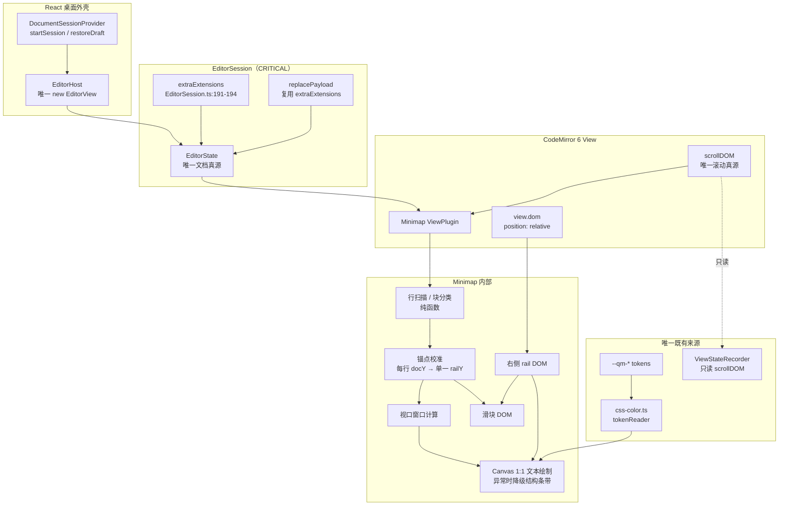

# 调用链、拓扑与影响面证据

> 功能：编辑器缩略图（Minimap）  
> 代码基线：`main@43659b1`（2026-10-30 00:17:27 +0800）  
> GitNexus 索引：`43659b1`，`status = ✅ 已是最新`  
> 分析方式：GitNexus CLI `impact/query/context` + 3 个只读 subagent + 源码逐行核对  
> 结论用途：证明接入点唯一、影响面可控、没有第二套文档/滚动/主题/持久化逻辑。

---

## 0. 结论先行

1. **唯一正确接入点**是 `EditorSession` 构造函数的 `this.extraExtensions`：
   `apps/desktop/src/features/editor/EditorSession.ts:191-194`。
2. `EditorSession` 是所有顶层文档 session 的汇合点：`EditorSession.create`、`createUntitled`、`createDocumentSession`、`restoreDraft` 都经过构造函数；`replacePayload` 复用同一 `extraExtensions`（`:370-377`）。
3. `EditorHost` 是唯一 `new EditorView` 的地方（`EditorHost.tsx:46-50`），minimap 作为 `ViewPlugin` 由 CM6 自动实例化，不需要改 `EditorHost`。
4. 嵌套代码块编辑器使用独立 `EditorState.create`（`code-blocks.ts:665-728`），不会挂载 minimap。
5. 项目当前没有 minimap 源码、依赖、测试、设计稿；不存在需要复用/合并的旧实现。
6. `EditorSession` 的 GitNexus 风险为 **CRITICAL**（77 impacted / 37 direct / 22 processes / 8 modules），因此本方案对它的修改必须只有“向 `extraExtensions` 追加一个扩展”这一处，且先跑全量 session 测试。

---

## 1. 入口与生命周期链路

### 1.1 顶层文档创建

```text
AppShell / DocumentSessionProvider
  -> startSession(...)                         DocumentSessionContext.tsx:88-121
  -> EditorSession.createUntitled(...)          DocumentSessionContext.tsx:123-131
     或 createDocumentSession(ipc, payload)    session/createDocumentSession.ts:31-52
        -> EditorSession.create(payload, ...)   EditorSession.ts:232-234
  -> new EditorSession(...)                     EditorSession.ts:186-231
     -> this.extraExtensions = [                EditorSession.ts:191-194
          ...(options.extensions ?? []),
          editorOpenExternal.of(...),
          minimapExtension(),                   ← 本方案唯一新增
        ]
     -> createEditorState({ extraExtensions })  EditorSession.ts:204-212
        -> EditorState.create({ extensions: [ ...extraExtensions ] })
                                                createEditor.ts:110-124
  -> EditorHost                              EditorPage.tsx -> EditorHost.tsx:38-61
     -> new EditorView({ state, parent })
        -> ViewPlugin constructor               minimap.ts
        -> rail DOM / canvas / listeners
```

### 1.2 重载与恢复

```text
SaveCoordinator.reload / autoReload
  -> session.replacePayload(payload)            EditorSession.ts:360-420
     -> createEditorState({ extraExtensions })  EditorSession.ts:370-377
     -> view.setState(state)                    EditorSession.ts:395-399
        -> 旧 ViewPlugin.destroy()
        -> 新 ViewPlugin.constructor()
```

关键点：`replacePayload` 复用同一个 `this.extraExtensions`，所以 minimap 不会在重载后丢失，也不会出现“第二套扩展”。

### 1.3 模式/主题/只读重配置

```text
toggleLivePreview()
  -> setModeEffect(...)                         EditorSession.ts:468-495
  -> view.dispatch({ effects })                 （view 不重建）

applyTheme(theme)
  -> setThemeEffect(themeExtension(theme))      EditorSession.ts:503-515

setReadOnlyEffect / setEditorUiCopyEffect
  -> compartment.reconfigure(...)               createEditor.ts:60-86
```

这些 Compartment 只重配 state extension，不重建 view；minimap `ViewPlugin` 实例会保留。模式切换导致块级 widget 增减，`ViewPlugin.update` 会收到 `geometryChanged`，触发锚点重测。

### 1.4 销毁

```text
EditorHost effect cleanup
  -> session.detach(view)                       EditorSession.ts:439-445
  -> view.destroy()                             EditorHost.tsx:57-60
     -> ViewPlugin.destroy()
        -> remove rail DOM / listeners / observers / rAF
```

StrictMode 的 mount → cleanup → mount 会创建两个 view；每个 view 的插件独立销毁，最后只保留一个 rail。方案必须用 `editor-binding.test.tsx` 的 StrictMode 单测断言 `.qm-minimap` 数量为 1；E2E 是 production build，不会触发 StrictMode 双调用。

---

## 2. 目标拓扑



---

## 3. 数据流

### 3.1 文档 → 文本缩略图

```text
EditorState.doc (Text)
  -> doc.iterLines() / doc.line(n)              只读，不复制文档字符串
  -> MinimapLineTable（Uint8/Uint16 列式：kind/heading/indent/density）
  -> MinimapBlock[]（fence/table/frontmatter/math 范围）
  -> 锚点候选（块边界 + 标题 + 固定 stride）
  -> view.lineBlockAt(line.from).top            采样 docY
  -> AnchorMap（每行 docY；docY ↔ railY 单一线性映射）
  -> 视口窗口（computeMinimapWindow，整篇可容纳时全画）
  -> Canvas 1:1 文本（每字符一列、每行 3px；异常时降级像素桶/块带）
```

**不复制文档到 React state，不产生第二份文档内容。** 行模型是短生命周期缓存，文档变化后 120ms 重建。

### 3.2 滚动 → 滑块

```text
scrollDOM "scroll" (passive)
  -> requestAnimationFrame
  -> docY = clamp(scrollTop - documentPadding.top, 0, docHeight)
  -> railY = docYToRail(docY)
  -> slider.style.transform = translateY(...)
  -> 不重绘 Canvas
```

### 3.3 点击/拖拽 → 滚动

```text
pointerdown / pointermove
  -> rail 内坐标（扣除 trackTop）
  -> docY = railToDocY(y)
  -> scrollDOM.scrollTop = clamp(docY + documentPadding.top - offset, 0, maxScroll)
  -> 原生 scroll 事件 -> ViewStateRecorder 照常记录
```

### 3.4 主题变化

```text
uiStore.setTheme -> documentElement[data-theme]
  -> MutationObserver
  -> resolveMinimapPalette(view.dom)
  -> Canvas 重绘（不重建 view / 不丢 undo）
```

### 3.5 错误流

```text
canvas.getContext("2d") == null
  -> 标记 data-minimap-state="unsupported"
  -> 隐藏 rail，不抛错，不影响编辑

tokenReader == null / token 解析失败
  -> 单 token 中性灰；reader null 时隐藏 rail
  -> Canvas 仍可绘制

ResizeObserver 不存在
  -> 降级为 window.resize + update.geometryChanged

doc.lines > 100_000 或 doc.length > 2_000_000
  -> 隐藏 rail，移除 .cm-editor padding
  -> 文档缩小后自动恢复
```

---

## 4. GitNexus 影响面

### 4.1 汇总

| 目标符号 | 类型 | impacted | direct | processes | modules | risk | 本方案动作 |
|---|---|---:|---:|---:|---:|---|---|
| `EditorSession` | Class | 77 | 37 | 22 | 8 | **CRITICAL** | 仅在构造函数追加一个扩展 |
| `createEditorState` | Function | 6 | 3 | 3 | 2 | **HIGH** | **不修改** |
| `previewTierFor` | Function | 20 | 10 | 6 | 4 | **CRITICAL** | **不修改**；仅复用 `PREVIEW_PARTIAL_MAX_UNITS` 常量 |
| `ViewStateRecorder` | Class | 16 | 4 | 3 | 2 | **HIGH** | **不修改**；只共享 `scrollDOM` 只读事件 |
| `EditorHost` | Function | 3 | 1 | 1 | 1 | LOW | **不修改** |
| `qingmoEditorTheme` | Const | 0 | 0 | 0 | 0 | **UNKNOWN** | **不修改**；用 grep 确认被 `createEditor.ts` 与 `code-blocks.ts` 引用 |

> `qingmoEditorTheme` 的 `UNKNOWN` 是 GitNexus 对“模块级 const 的裸引用”无法建边的已知限制，不代表未使用。`grep` 已确认：
> `packages/editor-core/src/createEditor.ts:6,117`、`packages/editor-core/src/live-preview/code-blocks.ts:7,669`。

### 4.2 `EditorSession` 受影响流程（GitNexus 摘要）

| 流程 | 文件 | 受影响 process | 说明 |
|---|---|---:|---|
| `runMenuCommand` | `WorkspaceLayout.tsx` | 10 | 菜单/命令会读 session |
| `DocumentSessionProvider` | `DocumentSessionContext.tsx` | 6 | 创建/恢复/切换 session |
| `retry` / `forceSave` / `armScheduledTimers` / `armRetry` / `saveOnce` / `saveAsOnce` | `SaveCoordinator.ts` | 5~8 | 保存状态机 |
| `schedule` | `DraftJournal.ts` | 4 | 崩溃草稿 |
| `AppShell` | `AppShell.tsx` | 12 | 应用壳与关闭守卫 |
| `autoReload` / `reload` | `SaveCoordinator.ts` | 4 | 外部变更重载 |

**处理策略**：

1. 先跑基线：`pnpm vitest run apps/desktop/src/features/editor apps/desktop/src/app`。
2. 只改 `EditorSession.ts` 的 `extraExtensions` 数组，不碰构造函数其余逻辑、不碰 `replacePayload`、不碰 snapshot。
3. 新增测试：view 创建后恰好 1 个 `.qm-minimap`；`replacePayload` 后仍 1 个；`view.destroy()` 后 0 个。
4. 再跑全量 `pnpm test` 与 E2E。

### 4.3 `createEditorState` 的影响链（不修改的理由）

`createEditorState` 被以下流程使用：

- `EditorSession` 构造/重载；
- `bench/open.bench.ts`；
- `editor-core.test.ts`；
- 其他只读消费者。

若把 minimap 设为默认扩展：

- editor-core 不再是纯编辑器内核，所有消费者被动获得 UI；
- jsdom/bench 会创建 rail DOM，增加无意义开销；
- 未来若做插件/嵌入编辑器，无法关闭。

因此 **不修改** `createEditorState`，只在 `EditorSession.extraExtensions` 注入。

### 4.4 `ViewStateRecorder` 的影响链（不改的理由）

`ViewStateRecorder` 是唯一持久化滚动/选区的组件：

- 监听 `view.scrollDOM` 的 scroll；
- 用 `lineBlockAtHeight(0)` + `documentTop` 计算 `topPos/topOffset`；
- 1s debounce / 5s max wait；
- 写入 Rust；不恢复滚动（恢复由 `EditorHost` 首帧 `scrollTo`）。

minimap 只读 `scrollDOM`，不写任何 view state。若再新增一套持久化，会违反“唯一写入者”并导致滑块位置与恢复位置不一致。**禁止**。

---

## 5. 候选接入点比较

| 候选 | 是否选择 | 理由 | 风险 |
|---|---|---|---|
| `EditorSession.extraExtensions` | **选择** | 所有顶层 session 汇合；`replacePayload` 复用；嵌套编辑器不经过 | 修改 CRITICAL 文件，但只追加数组项 |
| `createEditorState` 默认扩展 | 排除 | 影响所有 editor-core 消费者/bench/jsdom；无法按桌面场景关闭 | HIGH |
| `basicExtensions` | 排除 | 全局基线；未来嵌入编辑器也会挂载；与“桌面文档 session”语义不符 | 中 |
| `qingmoEditorTheme` | 排除 | 嵌套代码块也使用；主题扩展不应包含 DOM/Canvas 逻辑 | 高 |
| `modeCompartment` | 排除 | 模式切换会重配；minimap 应在两种模式都存在 | 中 |
| `themeCompartment` | 排除 | 主题切换不应重建 minimap DOM | 中 |
| `EditorHost.tsx` | 排除 | 会引入第二个 view 生命周期管理点；StrictMode 风险 | 中 |
| `ViewStateRecorder` | 排除 | 职责是持久化，不是渲染；会造成第二套滚动逻辑 | 高 |
| `WorkspaceLayout` 命令 | 不修改（Q-002=B 已确认） | 不新增会话内开关；不持久化 | 低 |
| `styles.css` `.cm-gutters` | 排除 | 现有 CSS 强制左侧 40px、Live Preview 隐藏 | 高 |
| 直接依赖 `@replit/codemirror-minimap` | 排除 | 挂载冲突、整篇解析、全局比例 | 高 |

---

## 6. 重复实现 / 多套逻辑风险表

| 风险 | 现有唯一来源 | 本方案必须怎么做 | 禁止怎么做 |
|---|---|---|---|
| 文档内容 | `EditorState.doc` | 只读 `doc.iterLines()`；不复制到 React | 新建 `MinimapDocument` 持久化/第二份正文 |
| 滚动位置 | `view.scrollDOM` | 只读监听 scroll；点击直接写 `scrollDOM.scrollTop` | 自建 scrollTop 状态、再用 effect 同步 |
| 滚动持久化 | `ViewStateRecorder` | 不写、不读持久化 | 新增 minimap 专用 view-state 字段 |
| 主题色 | `--qm-*` + `css-color.ts` | 抽取共享 `createTokenReader` | 在 minimap 里复制十六进制 palette |
| 主题切换 | `uiStore` + `data-theme` + `themeCompartment` | `MutationObserver` 重读 token | 监听 React store、重建 EditorView |
| 模式切换 | `modeCompartment` | 依赖 `geometryChanged` 重建锚点 | 在 minimap 内再维护一套 Live Preview 开关 |
| 编辑器生命周期 | `EditorHost` + `ViewPlugin` | 插件 `constructor/update/destroy` | 在 React 里 `querySelector` 挂 DOM |
| 嵌套代码块 | 独立 `EditorState.create` | 不经过 `EditorSession`，自然不挂载 | 把 minimap 加到 `basicExtensions`/`qingmoEditorTheme` |
| Markdown 语义 | Lezer / live-preview block readers | 只做“展示分类器”，不解析语义 | 复制一套 Markdown parser、影响渲染结果 |
| 命令/快捷键 | `CommandRegistry` | 本期不加命令（Q-002=B）；若未来重评，只注册一个 `view.toggleMinimap` | 自建 keydown 监听/第二套快捷键 |
| 配置 | `UiStore` / Rust view state | 本期零新增配置 | 私自新增 localStorage 键或 DB 表 |
| i18n | `apps/desktop/src/i18n/locales/*` | 本期无文案（Q-002=B） | 在组件内硬编码中英文 |

### 6.1 关于“展示分类器”是否算重复解析

方案中的行分类器只回答“这一行画什么颜色/是否属于 fence/table”，**不参与 Markdown 语义、不改变 Live Preview 装饰、不影响保存内容**。它输入是 `Text` 的纯文本行，输出是 `MinimapLineKind`，是 presentation-only 的纯函数。

为避免与 Lezer 的语义漂移：

- 分类器不导出到 live-preview，不被其他模块消费；
- 单元测试固定覆盖 ATX/Setext、fence、table、front matter、列表、引用、分隔线；
- 若未来 Lezer 已能提供稳定 block 信息，可在 T-003 评估替换，但不作为本期前置。

---

## 7. 当前代码校准证据

| 事实 | 证据 |
|---|---|
| 当前 HEAD | `git rev-parse --short HEAD` → `43659b1` |
| GitNexus 索引 | `node .gitnexus/run.cjs status` → 索引提交 `43659b1`，当前提交 `43659b1`，状态已是最新 |
| 无 minimap 实现 | 全仓 `minimap` / `mini-map` 检索 0 命中（排除依赖/构建产物） |
| 唯一 `new EditorView`（顶层） | `EditorHost.tsx:46`；嵌套代码块另有 `new EditorView` 于 `code-blocks.ts:727` |
| `EditorSession.extraExtensions` | `EditorSession.ts:191-194` |
| `replacePayload` 复用 | `EditorSession.ts:370-377` |
| 扩展追加顺序 | `createEditor.ts:113-123`，`...extraExtensions` 在最后 |
| `.cm-gutters` 冲突 | `styles.css:10-21` |
| 嵌套编辑器 | `code-blocks.ts:665-728`，独立 `EditorState.create` |
| 滚动持久化唯一写入 | `ViewStateRecorder.ts:145-185` |
| 主题 token 唯一来源 | `packages/ui/src/tokens.css:1-43`；`extensions/theme.ts:14-20` 注释 |
| 颜色解析现状 | `mermaid-theme.ts:338-382` 的 `tokenReader` 是模块私有 |
| 大文档阈值 | `limits.ts`：`PREVIEW_FULL_MAX_UNITS=200_000`、`PREVIEW_PARTIAL_MAX_UNITS=2_000_000`、`MAX_LINE_UNITS=10_000` |

---

## 8. 未验证项

1. `lineBlockAt` 在 10 万行文档上的批量采样耗时（T-003 实测）。
2. Live Preview 中 Mermaid/图片异步加载对 `geometryChanged` 的触发次数（T-006 观察）。
3. Windows 经典滚动条宽度与 rail `right` 偏移（T-006 真机/模拟）。
4. `MutationObserver` 监听 `data-theme` 是否覆盖所有主题切换路径（T-004/T-006 验证）。
5. `replacePayload` 时 `view.setState` 是否稳定触发旧插件 `destroy`（T-005 单测验证）。
