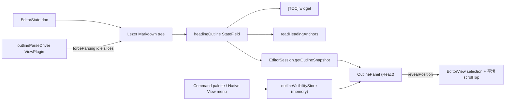
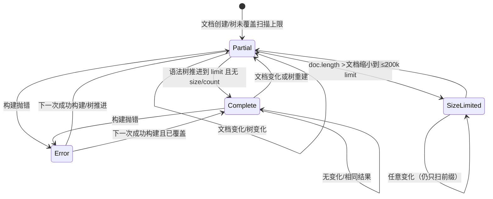
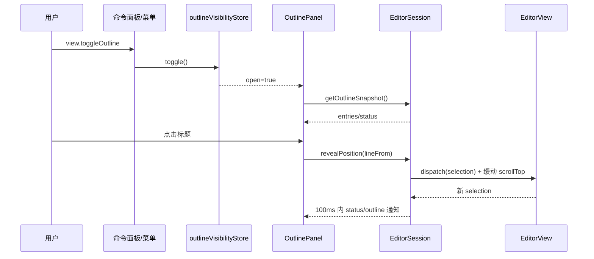
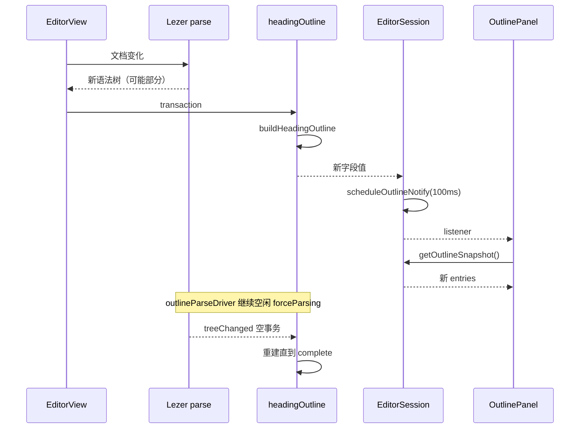

# 编辑器大纲面板（Outline）设计方案

> **文档用途：** 面向技术评审、开发、测试和运维人员的设计说明  
> **功能 ID：** `editor-outline`  
> **对应需求：** `R-001 ~ R-008`  
> **对应实施计划：** [`01-实施计划.md`](01-实施计划.md)  
> **代码基线：** `main@e97d651`  
> **设计版本：** `v1.8`  
> **日期：** `2026-10-30`  
> **状态：** `R1~R7 通过；T-001~T-009 已实施并验证（VERDICT: PASS）；Q-001~Q-007 已确认 A`

---

## 1. 摘要

青墨已经有单一的 CM6 文档状态、Live Preview、`[TOC]` 占位符、标题锚点和右侧 minimap，但没有一个持续可见的“文档结构”导航。用户在长文中只能依赖滚动、查找或 `[TOC]` 占位符；`[TOC]` 又只在 Live Preview 中出现，Source 模式没有等价入口。Typora 的左侧 Outline 面板提供了“标题层级 + 点击跳转 + 当前项高亮”的连续导航，是本方案的产品参照。

本方案的核心不是再写一个 Markdown 标题解析器，而是把“标题”提升为编辑器状态的一部分：

1. 在 `editor-core` 新增 `headingOutline` StateField，放在 `createEditorState` 的基座扩展中；它只在文档或语法树变化时重建，保存 `level/text/plainText/from/to/line/lineFrom`。
2. 现有 `[TOC]` 与标题锚点改为消费同一个字段，删除各自的标题扫描；这样 Source/Live Preview、TOC、锚点、侧栏只有一份标题语义。
3. `EditorSession` 增加独立的 `getOutlineSnapshot/subscribeOutline/revealPosition` 桥接。标题文本不进入 `EditorSessionSnapshot`，避免 React 成为第二份文档副本。
4. 左侧 `OutlinePanel` 只渲染纯文本标题，点击复用 CM6 的 selection + 平滑视口滚动；不复制 Markdown 渲染、不新开滚动容器。
5. 默认隐藏，通过命令面板和原生“显示 > 大纲”打开；开关只存在于当前窗口的内存 store，不新增 localStorage、DB、Rust 命令或第三方依赖。

一句话方案：

> 在保留 CM6 单一文档状态、现有 Compartment 重配置和 `ViewStateRecorder` 持久化的前提下，用共享 `headingOutline` 字段统一 TOC/锚点/侧栏的标题模型，用 `EditorSession` 的独立订阅把纯文本大纲桥接给 React，再用一个默认隐藏的左侧面板完成导航。

预期结果：长文作者可以在不离开编辑区的情况下看到全文结构、点击跳转、随光标定位当前章节；现有 TOC、锚点、minimap、保存/重载/模式切换行为不变。

---

## 2. 问题定义

### 2.1 业务背景与故障特征

当前用户在长 Markdown 文档中的导航路径是：

```text
想找某一节
  -> 滚动/记忆标题位置，或打开查找输入关键词
  -> 找不到时回到文首找 [TOC] 占位符
  -> [TOC] 只在 Live Preview 中渲染；Source 模式没有
  -> 找到后点击，光标跳到标题行
  -> 继续阅读/编辑后又失去位置
```

这带来三个可观察问题：

1. **结构不可见**：没有持续存在的标题列表；用户必须记住文档结构。
2. **模式不一致**：`[TOC]` 是文档内容的一部分，Source 模式看不到；大文档进入 Source 模式后完全失去结构导航。
3. **导航成本高**：查找是文本匹配，不知道标题层级；滚动是线性的，长文定位慢。

### 2.2 当前实现与主要缺口

| 缺口 | 当前行为 | 根因/证据 | 导致的问题 |
|---|---|---|---|
| GAP-001 无持续大纲 | 只有 `[TOC]` 占位符 widget | `packages/editor-core/src/live-preview/toc.ts:70-116` | Source 模式无结构导航；无占位符的文档没有 TOC |
| GAP-002 三套标题扫描 | `toc.ts:scanDocument`、`heading-anchors.ts:readHeadingAnchors`、`minimap/model.ts` 行扫描 | 三处独立实现 | 标题语义可能分叉；新增侧栏会变成第四套 |
| GAP-003 TOC 与锚点重复遍历 | TOC 扫描标题 + 占位符；锚点再扫描标题 | `toc.ts:77-113`、`heading-anchors.ts:164-199` | 每次文档变化重复解析同一批标题 |
| GAP-004 初始语法树不完整 | CM6 `LanguageState.init` 只解析前 3000 units | `@codemirror/language@6.13.1` `LanguageState.init` | 只在 create 时扫描会长期缺标题 |
| GAP-005 EditorSession 无大纲桥 | snapshot 只有元数据/光标/模式 | `EditorSession.ts:59-72` | 侧栏无法订阅标题，又不能把正文塞进 snapshot |
| GAP-006 设置开关无归属 | `uiStore` 只持久化 theme/language | `uiStore.ts:10-11` | 新增持久化 key 需要人工批准；本期应避免 |
| GAP-007 菜单契约三处同步 | Rust `MENU_ACTIONS`、TS `MENU_ACTIONS`、`MENU_ACTION_NAMES` | `contract.rs:70-82`、`commands.ts:117-145` | 只改两处会让 FakePlatform/E2E 通过但真实 Tauri 忽略 |
| GAP-008 大文档无降级策略 | minimap 有 100k/2M 限制，TOC 有 200k 限制 | `limits.ts`、`toc.ts:119` | 大纲若全量扫描会拖慢输入 |

### 2.3 设计目标

| R-ID | 目标 | 可度量成功标准 |
|---|---|---|
| R-001 | 可打开/关闭的左侧大纲 | 默认无面板；菜单/命令打开后 ≤1 帧出现；再次关闭无残留 |
| R-002 | 唯一标题数据源 | `scanPlaceholders`/`readHeadingAnchors` 不再遍历标题；`readHtmlAnchors` 的显式锚点扫描与 `details.ts` 渲染调用保留 |
| R-003 | 点击跳转 | 光标 anchor 等于 `entry.lineFrom`；标题块顶部与滚动容器顶部差 ≤10±2px |
| R-004 | 实时一致 | 编辑后 100ms 内面板更新；重载/切换文档无旧标题；Source/LP 条目一致 |
| R-005 | 语义正确 | 200 个混合 fixture 中标题集合与 Lezer 顶层 `HeadingN` 完全一致；排除 frontmatter/details/fence |
| R-006 | 性能 | 200k units/500 标题 field rebuild p95 ≤4ms；字段安全上限 5000 条、UI 500 条；面板打开 p95 ≤300ms；输入无 >50ms 长任务 |
| R-007 | 可访问/国际化 | Tab 进入列表一次，Arrow/Home/End 移动，Enter 跳转；zh-CN/en 无空文案；菜单多处契约测试通过 |
| R-008 | 零持久化/可回滚 | `git diff` 无 DB/localStorage/Rust 命令；回滚只移除 UI/命令 |

### 2.4 非目标

- 不实现文件树/文件夹；见 `Q-001`，建议另立 `workspace-file-tree`。
- 不实现大纲内搜索/过滤、折叠/展开、拖拽排序、自动编号；见 `NEXT-002/NEXT-003`。
- 不实现 Typora 式“视口滚动高亮”；v1 使用光标行，见 `Q-004` 与 `NEXT-004`。
- 不渲染 Markdown 行内格式；侧栏只显示纯文本。
- 不解析代码块内符号；本文档大纲只表达 Markdown 标题。
- 不修复标题 slug 冲突/显式锚点覆盖规则；见 `Q-006`。
- 不新增默认快捷键；见 `Q-007`。
- 不做多窗口开关同步/持久化；见 `Q-003`。

### 2.5 前置假设与约束

| 类型 | 内容 | 验证方式 | 假设失效后的处理 |
|---|---|---|---|
| 技术 | `createEditorState` 是唯一顶层 EditorState 工厂 | `rg "EditorState.create"`：顶层只此一处；嵌套代码块独立 | 若出现第二个顶层工厂，把字段注入抽到共享函数并逐个接入 |
| 技术 | `markdownExtensions` 在 Source/LP 都启用 | `createEditor.ts:113-122` | 若 Source 不启用 Markdown 解析，字段只能返回空并提示 |
| 技术 | `syntaxTree(state)` 会随解析推进产生新树对象 | `toc.ts:263` 已用 `syntaxTree !==` 判断 | 若树对象身份不稳定，改用 `tree.length`/版本号比较 |
| 技术 | `EditorSession` 是唯一顶层 session 汇合点 | `EditorSession.ts:192-214`、`:370-379` | 若新增 session 类型，必须复用同一桥接 |
| 产品 | 用户接受“默认隐藏 + 命令/菜单打开” | `Q-002` | 改为自动/常显时需补布局 E2E |
| 产品 | 200k units 覆盖绝大多数长文 | `Q-005`；bench fixture | 提高上限并重新做性能门禁 |
| 部署 | Tauri 原生菜单标签由前端投影 | `NativeShellLabels`、`native.test.ts` | 若 Rust 自持文案，需新增翻译表，范围扩大 |

---

## 3. 总体设计

### 3.1 设计原则

| 原则 | 含义 | 对实现的约束 |
|---|---|---|
| 单一真源 | 标题只由 `headingOutline` 产生 | TOC/锚点/侧栏不得再调用 `syntaxTree` 遍历标题 |
| 状态与视图分离 | 标题模型在 EditorState；几何/滚动在 EditorView | StateField 不读 DOM；侧栏不直接读 `readText()` |
| 默认安全 | 默认隐藏、默认无持久化、默认有上限 | 未打开时零布局变化；超限只降级 |
| 最小桥接 | React 只拿纯文本与位置 | 不把 `EditorState`/`EditorView`/正文放进 snapshot |
| 渐进增强 | 解析未完成时先显示已有条目 | partial 状态可见、可恢复，不阻塞输入 |
| 契约同步 | 菜单动作多处一致 | Rust/TS/names/精确测试/生成绑定/i18n 同一提交更新 |

### 3.2 系统架构



架构说明：

- **入口层：** 命令面板 `view.toggleOutline`、原生菜单 `view.toggleOutline`、面板关闭按钮；三者只改 `outlineVisibilityStore`。
- **核心层：** `headingOutline` 是唯一标题模型；`outlineParseDriver` 只负责推进语法树，不产生第二份标题。
- **桥接层：** `EditorSession` 把字段值暴露为只读快照，并提供 `revealPosition`；React 不接触 CM6 内部结构。
- **依赖层：** 现有 `markdownExtensions`、`frontmatter`、`details` 读取函数；不新增第三方依赖。
- **观测层：** 面板 `data-outline-status`/`data-outline-count`/`data-outline-limit` 供 E2E 与诊断；无生产日志/指标。

### 3.3 职责边界

| 模块/层 | 负责 | 不负责 | 依赖 |
|---|---|---|---|
| `headingOutline` | 从语法树构建标题数组、状态、限额 | DOM、滚动、React、持久化 | `syntaxTree`、`headingText`/`plainInlineText`、`readFrontMatter`、`readDetailsRanges` |
| `outlineParseDriver` | 视图存在时按空闲切片推进语法树 | 构建标题、渲染 UI | `forceParsing`、`syntaxTree` |
| `details-range.ts` | 只读取闭合 `<details>` 的顶层范围 | summary/正文渲染、Markdown 渲染 | `syntaxTree`、`readFrontMatter` |
| `toc.ts` | 找到 `[TOC]` 占位符、生成 widget、渲染标题 | 自己扫描标题 | `headingOutline`、`details-range` |
| `heading-anchors.ts` | 把标题转成 slug、去重、解析 `#fragment` | 自己扫描标题 | `headingOutline.entries` |
| `EditorSession` | outline 订阅、节流、`revealPosition`、生命周期 | Markdown 语义、DOM 渲染 | `headingOutline`、`EditorView` |
| `OutlinePanel` | 列表、缩进、活动项、空/partial 提示、关闭 | 解析 Markdown、保存、滚动计算 | `EditorSession`、i18n |
| `outlineVisibilityStore` | 当前窗口开关 | 持久化、跨窗口同步 | 无 |
| `WorkspaceLayout` | 注册命令、处理原生菜单动作 | 渲染面板 | `commandRegistry`、store |
| `NativeShellLabels`/Rust | 原生菜单标签与动作转发 | 保存状态 | 前端投影 |

### 3.4 当前链路与目标链路

当前链路：

```text
[文档变化]
  -> tocPreview.update
     -> scanDocument(state)                 // 遍历 Document 顶层
        -> headings[] + placeholder ranges
     -> 只有存在 [TOC] 时才生成 widget
  -> specs.ts 渲染内部链接
     -> readHeadingAnchors(state, blocked)
        -> 再遍历 Document 顶层标题
  -> 没有侧栏消费者
```

目标链路：

```text
[文档变化 / 语法树推进]
  -> headingOutline.update
     -> buildHeadingOutline(state)
        -> syntaxTree(state) 顶层标题
        -> 排除 frontmatter/details
        -> entries[] + status + limitReason
  -> tocPreview.update
     -> scanPlaceholders(state)             // 只找 [TOC]
     -> 读取 headingOutline.entries         // 不再扫标题
  -> readHeadingAnchors(state, blocked)
     -> 读取 headingOutline.entries         // 不再扫标题
  -> EditorSession.handleUpdate
     -> outline 字段变化? -> scheduleOutlineNotify (100ms trailing)
  -> OutlinePanel useSyncExternalStore
     -> 渲染纯文本列表
  -> 点击
     -> EditorSession.revealPosition(lineFrom)
        -> view.dispatch({ selection })              ← 光标立即落点
        -> scrollTop 缓动 + coordsAtPos 收尾          ← 视口平滑
```

---

## 4. 修改点清单

> 本方案不是纯缺陷修复，但存在多处现有代码调整；按 `MP-ID` 列出。未列出的候选位置表示本期明确不改。

| MP-ID | 文件/符号 | 修改类型 | 修改内容 | 影响的调用链节点 | 关联决策/任务 | 风险 |
|---|---|---|---|---|---|---|
| MP-001 | `packages/editor-core/src/live-preview/outline.ts`（新增） | 新增 | `HeadingOutlineEntry`、`HeadingOutlineState`、`buildHeadingOutline`、`headingOutline`、`readHeadingOutline`、`outlineParseDriver` | 核心模型 | D-001/D-003/D-004/D-005；T-002 | 中 |
| MP-002 | `packages/editor-core/src/limits.ts` | 修改 | 新增 `OUTLINE_SCAN_MAX_UNITS`、`OUTLINE_SAFETY_MAX_ENTRIES`、`OUTLINE_PANEL_MAX_ENTRIES`、切片/面板常量 | 限额 | D-005；T-002 | 低 |
| MP-003 | `packages/editor-core/src/createEditor.ts` | 修改 | 基座 extensions 在 `markdownExtensions` 之后、`modeCompartment` 之前注入 `headingOutline`、`outlineParseDriver` | 状态工厂 | D-001/D-004；T-002 | 高（HIGH） |
| MP-004 | `packages/editor-core/src/index.ts` | 修改 | 导出字段、读取函数、类型、限额 | 包 API | T-002 | 低 |
| MP-005 | `packages/editor-core/src/live-preview/toc.ts:scanDocument/buildToc` | 修改 | 删除标题扫描，只扫占位符；headings 来自字段 | TOC | D-001；T-003 | 中 |
| MP-006 | `packages/editor-core/src/live-preview/heading-anchors.ts:readHeadingAnchors` | 修改 | 使用 `readHeadingOutline(state).entries`，复用 `plainText` | 锚点 | D-001/D-012；T-003 | 中 |
| MP-007 | `apps/desktop/src/features/editor/EditorSession.ts` | 修改 | 新增 outline 字段/订阅/节流/`revealPosition`/`focusEditor`；修复 update listener 代际 | 桥接 | D-006/D-007；T-004 | **高（CRITICAL）** |
| MP-008 | `apps/desktop/src/features/editor/outline/outlineVisibility.ts`（新增） | 新增 | 会话内开关 store | 开关注入 | D-008；T-005 | 低 |
| MP-009 | `apps/desktop/src/features/editor/outline/OutlinePanel.tsx`（新增） | 新增 | 左侧列表、活动项、空/partial/error、关闭、roving tabindex | UI | D-009/D-010/D-011/D-012；T-006 | 中 |
| MP-010 | `apps/desktop/src/features/editor/EditorPage.tsx` | 修改 | 面板 + 编辑器 flex 布局；编辑器 `min-w-0 flex-1` | UI 布局 | D-009；T-006 | 低 |
| MP-011 | `apps/desktop/src/features/workspace/WorkspaceLayout.tsx` | 修改 | 注册 `view.toggleOutline`、处理菜单动作 | 命令/菜单 | D-008/D-013；T-005 | 低 |
| MP-012 | `apps/desktop/src/lib/ipc/commands.ts` | 修改 | 新增 `MENU_ACTIONS.toggleOutline` 与 names | 菜单契约 | D-013；T-005 | 低 |
| MP-013 | `src-tauri/src/ipc/contract.rs` | 修改 | 新增 `MENU_VIEW_TOGGLE_OUTLINE` 与 `MENU_ACTIONS` | 菜单契约 | D-013；T-005 | 低 |
| MP-014 | `src-tauri/src/ipc/dto.rs`、`src-tauri/src/lib.rs` | 修改 | `NativeShellLabels.outline`、View 菜单 Action | 菜单标签/布局 | D-013；T-005 | 中 |
| MP-015 | `apps/desktop/src/i18n/*`、`packages/shared/src/generated/NativeShellLabels.ts` | 修改/生成 | `editor.outline.*`、`commands.view.toggleOutline`、`menu.outline`、生成绑定 | i18n | D-013；T-005 | 中 |
| MP-016 | `packages/editor-core/src/live-preview/details-range.ts`（新增） | 新增 | `scanDetailsTags`、`readDetailsRanges`；不依赖 `specs.ts`/DOM | 排除范围 | D-003；T-002 | 中 |
| MP-017 | `packages/editor-core/src/live-preview/heading-text.ts` | 修改 | 接收 `plainInlineText`；`heading-anchors.ts` re-export | 纯文本 | D-002；T-002 | 低 |
| MP-018 | `packages/editor-core/src/live-preview/details.ts` | 修改 | 只复用 `scanDetailsTags`，签名/渲染行为不变 | details 预览 | D-003；T-002 | 高（CRITICAL） |

边界说明：

- `frontmatter.ts`：复用 `readFrontMatter`，不修改签名。
- `details.ts`：只把标签扫描替换为 `details-range.ts` 的 `scanDetailsTags`；`readDetailsBlocks` 签名/输出/嵌套渲染不变。
- `specs.ts`：`readHeadingAnchors` 签名保持不变，内部改为读字段。
- `minimap/**`：minimap 的行扫描不是大纲数据源；不合并。
- `styles.css`/`tokens.css`：面板只用 Tailwind 类与现有 token。
- `ViewStateRecorder.ts`：滚动持久化不改；`revealPosition` 不写持久化。
- `src-tauri/src/commands/**`：不新增 IPC 命令。

---

## 5. 核心组件

### 5.1 `headingOutline`

职责：把当前 `EditorState` 的顶层 Markdown 标题转换为稳定、只读、可限额的快照。

| 项 | 设计 |
|---|---|
| 输入 | `EditorState`（doc + syntax tree + frontmatter/details-range 读取结果） |
| 输出 | `HeadingOutlineState`：entries/status/limitReason/errorReason |
| 依赖 | `@codemirror/language`、`heading-text.ts`（含从 `heading-anchors.ts` 移入的 `plainInlineText`）、`frontmatter.ts`、`details-range.ts` |
| 状态 | CM6 StateField，随 state 不可变 |
| 并发 | 单线程；每次 update 同步构建；无异步回调 |
| 测试 | 纯函数 `buildHeadingOutline(state)` + 字段 update/error 单测 |

核心接口：

```ts
export type OutlineStatus = "complete" | "partial" | "error";
export type OutlineLimitReason = "size" | "count" | null;

export interface HeadingOutlineEntry {
  level: number;
  /** 原始标题文本，保留行内 Markdown，供 TOC 渲染。 */
  text: string;
  /** 精确的 plainInlineText(text)，可以为空；不做回退。 */
  plainText: string;
  from: number;
  to: number;
  line: number;
  lineFrom: number;
}

export interface HeadingOutlineState {
  entries: readonly HeadingOutlineEntry[];
  status: OutlineStatus;
  limitReason: OutlineLimitReason;
  /** status=error 时的简短原因；不包含正文。 */
  errorReason: string | null;
}

export function buildHeadingOutline(state: EditorState): HeadingOutlineState;
export function readHeadingOutline(state: EditorState): HeadingOutlineState;
export const headingOutline: StateField<HeadingOutlineState>;
```

构建规则：

1. 只接受 `syntaxTree(state).topNode` 的直接子节点；用 `root.firstChild` + `nextSibling` 遍历（`SyntaxNode` 没有 `children` 数组）。
2. `isHeading(node.name)`（`ATX|SetextHeading[1-6]`）才进入候选。
3. 跳过完全落在 `readFrontMatter(doc)` 范围内的节点。
4. 跳过完全落在任一 `readDetailsRanges(state)` 范围内的节点；未闭合 `<details>` 不排除（与 `readDetailsBlocks` 一致）。
5. `FencedCode`/`CodeBlock` 不产生 Heading 节点；构建器仍对顶层 fence 做防御性跳过。
6. `headingText(doc, node)` 为空则跳过。
7. `plainText = plainInlineText(text)`，**不回退**；图片标题等纯文本为空时保留条目，但 `readHeadingAnchors` 跳过空 `plainText`，保持现有 slug 语义。
8. 条目按文档顺序；`line = doc.lineAt(node.from).number`，`lineFrom = doc.lineAt(node.from).from`。
9. 达到 `OUTLINE_SAFETY_MAX_ENTRIES`（5000）时停止并设 `limitReason = "count"`；这是字段安全上限，不是 UI 的 500 条显示上限。
10. `doc.length > OUTLINE_SCAN_MAX_UNITS` 时只扫描前 200k；`limitReason = "size"` 仅在 `tree.length >= min(doc.length, 200k)`（treeComplete）时设置，否则保持 `null` 并显示 generating，避免把“尚未扫到”误报成“前 200k 没有标题”。
11. `status = "complete"` 当且仅当未触发 size/count 限制且 `syntaxTree(state).length >= min(doc.length, 200k)`；否则 `"partial"`。任何构建异常为 `"error"`。
12. 返回冻结对象；`entries` 与每个 entry 都 `Object.freeze`，React 可安全比较引用。

字段更新：

```ts
create(state) {
  try { return buildHeadingOutline(state); }
  catch (error) { return errorOutline([], null, error); }
}

update(value, tr) {
  const treeChanged = syntaxTree(tr.state) !== syntaxTree(tr.startState);
  if (!tr.docChanged && !treeChanged) return value;
  try {
    const next = buildHeadingOutline(tr.state);
    return sameOutline(value, next) ? value : next;
  } catch (error) {
    const entries = tr.docChanged ? [] : value.entries;
    return errorOutline(entries, value.limitReason, error);
  }
}
```

`create` 也必须走同一兜底：初始构建失败时返回空 `status=error`，不能阻止 `EditorState.create`/打开文档。

降级语义：

- `tr.docChanged` 时异常：清空 entries，避免旧位置/旧标题指向错误内容。
- 仅树变化时异常：保留上一次 entries（last-known-safe），状态置 `error`，UI 显示“大纲暂不可用”，编辑/保存不受影响。
- 下一次成功构建自动恢复 `partial/complete`。

`sameOutline` 只比较 `status/limitReason/errorReason` 与 `entries` 的 `level/text/plainText/from/to/line/lineFrom`；**不比较语法树位置**。树继续推进但标题未变时返回旧引用，避免 100ms 通知重建列表。

`readHeadingOutline(state)` 先读字段；字段不存在时调用带 try/catch 的构建（用于裸 `EditorState` 测试/未来消费者），仍然是同一算法。

### 5.2 `outlineParseDriver`

职责：在视图存在时，用空闲切片把 Markdown 语法树推进到扫描上限；不产生标题、不渲染 UI。

| 项 | 设计 |
|---|---|
| 输入 | `EditorView` |
| 输出 | 空；通过 `forceParsing` 发布树变化 |
| 依赖 | `forceParsing`、`syntaxTree` |
| 生命周期 | ViewPlugin constructor 启动；`update` 在 doc/tree/viewport 变化时重新调度；`destroy` 取消 idle/timeout 句柄并移除 composition 监听 |
| 失败策略 | 解析无进展/抛错则停止；字段保持 partial，不影响编辑；composition 中暂停 dispatch |
| 测试 | jsdom 创建 view + 长文档；等待 `data-outline-status=complete` 或字段状态；覆盖 fallback/cancel |

调度算法：

```text
attempts = 0
pending = false
hasIdle = typeof requestIdleCallback == "function"

schedule():
  if destroyed or scheduled != null or running or view.composing: return
  if hasIdle:
    scheduled = requestIdleCallback(run, { timeout: 200 })
  else:
    scheduled = setTimeout(run, OUTLINE_PARSE_WEBKIT_DELAY_MS)  // 64ms

run():
  scheduled = null
  if destroyed or view.composing: return
  running = true
  pending = false
  try:
    state = view.state
    limit = min(state.doc.length, OUTLINE_SCAN_MAX_UNITS)
    before = syntaxTree(state).length
    if before < limit:
      // 关键：分块推进；同一个空闲回调可在预算内连续处理多个块。
      target = min(limit, before + OUTLINE_PARSE_CHUNK_UNITS)
      slice = hasIdle ? OUTLINE_PARSE_CHROMIUM_SLICE_MS : OUTLINE_PARSE_WEBKIT_SLICE_MS
      success = forceParsing(view, target, slice)
      after = syntaxTree(view.state).length
    else:
      success = true
      after = before
  catch:
    running = false
    return                                  // 停止，不再自旋
  running = false
  if after >= limit:
    attempts = 0
  else if success or after > before:
    attempts = 0
    schedule()
  else:
    // false 只表示本次 8ms 没到 target；parse context 可能已推进，
    // 所以继续重试同一个 target，而不是按“无进展”判死。
    attempts += 1
    if attempts < OUTLINE_PARSE_MAX_ATTEMPTS_PER_CHUNK: schedule()
    // 达到尝试上限：保持 partial，等下一次 doc/viewport 变化再试
  if pending:
    attempts = 0
    schedule()

update(update):
  if destroyed: return
  // forceParsing 失败时也会 dispatch 空事务（源码：null != tree 时 dispatch({})）。
  // 只把真实 doc/viewport/tree 变化当作 pending，否则空事务会不断重置 attempts。
  relevant = update.docChanged
    or update.viewportChanged
    or syntaxTree(update.state) !== syntaxTree(update.startState)
  if !relevant: return
  if running: pending = true; return
  attempts = 0
  schedule()

compositionend:
  pending = true
  attempts = 0
  if !running: schedule()
```

要点：

- **不能只比较树长度，也不能把 `false` 当“无进展”**：`ensureSyntaxTree`/`forceParsing` 在超时后会推进内部 parse context，但可能不发布新树；若只等 `after > before`，driver 会在第一个 8ms 切片后永久停摆；若按“连续 3 次 false”判死，又会在正常慢解析时过早停止。设计改为 **分块目标**（`OUTLINE_PARSE_CHUNK_UNITS = 50_000`）+ 同一 target 的有界重试（`OUTLINE_PARSE_MAX_ATTEMPTS_PER_CHUNK = 16`）：`false` 继续试同一 target，成功才推进下一块；同一个空闲回调可在 8ms 预算内连续处理多个块；16 次仍未成功才停止并保留 partial。
- `requestIdleCallback`/`cancelIdleCallback` 成对使用；WKWebView 没有空闲 API 时退回 `setTimeout(64)` + 4ms 切片。
- `forceParsing` 失败时仍会 dispatch 空事务（`ensureSyntaxTree` 返回 `null`，`null != syntaxTree` 成立）；`update` 必须先过滤“无 doc/viewport/tree 变化”的事务，不能把空事务当成 `pending`，否则每次失败都会重置 `attempts`，16 次上限永远达不到。
- `running` 期间的 `docChanged`/`viewportChanged`/`compositionend` 设置 `pending`，run 结束后必须再调度，不能丢事件。
- `viewportChanged` 重新调度，避免用户滚动到未解析区域后大纲长期缺失。
- `view.composing` 时不在 IME 组合中 dispatch；`compositionend` 是唯一补偿点。
- `destroy` 必须取消 pending idle/timeout，否则 view 销毁后仍可能触碰 state。

为什么不在 StateField 里调用 `ensureSyntaxTree`：

- Zettlr 的 `tocField` 在字段 create/update 中调用 `ensureSyntaxTree(state, doc.length, 1000)`；这能拿到全树，但把解析工作放在 state 更新路径上，最坏阻塞 1s。
- CM6 官方把解析 worker 作为 ViewPlugin；StateField 应尽量纯函数、可预测。
- 本方案把“推进解析”放到 ViewPlugin，把“从当前树构建标题”留在 StateField，职责更清晰。
- 代价：无视图的消费者只能看到当前已解析部分；通过 `readHeadingOutline` 的 partial 状态和测试中的 `forceParsing` 处理。

### 5.3 `EditorSession` 大纲桥接

职责：把 `headingOutline` 暴露为 React 可订阅的只读快照，并提供不修改文档的定位方法。

| 项 | 设计 |
|---|---|
| 输入 | `EditorState` / 位置 |
| 输出 | `HeadingOutlineState`、订阅回调、`boolean` |
| 依赖 | `headingOutline`/`readHeadingOutline`、`EditorView` |
| 状态 | 每个 session 一份监听集合 + 一个 trailing timer |
| 失败策略 | 无 view 时 `revealPosition` 只更新 state selection；不抛错 |
| 测试 | 单测 + StrictMode 重挂载 + replacePayload |

新增成员：

```ts
private readonly outlineListeners = new Set<() => void>();
private outlineTimer: ReturnType<typeof setTimeout> | null = null;
private attachmentId = 0;

getOutlineSnapshot = (): HeadingOutlineState => readHeadingOutline(this.currentState);

subscribeOutline = (listener: () => void): (() => void) => {
  if (this.disposed) return () => undefined;
  this.outlineListeners.add(listener);
  return () => this.outlineListeners.delete(listener);
};

revealPosition(position: number): boolean {
  if (this.disposed || !Number.isFinite(position)) return false;
  const pos = Math.min(this.currentState.doc.length, Math.max(0, Math.trunc(position)));
  if (this.view) {
    // Selection is immediate; only the viewport eases.
    this.view.dispatch({ selection: { anchor: pos } });
    this.view.focus();
    this.scrollToPosition(this.view, pos);
  } else {
    this.state = this.state.update({ selection: { anchor: pos } }).state;
    this.publish({ selection: selectionOf(this.state), cursor: cursorAt(this.state, pos) });
  }
  return true;
}
```

滚动策略：

- 目标位置用 `lineBlockAt(pos).top + documentPadding.top - OUTLINE_SCROLL_MARGIN` 估算，初始落点已包含内容内边距（`.cm-content` 的 28px），不会系统性偏高。
- 用 `requestAnimationFrame` + `easeInOutCubic` 在 120–280ms 内推进 `scrollTop`；距离越远时长越长，但不超过 280ms。
- 动画结束后等一帧，让 CM6 完成视口测量，再用 `coordsAtPos(pos)` 计算精确的文本顶部，做 120ms 的微调收尾；这修正了离屏行高估算与真实行高之间的差异。
- `prefers-reduced-motion: reduce`、全局 `scroll-behavior: auto !important`、无 `requestAnimationFrame`、或距离 <1px 时，退回一次性 `EditorView.scrollIntoView(y:"start", yMargin:10)`，保证可达性。
- 用户滚轮/触摸/指针按下、文档变化、重新点击其他条目、detach/dispose 都会取消旧动画；代际 id 防止旧收尾覆盖新目标。

focusEditor(): boolean {
  if (this.disposed) return false;
  this.view?.focus();
  return this.view !== null;
}
```

更新分流：

```text
handleUpdate(update):
  if disposed: return
  state = update.state
  outlineChanged = state.field(headingOutline, false) !== update.startState.field(headingOutline, false)
  if outlineChanged: scheduleOutlineNotify()
  if !docChanged && !selectionSet: return       // 关键：tree-only 更新不能提前丢掉 outline
  ...原有 dirty/selection/mode 逻辑...
```

通知节流：

```text
scheduleOutlineNotify():
  if disposed or timer != null or outlineListeners.size == 0: return
  timer = setTimeout(flushOutlineNotify, statusThrottleMs)   // 默认 100ms

flushOutlineNotify():
  clear timer
  for listener of [...outlineListeners]: listener()
```

- 文档连续输入时最多每 100ms 通知一次 React；字段本身仍然同步更新，`getOutlineSnapshot` 总是最新。
- `replacePayload` 在 `view.setState` 后立即 `flushOutlineNotify()`，避免重载后侧栏停留旧标题。
- `dispose` 清空 timer/listeners 并递增 `attachmentId`；`detach` 也递增 `attachmentId`。
- StrictMode 的两种路径都要覆盖：React 创建**新 view**时，旧 listener 由 `this.view !== view` no-op；同一 view 的 detach→attach 与 `replacePayload` 重挂由 `attachmentId` 拦截。
- `attachUpdateListener` 使用代际 id，避免同一 view/state 上留下两个活跃 listener：

```ts
private attachUpdateListener(view: EditorView): void {
  this.view = view;
  this.state = view.state;
  const id = ++this.attachmentId;
  const listener = EditorView.updateListener.of((update) => {
    if (this.disposed || this.attachmentId !== id || this.view !== view) return;
    this.handleUpdate(update);
  });
  view.dispatch({ effects: StateEffect.appendConfig.of(listener) });
  this.state = view.state;
}
```

`detach`/`dispose` 递增 `attachmentId`，旧 listener 变成 no-op。`this.view !== view` 只覆盖“新 view”路径；同一 view 的 detach→attach 与 `replacePayload` 重挂必须靠 `attachmentId`。

### 5.4 `OutlinePanel`

职责：渲染当前文档的标题列表、活动项、空/partial/error 状态，并把点击转成 `revealPosition`。

订阅绑定（`useOutline.ts`）：

```ts
export function useOutline(session: EditorSession): HeadingOutlineState {
  return useSyncExternalStore(
    session.subscribeOutline,
    session.getOutlineSnapshot,
    session.getOutlineSnapshot,
  );
}
```

`subscribeOutline`/`getOutlineSnapshot` 都是 session 上的稳定箭头函数，满足 `useSyncExternalStore` 的引用要求；字段未变时 `getOutlineSnapshot` 返回同一对象，不会触发 React 循环。

| 项 | 设计 |
|---|---|
| 输入 | `session`、`cursorLine`、`onClose` |
| 输出 | DOM；点击调用 `session.revealPosition(entry.lineFrom)` |
| 依赖 | `useOutline`、`useTranslation`、`outlineVisibilityStore`（仅关闭） |
| 状态 | 无本地持久化；活动项由 entries + cursorLine 派生；`focusIndex` 仅用于 roving tabindex |
| 并发 | 单线程；列表 memo；活动项变化只改 class/aria 与面板 `scrollTop` |
| 测试 | Testing Library + E2E |

布局：

```tsx
<div className="flex min-h-0 w-full flex-1">
  {outlineOpen ? <OutlinePanel ... /> : null}
  <div className="min-h-0 min-w-0 flex-1">
    <EditorHost ... />
  </div>
</div>
```

> **结构稳定约束：** `EditorHost` 必须始终位于同一个 `div` 中，只条件渲染 `<OutlinePanel>` 作为兄弟节点；禁止写成 `open ? <><Panel/><EditorHost/></> : <EditorHost/>`。否则 toggle 会改变 `EditorHost` 的父级/位置，React 卸载重建 `EditorView`，丢失撤销历史、滚动、IME 与选区。UT-033 断言 toggle 前后 `session.attachedView` 引用不变。

派生值与组件骨架：

```tsx
import type { KeyboardEvent } from "react";

const { t } = useTranslation(["editor"]);
const outline = useOutline(session);
const entries = outline.entries;
const visibleEntries = useMemo(
  () => entries.slice(0, OUTLINE_PANEL_MAX_ENTRIES),
  [entries],
);
const activeIndex = activeOutlineIndex(visibleEntries, cursorLine);
const minLevel = visibleEntries.reduce((min, e) => Math.min(min, e.level), 6);
const [focusIndex, setFocusIndex] = useState(0);
const navRef = useRef<HTMLElement>(null);
const listRef = useRef<HTMLUListElement>(null);
const pendingInitialFocus = useRef(true);
const statusHint = outlineStatusHint(outline, visibleEntries.length, t); // 规则见下

const moveFocus = useCallback(
  (next: number) => {
    if (visibleEntries.length === 0) return;
    const index = Math.max(0, Math.min(next, visibleEntries.length - 1));
    setFocusIndex(index);
    const list = listRef.current;
    const item = list?.children[index] as HTMLElement | undefined;
    item?.querySelector<HTMLButtonElement>("button")?.focus({ preventScroll: true });
    if (list && item) scrollPanelItemIntoView(list, item);
  },
  [visibleEntries.length],
);

const handleListKeyDown = useCallback(
  (event: KeyboardEvent) => {
    if (event.key === "ArrowDown") {
      event.preventDefault();
      moveFocus(focusIndex + 1);
    } else if (event.key === "ArrowUp") {
      event.preventDefault();
      moveFocus(focusIndex - 1);
    } else if (event.key === "Home") {
      event.preventDefault();
      moveFocus(0);
    } else if (event.key === "End") {
      event.preventDefault();
      moveFocus(visibleEntries.length - 1);
    } else if (event.key === "Enter" || event.key === " ") {
      event.preventDefault();
      const entry = visibleEntries[focusIndex];
      if (entry) session.revealPosition(entry.lineFrom);
    }
  },
  [focusIndex, moveFocus, session, visibleEntries],
);

useEffect(() => {
  // <900px 时 nav 是 display:none，focus() 无效；不要抢触发按钮的焦点。
  if (window.matchMedia?.("(min-width: 900px)")?.matches) navRef.current?.focus();
}, []);

useEffect(() => {
  if (visibleEntries.length === 0) return;
  setFocusIndex((current) => Math.min(current, visibleEntries.length - 1));
  if (!pendingInitialFocus.current) return;
  // 首次 entries 到达即消费该标记：即使用户此时焦点在编辑器，
  // 后续 activeIndex 变化也不能再次抢焦点。
  pendingInitialFocus.current = false;
  const nav = navRef.current;
  if (!nav || (document.activeElement !== nav && !nav.contains(document.activeElement))) return;
  const index = activeIndex >= 0 ? activeIndex : 0;
  const list = listRef.current;
  const item = list?.children[index] as HTMLElement | undefined;
  item?.querySelector<HTMLButtonElement>("button")?.focus({ preventScroll: true });
  if (list && item) scrollPanelItemIntoView(list, item);
}, [visibleEntries.length, activeIndex]);

useEffect(() => {
  const list = listRef.current;
  if (!list || activeIndex < 0) return;
  const item = list.children[activeIndex] as HTMLElement | undefined;
  if (item) scrollPanelItemIntoView(list, item);
}, [activeIndex]);

const list = useMemo(
  () => (
    <ul
      ref={listRef}
      onKeyDown={handleListKeyDown}
      className="relative min-h-0 flex-1 overflow-y-auto"
    >
      {visibleEntries.map((entry, index) => {
        const displayText = entry.plainText || entry.text;
        return (
          <li key={`${entry.line}:${index}`}>
            <button
              type="button"
              tabIndex={index === focusIndex ? 0 : -1}
              aria-current={index === activeIndex ? "location" : undefined}
              aria-label={t("editor:outline.item", { level: entry.level, text: displayText })}
              title={displayText}
              style={{ paddingLeft: 12 + (entry.level - minLevel) * 12 }}
              onFocus={() => setFocusIndex(index)}
              onClick={() => session.revealPosition(entry.lineFrom)}
            >
              {displayText}
            </button>
          </li>
        );
      })}
    </ul>
  ),
  [visibleEntries, activeIndex, focusIndex, minLevel, session, t, handleListKeyDown],
);
```

```tsx
<nav
  ref={navRef}
  tabIndex={-1}
  aria-label={t("editor:outline.region")}
  data-testid="outline-panel"
  data-outline-status={outline.status}
  data-outline-count={visibleEntries.length}
  data-outline-total={entries.length}
  data-outline-limit={outline.limitReason ?? "none"}
  onKeyDown={(e) => {
    if (e.key === "Escape") {
      e.preventDefault();
      onClose();
    }
  }}
  className="relative hidden min-[900px]:flex h-full w-60 shrink-0 flex-col border-r border-line bg-surface/60"
>
  <header className="flex shrink-0 items-center gap-2 px-3 py-2">
    <h2>{t("editor:outline.title")}</h2>
    <span>{t("editor:outline.count", { count: visibleEntries.length })}</span>
    <button type="button" aria-label={t("editor:outline.close")} onClick={onClose}>×</button>
  </header>
  {visibleEntries.length === 0 ? <OutlineMessage outline={outline} /> : list}
  {visibleEntries.length > 0 && statusHint ? (
    <footer className="shrink-0 px-3 py-1.5 text-xs text-muted">{statusHint}</footer>
  ) : null}
</nav>
```

空态/降级矩阵（`entries` 指字段完整条目，不是 `visibleEntries`）：

| `status` | `entries` | `limitReason` | 渲染 |
|---|---|---|---|
| `error` | 非空 | 任意 | 正常列表 + footer “大纲暂不可用”；这是 last-known-safe，位置可能已过期但不会指向新正文 |
| `error` | 空 | 任意 | `OutlineMessage` 错误态：“大纲暂不可用” |
| `partial` | 空 | `null` | `OutlineMessage` 生成态：“正在生成大纲…（大文档可能需要更久；滚动或编辑后会继续）”；驱动暂停后不承诺自动完成 |
| `partial` | 空 | `size` | 空态：“前 200k UTF-16 单元内没有标题” |
| `partial` | 空 | `count` | 不可达（`count` 需要 5000 条 entries）；防御性按空列表 + count 文案渲染 |
| `complete` | 空 | `null` | 空态：“本文档没有标题” |
| `complete`/`partial` | 非空 | 任意 | 列表；footer 按下方优先级显示 |

`OutlineMessage` 只渲染单个 `<p>`：生成/空文档用 `role="status"`；错误态用 `role="alert"`。它不包含重试按钮（字段会在下一次事务/树推进时自动恢复），避免引入额外状态。footer 只在 `visibleEntries.length > 0` 时渲染，空态不会重复显示同一条文案。

```tsx
function OutlineMessage({ outline }: { outline: HeadingOutlineState }) {
  const { t } = useTranslation(["editor"]);
  if (outline.status === "error") {
    return <p role="alert">{t("editor:outline.error")}</p>;
  }
  if (outline.status === "partial") {
    if (outline.limitReason === "size") {
      return <p role="status">{t("editor:outline.emptySize", { units: OUTLINE_SCAN_MAX_UNITS })}</p>;
    }
    if (outline.limitReason === "count") {
      return <p role="status">{t("editor:outline.limitCount", { count: OUTLINE_SAFETY_MAX_ENTRIES })}</p>;
    }
    return <p role="status">{t("editor:outline.generating")}</p>;
  }
  return <p role="status">{t("editor:outline.empty")}</p>;
}
```

数据与显示规则：

- `visibleEntries = useMemo(() => entries.slice(0, OUTLINE_PANEL_MAX_ENTRIES), [entries])`；字段最多 5000 条，但面板只创建 500 个按钮，锚点仍使用完整字段。不要在 render 内直接 `slice`，否则每次光标刷新都会生成新数组，击穿 500 行 memo。
- `data-outline-count` 是**面板可见条数**；`data-outline-total` 是字段总数，仅用于诊断/测试。
- 显示文本 `entry.plainText || entry.text`：纯文本为空（如图片标题）时回退原始标题；锚点不使用该回退。
- 状态提示按优先级返回单一文案，避免 footer 堆叠（`t` 由组件从 `useTranslation()` 传入，便于单测注入）：

```ts
export function outlineStatusHint(
  outline: HeadingOutlineState,
  visibleCount: number,
  t: (key: string, options?: Record<string, unknown>) => string,
): string | null {
  if (outline.status === "error") return t("editor:outline.error");
  if (outline.limitReason === "size") {
    return t("editor:outline.limitSize", { units: OUTLINE_SCAN_MAX_UNITS });
  }
  if (outline.limitReason === "count") {
    return t("editor:outline.limitCount", { count: OUTLINE_SAFETY_MAX_ENTRIES });
  }
  if (outline.status === "partial") {
    return outline.entries.length > visibleCount
      ? t("editor:outline.generatingPanel", {
          shown: visibleCount,
          total: outline.entries.length,
        })
      : t("editor:outline.generating");
  }
  if (outline.entries.length > visibleCount) {
    return t("editor:outline.limitPanel", {
      shown: visibleCount,
      total: outline.entries.length,
    });
  }
  return null;
}
```

- `limitReason` 优先于面板 500 条提示：同一文档可能同时 size/count 与面板截断，footer 只显示最根本的字段级限制。
- `partial` 且 `limitReason=null` 且 entries 超过 500 时使用 `generatingPanel` 合并文案；`size/count` 分支仍优先显示字段级限制，不能只显示“仅显示前 500”。

活动项：

```ts
export function activeOutlineIndex(
  entries: readonly HeadingOutlineEntry[],
  cursorLine: number,
): number {
  let lo = 0;
  let hi = entries.length - 1;
  let result = -1;
  while (lo <= hi) {
    const mid = (lo + hi) >> 1;
    const entry = entries[mid];
    if (!entry) break;
    if (entry.line <= cursorLine) {
      result = mid;
      lo = mid + 1;
    } else {
      hi = mid - 1;
    }
  }
  return result;
}
```

- 面板调用时必须传 `visibleEntries`（前 500 条），不能传完整 5000 条字段，否则光标在第 501 条后时 `activeIndex` 越界、`aria-current` 丢失。
- 光标在第 1 个标题之前 → `-1`，无 `aria-current`。
- 光标在最后一个可见标题之后 → 最后一项（同时 footer 提示“仅显示前 500”）。
- 活动项变化时只调整面板列表的 `scrollTop`，不调用 `scrollIntoView`：后者会滚动所有可滚动祖先，可能把编辑器页面一起带走。`ul` 设为 `position: relative`，使 `li.offsetTop` 相对列表计算：

```ts
export function scrollPanelItemIntoView(list: HTMLElement, item: HTMLElement): void {
  const top = item.offsetTop;
  const bottom = top + item.offsetHeight;
  if (top < list.scrollTop) list.scrollTop = top;
  else if (bottom > list.scrollTop + list.clientHeight) {
    list.scrollTop = bottom - list.clientHeight;
  }
}
```

- 不做平滑动画；`scrollTop` 赋值本身不受 `prefers-reduced-motion` 影响，无需额外分支。
- 缩进以 `minLevel` 为基准（与现有 TOC 一致），避免全 H2 文档整体右移。
- 列表用 `useMemo` 依赖 `[visibleEntries, activeIndex, focusIndex, minLevel, session, t, handleListKeyDown]`；`OutlinePanel` 用 `memo`，父组件每 100ms 的光标刷新只要 `activeIndex` 未变就不会重建 500 行。
- 活动项变化由 `useEffect([activeIndex])` 取 `list.children[activeIndex]`，调用 `scrollPanelItemIntoView`；鼠标 `onFocus` 同步 `focusIndex`，避免 roving tabindex 与真实焦点脱节。

键盘与焦点：

- `nav` 本身 `tabIndex=-1`；面板在 ≥900px 挂载后聚焦 `nav`，<900px 时 `nav` 是 `display:none`，跳过聚焦、不抢触发按钮焦点。`Escape` 与关闭按钮走同一 `onClose`。
- 列表采用 roving tabindex：只有 `focusIndex` 项 `tabIndex=0`，其余 `-1`；Tab 进入列表一次，不产生 500 个 Tab stop；关闭按钮是独立 Tab stop。
- 首批 entries 到达且焦点仍在 `nav`/面板内时，把 `focusIndex` 设为活动项（无活动项则首项）并聚焦该项；用 `pendingInitialFocus` ref 保证只做一次，之后的后台更新不抢焦点。`focusIndex` 在 `visibleEntries.length` 缩小时 clamp 到 `[0, length-1]`。
- `ul` 的 `onKeyDown`：ArrowUp/ArrowDown 移动 `focusIndex` 并对目标按钮 `focus()`；Home/End 到首/尾；Enter/Space 触发 `revealPosition`。
- 关闭时调用 `session.focusEditor()` 把焦点还给编辑器；命令面板/原生菜单关闭面板时也走同一路径（见 §5.6）。
- 局部 `OutlineErrorBoundary` 包住列表；渲染异常只显示空态/错误提示，不让整个编辑器白屏。

### 5.5 `outlineVisibilityStore`

职责：保存当前窗口的大纲开关，不持久化。

```ts
export interface OutlineVisibilitySnapshot {
  open: boolean;
}

class OutlineVisibilityStore {
  private snapshot = Object.freeze({ open: false });
  private listeners = new Set<() => void>();

  subscribe = (listener: () => void): (() => void) => {
    this.listeners.add(listener);
    return () => this.listeners.delete(listener);
  };

  getSnapshot = (): OutlineVisibilitySnapshot => this.snapshot;

  setOpen(open: boolean): void {
    if (open === this.snapshot.open) return;
    this.snapshot = Object.freeze({ open });
    for (const listener of [...this.listeners]) listener();
  }

  toggle(): boolean {
    this.setOpen(!this.snapshot.open);
    return this.snapshot.open;
  }

  resetForTests(): void {
    this.setOpen(false);
  }
}

export const outlineVisibilityStore = new OutlineVisibilityStore();
export function useOutlineOpen(): boolean {
  return useSyncExternalStore(
    outlineVisibilityStore.subscribe,
    outlineVisibilityStore.getSnapshot,
    outlineVisibilityStore.getSnapshot,
  ).open;
}
```

- 每个 Tauri 文档窗口是独立 webview，module store 天然按窗口隔离。
- 新文档/切换文档保持当前窗口开关；新窗口默认关闭。
- `Q-003` 若改为持久化，只需替换 store 的读写实现，不改 UI/命令。

### 5.6 命令、菜单与 i18n

| 层 | 变更 |
|---|---|
| `WorkspaceLayout` | 注册 `view.toggleOutline`（effect 由 `hasSession` 守卫，不传 `when`）；菜单 switch 调 `runMenuCommand("view.toggleOutline")` |
| 命令面板 | 自动出现，标题 `commands:view.toggleOutline`，分类 `commands:category.view` |
| 原生菜单 | View 菜单新增普通 `Action`（非 `Checked`），位置在 Live Preview 之后、命令面板之前 |
| Rust `contract.rs` | `MENU_VIEW_TOGGLE_OUTLINE = "view.toggleOutline"`；加入 `MENU_ACTIONS` |
| TS `commands.ts` | `MENU_ACTIONS.toggleOutline`；加入 `MENU_ACTION_NAMES` |
| Rust `dto.rs` | `NativeShellLabels.outline`；`fields()` 38→39 项；`test_native_labels` |
| Rust 其他触点 | `lib.rs::menu_tests::labels`、`commands_contract::valid_labels`、`state/shell_locale.rs` 测试 JSON、`startup_locale.rs` 资源投影 |
| 契约测试 | `contract.test.ts` 精确 `MENU_ACTION_NAMES`；`open-flow.test.tsx` 命令面板 6→7；`menu-actions.test.tsx`；`commands_contract.rs` 长度 11→12 |
| 生成绑定 | `cargo test --manifest-path src-tauri/Cargo.toml --test export_bindings` 更新 `NativeShellLabels.ts` |
| i18n | `editor.outline.*`：`region/title/count/close/item/empty/emptySize/generating/generatingPanel/error/limitSize/limitCount/limitPanel`（zh/en）、`commands.view.toggleOutline`、`menu.outline` |

关闭路径的焦点统一：

- 面板 `onClose`、命令面板执行 `view.toggleOutline`（从开到关）、原生菜单动作（从开到关）都必须在关闭后调用当前 session 的 `focusEditor()`；从关到开由面板挂载后的 `nav.focus()` 接管。
- 焦点逻辑放在 `WorkspaceLayout`/`OutlinePanel`，不放进 `outlineVisibilityStore`：store 是窗口级 UI 状态，不持有 session，也不应依赖 React 生命周期。
- 命令面板自身关闭时通常已把焦点还给编辑器；仍显式调用 `focusEditor()`，保证“菜单关闭”和“命令关闭”行为一致。

不采用 `Checked` 的原因：

- `Checked` 需要 Rust 维护每个窗口的 checked 状态、焦点切换时重新应用、语言重建时保留，并新增 IPC（类似 `app_set_live_preview`）。
- 大纲开关是窗口内 UI 状态，面板可见性本身已经是反馈；v1 用普通 Action，避免新增 IPC/状态机。
- 如果未来需要菜单勾选，按 `NEXT-007` 单独评审。

---

## 6. 数据模型、接口与核心机制

### 6.1 核心数据模型

```ts
export type OutlineStatus = "complete" | "partial" | "error";
export type OutlineLimitReason = "size" | "count" | null;

export interface HeadingOutlineEntry {
  level: number;       // 1-6
  text: string;        // 原始标题文本，保留行内 Markdown
  plainText: string;   // 精确 plainInlineText(text)，可为空
  from: number;        // 标题节点起点
  to: number;          // 标题节点终点
  line: number;        // 1-based 行号
  lineFrom: number;    // 标题行首
}

export interface HeadingOutlineState {
  entries: readonly HeadingOutlineEntry[];
  status: OutlineStatus;
  limitReason: OutlineLimitReason;
  errorReason: string | null;
}
```

字段语义：

| 字段 | 类型 | 来源 | 语义 | 校验/约束 |
|---|---|---|---|---|
| `level` | number | `headingLevel(node.name)` | 1-6 | 必须匹配 `HeadingN` |
| `text` | string | `headingText(doc,node)` | 去掉 `#`/Setext 下划线的标题 | 非空才入列 |
| `plainText` | string | `plainInlineText(text)` | 去行内标记的纯文本 | 允许空；UI 回退 `text`，锚点跳过空值 |
| `from`/`to` | number | Lezer 节点 | 标题范围 | `0 <= from < to <= doc.length` |
| `line` | number | `doc.lineAt(from).number` | 活动项二分 | 1-based |
| `lineFrom` | number | `doc.lineAt(from).from` | selection/scroll | `lineFrom <= from <= to` |
| `status` | enum | 构建结果 | 完整/部分/错误 | size/count 限制均为 partial |
| `limitReason` | enum | 构建结果 | 超限原因 | 都发生时 count 优先（entries 确实在 5000 停止）；size 仅在树覆盖 limit 后标记 |
| `errorReason` | string/null | 异常捕获 | 简短错误码/消息 | 不含正文，长度截断 |

### 6.2 核心算法

```text
buildHeadingOutline(state):
  doc = state.doc
  limit = min(doc.length, OUTLINE_SCAN_MAX_UNITS)
  tree = syntaxTree(state)
  frontMatter = readFrontMatter(doc)
  details = readDetailsRanges(state)          // 与 preview block-widget cap 对齐
  entries = []
  countLimited = false
  for child = tree.topNode.firstChild; child; child = child.nextSibling:
    if child.from >= limit: break
    if !isHeading(child.name): continue
    if frontMatter contains child: continue
    if details contains child: continue
    text = headingText(doc, child)
    if !text: continue
    if entries.length >= OUTLINE_SAFETY_MAX_ENTRIES:
      countLimited = true
      break
    plain = plainInlineText(text)             // 不回退
    entries.push({ level, text, plainText: plain, from, to, line, lineFrom })
  sizeLimited = doc.length > OUTLINE_SCAN_MAX_UNITS
  treeComplete = tree.length >= limit
  complete = !sizeLimited && !countLimited && treeComplete
  return freeze({
    entries,
    status: complete ? "complete" : "partial",
    // 只有树真正覆盖到 limit 时才报 size；否则 entries 为空会被误读为
    // “前 200k 没有标题”，实际仍在生成。
    limitReason: countLimited ? "count" : sizeLimited && treeComplete ? "size" : null,
    errorReason: null,
  })
```

`details contains child` 的实现：`readDetailsRanges` 在 ≤200k 时返回按位置排序的顶层闭合范围；用指针/二分判断 `child.from >= range.from && child.to <= range.to`，不要对每个标题做 `Array.some` 的 O(n*m) 扫描。未闭合 `<details>` 不返回范围，因此其中标题按普通 Markdown 处理；>200k 时整个 details 范围读取返回空，标题按可见源码进入大纲（与 preview 一致）。

`readDetailsRanges` 不能复用 `readDetailsBlocks`：后者依赖 `specs.ts`/DOM/i18n，会把循环依赖带进 `outline.ts`。新模块只做标签配对，供 `details.ts` 与 `outline.ts` 共用，并且**与 preview 的 block-widget cap 对齐**：`doc.length > PREVIEW_FULL_MAX_UNITS` 时返回空范围，因为 details widget 在该档不渲染，其中标题按可见源码处理；≤200k 时才排除闭合 `<details>`。`scanDetailsTags` 必须是无状态迭代（每次调用重置 `lastIndex` 或使用 `matchAll`），不能被两个消费者并发复用同一个全局 regex。

### 6.3 数据一致性与并发

- **一致性模型：** 单个 `EditorState` 内强一致；字段值与其 doc/tree 同一事务。
- **事务边界：** `headingOutline.update` 只读 `tr.state`，不 dispatch；解析推进由 ViewPlugin 的 `forceParsing` 触发空事务。
- **幂等：** `buildHeadingOutline` 纯函数；同一 state 多次构建结果相同（对象引用可不同，`sameOutline` 归一）。
- **并发控制：** 单线程；`outlineParseDriver` 去重 timer，避免多个解析循环。
- **缓存策略：** 不做跨 state 缓存；CM6 的 parse context 自带增量解析。`sameOutline` 是唯一的“结果缓存”。
- **时间语义：** 通知节流 100ms 是 wall clock；状态不保存语法树位置，避免树推进但标题未变时产生无意义引用变化。

### 6.4 API / 事件 / 外部接口

| 接口 | 输入 | 输出 | 兼容性 | 权限/安全 |
|---|---|---|---|---|
| `headingOutline` | `EditorState` | `HeadingOutlineState` | 新增 | 只读文档内容 |
| `readHeadingOutline(state)` | `EditorState` | `HeadingOutlineState` | 新增 | 同上 |
| `EditorSession.getOutlineSnapshot()` | 无 | `HeadingOutlineState` | 新增 | 同一 session |
| `EditorSession.subscribeOutline(fn)` | 回调 | 取消函数 | 新增 | 同上 |
| `EditorSession.revealPosition(pos)` | number | boolean | 新增 | 只改 selection/scroll；非有限数返回 false |
| `EditorSession.focusEditor()` | 无 | boolean | 新增 | 只聚焦现有 view |
| `readDetailsRanges(state)` | `EditorState` | 闭合范围 | 内部（`editor-core`/测试） | 只读语法树/文档 |
| `view.toggleOutline` | 无 | 开关 | 新增 | 无权限模型（本地 UI） |
| `app://menu-action` `view.toggleOutline` | string | 开关 | 新增 | 沿用现有菜单通道 |

---

## 7. 状态机与决策策略

### 7.1 大纲字段状态机



| 状态 | 含义 | 允许动作 | 退出条件 |
|---|---|---|---|
| `Partial` | 语法树尚未覆盖扫描上限，或 count 截断 | 显示已有条目 + “正在生成/已截断” | 树推进到 limit 且未截断 |
| `Complete` | 扫描范围内已完整 | 正常显示 | 文档/树变化 |
| `SizeLimited` | 文档超过 200k 且树已覆盖 limit，只扫前缀（`status=partial` + `limitReason=size`） | 显示前缀 + “仅显示前 200k” | 文档缩小到 ≤200k |
| `Error` | 构建异常（`status=error`） | 显示 last-known-safe 或空态 | 下一次成功构建 |

> `limitReason="count"` 时 `status=partial`；字段保留 5000 条，UI 只显示 500 条。面板显示截断不等于字段状态变化。

### 7.2 决策优先级

| 优先级 | 条件 | 动作 | 原因 |
|---|---|---|---|
| P0 | 文档超过 200k | 只扫前缀、绝不整篇解析；树覆盖 limit 后标记 size | 保护输入延迟；未覆盖时保持 generating |
| P1 | 语法树未覆盖 limit | 显示 partial + 空闲推进 | 先可用，后完整 |
| P2 | 条目达到 5000（字段安全上限） | 停止并标记 count；面板仍只显示 500 | 限制内存/锚点成本 |
| P3 | 正常文档 | 全量扫描、complete | 默认路径 |
| P4 | 面板关闭 | 不渲染列表；字段仍维护 | 开关不影响 TOC/锚点 |

### 7.3 阈值、默认值与依据

| 参数 | 初始值 | 单位 | 依据 | 调整方式 |
|---|---:|---|---|---|
| `OUTLINE_SCAN_MAX_UNITS` | 200,000 | UTF-16 units | 初始值与 `PREVIEW_FULL_MAX_UNITS` 相同但独立可调；TOC 仍保留自己的 200k 空态 | Q-005 / 配置常量 |
| `OUTLINE_SAFETY_MAX_ENTRIES` | 5,000 | 条 | 锚点不能被 UI 的 500 条截断；5000 是字段安全上限 | 常量 |
| `OUTLINE_PANEL_MAX_ENTRIES` | 500 | 条 | 500 个按钮 ≈ 2k DOM 节点；TOC widget 仍用 200 | 常量 |
| `OUTLINE_PARSE_CHROMIUM_SLICE_MS` | 8 | ms | 与 Preview `SYNTAX_TREE_BUDGET_MS` 同量级 | 常量 |
| `OUTLINE_PARSE_CHUNK_UNITS` | 50,000 | UTF-16 units | 每个分块目标为当前树 + 50k；同一个 8ms 空闲回调内可连续推进多个块，避免请求 200k 但保持单回调有界 | 常量 |
| `OUTLINE_PARSE_MAX_ATTEMPTS_PER_CHUNK` | 16 | 次 | 同一 target 最多 16 次 8ms 尝试；`false` 不代表 context 未推进，不能按 3 次 false 判死 | 常量 |
| `OUTLINE_PARSE_WEBKIT_DELAY_MS` | 64 | ms | WKWebView 无 `requestIdleCallback` 的退避 | 常量 |
| `OUTLINE_PARSE_WEBKIT_SLICE_MS` | 4 | ms | 无空闲 API 时更保守的单次预算 | 常量 |
| `OUTLINE_NOTIFY_MS` | 100 | ms | 复用 `STATUS_THROTTLE_MS`；光标/状态栏同频 | `statusThrottleMs` 测试注入 |
| `OUTLINE_PANEL_WIDTH` | 240 | px | 设计令牌，不是导出常量；实现用 Tailwind `w-60`（240px） | 改类名 + 本文档 |
| `OUTLINE_MIN_VIEWPORT` | 900 | px | 设计令牌；实现用 `min-[900px]:flex`，低于此 CSS 隐藏 | 改类名 + 本文档 |
| `OUTLINE_SCROLL_MARGIN` | 10 | px | 对齐 Typora `scrollAdjust(elem, 10)` | 常量 |

> 这些是工程初值，不是行业标准；T-008 用 bench 和真实 Chromium 采样校准，若 p95 超预算按 §10 降级。

---

## 8. 数据流与关键时序

### 8.1 正常打开与跳转



### 8.2 编辑后的增量更新



### 8.3 重载/切换文档

```text
SaveCoordinator.reload
  -> EditorSession.replacePayload(payload)
     -> createEditorState(...)          // 新 state，字段重新 create
     -> view.setState(state)
     -> attachUpdateListener(view)      // append 新 listener；代际 id 使旧 listener no-op
     -> flushOutlineNotify()            // 立即通知，侧栏不显示旧标题
     -> snapshot version +1
```

### 8.4 停止、取消与资源释放

```text
EditorSession.dispose()
  -> disposed = true
  -> clear status/outline timers
  -> listeners/statusListeners/docChangedListeners/outlineListeners.clear()
  -> attachmentId += 1
  -> view = null
EditorHost cleanup
  -> session.detach(view)   // composition cleanup + attachmentId += 1
  -> view.destroy()         // outlineParseDriver.destroy() 取消 timer
```

顺序原因：先让 session 停止通知，再销毁 view；即使 view 的 update listener 在销毁过程中触发，代际 id 也会让它 no-op。

---

## 9. 特殊路径与边界场景

| 场景 | 预期行为 | 不允许的行为 | 验证方式 |
|---|---|---|---|
| 空文档 | 面板显示“本文档没有标题” | 显示 loading forever | UT-021/E2E |
| 只有 frontmatter | entries 为空；不把 YAML `#` 当标题 | 把 `#` 注释当 H1 | UT-003 |
| `<details>` 内标题 | 不进入大纲；`specs` 带 `blocked` 调用时锚点同样跳过 | 点击跳到被 widget 隐藏的标题 | UT-004/UT-031 |
| 围栏代码块内 `#` | 不进入大纲 | 把代码注释当标题 | UT-003 |
| Setext 标题 | `text` 不含下划线；level 正确 | 把 `---` 当前一条标题文本 | UT-002 |
| 重复标题 | 两条都显示；锚点仍按现有规则去重 | 侧栏去重导致丢条目 | UT-005 |
| 空标题 `#` | 跳过 | 渲染空按钮 | UT-005 |
| 只读文档 | 可打开/跳转；不插入文本 | 因 readOnly 禁用面板 | E2E |
| Source 模式 | 大纲可用，条目与 LP 一致 | Source 下隐藏/空 | E2E-006 |
| 大文档 >200k | 显示前缀 + partial/size 提示；输入不卡；锚点只覆盖前缀 | 整篇同步解析/空白面板 | E2E-011/BENCH |
| >200k 的 `#fragment` 链接 | 只解析前 200k 内标题；超出前缀的链接保持原样/不跳转 | 为锚点再全量扫描 2M 文档 | UT-034 |
| >5000 个标题 | 字段在 5000 条停止；第 5001 条以后的锚点不存在 | 无限字段导致每次编辑重建巨量条目 | UT-034 |
| 500+ 标题 | 字段保留至 5000 条，面板只显示前 500 + 提示 | 用 500 条字段截断锚点 | UT-007/UT-013/UT-032/UT-034 |
| 面板打开时切换文档 | 立即显示新文档标题 | 残留旧标题 | E2E-008 |
| 面板打开时重载 | 立即显示重载后标题 | 旧标题闪烁 | E2E-007 |
| 窄窗口 <900px | 面板隐藏；命令仍可切换状态 | 挤压编辑器到不可用 | E2E-013 |
| 主题切换 | 颜色随 token；列表不重建 | 白底/黑字硬编码 | E2E-014 |
| 语言切换 | 标题/空态/关闭按钮/命令/菜单同步 | 中英混排 | C-003/C-004 |
| IME 组合输入 | 大纲更新可延迟；不打断组合 | 在 composition 中 dispatch | 现有 IME 测试 |
| 多个窗口 | 每窗口独立开关；互不影响 | 全局单例串窗 | 手工/架构审查 |

---

## 10. 失效与降级策略

| 异常 | 检测方式 | 处理 | 用户可见结果 | 告警/证据 |
|---|---|---|---|---|
| 语法树长期不完整 | `status=partial` 超过 1s | 保持已有条目；达到单块尝试上限后暂停，doc/viewport 变化重新调度 | “正在生成大纲…（滚动或编辑后会继续）” | `data-outline-status` |
| 解析抛错 | try/catch 包住 `buildHeadingOutline`/`forceParsing` | 文档未变保留 last-known-safe；文档已变清空 entries；`status=error` | “大纲暂不可用” | 控制台/E2E 无崩溃 |
| 文档超过 200k | `doc.length > limit` | 只扫前缀；不整篇解析 | “仅显示前 200k UTF-16 单元的大纲” | `data-outline-limit=size` |
| 标题超过 5000 | entries 达到字段安全上限 | 停止追加 | “标题过多，仅保留前 5000 个” | `data-outline-limit=count` |
| 标题超过 500（UI） | `entries.length > 500` | 面板只渲染前 500 | “仅显示前 500 个（共 N 个）” | `data-outline-count=500` |
| 面板渲染异常 | local `OutlineErrorBoundary` | 面板局部空态，不影响编辑器 | 空列表/提示 | React error boundary（AppErrorBoundary 兜底） |
| 无 view | `attachedView=null` | `revealPosition` 只改 state；面板仍显示 | 点击后光标更新，滚动待 view 挂载 | UT |
| 窄窗口 | CSS media query | 面板 `display:none` | 编辑器保持可用 | E2E-013 |

降级原则：

1. **编辑优先**：任何大纲异常都不能阻止输入、保存、关闭。
2. **保持 last-known-safe**：解析失败时保留上一次成功 entries，而不是清空（除非文档已替换）。
3. **明确部分状态**：partial/size/count 必须在 UI 可见，不能伪装成完整。
4. **可恢复**：文档缩小、滚动或编辑触发 doc/viewport 变化后自动恢复解析，最终回到 complete，无需重启。

---

## 11. 配置设计

### 11.1 核心配置

```json
{
  "editorOutline": {
    "enabled": true,
    "defaultOpen": false,
    "scanMaxUnits": 200000,
    "safetyMaxEntries": 5000,
    "panelMaxEntries": 500
  }
}
```

> 这不是用户配置文件，而是设计上的参数分组；v1 不落地任何用户配置。实际值在 `limits.ts`/`outline.ts` 常量中。

### 11.2 配置语义与校验

| 配置 | 类型 | 默认值 | 语义 | 合法范围 | 动态生效 |
|---|---|---|---|---|---|
| `enabled` | bool | `true` | 功能是否存在；关闭时不注册命令/不渲染 | true/false | 编译期 |
| `defaultOpen` | bool | `false` | 新窗口初始开关 | true/false | 否 |
| `scanMaxUnits` | number | 200000 | 扫描上限 | 10k~2M | 否（常量） |
| `safetyMaxEntries` | number | 5000 | 字段安全上限 | 500~10000 | 否（常量） |
| `panelMaxEntries` | number | 500 | 面板渲染上限 | 100~2000 | 否（常量） |

配置边界：

- **来源优先级：** 无用户配置；常量 > 无环境变量。
- **非法值：** 编译期常量；测试覆盖 0/负数/NaN 的 `previewTierFor` 已有先例。
- **热更新：** 不支持；改常量需重新构建。
- **敏感值：** 无。

---

## 12. 可观测性设计

### 12.1 查询快照或状态接口

```json
{
  "outline": {
    "status": "partial",
    "limitReason": "size",
    "entryCount": 128,
    "panelCount": 128,
    "errorReason": null,
    "documentUnits": 350000
  }
}
```

> 该 JSON 是诊断形状，不是对外 API。UI 只通过 `data-outline-*` 暴露必要字段。

### 12.2 日志

- **统一前缀/事件名：** `EditorOutline`。
- **info：** 不记录（高频）。
- **warning：** 构建/解析异常、partial 超过阈值（仅 dev console）。
- **debug：** 不记录标题文本（隐私）；只记录长度/状态。
- **限频规则：** 同一错误每 session 最多一次。

### 12.3 指标与告警

| 指标 | 类型 | 标签 | 用途 | 告警条件 |
|---|---|---|---|---|
| `outline_build_ms` | 本地 bench | fixture | 性能回归 | p95 >4ms（200k） |
| `outline_open_ms` | E2E 采样 | fixture | 打开延迟 | p95 >300ms |
| `outline_status` | DOM 属性 | status/limit | E2E 断言 | partial 持续 >1s（仅诊断） |

> 本地应用没有生产指标后端；这些是测试/诊断观测点，不新增遥测。

---

## 13. 兼容性与安全边界

### 13.1 兼容性

| 边界 | 设计 | 验证 |
|---|---|---|
| 默认行为 | 大纲默认隐藏；未打开时布局/DOM 与现在一致 | E2E-001 + 现有 margins/minimap |
| API/协议 | 只新增导出/方法；不删除/不改签名 | `pnpm typecheck` |
| 数据库/存储 | 无变更 | `git diff` |
| 配置 | 无新增 localStorage/DB | 审查 |
| 菜单契约 | 新增动作，同步 Rust/TS/names/精确测试/生成绑定/i18n | C-004/C-010 |
| TOC/锚点 | TOC 保留三种占位符与 200k 空态；锚点与旧 `specs` 带 `blocked` 输出逐字段对齐；直接调用 ≤200k 时排除闭合 details（单一模型的有意收敛） | C-001；现有测试 + UT-013/UT-031/UT-034 |
| 嵌套代码块 | 使用独立 `EditorState.create`，不经过 `createEditorState` | 现有 code-block 测试 |
| 滚动恢复 | `ViewStateRecorder` 不变；`revealPosition` 不写持久化 | `view-state.spec.ts` |
| 大文档 | 只影响大纲字段；preview/minimap 限额不变；>200k 锚点只覆盖前缀 | 现有 large-file 测试 + UT-013/UT-034 |

### 13.2 安全边界

| 风险面 | 设计 |
|---|---|
| 认证与鉴权 | 不适用（本地 UI，无权限模型） |
| 租户/数据隔离 | 每个窗口一个 session；module store 不跨窗口 |
| 输入校验 | 位置 `clamp(0, doc.length)`；level 1-6；文本用 React text node |
| 敏感信息 | 不记录标题文本到日志/遥测；不写入持久化 |
| 注入与执行 | 不使用 `dangerouslySetInnerHTML`；`plainInlineText` 去 HTML 标签；TOC 现有 inline renderer 不变 |
| 资源滥用 | 200k/5000 字段上限、500 面板上限；8ms 切片；100ms 通知节流 |

---

## 14. 方案对比与决策记录

| 方案 | 优点 | 缺点/风险 | 适用条件 | 结论 |
|---|---|---|---|---|
| A. React 侧独立扫描 `readText()` | 不改 editor-core | 第二套 Markdown 解析；大文档复制全文；与 TOC/锚点分叉 | 一次性小工具 | 拒绝 |
| B. 只复用 `tocPreview` | 改动少 | TOC 只在 LP、只在有占位符时非空；Source 无大纲 | 只做 LP TOC | 拒绝 |
| C. `headingOutline` StateField + Session 桥接 | 单一真源；Source/LP 都可用；可测 | 改 `createEditorState`/`EditorSession`（HIGH/CRITICAL） | 本需求 | **推荐** |
| D. 在 StateField 里 `ensureSyntaxTree(1000ms)` | 代码短；Zettlr 验证 | 阻塞 state 更新；输入卡顿；不纯 | 小文档/原型 | 拒绝（借鉴其字段思路） |
| E. Web Worker 解析 | 不阻塞主线程 | Lezer tree 传输/同步复杂；200k 上限下收益低 | 超大文档 | 后续评估 |

关键决策：

| D-ID | 决策 | 理由 | 代价 | 重新评估条件 |
|---|---|---|---|---|
| D-001 | `headingOutline` 放 `createEditorState` 基座 | Source/LP 都可用；TOC/锚点共享 | `createEditorState` HIGH 影响面 | 出现第二个顶层 state 工厂 |
| D-002 | 字段同时存 `text`/`plainText` | TOC 保留行内渲染；侧栏/锚点用纯文本 | 每项多一个字符串 | 内存成为瓶颈 |
| D-003 | 只取 Document 顶层标题，排除 frontmatter/details/fence | 与现有 TOC/锚点语义一致 | 不覆盖 details 内标题（现有行为） | 产品要求 details 内标题 |
| D-004 | 解析推进放 ViewPlugin，字段只读当前树 | 保持 StateField 纯；避免 1s 阻塞 | 无 view 时只能 partial | 需要无视图完整大纲 |
| D-005 | 200k 扫描 + 5000 字段安全上限 + 500 UI + partial | 保护输入；覆盖绝大多数长文；锚点不被 UI 截断 | 超长/超多标题只显示前缀 | Q-005 改上限 |
| D-006 | 独立 outline 订阅，不进 `EditorSessionSnapshot` | 不把正文放进 React 元数据快照 | 多一个订阅通道 | 需要统一 snapshot |
| D-007 | 100ms trailing 通知 | 避免每键重建 500 行 | 面板略滞后 | 用户要求即时 |
| D-008 | 默认隐藏 + 内存 store | 零持久化；不影响现有布局 E2E | 新窗口需手动打开 | Q-002/Q-003 |
| D-009 | 240px 固定宽 + <900px 隐藏 | 不挤压 640px 编辑器；无拖拽配置 | 窄窗口不可见 | 需要可调宽度 |
| D-010 | 点击 selection 立即落点 + `scrollTop` 缓动到 10px，`coordsAtPos` 收尾校正 | 与 Typora 10px 对齐；不修改文档；短动画降低生硬感 | 不是居中跳转；`prefers-reduced-motion` 时退回瞬时 | 用户要求居中或更长动画 |
| D-011 | 活动项跟随光标 | 可测、无 scroll 监听、与 VS Code 一致 | 与 Typora 视口高亮不同 | Q-004 改 B |
| D-012 | 侧栏纯文本 | 不复制 inline renderer；安全 | 丢失加粗/链接样式 | 需要富文本 |
| D-013 | 原生菜单普通 Action，无 checked | 避免新 IPC/每窗口 checked 状态 | 菜单不显示开关状态 | 需要勾选 |
| D-014 | 不新增 localStorage/DB/Rust 命令 | 最小交付/易回滚 | 不跨窗口记忆 | Q-003 |
| D-015 | 不修 slug 冲突 | 保持链接解析语义；独立缺陷 | 旧 bug 仍在 | Q-006 |

---

## 15. 验证方案

### 15.1 单元测试

1. `buildHeadingOutline` 正常路径：ATX 1-6、Setext 1-2、顺序、`line/lineFrom`。
2. 排除：frontmatter（YAML/TOML/JSON）、`<details>`（≤200k；>200k 与 preview 一致不排除）、围栏代码块、缩进代码块。
3. 空标题、只有图片的标题、重复标题、CJK/emoji/组合字符。
4. `OUTLINE_SAFETY_MAX_ENTRIES` 截断与 `limitReason=count`；确认第 501 条仍有锚点，面板只渲染 500。
5. `OUTLINE_SCAN_MAX_UNITS` 截断与 `limitReason=size`、`status=partial`；初始 3000-unit 树且 100k 处有标题时，`limitReason=null`、空态为 generating，树覆盖 limit 后才变 size。
6. `sameOutline` 在 selection-only 事务中保持引用；在标题文本/位置变化时返回新引用。
7. `headingOutline.update` 在 `treeChanged` 时重建（用 view + `forceParsing` 模拟 3000 units 之后的标题）。
8. `readHeadingOutline` 在无字段 state 上回退构建。
9. `activeOutlineIndex` 二分：空、首项前、项间、末项后、重复行。
10. `readHeadingAnchors` 与旧 `specs` blocked 输出一致（slug/text/level/lineFrom）；第 501 条仍有锚点，空 `plainText` 跳过；UT-034 覆盖 >200k 与第 5001 条边界。
11. `tocPreview` 的 headings 与 `headingOutline.entries` 一致；三种占位符范围不变；blockquote/list 内占位符不生效。
12. 字段异常：文档未变保留 last-known-safe；文档已变清空 entries；`status=error` 可恢复。
13. 面板 500 条截断、`plainText` 回退、roving tabindex、error/partial/size/count 空态、只滚动面板。

### 15.2 集成测试

1. `EditorSession.getOutlineSnapshot` 初始值、`subscribeOutline` 通知、`dispose` 清理。
2. `EditorSessionSnapshot` 不包含标题文本（JSON.stringify 断言）。
3. StrictMode 新 view 与同一 view detach→attach 两条路径，dispatch 一次只通知一次 outline/status。
4. `replacePayload` 后立即通知新标题；`view.setState` 不残留旧 listener。
5. `revealPosition` 有 view/无 view 两条路径；位置 clamp；`NaN/Infinity` 返回 false 且不 dispatch。
6. `WorkspaceLayout` 命令注册/注销；菜单动作打开/关闭面板。
7. `native.test.ts` 字段与 menu JSON 全量对齐；Rust 菜单包含动作且只出现一次。
8. toggle 面板前后 `session.attachedView` 引用不变（UT-033），EditorHost 不重挂。

### 15.3 端到端与故障注入

| 场景 | 环境/注入方式 | 验证点 | 成功标准 |
|---|---|---|---|
| 基线 | 现有 `note.md` | 默认无面板；编辑器布局不变 | 无 `outline-panel`；margins 与基线一致 |
| 打开/关闭 | 菜单动作/命令 | 面板出现/消失；无残留 | 1 次 toggle = 1 次状态变化 |
| 跳转 | `outline.md` 已知标题 | selection/anchor、标题距顶 | ≤10±2px |
| 活动项 | 点击/键盘移动光标 | `aria-current` 跟随 | 与 cursor line 一致 |
| 排除 | frontmatter/details/fence | 标题数量/文本 | 不含被排除项 |
| 模式 | Source/LP 切换 | 条目一致 | 同一 entries |
| 重载 | `setDiskText` + reload | 新标题/无旧标题 | 100ms 内更新 |
| 大文档 | 210k units seed | partial 提示、输入 | 无 >50ms 长任务；面板可用 |
| 窄窗 | 600/800/899/900/1200px | 面板隐藏/显示 | <900 隐藏；编辑器无横向溢出 |
| 主题/语言 | 切换 | 颜色/文案 | token 生效；无空文案 |

### 15.4 验收映射

| AC-ID | 验收项 | 覆盖需求 | 测试/命令 | 证据位置 |
|---|---|---|---|---|
| AC-001 | 默认隐藏/可开关 | R-001 | E2E-001/002/010 | `02` §4 |
| AC-002 | 标题/层级正确 | R-005 | UT-001/002；E2E-003 | `02` §4 |
| AC-003 | 排除边界 | R-005 | UT-003/004；E2E-009 | `02` §4 |
| AC-004 | 点击跳转 | R-003 | E2E-003/004 | `02` §4 |
| AC-005 | 活动项 | R-004 | E2E-005 | `02` §4 |
| AC-006 | 模式一致 | R-004 | E2E-006 | `02` §4 |
| AC-007 | 编辑/重载同步 | R-004 | E2E-007/008；UT-015/018 | `02` §4 |
| AC-008 | TOC/锚点不回归 | R-002 | C-001；审查 | `02` §4 |
| AC-009 | 无第二套解析 | R-002 | 审查/`rg` | `02` §4 |
| AC-010 | 性能/降级 | R-006 | BENCH-001~006；C-009；E2E-011/015/016/017；UT-034 | `02` §4 |
| AC-011 | 可访问性/窄窗 | R-007 | E2E-012/013 | `02` §4 |
| AC-012 | i18n/菜单契约/主题语言 | R-007 | C-003/C-004/C-010；E2E-014 | `02` §4 |
| AC-013 | 零持久化 | R-008 | `git diff --stat` | `02` §4 |
| AC-014 | 可回滚 | R-008 | 回滚演练 | `02` §4 |

最终验收不得只观察单一指标；至少同时验证功能正确性、终态/数据一致性、错误处理、资源释放和回归影响。

---

## 16. 灰度与回滚

### 16.1 发布顺序

```text
默认隐藏（代码合并）
  -> 内部 dogfood：命令面板打开，长文/短文/Source/LP/主题/语言
  -> 观察 200k 文档输入与面板打开
  -> 默认隐藏保持；不自动打开
  -> 如需默认打开，另立 Q-002 评审
```

| 阶段 | 范围 | 重点观察 | 放量条件 | 停止条件 |
|---|---|---|---|---|
| 阶段 0 | 默认隐藏 | 现有 E2E/布局 | 全量通过 | 任一回归 |
| 阶段 1 | 内部使用 | 打开/跳转/活动项/大文档 | 无 P1/P2 缺陷 | 输入卡顿/崩溃 |
| 阶段 2 | 用户可用（仍默认隐藏） | 命令/菜单可发现性 | 无阻塞反馈 | 产品要求回滚 |

### 16.2 回滚

首选回滚（无数据迁移）：

```ts
// EditorPage.tsx
// 删除 <OutlinePanel ... /> 条件渲染，恢复单一 EditorHost 容器
```

回滚步骤：

1. 移除 `EditorPage` 面板渲染；恢复原 `div` 布局。
2. 移除 `WorkspaceLayout` 的 `view.toggleOutline` 注册与菜单 case。
3. 移除 Rust `MENU_ACTIONS` 动作、菜单项、`NativeShellLabels.outline`；重新生成绑定。
4. 移除 i18n outline 文案。
5. `headingOutline`/`toc.ts`/`heading-anchors.ts` 可保留（只读、无 UI），也可按提交整体回退；保留时需确认 TOC/锚点回归通过。
6. 跑 C-001/C-007/C-011，确认编辑器/保存/滚动/minimap 正常。

不可逆变更：无。

---

## 17. 风险与缓解

| RK-ID | 风险 | 级别 | 触发信号 | 缓解措施 | 回滚/应急动作 |
|---|---|---|---|---|---|
| RK-001 | `EditorSession` CRITICAL 回归 | 高 | session/save/close 测试失败 | 只新增方法；监听代际修复单独测试；先跑基线 | 移除 outline 方法/订阅 |
| RK-002 | `createEditorState` HIGH 回归 | 高 | editor-core 测试大面积失败 | 字段只读；限额；全量 C-001 | 移除基座注入 |
| RK-003 | TOC/锚点语义变化 | 高 | `heading-anchors`/TOC 测试失败 | 逐字段对齐；不修 slug；保留旧测试 | 回退两个文件 |
| RK-004 | 语法树不完整 | 中 | 面板缺标题/partial 不消失 | treeChanged + driver + partial 提示 | 提高切片/上限 |
| RK-005 | 输入卡顿 | 中 | p95 >4ms/长任务 | 200k/5000 字段、500 UI、8ms 切片、100ms 通知 | 降上限/默认关闭 |
| RK-006 | 布局回归 | 高 | minimap/margins E2E 失败 | 默认隐藏；`min-w-0`；<900 隐藏 | 移除面板 |
| RK-007 | StrictMode 双 listener | 高 | outline/status 通知两次 | 代际 id + UT | 回退守卫 |
| RK-008 | 菜单契约不同步 | 中 | 真实 Tauri 无反应 | Rust/TS/names/生成绑定同改；契约测试 | 移除动作 |
| RK-009 | i18n 缺失 | 中 | 空标签/`{{}}` | `native.test.ts` 全字段 | 移除文案 |
| RK-010 | 生成绑定过期 | 中 | `ci:generated` 失败 | 重新生成并提交 | 重新生成 |
| RK-011 | 可访问性不足 | 中 | 键盘无法到达/无 aria-current | 语义化 nav/list/button + E2E | 修 UI |
| RK-012 | 范围蔓延到文件树 | 中 | 需求变更 | Q-001 拆分；T-010 skipped | 关闭 T-010 |

必须覆盖的风险视角：正确性、并发/事务、性能与容量、兼容性、部署升级、安全与权限、可观测性、外部依赖和运维复杂度。

---

## 18. 评审重点

评审时优先确认：

1. `headingOutline` 是否真的覆盖 TOC/锚点/侧栏三处，且没有第四套标题扫描？
2. `createEditorState` 基座注入是否会影响所有 editor-core 消费者/bench/jsdom？
3. `outlineParseDriver` 的 8ms 切片是否会在输入时造成可感知卡顿？
4. `EditorSession` 的 outline 订阅/节流/代际守卫是否覆盖 StrictMode、replacePayload、dispose？
5. 默认隐藏是否足够避免现有布局/E2E 回归？
6. 200k 扫描、5000 字段安全上限、500 UI 上限与 partial 提示是否满足产品预期？
7. 菜单多处触点 + 生成绑定 + i18n 是否同一提交闭环？
8. 活动项跟随光标与 Typora 视口高亮的差异是否被接受？
9. roving tabindex 是否覆盖 Arrow/Home/End、打开聚焦与关闭回焦？

评审结论：`R1~R7 通过；设计已冻结，实施与验证完成（VERDICT: PASS）`  
决策状态：`Q-001 ~ Q-007 已全部确认 A`；后续事项见 `NEXT-001 ~ NEXT-006`，R1~R7 记录见 [`05-多轮评审记录.md`](05-多轮评审记录.md)。

---

## 19. 实施与验收关系

本文档解释“为什么这样设计”和“系统将如何工作”。实际执行和证据记录以下列文档为准：

| 文档 | 用途 |
|---|---|
| [`README.md`](README.md) | 当前状态、目标、范围、验收和下一步 |
| [`01-实施计划.md`](01-实施计划.md) | `T-###` 任务、文件范围、依赖、步骤和验证命令 |
| [`02-实施状态与验证.md`](02-实施状态与验证.md) | 执行证据、失败记录、质量门和最终 `VERDICT` |
| [`03-复盘与交接.md`](03-复盘与交接.md) | 决策、回滚、已知限制、维护和交接 |
| [`05-多轮评审记录.md`](05-多轮评审记录.md) | 评审发现与修复 |

一致性要求：

- 本文的 R/D/MP/AC/RK-ID 必须能在其他文档中追踪。
- 设计变更后，同步更新任务、验收命令、状态和变更日志。
- 实施发现假设失效时，先记录偏差和新证据，再修改方案，不得静默偏离。

---

## 20. 参考资料

### 20.1 当前系统证据

- `packages/editor-core/src/live-preview/toc.ts:70-152`：现有 TOC 标题扫描、200 条上限、占位符范围。
- `packages/editor-core/src/live-preview/heading-anchors.ts:164-199`：现有标题锚点扫描、slug 去重。
- `packages/editor-core/src/live-preview/heading-text.ts:5-39`：ATX/Setext 标题级别与文本提取。
- `packages/editor-core/src/createEditor.ts:89-124`：唯一顶层 `EditorState` 工厂。
- `apps/desktop/src/features/editor/EditorSession.ts:160-234`、`:724-780`：session 生命周期、update listener、snapshot。
- `apps/desktop/src/features/editor/EditorPage.tsx:100-107`：编辑器布局插入点。
- `apps/desktop/src/features/workspace/WorkspaceLayout.tsx:164-205`、`:250-267`：菜单分发与命令注册。
- `src-tauri/src/ipc/contract.rs:54-82`：菜单动作唯一真源。
- `src-tauri/src/lib.rs:150-300`：原生菜单布局。
- `src-tauri/src/ipc/dto.rs:275-415`：`NativeShellLabels` 与校验。
- `apps/desktop/src/i18n/native.ts`、`i18n/locales/menu.*.json`：菜单标签投影。
- `e2e/helpers.ts:88-110`：E2E 菜单动作联合类型。

### 20.2 官方文档与标准

- [CodeMirror 6 StateField](https://codemirror.net/docs/ref/#state.StateField)：字段定义、update、`state.field` 读取。
- [CodeMirror 6 ensureSyntaxTree](https://codemirror.net/docs/ref/#language.ensureSyntaxTree)：推进解析并返回树或 null；`LanguageState.init` 只解析 3000 units。
- [CodeMirror 6 forceParsing](https://codemirror.net/docs/ref/#language.forceParsing)：推进解析并派发空事务。
- [CodeMirror 6 EditorView.scrollIntoView](https://codemirror.net/docs/ref/#view.EditorView^scrollIntoView)：`y: "start"` + `yMargin`。
- [React useSyncExternalStore](https://react.dev/reference/react/useSyncExternalStore)：外部 store 订阅契约。

### 20.3 论文、专利与开源实现

- Chimera & Shneiderman 1994, *An exploratory evaluation of three interfaces for browsing large hierarchical tables of contents*, DOI [10.1145/185462.185483](https://doi.org/10.1145/185462.185483)：大 TOC 的 expand/contract/multipane 比全展开更快；提示超大层级需要折叠/多面板，v1 先平铺。
- Lu et al. 2017, *Is there any efficient reading strategy when using text signals for navigation in a long document?*, DOI [10.1108/LHT-11-2016-0143](https://doi.org/10.1108/LHT-11-2016-0143)：标题导航行为影响阅读效率而非效果；支持把标题作为一等导航信号。
- Zhou & Farkas 2009, *QuikScan*, DOI [10.1109/IPCC.2009.5208671](https://doi.org/10.1109/IPCC.2009.5208671)：细粒度结构提示加快定位 superordinate 内容；大纲只做标题粒度，不替代搜索。
- Kools et al. 2008, *The effects of headings in information mapping on search speed and evaluation of a brief health education text*, DOI [10.1177/0165551508089719](https://doi.org/10.1177/0165551508089719)：标题存在提升检索可达性；标题数量对速度影响不显著，支持显示全部层级而非只显示 H1/H2。
- Sharafi et al. 2022, *Eyes on Code: A Study on Developers' Code Navigation Strategies*, DOI [10.1109/TSE.2020.3032064](https://doi.org/10.1109/TSE.2020.3032064)：导航 thrashing 与低效相关；持续结构导航有助于减少来回跳转（代码场景，谨慎外推）。
- [Zettlr/Zettlr `toc-field.ts`](https://github.com/Zettlr/Zettlr/blob/develop/source/common/modules/markdown-editor/plugins/toc-field.ts)：StateField + `ensureSyntaxTree`；GPL-3.0，仅借鉴字段职责，不复制代码。
- [microsoft/vscode `outlineModel.ts`](https://github.com/microsoft/vscode/blob/main/src/vs/editor/contrib/documentSymbols/browser/outlineModel.ts)：异步模型、去抖/取消、活动项；MIT，借鉴服务分层。
- [marktext/marktext `toc.vue`](https://github.com/marktext/marktext/blob/develop/packages/desktop/src/renderer/src/components/sideBar/toc.vue)：`el-tree`、活动节点、点击 slug；MIT，借鉴交互，拒绝其第二套内容模型。
- `third_party/typora-recovered/recovered/web/relinked/bundle-main/ui/OutlinePanel.js`：Typora 大纲的 `highlightVisibleHeader`、`scrollAdjust(10)`、auto-hide、filter/expand 行为证据；只作为行为参考。

---

## 21. 变更日志

| 时间 | 版本 | 变更 | 作者/Agent | 证据 |
|---|---|---|---|---|
| 2026-10-30 | v1.0 | 创建设计方案 | OpenCode / DeepSeek V4.1 | `main@e97d651`；`research/*.md` |
| 2026-10-30 | v1.1 | R1：统一字段/TOC/锚点，明确 driver 与限额 | OpenCode / DeepSeek V4.1 | `05 §2` |
| 2026-10-30 | v1.2 | R2：`details-range.ts`、5000/500、error、driver、StrictMode 两路径 | OpenCode / DeepSeek V4.1 | `05 §3` |
| 2026-10-30 | v1.3 | R3：菜单触点、900px、roving tabindex、性能矩阵 | OpenCode / DeepSeek V4.1 | `05 §4` |
| 2026-10-30 | v1.4 | R4：跨文档一致性修复 | OpenCode / DeepSeek V4.1 | `05 §6` |
| 2026-10-30 | v1.5 | R5：driver/面板空态/UT 归属/TOC 占位符/滚动回焦 | OpenCode / DeepSeek V4.1 | `05 §7` |
| 2026-10-30 | v1.6 | R6：forceParsing 空事务/面板接线/footer/details 200k/验收映射 | OpenCode / DeepSeek V4.1 | `05 §8` |
| 2026-10-30 | v1.7 | 用户确认 Q-001~Q-007 全部 A；设计冻结，可启动 T-001 | 用户 / OpenCode | 本文档 §22；`05 §9` |
| 2026-10-30 | v1.8 | 实施校准：分块 10k→50k + 单回调多块；R7 复核通过 | OpenCode / DeepSeek V4.1 | `05 §10`；`02 §3~§9` |

---

## 22. 人工确认结论（已确认）

> 用户已于 2026-10-30 确认全部采纳推荐项 A。详见 [`README.md §12`](README.md#12-人工确认结论已确认)。这里保留设计视角的结论摘要：

| ID | 问题 | 已确认 | 对设计的影响 |
|---|---|---|---|
| Q-001 | 是否只做大纲、文件树另立方案 | **A. 只做大纲** | T-010 skipped；不引入 workspace/文件监听 |
| Q-002 | 默认显示还是隐藏 | **A. 默认隐藏** | 零布局回归；命令/菜单可发现性需文档 |
| Q-003 | 是否持久化开关 | **A. 仅会话内** | 不新增 localStorage/DB；新窗口默认关闭 |
| Q-004 | 活动项跟随光标还是视口 | **A. 光标行** | 无 scroll 监听；与 Typora 有差异 |
| Q-005 | 大文档上限 | **A. 200k/5000 字段/500 UI** | 超限 partial；不影响输入；>200k 锚点只覆盖前缀 |
| Q-006 | 是否顺带修 slug 冲突 | **A. 不在本期** | 保持链接解析语义 |
| Q-007 | 是否加默认快捷键 | **A. 不加** | 仅命令面板/菜单；避免冲突 |

**最终生效组合（已确认）：Q-001 A + Q-002 A + Q-003 A + Q-004 A + Q-005 A + Q-006 A + Q-007 A。**
