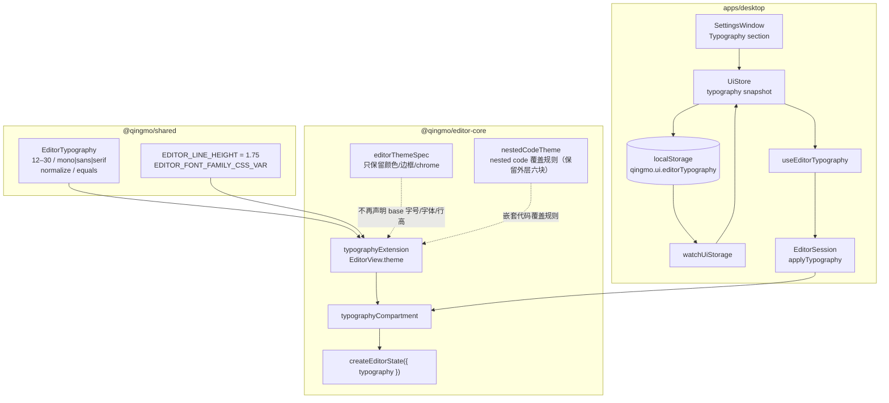
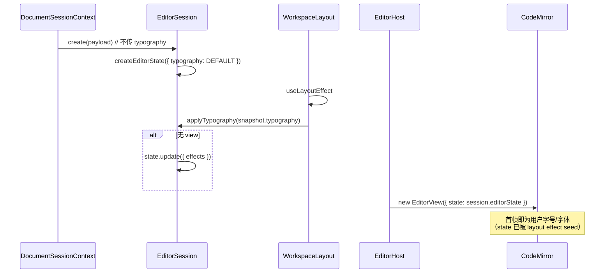
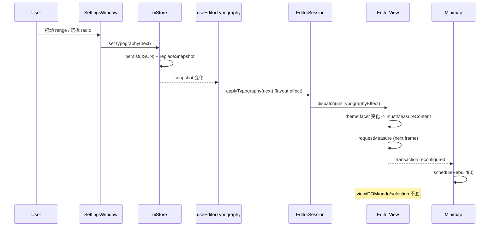
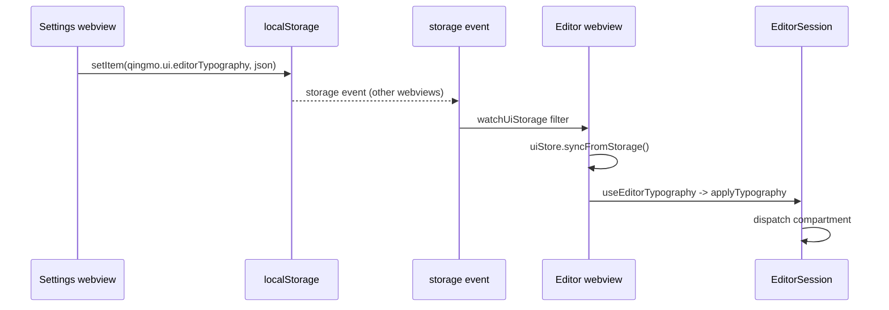

# 编辑器字体调整设计方案

> **文档用途：** 面向技术评审、开发、测试和运维人员的设计说明
> **功能 ID：** `editor-typography`
> **对应需求：** R-001 ~ R-006
> **对应实施计划：** [`01-实施计划.md`](01-实施计划.md)
> **代码基线：** `main@3f654ba6d8d4866529d81566428214a320bebc61`
> **设计版本：** `v1.2`（Q-001 ~ Q-005 已确认）
> **日期：** 2026-11-04
> **状态：** Q-001 ~ Q-005 已确认；T-001 ~ T-009 已实施并验证通过

---

## 1. 摘要

青墨的编辑器排版目前只有一套硬编码值：根字号 `15px`、正文 `var(--qm-font-mono)`、行高 `1.75`，全部写在 `packages/editor-core/src/extensions/theme.ts:21-34` 的 `editorThemeSpec` 里。用户无法在设置窗口调整字号或字体族；Settings 窗口目前只有语言一项。对于长时间写作的用户，15px 在 macOS Retina 上偏小，且 mono 并不适合所有中文长文场景。

本方案新增**编辑器字体调整**：字号 `12–30px`（默认 `15px`，步进 `1px`）+ 字体族三预设 `mono/sans/serif`（默认 `mono`）。偏好保存在单个 localStorage JSON 键 `qingmo.ui.editorTypography`，通过现有 `uiStore` 快照、`storage` 事件和新的 `useEditorTypography` 投影到所有编辑器窗口。编辑器侧新增独立的 CM6 `typographyCompartment`，用 `EditorView.theme` 承载 base 字号/字体族/行高；`editorThemeSpec` 不再声明这三项，避免两套样式源。切换只 dispatch compartment，不重建 `EditorView`、不清 undo、不移动选区。

关键边界：

- 不新增 Rust 命令、IPC、数据库表、原生菜单或快捷键。
- 不做行高、阅读宽度、应用级 zoom；行高继续固定 `1.75`。
- 不枚举系统字体；只使用现有 `--qm-font-mono/sans/serif` token。
- 代码块、表格、Mermaid 保持各自既有字体策略；代码块继续 mono。
- 不修改 `EditorHost`、`DocumentSessionContext`、`styles.css`、`tokens.css`、`minimap/**`、`packages/shared/src/generated/**`。
- 新增持久化配置项已获批准（Q-001：单 JSON 键 `qingmo.ui.editorTypography`）。

一句话方案：

> 在保留现有 CM6 单一真源、`uiStore` 单一偏好源和 `--qm-*` token 的前提下，用“共享纯模型 + 独立 typography compartment + 现有 storage 同步”替换硬编码 base 排版，实现可持久化、跨窗口、不重建 view 的字号/字体族调整。

---

## 2. 问题定义

### 2.1 业务背景

青墨的定位是“Quiet as paper, fast as a code editor”。当前编辑器正文使用 mono 字体、15px、1.75 行高，适合代码感写作，但对以下场景不够：

- 长时间中文长文写作：15px 在 Retina 屏幕上偏小，用户需要频繁使用浏览器/系统缩放。
- 不同用户对 mono/sans/serif 的偏好差异大；论文证据显示 serif 与 sans 没有显著性能差异（Beymer 2008），字体选择主要是偏好问题。
- 现有 Settings 窗口只有语言，没有任何编辑器外观入口；用户无法在不改 CSS 的情况下调整排版。

### 2.2 当前可观察行为

```text
打开任意 Markdown 文档
  -> EditorSession 构造 createEditorState
  -> themeCompartment.of(qingmoEditorTheme)
  -> editorThemeSpec["&"].fontSize = "15px"
  -> editorThemeSpec[".cm-scroller"].fontFamily = "var(--qm-font-mono)"
  -> editorThemeSpec[".cm-scroller"].lineHeight = "1.75"
  -> 用户没有任何设置入口
```

证据：

- `packages/editor-core/src/extensions/theme.ts:21-34`
- `packages/editor-core/src/createEditor.ts:136`
- `apps/desktop/src/settings/SettingsWindow.tsx:198-220`（只有语言 section）

### 2.3 能力缺口

| GAP-ID | 缺口 | 影响 | 证据 |
|---|---|---|---|
| GAP-001 | 无字号设置 | 低视力/长文用户只能依赖系统缩放 | `theme.ts:26` 固定 15px |
| GAP-002 | 无字体族设置 | 用户不能选择 sans/serif | `theme.ts:32` 固定 mono |
| GAP-003 | 排版值硬编码在 theme spec | 任何调整都要改代码，且容易与 Live Preview 的 em 规则形成两套来源 | `theme.ts:21-34`；`live-preview/theme.ts:14-19` |
| GAP-004 | 无持久化/跨窗口同步 | 即使加了 UI，也无法在重启/多窗口保持一致 | `uiStore.ts:10-24` 只有 theme/language |
| GAP-005 | Settings 无外观类控件 | 用户找不到入口 | `SettingsWindow.tsx:198-220` |
| GAP-006 | 嵌套代码块排版重复 | `mono`/`1.75` 同时存在于 `nestedCodeTheme` 与 `livePreviewTheme`，未来改 base 行高容易漏改；外层六块同时承担 specificity 覆盖职责 | `code-blocks.ts:177-204`；`live-preview/theme.ts:1302-1324` |
| GAP-007 | 阅读宽度未启用 | `--qm-content-max: 72ch` 定义但无消费点；行长不受限 | `tokens.css:180`；全仓 `rg` 无消费 |

> GAP-007 不在本功能范围内，但必须在文档中如实记录，避免“保持 72ch”的错误表述。

### 2.4 为什么现在做

- 这是纯前端、低数据风险的体验增强，不依赖工作区/搜索/导出等大功能。
- 现有 `themeCompartment` 已经证明“compartment 热切换不重建 view”的路径可行（`theme.test.ts:45-70`）。
- 现有 `uiStore` + `watchUiStorage` 已经提供跨窗口偏好同步的成熟模式，新增一个偏好的边际成本低。
- 越晚做，`editorThemeSpec`、`livePreviewTheme`、`nestedCodeTheme` 的重复越难收敛。

---

## 3. 目标与非目标

### 3.1 需求

| ID | 需求 | 优先级 |
|---|---|---|
| R-001 | 用户可在 Settings 调整编辑器正文字号，范围 12–30px，步进 1px，默认 15px | P1 |
| R-002 | 用户可在 mono/sans/serif 三个预设间切换正文字体，默认 mono | P1 |
| R-003 | 调整立即作用于所有已打开编辑器窗口；不重建 EditorView、不清 undo、不移动选区 | P0 |
| R-004 | 偏好持久化，重启/新窗口恢复；缺失/非法/损坏值安全回退默认 | P0 |
| R-005 | Settings 提供实时预览与“恢复默认”；中英文案完整 | P1 |
| R-006 | 不新增 Rust/IPC/DB/原生菜单/快捷键；代码块、表格、Mermaid 保持既有字体策略 | P0 |

### 3.2 非目标

| 非目标 | 原因 |
|---|---|
| 行高设置 | 首版控制变量；现有 1.75 满足 WCAG 1.4.8 的“行距 ≥1.5”下限（不代表整条 SC 合规）；Rello 2016 对 1.8 极端值有保留 |
| 阅读宽度设置 | `--qm-content-max` 当前未接入；行长是独立缺口，需单独设计与测试 |
| 应用级 zoom | 浏览器/WebView 缩放已可用；Typora 也把 Font Size 与 Zoom 分开 |
| 代码块独立字号/字体 | 代码块继续 mono、0.92em；避免范围膨胀 |
| 系统字体枚举/自由字体栈 | 只使用三个现有 token，避免 CSS 注入与跨平台差异 |
| 每文档排版 | 排版是应用外观偏好；每文档会与 Rust `view-state` 的 `live_preview_preferred` 语义混淆 |
| 命令面板/原生菜单/快捷键 | 首版只做 Settings；后续可加 `view.editorTypography` 命令 |
| 导出/打印排版 | 不在本功能范围 |

---

## 4. 现状与证据

### 4.1 当前 base 排版的唯一来源

```ts
// packages/editor-core/src/extensions/theme.ts:21-34
const editorThemeSpec = {
  "&": {
    height: "100%",
    color: "var(--qm-ink)",
    backgroundColor: "transparent",
    fontSize: "15px",
  },
  "&.cm-focused": { outline: "none" },
  ".cm-scroller": {
    fontFamily: "var(--qm-font-mono)",
    lineHeight: "1.75",
  },
  ".cm-content": { padding: "28px 20px", caretColor: "var(--qm-accent)" },
  // ...
};
```

`themeExtension` 缓存 light/dark 两套 `EditorView.theme` + `syntaxHighlighting`（`theme.ts:334-347`）。`createEditorState` 默认装入 `themeCompartment.of(qingmoEditorTheme)`（`createEditor.ts:136`）。

### 4.2 主题链路

```text
uiStore.setTheme
  -> UiSnapshot
  -> useThemeService (useEffect)
  -> EditorSession.applyTheme
  -> setThemeEffect(themeExtension(theme))
  -> themeCompartment.reconfigure
  -> EditorView.theme
  -> CM6 theme facet 变化 -> mustMeasureContent + requestMeasure
```

详细行号与 Topology 见 [`research/04-call-chain-and-impact.md`](research/04-call-chain-and-impact.md)。

### 4.3 关键约束

1. **CM6 测量**：`EditorView.theme` 改变 theme facet 会自动 `mustMeasureContent = true` 并 `requestMeasure()`（`@codemirror/view@6.43.15` `dist/index.js:8094-8097`）。纯 CSS 变量不会自动触发；CM6 的 ResizeObserver 只观察 `scrollDOM`（`7234-7240`）。
2. **minimap**：`MinimapController` 观察 `view.dom/scrollDOM/contentDOM`，并在 `transaction.reconfigured` 时重建（`minimap.ts:489-503,543-548`）。compartment 重配会触发重建。
3. **view 身份**：`EditorHost` 只在 session 变化时创建 view；theme/mode/LP 变化只 reconfig compartment（`EditorHost.tsx:39-51`）。
4. **undo/selection**：`replacePayload` 的 `view.setState` 会清 undo（`EditorSession.ts:417-420`）；字体切换不能走这条路径。
5. **UiSnapshot**：`replaceSnapshot` 的相等性硬编码三个字段（`uiStore.ts:252-259`）；新增字段必须加入比较，否则订阅者不更新。
6. **storage 同步**：`watchUiStorage` 只过滤 theme/language/null（`uiStorageSync.ts:11-19`）；漏加 key 会静默不同步。
7. **Settings 固定尺寸**：1120×720、不可缩放（`settings.rs:7-9,60-63`）；新增内容只能纵向滚动。
8. **无设置后端**：Settings 只有 `info/close` 两个 Rust 命令；没有 `settings.json`/DB 表。新偏好应继续用 localStorage。

### 4.4 被推翻的假设

| 假设 | 事实 | 影响 |
|---|---|---|
| 当前有 72ch 行宽 | `--qm-content-max` 定义但无消费点 | 不得声称保持 72ch；行长列为 Q-004 |
| Settings 已有主题控件 | 只有语言 | Typography 是第一个外观类控件 |
| 扩展 `themeExtension` 即可 | HIGH 22 impacted / 4 processes | 新建 `typographyExtension` |
| 纯 CSS 变量足够 | CM6 不自动测量 font-family-only | 用 theme facet |
| `replacePayload` 自动保留主题 | 仅 `themeApplied` 时重放 | typography 必须传入 factory |
| 加 `UiSnapshot` 字段只影响 Settings | HIGH / lower-bound，36 impacted | 全量测试同步 |

---

## 5. 方案总览

### 5.1 一句话

> 共享纯模型定义值与校验；editor-core 用独立 typography compartment 生成 CM6 主题；EditorSession 持有当前值，构造接受可选 seed、reload 时传入 state；uiStore 持久化并通过 storage 事件同步；Settings 只做 UI，不成为第二套样式源。

### 5.2 架构图



### 5.3 为什么是 CM6 compartment（方案 B）

| 维度 | A：`:root` CSS 变量 + theme 引用 + `requestMeasure` | **B：独立 typography compartment + `EditorView.theme`** | C：重建 `EditorState` |
|---|---|---|---|
| 正确性 | 值只有一套 CSS 源；但 font-family-only 可能不刷新 `charWidth`；minimap 可能 stale | theme facet 变化自动 `mustMeasureContent`；minimap 收到 `reconfigured` | 正确但代价最高 |
| 生命周期 | 变量在 `:root`，reload 后仍存在；但需手动 measure + 通知 minimap | `applyTypography` 有 view dispatch/无 view state.update；reload 传 factory | 每次改字体重建 state |
| 可测试性 | CSS 变量断言容易；jsdom 无布局 | 可断言 compartment、view 身份、undo、计算样式 | 易写但回归面大 |
| 重复源风险 | 低，但需把 `livePreviewTheme`/`nestedCodeTheme` 的固定值改为变量 | 低；typography 是唯一 base owner | 中；容易与 theme 分叉 |
| 性能 | 最好，但需一次强制 measure | 好；一个 transaction，可缓存 | 最差；全文重绘、插件重建 |
| 结论 | 不采用 | **采用** | 不采用 |

详细对比与源码证据见 [`research/04-call-chain-and-impact.md`](research/04-call-chain-and-impact.md) §5。

### 5.4 为什么不扩展 `themeExtension`

- `themeExtension` 同时承载颜色与 `syntaxHighlighting`（`theme.ts:334-343`）。把 typography 混进去会让“改字号”也重配高亮样式，职责不单一。
- GitNexus：`themeExtension` **HIGH**（22 impacted / 3 direct / 4 processes / 4 modules）；新增独立扩展可把改动限制在 LOW/MEDIUM 面。
- 现有 `theme.test.ts` / `editor-binding.test.tsx` 把 `themeExtension` 当作“主题颜色 + darkTheme”契约；不应改变它的语义。

---

## 6. 详细设计

### 6.1 共享模型：`packages/shared/src/editor-typography.ts`（新增）

```ts
export const EDITOR_FONT_FAMILY_IDS = ["mono", "sans", "serif"] as const;
export type EditorFontFamily = (typeof EDITOR_FONT_FAMILY_IDS)[number];

export const EDITOR_FONT_SIZE_MIN = 12;
export const EDITOR_FONT_SIZE_MAX = 30;
export const EDITOR_FONT_SIZE_DEFAULT = 15;
export const EDITOR_LINE_HEIGHT = 1.75;

export interface EditorTypography {
  readonly fontSize: number;
  readonly fontFamily: EditorFontFamily;
}

export const DEFAULT_EDITOR_TYPOGRAPHY: Readonly<EditorTypography> = Object.freeze({
  fontSize: EDITOR_FONT_SIZE_DEFAULT,
  fontFamily: "mono",
});

export const EDITOR_FONT_FAMILY_CSS_VAR: Record<EditorFontFamily, string> = Object.freeze({
  mono: "var(--qm-font-mono)",
  sans: "var(--qm-font-sans)",
  serif: "var(--qm-font-serif)",
});

export function isEditorFontFamily(value: unknown): value is EditorFontFamily;

export function normalizeEditorFontSize(value: unknown): number;

export function normalizeEditorTypography(value: unknown): EditorTypography;

export function editorTypographyEquals(a: EditorTypography, b: EditorTypography): boolean;
```

`normalizeEditorTypography` 的契约：

1. `null`/非对象/解析失败 → `DEFAULT_EDITOR_TYPOGRAPHY`。
2. `fontSize` 必须是有限数字；`Math.trunc` 后 clamp 到 `[12, 30]`；非数字回退 `15`。
3. `fontFamily` 必须是三个 id 之一；否则回退 `"mono"`。
4. 忽略 `version` 与未知字段；返回 `Object.freeze` 的新对象。
5. 幂等：`normalize(normalize(x))` 值相等。

为什么放在 `shared`：

- `@qingmo/shared` 已被 `editor-core` 和 `apps/desktop` 同时依赖（`packages/editor-core/package.json`、`apps/desktop/package.json`）。
- 模型是纯 TypeScript，不依赖 DOM/CM6，适合放在 shared。
- 避免 `uiStore` 为了一个类型去依赖 `@qingmo/editor-core`（store 层不应依赖编辑器实现）。

`packages/shared/src/index.ts` 增加：

```ts
export * from "./editor-typography";
```

### 6.2 editor-core：`typographyExtension`（新增）

`packages/editor-core/src/extensions/typography.ts`：

```ts
import type { Extension } from "@codemirror/state";
import { EditorView } from "@codemirror/view";
import {
  EDITOR_FONT_FAMILY_CSS_VAR,
  EDITOR_LINE_HEIGHT,
  normalizeEditorTypography,
  type EditorTypography,
} from "@qingmo/shared";

const cache = new Map<string, Extension>();

function keyOf(typography: EditorTypography): string {
  return `${typography.fontSize}:${typography.fontFamily}`;
}

/**
 * The single source for base editor typography. `fontSize` lives on the
 * editor root; family and line height live on `.cm-scroller`, matching the
 * pre-existing cascade while keeping the values in one extension.
 */
export function typographyExtension(input: EditorTypography): Extension {
  const typography = normalizeEditorTypography(input);
  const key = keyOf(typography);
  const cached = cache.get(key);
  if (cached) {
    return cached;
  }
  const extension = EditorView.theme({
    "&": { fontSize: `${typography.fontSize}px` },
    ".cm-scroller": {
      fontFamily: EDITOR_FONT_FAMILY_CSS_VAR[typography.fontFamily],
      lineHeight: String(EDITOR_LINE_HEIGHT),
    },
  });
  cache.set(key, extension);
  return extension;
}
```

设计点：

- **缓存**：19 个字号 × 3 个字体族 = 57 个扩展，避免滑杆拖动时不断创建 style module。缓存无失效需求（纯函数）。
- **测量语义**：只有不同的 `(fontSize, fontFamily)` 才会产生不同的 style module 前缀，从而改变 theme facet 字符串并触发 `mustMeasureContent`（`@codemirror/view/dist/index.js:6853,8094-8097,8829-8831`）。相同值命中缓存时 facet 不变，**不会**触发测量；因此 `applyTypography` 必须保留相等 early-return。若未来 Q-004 引入行高，缓存 key 必须把 lineHeight 也纳入，否则会返回 stale style。
- **不设置 `dark`**：typography 与明暗无关；`darkTheme` facet 仍由 `themeExtension` 拥有。
- **不设置颜色/边框**：避免与 `editorThemeSpec` 争夺同一属性。
- **normalize 在入口**：任何调用方（测试、未来命令）传入非法值都会被收敛。

### 6.3 editor-core：`createEditor.ts`

新增：

```ts
export const typographyCompartment = new Compartment();

export function setTypographyEffect(typography: EditorTypography) {
  return typographyCompartment.reconfigure(typographyExtension(typography));
}
```

`CreateEditorStateOptions` 增加：

```ts
/** Base editor typography; defaults preserve 15px / mono / 1.75. */
typography?: EditorTypography;
```

`createEditorState` 解构默认值与扩展：

```ts
typography = DEFAULT_EDITOR_TYPOGRAPHY,
// ...
themeCompartment.of(qingmoEditorTheme),
typographyCompartment.of(typographyExtension(typography)),
```

为什么放在 `createEditorState` 而不是 `EditorSession` 构造后：

- factory 参数让**任何显式传入的值**（测试、未来调用方、`replacePayload`）在 state 创建时就正确，不依赖后续 hook。
- `replacePayload` 可以直接复用 factory，不依赖 `themeApplied` 式标志。
- 现有调用方无需改动（参数可选，默认等于当前值）。
- 注意：生产入口当前不传 `typography`，所以首个 state 是默认值；持久化值由 `useEditorTypography` 的 layout effect 在 view 创建前 seed（见 §6.6/§7.1）。

### 6.4 editor-core：`extensions/theme.ts` 删除 base 声明

修改：

- 删除 `"&".fontSize: "15px"`。
- 删除整个 `.cm-scroller` 条目（当前只有 `fontFamily` 与 `lineHeight`）。
- 保留 `height/color/backgroundColor`、`.cm-content`、`.cm-line`、`.cm-gutters`、搜索面板、颜色等。

修改后 `editorThemeSpec` 不再声明任何 base 字号/字体族/行高；`typographyExtension` 是唯一 owner。

> **公开 API 兼容性（R2 F-R2-014）：** `qingmoEditorTheme` / `themeExtension` 是 `@qingmo/editor-core` 的公开导出。删除 base 排版后，只安装 `qingmoEditorTheme` 的外部 view 将不再获得 15px/mono/1.75；仓库内 `createEditorState` 会安装 typography，嵌套代码块会安装 `nestedCodeTheme`，两者都覆盖了所需排版。若仓库外有消费者，这是行为变更，需在发布说明中注明。

注意：

- `.cm-placeholder` 仍保留 `fontFamily: "var(--qm-font-sans)"`（`theme.ts:52-55`）。这是 UI 提示文案，不是文档正文；**字体族保持 sans，字号继承正文并随字号缩放**。若产品要求 placeholder 完全不缩放，需显式写死字号（会与 base 设置脱节，不推荐）。
- 搜索面板的 `13px/10px/10.5px/11.5px` 是 chrome，不随正文缩放。

### 6.5 editor-core：嵌套代码块行高常量（**不删除**外层六块）

当前样式来源：

- `packages/editor-core/src/live-preview/code-blocks.ts:177-204` 的 `nestedCodeTheme` 设置 `fontSize: inherit`、mono、`1.75`、`.cm-content/.cm-line/.cm-gutters/.cm-activeLine`。
- `packages/editor-core/src/live-preview/theme.ts:1302-1324` 的 `.cm-md-code-block-widget .cm-editor/.cm-scroller/.cm-content/.cm-line/.cm-gutters/.cm-activeLine` 六个块，在数值上与 `nestedCodeTheme` 重复。
- `.cm-md-code-block-widget` 根样式仍负责 `fontFamily: mono` 与 `fontSize: 0.92em`（`live-preview/theme.ts:1036-1040`）。

**R2 评审结论（BLOCKER）：不能删除这六个外层块。** 原因是 CM6 的 style module 级联顺序，而不是“值是否相同”：

- `theme` facet 与 style module 都按扩展声明顺序参与优先级；先声明的扩展优先级更高（`@codemirror/state/dist/index.d.ts:690-697`）。
- `mountStyles` 反序挂载 style module（`@codemirror/view/dist/index.js:8380-8383`），因此先声明的扩展在样式表中更靠后。
- 嵌套编辑器声明顺序是 `qingmoEditorTheme` 在前、`nestedCodeTheme` 在后（`code-blocks.ts:669-670`），所以 `nestedCodeTheme` 的同 specificity 规则**先挂载、后输**。
- R2 只读探针（jsdom + CM6 6.43.15）复现：删除外层六块后，serif/sans 模式下嵌套 `.cm-scroller` 的 `font-family` 变成正文 serif/sans，`.cm-content` padding 回到 `28px 20px`，`.cm-line` padding 回到 `0 20px`，`.cm-editor` height 变 `100%`。

修改（最小、可验证）：

1. **保留** `live-preview/theme.ts:1302-1324` 的六个 `.cm-md-code-block-widget .cm-*` 外层块；其中 `.cm-scroller` 的 `fontFamily: "var(--qm-font-mono)"` 必须保留，否则 serif/sans 会泄漏进代码块。
2. 把这两处 `lineHeight: "1.75"`（`live-preview/theme.ts:1309` 与 `code-blocks.ts:188`）改为 `lineHeight: String(EDITOR_LINE_HEIGHT)`，从 `@qingmo/shared` 导入常量。
3. 保留 `.cm-md-code-block-widget` 根节点样式（`padding`、`fontFamily`、`fontSize: 0.92em`）、`.cm-md-code-editor { padding: ... }`（`1302-1324` 之外的布局规则）以及 chrome/语言选择器。
4. **不删除**任何嵌套编辑器样式块；本任务只收敛“行高字面量”，不改变样式所有权。若未来确实要单一 owner，必须把 `nestedCodeTheme` 放到 `qingmoEditorTheme` 之前，并在真实 WebView 验证 cursor/selection 等规则不被意外覆盖；首版不做。

为什么保留是安全的：

- 外层六块继续提供 specificity 优势，保证嵌套代码在 serif/sans 模式下仍是 mono、padding 0、height auto。
- 两处 `1.75` 改为同一常量，消除“未来改行高漏改一处”的风险；样式值不变。
- 嵌套编辑器的 `fontSize: inherit` 从 `.cm-md-code-block-widget { fontSize: 0.92em }` 继承；字号仍随 base 缩放。

> 这是本方案唯一触碰 Live Preview 样式的地方，风险中等；用 E2E 计算样式断言覆盖（AC-010）。

### 6.6 `EditorSession` 生命周期

新增字段：

```ts
private typography: EditorTypography = DEFAULT_EDITOR_TYPOGRAPHY;
```

`EditorSessionOptions` 增加：

```ts
/**
 * Optional constructor seed. Production callers do not pass it today, so the
 * first EditorState starts at DEFAULT_EDITOR_TYPOGRAPHY; `useEditorTypography`
 * seeds the persisted value before EditorHost creates the view.
 */
typography?: EditorTypography;
```

新增字段：

```ts
private typography: EditorTypography = DEFAULT_EDITOR_TYPOGRAPHY;
private pendingTypography: EditorTypography | null = null;
```

构造函数：

```ts
this.typography = normalizeEditorTypography(
  options.typography ?? DEFAULT_EDITOR_TYPOGRAPHY,
);
// ...
const state = createEditorState({
  doc: payload.text,
  // ...
  typography: this.typography,
});
```

**生产路径的真实时序（R2/R3 校准）：**

1. `createDocumentSession.ts:36-45` 与 `DocumentSessionContext.tsx:168/283` 目前都**不传入** `typography`；因此构造出的首个 `EditorState` 是默认 `15px/mono`。
2. `WorkspaceLayout` 的 `useLayoutEffect`（`useEditorTypography`）在 `EditorHost` 的 passive `useEffect` **之前**运行；此时还没有 view，`applyTypography` 走 `this.state = this.state.update({ effects }).state`，把持久化值写进即将被 view 使用的 state。
3. `EditorHost` 随后用 `session.editorState` 创建唯一 `EditorView`，首帧即为用户偏好。

因此文档不再声称“构造时已经注入持久化值”；构造只注入默认值/可选 seed，生产首帧由 layout effect 保证。若未来要把持久化值放进构造，必须把 `createDocumentSession.ts` / `DocumentSessionContext.tsx` 加入允许范围并从 `uiStore.getSnapshot()` 读取；首版不这样做。

`replacePayload`：

```ts
let state = createEditorState({
  doc: payload.text,
  // ...
  typography: this.typography,
});
this.pendingTypography = null; // 新 state 已包含当前 typography
```

> 如果 reload 发生在 IME composition 期间，新 `EditorState` 已经带上 `this.typography`，因此清除待处理 effect，避免 composition 结束后重复 dispatch。

`applyTypography`（带 IME composition 延迟）：

```ts
applyTypography(next: EditorTypography): void {
  if (this.disposed) {
    return;
  }
  const normalized = normalizeEditorTypography(next);
  if (editorTypographyEquals(this.typography, normalized)) {
    return;
  }
  this.typography = normalized;
  this.pendingTypography = normalized;
  this.flushTypography();
}
```

`flushTypography`：

```ts
private flushTypography(): void {
  if (this.disposed || this.pendingTypography === null) {
    return;
  }
  if (this.view?.composing) {
    return; // compositionend 时再 flush
  }
  const typography = this.pendingTypography;
  this.pendingTypography = null;
  const effect = setTypographyEffect(typography);
  if (this.view) {
    this.view.dispatch({ effects: effect });
  } else {
    this.state = this.state.update({ effects: effect }).state;
  }
}
```

`attachCompositionListener` 的 `compositionend` 回调增加 `this.flushTypography()`；`dispose()` 清空 `pendingTypography`。

`getTypography()`：

```ts
getTypography(): EditorTypography {
  return this.typography;
}
```

设计点：

- 不需要 `typographyApplied` 标志：`replacePayload` 总是把 `this.typography` 传给 factory；字段与 state 在每次 apply 后保持同步。
- 相等 early-return：避免 `useLayoutEffect` 重复执行时产生空 transaction。
- IME composition 期间延迟 dispatch：与 `applyPlaceholder`/`applyUiCopy` 一致，避免 minimap 在 `view.composing` 时 early-return 导致 glyph/scale stale（R2 F-R2-009）。
- 不触发 snapshot 更新：typography 不是文档状态，不进 `EditorSessionSnapshot`，避免状态栏/测试连锁变化。
- 有 view 时 dispatch，无 view 时更新 state：与 `applyTheme` 一致。

### 6.7 `uiStore` 持久化

新增常量：

```ts
export const EDITOR_TYPOGRAPHY_STORAGE_KEY = "qingmo.ui.editorTypography";
```

内部字段：

```ts
private typographyPersistenceDegraded = false;
```

`UiSnapshot` 增加：

```ts
/** Persisted editor typography. */
typography: EditorTypography;
```

读取：

```ts
function readStoredTypography(storage: ThemeStorage | null): EditorTypography {
  if (!storage) {
    return DEFAULT_EDITOR_TYPOGRAPHY;
  }
  try {
    const raw = storage.getItem(EDITOR_TYPOGRAPHY_STORAGE_KEY);
    if (!raw) {
      return DEFAULT_EDITOR_TYPOGRAPHY;
    }
    return normalizeEditorTypography(JSON.parse(raw));
  } catch {
    return DEFAULT_EDITOR_TYPOGRAPHY;
  }
}
```

构造器：

```ts
this.snapshot = Object.freeze({
  theme,
  resolvedTheme: resolveTheme(theme, this.media?.matches ?? false),
  language: readStoredLanguage(this.storage),
  typography: readStoredTypography(this.storage),
});
```

Setter：

```ts
setTypography(next: EditorTypography): boolean {
  const normalized = normalizeEditorTypography(next);
  if (editorTypographyEquals(normalized, this.snapshot.typography)) {
    return true;
  }
  const persisted = this.persist(
    EDITOR_TYPOGRAPHY_STORAGE_KEY,
    JSON.stringify({
      version: 1,
      fontSize: normalized.fontSize,
      fontFamily: normalized.fontFamily,
    }),
  );
  this.typographyPersistenceDegraded = !persisted;
  this.replaceSnapshot({ ...this.snapshot, typography: normalized });
  return persisted;
}
```

`syncFromStorage`（接受变更 key，避免降级值被其他 key 的事件回滚）：

```ts
syncFromStorage(changedKey?: string | null): void {
  const theme = readStoredTheme(this.storage);
  const language = readStoredLanguage(this.storage);
  const typography =
    this.typographyPersistenceDegraded &&
    changedKey !== null &&
    changedKey !== EDITOR_TYPOGRAPHY_STORAGE_KEY
      ? this.snapshot.typography
      : readStoredTypography(this.storage);
  if (changedKey === null || changedKey === EDITOR_TYPOGRAPHY_STORAGE_KEY) {
    this.typographyPersistenceDegraded = false;
  }
  this.replaceSnapshot({
    theme,
    resolvedTheme: resolveTheme(theme, this.media?.matches ?? false),
    language,
    typography,
  });
}
```

`uiStorageSync.ts` 调用时传入 `event.key`；命中 typography key 或 `key === null` 时清除 `typographyPersistenceDegraded`（采用外部写入）。

`replaceSnapshot` 相等性增加：

```ts
if (
  next.theme === this.snapshot.theme &&
  next.resolvedTheme === this.snapshot.resolvedTheme &&
  next.language === this.snapshot.language &&
  editorTypographyEquals(next.typography, this.snapshot.typography)
) {
  return;
}
```

语义：

- 存储格式：`{"version":1,"fontSize":15,"fontFamily":"mono"}`。`version` 当前只写入、不读取；`normalizeEditorTypography` 忽略它，未来若做迁移再按版本分支。
- 写入失败：`persist` 返回 false；`typographyPersistenceDegraded = true`；当前会话仍应用新值，Settings 首次失败弹一次 `toast.typographyPersistenceFailed`。此后若收到 **其他 key**（theme/language）的 storage 事件，`syncFromStorage` 保留内存中的 typography，不回滚；只有收到 typography key 或 `localStorage.clear()` 才采用外部值并清除降级。这是与 `languagePersistenceDegraded` 对齐的最小正确行为（R3 F-R3-002 / R2 F-R2-011）。
- 读取失败/损坏：默认值，不阻塞启动。
- `Object.freeze(next)` 是浅冻结；`normalizeEditorTypography` 返回冻结的 typography，保证嵌套对象不可变。
- 不新增 `removeItem`：`ThemeStorage` 没有该方法；Q-001 已确认“恢复默认”写入默认 JSON，不删除 key。

### 6.8 React 投影：`useEditorTypography`

`apps/desktop/src/app/useEditorTypography.ts`（新增）：

```ts
import { useLayoutEffect, useSyncExternalStore } from "react";

import type { EditorSession } from "../features/editor/EditorSession";
import { uiStore } from "../stores/uiStore";

/**
 * Bridges the persisted typography preference to the active editor session.
 * `useLayoutEffect` seeds the state before EditorHost's passive effect creates
 * the first view, so the first frame already uses the user's type.
 */
export function useEditorTypography(session: EditorSession | null): void {
  const snapshot = useSyncExternalStore(
    uiStore.subscribe,
    uiStore.getSnapshot,
    uiStore.getSnapshot,
  );

  useLayoutEffect(() => {
    session?.applyTypography(snapshot.typography);
  }, [session, snapshot.typography]);
}
```

`WorkspaceLayout.tsx`：

```ts
useThemeCommand();
useThemeService(session);
useEditorTypography(session);
useEditorLocale(session);
useLivePreviewMenu(ipc, session);
```

为什么用 `useLayoutEffect`：

- `EditorHost` 在 passive `useEffect` 中创建 view（`EditorHost.tsx:39-51`）；父组件的 layout effect 先于子组件的 passive effect 运行，可在 view 创建前把 typography 写入 state。
- 避免 dark 主题式的“先默认、后切换”首帧闪烁；E2E 验证首帧计算样式。

为什么不改 `useThemeService`：

- 它的职责是主题颜色/高亮；typography 是独立偏好。
- 保持 `themeExtension` 的 LOW 风险边界。

### 6.9 Settings 窗口

#### 6.9.1 结构

在 `SettingsWindow.tsx:220` 的 Interface section 之后、`:222` 的 `<aside className="settings-note">` 之前插入第二个 `section.settings-section`：

```tsx
<section className="settings-section" aria-labelledby="settings-typography-heading">
  <header className="settings-section-head">
    <span className="settings-section-num">02</span>
    <h2 id="settings-typography-heading">{t("section.typography")}</h2>
    <span className="settings-section-rule" aria-hidden="true" />
  </header>

  <div className="settings-row">
    <div className="settings-copy">
      <h3 id="settings-font-size-heading">{t("typography.fontSize")}</h3>
      <p>{t("typography.fontSizeHint")}</p>
    </div>
    <div className="settings-typography-controls">
      <div className="settings-range-row">
        <input
          id="settings-font-size"
          data-testid="settings-font-size"
          className="settings-range"
          type="range"
          min={EDITOR_FONT_SIZE_MIN}
          max={EDITOR_FONT_SIZE_MAX}
          step={1}
          value={typography.fontSize}
          aria-labelledby="settings-font-size-heading"
          aria-valuetext={`${typography.fontSize} px`}
          onChange={(event) =>
            updateTypography({ fontSize: Number(event.currentTarget.value) })
          }
        />
        <span
          className="settings-range-value"
          data-testid="settings-font-size-value"
          aria-hidden="true"
        >
          {typography.fontSize}px
        </span>
      </div>
    </div>
  </div>

  <div className="settings-row">
    <div className="settings-copy">
      <h3 id="settings-font-family-heading">{t("typography.fontFamily")}</h3>
      <p>{t("typography.fontFamilyHint")}</p>
    </div>
    <div
      className="settings-font-grid"
      role="radiogroup"
      aria-labelledby="settings-font-family-heading"
    >
      {EDITOR_FONT_FAMILY_IDS.map((family) => (
        <label
          className="settings-font-option"
          key={family}
          data-testid={`settings-font-option-${family}`}
          data-checked={typography.fontFamily === family ? "true" : "false"}
        >
          <input
            className="settings-font-radio"
            type="radio"
            name="editor-font-family"
            value={family}
            checked={typography.fontFamily === family}
            data-testid={`settings-font-${family}`}
            onChange={() => updateTypography({ fontFamily: family })}
          />
          <span
            className="settings-font-sample"
            style={{ fontFamily: EDITOR_FONT_FAMILY_CSS_VAR[family] }}
            aria-hidden="true"
          >
            Aa
          </span>
          <span className="settings-font-name">{t(`typography.family.${family}`)}</span>
          <span className="settings-font-detail">
            {t(`typography.family.${family}Detail`)}
          </span>
        </label>
      ))}
    </div>
  </div>

  <div
    className="settings-type-preview"
    data-testid="settings-typography-preview"
    role="group"
    aria-label={t("typography.previewAria")}
  >
    <span className="settings-type-preview-label">{t("typography.preview")}</span>
    <p
      style={{
        fontFamily: EDITOR_FONT_FAMILY_CSS_VAR[typography.fontFamily],
        fontSize: typography.fontSize,
        lineHeight: EDITOR_LINE_HEIGHT,
      }}
    >
      {t("typography.previewText")}
    </p>
  </div>

  <div className="settings-typography-foot">
    <p className="settings-hint">{t("typography.hint")}</p>
    <button
      className="settings-reset"
      type="button"
      data-testid="settings-typography-reset"
      onClick={resetTypography}
      disabled={editorTypographyEquals(typography, DEFAULT_EDITOR_TYPOGRAPHY)}
    >
      {t("typography.reset")}
    </button>
  </div>
</section>
```

Handlers：

```ts
const { language, typography } = useUiPreferences();
const persistenceWarned = useRef(false);

const commitTypography = useCallback(
  (next: EditorTypography) => {
    const persisted = uiStore.setTypography(next);
    if (!persisted && !persistenceWarned.current) {
      persistenceWarned.current = true;
      showToast(t("toast.typographyPersistenceFailed"));
    }
  },
  [showToast, t],
);

const updateTypography = useCallback(
  (patch: Partial<EditorTypography>) => {
    const current = uiStore.getSnapshot().typography;
    commitTypography({ ...current, ...patch });
  },
  [commitTypography],
);

const resetTypography = useCallback(() => {
  commitTypography(DEFAULT_EDITOR_TYPOGRAPHY);
  showToast(t("toast.typographyReset"));
}, [commitTypography, showToast]);
```

设计点：

- `setTypography` 返回 `boolean`（是否成功持久化）；写入失败只提示一次，当前会话仍生效。
- 读取 `uiStore.getSnapshot().typography` 合并 patch，避免闭包过期。
- 不使用 `LanguageSelect`：它与语言选项/globe/code/chevron 强绑定，复用会复制组件与 CSS。
- 字体族用**可见的原生 radio**；label 输出 `data-checked`，CSS 用属性选择器；`:focus-within` 提供键盘焦点环。不依赖 `:has()`，避免 WebView 兼容性风险。
- range 有 `aria-valuetext`（“15 px”）；数值用 `<span aria-hidden="true">` 做视觉镜像，不用 `<output>`。`<output>` 的隐式 role 是 `status`，会与 Settings toast 的 `role="status"` 冲突，导致 `e2e/settings.spec.ts:17` 的 strict-mode 失败（R2 F-R2-003）。
- 预览用 `role="group"` + `aria-label`，不用无 role 的 `div` 挂 `aria-label`。
- 预览只使用同一模型值与 CSS 变量映射，不复制字体栈。
- `恢复默认` 写入默认值，不删除 key；按钮在默认值时禁用。
- 不新增左侧 nav 项；General 页面只有一个滚动区，第二个 section 自然追加。若未来设置项变多，再拆 Tab。

#### 6.9.2 CSS

在 `apps/desktop/src/settings/settings.css` 增加（复用 `.settings-section/.settings-row/.settings-copy/.settings-hint`）：

```css
.settings-typography-controls {
  display: flex;
  flex-direction: column;
  gap: 10px;
  width: 300px;
}

.settings-range-row {
  display: flex;
  align-items: center;
  gap: 12px;
}

.settings-range {
  flex: 1;
  min-width: 0;
  accent-color: var(--qm-accent);
}

.settings-range-value {
  min-width: 44px;
  color: var(--qm-ink-muted);
  font-family: var(--qm-font-mono);
  font-size: 12px;
  font-variant-numeric: tabular-nums;
  text-align: right;
}

.settings-font-grid {
  display: grid;
  grid-template-columns: repeat(3, minmax(0, 1fr));
  gap: 6px;
  width: 300px;
}

.settings-font-option {
  display: grid;
  grid-template-columns: 14px minmax(0, 1fr);
  grid-template-rows: auto auto auto;
  column-gap: 6px;
  min-width: 0;
  padding: 8px 10px;
  border: 1px solid var(--qm-line);
  border-radius: 9px;
  background: var(--qm-surface-raised);
  cursor: pointer;
  transition:
    border-color 140ms ease,
    box-shadow 160ms ease;
}

.settings-font-option[data-checked="true"] {
  border-color: var(--qm-accent);
  box-shadow: 0 0 0 3px var(--qm-accent-soft);
}

.settings-font-option:focus-within {
  outline: 2px solid var(--qm-accent);
  outline-offset: 2px;
}

.settings-font-radio {
  grid-row: 1 / span 3;
  align-self: start;
  margin: 3px 0 0;
  accent-color: var(--qm-accent);
}

.settings-font-sample {
  grid-column: 2;
  font-size: 18px;
  line-height: 1.1;
}

.settings-font-name {
  grid-column: 2;
  overflow: hidden;
  color: var(--qm-ink);
  font-size: 11px;
  letter-spacing: 0.04em;
  text-overflow: ellipsis;
  white-space: nowrap;
}

.settings-font-detail {
  grid-column: 2;
  overflow: hidden;
  color: var(--qm-ink-muted);
  font-size: 9.5px;
  text-overflow: ellipsis;
  white-space: nowrap;
}

.settings-type-preview {
  margin-top: 18px;
  padding: 16px 18px;
  border: 1px solid var(--qm-line);
  border-radius: 12px;
  background: var(--qm-surface-raised);
  color: var(--qm-ink);
}

.settings-type-preview-label {
  display: block;
  margin-bottom: 6px;
  color: var(--qm-ink-muted);
  font-family: var(--qm-font-mono);
  font-size: 9.5px;
  letter-spacing: 0.12em;
  text-transform: uppercase;
}

.settings-type-preview p {
  margin: 0;
  overflow-wrap: anywhere;
  white-space: pre-wrap;
}

.settings-typography-foot {
  display: flex;
  align-items: center;
  justify-content: space-between;
  gap: 16px;
  padding-top: 12px;
}

.settings-reset {
  flex: none;
  padding: 6px 10px;
  border: 1px solid var(--qm-line);
  border-radius: 8px;
  background: transparent;
  color: var(--qm-ink-muted);
  font-size: 11px;
  cursor: pointer;
}

.settings-reset:hover:not(:disabled) {
  border-color: var(--qm-line-strong);
  color: var(--qm-ink);
}

.settings-reset:disabled {
  cursor: default;
  opacity: 0.45;
}
```

布局校验：

- Settings 内容宽约 `1120 - 2px 边框 - 326px rail - 56px*2 padding = 680px`；有 10px 滚动条时约 670px。`.settings-row` 两列 `minmax(0,1fr) auto` + 30px gap；控件 300px，copy 列剩约 350px，`.settings-copy p` 最大 350px，刚好放下；窄 10px 时 copy 列可收缩换行。
- 窗口固定 1120×720；新增 section 后内容变长，`.settings-scroll` 纵向滚动（`settings.css:366-378`）。
- 不修改 `.settings-select*`，避免与 `LanguageSelect` 耦合。
- 新控件文字不小于 9.5px，range 值/detail/preview label 使用 `--qm-ink-muted`（不用 `--qm-ink-faint`），避免低对比度。

#### 6.9.3 文案与页面语义

当前 `description` 只描述语言（`en.ts:432-433`、`zh-CN.ts:424`）。加入 Typography 后必须改成同时覆盖“语言 + 排版”，否则页面文案不准确：

| key | en | zh-CN |
|---|---|---|
| `nav.generalNote` | `Interface language and typography` | `界面语言与排版` |
| `lede` | `Language, type, and the quiet details of the page.` | `语言、排版，以及纸面上的安静细节。` |
| `description` | `Interface language and editor typography. Changes apply immediately — no restart.` | `界面语言与编辑器排版。更改会立即应用，不需要重启。` |
| `section.typography` | `Typography` | `排版` |
| `typography.fontSize` | `Font size` | `字号` |
| `typography.fontSizeHint` | `12–30 px. The default is 15 px.` | `12–30 px，默认 15 px。` |
| `typography.fontFamily` | `Font family` | `字体` |
| `typography.fontFamilyHint` | `Prose only. Code blocks, tables and diagrams keep their own fonts.` | `仅作用于正文。代码块、表格与图表保持各自字体。` |
| `typography.family.mono` | `Mono` | `等宽` |
| `typography.family.monoDetail` | `SF Mono · JetBrains Mono` | `SF Mono · JetBrains Mono` |
| `typography.family.sans` | `Sans` | `无衬线` |
| `typography.family.sansDetail` | `Avenir Next · PingFang SC` | `Avenir Next · 苹方` |
| `typography.family.serif` | `Serif` | `衬线` |
| `typography.family.serifDetail` | `Iowan Old Style · Songti SC` | `Iowan Old Style · 宋体` |
| `typography.preview` | `Preview` | `预览` |
| `typography.previewAria` | `Typography preview` | `排版预览` |
| `typography.previewText` | `The quick brown fox jumps over the lazy dog. 0123456789 — a quiet page, a clear mind.` | `永和九年，岁在癸丑，暮春之初，会于会稽山阴之兰亭。0123456789 —— 安静的纸面，清晰的思绪。` |
| `typography.hint` | `Applies to every open editor window.` | `应用到所有已打开的编辑器窗口。` |
| `typography.reset` | `Restore defaults` | `恢复默认` |
| `toast.typographyReset` | `Editor typography restored to defaults.` | `编辑器排版已恢复默认。` |
| `toast.typographyPersistenceFailed` | `Could not save the typography preference. It applies for this session and resets after restart.` | `无法保存排版设置；本次会话仍生效，重启后会恢复默认。` |
| `note.quote` | `A tool should sound and look like yours.` | `工具应当以你的语言开口，也以你的字体落笔。` |
| `note.body` | `Qingmo translates only its interface and never rewrites your Markdown. Typography changes the editor only; your files stay exactly as written.` | `青墨只翻译界面，从不改写你的 Markdown。字体设置只作用于编辑器，文件内容始终保持原样。` |

> `section.typography` 用“排版”，`typography.fontFamily` 用“字体”，避免两个同名 heading 造成读屏/测试歧义。

约束：

- `en.ts` 与 `zh-CN.ts` 的 key 集合、插值必须一致（`i18n.test.ts:71-97`）。
- 中文只能放 `zh-CN.ts`；`text-scan.test.ts:49-64` 禁止在 `.tsx` 硬编码汉字。
- 不新增 `i18nextLng` 或第二个语言持久键（`text-scan.test.ts:66-78`）。
- `note.quote/body` 若仍只描述语言，会与新页面语义不完全一致；建议同步改为“语言与字体”主题（文案见 `01-实施计划.md` T-007）。

---

## 7. 数据流与时序

### 7.1 首次打开文档



> 这是生产路径的真实时序。`EditorSession` 构造只拿到默认值；持久化值由 `useEditorTypography` 的 layout effect 在 `EditorHost` passive 创建 view 之前写入 `EditorState`。

### 7.2 已挂载后切换



### 7.3 跨窗口同步



### 7.4 `replacePayload` / reload

```text
Watcher reload / conflict reload
  -> EditorSession.replacePayload(payload)
  -> createEditorState({ ..., typography: this.typography })
  -> view.setState(state)
  -> 新 state 已包含当前 typography
  -> 不需要 typographyApplied 标志
```

---

## 8. 修改点清单

| MP-ID | 文件/符号 | 类型 | 内容 | 关联任务 | 风险 |
|---|---|---|---|---|---|
| MP-001 | `packages/shared/src/editor-typography.ts` | 新增 | 模型、常量、normalize、equals、CSS 变量映射 | T-001 | 低 |
| MP-002 | `packages/shared/src/index.ts` | 修改 | 导出新模块 | T-001 | 低 |
| MP-003 | `packages/editor-core/src/extensions/typography.ts` | 新增 | `typographyExtension` + 缓存 | T-002 | 低 |
| MP-004 | `packages/editor-core/src/extensions/theme.ts` | 修改 | 删除 base `fontSize`、`.cm-scroller` 的 `fontFamily/lineHeight` | T-002 | 中 |
| MP-005 | `packages/editor-core/src/createEditor.ts` | 修改 | `typographyCompartment`、`setTypographyEffect`、`createEditorState` 参数 | T-002 | 中 |
| MP-006 | `packages/editor-core/src/index.ts` | 修改 | 导出新 API | T-002 | 低 |
| MP-007 | `packages/editor-core/src/live-preview/code-blocks.ts` | 修改 | `lineHeight` 用 `EDITOR_LINE_HEIGHT`；保留 `nestedCodeTheme` 全部规则 | T-003 | 中 |
| MP-008 | `packages/editor-core/src/live-preview/theme.ts` | 修改 | **保留**外层六个 `.cm-md-code-block-widget .cm-*` 块；仅把 `lineHeight` 改为常量 | T-003 | 中 |
| MP-009 | `apps/desktop/src/features/editor/EditorSession.ts` | 修改 | 字段、option、`applyTypography`、`getTypography`、`replacePayload` 传值 | T-004 | 高（类 CRITICAL） |
| MP-010 | `apps/desktop/src/stores/uiStore.ts` | 修改 | key、snapshot 字段、读取、setter、sync、相等性 | T-005 | 高（UiSnapshot HIGH） |
| MP-011 | `apps/desktop/src/app/uiStorageSync.ts` | 修改 | 过滤新 key | T-005 | 低 |
| MP-012 | `apps/desktop/src/app/useEditorTypography.ts` | 新增 | `useLayoutEffect` 投影 hook | T-006 | 低 |
| MP-013 | `apps/desktop/src/features/workspace/WorkspaceLayout.tsx` | 修改 | 并列调用 hook | T-006 | 低 |
| MP-014 | `apps/desktop/src/settings/SettingsWindow.tsx` | 修改 | Typography section、range、radio、preview、reset | T-007 | 低 |
| MP-015 | `apps/desktop/src/settings/settings.css` | 修改 | 新控件样式 | T-007 | 低 |
| MP-016 | `apps/desktop/src/i18n/locales/en.ts` | 修改 | 新文案 + 页面语义更新 | T-007 | 低 |
| MP-017 | `apps/desktop/src/i18n/locales/zh-CN.ts` | 修改 | 同上 | T-007 | 低 |
| MP-018 | 单元测试（见 §10） | 新增/修改 | 模型、扩展、session、store、hook、settings | T-001~T-007 | 中 |
| MP-019 | `e2e/settings.spec.ts` 或新 spec | 新增 | 跨窗口/持久化/计算样式 | T-008 | 中 |
| MP-020 | `docs/todo/editor-typography/**` | 修改 | 实施记录、验证、复盘 | T-009 | 低 |

### 8.1 明确不修改

| 文件/目录 | 原因 |
|---|---|
| `src-tauri/**` | 无新命令/IPC/DB/菜单 |
| `packages/shared/src/generated/**` | 无契约变更 |
| `apps/desktop/src/features/editor/EditorHost.tsx` | view 生命周期不变 |
| `apps/desktop/src/features/editor/DocumentSessionContext.tsx` | session 创建参数不变（hook 负责投影） |
| `apps/desktop/src/styles.css` | gutter/body 是 UI chrome，不随正文缩放 |
| `packages/ui/src/tokens.css` | 只读现有字体 token；不新增字号 token |
| `packages/editor-core/src/minimap/**` | compartment 重配已触发重建 |
| `apps/desktop/src/settings/LanguageSelect.tsx` | 不复用，避免复制 |
| `apps/desktop/src/features/editor/theme.test.ts` 的既有断言 | 只新增测试，不改契约 |
| `packages/editor-core/src/live-preview/plugin.ts` | 不改插件装配 |
| `packages/editor-core/src/live-preview/mermaid-theme.ts` | 图表字体独立 |
| `apps/desktop/src/features/commands/**` | 首版不加命令 |

---

## 9. 兼容性、迁移与回滚

### 9.1 默认值 = 当前行为

| 项 | 当前 | 方案默认 | 升级影响 |
|---|---|---|---|
| 字号 | 15px | 15px | 无 |
| 字体族 | mono | mono | 无 |
| 行高 | 1.75 | 1.75 | 无 |
| 行号 gutter | 11px | 11px | 无 |
| 代码块 | mono/0.92em/1.75 | 不变 | 无 |

默认值必须与当前完全一致，否则升级会静默改变所有文档外观。

### 9.2 存储迁移

- 新键 `qingmo.ui.editorTypography`；没有旧键需要迁移。
- 旧版本忽略新键；新版本忽略未知 JSON 字段与 `version > 1` 的额外字段。
- `qingmo.ui.theme`/`qingmo.ui.language` 不改名；E2E 硬编码这两个 key，改名会破坏用户数据与测试。
- 损坏 JSON → 默认值，不删除原值；下次写入会覆盖。
- 不做 Rust `settings.json`/DB 迁移；当前没有该层。

### 9.3 回滚

- 代码回滚：revert 本次提交即可；localStorage 键是新增的，旧代码忽略，不需要清理。
- 功能回滚：若只想关闭 UI，可隐藏 Typography section；默认值仍保持当前外观。
- 数据回滚：用户可在 Settings 点“恢复默认”，或删除 `qingmo.ui.editorTypography` 键。
- 无数据库迁移、无文件格式变更、无 IPC 契约变更。

### 9.4 降级

- localStorage 被禁用/配额满：当前会话仍生效；重启回到默认。`persist` 已 try/catch（`uiStore.ts:267-278`）。
- 跨窗口 storage 事件未到达：写入窗口自身立即生效；其他窗口需重载或等下一次 storage 事件。
- 字体 token 缺失：CSS 回退到 `monospace/sans-serif/serif`（`tokens.css:12-17` 的栈末端）。
- CM6 测量失败：文本仍按 CSS 渲染；最坏情况是滚动高度短暂不准，下一次 measure 修正。

---

## 10. 测试策略

### 10.1 单元测试

| 文件 | 覆盖 |
|---|---|
| `packages/shared/src/editor-typography.test.ts`（新增） | 默认值、clamp、trunc、非法 family、幂等、equals、CSS 映射 |
| `packages/editor-core/src/extensions/typography.test.ts`（新增） | 同值缓存、不同值不同扩展、normalize 入口、不改变 doc |
| `packages/editor-core/src/editor-core.test.ts`（修改） | `createEditorState({ typography })` 默认/自定义；`setTypographyEffect` 不改 doc |
| `apps/desktop/src/features/editor/typography.test.ts`（新增） | `applyTypography` view 身份/undo/selection；`replacePayload` 保留；无 view 时 state 更新；非法值 normalize；**composing 时延迟到 compositionend** |
| `apps/desktop/src/stores/uiStore.test.ts`（修改） | 默认/持久化 JSON/损坏回退/syncFromStorage/相等性 no-op；**持久化失败后的 degraded 保留**；`uiSnapshot` helper 加 typography |
| `apps/desktop/src/app/uiStorageSync.test.ts`（修改） | theme/language/typography/null = 4 次；unrelated 不计；**传递 `event.key`** |
| `apps/desktop/src/app/useEditorTypography.test.tsx`（新增） | session 为 null 不崩；快照变化调用 apply；同一值不重复；清理 localStorage 与单例快照 |
| `apps/desktop/src/settings/SettingsWindow.test.tsx`（修改） | 渲染 section、range 值、radio 选中、重置、localStorage；**`afterEach` 清理 `EDITOR_TYPOGRAPHY_STORAGE_KEY` 并重置单例** |
| `apps/desktop/src/features/commands/themeCommand.test.ts`（修改） | 全量快照加 typography |
| `apps/desktop/src/i18n/i18n.test.ts` | 自动校验中英 key 对齐 |

### 10.2 E2E

新增/扩展 `e2e/settings.spec.ts` 或 `e2e/editor-typography.spec.ts`：

> **选择器纪律（R2/R3）：** 页面含嵌套代码编辑器时，裸 `.cm-editor` / `.cm-scroller` 会命中多个元素。外层编辑器统一用 `page.locator(".cm-editor").first()` 或 `page.getByTestId("editor-host").locator(".cm-editor")`，内部用 `:scope > .cm-scroller`；嵌套代码块断言显式 scope 到 `.cm-md-code-block-widget`。

| 用例 | 断言 |
|---|---|
| Settings 改变字号/字体 | `localStorage` JSON；预览计算样式；**`expect(page.getByTestId("settings-font-serif")).toBeChecked()`**（原生 radio 没有 `aria-checked` 属性）；range 值用 `inputValue()`/`toHaveValue("20")` |
| 点击 radio | **点击 label `settings-font-option-serif`**，不要直接点 1×1 隐藏 input；若保留 input 点击，先用 smoke test 验证 actionability |
| Settings → 编辑器跨窗口 | 外层 `.cm-editor` computed `font-size` = `20px`；外层 `.cm-scroller` `font-family` 包含 `Iowan Old Style`；**line-height 比值**用 `parseFloat(cs.lineHeight) / parseFloat(cs.fontSize)` ≈ 1.75（computed 返回 px，不是 `"1.75"`） |
| 标题随字号缩放 | 外层 `.cm-md-h1` computed font-size ≈ 1.6 × base（用比值，不写死 px） |
| 代码块保持 mono/比例 | `.cm-md-code-block-widget .cm-editor` computed font-size ≈ 0.92 × base；**该 widget 内 `.cm-scroller`** font-family 包含 `SF Mono`（serif 模式下也不能包含 `Iowan Old Style`）；line-height 比值 ≈ 1.75 |
| 代码块布局不回归 | 嵌套 `.cm-content` computed `padding` = `0px`；嵌套 `.cm-line` computed `padding` = `0px`；嵌套 `.cm-editor` computed `height` 不是 `100%`（允许 `auto`/内容高度） |
| 重启/重载恢复 | `page.reload()` 后外层 computed style 仍为 20px/serif |
| 恢复默认 | 15px/mono；localStorage 写入默认 JSON |
| 首次可观测帧 | 在 `addInitScript` 安装 `MutationObserver`，第一次出现 `.cm-editor` 时把 `getComputedStyle` 写入 `window.__qingmoFirstTypography`，断言该记录已是 20px/serif；**不要用 `waitForFunction` 轮询代替帧记录**（R2 F-R2-008） |
| 边界值 | 12/30 可设置；越界输入被 clamp（若未来加 number input） |

### 10.3 回归

必须跑：

```bash
pnpm typecheck
pnpm test
pnpm build
pnpm depcruise
pnpm format:check
pnpm exec playwright test e2e/editor-typography.spec.ts e2e/settings.spec.ts \
  e2e/palette-theme.spec.ts e2e/markdown-syntax.spec.ts e2e/minimap.spec.ts \
  e2e/selection.spec.ts e2e/view-state.spec.ts
```

如果时间允许，跑全量 `pnpm test:e2e`。

### 10.4 验收映射

| AC | 内容 | 对应测试 |
|---|---|---|
| AC-001 | typecheck | C-101 |
| AC-002 | 共享模型 | `editor-typography.test.ts` |
| AC-003 | 扩展/compartment | `typography.test.ts` + `editor-core.test.ts` |
| AC-004 | session 生命周期 | `typography.test.ts` |
| AC-005 | store 持久化/同步 | `uiStore.test.ts` + `uiStorageSync.test.ts` |
| AC-006 | hook | `useEditorTypography.test.tsx` |
| AC-007 | Settings UI | `SettingsWindow.test.tsx` |
| AC-008 | E2E 计算样式 | `e2e/editor-typography.spec.ts` |
| AC-009 | 持久化/恢复默认 | E2E |
| AC-010 | 嵌套代码样式回归（mono/padding/height/line-height） | E2E + `markdown-syntax.spec.ts` |
| AC-011 | 全量回归 | C-108（+C-107） |
| AC-012 | 无 Rust/IPC/DB/禁改文件（含未跟踪） | C-113 + 人工检查 |
| AC-013 | `detect_changes` 非 partial | C-112 |
| AC-014 | i18n parity/text-scan | `pnpm test` |

---

## 11. 性能

### 11.1 预期成本

- 每次接受的变化：1 个 transaction + 1 次 theme facet 变化 + 1 次 `requestMeasure`（下一帧）。
- CM6 `requestMeasure` 会取消上一帧未执行的测量；同一帧内多次变化合并。
- minimap `scheduleRebuild(0)` 使用 rAF；同一帧内合并。
- localStorage 写入约 50–80 字节；可忽略。
- `typographyExtension` 缓存最多 57 个 style module；不会无限增长。

### 11.2 风险

- 大文档（100k 行）`mustMeasureContent` 会触发高度图重建；一次可能 10–50ms。字体变化是用户主动操作，可接受。
- 快速拖动 range 可能跨多帧产生多次重建。19 个离散字号意味着最多约 19 次 apply；Settings 是独立 webview，storage 事件通常分布在不同帧。若真实设备出现卡顿，在 Settings handler 或 hook 用 `requestAnimationFrame` 合并到每帧最多一次（持久化仍在最终值或每次写入均可，需保持一致），不改变模型。
- 若 benchmark 显示 100k 行 p95 > 100ms，增加 80ms debounce（在 Settings handler 或 hook），不改变模型。

### 11.3 性能门禁

- 单元测试不做像素性能断言。
- 实施后跑一次 100k 行 fixture 的手动/bench 记录，写入 `02-实施状态与验证.md`。
- 如果无法达到 100ms p95，记录为已知限制，不阻塞功能（用户主动操作）。

---

## 12. 安全、隐私与无障碍

### 12.1 安全

- 字体族是枚举，不接受任意字符串；`fontSize` 是 clamp 后的整数。无 CSS 注入面。
- localStorage 读取有 try/catch；JSON.parse 失败回退默认。
- 不联网、不上报、不写文件、不新增 Rust 命令。
- 偏好不含文档内容/路径/文件名。

### 12.2 隐私

- 纯本地偏好；与现有 theme/language 同级。
- 不需要用户同意/隐私政策变更。

### 12.3 无障碍

- 原生 `<input type="range">` 与**可见** `<input type="radio">`；键盘可用。
- range 有 `aria-labelledby` + `aria-valuetext`（“15 px”）；数值用 `<span aria-hidden="true">` 视觉镜像，不使用 `<output>`（隐式 `role="status"` 会与 toast 冲突）。
- radio group 有 `role="radiogroup"` + `aria-labelledby`；每个 label 包含可见文本；label 输出 `data-checked`，CSS 用属性选择器，不依赖 `:has()`。
- 可见 radio 自带焦点环；label 用 `:focus-within` 提供额外的卡片焦点提示。
- 预览用 `role="group"` + `aria-label`；不作为唯一信息源。
- 字号上限 30px + `lineWrapping` 保证放大后不横向滚动。
- 颜色使用现有 `--qm-*` token；新控件文字使用 `--qm-ink-muted` 且不小于 9.5px（`--qm-ink-faint` 对比度不足）。
- **不能宣称整个应用满足 WCAG 1.4.4/1.4.8/1.4.12**：Settings chrome 固定 1120×720、Tauri WebView 的页面 zoom 未验证、行长/段距/字距未实现或未测试。本功能只提供编辑器字号/字体族的直接支持。
- 建议在实施后跑一次 axe（如项目已有）或键盘手测，并实测 Tauri WebView 的 Cmd+plus/捏合缩放。

---

## 13. 风险与缓解

| RK-ID | 风险 | 等级 | 缓解 |
|---|---|---|---|
| RK-001 | 大文档切换字号卡顿 | 中 | 缓存扩展；CM6/rAF 合并；benchmark；必要时 debounce |
| RK-002 | 首帧默认值闪烁 | 中 | `useLayoutEffect` 在 EditorHost passive 前 seed；E2E 首次可观测帧断言 |
| RK-003 | 跨窗口不同步 | 高 | `watchUiStorage` 加 key + 传 `event.key`；测试 4 次；E2E |
| RK-004 | `UiSnapshot` 形状变更破坏测试/调用方 | 高 | 同步 `uiSnapshot`/`themeCommand`/Settings 测试；typecheck |
| RK-005 | Settings 1120×720 布局溢出 | 中 | 控件 300px；内容滚动；E2E/截图 |
| RK-006 | 字体族未作用到标题/表格 | 中 | 继承 + E2E 计算样式；表格保持 mono 是预期 |
| RK-007 | 嵌套代码样式回归 | 中 | **保留外层六块**；只替换行高常量；E2E 断言 mono/padding/height |
| RK-008 | localStorage 损坏/禁用 | 中 | try/catch + 默认值；degraded 标志保证会话内不被回滚；一次性 toast |
| RK-009 | 降级到旧版本 | 低 | 新键被忽略；默认值不变 |
| RK-010 | minimap stale（composing） | 低 | `applyTypography` 在 composition 期间延迟到 `compositionend`；`transaction.reconfigured` 触发重建 |
| RK-011 | 自定义 radio 可访问性 | 中 | 原生 input + label + focus ring + 键盘测试 |
| RK-012 | `EditorSession` CRITICAL 影响面 | 高 | 最小 API；全量 Vitest；关键 E2E；`detect_changes` |
| RK-013 | 误称现有 72ch | 中 | 文档明确 `--qm-content-max` 未消费；不实现行长 |
| RK-014 | 1.75 行高与 Rello 1.8 极端的张力 | 低 | 保持现状；Q-004 单独决策行高 |

---

## 14. 已确认决策

> 2026-11-04 用户确认：Q-001 ~ Q-005 全部采纳推荐项 **A**。以下保留选项与理由，供实施与复盘追溯。

### Q-001 持久化方式（已批准：A）

**问题：** 字体偏好是否持久化？如果持久化，用什么键/格式？

| 选项 | 内容 | 优点 | 缺点 | 决策 |
|---|---|---|---|---|
| **A** | 单个 JSON 键 `qingmo.ui.editorTypography`，`{version:1,fontSize,fontFamily}` | 原子写入；一个 key；易迁移；与 `UiSnapshot.typography` 对齐 | 需要 JSON 校验；对象身份/冻结要处理 | **已采纳** |
| B | 两个 scalar 键 `qingmo.ui.editorFontSize` + `qingmo.ui.editorFontFamily` | 与 theme/language 的 scalar 模式一致 | 非原子；两次 storage 事件；filter 变长；两个配置项 |  |
| C | 仅会话内生效，不持久化 | 不新增配置项；回滚容易 | 重启/新窗口丢失；与“偏好”语义不符 |  |
| D | Rust `settings.json`/DB 表 | 统一后端 | 当前没有该层；新增命令/capability/迁移；双源 | 不推荐 |

**已批准的具体新增：**

- localStorage key `qingmo.ui.editorTypography`。
- `UiSnapshot.typography` 字段。
- `EditorTypography` 模型与 `version: 1` schema。
- 不新增数据库表、不新增 Rust 命令/IPC。

### Q-002 字号范围与默认值（已采纳：A）

| 选项 | 范围 | 默认 | 步进 | 说明 |
|---|---|---|---|---|
| **A** | 12–30px | 15px | 1px | 覆盖 24px（Rello 18pt 推荐），上限留余量 |
| B | 12–32px | 15px | 1px | 接近 MarkText |
| C | 9–24px | 15px | 1px | 接近 Typora；上限低于 24px 推荐点 |
| D | 14–24px | 15px | 1px | 更保守，但低视力用户空间小 |

决策：**A（已采纳）**。理由：默认保持现状；上限必须 ≥24px；下限 12px 覆盖小字号偏好。

### Q-003 字体族预设与默认值（已采纳：A）

| 选项 | 预设 | 默认 | 说明 |
|---|---|---|---|
| **A** | mono / sans / serif，使用现有 `--qm-font-*` | mono | 保持当前外观；不新增字体 |
| B | 同上 | sans | 更接近普通阅读器，但升级会改变默认外观 |
| C | 同上 | serif | 更“纸面”，但升级会改变默认外观 |
| D | 增加自由字体栈输入 | mono | 不推荐：CSS 注入面、跨平台不一致 |

决策：**A（已采纳）**。理由：默认 = 当前行为；三个 token 已是设计系统的一部分。

### Q-004 功能范围（已采纳：A）

| 选项 | 内容 | 说明 |
|---|---|---|
| **A** | 字号 + 字体族；行高固定 1.75；不做阅读宽度/zoom | 最小可用；证据支持 |
| B | 再加行高 1.4–2.0 | 需要额外 UI/测试；Rello 对 1.8 极端值有保留 |
| C | 再加阅读宽度 55–100ch，并接入 `--qm-content-max` | 行长是独立缺口；会改变布局与 minimap/滚动 |
| D | 再加应用级 zoom | 当前没有应用内 zoom 命令，Tauri WebView 缩放未验证；与字号语义重叠 |

决策：**A（已采纳）**。行长/行高/zoom 单独立项（Q-004 只决定是否纳入本功能）。

### Q-005 Settings 信息架构（已采纳：A）

| 选项 | 内容 | 说明 |
|---|---|---|
| **A** | 在现有 General 页追加第二个 section “Typography” | 不新增路由/Tab；复用现有布局；窗口可滚动 |
| B | 左侧 nav 新增 “Typography” 独立项/Tab | 需要窗口内导航状态、路由/滚动逻辑；当前 nav 是静态装饰 |
| C | 编辑器状态栏/popover 内联 | 入口更近，但 Settings 仍需要一个入口；交互复杂 |
| D | 独立窗口 | 过度设计 |

决策：**A（已采纳）**。理由：当前 Settings 只有一个 General 页；第二个 section 是最小、最一致的扩展。

---

## 15. 证据索引

| 主题 | 文件 |
|---|---|
| 官方文档/CM6/WCAG/React | [`research/01-official-docs.md`](research/01-official-docs.md) |
| Typora/MarkText/SiYuan/Logseq/Joplin | [`research/02-oss-implementations.md`](research/02-oss-implementations.md) |
| 论文/HCI | [`research/03-papers-and-hci.md`](research/03-papers-and-hci.md) |
| 调用链/拓扑/影响面 | [`research/04-call-chain-and-impact.md`](research/04-call-chain-and-impact.md) |
| 代码校准/基线 | [`research/05-code-calibration.md`](research/05-code-calibration.md) |
| 任务队列 | [`01-实施计划.md`](01-实施计划.md) |
| 验证记录 | [`02-实施状态与验证.md`](02-实施状态与验证.md) |
| 评审记录 | [`05-多轮评审记录.md`](05-多轮评审记录.md) |
