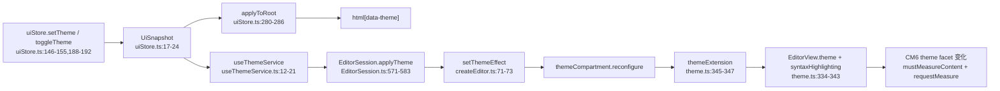
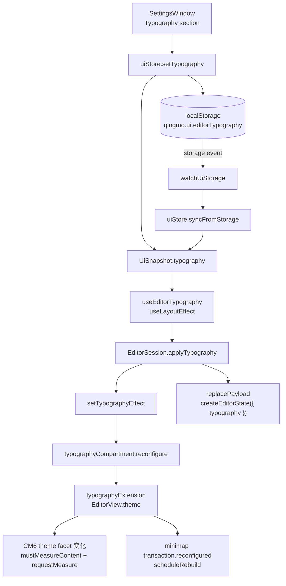

# 调用链、拓扑与影响面证据

> **功能 ID：** `editor-typography`
> **代码基线：** `main@3f654ba6d8d4866529d81566428214a320bebc61`
> **采集日期：** 2026-11-04
> **工具：** GitNexus 1.6.12（CLI + MCP）、`rg`、本地 CM6 源码、逐文件阅读。
> **索引状态：** `node .gitnexus/run.cjs status` → 索引提交 `3f654ba`，当前提交 `3f654ba`，`✅ 已是最新`。

---

## 1. 方法与限制

1. GitNexus 结果统一使用 `summaryOnly: true`、`maxDepth: 3`、不传 `repo`（避免 MCP 命中旧分支 `feat/document-new@34e81af` 的共享图）。所有结果 `staleness.status = "current"`、`branch = "main"`、`lastCommit = 3f654ba...`。
2. `editorThemeSpec`、`qingmoEditorTheme`、`themeCompartment`、`livePreviewTheme` 是模块级 const/对象属性引用，GitNexus 返回 `impactedCount = 0` 且 `risk = UNKNOWN`。**零不是“无影响”**；已用 `rg` 确认实际引用点（见 §7）。
3. GitNexus 不建模 CSS 层叠、localStorage、React effect 顺序；这些结论来自源码与官方文档。
4. 本文的“改动后调用链”是设计推导，不是已实现代码；方案阶段没有修改任何生产文件。

---

## 2. 当前主题调用链（已实现）



关键行号：

| 节点 | 位置 | 说明 |
|---|---|---|
| `UiSnapshot` | `apps/desktop/src/stores/uiStore.ts:17-24` | `theme`、`resolvedTheme`、`language`；没有 typography |
| `setTheme` | `uiStore.ts:146-155` | 持久化 + `replaceSnapshot` + 媒体监听 |
| `syncFromStorage` | `uiStore.ts:198-206` | 跨窗口读取 theme/language |
| `replaceSnapshot` | `uiStore.ts:252-265` | 相等性只比较 theme/resolvedTheme/language |
| `useThemeService` | `apps/desktop/src/app/useThemeService.ts:12-21` | `useEffect` 中 `session.applyTheme` |
| `applyTheme` | `apps/desktop/src/features/editor/EditorSession.ts:571-583` | 有 view 则 dispatch，无 view 则更新 state |
| `themeExtension` | `packages/editor-core/src/extensions/theme.ts:345-347` | 缓存 light/dark 两套 |
| `editorThemeSpec` | `packages/editor-core/src/extensions/theme.ts:21-326` | 当前 base `15px`、mono、`1.75` 的来源 |

补充入口：

- 命令面板：`apps/desktop/src/features/commands/themeCommand.ts:20-28` → `uiStore.toggleTheme()`。
- 原生菜单：`apps/desktop/src/features/workspace/WorkspaceLayout.tsx:376-386` → `uiStore.setTheme(...)`。

---

## 3. 当前排版值的准确来源

| 项目 | 当前值 | 位置 | 类型 |
|---|---|---|---|
| 编辑器根字号 | `15px` | `packages/editor-core/src/extensions/theme.ts:26` | 固定 px |
| 正文行高 | `1.75` | `theme.ts:33` (`.cm-scroller`) | 无单位 |
| 正文字体 | `var(--qm-font-mono)` | `theme.ts:32` | CSS 变量 |
| 行号 gutter | `11px` | `apps/desktop/src/styles.css:17` | 固定 px |
| App body | `14px` / `1.6` | `apps/desktop/src/styles.css:36-37` | 固定 px + 无单位 |
| Live Preview 标题 | `1.6/1.4/1.24/1.12/1.04/0.98em` | `packages/editor-core/src/live-preview/theme.ts:14-19` | em |
| 标题行高 | `1.45` | `live-preview/theme.ts:12` | 无单位 |
| 代码块 widget | `0.92em` + mono | `live-preview/theme.ts:1036-1040` | em |
| 嵌套代码编辑器 | `fontSize: inherit` + mono + `1.75` | `live-preview/theme.ts:1302-1311`；`live-preview/code-blocks.ts:177-204` | 继承 + 固定比例 |
| 表格 | `0.92em` + mono；单元格 `line-height: 1.5` | `live-preview/theme.ts:1404-1407,1436-1447` | em + 无单位 |
| Inline code | mono，字号继承 | `live-preview/theme.ts:40-46` | 继承 |
| 字体 token | `--qm-font-sans/serif/mono` | `packages/ui/src/tokens.css:12-17` | CSS 变量 |
| 阅读宽度 token | `--qm-content-max: 72ch` | `tokens.css:180` | **已定义、无消费点** |

### 3.1 会随 base font-size 缩放的部分

- `.cm-content`、`.cm-line`、正文继承 `& { font-size }`。
- 标题、代码块、表格、列表、引用、widget 内的 `em` 字号都随根字号缩放。
- `.cm-scroller` 的 `line-height: 1.75` 是无单位值，随字号缩放。

### 3.2 不随 base font-size 缩放的固定 px 例外

| 选择器 | 值 | 位置 |
|---|---:|---|
| `.cm-md-link[data-link-hover]::after` | `8.5px` | `live-preview/theme.ts:75` |
| `.cm-md-mermaid-badge` | `8.5px` | `live-preview/theme.ts:230` |
| `.cm-md-mermaid-sep` | `9.5px` | `live-preview/theme.ts:236` |
| `.cm-md-mermaid-kind` | `9.5px` | `live-preview/theme.ts:241` |
| `.cm-md-mermaid-hint` | `9.5px` | `live-preview/theme.ts:259` |
| `.cm-md-mermaid-tool` | `9.5px` | `live-preview/theme.ts:299` |
| `.cm-md-mermaid-error-message` | `11px` | `live-preview/theme.ts:385` |
| `.qm-search-input` | `13px` | `extensions/theme.ts:170` |
| `.qm-search-toggle` | `10px` | `extensions/theme.ts:195` |
| `.qm-search-select` | `10.5px` | `extensions/theme.ts:229` |
| `.qm-search-action` | `11.5px` | `extensions/theme.ts:294` |
| `.cm-gutters` | `11px` | `apps/desktop/src/styles.css:17` |

这些是 UI chrome / widget chrome，不是正文；本方案明确**不缩放**它们，避免把“正文字号”扩大成“整页缩放”。

---

## 4. 生命周期：构造、attach、replacePayload

| 场景 | 当前行为 | 对 typography 的要求 |
|---|---|---|
| `EditorSession` 构造 | `createEditorState` 装入 `themeCompartment.of(qingmoEditorTheme)`（light）；`themeApplied=false`；`this.theme="light"` | 构造只注入默认值/可选 seed；生产入口当前不传 typography，首个 state 是默认值，持久化值由 layout effect seed（见 §4 与 §9.1） |
| `EditorView` 首次 attach | `EditorHost` 的 passive `useEffect` 创建唯一 view（`EditorHost.tsx:39-51`）；`EditorSession.attach` 只挂监听（`EditorSession.ts:493-503`） | 在 `EditorHost` passive effect 之前，用 `WorkspaceLayout` 的 `useLayoutEffect` 把 typography 写入 state |
| 主题首次应用 | `useThemeService` 的 `useEffect` 在 attach 后执行；若偏好 dark，存在 light→dark 瞬态 | typography 用 `useLayoutEffect`，避免同类瞬态 |
| `replacePayload` | 重建 `EditorState`，默认 light；仅 `themeApplied` 时重放 theme（`EditorSession.ts:443-445`） | 直接把 `this.typography` 传给 `createEditorState`，不依赖“是否已应用”标志 |
| `replacePayload` 且有 view | `view.setState(state)`（`EditorSession.ts:460-462`），全文重绘、插件重建、undo 清空 | typography 必须随新 state 一起创建，否则 reload 后回到默认 |
| `applyTheme` | 有 view `dispatch`，无 view `state.update`（`EditorSession.ts:578-582`） | `applyTypography` 采用同一模式；相等时 early-return |

---

## 5. CM6 测量与 minimap

### 5.1 theme facet 变化

`node_modules/@codemirror/view/dist/index.js:8094-8097`：

```js
if (update.startState.facet(theme) != update.state.facet(theme))
    this.viewState.mustMeasureContent = true;
if (... || this.viewState.mustMeasureContent)
    this.requestMeasure();
```

结论：typography 通过 `EditorView.theme` 进入 theme facet 后，compartment 重配会自动触发测量。

### 5.2 纯 CSS 变量的边界

`dist/index.js:7234-7240` 的 ResizeObserver 只观察 `scrollDOM`；`6386-6390` 的 `measureContent` 需要 `mustMeasureContent` 或内容高度变化。`6447-6452` 才重新读取 `lineHeight/charWidth`。

结论：

- 只改 `:root` CSS 变量 + 手动 `requestMeasure()`，在“只换字体族、行盒高度不变”时可能不刷新 `charWidth`。
- 方案 A（纯 CSS 变量）必须额外制造一次 theme facet 变化或强制 `mustMeasureContent`，复杂度反而更高。

### 5.3 minimap

`packages/editor-core/src/minimap/minimap.ts:489-503`：

```ts
this.resizeObserver = new ResizeObserver(() => {
  if (!this.destroyed) this.scheduleRebuild(0);
});
this.resizeObserver.observe(view.dom);
this.resizeObserver.observe(view.scrollDOM);
this.resizeObserver.observe(view.contentDOM);
```

`minimap.ts:543-548`：

```ts
if (update.geometryChanged) needsRebuild = true;
if (update.transactions.some(tr => tr.reconfigured)) needsRebuild = true;
```

结论：

- typography compartment 重配 → `transaction.reconfigured` → minimap 重建。
- minimap 的 `minimapLineHeight` / `minimapCharWidth` 来自 `view.defaultLineHeight` / `defaultCharacterWidth`，在 `updateScale()` 中读取（`minimap.ts:1872-1884`）。
- glyph mask 固定 `bold 11px`，按 `fontFamily` 缓存（`minimap.ts:254-311,1133-1141`）；字号变化只改变行距/字符宽阶梯，不改变 glyph 形状。这是现有设计，不是本功能要修的 bug。
- 不修改 minimap 任何文件。

---

## 6. 现有测试对排版的约束

| 测试 | 断言 | 对本方案的影响 |
|---|---|---|
| `apps/desktop/src/features/editor/theme.test.ts:45-70` | 主题切换后 view DOM 身份不变、undo 可回退、`EditorView.darkTheme` 变化 | 不能用重建 state/view 实现 typography |
| `theme.test.ts:72-83` | `replacePayload` 后保留 dark | typography 也必须在 replacePayload 后保留 |
| `apps/desktop/src/features/editor/editor-binding.test.tsx:163-183` | `setThemeEffect` 后 `.cm-editor` 仍是同一个 DOM、`attachedView` 不变 | typography 也必须只 dispatch compartment |
| `packages/editor-core/src/editor-core.test.ts:84-95` | `setThemeEffect` 不改 doc；`qingmoEditorTheme` 已定义 | 弱断言；不校验具体字号，但导出签名要保持兼容 |
| `packages/editor-core/src/minimap/minimap.test.ts:107-109` | `data-minimap-line-height >= 2` | 极端字号可能触及 clamp；12–30 不会 |
| `e2e/minimap.spec.ts:167-176,503-508` | `lineHeight >= 2`、`charWidth >= 1`、长行更宽 | 字号变化可能影响像素阈值；不是精确值 |
| `e2e/selection.spec.ts:54-57,72-78` | 选区 marker 高度 `> 30` | 行高大幅调低才可能失败；本方案不改行高 |
| `e2e/view-state.spec.ts:59-61` | 内容顶部 padding `28px` | 不改 padding |
| `apps/desktop/src/features/editor/editor-session.test.ts:421-441` | reload 后 minimap 仍只有一个 rail | typography 走新 state 时不能泄漏插件 |

**没有测试直接断言 `15px` / `1.75` / `font-family`。** 全仓唯一字体断言是 `packages/editor-core/src/live-preview/mermaid-labels.test.ts:31,91`（`14px` → `10.4px`），与编辑器基准无关。

---

## 7. GitNexus 影响面（2026-11-04 最终运行）

命令口径：`impact({ target, direction: "upstream", summaryOnly: true, maxDepth: 3 })`，不传 `repo`。

| 目标 | 风险 | impacted | direct | processes | modules | epistemic | 说明 |
|---|---|---:|---:|---:|---:|---|---|
| `EditorSession` | **CRITICAL** | 89 | 43 | 23 | 8 | exact | 中心类；新增字段/方法虽局部，但必须全量回归 |
| `UiSnapshot` | **HIGH** | 36 | 20 | 4 | 3 | lower-bound | 增加必填字段会影响所有构造点/全量断言；36 是下限 |
| `themeExtension` | **HIGH** | 22 | 3 | 4 | 4 | exact | 受影响流程：`autoReload`、`reload`、`WorkspaceLayout`、`useThemeService` |
| `createEditorState` | **HIGH** | 8 | 4 | 3 | 3 | exact | 新增可选参数；必须保持默认行为 |
| `UiStore` | MEDIUM | 22 | 11 | 0 | 0 | exact | 11 个直接导入者 |
| `applyTheme` | LOW | 3 | 1 | 2 | 2 | exact | 只 dispatch compartment，不碰文档 |
| `useThemeService` | LOW | 3 | 1 | 1 | 1 | exact | 唯一直接调用点 `WorkspaceLayout.tsx:92` |
| `watchUiStorage` | LOW | 3 | 3 | 0 | 0 | exact | 三个入口：main/settings/about |
| `SettingsWindow` | LOW | 1 | 1 | 0 | 0 | exact | 唯一调用方 `settings/main.tsx` |
| `minimapExtension` | LOW | 1 | 1 | 0 | 0 | exact | 只被 `EditorSession` 构造使用 |
| `editorThemeSpec` | **UNKNOWN** | 0 | 0 | — | — | exact | 模块级 const，裸引用无 edge；`rg` 确认 `theme.ts:336,340` 使用 |
| `qingmoEditorTheme` | **UNKNOWN** | 0 | 0 | — | — | exact | `rg` 确认 `createEditor.ts:7,136`、`code-blocks.ts:23,669`、测试 |
| `themeCompartment` | **UNKNOWN** | 0 | 0 | — | — | exact | `rg` 确认 `createEditor.ts:72,136`、`index.ts:15` |
| `livePreviewTheme` | **UNKNOWN** | 0 | 0 | — | — | exact | `rg` 确认 `plugin.ts:27,248`、`index.ts:121` |

### 7.1 风险解读

- **`EditorSession` CRITICAL**：不是“新增一个方法就会破坏 89 个符号”，而是说明它是调用图中心。方案必须把改动限制在字段/方法级别，并跑 `detect_changes` + 全量 Vitest + 关键 E2E。
- **`UiSnapshot` HIGH / lower-bound**：新增 `typography` 字段会影响 `uiStore.test.ts` 的 `uiSnapshot()` helper、`themeCommand.test.ts` 的全量 `toEqual`、`SettingsWindow.test.tsx`。必须同步修改；不能只改生产代码。
- **`themeExtension` HIGH**：如果扩展 `themeExtension` 来承载 typography，会把本可 LOW 的改动升级为 HIGH。方案选择新增 `typographyExtension`，不扩展 `themeExtension`。
- **`createEditorState` HIGH**：新增可选参数是向后兼容的，但必须保证默认值等于当前 `15px/mono/1.75`。
- **UNKNOWN 的四个目标**：不能引用“0 impact”作为安全证据；必须用文本搜索确认。

### 7.2 建议的 `detect_changes` 门禁

实施阶段每次提交前：

```bash
node .gitnexus/run.cjs detect-changes --scope all --repo .
```

如果输出 `partial: true` 或 `truncated: true`，不算通过；必须重跑或缩小改动面。回归评审用：

```bash
node .gitnexus/run.cjs detect-changes --scope compare --base-ref main --repo .
```

---

## 8. 重复来源清单（设计必须收敛）

| # | 来源 | 内容 | 风险 | 本方案处理 |
|---|---|---|---|---|
| 1 | `extensions/theme.ts:26,32-33` | base `15px` / mono / `1.75` | 当前唯一 base 来源 | 移出到 `typographyExtension` |
| 2 | `live-preview/theme.ts:7-1514` | 第二套 `EditorView.theme`，标题/表格/widget 的 em 与固定 px | 中 | 保留 em 相对值；不新增 base 字号 |
| 3 | `live-preview/code-blocks.ts:177-204` + `live-preview/theme.ts:1302-1324` | 嵌套代码 `mono` + `1.75` 重复；外层六块承担 specificity 覆盖 | **高** | **保留外层六块**；只把两处 `1.75` 改为 `EDITOR_LINE_HEIGHT` 常量（R2 BLOCKER） |
| 4 | `minimap.ts:55-64,254-311` | minimap 常量 + `bold 11px` glyph | 中 | 不修改；字号只影响 scale |
| 5 | `styles.css:10-18,31-40` | gutter `11px`、body `14px/1.6` | 低 | 不动；UI chrome |
| 6 | `tokens.css:12-17,180` | 字体族 token；`72ch` 未消费 | 低 | 只读；不新增字号 token |
| 7 | `live-preview/mermaid-theme.ts:335` | Mermaid 读 `--qm-font-sans` | 中 | 不修改；图表字体独立 |
| 8 | `settings/settings.css` | Settings 自身排版值 | 低 | 新增 Typography 样式，不复用 `.settings-select*` |
| 9 | `docs/BLUEPRINT.md:962-963` | 文档提议 14/15/16px、1.7 行高、72ch | 低 | 与代码不一致；以代码为准，文档只作历史参考 |

---

## 9. 改动后的调用链（设计，不是已实现）



### 9.1 首次挂载顺序

```text
DocumentSessionContext 创建 EditorSession（不传 typography）
  -> 构造函数 createEditorState({ typography: DEFAULT })
  -> WorkspaceLayout useLayoutEffect
       -> session.applyTypography(snapshot.typography)
       -> 无 view：this.state = state.update({ effects }).state
  -> EditorHost useEffect（passive）
       -> new EditorView({ state: session.editorState })
  -> 首帧即为用户偏好（state 已被 layout effect seed）
```

### 9.2 已挂载后的切换顺序

```text
用户拖动 range / 选择 radio
  -> uiStore.setTypography(next)
  -> persist(JSON)
  -> replaceSnapshot（值比较）
  -> useEditorTypography 重新渲染
  -> useLayoutEffect：session.applyTypography(next)
  -> view.dispatch({ effects: setTypographyEffect(...) })
  -> CM6: theme facet 变化 -> mustMeasureContent -> requestMeasure
  -> minimap: transaction.reconfigured -> scheduleRebuild(0)
  -> 同一帧内不重建 view、不丢 undo/selection
```

### 9.3 跨窗口顺序

```text
Settings webview: uiStore.setTypography
  -> localStorage.setItem
  -> 其他 webview 收到 storage 事件
  -> watchUiStorage 过滤新 key
  -> uiStore.syncFromStorage
  -> replaceSnapshot
  -> useEditorTypography -> applyTypography
```

---

## 10. 明确未知

1. GitNexus 对模块级 const 的盲区（§7 的四个 UNKNOWN）。
2. 真实 Tauri 多 webview 的 `storage` 事件行为未在本仓库用 WKWebView/WebView2 验证；现有 E2E 是 Chromium 同 context 的两个 page。
3. React 首次挂载的 layout/passive effect 顺序来自 React 语义与 `EditorHost` 代码；未在真实 WebView 做逐帧 trace。
4. 字体族只换、行盒高度恰好不变时，CM6 `charWidth` 是否更新；方案通过 theme facet 变化规避，但未做浏览器实验。
5. minimap glyph 固定 11px，字号变化不会让 minimap 字形连续缩放；这是现有设计，不是本功能的验收项。
6. `--qm-content-max: 72ch` 是否有意未接入，无法从代码断言；方案按“未启用”处理。
