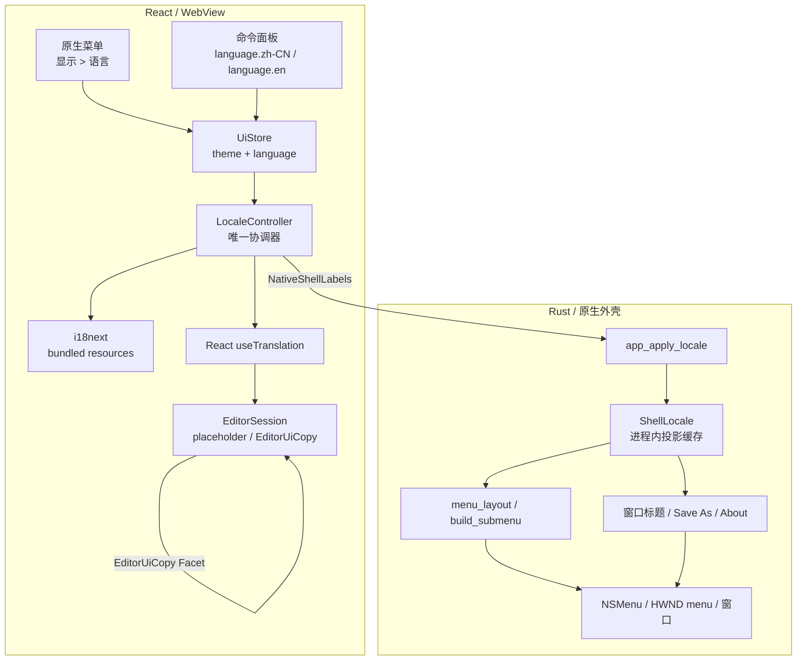
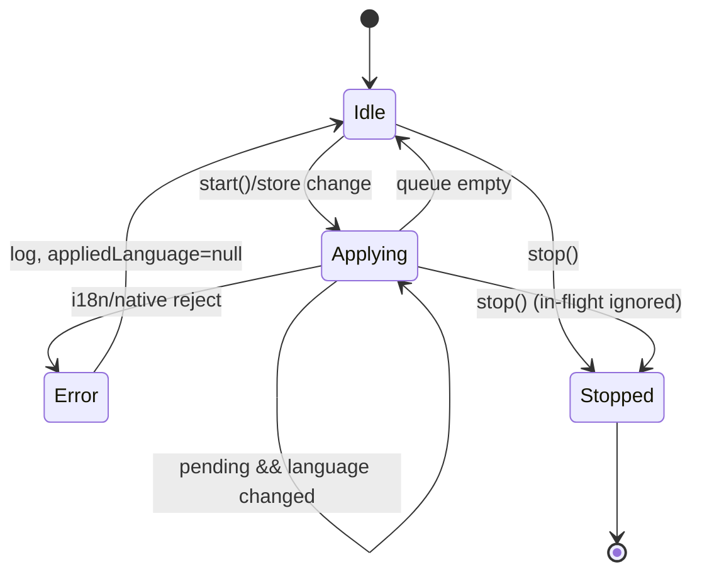
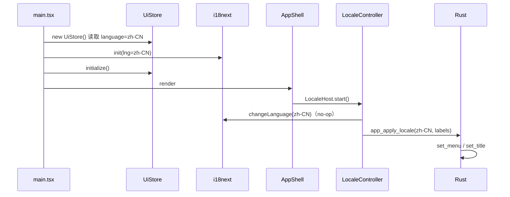
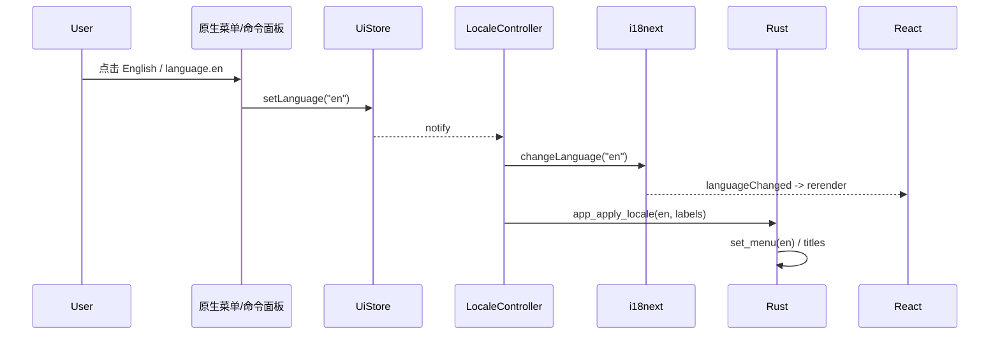
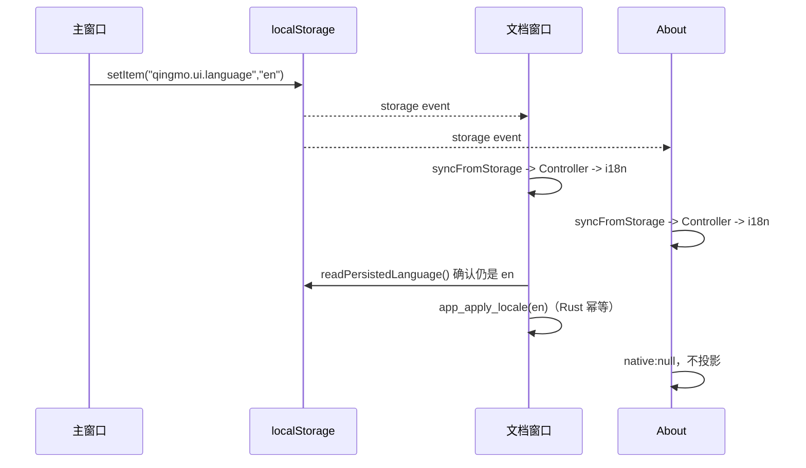
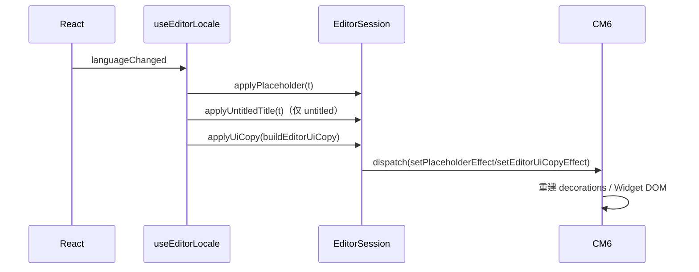

# 运行时国际化与原生本地化 — 设计方案

> **功能 ID：** `i18n`
> **文档版本：** v1.0（2026-10-28）
> **代码基线：** `main@195bfb6` + 工作树 WIP
> **实施计划：** [`01-实施计划.md`](01-实施计划.md) v1.0
> **调用链证据：** [`research/04-code-topology.md`](research/04-code-topology.md)
> **状态：** 设计完成；Q-001~Q-008 已于 2026-10-28 确认（全部采纳建议）；未写生产代码

---

## 1. 摘要

Qingmo 已经有完整的中英资源层和组件级 `useTranslation`，但运行时固定 `zh-CN`：没有语言持久化、没有切换入口；原生菜单/窗口标题/另存为默认名硬编码中文；`packages/editor-core` 仍有 92 行含中文（90 行最终可见/可访问）；日志时间/更新日期使用系统 locale。

本方案把语言定义为一种 **UI 偏好**，由现有 `UiStore` 单一持久化；新增 `LocaleController` 作为唯一运行时协调器；前端仍是唯一文案源，Rust 只接收类型化 `NativeShellLabels` 并重建菜单/标题；`editor-core` 通过 CM6 `EditorUiCopy` Facet 接收文案，不引入第二套 i18n。默认保持 `zh-CN`，不新增依赖、不新增数据表、不引入 `i18next-browser-languagedetector` 或 `tauri-plugin-store`。

核心不变量：

1. **一个持久化点**：`UiStore`，键为 `qingmo.ui.language`。
2. **一个运行时协调器**：`LocaleController`，负责 i18n/DOM/原生投影的串行应用。
3. **一个文案源**：`apps/desktop/src/i18n/locales/{zh-CN,en}.ts`；Rust/editor-core 不维护第二套翻译。
4. **一个原生投影协议**：`app_apply_locale(ApplyLocaleRequest)`，幂等、可重试。
5. **一个编辑器注入点**：`EditorUiCopy` Facet + `version`，不重建 EditorState/View。

---

## 2. 问题定义

### 2.1 业务背景与故障特征

产品声明“中英双语”，但当前只有“中文 UI + 英文资源文件”：

- 英文用户无法把界面切到英文；原生菜单、窗口标题、About、另存为默认名仍是中文。
- 即使手动改 `localStorage`/代码，也没有 `changeLanguage` 入口，编辑器内 Widget 文案不会变。
- 多窗口（main / doc-* / about）没有语言同步机制；About 只同步主题。
- 日志时间、更新日期跟随系统 locale，而不是用户选择的语言；`formatSize` 有两份实现。
- 现有 `i18n.test.ts` 只覆盖 5 个 namespace，漏 `about`/`logs`，且硬编码 19 个错误码；资源漂移无法在 CI 发现。

### 2.2 当前实现与主要缺口

| 层 | 当前实现 | 缺口 |
|---|---|---|
| 资源 | `zhCN`/`en` 两套，7 namespace | 缺 `menu`/widget/复数键 |
| 初始化 | `i18n.init({ lng: "zh-CN", initAsync:false })` | 不读偏好、无切换 |
| 状态 | `UiStore` 只有 theme | 无 language 持久化/同步 |
| 原生菜单 | `MenuSpec` + `&'static str` 中文 | 第二文案源、无运行时重建 |
| 标题 | `文件名 — 青墨`、`关于青墨`、`未命名.md` | 硬编码中文 |
| 编辑器 | CM6 Compartment 主题/模式/只读 | 无 placeholder/copy Compartment |
| Widget | 直接写 `textContent/title/aria-label` | 92 行含中文、无注入点 |
| 格式化 | `toLocale*` + 两份 `formatSize` | 系统 locale、重复实现 |
| 测试 | 5 namespace/19 错误码 | 漏 namespace、无复数/插值/扫描 |

### 2.3 设计目标

| R-ID | 目标 |
|---|---|
| R-001 | 菜单/命令面板切换 `zh-CN`/`en`，React UI 立即更新 |
| R-002 | 语言持久化；非法值/禁用 localStorage 不影响启动 |
| R-003 | 原生菜单标题/项/勾选随语言同步；无 Rust 第二文案表 |
| R-004 | 文档/About 窗口标题、Save As 默认名随语言变化（未命名名称由 R-006 覆盖） |
| R-005 | main/doc-*/about 语言一致；About 通过 storage 跟随 |
| R-006 | 未命名 placeholder/状态栏名称切换后无旧语言残留 |
| R-007 | `editor-core` 可见 Widget 文案/aria/title 通过 `EditorUiCopy` 本地化 |
| R-008 | 日志时间/更新日期/文件大小使用所选语言且只有一份实现 |
| R-009 | 全 namespace key/插值/复数/错误码完整；无硬编码用户文案 |
| R-010 | 不新增运行时依赖/数据表/第二持久化键 |
| R-011 | 新命令/权限/DTO/生成类型/契约测试单一源、负例防漂移 |
| R-012 | ADR/蓝图/README/TOPOLOGY/现状审计同步；可安全回滚 |

### 2.4 非目标

| 项 | 原因 | 后续 |
|---|---|---|
| RTL/第三语言 | 布局仍使用 `ml-auto` 等物理属性 | `NEXT-I18N-001` |
| 插件语言包/懒加载 | 资源约 10KB；`initAsync:false` 是首帧确定性前提 | `NEXT-I18N-002` |
| 系统语言作为首次默认 | 会改变现有行为 | `Q-003-B` |
| macOS 包元数据/文件关联本地化 | 需要 `InfoPlist.strings` 等平台资源 | `NEXT-I18N-003` |
| Rust 日志/诊断翻译 | 日志是开发者诊断，不是 UI | 设计边界 |
| 更新说明正文翻译 | 外部内容 | 设计边界 |
| 设置页 | 当前无设置页 | `NEXT-I18N-004` |
| Windows/Linux 真机验收 | 当前只有 macOS 发布链 | `NEXT-I18N-005` |
| About-only 窗口语言 action | 无主窗口时 `command_window` 可能为空 | `NEXT-I18N-006` |

### 2.5 前置假设与约束

| 类型 | 内容 | 验证 | 失效处理 |
|---|---|---|---|
| 技术 | i18next 26.5.11 + react-i18next 17.1.9，bundled resources | `apps/desktop/package.json` | 升级先跑 `i18n.test.ts` |
| 技术 | `initAsync:false` + `useSuspense:false` 首帧同步 | `i18n/index.ts:16-27` | 改异步时增加 ready 边界 |
| 技术 | `AppHandle::set_menu` 运行时替换 app-wide 菜单 | 本机 tauri 2.12.5 源码 + 官方文档 | best effort，失败可能降级为无菜单/部分菜单；不提交 ShellLocale，下一次重试，不阻断 UI |
| 部署 | localStorage 同 origin 跨 webview 共享 | 现有主题 storage 事件 | 若隔离，改用 Rust 广播（需新决策） |
| 产品 | 默认 `zh-CN`，英文显式切换 | `DEFAULT_LANGUAGE` | Q-003-B 时更新测试 |
| 安全 | 菜单 label 只作文本，不解析 HTML | 代码审查/测试 | 禁止 `dangerouslySetInnerHTML` 类用法 |

---

## 3. 总体设计

### 3.1 设计原则

1. **单一状态源**：语言只在 `UiStore`；`LocaleController` 不缓存“当前语言”作为第二状态（只记录“上次已应用”用于幂等）。
2. **单向数据流**：菜单/命令 -> `uiStore.setLanguage` -> 订阅者；React/编辑器/原生都是下游投影。
3. **投影而非复制**：Rust 只接收 `NativeShellLabels`；editor-core 只接收 `EditorUiCopy`。
4. **运行时重配置优先**：CM6 Compartment/Facet、`set_menu`、`set_title`，不重启/不重建文档。
5. **失败降级**：缺 key/非法值/localStorage 禁用 -> `zh-CN`；原生投影失败 -> UI 仍切换、菜单可能保持旧值或无/部分菜单、记录日志。
6. **可测试边界**：`IpcPort`/`LocaleController`/`EditorUiCopy` 都可注入 fake；不依赖真实 Tauri。

### 3.2 系统架构



### 3.3 职责边界

| 组件 | 拥有 | 不拥有 |
|---|---|---|
| `UiStore` | 语言/主题偏好、localStorage、快照/订阅 | i18n 实例、原生菜单、编辑器 |
| `LocaleController` | 串行应用、i18n/DOM/原生协调、失败日志 | 持久化、UI 渲染、文案内容 |
| `i18n` | 资源、`t`、`changeLanguage`、`languageChanged` | 原生菜单、编辑器 Widget |
| `NativeShellLabels` | 原生菜单/标题的全部文案 | 业务逻辑/状态 |
| `ShellLocale` | 最近一次合法投影（language+labels） | 持久化、第二份翻译 |
| `EditorUiCopy` | Widget/块级 UI 文案、版本 | i18n 实例、React |
| `EditorSession` | 文档状态、Compartment 重配置 | 文案来源、语言策略 |
| `IpcPort` | 前端唯一原生边界 | Tauri 细节、UI 状态 |

### 3.4 当前链路与目标链路

当前：

```text
main.tsx -> i18n.init(zh-CN) -> AppShell -> WorkspaceLayout
原生菜单 -> menu_layout(&'static 中文) -> set at startup only
标题 -> window_title_for("— 青墨") / "关于青墨" / "未命名.md"
编辑器 -> createUntitled(i18n.t) -> placeholder 捕获 -> Widget 中文
格式化 -> toLocale*(系统 locale) + 两份 formatSize
```

目标：

```text
main.tsx -> UiStore(language) -> i18n.init(language) -> AppShell
  -> LocaleHost -> LocaleController
       -> i18n.changeLanguage -> <html lang>
       -> buildNativeShellLabels -> app_apply_locale
            -> ShellLocale -> set_menu / titles / Save As
  -> React useTranslation
  -> WorkspaceLayout -> useEditorLocale(session)
       -> applyPlaceholder / applyUntitledTitle / applyUiCopy
            -> CM6 Compartment/Facet -> Widget 重绘
  -> lib/format -> Intl(language)
```

---

## 4. 修复方式与修改点

### 4.1 接入方式概述

采用“**中心接线 + 两端投影**”：

- 中心：`UiStore` 持久化语言；`LocaleController` 订阅并应用。
- 左端（Web）：i18n/React/CM6 通过同一语言值重渲染。
- 右端（Native）：Rust 只接收 `NativeShellLabels`，重建菜单/标题。

不采用“每个组件各自监听 localStorage”“Rust 维护第二套翻译”“editor-core 直接 import i18next”。

### 4.2 接入前链路

```text
语言值：不存在（固定 zh-CN）
持久化：qingmo.ui.theme only
原生：启动时构建中文菜单；标题创建时中文
编辑器：创建时捕获中文 placeholder；Widget 中文
```

### 4.3 接入后链路

```text
语言值：UiStore.language
持久化：qingmo.ui.language
原生：启动中性 -> 首帧 app_apply_locale -> set_menu/titles
编辑器：创建时注入当前 copy；切换时 Compartment/Facet 重配置
```

### 4.4 修改点清单

| MP-ID | 修改点 | 文件 | 类型 | 风险 |
|---|---|---|---|---|
| MP-001 | 语言策略纯函数 | `i18n/language.ts`（新） | 新增 | 低 |
| MP-002 | i18n 从 UiStore 初始化 + `<html lang>` | `i18n/index.ts` | 改 | 低 |
| MP-003 | UiStore language 持久化/同步 | `stores/uiStore.ts` | 改 | MEDIUM |
| MP-004 | storage 监听收口 | `app/uiStorageSync.ts`（新） | 新增 | 低 |
| MP-005 | LocaleController/LocaleHost | `app/LocaleController.ts`、`LocaleHost.tsx`（新） | 新增 | MEDIUM |
| MP-006 | Native labels 构建 | `i18n/native.ts`（新） | 新增 | 低 |
| MP-007 | Rust DTO/错误/契约/权限 | `ipc/dto.rs`、`error.rs`、`contract.rs`、`capabilities/default.json` | 改 | MEDIUM |
| MP-008 | Rust ShellLocale | `state/shell_locale.rs`（新） | 新增 | 低 |
| MP-009 | Rust 菜单数据化/重建 | `lib.rs` | 改 | HIGH |
| MP-010 | Rust 标题/Save As/About | `commands/document.rs`、`about.rs`、`window_sessions.rs` | 改 | MEDIUM |
| MP-011 | 前端 IPC port/adapter/fake | `lib/ipc/*` | 改 | 低 |
| MP-012 | 菜单 action/命令面板 | `lib.rs`、`WorkspaceLayout.tsx`、`localeCommand.ts` | 改/新增 | MEDIUM |
| MP-013 | About 同步/HTML | `about/main.tsx`、`index.html`、`about.html` | 改 | 低 |
| MP-014 | Intl 格式化 | `lib/format/*`、三个组件 | 新增/改 | 低 |
| MP-015 | placeholder/未命名标题 | `DocumentSessionContext.tsx`、`EditorSession.ts` | 改（加法） | CRITICAL |
| MP-016 | EditorUiCopy Facet | `packages/editor-core/src/i18n.ts`、`createEditor.ts`、`plugin.ts` | 新增/改 | HIGH |
| MP-017 | Widget 文案迁移 | `packages/editor-core/src/live-preview/**` | 改 | HIGH |
| MP-018 | 测试硬化 | `i18n.test.ts`、`language.test.ts`、`native.test.ts`、E2E | 改/新增 | 低 |
| MP-019 | 文档/ADR/蓝图/README/TOPOLOGY | `docs/**`、`README*` | 改/新增 | 低 |
| MP-020 | 删除第二文案源 | `packages/shared/src/index.ts`、`smoke.test.ts` | 改 | 低 |

---

## 5. 核心组件

### 5.1 `UiStore`（唯一持久化层）

在现有 `UiStore` 上做加法，不新建 store。

```ts
export const THEME_STORAGE_KEY = "qingmo.ui.theme";
export const LANGUAGE_STORAGE_KEY = "qingmo.ui.language";

export interface UiSnapshot {
  theme: ThemePreference;
  resolvedTheme: ResolvedTheme;
  language: SupportedLanguage;
}

export class UiStore {
  private languagePersistenceDegraded = false;

  constructor(options: UiStoreOptions = {}) {
    const theme = readStoredTheme(this.storage);
    const language = readStoredLanguage(this.storage);
    this.snapshot = Object.freeze({
      theme,
      resolvedTheme: resolveTheme(theme, this.media?.matches ?? false),
      language,
    });
  }

  setLanguage(next: SupportedLanguage): void {
    if (!isSupportedLanguage(next)) return; // 运行期非法值忽略，不写回
    if (next === this.snapshot.language) return;
    if (!this.persist(LANGUAGE_STORAGE_KEY, next)) {
      // 存储不可写时，本次会话以内存快照为准；不能拿旧存储值把用户选择打回去。
      this.languagePersistenceDegraded = true;
    } else {
      this.languagePersistenceDegraded = false;
    }
    this.replaceSnapshot({ ...this.snapshot, language: next });
  }

  syncFromStorage(): void {
    const theme = readStoredTheme(this.storage);
    const language = readStoredLanguage(this.storage);
    this.replaceSnapshot({
      theme,
      resolvedTheme: resolveTheme(theme, this.media?.matches ?? false),
      language,
    });
    this.syncMediaListener();
  }

  /**
   * 只读权威存储值，供 LocaleController 在投影前做跨窗口防回退。
   * `null` 表示“没有可信的持久化值”（storage 禁用、读取失败、键不存在或本窗口写入失败）；
   * 此时不得用 UI 默认值覆盖内存语言。
   */
  readPersistedLanguage(): SupportedLanguage | null {
    if (!this.storage || this.languagePersistenceDegraded) return null;
    try {
      const stored = this.storage.getItem(LANGUAGE_STORAGE_KEY);
      return stored === null ? null : normalizeLanguage(stored);
    } catch {
      return null;
    }
  }

  private persist(key: string, value: string): boolean {
    if (!this.storage) return false;
    try {
      this.storage.setItem(key, value);
      return true;
    } catch {
      return false;
    }
  }

  private replaceSnapshot(next: UiSnapshot): void {
    if (
      next.theme === this.snapshot.theme &&
      next.resolvedTheme === this.snapshot.resolvedTheme &&
      next.language === this.snapshot.language
    ) return;
    this.snapshot = Object.freeze(next);
    this.applyToRoot();
    for (const listener of [...this.listeners]) listener();
  }
}

export function useUiPreferences(): UiSnapshot {
  return useSyncExternalStore(uiStore.subscribe, uiStore.getSnapshot, uiStore.getSnapshot);
}
```

关键规则：

1. `readStoredLanguage` 只接受精确 `"zh-CN"`/`"en"`；其他值（`"en-US"`、空串、损坏 JSON）回 `DEFAULT_LANGUAGE`。
2. `persist` 返回是否写入成功；localStorage 禁用/配额满时只更新内存快照，并把 `languagePersistenceDegraded` 置为 true，避免 controller 拿旧值回退用户选择。
3. `syncFromStorage` 一次通知同时更新 theme+language，避免 About 两次重渲染。
4. `useUiTheme` 当前无消费者（`useThemeService` 直接 `useSyncExternalStore`）；统一改名为 `useUiPreferences` 供后续消费，不保留两个 hook。
5. `UiStore` 不 import `i18n/index.ts`，只 import `i18n/language.ts`，避免循环初始化。
6. `readPersistedLanguage()` 只读 localStorage、不触发通知；返回 `null` 表示没有可信持久化值，`LocaleController` 不得用默认/旧值覆盖内存语言。

### 5.2 `i18n/language.ts`（语言策略纯函数）

```ts
export const SUPPORTED_LANGUAGES = ["zh-CN", "en"] as const;
export type SupportedLanguage = (typeof SUPPORTED_LANGUAGES)[number];
export const DEFAULT_LANGUAGE: SupportedLanguage = "zh-CN";

export function isSupportedLanguage(value: unknown): value is SupportedLanguage {
  return typeof value === "string" && (SUPPORTED_LANGUAGES as readonly string[]).includes(value);
}

export function normalizeLanguage(value: unknown): SupportedLanguage {
  return isSupportedLanguage(value) ? value : DEFAULT_LANGUAGE;
}
```

约束：

- 不做 `navigator.language` 检测（Q-003 默认 zh-CN）；不引入 language detector。
- 不把 `zh`/`en-US` 自动映射到支持语言；精确匹配，避免隐式行为。
- `resources` 的 key 必须与 `SUPPORTED_LANGUAGES` 一致，由 `i18n.test.ts` 断言。

### 5.3 `i18n/index.ts`（初始化 + DOM lang）

```ts
import i18n from "i18next";
import { initReactI18next } from "react-i18next";
import { uiStore } from "../stores/uiStore";
import { DEFAULT_LANGUAGE, normalizeLanguage, type SupportedLanguage } from "./language";
import { en } from "./locales/en";
import { zhCN } from "./locales/zh-CN";

export const resources = { "zh-CN": zhCN, en } as const;
export const ns = Object.keys(resources[DEFAULT_LANGUAGE]) as Array<keyof typeof zhCN>;
export { DEFAULT_LANGUAGE, type SupportedLanguage };

const language = uiStore.getSnapshot().language;

void i18n.use(initReactI18next).init({
  resources,
  lng: language,
  fallbackLng: "en",
  supportedLngs: Object.keys(resources),
  defaultNS: "common",
  ns,
  interpolation: { escapeValue: false },
  returnNull: false,
  initAsync: false,
  react: { useSuspense: false },
});

i18n.on("languageChanged", (next) => {
  if (typeof document !== "undefined") {
    document.documentElement.lang = normalizeLanguage(next);
  }
});
if (typeof document !== "undefined") {
  document.documentElement.lang = normalizeLanguage(i18n.language);
}

export default i18n;
```

说明：

- `ns` 从资源动态派生，新增 `menu`/未来 namespace 不会漏初始化。
- `lng` 读取 `uiStore.getSnapshot().language` 是 T-003 完成后的最终形态；T-002 阶段先固定 `DEFAULT_LANGUAGE`，否则 `UiStore.language` 尚不存在（见 P0-8）。
- `languageChanged` 是**唯一** `<html lang>` 更新点；组件不直接写 DOM。
- `initAsync:false` 保持同步；不引入 Suspense 边界。
- `DocumentSessionContext` 仍可 import i18n 取当前语言；不产生循环（i18n -> uiStore -> language）。

### 5.4 `LocaleController`（唯一运行时协调器）

职责：把 `UiStore.language` 串行投影到 i18n、DOM（由 i18n 监听）、原生外壳；合并快速切换；失败不阻断 UI。

```ts
export interface LocaleNativePort {
  appApplyLocale(request: ApplyLocaleRequest): Promise<void>;
}

export interface LocaleControllerOptions {
  store: Pick<
    UiStore,
    "getSnapshot" | "subscribe" | "readPersistedLanguage" | "syncFromStorage"
  >;
  i18n: Pick<I18n, "language" | "changeLanguage">;
  native?: LocaleNativePort | null;
  buildLabels?: (language: SupportedLanguage) => NativeShellLabels;
  logger?: Pick<Console, "error" | "warn">;
}

export class LocaleController {
  private unsubscribe: (() => void) | null = null;
  private running = false;
  private pending = false;
  private stopped = false;
  private generation = 0;
  private appliedLanguage: SupportedLanguage | null = null;

  start(): void {
    if (this.unsubscribe) return;
    this.stopped = false;
    this.unsubscribe = this.store.subscribe(this.request);
    this.request();
  }

  stop(): void {
    this.stopped = true;
    this.generation += 1;
    this.unsubscribe?.();
    this.unsubscribe = null;
  }

  private request = (): void => {
    if (this.stopped) return;
    this.pending = true;
    if (!this.running) void this.drain();
  };

  private async drain(): Promise<void> {
    this.running = true;
    try {
      while (this.pending && !this.stopped) {
        this.pending = false;
        const generation = this.generation;
        const language = this.store.getSnapshot().language;
        if (language === this.appliedLanguage) continue;
        try {
          if (this.i18n.language !== language) {
            await this.i18n.changeLanguage(language);
            if (this.i18n.language !== language) {
              throw new Error(`i18n did not switch to ${language}`);
            }
          }
          if (this.stopped || generation !== this.generation) return;
          if (this.native) {
            // 跨窗口防回退：本地存储是语言偏好的权威值；如果本窗口快照
            // 已过期，先同步再重试，绝不把旧语言投影到全局菜单。
            // null 表示存储不可信（禁用/写入失败），此时以内存快照为准。
            const persisted = this.store.readPersistedLanguage();
            if (persisted !== null && persisted !== language) {
              this.store.syncFromStorage();
              this.appliedLanguage = null;
              continue;
            }
            await this.native.appApplyLocale({
              language,
              labels: (this.buildLabels ?? buildNativeShellLabels)(language),
            });
            if (this.stopped || generation !== this.generation) return;
            // 双检：native 期间另一个窗口可能已写入新语言；若存储已变，
            // 立即收敛到最新值，避免“先读后写”的 IPC 乱序留下旧菜单。
            const persistedAfter = this.store.readPersistedLanguage();
            if (persistedAfter !== null && persistedAfter !== language) {
              this.store.syncFromStorage();
              this.appliedLanguage = null;
              continue;
            }
          }
          this.appliedLanguage = language;
        } catch (error) {
          if (this.stopped || generation !== this.generation) return;
          this.appliedLanguage = null;
          this.logger?.error("failed to apply locale", error);
        }
      }
    } finally {
      this.running = false;
      // stop()/start() 可能发生在 await 期间：若新请求已排队，必须由这里
      // 重新启动 drain，否则旧 drain 退出后新语言永远不投影。
      if (this.pending && !this.stopped) void this.drain();
    }
  }
}
```

行为定义：

| 场景 | 行为 |
|---|---|
| 启动 | `start()` 立即 apply 当前语言；native 存在则先做持久化 guard 再投影 |
| 语言变化 | store 通知 -> `request()` -> `drain()` 串行 apply |
| 快速 A->B->A | `pending` 合并；循环每次读最新 store；最终 A |
| theme 变化 | store 通知；`language === appliedLanguage` -> 跳过 |
| native 失败 | 记日志，`appliedLanguage=null`；下次通知重试；i18n 已切换 |
| i18n 失败 | 记日志；`appliedLanguage=null`；不阻塞后续；React 仍用旧语言（极少见） |
| 跨窗口旧快照 | 投影前 `readPersistedLanguage()` 返回非 null 且与目标语言不一致 -> `syncFromStorage()` 并重试，不投影旧语言 |
| native 成功后存储被改写 | 投影后再次 `readPersistedLanguage()`；若已变则 `syncFromStorage()` 并重新 apply，收敛到最新值；极端 IPC 乱序允许短暂旧菜单，下一次事件纠正 |
| 存储不可信 | `readPersistedLanguage()` 为 null（禁用/写入失败/无键）-> 以内存快照为准，不调用 `syncFromStorage()`，避免把用户选择回退成默认值 |
| StrictMode 双挂载 | 旧 controller `stop()` 递增 generation；`await` 后通过 generation 检查的旧请求不再调用 native；`finally` 在 `pending && !stopped` 时重新 drain，支持 start 重启；无法取消的已发出 IPC 由 Rust 幂等 + 同一语言收敛 |
| About | `native:null`；只 i18n/DOM；成功后 `appliedLanguage=language` 防止 theme 变化重复 apply |

> `appliedLanguage` 只是“上次成功投影”的簿记，不是第二份当前语言状态；真正状态仍是 `UiStore`。它按语言配对，避免 `lastRequested + nativeApplied` 组合产生“假已应用”。

### 5.5 `LocaleHost` 与 `uiStorageSync`

```tsx
export function LocaleHost() {
  const { ipc } = useAppServices();
  useEffect(() => {
    const controller = new LocaleController({
      store: uiStore,
      i18n,
      native: { appApplyLocale: (request) => ipc.appApplyLocale(request) },
    });
    controller.start();
    return () => controller.stop();
  }, [ipc]);
  return null;
}
```

`AppShell` 中的位置：

```tsx
<AppErrorBoundary>
  <ToastProvider>
    <AppServicesProvider>
      <LocaleHost />
      <UpdateProvider>
        <DocumentSessionProvider>
          <RouterProvider router={router} />
        </DocumentSessionProvider>
      </UpdateProvider>
    </AppServicesProvider>
  </ToastProvider>
</AppErrorBoundary>
```

- `LocaleHost` 在 `AppServicesProvider` 内（拿 `ipc`），在 `DocumentSessionProvider` 外（不依赖 session）。
- About 不挂 `LocaleHost`；`about/main.tsx` 直接创建 `LocaleController({ native: null })`。

```ts
export function watchUiStorage(store: UiStore = uiStore): () => void {
  const onStorage = (event: StorageEvent) => {
    if (
      event.key === null ||
      event.key === THEME_STORAGE_KEY ||
      event.key === LANGUAGE_STORAGE_KEY
    ) {
      store.syncFromStorage();
    }
  };
  window.addEventListener("storage", onStorage);
  return () => window.removeEventListener("storage", onStorage);
}
```

`main.tsx`/`about/main.tsx` 在 `uiStore.initialize()` 后调用 `watchUiStorage()`；主窗口和文档窗口都监听，About 也监听。`event.key === null` 覆盖 `localStorage.clear()`。

### 5.6 `NativeShellLabels` 与 `buildNativeShellLabels`

前端唯一投影 DTO：

| 字段 | 来源 key | 说明 |
|---|---|---|
| `appName` | `common:appName` | 菜单/标题应用名 |
| `about` | `menu:about` | `关于{{appName}}` / `About {{appName}}` |
| `services` | `menu:services` | macOS 服务 |
| `hideApp` | `menu:hideApp` | 隐藏应用 |
| `hideOthers` | `menu:hideOthers` | 隐藏其他 |
| `showAll` | `menu:showAll` | 显示全部 |
| `quitApp` | `menu:quitApp` | 退出应用 |
| `file` | `menu:file` | 文件菜单 |
| `open` | `menu:open` | 打开… |
| `save` | `menu:save` | 保存 |
| `closeWindow` | `menu:closeWindow` | 关闭窗口 |
| `edit` | `menu:edit` | 编辑菜单 |
| `undo`/`redo`/`cut`/`copy`/`paste`/`selectAll` | `menu:*` | 原生编辑项 |
| `view` | `menu:view` | 显示菜单 |
| `livePreview` | `menu:livePreview` | 实时预览 |
| `commandPalette` | `menu:commandPalette` | 命令面板 |
| `toggleTheme` | `menu:toggleTheme` | 切换主题 |
| `logs` | `menu:logs` | 日志… |
| `fullscreen` | `menu:fullscreen` | 全屏 |
| `theme` | `menu:theme` | 主题菜单 |
| `themeLight`/`themeDark`/`themeSystem` | `menu:*` | 主题项 |
| `language` | `menu:language` | 语言子菜单 |
| `languageZhCN` | `menu:languageZhCN` | 简体中文（两端都显示 endonym） |
| `languageEn` | `menu:languageEn` | English |
| `window` | `menu:window` | 窗口菜单 |
| `minimize`/`zoom`/`maximize`/`bringAllToFront` | `menu:*` | 窗口项；macOS 用 `zoom`，Windows/Linux 用 `maximize`，`menu_layout` 按平台取字段 |
| `help` | `menu:help` | 帮助菜单 |
| `untitledFileName` | `menu:untitledFileName` | `未命名.md`/`Untitled.md` |

```ts
export function buildNativeShellLabels(language: SupportedLanguage): NativeShellLabels {
  const menu = i18n.getFixedT(language, "menu");
  const common = i18n.getFixedT(language, "common");
  const appName = common("appName");
  return {
    appName,
    about: menu("about", { appName }),
    services: menu("services"),
    hideApp: menu("hideApp", { appName }),
    quitApp: menu("quitApp", { appName }),
    // ...
    languageZhCN: menu("languageZhCN"),
    languageEn: menu("languageEn"),
    untitledFileName: menu("untitledFileName"),
  };
}
```

- 用 `getFixedT(language)` 而不是 `t`，避免“切换过程中按当前语言构建目标 labels”的竞态。
- 前端不做长度/路径校验（避免第二套规则）；Rust `validate()` 是权威。
- 前端测试只断言：字段完整、非空、`untitledFileName.endsWith(".md")`、中英字段语义。

### 5.7 Rust `ShellLocale` 与 `app_apply_locale`

```rust
#[derive(Debug, Clone, Copy, PartialEq, Eq, Serialize, Deserialize, TS)]
pub enum AppLanguage {
    #[serde(rename = "zh-CN")]
    ZhCn,
    #[serde(rename = "en")]
    En,
}

#[derive(Debug, Clone, PartialEq, Eq, Serialize, Deserialize, TS)]
#[serde(rename_all = "camelCase")]
pub struct ApplyLocaleRequest {
    pub language: AppLanguage,
    pub labels: NativeShellLabels,
}

#[derive(Debug, Default)]
pub struct ShellLocale {
    inner: Mutex<Option<ShellState>>,
}

#[derive(Debug, Clone)]
struct ShellState {
    language: AppLanguage,
    labels: NativeShellLabels,
}

impl ShellLocale {
    pub fn current(&self) -> Option<(AppLanguage, NativeShellLabels)> { /* clone */ }
    pub fn matches(&self, language: AppLanguage, labels: &NativeShellLabels) -> bool { /* compare */ }
    pub fn replace(&self, language: AppLanguage, labels: NativeShellLabels) { /* set */ }
    pub fn replace_if_changed(&self, language: AppLanguage, labels: NativeShellLabels) -> bool {
        if self.matches(language, &labels) { return false; }
        self.replace(language, labels);
        true
    }
    pub fn labels(&self) -> Option<NativeShellLabels> { self.current().map(|(_, labels)| labels) }
    pub fn untitled_file_name(&self) -> String {
        self.current()
            .map(|(_, labels)| labels.untitled_file_name)
            .unwrap_or_else(|| "Untitled.md".to_string())
    }
}
```

`app_apply_locale`（同步命令，运行在主线程）：

```rust
#[tauri::command]
pub fn app_apply_locale(
    app: AppHandle,
    locale: State<'_, ShellLocale>,
    request: ApplyLocaleRequest,
) -> Result<(), AppError> {
    request.labels.validate()?;

    let language = request.language;
    let labels = request.labels;
    if locale.matches(language, &labels) {
        // 标题更新是幂等的；即使上一次标题设置失败，下一次同请求也可重试。
        apply_window_titles(&app, &labels);
        return Ok(());
    }

    let checked = current_live_preview_checked(&app); // 用 FocusTracker.get_command_target()，About 聚焦时仍取最后可编辑窗口
    let menu = build_menu_for(&app, menu_platform(), &labels, language, checked)
        .map_err(|error| AppError::new(AppErrorCode::Io, error.to_string()))?;

    app.set_menu(menu)
        .map_err(|error| AppError::new(AppErrorCode::Io, error.to_string()))?;

    apply_window_titles(&app, &labels);
    locale.replace(language, labels);
    Ok(())
}
```

顺序与幂等：

1. **validate** -> **build** -> **set_menu** -> **titles** -> **commit state**。
2. 任一步在 `set_menu` 前失败，状态不变，下一次同请求会重试。
3. `set_menu` 成功后即使标题更新部分失败，状态已提交；新窗口创建时用 labels。标题更新失败只记 `tracing::warn!`，不返回错误（避免菜单已换但 UI 报错）；`locale.matches` 命中时仍重试一次 `apply_window_titles`，避免一次失败永久残留。
4. `locale.matches` 比较 `language + labels`（`NativeShellLabels: PartialEq`）；重复调用直接返回，不重建菜单。
5. 同步命令避免 async 锁/线程问题；Tauri 同步命令在主线程执行，`set_menu` 安全。
6. 若未来改为 async，必须 `run_on_main_thread` + oneshot，不能在锁内 await。
7. 注册：builder 在 `invoke_handler` 前 `.manage(ShellLocale::default())`；任何 invoke 该命令的 mock app 也必须 manage，否则 Tauri 在进入函数前报 state 未注册。

`NativeShellLabels::validate()`：

```rust
pub fn validate(&self) -> Result<(), AppError> {
    for (field, value) in self.fields() {
        let limit = if field == "app_name" { 32 } else { 80 };
        if value.trim().is_empty() {
            return Err(AppError::new(AppErrorCode::InvalidLocale, "empty menu label")
                .with_details(json!({ "field": field, "reason": "empty" })));
        }
        if value.chars().count() > limit {
            return Err(/* field, "too_long" */);
        }
        if value.chars().any(|c| c.is_control() || is_bidi_format_char(c)) {
            return Err(/* field, "control_character" */);
        }
    }
    validate_untitled_file_name(&self.untitled_file_name)?;
    Ok(())
}

fn is_bidi_format_char(c: char) -> bool {
    matches!(c,
        '\u{200E}' | '\u{200F}' |
        '\u{202A}'..='\u{202E}' |
        '\u{2066}'..='\u{2069}')
}
```

`fields()` 只返回菜单/标题字段，**不包含** `untitled_file_name`；后者单独校验（上限 120，不是 80）。

`validate_untitled_file_name` 规则：

- 1..=120 chars。
- 以 `.md` 结尾（大小写敏感；与 Save As 过滤器一致）。
- 不含 `/`、`\`、NUL、`..`，且 `Path::new(name).file_name().and_then(|value| value.to_str()) == Some(name)`。
- 不以 `.` 开头（避免隐藏文件）。
- 不包含路径分隔符/驱动器前缀。

> `AppLanguage` 是类型化 enum；`ZhCn`/`En` 必须显式 `#[serde(rename)]` 为 `"zh-CN"`/`"en"`，否则 serde 默认会发送 `"En"`。未知 wire 值在反序列化阶段被 Tauri 拒绝（前端永不发送），此时前端看到的是 IPC/`IO` 类错误，不是 `INVALID_LOCALE`；`INVALID_LOCALE` 只覆盖“locale 投影内容非法”，包括 label 空/超长/控制字符/默认文件名路径注入。

### 5.8 原生菜单数据化与重建

把 `MenuSpec`/`MenuEntry` 从 `&'static str` 改为借用 `&str`：

```rust
struct MenuSpec<'a> {
    title: &'a str,
    items: Vec<MenuEntry<'a>>,
}

enum MenuEntry<'a> {
    Separator,
    Services(&'a str),
    Hide(&'a str),
    HideOthers(&'a str),
    ShowAll(&'a str),
    Undo(&'a str),
    Redo(&'a str),
    Cut(&'a str),
    Copy(&'a str),
    Paste(&'a str),
    SelectAll(&'a str),
    Minimize(&'a str),
    Maximize(&'a str),
    BringAllToFront(&'a str),
    Action { id: &'static str, label: &'a str, accelerator: Option<&'static str> },
    Checked { id: &'static str, label: &'a str, checked: bool },
    Submenu(MenuSpec<'a>),
}

fn menu_layout<'a>(
    platform: MenuPlatform,
    labels: &'a NativeShellLabels,
    language: AppLanguage,
    live_preview: bool,
) -> Vec<MenuSpec<'a>> { /* ... */ }
```

菜单结构（macOS）：

```text
青墨 / Qingmo
  关于青墨 / About Qingmo
  ───
  服务 / Services
  ───
  隐藏青墨 / Hide Qingmo
  隐藏其他 / Hide Others
  显示全部 / Show All
  ───
  退出青墨 / Quit Qingmo
文件 / File
  打开… / Open…
  保存 / Save
  ───
  关闭窗口 / Close Window
编辑 / Edit
  撤销 / Undo
  重做 / Redo
  ───
  剪切 / Cut
  复制 / Copy
  粘贴 / Paste
  全选 / Select All
显示 / View
  ✓ 实时预览 / Live Preview
  命令面板 / Command Palette
  切换主题 / Toggle Theme
  ───
  日志… / Logs…
  全屏 / Full Screen
  ───
  语言 / Language
    ✓ 简体中文
      English
主题 / Theme
  浅色 / Light
  深色 / Dark
  跟随系统 / System
窗口 / Window
  最小化 / Minimize
  缩放 / Zoom
  ───
  前置全部窗口 / Bring All to Front
```

Windows：`文件` 内含 `退出青墨`；`帮助` 内含 `关于青墨`；其余相同。

关键点：

1. **语言子菜单**是 `MenuEntry::Submenu`，放在“显示”内；`checked` 由 `language` 决定。
2. `MenuEntry::Checked` 同时用于实时预览和语言项；`set_live_preview_checked` 仍按 id 查找。
3. `build_submenu` 递归处理 `Submenu`；`action_ids`/`assert_every_action_has_a_handler` 递归遍历；测试必须分别覆盖 `MenuPlatform::Mac` 与 `MenuPlatform::Other`（Quit/About 的位置不同）。
4. `build_menu` 启动改为**安全中性菜单**：自定义 `MENU_QUIT`（走 `request_close`）+ 标准预定义编辑项 + 仅必要的中性项，**不使用 `Menu::default`**。平台默认 Quit 在 macOS 映射 `terminate:`、Windows 映射 `PostQuitMessage`，会绕过 CloseGuard；`Menu::default` 还会暴露原生 About 且缺少 Open/Save。首帧后 `app_apply_locale` 替换；T-018 仍要实测 Quit/Cmd+Q/关闭未保存窗口。
   - **安全基线：** 启动菜单从第一帧起就用自定义 `MENU_QUIT`，而不是“先默认、失败再切”；`Menu::default` 不能作为首帧兜底。
5. `set_menu` 会应用到所有使用 app-wide 菜单的窗口；不重建窗口/不丢编辑状态。
6. 菜单重建时用 `current_live_preview_checked` 读取 `FocusTracker.get_command_target()` 对应窗口的 `PreviewModes`（默认 true）；About 聚焦时仍取最后可编辑窗口，不能用广义 `focused_window`，否则会把勾选重置为 true。T-005/T-006 增加 About 聚焦时 apply locale 的测试。

### 5.9 窗口标题、About、Save As 默认名

```rust
pub(crate) fn window_title_for(path: &Path, app_name: &str) -> String {
    match path.file_name().and_then(|name| name.to_str()) {
        Some(name) => format!("{name} — {app_name}"),
        None => app_name.to_string(),
    }
}
```

`apply_window_titles`：

```text
for window in app.webview_windows().values():
  if window.label() == ABOUT_WINDOW_LABEL:
    title = labels.about
  else if let Some(path) = sessions.pending_path(label):
    title = window_title_for(path, labels.app_name)
  else if let Some(token) = sessions.token_for(label):
    if let Ok(record) = registry.get(token):
      title = window_title_for(&record.canonical_target, labels.app_name)
    else:
      continue; // token 仍存在但 registry 暂时 miss：保留当前标题，不降级为 app_name
  else:
    title = labels.app_name
  window.set_title(title) // 失败只 warn
```

- `WindowSessions` 增加 `pending_path(label)` 与 `token_for(label)`；不改变现有 `stage/take_pending/set_token/release` 语义。
- `token_for` 有值但 `registry.get` 暂时 miss 时保留当前标题；只有无 token、无 pending path 时才回退 `app_name`，避免关闭/保存竞态把文档标题抹成应用名。
- `document_save_as` 使用 `ShellLocale.untitled_file_name()`，缺失回退 `Untitled.md`；写入前仍由 `registry.save_as` 校验 `.md`。
- `open_about` 使用 `ShellLocale.labels().about`，缺失回退中性 `Qingmo`；About 窗口标题也由 `apply_window_titles` 更新。
- 新建文档窗口在 `open_path_in_new_window` 时用当前 `app_name` 设置初始标题；首帧后 `app_apply_locale` 再次校正。
- 不做 React `document.title` 动态格式化：原生标题是唯一产品面，避免 Rust/React 两份 `"{name} — {app}"` 逻辑。HTML `<title>` 只保留中性 `Qingmo` 作为浏览器/首帧兜底。

### 5.10 `EditorUiCopy` Facet（editor-core）

目标：Widget/块级 UI 的所有文案来自一个**不可变、可版本化**的输入；不 import i18next。

```ts
export interface EditorUiCopy {
  /** 语言 + 文案 schema 版本；Widget eq 与 cache key 使用，保证中英必然不同。 */
  version: string;
  language: string;
  widgets: {
    externalRender: string;
    externalRenderHint: (name: string) => string;
    attributes: string;
    footnoteJump: string;
    inlineFootnote: (content: string) => string;
    inlineFootnoteLabel: (index: number) => string;
    abbreviation: string;
    wikiEmbed: (target: string) => string;
    wikiLink: (target: string) => string;
    htmlAnchor: (label: string) => string;
    anchorJump: (href: string) => string;
    taskToggle: string;
  };
  details: {
    summary: string;
    empty: string;
    tooLarge: string;
    edit: string;
    editTitle: string;
    wrapperTitle: string;
  };
  toc: {
    title: string;
    empty: string;
    wrapperTitle: string;
  };
  frontmatter: {
    title: string;
    wrapperTitle: string;
    entries: (count: number) => string;
    empty: string;
    more: (hidden: number) => string;
  };
  media: {
    video: string;
    audio: string;
    gallery: string;
    figure: string;
    image: string;
    centeredImage: string;
    embed: string;
    imageEmbedTitle: (target: string) => string;
    externalPage: string;
    externalBlocked: string;
    source: string;
    editSource: string;
  };
  mermaid: {
    edit: string;
    editTitle: string;
    zoomOut: string;
    zoomReset: string;
    zoomIn: string;
    fitWidth: string;
    fitTitle: string;
    source: string;
    sourceTitle: string;
    hintEdit: string;
    hintScroll: string;
    renderFailed: string;
    unsafeSvg: string;
    invalidSvg: string;
    unavailable: string;
    readyTimeout: string;
    renderTimeout: string;
  };
  math: { editSource: string };
  table: { editSource: string };
  definitionList: { editSource: string };
  comments: {
    wrapperTitle: string;
    html: string;
    obsidian: string;
    hiddenLines: (lines: number) => string;
    source: string;
    editSource: string;
  };
  diagramKinds: Record<MermaidDiagramKind, string>; // 27 类标签，漏 key 编译失败
}
```

创建：

```ts
export const editorUiCopy = Facet.define<EditorUiCopy, EditorUiCopy>({
  combine: (values) => values[values.length - 1] ?? DEFAULT_EDITOR_UI_COPY,
});

export const uiCopyCompartment = new Compartment();

export function setEditorUiCopyEffect(copy: EditorUiCopy) {
  return uiCopyCompartment.reconfigure(editorUiCopy.of(copy));
}
```

`createEditorState`：

```ts
export interface CreateEditorStateOptions {
  doc: string;
  readOnly?: boolean;
  extraExtensions?: readonly Extension[];
  placeholder?: string;
  uiCopy?: EditorUiCopy;
}

extensions: [
  ...basicExtensions,
  ...markdownExtensions,
  themeCompartment.of(qingmoEditorTheme),
  readOnlyCompartment.of(readOnlyExtensions(readOnly)),
  placeholderCompartment.of(placeholder ? cmPlaceholder(placeholder) : []),
  uiCopyCompartment.of(uiCopy ?? DEFAULT_EDITOR_UI_COPY),
  modeCompartment.of(previewEnabled ? livePreview() : []),
  ...extraExtensions,
]
```

`DEFAULT_EDITOR_UI_COPY` 只是 editor-core 的**独立运行/测试兜底**（英文/中性），不是产品翻译源；桌面应用在创建 session 和语言切换时**总是注入** `buildEditorUiCopy`。因此它不参与 `apps/desktop/src/i18n/locales` 的 key 对齐测试，但必须有独立测试保证字段完整、无中文。`buildEditorUiCopy` 的 `version` 必须形如 ``${language}:${EDITOR_COPY_SCHEMA_VERSION}``；`editorCopy.test.ts` 断言中英 version 不同，`i18n.test.ts` 断言只 reconfigure facet 后 DOM 文案确实变化。

`EditorSession`：

```ts
applyPlaceholder(text: string): void {
  if (this.disposed || !this.untitled) return;
  this.placeholder = text;
  this.pendingPlaceholder = text;
  this.flushPlaceholder();
}

private flushPlaceholder(): void {
  if (this.disposed || !this.untitled || this.pendingPlaceholder === null) return;
  if (this.view?.composing) return; // compositionend 监听会再次 flush
  const text = this.pendingPlaceholder;
  this.pendingPlaceholder = null;
  const effect = setPlaceholderEffect(text);
  if (this.view) this.view.dispatch({ effects: effect });
  else this.state = this.state.update({ effects: effect }).state;
}

applyUiCopy(copy: EditorUiCopy): void {
  if (this.disposed) return;
  this.uiCopy = copy;
  if (this.view?.composing) {
    this.pendingUiCopy = copy; // compositionend 后 flush
    return;
  }
  this.pendingUiCopy = null;
  const effect = setEditorUiCopyEffect(copy);
  if (this.view) this.view.dispatch({ effects: effect });
  else this.state = this.state.update({ effects: effect }).state;
}

applyUntitledTitle(title: string): void {
  if (this.disposed || !this.untitled) return;
  this.metadata = Object.freeze({ ...this.metadata, fileName: title });
  // publish 的 patch 类型需扩展 fileName；或在该方法内直接构造 snapshot 并 notify。
  this.publish({ fileName: title });
}
```

`replacePayload` 传递当前 `placeholder`/`uiCopy`，避免重载后回默认。

> `EditorSession.publish` 当前 patch 类型只允许 `saveState/selection/cursor/largeFile/livePreview`；T-012 必须把 `fileName` 加入 patch 类型并写入 `next`（或在 `applyUntitledTitle` 内直接构造 snapshot 并 notify）。这是本任务唯一需要改 `publish` 签名的地方，不能顺手改其他字段。

> `EditorSession` 新增 `pendingPlaceholder: string | null` 与 `pendingUiCopy: EditorUiCopy | null`；在 `attachView` 时监听 `contentDOM` 的 `compositionend`，一次 flush 两者，保证语言切换不打断 IME。

### 5.11 Widget 重绘与缓存

`livePreview` 的 cache key 增加 `uiCopyVersion`：

```ts
interface CacheKey {
  doc: EditorState["doc"];
  tree: SyntaxTreeRef;
  viewport: string;
  selections: string;
  uiCopy: string;
}

function cacheKey(state: EditorState, ranges: readonly VisibleRange[]): CacheKey {
  return {
    doc: state.doc,
    tree: syntaxTree(state),
    viewport: rangeKey(ranges),
    selections: rangeKey(state.selection.ranges),
    uiCopy: state.facet(editorUiCopy).version,
  };
}
```

`LivePreviewViewPlugin.update`：

```ts
const copyChanged =
  update.startState.facet(editorUiCopy).version !==
  update.state.facet(editorUiCopy).version;
if (copyChanged) {
  this.decorations = buildForView(update.view).decorations;
  this.atomicRanges = buildForView(update.view).atomicRanges;
  this.key = cacheKey(update.state, update.view.visibleRanges);
  return;
}
```

（实现时只 build 一次，伪代码为说明。）

块级 StateField（details/toc/frontmatter/media/comment/table/math/mermaid）：

```ts
update(value, transaction) {
  const copyChanged =
    transaction.startState.facet(editorUiCopy).version !==
    transaction.state.facet(editorUiCopy).version;
  const treeChanged = syntaxTree(transaction.state) !== syntaxTree(transaction.startState);
  if (transaction.docChanged || treeChanged || copyChanged) {
    return build(transaction.state); // build 读 facet，把 copy 传给 Widget
  }
  // selection 逻辑保持不变
  return value;
}
```

Widget 构造函数接收 `copy`（或 `copy.version`），`eq` 比较内容 + `copy.version`：

```ts
override eq(other: WidgetType): boolean {
  return (
    other instanceof AttributesWidget &&
    other.label === this.label &&
    other.copy.version === this.copy.version
  );
}
```

这样在**不重建 EditorState/View** 的情况下，facet 重配置会触发：
1. `ViewPlugin`/`StateField` 重建 decorations；
2. 新 Widget 实例的 `eq` 因 version 不同返回 false；
3. CM6 替换 DOM，`toDOM(view)` 读取新 copy 渲染。

注意：`cacheKey` 的 `sameKey` 必须把 `uiCopy` 纳入比较；只把 `uiCopy` 加进对象但比较函数漏掉，仍会复用旧 decorations。`buildEditorUiCopy` 必须保证中英 `version` 不同（见 §5.10）。

### 5.12 Widget 文案迁移策略

按“风险从低到高、可独立验证”分批：

| 批次 | 文件 | 内容 | 测试 |
|---|---|---|---|
| B1 | `widgets.ts` | 外部渲染/属性/脚注/缩写/双链/HTML 锚点/跳转/task aria | 单元 textContent/title/aria |
| B2 | `details.ts`/`toc.ts`/`frontmatter.ts` | 默认摘要/空态/源码按钮/计数/更多/`wrapperTitle` tooltip | 组件快照 + 中英 |
| B3 | `media-blocks.ts`/`comment-blocks.ts`/`table-blocks.ts`/`math-blocks.ts`/`definition-lists.ts`/`html-tables.ts` | 类型标签/源码按钮/安全提示 | 中英 |
| B4 | `mermaid-theme.ts` | 27 个图表类型标签 | 映射完整性 |
| B5 | `mermaid-blocks.ts` | 工具栏/提示/失败态/缩放 | 中英 + 交互 |
| B6 | `mermaid-render.ts` + `mermaid-blocks.ts` | 6 条内部错误（4 + 安全过滤/SVG 无效 2）全部 -> `MermaidRenderError { code, detail? }`；由 copy 映射 | 错误码测试，不再断言中文 |
| B7 | `specs.ts` | `注N`（`inlineFootnoteLabel(index)`）/`嵌入图片`（`media.imageEmbedTitle(target)`）等结构化 label | 中英 |

内部错误处理：

```ts
export type MermaidRenderErrorCode =
  | "unavailable"
  | "ready-timeout"
  | "render-timeout"
  | "render-failed"
  | "unsafe-svg"
  | "invalid-svg";

export class MermaidRenderError extends Error {
  constructor(readonly code: MermaidRenderErrorCode, readonly detail?: string) {
    super(code);
  }
}
```

`mermaid-blocks.ts` 捕获后：

```ts
const MERMAID_ERROR_COPY: Record<
  MermaidRenderErrorCode,
  keyof EditorUiCopy["mermaid"]
> = {
  unavailable: "unavailable",
  "ready-timeout": "readyTimeout",
  "render-timeout": "renderTimeout",
  "render-failed": "renderFailed",
  "unsafe-svg": "unsafeSvg",
  "invalid-svg": "invalidSvg",
};

const message =
  error instanceof MermaidRenderError
    ? copy.mermaid[MERMAID_ERROR_COPY[error.code]]
    : copy.mermaid.renderFailed;
figure.replaceChildren(createError(message, openSource));
```

这样英文 UI 不会显示中文内部错误；错误详情仍可记录到日志（不作为 UI 文案）。

### 5.13 placeholder / 未命名标题

`editor-core` 增加：

```ts
export const placeholderCompartment = new Compartment();

export function setPlaceholderEffect(text: string): StateEffect<unknown> {
  return placeholderCompartment.reconfigure(text ? cmPlaceholder(text) : []);
}
```

`createEditorState` 用 `placeholderCompartment.of(...)` 替代条件扩展；行为不变。

`EditorSession`：

- `applyPlaceholder(text)`：更新字段；有 view 且 `!view.composing` 时 `view.dispatch`；`view.composing` 时把 effect 暂存到 `compositionend` 后 flush；无 view 时 `this.state = this.state.update({ effects: setPlaceholderEffect(text) }).state`；`replacePayload` 使用当前字段。
- `applyPlaceholder` 只对 `untitled` 生效；命名空文件不注入 placeholder（避免把“空文件”误显示成“未命名草稿”）。
- `applyUntitledTitle(title)`：仅 `untitled` 更新 `metadata.fileName` + snapshot；不改 `docId/docToken/path`。
- `applyUiCopy(copy)` 复用同一 composition 防护；语言切换不能打断 IME 组合，T-013 增加 `view.composing` 回归测试（不能只靠 T-018 手工）。
- 不重建 state，不丢 undo/selection/IME。

`useEditorLocale(session)`（放在 `features/editor/`）：

```ts
export function useEditorLocale(session: EditorSession | null): void {
  const { i18n } = useTranslation();
  const language = i18n.language;
  useEffect(() => {
    if (!session) return;
    const t = i18n.getFixedT(language);
    if (session.isUntitled) {
      session.applyPlaceholder(t("editor:empty.placeholder"));
      session.applyUntitledTitle(t("editor:empty.title"));
    }
    session.applyUiCopy(buildEditorUiCopy(language));
  }, [session, language, i18n]);
}
```

`WorkspaceLayout` 在 `useThemeService(session)` 旁调用 `useEditorLocale(session)`；这是 React 绑定，不是第二协调器。`DocumentSessionContext` 创建 session 时传入当前 `uiCopy`/`placeholder`/`title`，避免首帧默认英文闪烁。

### 5.14 Intl 格式化

`lib/format/index.ts`：

```ts
const decimalFormatters = new Map<string, Intl.NumberFormat>();
const timeFormatters = new Map<string, Intl.DateTimeFormat>();
const dateFormatters = new Map<string, Intl.DateTimeFormat>();

function decimalFormatter(language: string, digits: number): Intl.NumberFormat {
  const key = `${language}:${digits}`;
  let formatter = decimalFormatters.get(key);
  if (!formatter) {
    formatter = new Intl.NumberFormat(language, {
      minimumFractionDigits: digits,
      maximumFractionDigits: digits,
    });
    decimalFormatters.set(key, formatter);
  }
  return formatter;
}

function timeFormatter(language: string): Intl.DateTimeFormat {
  let formatter = timeFormatters.get(language);
  if (!formatter) {
    formatter = new Intl.DateTimeFormat(language, {
      hour: "2-digit",
      minute: "2-digit",
      second: "2-digit",
    });
    timeFormatters.set(language, formatter);
  }
  return formatter;
}

function dateFormatter(language: string): Intl.DateTimeFormat {
  let formatter = dateFormatters.get(language);
  if (!formatter) {
    formatter = new Intl.DateTimeFormat(language, { dateStyle: "medium" });
    dateFormatters.set(language, formatter);
  }
  return formatter;
}

export function formatBytes(size: number | null, language: string): string {
  if (size === null || !Number.isFinite(size) || size < 0) return "—";
  if (size < 1024) return `${size} B`;
  if (size < 1024 * 1024) {
    return `${decimalFormatter(language, 1).format(size / 1024)} KB`;
  }
  return `${decimalFormatter(language, 1).format(size / (1024 * 1024))} MB`;
}

export function formatEncoding(encoding: string | null): string {
  switch (encoding) {
    case "utf8": return "UTF-8";
    case "utf16Le": return "UTF-16 LE";
    case "utf16Be": return "UTF-16 BE";
    default: return "—";
  }
}

export function formatEol(eol: string | null): string {
  switch (eol) {
    case "lf": return "LF";
    case "crlf": return "CRLF";
    case "cr": return "CR";
    default: return "—";
  }
}

export function formatTime(timestamp: string, language: string): string {
  const parsed = new Date(timestamp);
  if (Number.isNaN(parsed.getTime())) return timestamp;
  return timeFormatter(language).format(parsed);
}

export function formatDate(value: string | null, language: string): string | null {
  if (!value) return null;
  const parsed = new Date(value);
  if (Number.isNaN(parsed.getTime())) return value;
  return dateFormatter(language).format(parsed);
}
```

- 组件用 `const { t, i18n } = useTranslation(...)`，把 `i18n.language` 传入。
- 删除 `StatusBar.formatSize`、`LogDialog.formatSize`；`ConflictBanner.tsx:72` 的第三套 `{conflict.currentSize} B` 也改为 `formatBytes`；只保留一份。
- `StatusBar` 的编码/EOL 用 `formatEncoding`/`formatEol` 显示 canonical 标识，不再显示 `utf8`/`lf` 内部 wire 值；这些标识不翻译。
- `Intl` 输出随 ICU 平台差异，测试用 `new Intl...format` 生成期望值，不硬编码英文月份。
- 单位 B/KB/MB 是国际符号，不翻译；数字分隔符/小数由 `Intl` 处理。

### 5.15 About 窗口

`about/main.tsx`：

```ts
import i18n from "../i18n";
import { LocaleController } from "../app/LocaleController";
import { watchUiStorage } from "../app/uiStorageSync";
import { uiStore } from "../stores/uiStore";

uiStore.initialize();
watchUiStorage();
const controller = new LocaleController({ store: uiStore, i18n, native: null });
controller.start();
```

- About 不挂 `LocaleHost`，不调用 `app_apply_locale`（capability 不授权）。
- `AboutWindow` 已有 `useTranslation(["about","common"])`；语言变化自动重渲染。
- About 标题由 Rust `apply_window_titles` 更新；HTML `<title>` 中性。
- 若 storage 事件丢失，重开 About 窗口会重新读取 storage；不写第二状态。

---

## 6. 数据模型、接口与核心机制

### 6.1 核心数据模型

**不新增数据库、不新增表、不新增迁移。**

```ts
// localStorage（唯一新增键）
"qingmo.ui.language": "zh-CN" | "en"

// UiSnapshot
interface UiSnapshot {
  theme: "light" | "dark" | "system";
  resolvedTheme: "light" | "dark";
  language: "zh-CN" | "en";
}
```

Rust（仅进程内）：

```rust
enum AppLanguage { ZhCn /* "zh-CN" */, En /* "en" */ }

struct ShellState {
    language: AppLanguage,
    labels: NativeShellLabels,
}

struct ShellLocale {
    inner: Mutex<Option<ShellState>>,
}
```

跨 IPC：

```rust
struct ApplyLocaleRequest {
    language: AppLanguage,
    labels: NativeShellLabels,
}
```

### 6.2 `NativeShellLabels` 完整字段

```rust
#[derive(Debug, Clone, PartialEq, Eq, Serialize, Deserialize, TS)]
#[serde(rename_all = "camelCase")]
pub struct NativeShellLabels {
    pub app_name: String,
    pub about: String,
    pub services: String,
    pub hide_app: String,
    pub hide_others: String,
    pub show_all: String,
    pub quit_app: String,
    pub file: String,
    pub open: String,
    pub save: String,
    pub close_window: String,
    pub edit: String,
    pub undo: String,
    pub redo: String,
    pub cut: String,
    pub copy: String,
    pub paste: String,
    pub select_all: String,
    pub view: String,
    pub live_preview: String,
    pub command_palette: String,
    pub toggle_theme: String,
    pub logs: String,
    pub fullscreen: String,
    pub theme: String,
    pub theme_light: String,
    pub theme_dark: String,
    pub theme_system: String,
    pub language: String,
    #[serde(rename = "languageZhCN")]
    pub language_zh_cn: String,
    pub language_en: String,
    pub window: String,
    pub minimize: String,
    pub zoom: String,
    pub maximize: String,
    pub bring_all_to_front: String,
    pub help: String,
    pub untitled_file_name: String,
}
```

`PartialEq` 用于幂等比较；`TS` 生成前端类型；`serde(rename_all="camelCase")` 与现有 DTO 一致。

### 6.3 核心规则/算法

#### 6.3.1 语言读取与回退

```text
stored = localStorage["qingmo.ui.language"]
if stored ∈ {"zh-CN","en"} -> stored
else -> "zh-CN"
```

- 不读取 `navigator.language`。
- 读取到非法值 -> 内存回 `"zh-CN"`，**不写回**（避免覆盖用户数据）；下次用户显式选择时写合法值。
- `setLanguage(next)` 运行期收到非法值 -> 直接忽略（不 persist、不通知）；类型层只允许 `SupportedLanguage`。
- localStorage 异常 -> `"zh-CN"`，不抛错。

#### 6.3.2 应用顺序

```text
setLanguage(next)
  -> UiStore 持久化 + 快照
  -> LocaleController 合并请求
  -> i18n.changeLanguage(next)         // React 重渲染
  -> <html lang>（i18n 监听）
  -> buildNativeShellLabels(next)
  -> app_apply_locale(...)             // Rust 菜单/标题
```

顺序理由：先让 Web UI 切换（用户立即看到），再投影原生；原生失败不回滚 UI。

#### 6.3.3 幂等

- `UiStore.setLanguage` 同值直接返回，不通知。
- `LocaleController` `language === appliedLanguage` -> 跳过（theme 变化不重复）。
- Rust `ShellLocale` 比较 `language + labels`；相同直接返回。
- `app_apply_locale` 失败不提交状态，下一次可重试。
- `set_menu` 重建是幂等操作：同一 labels 重复构建结果一致。

#### 6.3.4 快速切换

```text
A -> B -> A（同步连续）
  UiStore 每次通知
  LocaleController.pending=true
  drain 循环每次读最新 snapshot
  最终只 apply 最后一次 A（中间 B 可能被跳过）
```

允许中间语言被跳过；最终状态必须等于 `UiStore.language`。

### 6.4 并发与一致性

| 场景 | 机制 |
|---|---|
| 两个窗口同时切换 | 各自写 localStorage；storage 事件同步；native 前用 `readPersistedLanguage()` 拒绝过期快照；Rust 幂等，最终收敛到最后写入值 |
| main 与 About | About 只读 storage；不写回；避免 ping-pong |
| 快速切换 | controller 合并；Rust 幂等 |
| StrictMode | controller stop/start + generation；in-flight 结果不提交 native；Rust 幂等 |
| 菜单重建 vs 菜单事件 | IPC 在菜单事件返回后执行；同步命令主线程；不重入 |
| 标题遍历 vs 窗口关闭 | 遍历快照；`set_title` 失败只 warn；不阻塞 |
| 保存 vs 语言切换 | 语言不影响 `docToken/text/hash`；保存协议不变 |

### 6.5 API / 事件 / 菜单

| 接口 | 输入 | 输出 | 兼容性 | 权限 |
|---|---|---|---|---|
| `app_apply_locale` | `ApplyLocaleRequest` | `null` | 新增；旧前端不调用；invoke payload 为 `{ request: ApplyLocaleRequest }`（Tauri 不展开结构体参数） | `allow-app-apply-locale` |
| `app://menu-action` | `MenuActionPayload` | 现有事件 | 追加 `language.zh-CN`/`language.en` | 现有 |
| “显示 > 语言”子菜单 | `Checked` 两项 | 原生菜单 | 新增 | 原生 |
| `qingmo.ui.language` storage 事件 | `StorageEvent` | 同步快照 | 新增键 | 同 origin |
| `IpcPort.appApplyLocale` | `ApplyLocaleRequest` | `Promise<void>` | 新增 | 前端边界 |

### 6.6 状态机

`LocaleController` 应用状态：



`ShellLocale` 状态：

```text
None --valid request--> Applied(language, labels)
Applied --same request--> Applied（no-op）
Applied --different valid request--> Applied（rebuild）
Applied --invalid request--> Applied（error, no change）
```

### 6.7 决策优先级

| 冲突 | 优先级 | 理由 |
|---|---|---|
| UI 语言 vs 原生投影 | UI 先 | 用户立即看到；原生失败可重试 |
| 默认语言 vs 系统语言 | 默认 zh-CN | 不改变现有行为（Q-003-A） |
| Rust labels vs 前端 labels | 前端 | 单一文案源 |
| 幂等 vs 强制刷新 | 幂等 | 避免重复重建；需要强制时重启/新请求 |
| 启动中文 vs 首帧中性 | 中性 | 英文用户不看到中文；中文用户首帧后立即替换 |

---

## 7. 数据流与关键时序

### 7.1 启动（中文用户）



### 7.2 切换（菜单/命令）



### 7.3 多窗口同步



### 7.4 编辑器切换



### 7.5 保存与关闭

- 保存：`document_save_as` 使用 `ShellLocale.untitled_file_name()`；其余保存路径不变。
- 关闭：语言切换不改变 CloseGuard；启动安全菜单和投影后的菜单 Quit 都走 `request_close`；`ExitRequested` 仅作额外兜底。
- 更新：语言切换不改变 UpdateController/安装门闩；更新日期只在 UI 格式化层变化。

### 7.6 失败与恢复

```text
app_apply_locale 失败
  -> LocaleController 记录 error
  -> UI 语言已切换
  -> 菜单/标题可能保持旧值或无/部分菜单
  -> 下一次 setLanguage/storage 事件重试
  -> 若持续失败，用户仍可用 Web UI；原生文案不一致，记录 B-ID
```

---

## 8. 特殊路径与边界场景

| 场景 | 行为 | 测试 |
|---|---|---|
| 首次启动无 language 键 | `zh-CN` | uiStore 单测 |
| language 为 `en-US`/空/损坏 | `zh-CN` | uiStore 单测 |
| localStorage 抛异常 | 内存态切换生效且不被持久化 guard 回退；不崩 | uiStore/controller 单测 |
| localStorage.clear() | `event.key===null` -> 同步默认 | storage 单测 |
| 快速 A->B->A | 最终 A | controller 单测 |
| StrictMode | 不重复生效/不崩 | controller 单测 |
| About 在英文下打开 | About 标题/内容英文 | E2E |
| About-only 时切语言 | action 可能无接收窗口；记录 `NEXT-I18N-006` | 手动 |
| 文档窗口在主窗口切换后 | 标题/Widget 跟随 | E2E/手动 |
| 未命名文档切换 | 标题/placeholder 更新 | 单测/E2E |
| 命名空文件切换 | 不注入 placeholder；文件名不变；Widget 更新 | 单测 |
| 已打开文件文档切换 | 文件名不变；Widget 更新 | 手动 |
| 启动安全中性菜单 Quit | 自定义 `MENU_QUIT` 走 CloseGuard | 单测/T-018 手动 |
| 语言切换时正在保存 | 语言不影响保存；保存完成后再渲染 | 回归 |
| 语言切换时 IME 组合 | 不重建 EditorState；不打断 IME | 手动/回归 |
| 大文档（>LP_MAX_UNITS） | live preview 关闭；placeholder/copy 仍可应用 | 回归 |
| Mermaid 渲染中切换 | generation 保护；旧结果丢弃 | editor-core 测试 |
| 菜单打开时切换 | 菜单事件返回后 IPC；不重入 | 手动 |
| 英文 label 超长 | Rust `INVALID_LOCALE`；菜单不变 | Rust 单测 |
| `untitled_file_name` 路径注入 | `INVALID_LOCALE`；Save As 回退 | Rust 单测 |
| 菜单重建失败 | UI 切换；菜单 best effort（可能无/部分菜单）；日志；下一次重试 | 手动/单测 |
| 标题更新失败 | 只 warn；下一次 `matches` 路径重试标题 | 单测/手动 |
| 旧前端不调用新命令 | Rust 安全中性菜单/中性标题 | 手动 |

---

## 9. 失效与降级策略

| 失效 | 降级 | 用户可见 |
|---|---|---|
| localStorage 禁用 | 内存态语言；不持久化 | 本次会话可切换，重启回默认 |
| localStorage 损坏 | `zh-CN` | 默认中文 |
| i18n 缺 key | `fallbackLng: "en"` | 英文兜底；测试应阻止 |
| `changeLanguage` 失败 | 保留旧语言；日志 | 切换不生效；可重试 |
| `app_apply_locale` 失败 | UI 切换；菜单/标题可能保持旧值或无/部分菜单 | 原生文案不一致；日志；下一次重试 |
| `set_menu` 失败 | best effort：可能无菜单/部分菜单；不提交 state | 菜单可能不更新；下一次重试 |
| 标题更新失败 | 旧标题 | 只影响标题；日志 |
| Widget copy 未注入 | `DEFAULT_EDITOR_UI_COPY`（英文/中性） | 编辑器英文兜底 |
| Mermaid 错误 | copy 映射的失败态 | 本地化错误提示 |
| About storage 事件丢失 | 启动读取；重开恢复 | About 可能短暂旧语言 |
| 平台无 Windows | `cargo check` | 记录 PARTIAL |

降级原则：**不因 i18n 失败阻塞文档编辑/保存/关闭**。

---

## 10. 配置设计

| 配置项 | 类型 | 默认 | 语义 | 合法范围 | 动态生效 | 新增 |
|---|---|---|---|---|---|---|
| `qingmo.ui.language`（localStorage） | string | `"zh-CN"` | UI 语言偏好 | `"zh-CN"`/`"en"`；其他忽略 | 是 | **是，Q-001** |
| `qingmo.ui.theme`（localStorage） | string | `"system"` | 现有主题 | 三值 | 是 | 否 |
| `tauri.conf.json` 主窗口 `title` | string | `"Qingmo"` | 启动中性标题 | 非空 | 启动 | 值变更，Q-007 |
| `bundle.fileAssociations[0].description` | string | `"Markdown"` | OS 文件关联描述 | 非空 | 否 | 值变更，Q-007 |
| `index.html`/`about.html` `<title>` | string | `"Qingmo"` | HTML 首帧兜底 | 非空 | 启动 | 值变更 |
| `index.html`/`about.html` `<html lang>` | string | `"zh-CN"` | 首帧 lang；i18n 覆盖 | BCP 47 | 是 | 否 |

**明确不新增**：`settings.json`、SQLite `settings` 表、`i18nextLng`、`tauri-plugin-store`、Rust 侧语言配置文件。

配置校验：

- 语言：前端 `isSupportedLanguage`；Rust 类型化 enum。
- labels：Rust `validate()`；前端不重复规则。
- HTML title：中性 `Qingmo`，不随语言变化（原生标题负责产品面）。

---

## 11. 可观测性设计

### 11.1 日志

| 事件 | 级别 | 字段 |
|---|---|---|
| locale apply 开始/结束 | debug | `language`, `hasNative`, `durationMs` |
| locale apply 失败 | warn/error | `language`, `error` |
| `app_apply_locale` 校验失败 | warn | `field`, `reason`, `language` |
| `set_menu` 失败 | warn | `error` |
| 标题更新失败 | warn | `label`, `error` |
| storage 同步 | debug | `key`, `language` |
| 重复请求跳过 | trace | `language` |

不记录 labels 全文（可能含用户可见文案，但无敏感数据）；只记录字段名/长度。

### 11.2 调试入口

- `LocaleController` 可在测试中注入 `logger`，断言错误被捕获。
- `FakeIpc.localeCalls` 记录请求，E2E 可断言。
- Rust `ShellLocale::replace_if_changed` 返回 bool；测试可直接断言第二次 false，不靠日志猜。
- `set_menu` 抽 `#[cfg(test)]` 可注入 builder/计数器 seam，验证“相同 labels 不重建”和“失败不提交”。
- `createAboutServices()` 单测断言返回值只有 `about`/`updates`，从结构上证明 About 不暴露 locale native。
- Rust `ShellLocale` 可加 `#[cfg(test)]` 访问器；不在生产暴露状态查询命令。
- 手动冒烟：菜单/标题/About/Save As/日志时间/更新日期。

### 11.3 指标

当前无遥测；不新增。仅本地日志。

---

## 12. 兼容性与安全边界

### 12.1 兼容性

- 旧版本无 `qingmo.ui.language` -> `zh-CN`。
- 旧前端不调用 `app_apply_locale` -> Rust 安全中性菜单/标题；功能可用。
- 新增命令/权限/错误码是追加；旧客户端不受影响（同包发布）。
- 不改变保存/关闭/更新/编辑器数据语义。
- `EditorSession` 新方法可选；旧调用/测试不需要改。

### 12.2 安全边界

| 威胁 | 防护 |
|---|---|
| label 注入 HTML/脚本 | 菜单/标题只接受纯文本；不解析 HTML |
| 控制字符/双向文本欺骗 | `validate()` 拒绝 `is_control()` 与 U+200E/200F、U+202A..202E、U+2066..2069；长度上限 |
| `untitled_file_name` 路径遍历 | 拒绝 `/`、`\`、NUL、`..`、绝对路径；必须以 `.md` 结尾 |
| 超长 label 导致菜单/布局问题 | 普通 80、app_name 32、untitled 120 |
| 未授权窗口调用 `app_apply_locale` | capability 仅 `main`/`doc-*`；About 不授权 |
| 恶意前端伪造语言 | `AppLanguage` enum；label 校验；无文件/网络权限 |
| 菜单 id 伪造 | id 由 Rust 常量定义；前端只能触发已知 action |
| localStorage 注入 | 只影响 UI 偏好；不进入文件路径/保存协议 |
| `document.title` 覆盖原生标题 | 不做 React 动态 title；原生标题由 Rust 控制 |

### 12.3 权限

`src-tauri/capabilities/default.json` 追加：

```json
"allow-app-apply-locale"
```

并修正描述：

```json
"description": "Minimal permissions for Qingmo document windows: core event listen/unlisten plus the application commands."
```

About capability 不追加；About 不调用 native。

---

## 13. 方案对比与决策记录

| 方案 | 单一文案源 | 单一状态 | 运行时切换 | 多窗口 | 复杂度 | 结论 |
|---|---|---|---|---|---|---|
| A. UiStore + LocaleController + NativeShellLabels + Facet | 是 | 是 | 是 | 是 | 中 | **采用** |
| B. Rust 维护中英菜单表 | 否 | 否 | 是 | 部分 | 中 | 拒绝（第二源） |
| C. 引入 `tauri-plugin-store` + language detector | 否 | 否 | 是 | 是 | 高 | 拒绝（新依赖/第二键） |
| D. 每个组件监听 localStorage | 部分 | 否 | 是 | 是 | 高 | 拒绝（逻辑分散） |
| E. 原生菜单保持中文，只切 React | 是 | 是 | 部分 | 是 | 低 | 拒绝（不满足 R-003/R-004） |
| F. editor-core import i18next | 是 | 否 | 是 | 部分 | 高 | 拒绝（包依赖倒置/测试复杂） |

决策理由：

1. A 复用现有 `UiStore`/Compartment/Widget 架构，改动面可控。
2. Rust 只做投影，避免翻译漂移；代价是启动首帧需要中性兜底。
3. Facet 让 editor-core 保持纯包，且能按 view 重绘。
4. 不新增依赖/表，符合范围约束。

---

## 14. 验证方案

### 14.1 单元测试

| 对象 | 用例 |
|---|---|
| `language.ts` | 支持/非法/空/大小写/回退 |
| `UiStore` | 默认/读写/非法/禁用/写入失败/同步/三字段比较/`readPersistedLanguage` null |
| `i18n` | 全 namespace/复数/插值/错误码/切换/启动读取持久化 |
| `LocaleController` | 启动/切换/合并/幂等/失败/StrictMode/stop-start 重启/延迟旧实例不覆盖/存储降级/投影前后双检/`native:null` 不重复 |
| `uiStorageSync` | theme/language/clear/cleanup |
| `NativeShellLabels` | 字段/非空/.md/中英 |
| `lib/format` | 中英日期/时间/字节/边界/非法/负数/编码/EOL；`ConflictBanner` 不再自拼 `B` |
| `editor-core` | Facet/默认/eq/cache key/version 中英不同/中英 Widget/错误码；非测试、剥离注释后无汉字 |
| Rust `ShellLocale` | 幂等/校验/默认名 |
| Rust `menu_layout` | 中英结构/勾选/快捷键/Quit；Mac/Other 双布局、递归子菜单 |
| Rust 标题 | 中英/`pending_path`/`token_for`/无 token/Save As/About/标题重试 |

### 14.2 集成测试

- `commands_contract`：20 命令/4 事件/11 action/20 错误码/权限/生成类型。
- `security_config`：权限精确、无禁止前缀。
- `export_bindings`：新 DTO 生成无 diff。
- 组件测试：WorkspaceLayout/About/CommandPalette/LogDialog/UpdateDialog/StatusBar/ConflictBanner。

### 14.3 E2E

`e2e/i18n.spec.ts`：

1. 默认 zh-CN。
2. 菜单切 en -> UI 英文。
3. 刷新保持 en。
4. 第二页（`/?window=document` + pending payload）通过 storage 事件同步。
5. About 先加载再跟随；About services 不暴露 locale native。
6. 非法 storage 回 zh-CN。
7. 单复数/日期格式。
8. 未命名 placeholder/标题切换；命名空文件不出现 placeholder。

### 14.4 验收映射

| AC | 任务 | 证据 |
|---|---|---|
| AC-001 | T-008/T-009/T-016 | E2E/C-012 |
| AC-002 | T-003/T-008 | 单测/C-006 |
| AC-003 | T-005/T-009 | Rust 测试/手动/C-007 |
| AC-004 | T-006 | Rust 测试/手动/C-008 |
| AC-005 | T-008/T-010 | 单测+E2E/C-012 |
| AC-006 | T-012/T-016 | 单测+E2E/C-009/C-012 |
| AC-007 | T-013/T-014 | 单测+扫描/C-010 |
| AC-008 | T-011 | 单测/C-011 |
| AC-009 | T-015 | i18n 测试/C-005 |
| AC-010 | T-003/T-015 | 单测+rg/C-005/C-014 |
| AC-011 | T-004/T-007 | 契约测试/C-007 |
| AC-012 | T-017 | 文档评审/C-015 |

---

## 15. 灰度与回滚

### 15.1 发布顺序

1. 契约/策略（T-001~T-004）：默认 zh-CN，不启用入口。
2. 原生投影/协调器/入口（T-005~T-010）：默认行为不变。
3. 格式化/编辑器（T-011~T-016）。
4. 文档/门禁（T-017~T-018）。

### 15.2 回滚

| 顺序 | 操作 | 结果/验证 |
|---|---|---|
| 1 | 移除菜单/命令入口；`LocaleController` 临时强制 `zh-CN`，保留 `UiStore.language` 字段 | UI 回中文；类型不崩 |
| 2 | `LocaleController.native = null`，确认无 `app_apply_locale` 调用 | 原生投影停止；前端 i18n 仍可用 |
| 3 | 回退 Rust `app_apply_locale`/`ShellLocale`/权限/菜单数据化 | 静态菜单；无 invoke 失败 |
| 4 | 同一提交回退 `UiStore.language`、`qingmo.ui.language` 读取、i18n 动态初始化 | 编译通过；默认 zh-CN |
| 5 | 回退 T-013/T-014 并移除 desktop `uiCopy` 注入 | Widget 恢复原硬编码中文；只回退 T-014 会留下英文兜底 |
| 6 | 回退 T-011 | 系统 locale |
| 7 | 全量 revert | 最后清理 `qingmo.ui.language`；无数据迁移 |

回滚不需要迁移/清理数据库。**不能先删命令再删调用方**，也不能只删 `UiStore.language` 而保留 i18n 初始化对它的读取。

---

## 16. 风险与缓解

| RK-ID | 风险 | 影响 | 缓解 |
|---|---|---|---|
| RK-001 | `set_menu` 主线程重建 | 卡顿/崩溃 | 同步命令、事件后执行、best effort，失败可能无/部分菜单；不提交 state，下一次重试 |
| RK-002 | labels 漂移 | 空/旧菜单 | 生成类型 + validate + 双语测试 |
| RK-003 | 快速切换/多窗口乱序 | 旧语言覆盖 | controller 合并 + 持久化 guard（不可信存储返回 null 时不覆盖）+ Rust 幂等 |
| RK-004 | UiStore 扩展影响主题 | 主题回归 | 加法字段 + 现有测试 |
| RK-005 | EditorSession CRITICAL | 保存/IME 回归 | 只加方法/Compartment；专项测试 |
| RK-006 | Widget 重绘性能 | 切换卡顿 | version cache key；只重绘 decoration |
| RK-007 | 英文更长 | 菜单溢出 | 长度上限 + 英文截图/E2E |
| RK-008 | Intl 平台差异 | 测试脆弱 | 用 Intl 自身生成期望 |
| RK-009 | localStorage 禁用/写入失败 | 不持久 | 内存态可切换；`readPersistedLanguage` 返回 null，不被 guard 回退；不崩 |
| RK-010 | About 事件丢失 | About 旧语言 | 启动读取；重开恢复 |
| RK-011 | 默认语言改变 | 行为变化 | 默认 zh-CN；Q-003 |
| RK-012 | 首帧中文标题/菜单 | 英文体验 | 中性 title/安全中性菜单 |
| RK-013 | 图谱盲区 | 漏改调用 | 契约/文本/手工三重 |
| RK-014 | Mermaid 内部错误中文 | 英文 UI 混入中文 | 错误码 + camelCase 映射 + 英文负例 |
| RK-015 | 平台默认 Quit 绕过 CloseGuard | 未保存内容丢失 | 启动即用自定义 `MENU_QUIT`；T-018 实测 Quit/Cmd+Q |
| RK-016 | 多窗口同时切换的 check-then-act 竞态 | 极端 IPC 乱序可能短暂旧菜单 | 投影前后双检 + storage 事件 + Rust 幂等；T-016 延迟旧窗口用例；不承诺跨窗口线性一致 |

---

## 17. 评审重点

1. **单一源**：是否出现 Rust/editor-core 第二套完整翻译？启动安全中性菜单是否被误认为第二源？
2. **单一状态**：`LocaleController.appliedLanguage` 是否被当作第二语言状态？
3. **竞态**：快速切换、多窗口、StrictMode、菜单重建与菜单事件是否有序？
4. **事务性**：`app_apply_locale` 失败时状态/菜单/标题是否一致？
5. **编辑器**：Facet 重配置是否真的触发 Widget 重绘？是否重建 EditorState/丢 undo/IME？
6. **未命名**：`applyUntitledTitle` 是否只影响显示，不影响保存/路径？
7. **格式化**：`Intl` 测试是否稳定？是否只剩一份 `formatSize`？
8. **测试**：namespace/复数/插值/错误码/汉字扫描是否真正防漂移？
9. **安全**：label 校验/路径注入/权限边界是否完整？
10. **兼容**：旧 localStorage/旧前端/无 Windows 环境是否降级？

---

## 18. 实施与验收关系

- `01-实施计划.md` 的 T-001~T-018 是本设计的可执行分解。
- 每个 T 任务的 `Verification` 对应 `02-实施状态与验证.md` 的 C-ID。
- 设计变更必须先更新本文件 §4.4/§6，再改任务队列；不得只改代码不改设计。
- 验收以 `02` 的 VERDICT 为准；本文件不代替验证证据。

---

## 19. 参考资料

### 19.1 当前系统证据

- `apps/desktop/src/i18n/index.ts:7-27`
- `apps/desktop/src/stores/uiStore.ts:3-14,143-150,228-232`
- `apps/desktop/src/features/workspace/WorkspaceLayout.tsx:149-184`
- `apps/desktop/src/features/editor/DocumentSessionContext.tsx:75-81`
- `apps/desktop/src/features/editor/EditorSession.ts:138-163,312-322,419-431`
- `packages/editor-core/src/createEditor.ts:17-19,41-51,58-81`
- `packages/editor-core/src/live-preview/plugin.ts:16-40,150-200`
- `src-tauri/src/lib.rs:106-265,320-371,459-530`
- `src-tauri/src/commands/document.rs:16-21,149-181`
- `src-tauri/src/commands/about.rs:9,95`
- `src-tauri/src/ipc/contract.rs:6-26,45-65`
- `src-tauri/tests/commands_contract.rs:55-107`
- `src-tauri/capabilities/default.json:3`
- `src-tauri/tauri.conf.json:17,42-46`

### 19.2 官方文档与标准

- i18next: `changeLanguage`, `languageChanged`, `init` options.
- react-i18next: `useTranslation`, `useSuspense`.
- Tauri v2: `AppHandle::set_menu`, `Window::set_title`, menu/predefined items.
- MDN: `Intl.DateTimeFormat`, `Intl.NumberFormat`, `Intl.PluralRules`.
- BCP 47, RFC 4647, CLDR.

### 19.3 论文与开源实现

- Gupta & Wen, ACL 2015.
- Santos et al., ESEM 2020.
- Alameer et al., ICST 2016.
- Escobar-Velásquez et al., ICSME 2020.
- Collins, ECIS 2001.
- `pot-app/pot-desktop`（GPL-3.0，仅参考，不复制）。
- `spacedriveapp/spacedrive`（Apache-2.0）。
- `tauri-apps/tauri`（Apache-2.0）。
- `i18next/react-i18next`（MIT）。
- `lobehub/lobehub`（仅 UX 旁证）。

---

## 20. 变更日志

| 时间 | 变更 | 作者/Agent | 证据 |
|---|---|---|---|
| 2026-10-28 | 创建设计方案 v1.0 | OpenCode / DeepSeek V4.1 | `research/01-04`；`01`；基线 `195bfb6` + WIP |
| 2026-10-28 | 评审修订：AppLanguage/languageZhCN、ShellLocale API、Mermaid 映射、LocaleController generation、有序回滚 | OpenCode / DeepSeek V4.1 | `05 §2-§5` |
