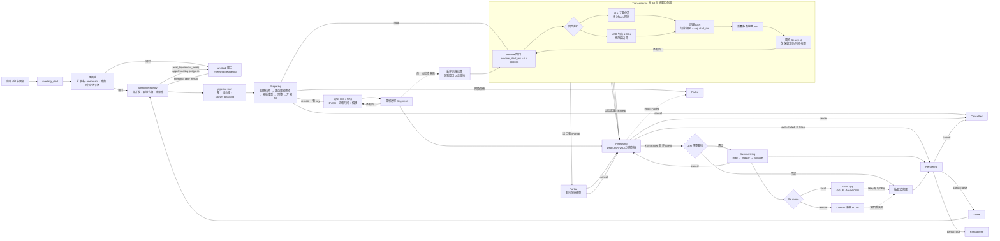
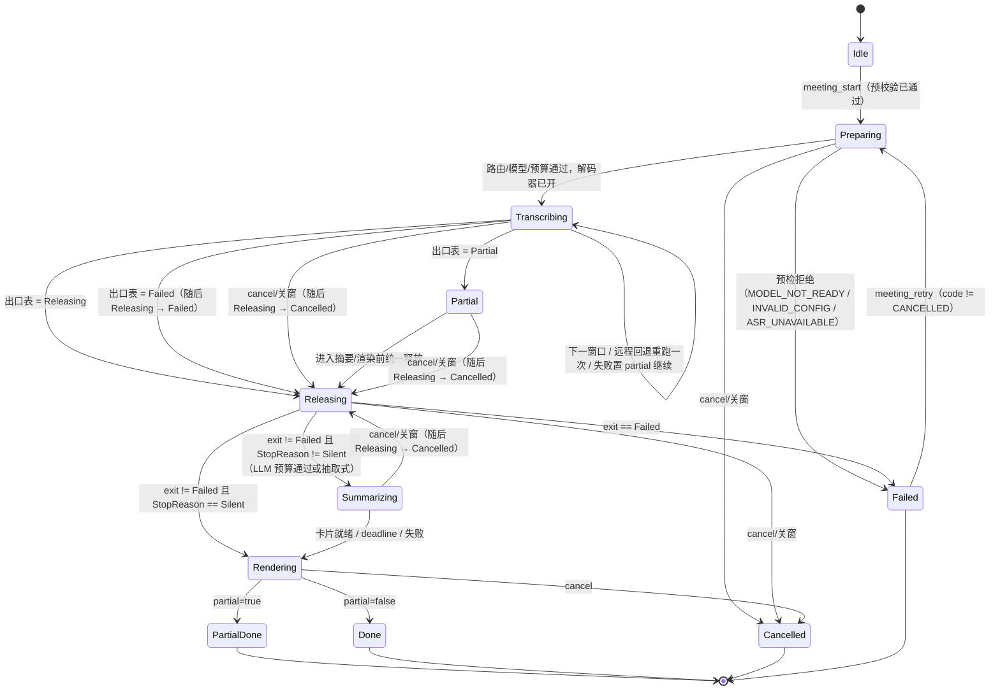
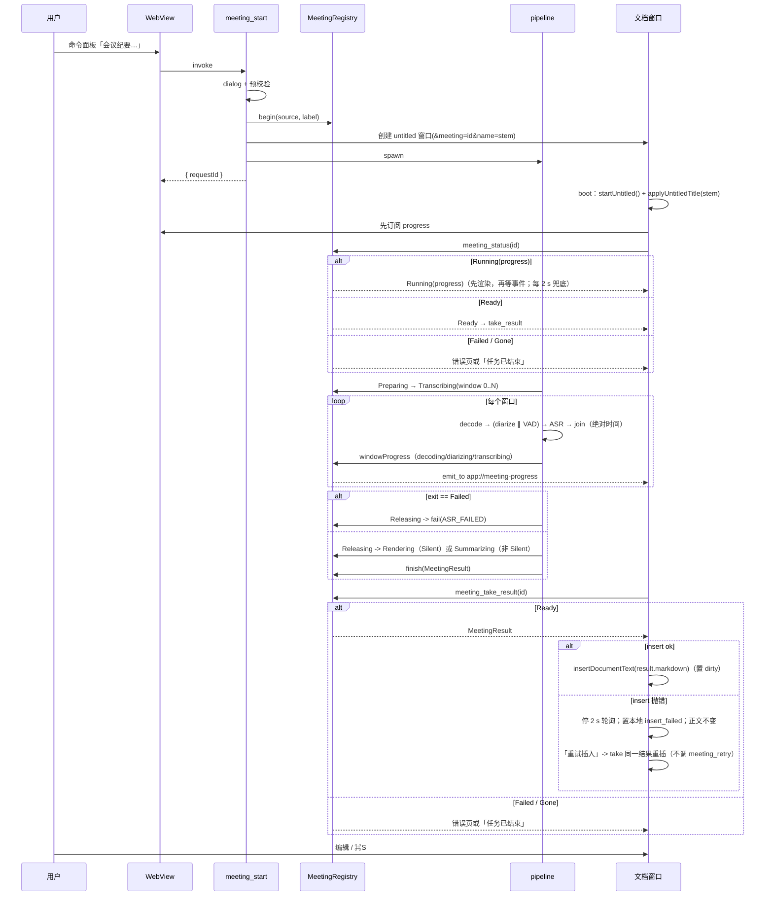
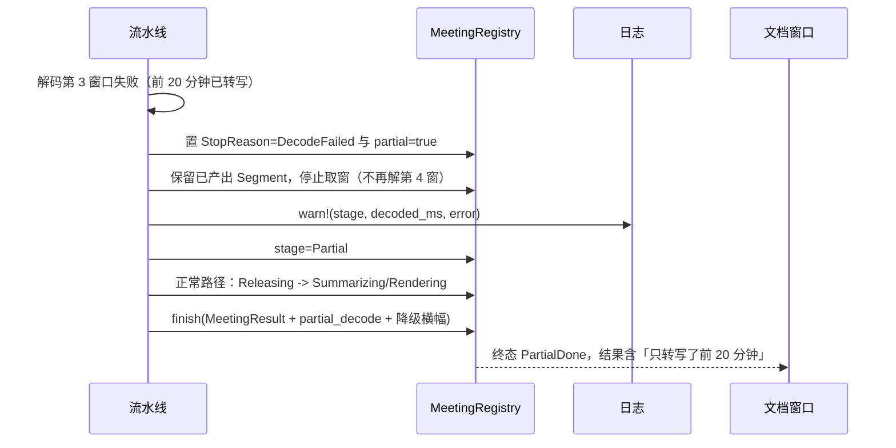

# 会议纪要（本地音频转结构化纪要）设计方案

> **文档用途：** 面向技术评审、开发、测试和运维人员的设计说明
> **功能 ID：** `meeting-minutes`
> **对应需求：** R-001 ~ R-014（见 [`README.md §2.1`](README.md#21-目标)）
> **对应实施计划：** [`01-实施计划.md`](01-实施计划.md)
> **代码基线：** `feat/p0-p1-closure@c4b0e75`（T-001~T-014 完成，R45/R46R2 PASS）
> **设计版本：** `v1.41`
> **日期：** `2026-11-12`
> **状态：** 已实施；R45/R46R2 **PASS**，发布版 GUI、真实 21 分钟通话与在线摘要模型联调 PASS（G-01~03、G-06~08 修复，G-04/05 限制）；T-001~T-014 完成
> **R45 变更摘要：** 打包/许可终审：NOTICE 全量并随包、THIRD_PARTY_LICENSES、空下载基址与 416 续传、许可 URL/版权对齐、官方源 E2E
> **R42 变更摘要：** `Summarizing` 取消边归 `REL`，直连仅剩三处；全链路图/表/迁移/§8.3 同源
> **R41 变更摘要：** 三处直连措辞、终态事件精确化、R1~R39/33 文件计数
> **R40 变更摘要：** 三处直连措辞、终态事件精确化、R1~R39/33 文件计数
> **R39 变更摘要：** Preparing 例外、终态事件措辞、E2E 就绪等待、T-003 预检顺序、计数/日期
> **R38 变更摘要：** 优先级列/枚举顺序、Rendering 取消边、§6.2 去重、vendor default/PATCH 断言、CI env、入库
> **R37 变更摘要：** 出口表优先级、取消边归 REL、状态表 Cancelled、Some 断言限定、Linux fixture、VAD 单测
> **R36 变更摘要：** §6.2 按表顺序、取消必经 Releasing、Option 哨兵、T-008 插入分支、macOS fixture 顺序
> **R35 变更摘要：** cleanup 退出码、`exit != Failed` 守卫、`set_exit`、插入失败停轮询、partial 断言、§8 分支、原型自动继续、AC-004/006 证据
> **R34 变更摘要：** `StopExit` 出口、终态快照、插入失败重试、`partial_until_ms`、静音/AC 断言、T-001 接口注记、vendor pin
> **R33 变更摘要：** Silent 守卫、partial/stop_reason 生产链、finish 返回 bool、静音渲染、渲染失败 IO、Cancelled 语义、vendor 干净机下载、soak 入口
> **R31 变更摘要：** `StopReason` 唯一出口表与 `PartialDone` 终态、bash 3.2 空数组、CI VAD fixture、`check-vendor --require`、注册表非法迁移、预算/磁盘挂点
> **R30 变更摘要：** RawAsr 显式切片相对 DTO、Partial 三分支、wdio 参数/soak、CI fixture/模型缓存、Provider 概率例外、ModelState NotVerified、build_plan 签名、check-vendor 实装
> **R29 变更摘要：** 修 ASR/分离偏移基准、`Partial` 语义、native E2E 接线与 CI、localStorage 共享态、vendor 防漂移、remote 预算/原因、下载 commit 恢复、概率 NaN、gpt 请求分支、config 返回与 AC 对齐
> **R28 变更摘要：** 逐窗单遍流水线（绝对时间戳、`window_start_ms`）；ASR 概率走 vendored 补丁；`TierDefaults`/`ResolvedModels` 拆分；remote 3×3 预检矩阵；相对可用内存预算；E2E harness/native 分层；manifest/config/密钥/下载/llama/测试全量收口
> **R27 变更摘要：** Q-010=A（llama.cpp + 3 个 Qwen3 GGUF）；Q-011=A（13 项配置 + 运行时分层）；全部人工闸门关闭
> **R26 变更摘要：** 设置页只保留「转写模型」「摘要模型」两类，各自本地/远程切换；固定开启会议、固定自动语言、固定区分说话人；本地 LLM 走 llama.cpp（macOS Metal / Windows CPU）；新增运行时硬件分层与首跑 RTF 校准；配置 14→13
> **R25 变更摘要：** Q-001/Q-003~Q-009 全部裁决：sherpa-onnx、BYOK（`llm.baseUrl` 默认留空强制填写）、14 项配置全批准、不加表、清单含 FireRed、小 fixture 入库、默认开启、远程默认关。计数不变
> **R24 变更摘要：** 设置导航由四项收敛为「通用」「AI」两项；会议相关全部归 AI，深链改 `section=ai`
> **R23 变更摘要：** 安装包零模型，ASR / VAD / 分离包全部由设置页按需下载；新增 FireRedASR2-CTC 高精度方言项与峰值内存预算；首用改为设置页引导 + 一键下载默认组合 + 同窗重试。两轮 REJECT 后终审 PASS
> **R10 变更摘要：** 本地模型由 `modelTier` 两档改为内置 manifest 单选；新增离线说话人分离（D-014 / R-012 / T-004c）；配置 14 项；新增模型命令与事件；原型改为真实组件基线

---

## 1. 摘要

青墨是本地优先的 Markdown 编辑器，会议纪要之前只处理文本。会议纪要是第一个需要「重计算 + 外部模型」的能力：用户选一段会议录音，应用在本机完成转写，再生成一篇结构化的 Markdown。

现状约束决定了三条主线。第一，CSP 的 `connect-src` 只有 `'self' ipc: http://ipc.localhost`（`src-tauri/tauri.conf.json:27`），WebView 连不了外部 API，所以音频、模型、密钥必须全部留在 Rust。第二，文档的唯一事实源是 CodeMirror `EditorState`（`README.zh-CN.md:206`），结果必须落成普通文档并走 `SaveCoordinator`，否则会造出第二套保存路径。第三，v1 曾明确「不做内置 AI」（`README.zh-CN.md:252`），会议纪要是第一个落地的端上 AI 能力，因此本方案只增菜单项、固定开启、可整体回退，不改既有行为；交付后 README 的 v1 非目标改为「通用 AI 助手」。

方案的核心是：**新增一条 Rust 侧的会议流水线，产物是一篇 untitled 文档；转写分本地/远程两条后端，默认本地；说话人分离全本地、固定开启**。选音频、探测、解码、VAD 切分、离线说话人分离、本地 ASR、结构卡片、reduce、事实校验、Markdown 渲染都在 Rust；WebView 只拿进度事件和最终 Markdown。本地 ASR 用 sherpa-onnx（Apache-2.0，中文 CER 1.31、静态链接、无额外 Mach-O），分离用同一运行时的 pyannote segmentation-3.0 int8（1.5 MB、MIT）与 CAM++ zh_en（28.3 MB、Apache-2.0），全程 ONNX、无 Python；远程 ASR 由用户自带 key（OpenAI 兼容 / Deepgram），默认不启用；摘要默认用 llama.cpp 跑本机 GGUF（macOS 可用 Metal，Windows 纯 CPU），也可切到 OpenAI 兼容端点，模型缺失或失败时自动降级为抽取式要点。默认值按物理内存与平台分层，用户可手动钉死。每个结论强制携带 `[hh:mm:ss]`、说话人标签与原文引句，数字、金额、日期做反向存在性校验，未通过标「待核」。

一句话方案：

> 在保留「Rust 独占 IO / CodeMirror 单一真源 / `SaveCoordinator` 单一保存」三条不变量的前提下，用 `meeting_*` 命令 + 全局任务注册表 + 复用 untitled 窗口承载结果，实现本地转写、离线说话人分离与两级结构化摘要，并让所有 AI 能力缺失都退化为可用产物。

---

## 2. 问题定义

### 2.1 业务背景与故障特征

```text
用户开完 1 小时会，拿到一段 m4a
  -> 现有应用只能打开 md/markdown/mdx          document.rs:390, document_registry.rs:1129
  -> 拖进窗口被 opened_paths 静默丢弃           document.rs:702
  -> 用户只能手工分段、外部转写、复制粘贴
  -> 时间戳与结构全部丢失
  -> 用户只能换到别的工具转写、复制、再粘回
  -> 时间戳、说话人、决议结构全部丢失
  -> 长录音还要手工分段，摘要靠通读
```

### 2.2 当前实现与主要缺口

| 缺口 | 当前行为 | 根因/证据 | 导致的问题 |
|---|---|---|---|
| 无音频入口 | 打开对话框只过滤 Markdown | `src-tauri/src/commands/document.rs:390` | 音频无法进入应用 |
| 扩展名白名单封闭 | `md/markdown/mdx` 之外一律 `UNSUPPORTED_EXTENSION` | `src-tauri/src/state/document_registry.rs:1129` | 不能靠放宽白名单复用 `document_open`（`FilePayload.text` 是 UTF-8） |
| 无媒体解码 | 依赖里没有音频解码器 | `src-tauri/Cargo.toml:22-45` | 需要新增解码与重采样 |
| 无远程通道 | 只有本地一条路，慢机器无退路 | 无 | 需要可选的 BYOK 远程后端 |
| 无说话人区分 | 转录只有连续文本 | 无 | 决策无法归属到人，需要离线分离 |
| WebView 无出网能力 | CSP `connect-src 'self' ipc: http://ipc.localhost` | `src-tauri/tauri.conf.json:27` | 前端直连厂商 API 必须改 CSP 并暴露密钥 |
| 无异步长任务框架 | 搜索是同步 `spawn_blocking`；更新有状态机但绑定单一 artifact | `src-tauri/src/commands/search.rs:34`、`src-tauri/src/state/update_manager.rs:52` | 需要一个可取消、可观察的通用任务注册表 |
| 契约是硬编码白名单 | `COMMANDS.len() == 47`、`commands.ts` 镜像、capability 逐项授权 | `src-tauri/tests/commands_contract.rs:56`、`scripts/ci/negative-contract.sh` | 新命令必须同步四处，漏一处 CI 失败 |
| 无凭据存储 | 设置只持久化在 `localStorage` | `apps/desktop/src/stores/uiStore.ts:14-16` | API Key 不能明文进 WebView 存储 |

### 2.3 设计目标

| R-ID | 目标 | 可度量成功标准 |
|---|---|---|
| R-001 | 生成含摘要/决议/待办/风险/转录的纪要 | 60 s fixture 五节齐全，时间戳单调不减 |
| R-002 | 音频只经只读 asset URL 播放；密钥仅在输入时经 WebView、读取不回传明文；默认本地 | `commands.ts` 无音频路径参数；CSP 零改动；`asr.mode=local` 时零外传 |
| R-003 | 断网可用 | 无 LLM 时仍产出转录 + 抽取要点并标注 |
| R-004 | 可追溯 | 100% 结论带时间戳；引句存在性校验通过率 ≥ 95% |
| R-005 | 有界 | 默认 180 分钟、硬上限 600 分钟与 500 MiB 双闸，任一越界均在选文件阶段拒绝；两者独立，不互相推导 |
| R-006 | 可取消、单并发 | UI 立即反馈；执行器在 ≤ 1 段（≤ 30 s）或 1 个分离子窗（≤ 60 s）内停机；并发返回 `MEETING_BUSY` |
| R-007 | 不破坏编辑与保存语义 | 整体可 undo；保存走既有 Save As |
| R-008 | 双语 | 中英界面与纪要；`auto` 判定准确率 ≥ 95%（40 条样本） |
| R-009 | 失败可解释 | 9 个新错误码 + 4 个已落地音频码，共 36；各有恢复动作与契约断言 |
| R-010 | 打包与许可可验证 | `make build` 通过公证；安装包不含任何模型（体积增量仅为代码与静态库与 vendored 补丁）；转写组合下载约 265 MB、摘要模型 1.1–5.0 GB、全量约 10.2 GB；逐项下载前按 `max(2×download_bytes, download_bytes + install_bytes×1.05 + 64MB)` 预检，全部下载引导预留 ≥ 20.5 GB；`NOTICE` 完整 |
| R-011 | 远程后端可选用、可回退、可解释 | 远程失败自动回退本地一次并标注；外传在 UI 与文档双提示 |
| R-012 | 本地离线说话人分离 | 双人 fixture ≥ 2 个稳定标签、同人同色；首窗失败无标签、部分失败保留已有标签；分离部分额外峰值 ≤ 160 MB |
| R-013 | 模型下载可恢复、可卸载、有界 | 同卷 staging、断点续传、归档预哈希与解包上限、逐文件 SHA-256、单下载槽、磁盘/内存预检；转写组合一键顺序下载、摘要模型单项；失败有恢复动作，不把半包当 Ready |
| R-014 | 按硬件自动分层 | 4 档内存与平台给不同默认和线程；8B 仅 `total_memory >= 32 GiB` 可选；用户可钉死模型或 `runtime.mode=cpu`；设置页同时展示分层默认与钉死值 |

### 2.4 非目标

- 不做麦克风实时录制：需要独立的采集、权限与背压模型，记为 `NEXT-001`。
- 不做说话人真实身份（姓名）识别：第一版只做声纹聚类编号，改名与通讯录记为 `NEXT-002`。
- 不做视频画面理解：只解音轨，记为 `NEXT-003`。
- 不做模板/提示词自定义：交给后续插件体系，记为 `NEXT-004`。
- 不做自建云 ASR 服务（只做 BYOK 直连）；不做多租户配额。
- 不做远程实时流式（WSS），第一版只做分块上传，记为 `NEXT-011`。
- 不做树内直接打开音频或拖入窗口，第一版只从命令面板/菜单选文件，记为 `NEXT-013`。
- 不做「仅重生成摘要」，第一版重生成需重跑任务，记为 `NEXT-014`。
- 不代管 provider 的音频留存/训练政策，只在设置页链到 provider 条款。
- 不做退出后任务续跑：第一版关窗即取消，记为 `NEXT-006`。
- 不改 `atomic_writer.rs`、`SaveCoordinator`、`DocumentRegistry` 的 token 语义。

### 2.5 前置假设与约束

| 类型 | 内容 | 验证方式 | 假设失效后的处理 |
|---|---|---|---|
| 技术 | sherpa-onnx crate 在 macOS arm64 静态编译通过，`OfflineRecognizer` 可吃 16 kHz f32 | T-003 先跑最小 demo + `cargo build --release` | 退到 whisper.cpp sidecar（Q-001 备选） |
| 技术 | Paraformer 中文/英文混合权重可商用（Apache-2.0） | T-013 核验模型卡并写 `NOTICE` | 换 zipformer-wenetspeech 或 SenseVoice（需署名） |
| 技术 | `symphonia` 能解 m4a/AAC/MP4 音轨 | T-001 用三类 fixture 跑通 | 退到 AVFoundation 解码（新增 objc2 依赖） |
| 技术 | sherpa-onnx `OfflineSpeakerDiarization` 在 macOS arm64 静态可用，模型仅 30 MB | T-004c 先跑 10 分钟双人 demo | 分离固定开启，无配置开关 |
| 技术 | FireRedASR2-CTC int8 实测峰值在预算函数下不误杀常见 8 GiB 机器 | T-012 实测 RSS 并回填 `MeasuredRss` | 高内存标记 + 提示换 small；仍失败则不默认选中 |
| 产品 | 用户接受 5–15 分钟的转写等待（1 h 音频） | T-012 实测并记录 | 换 small/SenseVoice 或「只转写前 N 分钟」 |
| 产品 | 用户接受首次使用先下载约 265 MB 转写组合，摘要模型可选（全量约 10.2 GB） | E2E-004 + 设置页引导 | 若抗拒，降级为随包 small（Q-002 备选重新评估） |
| 部署 | 安装包零模型，公证只覆盖代码与静态库 | T-013 `make build` 全链路 | 定位新增依赖的签名问题，不加模型资源 |
| 用户 | 摘要模型可本地下载或自备兼容端点 | T-010 设置页往返测试 | 内置规则式摘要（已具备） |
| 网络 | 可选远程 ASR 的 provider 域名可达（仅开启时） | T-012 wiremock + 真机 | 回退本地 |

---

## 3. 总体设计

### 3.1 设计原则

| 原则 | 含义 | 对实现的约束 |
|---|---|---|
| 单一入口 | 一个功能只有一条进入路径 | 只有 `meeting_start` 能创建任务；菜单/命令面板都调它 |
| 产物即文档 | AI 结果不是特殊视图 | 只输出 untitled 文档，不新增窗口类型、不新增保存 API |
| 能力可缺 | 任何模型/端点都可能没有 | 每层都有降级，最差仍给出转录与时间戳 |
| 有界 | 一切资源有上限 | 大小、时长、段长、并发、重试、内存窗口全部有常量 |
| 可观测 | 长任务必须能被看见和停止 | 阶段事件 + 取消令牌 + 单并发 |
| 零静默 | 不假装成功 | 低置信、被跳过、待核、降级都写进文档正文 |

### 3.2 系统架构



架构说明：

- **入口层**：只做 dialog、路径校验、上限判定；不碰解码，不创建结果窗口。
- **编排层**：`MeetingRegistry` 持有唯一在途任务；`pipeline.rs` 是唯一组合根，按窗口驱动 `decode → (diarize ∥ VAD) → ASR → join`，命令层只传参数并 spawn。
- **核心层**：解码 / 分离 / VAD / ASR / 卡片 / reduce / 校验 / 渲染，均为可注入替身的模块；时间在进入公共数据结构前已转绝对毫秒。
- **依赖层**：sherpa-onnx（识别 + VAD + 分离，进程内静态链接；2.0.1 以 `src-tauri/vendor/sherpa-onnx` 补丁补回 `ys_log_probs`）、llama.cpp（静态链接，仅摘要阶段加载）、可选 OpenAI 兼容 HTTP、keyring。
- **模型位置**：安装包不含模型；全部下载到 `app_local_data_dir()/models`；唯一清单 `services/meeting/models.rs`（编译期，含 family、文件角色、字节、SHA-256、峰值内存口径与许可）。
- **观测层**：`tracing` 结构化字段 + 定向进度事件；日志脱敏。

### 3.3 职责边界

| 模块/层 | 负责 | 不负责 | 依赖 |
|---|---|---|---|
| `commands/meeting.rs` | 参数校验、窗口创建、错误映射 | 任何解码/推理 | `MeetingRegistry`、`document.rs` |
| `services/meeting/pipeline.rs` | 唯一组合根：阶段、逐窗驱动、降级分支、句柄释放 | 命令参数、窗口 | 全部 service |
| `state/meeting/registry.rs` | 单并发、requestId、取消、结果槽、进度写入口 | 计算 | `job.rs`、`progress.rs` |
| `state/meeting/asset_scope.rs` | label→路径映射与引用计数；`std::sync::Mutex`；0→1 `allow_file` | 窗口生命周期 | `AppHandle` asset scope |
| `state/meeting/job.rs` | `MeetingJob{partial, stop_reason, exit}`、窗口 label、唯一 `progress` 快照 | 校验 | `progress.rs` |
| `state/meeting/progress.rs` | `MeetingProgress` 结构与更新；定向 `emit_to` | 计算 | `AppHandle` |
| `state/meeting/config.rs` | 配置补丁、schema/revision、字段校验；`std::sync::Mutex`；不再被 `build_menu` 读取 | IO 传输 | `app_local_data_dir` |
| `state/meeting/downloads.rs` | 单下载槽、staging、取消、磁盘预检、进度 | 校验算法 | `models.rs`、`download.rs` |
| `services/meeting/decode.rs` | 容器探测、解码、重采样、按 10 分钟窗口供数 | 识别 | `symphonia`、`rubato` |
| `services/meeting/diarize.rs` | 60 s 子窗分割、声纹 embedding、聚类、绝对时间线 | 识别、摘要 | `sherpa_onnx::OfflineSpeakerDiarization` |
| `services/meeting/speaker.rs` | 绝对时间线 join、编号稳定化、颜色索引、Deepgram 跨块缝合 | 推理 | 分离结果 |
| `services/meeting/models.rs` | 编译期 manifest、family/文件角色、目录解析、SHA-256、状态机 | 网络传输 | 常量表 |
| `services/meeting/vad.rs` | 段切分、最短/最长约束、padding、绝对边界 | 识别 | `sherpa_onnx::VoiceActivityDetector` |
| `services/meeting/asr.rs` | 逐段识别、绝对时间、可选 token 概率 | 摘要、HTTP | `sherpa_onnx::OfflineRecognizer`（vendored） |
| `services/meeting/remote_asr.rs` | 远程分块上传、词级时间、provider 鉴权 | 本地推理 | `reqwest`（multipart）、keyring |
| `services/meeting/asr_route.rs` | 路由矩阵判定、远程失败回退、外传标记 | 具体识别 | 上面两者 |
| `services/meeting/budget.rs` | 纯函数内存预算（解码/分离/VAD/ASR/LLM/KV/运行时） | 硬件探测 | manifest 峰值 |
| `services/meeting/cards.rs` | 窗口聚合、map 提示词、JSON 解析 | reduce | LLM 客户端 |
| `services/meeting/reduce.rs` | 去重、合并、排序 | 渲染 | 卡片 |
| `services/meeting/summarize.rs` | 窗口摘要、阶段 deadline、抽取式降级 | 渲染 | `llm.rs` |
| `services/meeting/validate.rs` | 引句/数字/日期存在性 | 改写 | 转录 |
| `services/meeting/render.rs` | 固定模板、转义、折叠块、失败段占位 | IO | 全部产物 |
| `services/meeting/lang.rs` | 固定自动：CJK 占比选模板 | 模型 | 转录样本 |
| `services/meeting/llm.rs` | OpenAI 兼容调用、响应上限、超时、重试 | 业务规则 | `reqwest` |
| `services/meeting/llm_local.rs` | llama.cpp 加载、Metal/CPU、分批 prefill、逐 token 取消 | 业务规则 | `llama-cpp-2` |
| `services/meeting/runtime.rs` | 硬件探测、`TierDefaults` 纯函数、`ResolvedModels`、RTF 校准 | 全部推理 | `sysinfo`、`sysctl` |

预校验顺序：`meeting_start` 在 `begin` 前完成扩展名、`metadata`、魔数、时长与大小检查；失败直接返回调用窗口，不创建结果窗口。通过后 `begin` + 建窗。job 在 `Preparing` 做**路由感知**预检（§7.2 路由矩阵）：只有实际将走本地的路径才要求本地 ASR 就绪；remote + key 不要求本地 ASR。预检通过后解析 `ResolvedModels`、跑预算纯函数、打开解码器。

### 3.4 当前链路与目标链路

当前：

```text
file.open -> document_open -> pick_document(.md) -> ensure_supported_extension
  -> DocumentRegistry.open_path -> FilePayload{text} -> 文档窗口
```

目标：

```text
meeting.start -> meeting_start（dialog + 预校验，失败即返回 Toast）
  -> MeetingRegistry.begin -> create_untitled_window_with_label(doc-uuid, query) -> spawn pipeline::run
  -> Preparing（路由感知预检：本地必需 / remote+key 不要求本地）
  -> 逐 10 分钟窗口：decode → (diarize ∥ vad) → asr → speaker join（绝对时间）
  -> Releasing → Summarizing（预算复核）→ validate → render
  -> meeting_take_result -> insertDocumentText(markdown)
     -> 抛错：停轮询，显示「重试插入」，再 take 同一结果重插（不重跑）
  -> 用户编辑 -> SaveCoordinator（不变）
```

差异只在「如何产生一篇文档」，文档产生之后的所有链路完全复用。

---

## 4. 修复方式与修改点

本功能以新增为主，但需要 11 处既有文件的受控修改，逐一列为 `MP-###`。

### 4.1 修复方式概述

| 项 | 内容 |
|---|---|
| 根因 | 应用只有「读取 UTF-8 文本」一条打开路径，缺音频与长任务能力 |
| 修复策略 | 并行新增一条会议链路，只在窗口构建、路由参数、命令注册三处对既有代码做最小切口 |
| 保持不变 | `document_open`、`ensure_supported_extension`、`take_pending` 语义、`AtomicWriter`、`SaveCoordinator` |
| 被否决的替代方案 | 放宽 `document_open` 支持音频（`FilePayload.text` 语义被污染）；改 `take_pending` 传内容（`CRITICAL` 风险）；新增 `meeting.html` 窗口（重复窗口与主题管线） |

### 4.2 修改前调用链

```text
build_document_window(app, label, title)                 document.rs:70
  -> WebviewUrl::App("index.html?window=document")       document.rs:78
  -> 前端 isDocumentWindow() 只认 window=document        DocumentSessionContext.tsx:73
```

窗口 URL 是硬编码的，无法带任务身份。

### 4.3 修改后调用链

```text
build_document_window(app, label, title, query: &str)   MP-001
  -> WebviewUrl::App(format!("index.html?window=document{query}"))  // query 以 & 开头
  -> 前端 isDocumentWindow() 不变；meetingRequestId() 读 meeting 参数  MP-002
  -> 有 meeting 参数：boot 立即 startUntitled() + applyUntitledTitle(stem)，渲染 MeetingBoot
  -> Done 后 insertDocumentText(markdown)（单事务、置 dirty）并让位给编辑器  MP-003
```

`query` 默认空，`document_open`/`document_new` 的既有行为逐字节不变。

### 4.4 修改点清单

| MP-ID | 文件/符号 | 修改类型 | 修改内容 | 影响的调用链节点 | 关联决策/任务 | 风险 |
|---|---|---|---|---|---|---|
| MP-001 | `src-tauri/src/commands/document.rs:build_document_window`、`create_document_window` | 修改 | 前者增加 `query: &str` 拼进 `WebviewUrl`，后者返回 `WebviewWindow`；`open_path` 调用点传 `""`，`create_untitled_window_with_label` 捕获 `query` 并传 `query.as_deref().unwrap_or("")` | 窗口构建 | D-002 / T-008 | 中（`create_document_window` 实际 2 个调用点） |
| MP-002 | `apps/desktop/src/features/editor/DocumentSessionContext.tsx:isDocumentWindow` + `EditorSession.insertDocumentText` | 修改/新增 | 新增 `meetingRequestId()`、`meetingSourceName()`（解码 percent-encoded name）；带 meeting 参数时 boot 立即 `startUntitled()` 并 `applyUntitledTitle(stem)`（不调 `takePending`）；完成态对 `currentRef` 执行单条 CM transaction 写入整篇 Markdown，同步把 snapshot 置 `dirty` 并 `publish` + `journal.evaluate()`（view 未 attach 也不丢 dirty），一次 undo 可整体撤销，光标置文首 | 会话启动分支 | D-002 / T-008 | 中 |
| MP-003 | `apps/desktop/src/features/meeting/MeetingBoot.tsx` | 新增 | 进度/错误视图；挂在 `DocumentEditor` 内替代 `EditorHost`，Done 后让位给编辑器 | 窗口首屏 | D-002 / T-008 | 低 |
| MP-004 | `src-tauri/src/commands/mod.rs:handler` | 修改 | 注册 15 个 `meeting_*`/`app_settings_open` 命令 | 命令分发 | D-001 / T-007 | 低（契约测试强制） |
| MP-005 | `src-tauri/src/lib.rs:menu_layout`、`build_menu`、`build_menu_for`、`startup_layout`、`commands/locale.rs`、`ipc/contract.rs:MENU_ACTIONS`、`apps/desktop/src/lib/ipc/commands.ts:MENU_ACTIONS` | 修改 | 会议项固定插入，`menu_layout`/`build_menu_for`/`startup_layout` 签名不变；文件菜单插入「会议纪要…」，`CmdOrCtrl+Shift+M`；新增 `MENU_MEETING` 并同步 14→15 与两处布局断言 | 菜单 | D-007 / T-009 | 中（模板不变，只加固定项） |
| MP-006 | `src-tauri/src/error.rs:AppErrorCode` | 修改 | 追加 9 个会议错误码（含 `MODEL_DOWNLOAD_FAILED`、`MODEL_BUSY`）；4 个音频码已由 T-001 落地，总 36 | 错误传播 | D-010 / T-007 | 低（枚举无入边，已 grep 出 3 处穷举） |
| MP-007 | `src-tauri/src/commands/document.rs:create_untitled_window_with_label`、`document_save_as` + `state/session_restore.rs:171` | 修改 | 前者增加 `query: Option<String>` 并返回 `WebviewWindow`（主窗复用分支返回 `Ok(main)`），内部把 `query.as_deref().unwrap_or("")` 交给 `build_document_window`；后者调用点传 `None`；`create_untitled_window_with_workspace` 传 `None` 并 `.map(\|_\| ())`；`create_untitled_window` 直接转发；`open_path_in_window_with_label` 返回窗口，`open_path_in_new_window_with_workspace` `.map(\|_\| ())`；meeting 传 `Some(label)` 且 label 固定 `format!("doc-{}", Uuid::new_v4())`，query 为 `Some("&meeting=id&name=<percent-encoded stem>")`，并传调用方 `WorkspaceToken`；建窗后把原生标题设为源文件 stem，并把 `display_title` 存入 job；`app_apply_locale` 重建标题时对会议窗口优先复用 `display_title`，不被 i18n 覆盖；`document_save_as` 仅当 `window.url()` 含 `meeting` 查询键时，用标题去掉 `format!(" — {app_name}")`、再剥掉既有 `.md`/`.markdown` 后补 `.md` 作默认名，普通文档不变 | 会议窗口 / 保存 | D-002 / T-008 | 中 |
| MP-008 | `src-tauri/src/commands/meeting.rs`、`commands/settings.rs` | 新增/修改 | 15 个命令：任务 5、配置 2、密钥 3、模型 4、`app_settings_open` 1；分别由 T-007（命令壳/注册）、T-008（任务/重试/结果）、T-010（配置与密钥）、T-011（模型）实装 | 命令入口 | D-001/D-013 / T-007/T-008/T-010/T-011 | 低 |
| MP-009 | `src-tauri/src/ipc/contract.rs`、`capabilities/default.json`、`capabilities/settings.json` | 修改 | 事件入 `EVENTS`；模型命令对 `settings`/`doc-*`/`main` 放行；`settings.json` 补 `core:event:allow-listen`、`core:event:allow-unlisten`、`allow-app-open-external`；配置/密钥命令只对 settings | capability 边界 | D-013 / T-007 | 中（负例覆盖） |
| MP-010 | `apps/desktop/src/components/StatusBar.tsx`、`features/editor/EditorPage.tsx` | 修改 | meeting 可选段（后端/阶段/说话人/播放器）；`showStatusBar` 增加 `isMeetingWindow`，干净 untitled 仅会议窗口显示状态栏 | 结果窗口状态栏 | D-002 / T-008 | 低 |
| MP-011 | `src-tauri/src/services/workspace_service.rs:list_directory`、`src-tauri/src/ipc/dto.rs:WorkspaceEntry`、`apps/desktop/src/features/workspace/VirtualWorkspaceTree.tsx` | 修改 | 音频扩展名不再被过滤；`WorkspaceEntry` 加 `audio: bool`；音频行 `audio=true`、`openable=false`，树中禁用并给 title | 工作区树 | D-002 / T-009 | 低 |

---

## 5. 核心组件

### 5.1 `MeetingRegistry`

职责：唯一在途任务的准入、阶段迁移、取消与结果交付（窗口存活期可重复取，销毁后释放）。

| 项 | 设计 |
|---|---|
| 输入 | `MeetingSource`、`window_label`、`CancelToken` |
| 输出 | `MeetingProgress`、`MeetingOutcome`；`terminals` 按 label 保留 Ready/Failed（Failed 另存 `MeetingSource` 供同 id 重试） |
| 降级标记 | `degrade(id, Degraded)` 只增不清，进度事件与最终文档共享同一份 |
| 依赖 | `std::sync::Mutex`（毒锁 `expect`）、`CancellationToken`；全同步 API，Destroyed 可直接调用 |
| 状态 | 单运行槽 + `terminals: HashMap<label, (id, Terminal)>`；终态保留到 `release*`/Destroyed |
| 并发 | `begin` 见 `running=Some` 即 `MEETING_BUSY`；终态进 `terminals`（按 label 保留），启动新任务不覆盖旧结果；`retry` 只接受同 label 的 Failed 且运行槽为空 |
| 测试 | 注入 Fake 流水线，断言并发被拒、取消、结果可重复取、窗口销毁后释放、Failed 同 id 重试保留 source |

```rust
pub struct RegistryState {
    running: Option<MeetingJob>,
    terminals: HashMap<String, (Uuid, Terminal)>,
    released: HashSet<String>,
}
pub struct MeetingRegistry { state: Mutex<RegistryState> }
pub enum Terminal { Ready(MeetingResult), Failed { error: AppError, source: MeetingSource, audio_url: Option<String>, attempt: u32 } }

impl MeetingRegistry {
    pub fn begin(&self, source: MeetingSource, window_label: &str) -> Result<(Uuid, CancellationToken), AppError>;
    pub fn retry(&self, id: Uuid, window_label: &str) -> Result<(CancellationToken, u32), AppError>;
    pub fn cancel(&self, id: Uuid) -> Result<(), AppError>;
    pub fn cancel_by_label(&self, label: &str) -> bool;
    pub fn release(&self, id: Uuid) -> bool;              // 取消+丢 running+删终态+墓碑
    pub fn release_by_label(&self, label: &str) -> bool; // 同上，按 label
    pub fn status(&self, id: Uuid) -> MeetingOutcome;
    pub fn advance(&self, id: Uuid, stage: MeetingStage) -> bool;
    pub fn set_window(&self, id: Uuid, window: Option<WindowProgress>) -> bool;
    pub fn set_failed_segments(&self, id: Uuid, failed: u32) -> bool;
    pub fn degrade(&self, id: Uuid, degraded: Degraded) -> bool;
    pub fn set_backend(&self, id: Uuid, backend: AsrBackend) -> bool;
    pub fn set_speaker_count(&self, id: Uuid, count: u8) -> bool;
    pub fn set_audio_url(&self, id: Uuid, url: String) -> bool;
    pub fn set_partial(&self, id: Uuid, partial: bool) -> bool;
    pub fn set_stop_reason(&self, id: Uuid, reason: StopReason) -> bool; // None -> Some 才 true
    pub fn set_exit(&self, id: Uuid, exit: StopExit) -> bool; // None -> Some 才 true
    /// 成功时在锁内把 stage 置为 Done/PartialDone、复制 audio_url+partial，
    /// 写 terminals，并返回**唯一一份**终态快照；调用方只 emit 它。
    pub fn finish(&self, id: Uuid, result: MeetingResult) -> Option<MeetingProgress>;
    /// CANCELLED 置 stage=Cancelled，其余置 Failed；返回唯一终态快照。
    pub fn fail(&self, id: Uuid, error: AppError) -> Option<MeetingProgress>;
    pub fn take_result(&self, id: Uuid) -> Option<MeetingResult>;
}
```

`status` 依次查 `running`（同 id 才返回 `Running(progress)`）→ `terminals`（`Ready`/`Failed{error,attempt}`）→ `Gone`；`Ready(MeetingResult{partial})` 的 `partial=true` 即 `PartialDone`，UI 据此显示「部分完成」，不依赖终态事件；`cancel(id)` 只置令牌，不取出 running；worker 停机后 `fail(id, CANCELLED)` 释放运行槽，因此取消后、停机前的 `meeting_start` 仍返回 `MEETING_BUSY`（单并发真实成立）。所有方法用同一把 `std::sync::Mutex<RegistryState>`，可在异步 command 与同步 Destroyed 共用；`take_result` 只从 `terminals` 的 `Ready` 克隆。`finish`/`fail` 先把 `running` 取出；若已为空或 id 不匹配则返回 `None`（被 release），否则在同一把锁内设置终态 stage、写 `terminals` 并返回该快照。`finish` 用 `job.partial` 覆盖 `result.partial` 且决定 `Done`/`PartialDone`。调用方只在 `Some` 时 emit 一次终态事件，因此 release 后无幽灵事件，事件 stage 也不会停在 `Rendering`。`release(id)` 与 `release_by_label` 都做三件事：取消令牌、若 `running` 匹配则取出并丢弃（解除单并发占用，worker 稍后自行停机）、删终态并插入 label 墓碑；墓碑按 label 进程内累积，随已销毁窗口数线性增长（每项短字符串）；`doc-*` label 不复用，`main` 在下次 `begin` 时清除，内存可忽略。`fail` 把 `job.source`、`job.audio_url` 与 `job.attempt` 一并存入 `Terminal::Failed { .. }`；`retry(id,label)` 在同一把锁内校验运行槽为空、终态是同 label 且 code != `CANCELLED` 的 Failed，`attempt += 1` 后以**同一 id** 重建 `MeetingJob`（恢复 source 与 audio_url），原子装入运行槽并返回 `(token, attempt)`，因此 2 s 轮询不会命中 Gone。`meeting_retry` 只允许承载该任务的窗口调用，label 取 `window.label()`，必须与终态存储键一致；`main` 不承载会议结果，跨窗口调用按 label 不匹配拒绝。前端 `MeetingBoot` 只在 allowlist（`MODEL_NOT_READY`、`ASR_UNAVAILABLE`、`ASR_FAILED`）显示「重试」，并按 `attempt` 丢弃旧响应。

### 5.2 `Decoder`

职责：把任意容器解成 16 kHz 单声道 `f32`，以 10 分钟为窗口供数，控制峰值内存。

| 项 | 设计 |
|---|---|
| 输入 | `&Path`、`CancellationToken` |
| 输出 | 迭代器 `DecodeWindow`，`Item = Result<DecodedWindow, AppError>`（T-001 当前为样本相对 `Vec<f32>`，T-003 改签名）；`DecodedWindow { index, start_ms, samples }`，每项 ≤ 10 min，`start_ms = index × 600000` |
| 依赖 | `symphonia`（MPL-2.0）、`rubato`（MIT） |
| 状态 | 请求级，Drop 即释放 |
| 失败策略 | 已解出的窗口保留；中途失败返回 `AUDIO_DECODE_FAILED` 并附已完成时长 |
| 测试 | 三个容器 fixture + 损坏文件 + 取消注入 |

### 5.3 `Vad`

职责：**仅本地路径**把样本流切成语音段，保证段长 ≤ 30 s、前后 200 ms padding、最短语音 250 ms。

| 项 | 设计 |
|---|---|
| 输入 | `segment_window(samples, model, window_start_ms, cancel)`；本地路径，远程跳过 |
| 输出 | `Segmentation { segments: Vec<SpeechSegment>, degraded }`；边界已加 `window_start_ms`，绝对毫秒（T-002 当前为样本偏移，T-003 加参数与换算）；padding 夹在 `[window_start_ms, window_end_ms]` |
| 依赖 | `sherpa_onnx::VoiceActivityDetector` + `silero_vad.onnx`（MIT，0.6 MB） |
| 阈值 | `threshold = 0.5`、`min_silence = 300 ms`、`min_speech = 250 ms`、`max_speech = 30 s` |
| 失败策略 | VAD 初始化失败 → 退化为 30 s 定长切分（仍可用，只是包含静音） |
| 测试 | 静音 / 正弦 / 真人片段；断言无 0 长段、无 > 30 s 段 |

### 5.4 `Asr`

职责：逐段识别，返回文本、绝对 token 时间与**可选**置信度。

| 项 | 设计 |
|---|---|
| 输入 | `SpeechSegment`（绝对边界）、该段样本切片、`CancellationToken`；外层换算只用 `seg.start_ms/end_ms`，不需要 `window_start_ms` |
| 输出 | `Segment { start_ms, end_ms, text, tokens, avg_prob: Option<f32>, low_confidence, speaker }`；`speaker` 由 join 填；时间一律绝对毫秒 |
| 依赖 | `sherpa_onnx::OfflineRecognizer`（vendored 补丁），模型来自 `ResolvedModels.asr` |
| 解码参数 | `decoding_method=Some("greedy_search")`、`max_active_paths=4`、`model_config.debug=false`、`provider=Some("cpu")`、`num_threads=plan.threads` |
| vendored 补丁 | `sherpa-onnx = "=2.0.1"`；复制完整 crate 到 `vendor/sherpa-onnx`（含 `Cargo.toml`、`LICENSE`、`README.md`、`PATCH.md`），仅在 `src/offline_asr.rs` 给 `OfflineRecognizerResult` 加 `ys_log_probs: Vec<f32>`（`#[serde(default)]`）。`[patch.crates-io]` 指向该目录；`scripts/ci/check-vendor.sh` 断言 `Cargo.lock` 中 `sherpa-onnx` source 为 path、vendor 与 sys 均为 2.0.1、相对 crates.io 原包只允许 `src/offline_asr.rs` 与新增 `PATCH.md`，并挂进 `ci:rust`；vendor 落地前允许跳过，T-003 预检必须用 `--require` 看 ok；`NOTICE` 记 Apache-2.0 与差异 |
| 概率来源 | **仅 Zipformer transducer** 的 C++ 实现会填 `ys_log_probs`；Paraformer / SenseVoice / FireRed 为空数组 → `avg_prob=None`。`Token.prob = exp(logprob)`，非有限则 `None`，有限则 clamp `0..=1`；`avg_prob = Some(mean)` 仅当 `prob_source=Token`、tokens 非空、每个 token 都 `Some` 且全部有限，否则 `None`；`prob_source=Provider` 可直接给值 |
| 时间换算 | 识别器只看到**本段切片**。解析器把 sherpa 的秒时间戳 ×1000 取整后写入 `RawAsr`；`RawAsr.start_ms/end_ms` 与 token 全部是切片相对毫秒；外层只加一次 `seg.start_ms`：`start = min(seg.start_ms + raw.start_ms, seg.end_ms.saturating_sub(1))`；`end = min(seg.end_ms, max(start + 1, seg.start_ms + raw.end_ms))`；token 同样加后 clamp 到 `[start, end]`。`raw.end_ms` 缺失时用 `raw.start_ms + 1` |
| 并发 | 单线程顺序推理；ASR 会话 `n_threads = plan.threads`；段间检查取消 |
| 失败策略 | 预检未下载/缺文件/哈希不符 → `MODEL_NOT_READY`；已通过预检但构建失败 → `ASR_UNAVAILABLE`；单段失败写 `Segment{status:Failed}` 并继续；失败段 >20% 只置 partial 标志并继续；全部段失败才 `ASR_FAILED` |
| 复读重跑 | 复读段先 Drop 当前 recognizer，用同一模型与 `blank_penalty+0.5` 重建后只重跑该段，再换回原配置；重建失败则保留首次结果并标记，不阻断 |
| 测试 | 注入 `AsrEngine` Fake；vendored 解析单测；段位于窗口内 `+120 s` 时断言段/ token 绝对时间等于 `seg.start_ms + 切片相对`；raw 尾时间超段尾/无尾时间时 `end > start` 且 ≤ `seg.end_ms`；Zipformer 真模型 `#[ignore]` 断言 `avg_prob.is_some()`；Paraformer 真模型断言 `None` |

```rust
pub trait AsrEngine: Send {
    /// `start_ms/end_ms` 为段绝对边界；返回时间相对 `samples`。
    fn recognize(&mut self, samples: &[f32], start_ms: u64, end_ms: u64,
                 cancel: &CancellationToken) -> Result<RawAsr, AppError>;
}
pub struct RawAsr {
    pub start_ms: u64, pub end_ms: u64, // 相对传入切片，ms
    pub text: String, pub tokens: Vec<(u64, Option<f32>)>, // token 相对切片，ms
}
```

`low_confidence` 只在 `avg_prob.is_some()` 时计算（`< 0.35`）。渲染层给低置信段与引用它的卡片加 `⚠ 低置信` 徽标；无概率模型仍跑复读与空文本门，不假装有置信度。

### 5.4.1 `RemoteAsr`

职责：按 provider 契约分块上传，解析词级时间并归一为段。三家官方文档已核实（`01 §2.4.5`）。

| 项 | 设计 |
|---|---|
| 输入 | 单个 10 分钟解码窗口、块起点 `offset_ms`（window_start_ms + 块内偏移）、`RemoteProvider`、模型名、key、`CancellationToken` |
| 输出 | `Vec<Segment>`（词级时间已加 `offset_ms`；块内按句聚合；时间一律绝对毫秒） |
| 分块 | 窗口内块长 300 s、重叠 2 s，步进 298 s；16 kHz mono PCM16 WAV 约 9.6 MB/块（三家上限 25 MB / 2 GB，Deepgram 另有 10 min 请求上限） |
| 跨块缝合 | 后块先用与前块重叠的 2 s 词做 `SpeakerStitcher` 继承，再丢弃 `start < 块起点 + 2 s` 的重复词；前块若提前结束则保留后块同窗词 |
| 鉴权 | OpenAI/Groq `Authorization: Bearer`；Deepgram `Authorization: Token`；跨 host 重定向丢弃 Authorization |
| 请求 | OpenAI/Groq multipart `POST /v1/audio/transcriptions`，字段 `model`、`response_format=verbose_json`、`timestamp_granularities[]=word`（OpenAI 仅 `whisper-1` 支持时间戳）；Deepgram `POST /v1/listen`，`Url::query_pairs_mut` 编码 `model/smart_format/punctuate/diarize`，body 为 `audio/wav` 原始字节 |
| 请求分支 | OpenAI `whisper-1` 用 `response_format=verbose_json` + `timestamp_granularities[]=word`；`gpt-4o-transcribe*`/`gpt-transcribe` 用 `response_format=json` 且不传 granularities（无词级时间/概率，走“无时间戳模型”行）。Groq 固定 `verbose_json` |
| 响应映射 | OpenAI/Groq `words[].word/start/end`；置信度取段 `avg_logprob` 的 `exp()` 或词 `confidence` 均值，`no_speech_prob` 直接映射；Deepgram `results.channels[0].alternatives[0].words[].confidence`，`diarize=true` 时 `speaker` 为 **0 基**，`+1` 后交 `SpeakerStitcher`；段落取重叠最长 speaker |
| 响应上限 | 单块响应 ≤ 8 MiB，流式读取超限即 `ASR_FAILED(details.reason=remote_response_too_large)` |
| 说话人归一 | 块内 speaker 是局部编号：首块建立全局映射；后续块先按与上一块最后 2 s 的时间重叠继承，再按首次出现新建；跨块仍无法对应则新建。`SpeakerStitcher` 与本地 `SpeakerId` 共用上限 8 + `9+` |
| 并发 | 顺序上传，保证时间单调、限流简单 |
| 重试 | 单块最多 3 次尝试（首次 + 2 次退避），仅 429/5xx；仍失败 → 整体回退一次 |
| 超时 | 连接 15 s；单块 120 s |
| 失败策略 | 任一块最终失败 → 丢弃全部远程结果；本地就绪 → 切本地从头跑一次、标 `remote_fallback`；本地未就绪 → `ASR_FAILED(fallback_unavailable)`；本地构建失败 → `ASR_UNAVAILABLE`；本地运行期失败 → `ASR_FAILED`；401/403 → `remote_auth`；413 → `remote_quota` |
| 限额守卫 | 编码后 > 23 MiB 降到 120 s 重切一次；provider 返回 413 同样降到 120 s 重试一次（OpenAI/Groq 25 MB、Deepgram 10 min）。300 s@16 kHz mono 仅约 9.6 MB，守卫主要防未来调大块长或非 16 kHz 输入 |
| 测试注入 | `endpoint(provider) -> Url` 常量；`transcribe_chunk(..., base, ...)` 允许测试传 wiremock base，生产不暴露配置项 |
| 无时间戳模型 | 选 `gpt-transcribe` 时无词级时间/概率：段=整块、时间=块边界、`prob_source=Provider`、`avg_prob=Some(1.0)`（显式例外，不走 Token 规则），质量门只用重复率与空文本 |
| 说话人 | 仅 Deepgram 附带 `diarize=true`；OpenAI/Groq 全 `speaker=None` |
| 测试 | wiremock 三 provider 正常/401/403/413/429/超时/畸形 JSON/块边界/重叠去重；Deepgram 另断言 `diarize` 参数与 `speaker` 映射 |

```rust
#[serde(rename_all = "lowercase")]
pub enum RemoteProvider { OpenAi, Groq, Deepgram }
pub fn endpoint(provider: RemoteProvider) -> Url;
pub async fn transcribe_chunk(
    samples: &[f32], offset_ms: u64, base: &Url, provider: RemoteProvider,
    model: &str, key: &str, cancel: &CancellationToken,
) -> Result<Vec<Segment>, AppError>;
```

为什么仍本地解码：OpenAI/Groq 请求体上限 25 MB，1 小时 m4a 直接传会 413；16 kHz mono WAV 解码便宜且不新增编码器依赖。解码按 10 分钟窗口产出，窗口内再切 300 s 块调用 `transcribe_chunk`，`offset_ms`（块起点）负责把块内词时间加回全片时间；不会整段 collect。默认模型：`whisper-1` / `whisper-large-v3-turbo` / `nova-3`（`asr.model` 为空时）。

### 5.4.2 `SpeakerSeparator` / `SpeakerJoiner`

职责：在本地按 60 s 子窗做离线分离，维护全局说话人质心，产出本子窗 `(t0, t1, speaker)` 时间线；标签按时间重叠贴到相邻 ASR 段。本地路径固定运行。

| 项 | 设计 |
|---|---|
| 输入 | 单个 16 kHz mono 子窗（≤ 60 s）、`subwindow_start_ms`（= 窗口起点 + 60 s × k）、`SpeakerModels`、`CancellationToken` |
| 分割 | `sherpa_onnx::OfflineSpeakerDiarization::process(window)` + pyannote segmentation-3.0 int8（powerset，支持重叠）；`window_shift_ratio=0.3`，T-004c 实测 10 min 额外峰值约 231 MB（0.1 为约 229 MB 且耗时 98.6 s；0.3 为 34.2 s） |
| 声纹 | 3D-Speaker CAM++ zh_en advanced（28.3 MB，Apache-2.0），192 维 embedding |
| 聚类 | 窗内 `FastClusteringConfig { threshold: 0.65, num_clusters: -1 }` 得局部 turn；对每个局部说话人的 turn 样本跑独立 `SpeakerEmbeddingExtractor`（CAM++ `num_threads=1`），按样本加权平均成 192 维质心；再用质心做跨窗余弦匹配（阈值 0.5），命中并入全局编号，未命中新建；缺 embedding 复用上一人；结束后折叠 <10% 的稀有编号并按首次出现重编号；阈值由 T-012 与 2026-11-12 真实 21 分钟双人通话复校 |
| 编号 | 按说话人首次出现顺序分配 `SpeakerId(u8)`，上限 8；第 9 人起统一 `9+`；编号跨窗口稳定 |
| 对齐 | turn 时间由 `subwindow_start_ms` 一次加齐；对本窗每个 ASR 段取绝对重叠最长的 speaker，重叠多个时按重叠时长多数投票，无重叠标 `None` |
| 内存 | 与同窗 VAD 并行、与 ASR 串行；每 60 s 子窗处理完即释放 turn embedding，只保留 ≤ 8 个 192 维全局质心（f32，约 6 KB） |
| 取消 | 以 60 s 子窗为边界，一次 `process` 返回即检查取消 |
| 超时/内存 | 10 分钟窗口分离部分额外峰值 ≤ 160 MB；超 `maxMinutes` 直接受全局上限约束 |
| 失败策略 | 构造/首窗失败 → 全部段 `speaker=None` + `speaker_degraded`；后续窗失败/超时 → 保留已有标签 + `speaker_partial`；两者都不阻断 ASR |
| 正文 | `speaker_degraded` 写「未分离说话人」；`speaker_partial` 写「部分片段未分离说话人」 |
| 关闭 | 无配置开关；全部失败仍由降级路径写「未分离说话人」，不写标签 |
| 远程 | 实际走远程时不跑本地分离；Deepgram 用其 `diarize=true` 的标签；OpenAI/Groq 标「远程 · 无说话人标签」；一旦回退本地，按本地路径逐窗补跑分离 |
| 线程 | `segmentation.num_threads = 1`、`embedding.num_threads = 1`、独立质心 extractor `1`；与 VAD(1) 并行，分离阶段最多 4 线程 |
| 测试 | 注入 Fake `DiarizationEngine`；真实模型走 `#[ignore]` 双人/四人 fixture；空窗口、全静音、单人、重叠、模型缺失、第 2 窗失败 |

```rust
pub struct SpeakerTurn { pub t0_ms: u64, pub t1_ms: u64, pub speaker: u8 } // 绝对 ms
pub trait DiarizationEngine: Send {
    fn push_window(&mut self, samples: &[f32], subwindow_start_ms: u64,
                   cancel: &CancellationToken) -> Result<Vec<SpeakerTurn>, DiarizeError>;
}
pub struct SherpaDiarizer { /* segmentation + embedding + 全局质心 */ }
impl SherpaDiarizer { pub fn new(models: &SpeakerModels) -> Result<Self, DiarizeError>; }
impl DiarizationEngine for SherpaDiarizer { /* ... */ }
pub fn join(segments: &mut [Segment], turns: &[SpeakerTurn]) -> SpeakerJoinStats;
```

为什么不用 Python/pyannote 原版：sherpa-onnx 已提供同权重的 ONNX 导出与离线 API，保持单一静态运行时；不用第二个进程、不需要 HF token。许可上分割权重 MIT、声纹权重 Apache-2.0，均可再分发。

### 5.5 `CardGenerator` / `Reducer` / `Validator`

| 组件 | 输入 | 输出 | 关键规则 |
|---|---|---|---|
| `CardGenerator` | 6 分钟窗口转录 | `Vec<Card>` | 提示词强制 JSON，但解析器兼容数组、单对象与 `{cards\|items:[...]}` 包装，`speaker` 接受数字或字符串；每项必须带 `quote` 与 `t0`；解析失败重试 1 次后转抽取式。请求不发送 `response_format`，避免网关在 `json_object` 下改写形状 |
| `Reducer` | 全部卡片 | 合并卡片 | `Summary` 卡按时间拼接；其余相似度 > 0.6 且时间重叠 → 合并，保留最早时间戳 |
| `Validator` | 卡片 + 转录 | 校验后卡片 | 引句必须原文存在；数字/日期/金额必须回查；不过标 `unverified`；`confidence` 取引句所在段 `avg_prob`，无概率为 `None` |

后端选择：`summarize.rs` 按 `llm.mode` 选 `LocalLlm` 或 `RemoteLlm`，两者实现同一 `LlmClient::generate(system, user, cancel) -> Result<String>`；`cards.rs` 不感知后端，降级只发生在窗口级。

### 5.6 `LocalLlm`

职责：用 `llama.cpp` 在本机跑摘要，输出与远程同一套 JSON 契约。

| 项 | 设计 |
|---|---|
| 输入 | 系统提示、窗口卡片 JSON、`ResolvedModels.llm` 路径、`plan.threads`、`plan.accel`、阶段 deadline、取消令牌 |
| 输出 | 原始字符串（交给 `cards.rs` 同一解析器） |
| 依赖 | `llama-cpp-2 = "=0.1.161"`，`default-features = false`；macOS 另加 `features=["metal"]`。显式关闭默认 `openmp`/`common`，避免 `libomp`/`vcomp` 动态库；`n_gpu_layers = if metal { 999 } else { 0 }`，Windows 强制 0 |
| 所有权 | `LlamaContext<'model>` 借用 `LlamaModel`，用 `self_cell`（MIT/Apache-2.0）让 `LocalLlmSession` 同时持有两者；任务结束整体 Drop，无自引用 unsafe |
| 构建前置 | `cmake`、`libclang`（bindgen）；T-003 开发机预检、CI 安装固定版本、T-013 干净机复验；sherpa 已静态链接，二者不共享运行时 |
| 参数 | `n_ctx=4096`、`temperature=0.2`、`top_p=0.8`、`seed=42`、`max_new_tokens=1024`、`n_threads=plan.threads`、`n_batch=128` |
| 提示 | 必须用 GGUF 自带 `chat_template` 构造 `<\|im_start\|>` 等控制 token，`chat_template()` 返回空即 `llm_unconfigured` 降级；系统提示末尾加 `/no_think`，解析器忽略 ` thinking` 块 |
| 上下文预算 | 输入按 `n_ctx - max_new_tokens - 256` 截断卡片 JSON（保留首尾与所有引句时间），超限先丢低优先卡片 |
| 生命周期 | `LlamaBackend::init()` 进程一次（约 1 MB）；模型/上下文每任务在 `Releasing` 后加载，reduce 完成即 Drop。**不使用全局 model/context `OnceCell`**，避免与 ASR 峰值叠加；GGUF 由 OS page cache 复用 |
| 超时/重试 | 单窗口：1.7B 120 s、4B 240 s、8B 360 s；全局摘要 deadline 20 min，超时后剩余窗口直接抽取式；非法 JSON 重试 1 次 |
| 取消 | prefill 按 `n_batch=128` 分批，每批后检查；生成逐 token，每 8 token 检查；取消即 Drop context。llama.cpp 单次 `decode` 不可抢占，批次大小保证 ≤ 1 s 粒度 |
| 失败策略 | 模型缺失/哈希不符 → `llm_model_missing`（只降级）；预算不足 → 只置 `llm_budget_exceeded`（不是错误码）；加载失败 → 记录 `LLM_FAILED` 但任务继续抽取式；C++ `abort` 无法捕获，进程级失败由下次启动恢复，GGUF 先验魔数/长度 |
| 测试 | Fake 生成器 + 真实 1.7B `#[ignore]`；断言分批取消、超时、非法 JSON、Metal/CPU 选择、`n_gpu_layers=0` |

```rust
pub trait LlmClient: Send {
    fn generate(&mut self, system: &str, user: &str,
                cancel: &CancellationToken) -> Result<String, AppError>;
}
```

### 5.7 `Renderer`

职责：固定模板输出 Markdown，纯函数，无 IO。

```rust
pub struct RenderInput<'a> {
    pub title: &'a str,
    pub duration_ms: u64,
    pub language: Lang,
    pub actual_backend: AsrBackend,
    pub local_model: Option<&'a str>,
    pub speaker_count: Option<u8>,
    pub stats: MeetingStats,
    pub segments: &'a [Segment],
    pub cards: &'a [Card],
    pub degraded: Degraded,
    pub keep_transcript: bool,
}
pub fn render(input: RenderInput<'_>) -> String;
```

`local_model`、`speaker_count` 由 job 快照传入，渲染器不读配置。

摘要节由 `Summary` 卡渲染（无卡则写「未生成摘要」）；`total_segments == 0` 时正文首行固定写「未检测到语音，转录为空」，五节保留标题但各写「—」，不写「未生成摘要」（静音不是摘要失败）；标题下 meta 行按 `actual_backend` 写「本地转写 · <local_model 展示名>」或「远程转写 · <provider>」，`speaker_count` 有值时追加「已分离（N 人）」，`failed_segments>0` 时追加「N 段识别失败」；`language=en` 时五个小节标题、徽标与降级句子用英文模板，关键词抽取表也按语言选择（中文与英文表均见 §6.2）；`degraded.remote_fallback` 为真时在标题下写「远程转写失败，已回退本地」；`degraded.remote_last_error` 为 `remote_auth`/`remote_quota` 时追加「密钥无效」/「配额不足」，`remote_response_too_large` 追加「响应过大」；`remote_key_missing` 为真时写「未配置远程密钥，已用本地」；`llm_model_missing` 为真时写「本地摘要模型未就绪」，`llm_unconfigured` 为真时写「未配置远程摘要」；`llm_budget_exceeded` 为真时写「内存不足，未生成抽象摘要，以下为抽取式要点」；`speaker_degraded` 写「未分离说话人」，`speaker_partial` 写「部分片段未分离说话人」；`partial_decode` 且 `partial_until_ms=Some(t)` 时写「只转写了前 N 分钟」（N=`floor(t/60000)`，不足 1 分钟写 `<1`）；`high_memory_model` 写「高内存模型 · 峰值约 X GB」；`slow_machine` 写「本机较慢，可改用远程」；远程且无标签时写「远程 · 无说话人标签」；标题取文件名主干；`<`、`&`、`*`、`_`、`` ` ``、`[`、`]` 逐字符反斜杠转义；转录放 `<details>`；每条卡片固定 `[hh:mm:ss]` + 说话人标签 + 引用块 + 校验徽标（`待核` 或 `已核`），`card.confidence = Some(p)` 且 `p < 0.35`、或引用段 `low_confidence` 时追加 `⚠ 低置信`；失败段渲染 `[hh:mm:ss] [识别失败]` 占位；无概率模型不显示低置信徽标。说话人色点用 8 个 emoji（🟢🔵🟠🟣🔴🟡🟤⚪），第 9 人起用 ⚫ + `9+`；不加 HTML `span`，避免改 Live Preview 解析器。

---

## 6. 数据模型、接口与核心机制

### 6.1 核心数据模型

```rust
pub struct MeetingSource { pub path: PathBuf, pub bytes: u64, pub duration_ms: u64 }

pub enum RuntimeMode { Auto, Cpu }
pub enum AsrMode { Local, Remote }
pub enum AsrRoute { Local, Remote }
#[serde(rename_all = "camelCase", tag = "kind", content = "provider")]
pub enum AsrBackend { Local, Remote(RemoteProvider) }
#[serde(rename_all = "lowercase")]
pub enum RemoteProvider { OpenAi, Groq, Deepgram }
pub enum LlmMode { Local, Remote }
pub enum Accel { Cpu, Metal }
pub enum ModelKind { Asr, Segmentation, Embedding, Vad, Llm }
pub enum AsrFamily { Paraformer, SenseVoice, ZipformerTransducer, FireRedCtc }

pub enum MeetingStage {
    Preparing, Transcribing, Releasing, Summarizing, Rendering,
    Partial, PartialDone, Done, Cancelled, Failed,
}
// 判别顺序即优先级；不要依赖 serde 顺序
pub enum StopReason { AllFailed, Silent, DecodeFailed, Deadline, Completed }
pub enum StopExit { Releasing, Partial, Failed }
pub enum WindowPhase { Decoding, Diarizing, Transcribing }

pub struct SpeechSegment { pub start_ms: u64, pub end_ms: u64 } // 绝对
pub enum SegmentStatus { Ok, Failed }
pub enum ProbSource { Token, Provider, None }
pub struct Token { pub t_ms: u64, pub prob: Option<f32> } // 绝对
pub struct Segment {
    pub start_ms: u64, pub end_ms: u64, pub text: String, pub tokens: Vec<Token>,
    pub avg_prob: Option<f32>, pub prob_source: ProbSource, pub low_confidence: bool,
    pub speaker: Option<u8>, pub status: SegmentStatus,
}

pub enum CardKind { Summary, Decision, Action, Risk }
pub struct Card {
    pub kind: CardKind, pub text: String, pub quote: String,
    pub t0_ms: u64, pub t1_ms: u64, pub speaker: Option<u8>,
    pub verified: bool, pub confidence: Option<f32>,
}

pub struct Degraded {
    pub llm_model_missing: bool, pub llm_unconfigured: bool, pub llm_budget_exceeded: bool, pub partial_decode: bool,
    pub remote_fallback: bool, pub remote_key_missing: bool,
    pub remote_last_error: Option<ReasonCode>, pub partial_until_ms: Option<u64>,
    pub speaker_degraded: bool, pub speaker_partial: bool,
    pub high_memory_model: bool, pub slow_machine: bool,
}

pub struct WindowProgress {
    pub index: u32, pub total: u32, pub phase: WindowPhase,
    pub done_segments: u32, pub total_segments: u32,
}

pub struct MeetingProgress {
    pub request_id: Uuid, pub attempt: u32, pub stage: MeetingStage,
    pub window: Option<WindowProgress>, pub elapsed_ms: u64,
    pub source_name: String, pub duration_ms: u64, pub bytes: u64,
    pub actual_backend: AsrBackend, pub local_model: String,
    pub llm_mode: LlmMode, pub llm_model: String, pub accel: Accel, pub rtf: Option<f32>,
    pub speaker_count: Option<u8>, pub failed_segments: u32,
    pub degraded: Degraded, pub error: Option<AppError>,
}

pub enum DownloadState { Queued, Downloading, Verifying, Done, Failed, Cancelled }
pub enum ModelState { Ready, NotVerified, NotDownloaded, Partial, Missing, Verifying, Downloading, Corrupt, Failed }
pub struct ModelProgress { pub download_id: Uuid, pub model_id: String,
    pub done_bytes: u64, pub total_bytes: u64, pub state: DownloadState, pub error: Option<AppError> }

pub enum MeetingOutcome { Running(MeetingProgress), Ready(MeetingResult), Failed { error: AppError, attempt: u32 }, Gone }
pub struct MeetingResult { pub markdown: String, pub audio_url: String, pub title: String, pub duration_ms: u64, pub stats: MeetingStats, pub partial: bool }
pub struct MeetingStats { pub decisions: u32, pub actions: u32, pub risks: u32, pub unverified: u32, pub failed_segments: u32 }

pub struct RuntimeView { pub mode: RuntimeMode }
pub struct AsrConfigView { pub mode: AsrMode, pub local_model: Option<String>, pub provider: RemoteProvider, pub model: String, pub api_key_ref: String, pub key_status: KeyStatus }
pub struct LlmConfigView { pub mode: LlmMode, pub local_model: Option<String>, pub base_url: String, pub model: String, pub api_key_ref: String, pub key_status: KeyStatus }
#[derive(Serialize, Deserialize)]
#[serde(rename_all = "snake_case")]
pub enum KeyStatus { Present, Absent, KeyringUnavailable }
pub struct MeetingConfigView {
    pub runtime: RuntimeView, pub asr: AsrConfigView, pub llm: LlmConfigView,
    pub keep_transcript: bool, pub max_minutes: u16, pub revision: u64,
}
pub struct MeetingConfigPatch { // 只写 Some 字段；localModel=Some("") 表示恢复自动(null)
    pub runtime_mode: Option<RuntimeMode>, pub asr_mode: Option<AsrMode>,
    pub asr_local_model: Option<String>, pub asr_provider: Option<RemoteProvider>,
    pub asr_model: Option<String>, pub asr_api_key_ref: Option<String>,
    pub llm_mode: Option<LlmMode>, pub llm_local_model: Option<String>,
    pub llm_base_url: Option<String>, pub llm_model: Option<String>,
    pub llm_api_key_ref: Option<String>, pub keep_transcript: Option<bool>,
    pub max_minutes: Option<u16>,
}
pub struct ModelView {
    pub id: String, pub display: String, pub kind: ModelKind, pub family: Option<AsrFamily>,
    pub license: String, pub license_url: String, pub languages: Vec<String>,
    pub download_bytes: u64, pub install_bytes: u64, pub local_bytes: u64,
    pub peak_memory_mb: u32, pub peak_basis: PeakBasis, pub group: Option<String>,
    pub state: ModelState, pub error: Option<AppError>,
}
```

所有 DTO 用 `#[serde(rename_all = "camelCase")]` 与 TS 生成绑定；Rust 侧保持 snake_case，不手写转换。`MeetingConfigPatch` 是扁平 DTO，命令层映射到嵌套 `meeting.*` 字段，不把扁平名写进 `config.json`。`MeetingConfigPatch` 的 `null`/缺省都表示“不改”，`localModel=Some("")` 是唯一“恢复自动”的表达。

字段语义：`source_name`/`duration_ms`/`bytes` 在 `begin` 快照；`actual_backend` 由路由判定写入，远程回退时在同一把锁内改 `Local` 并重发 progress；`done/total` 是**窗口计数**，`window` 是窗内子步；`speaker_count` 在分离首次产生新编号时递增，`Releasing` 后定格。`ModelState` 是 UI 视图（`NotVerified` 显示「待校验」，首次使用前触发一次全量哈希），`DownloadState` 只存在下载槽与 `ModelProgress`，不再双枚举混用。

| 字段 | 来源 | 约束 |
|---|---|---|
| `bytes` | `metadata()` | ≤ 500 MiB |
| `duration_ms` | 容器头 | ≤ `maxMinutes`（默认 180，硬上限 600），探测失败即拒绝 |
| `t0_ms/t1_ms` | VAD + `window_start_ms` | 绝对、单调、`t1 > t0` |
| `prob` | token logprob / provider | `0.0..=1.0`；无概率为 `None` |
| `low_confidence` | `avg_prob` | 仅 `Some(p)` 且 `p < 0.35` |
| `status` | ASR | `Failed` 段保留时间边界 |
| `quote` | LLM/抽取 | 归一化后必须是转录子串 |
| `speaker` | 分离 + join | `1..=8` 或 `9`（9+）；同段只取一个 |

### 6.2 核心算法

```text
探测：extension 白名单 -> metadata 大小 -> 魔数校验 -> symphonia probe 时长/采样率/声道
  -> 任何一步失败即拒绝，不进入解码
  -> 魔数：m4a/mp4 `....ftyp`、wav `RIFF....WAVE`、flac `fLaC`、mp3 `ID3` 或 `0xFFEx`

Preparing（任务开始一次）：
  -> 配置快照 + revision 固定；此后不改读
  -> 路由判定（§7.2 路由矩阵）：local / remote / remote_key_missing->local / 拒绝
  -> 解析 ResolvedModels（自动分层或钉死）
  -> 预算纯函数（ASR 路径必须先过；LLM 在 Releasing 后复核）
  -> 打开解码器，计算 total_windows = ceil(duration_ms / 600000)

Transcribing（逐窗口单遍，window_start_ms = i * 600000）：
  -> decode 窗口 i（≤ 10 min，16 kHz mono f32）
  -> 同一窗口并行：
       a) 每 60 s 子窗 k（16 kHz，右界截断）：
          DiarizationEngine::push_window(&samples[k*960000..min((k+1)*960000, len)], window_start_ms + k*60000)
          -> 绝对 SpeakerTurn；每子窗检查取消；子窗起点只加一次
       b) Vad::split(samples, window_start_ms) -> 绝对 SpeechSegment（≤ 30 s）
  -> 逐段 ASR（切片相对）-> + seg.start_ms -> 绝对 Segment，token/段尾 clamp 到段边界
  -> 本窗 turns 做绝对重叠多数投票 join -> Segment.speaker
  -> 累积 Segment（文本/时间/标签/状态），释放窗口样本与 turn embedding
  -> 下一窗口；取消在窗口/子窗/段边界生效

远程路径（actual_backend=remote）：
  -> 解码窗口直接切 300 s WAV 块，按 transcribe_chunk(..., offset_ms, ...) 上传
  -> 词级时间 + offset -> 绝对 Segment；Deepgram speaker 经 SpeakerStitcher 归一
  -> 任一块最终失败：丢弃全部远程结果、重开解码器、从窗口 0 走本地路径一次

部分失败（出口**只**按 §7.1 表按序判定，本节不另立规则）：
  -> 某窗失败段 >20%：只置 partial 标志，继续下一窗口
  -> 解码失败/转写 deadline：set_stop_reason，停止取窗但保留已产出 Segment
  -> 出口逐行取 §7.1 表（优先级 1→4；运行期 Failed 经 Releasing 后落 Failed，Preparing 预检拒绝直连）
  -> 进入 Releasing/Partial/Failed 前 set_exit；Partial 再 Releasing -> Summarizing/Rendering -> PartialDone

质量门（逐段，ASR 后立即执行）：
  -> status=Failed                   -> 保留占位，failed_segments += 1
  -> avg_prob=Some(p) 且 p < 0.35    -> low_confidence
  -> 5-gram 重复率 > 0.6             -> 去 padding 取段中段 + 提高 blank_penalty 重跑一次
  -> duration > 2s 且 text 为空      -> 判静音幻觉，丢弃
  -> 保留 Segment

说话人 join（local 且本窗分离成功）：
  -> 每段与本窗绝对 SpeakerTurn 求重叠
  -> 取重叠最长 speaker；无重叠 -> None
  -> Segment.speaker 与 Card.speaker 同源

Releasing：
  -> Drop recognizer / VAD / diarizer / decoder，检查取消
  -> 复核 LLM 预算；不足 -> llm_budget_exceeded -> 抽取式

摘要：每 6 分钟 / ≤ 1200 字一个窗口，全局 deadline 20 min
  -> card_map(window) -> Vec<Card>
  -> reduce：Jaccard > 0.6 且时间相交 => 合并
  -> validate：quote 必须存在；数字/日期/金额回查
  -> 全量失败 => 抽取式（按检测语言选表）
        中文表：Summary TextRank 前 3；Decision 含「决定/确认/定了/就这么」；Action 含「负责/跟进/之前/截止/明天」；Risk 含「风险/担心/可能/崩/超」
        英文表：Summary TextRank top 3；Decision 含 decide/agreed/signed off/final；Action 含 owner/follow up/by/before/deadline/tomorrow；Risk 含 risk/concern/might/blocker/slip
        全部截 200 字并带原时间戳

渲染：title + summary + 分组卡片 + 转录折叠（失败段占位）
```

打分定义：

```text
avg_prob   = mean(token.prob)            （无有限 token 概率时为 None）
repeat     = 1 - distinct(5gram) / total(5gram)
similarity = |A ∩ B| / |A ∪ B|          （按 2-gram 集合）
```

### 6.3 数据一致性与并发

- **一致性模型**：请求内一致。结果在窗口存活期可重复取，窗口销毁或取消后释放。
- **事务边界**：无数据库事务；文档保存由既有 `AtomicWriter` 保证。
- **幂等键**：`request_id`（UUID v4）。
- **并发控制**：全局单槽互斥；同一时刻仅一个任务；`meeting_start` 第二次返回 `MEETING_BUSY`。模型下载有独立单槽（`MODEL_BUSY`），与任务槽互不阻塞；关闭设置窗口不取消下载。
- **缓存策略**：结果只保留在结果槽；ASR/VAD/分离句柄任务内复用、任务结束 Drop；LLM 每任务独立加载；RTF 校准单独缓存。首次构建 < 2 s。
- **时间语义**：所有对外的段、token、卡片时间戳都是**音频起点为 0 的绝对毫秒**；`window_start_ms = index * 600000` 在解码边界注入，VAD/ASR/分离/join 不再各自归零。与文件 mtime 无关。
- **事件定向**：progress 用 `emit_to(job.window_label)`，不再全窗口广播；settings 只收模型进度。

### 6.4 API / 事件 / 外部接口

| 接口 | 输入 | 输出 | 兼容性 | 权限/安全 |
|---|---|---|---|---|
| `meeting_start` | 无（内部弹对话框） | `{ requestId }` | 新增 | 仅 `doc-*` / `main` |
| `meeting_retry` | `requestId` | `{ requestId, attempt }`（同 id、attempt+1） | 新增；仅对非 `CANCELLED` 的 Failed 终态、运行槽为空；复用原 source/audio_url | 仅 `doc-*` / `main` |
| `meeting_cancel` | `requestId` | `()` | 新增；只置取消令牌，不立即释放 running；worker 在 ≤1 段/≤1 子窗内停机并写 `Failed(CANCELLED)`，运行槽随后可复用 | 仅 `doc-*` / `main` |
| `meeting_status` | `requestId` | `MeetingOutcome` | 新增，幂等；`Running` 携带最近进度，供订阅前补齐 | 仅 `doc-*` / `main` |
| `meeting_take_result` | `requestId` | `Option<MeetingResult>` | 新增，可重复取；窗口 `Destroyed` 时 `release_by_label` 释放终态 | 仅 `doc-*` / `main` |
| `meeting_config_get` | 无 | `{ config: MeetingConfigView, preview: RuntimePreview }`（`revision` 在 `config` 内） | 新增 | settings、`doc-*`、`main`（只读，无明文） |
| `meeting_config_set` | `{ patch: MeetingConfigPatch, expectedRevision }` | `{ revision }` | 新增；只写补丁字段，revision 不符 `CONFLICT(config_revision)` | 仅 settings |
| `meeting_key_status` / `meeting_key_set` / `meeting_key_clear` | `slot`（set 另带 value；clear 另带 `all?: bool`） | `KeyStatus` / `()` | 新增；`KeyStatus = present｜absent｜keyring_unavailable` | 仅 settings，明文不回传 |
| `meeting_models_list` | 无 | `Vec<ModelView>`（id/名称/kind/许可/语言/字节/峰值内存/组合/分组/下载态/解析路径） | 新增 | settings、`doc-*`、`main` |
| `meeting_model_download` | `id` | `{ downloadId }` | 新增；单下载槽，重复返回 `MODEL_BUSY`；入队前磁盘预检 | settings、`doc-*`、`main` |
| `meeting_model_download_cancel` | `downloadId` | `()` | 新增，幂等 | settings、`doc-*`、`main` |
| `meeting_model_remove` | `id` | `()` | 新增；删除下载目录；未下载报 `MODEL_NOT_READY`；删除当前显式项后配置置 `null` 并 `revision += 1` | settings、`doc-*`、`main` |
| `app_settings_open` | `section?: "ai"` | `()` | 新增；错误页「打开设置/换模型」用；已开则导航到 `settings.html?section=ai` 并聚焦 | `doc-*`、`main`、settings |
| `app://meeting-progress` | `MeetingProgress` | — | 新增事件 | `emit_to(window_label)`；`doc-*` 仍按 `requestId`/`attempt` 防御 |
| `app://meeting-model-progress` | `ModelProgress` | — | 新增事件 | 广播，settings 与发起下载的 `doc-*`/`main` 消费 |

`meeting_key_*` 的 `slot` 只有 `llm`/`asr`，Rust 解析到当前 `ResolvedKeyRef`（`apiKeyRef` 为空时按 provider/baseUrl 派生），未知 slot 返回 `INVALID_CONFIG`。`meeting_key_clear(all=true)` 删除 `keyRefs ∪ {当前两个 ref}`（去重）的全部会议密钥；默认只删当前项。

`details.reason` 是 `ReasonCode` 枚举（`serde(rename_all="snake_case")`），不再散落字符串：

| reason | 场景 |
|---|---|
| `remote_auth` | 远程 401/403 |
| `remote_quota` | 远程 413/429 配额 |
| `remote_key_missing` | remote 无 key：本地可用时置 degraded 并走本地；本地不可用时作 `INVALID_CONFIG` reason |
| `remote_response_too_large` | 响应超 8 MiB |
| `fallback_unavailable` | 远程失败且本地未就绪 |
| `disk_full` | `MODEL_DOWNLOAD_FAILED` |
| `archive_bomb` | 解包条目/体积超限 |
| `archive_escape` | 路径逃逸/链接 |
| `memory_budget` | `INVALID_CONFIG` |
| `model_unsupported` | 钉死 8B 但 `total_memory < 32 GiB` |
| `config_revision` | `CONFLICT` |
| `keyring_unavailable` | 密钥无法持久化 |

```rust
#[derive(Serialize, Deserialize, Clone, Copy, PartialEq, Eq)]
#[serde(rename_all = "snake_case")]
pub enum ReasonCode {
    RemoteAuth, RemoteQuota, RemoteKeyMissing, RemoteResponseTooLarge,
    FallbackUnavailable, DiskFull, ArchiveBomb, ArchiveEscape,
    MemoryBudget, ModelUnsupported, ConfigRevision, KeyringUnavailable,
}
impl ReasonCode {
    pub const ALL: [Self; 12] = [
        Self::RemoteAuth, Self::RemoteQuota, Self::RemoteKeyMissing,
        Self::RemoteResponseTooLarge, Self::FallbackUnavailable, Self::DiskFull,
        Self::ArchiveBomb, Self::ArchiveEscape, Self::MemoryBudget,
        Self::ModelUnsupported, Self::ConfigRevision, Self::KeyringUnavailable,
    ];
}
```

均通过既有 `AppError::with_details` 写入 `serde_json::Value`，不改 DTO。

**新增错误码**（其余复用既有码，避免重复）：

| 码 | 触发 | 恢复动作 |
|---|---|---|
| `AUDIO_UNSUPPORTED` | 扩展名不在白名单 / 魔数不符 | 换文件 |
| `AUDIO_TOO_LARGE` | > 500 MiB | 压缩或截断 |
| `AUDIO_TOO_LONG` | 时长 > `maxMinutes` | 拆分或调高上限 |
| `AUDIO_DECODE_FAILED` | 容器损坏 / 中途解码失败 | 转写可用部分或换文件 |
| `ASR_UNAVAILABLE` | 实际执行本地路径时，模型已通过哈希但构建失败（含回退时） | 重下/换 small |
| `ASR_FAILED` | 全部段/全部块失败，或远程失败且本地未就绪/运行期不可用 | 重试、换模型、补本地模型 |
| `MODEL_NOT_READY` | 模型未下载 / 缺文件 / 长度不符 / 哈希不符 / 移除未下载项 | 打开设置下载或续传，完成后重试 |
| `MODEL_DOWNLOAD_FAILED` | 网络中断、磁盘不足（`disk_full`）、解包或哈希校验失败（写入 `DownloadState::Failed.error`） | 续传、换镜像或换模型；磁盘不足先清理 |
| `MODEL_BUSY` | 下载槽已有 `Queued/Downloading/Verifying` 任务 | 等待或取消当前下载 |
| `LLM_NOT_CONFIGURED` | `llm.mode=remote` 且 `baseUrl` 或 `model` 为空却请求摘要 | 去设置或接受抽取式 |
| `LLM_FAILED` | 超时 / 非 2xx / JSON 连续失败 | 该窗口降级 |
| `MEETING_BUSY` | 已有在途任务 | 等待或取消前一个 |
| `INVALID_CONFIG` | 配置字段非法 / ASR 或 LLM 预算纯函数超出可用内存 | 按提示修正、换 small 或轻量 LLM |

复用：`CANCELLED`、`PERMISSION_DENIED`（非文档窗口）。

---

## 7. 状态机与决策策略

### 7.1 任务状态机

`Transcribing` 结束前由下表算出唯一 `exit ∈ {Releasing, Partial, Failed}`；两者初值 `None`，流水线先 `set_stop_reason` 再 `set_exit`，各只允许 `None→Some` 一次，重复返回 `false`。进入 `Releasing` 后只读 `exit`，不再重新判计数。`Transcribing` 的出口只由 `StopReason` 与计数决定：

| 优先级 | StopReason | 条件 | 出口 |
|---|---|---|---|
| 1 | `AllFailed` | 总段 > 0 且可用段 = 0（全部段/块失败） | `Failed(ASR_FAILED)` |
| 1 | `AllFailed` | 总段 = 0（全块失败且 VAD 无段） | `Failed(ASR_FAILED)` |
| 2 | `Silent` | 总段 = 0（成功跑完） | `Releasing` |
| 3 | `DecodeFailed` / `Deadline` | 可用段 > 0 | 置 `partial=true` + `partial_decode` + `partial_until_ms` → `Partial` |
| 3 | `DecodeFailed` / `Deadline` | 可用段 = 0 | `Failed(ASR_FAILED)` |
| 4 | `Completed` | 可用段 = 总段且总段 > 0 | `Releasing` |
| 4 | `Completed` | 0 < 可用段 < 总段 | 置 `partial=true` → `Partial` |

判定只按下表“优先级”列，不依赖枚举判别值；同优先级内按条件列。顺序固定：先 `AllFailed`（全部块/段失败），再 `Silent`（成功跑完但无段），再 `DecodeFailed`/`Deadline`，最后 `Completed`。`>20%` 失败只提前置 `partial=true`；DecodeFailed/Deadline 另置 `partial_decode` 与 `partial_until_ms=最后可用段尾`，供正文写「只转写了前 N 分钟」。`Deadline` 与 `DecodeFailed` 同样必须置位。`partial` 在任务期是 `MeetingJob` 字段，`Rendering` 只读它决定落 `Done` 还是 `PartialDone`；`finish` 把它写入 `MeetingResult.partial`，因此晚启动的窗口即使错过终态事件，`meeting_status -> Ready{partial}` 仍能区分两种终态。`PartialDone` 只发一次终态事件，重复 `finish` 取不到 running 即幂等返回；`retry` 重建 job 时置 `partial=false`。



| 状态 | 含义 | 允许动作 | 退出条件 |
|---|---|---|---|
| `Idle` | 注册表空槽；预校验在进入前完成 | `meeting_start` | 成功 begin |
| `Preparing` | 配置快照、路由预检、模型解析、预算、开解码器 | cancel | `Transcribing` / `Failed` / `Cancelled` |
| `Transcribing` | 逐窗口 decode→(diarize∥VAD)→ASR→join；失败只置标志不中断 | cancel | 上表唯一出口；取消先 `Releasing` |
| `Releasing` | Drop 推理句柄，复核 LLM 预算 | cancel | `Summarizing` / `Rendering` / `Failed` / `Cancelled` |
| `Summarizing` | 摘要/抽取 + 校验；受 20 min deadline 约束 | cancel | `Rendering`；取消先 `Releasing` |
| `Rendering` | 生成文档（纯函数） | cancel | `Done` / `PartialDone` / `Cancelled`（直连）；插入失败由 UI 重试，不改终态 |
| `Partial` | 有待渲染的部分结果 | cancel | `Releasing`（取消也先入） |
| `PartialDone` | 已渲染的部分结果，终态 | — | — |
| `Done` / `Cancelled` / `PartialDone` / `Failed` | 终态 | `Failed`（`CANCELLED` 除外）可 `meeting_retry`；其余等下一次 start | — |

`Releasing` 是 `Transcribing`/`Partial`/`Summarizing`/运行期 `Failed` 的必经点，保证句柄释放先于终态事件。跳过 `Releasing` 的直连仅三处：`Preparing` 预检拒绝→`Failed`（尚无句柄）、`Preparing` 取消→`Cancelled`、`Rendering` 取消→`Cancelled`（已释放）。取消统一落 `Terminal::Failed(CANCELLED)`（`meeting_status` 返回 Failed），最后一个进度事件用 `stage=Cancelled` 仅作展示；`meeting_retry` 不接 `CANCELLED`。`Partial` 不是中途停机信号。

### 7.2 决策优先级

**ASR 路由矩阵（3 模式 × 2 本地就绪态 = 6 格，`Preparing` 唯一裁决表）**：

| `asr.mode` / 密钥 / 本地就绪 | 本地就绪 | 本地未就绪 |
|---|---|---|
| `local` | 本地 | `MODEL_NOT_READY` → 设置页 |
| `remote` + key 存在 | **远程**（不要求本地 ASR） | **远程**（不要求本地 ASR） |
| `remote` + key 缺失 | 本地 + `remote_key_missing` | `INVALID_CONFIG(remote_key_missing)` → 设置页 |

远程运行中失败：本地就绪 → 丢弃远程结果、回退本地一次、`remote_fallback`；本地未就绪 → `ASR_FAILED(fallback_unavailable)`。**不静默外传、不空跑、不因 remote+key 误拦。**

| 优先级 | 条件 | 动作 | 原因 |
|---|---|---|---|
| P0 | 音频损坏 / 超限 / 非法配置 | 拒绝并给恢复动作 | 不浪费算力 |
| P0 | 用户取消或窗口销毁 | 立即停机并清理 | 避免幽灵任务 |
| P0 | 路由矩阵命中拒绝 | 错误页 + 设置引导 | 语义唯一 |
| P1 | 摘要可用且解析成功 | 抽象摘要 | 默认质量路径 |
| P2 | LLM 不可用/超时/预算不足/解析连续失败 | 抽取式 | 保证有产物 |
| P2 | 远程失败且本地就绪 | 回退本地一次并标注 | 可用性 |
| P2 | 分离失败/缺模型/超时 | 无标签继续，标 `speaker_degraded`/`speaker_partial` | 说话人非硬依赖 |
| P3 | 单段低置信 | 保留并标 `low_confidence` | 不丢局部 |
| P3 | 单段 ASR 失败 | 占位并继续 | 不让一段毁掉整篇 |

### 7.3 阈值、默认值与依据

| 参数 | 初始值 | 单位 | 依据 | 调整方式 |
|---|---:|---|---|---|
| `MAX_AUDIO_BYTES` | 500 | MiB | 3 h 44.1 kHz AAC 约 200 MiB，留 2× 余量 | 常量 |
| `DEFAULT_MAX_MINUTES` | 180 | min | 默认单次上限（工程初值） | 常量 |
| `HARD_MAX_MINUTES` | 600 | min | 硬上限；配置不得越过 | 常量 |
| `DECODE_WINDOW` | 10 | min | 16 kHz f32 ≈ 38 MB/10 min | 常量 |
| `MAX_SEGMENT` | 30 | s | Whisper/SenseVoice 声学窗口惯例 | 常量 |
| `MIN_SILENCE` | 300 | ms | Silero 推荐区间 | 配置化候选 |
| `VAD_THRESHOLD` | 0.5 | — | Silero 默认 | 配置化候选 |
| `LOW_CONF_PROB` | 0.35 | — | 仅对有限概率生效（Zipformer/远程），T-012 校准 | 常量 |
| `REPEAT_LIMIT` | 0.6 | — | 复读判定工程初值 | 常量 |
| `DIARIZE_THRESHOLD` | 0.5 | — | FastClustering 窗内初值，T-012 双人/四人校准 | 常量 |
| `DIARIZE_MIN_ON` | 0.3 | s | 分割模型最短语音，沿用默认 | 常量 |
| `DIARIZE_MIN_OFF` | 0.5 | s | 分割模型最短静音，沿用默认 | 常量 |
| `DIARIZE_MATCH_THRESHOLD` | 0.5 | — | 跨窗质心余弦合并阈值；真实长通话复校（0.45 会把四人并成三人） | 常量 |
| `DIARIZE_MAX_SPEAKERS` | 8 | 人 | 颜色与可读性上限；第 9 人并入 `9+` | 常量 |
| `DIARIZE_WINDOW` | 60 | s | 处理与取消单元；窗内聚类后立即释放 embedding | 常量 |
| `DIARIZE_MEM_BUDGET` | 160 | MB | 10 分钟样本分离部分额外峰值目标（不含 VAD 基线） | 常量 |
| `MAP_WINDOW` | 6 | min | Lost-in-the-Middle 与 1200 字预算 | 常量 |
| `SIMILARITY_MERGE` | 0.6 | — | 去重初值，需样本回归 | 常量 |
| `ASR_CANCEL_GRACE` | 30 | s | 单段 ASR 不可抢占，取段上限；分离另有 60 s 子窗 | 常量 |
| `SEGMENT_FAIL_RATIO` | 0.2 | — | 失败段占比超此值置 partial 标志，不中断取窗 | 常量 |
| `ASR_MEM_RATIO` | 0.75 | — | ASR 预算 = 可用内存 × 0.75 | 常量 |
| `ASR_MEM_CAP` | 4096 | MB | 预算硬顶，超出按实测回填调整 | 常量 |
| `LLM_MEM_RATIO` | 0.75 | — | LLM 预算按（可用 − 1 GiB）× 0.75 | 常量 |
| `LLM_MEM_CAP` | 8192 | MB | 预算硬顶 | 常量 |
| `MEM_RESERVE` | 1024 | MB | 系统与其他应用预留 | 常量 |
| `TRANSCRIBE_DEADLINE` | `clamp(duration×4, 15 min, 240 min)` | — | 阶段总 deadline，超时停止取窗并转 `Partial` | 常量 |
| `SUMMARY_DEADLINE` | 20 | min | 全局摘要上限，超时剩余抽取式 | 常量 |
| `LLM_TIMEOUT` | 60 | s | 单窗口远程摘要上限 | 常量 |
| `LLM_LOCAL_TIMEOUT_1_7B` | 120 | s | 1.7B 单窗口（含首次加载） | 常量 |
| `LLM_LOCAL_TIMEOUT_4B` | 240 | s | 4B 单窗口 | 常量 |
| `LLM_LOCAL_TIMEOUT_8B` | 360 | s | 8B 单窗口 | 常量 |
| `REMOTE_CHUNK` | 300 | s | OpenAI/Groq 25 MB、Deepgram 10 min 请求上限的保守值 | 常量 |
| `REMOTE_OVERLAP` | 1 | s | 块边界词不丢；后块按时间窗去重 | 常量 |
| `REMOTE_ATTEMPTS` | 3 | 次 | 首次 + 2 次退避，仅 429/5xx | 常量 |
| `REMOTE_CONNECT_TIMEOUT` | 15 | s | 连接阶段上限 | 常量 |
| `REMOTE_CHUNK_TIMEOUT` | 120 | s | 单块整体上限 | 常量 |
| `REMOTE_CHUNK_MAX_BYTES` | 23 | MiB | 低于 25 MB 上限的守卫值；正常 300 s 块不触发 | 常量 |
| `REMOTE_RESPONSE_MAX` | 8 | MiB | 单块响应体上限 | 常量 |
| `REMOTE_413_CHUNK` | 120 | s | 413/守卫触发后的降档块长 | 常量 |

> 全部为工程初值；T-012 必须用 40 条自建样本回归后写入 `02`，否则不得发布。

---

## 8. 数据流与关键时序

### 8.1 正常流程



`window.phase` 让用户看到窗内子步，但 stage 始终是 `Transcribing`，不再有全局 `Decoding`/`Diarizing` 两遍。终态事件只在 stage 落 `Done`/`PartialDone`/`Failed`/`Cancelled` 后发一次。

### 8.2 异常与恢复流程



### 8.3 停止、取消与资源释放顺序

```text
cancel.cancel()
  -> 解码循环在下一个 1 s 子块边界返回
  -> 分离在下一个 ≤ 60 s 子窗边界返回，丢弃未消费 embedding
  -> VAD 在下一帧批返回；ASR 在下一段边界返回（段 ≤ 30 s，不可抢占）
  -> LLM prefill 在下一 n_batch、生成在下一 8 token 边界 drop
  -> Preparing 取消：无句柄，直接 fail(CANCELLED)
  -> Rendering 取消：正文已生成，直接 fail(CANCELLED)，跳过 Releasing
  -> 其余活动态进入 Releasing：Drop recognizer/VAD/diarizer/decoder/LLM context
  -> registry 写 Failed(CANCELLED)、清空句柄引用并释放运行槽
  -> emit_to 最终 progress（stage=Cancelled）
```

顺序保证：先停生产者再释放缓冲，避免 `spawn_blocking` 线程持锁；取消只置位不阻塞，UI 不等待 IO。

---

## 9. 特殊路径与边界场景

| 场景 | 预期行为 | 不允许的行为 | 验证方式 |
|---|---|---|---|
| 首次使用、无模型 | 结果窗错误页 + 自动打开设置页；横幅一键下载转写组合；下载后同窗重试 | 静默失败或空文档 | E2E-004 |
| 全静音音频 | 产出「未检测到语音」文档，转录为空 | 生成幻觉句子 | UT-VAD-03 |
| 中英混合 | 按 `auto` 正常识别 | 只识别一种语言 | 集成 fixture |
| 超 `maxMinutes`（硬上限 600） | 选文件阶段拒绝，提示拆分 | 开始后 OOM | UT-LIMIT-02 |
| 25 分钟音频（跨 3 窗） | 第 2/3 窗时间戳继续为 10/20 分钟后，不归零；窗内第 2 段从 `ws+120 s` 起，段尾 ≤ 窗尾 | 第二窗从 00:00 重计；窗内段全部挤到窗口起点 | UT-TIME-01/02 |
| 600 分钟整 | 允许；60 个窗口、逐窗释放；转写 deadline 240 min 到点：有段走 Partial→Releasing→PartialDone，0 段走 Failed | 整段驻留 2.3 GB | UT-LIMIT-03 |
| 单段 ASR 失败 | 写 `[识别失败]` 占位并继续 | 整篇失败 | UT-ASR-05 |
| 损坏容器 | 拒绝；若已解出部分则可「转写可用部分」 | 崩溃或空转 | UT-DEC-04 |
| 同名文件 | 标题含文件名，不做唯一化 | 覆盖已有文件 | 渲染单测 |
| 任务进行中再次启动 | `MEETING_BUSY` | 并行两个模型实例 | UT-REG-02 |
| 窗口在任务中关闭 | 取消任务 | 后台继续占内存 | UT-REG-05 |
| 结果未取走就退出 | 丢弃，无残留文件 | 写临时文件不清理 | UT-REG-06 |
| 转录含 `<`、`&`、`**`、反引号 | 转义后仍是原文 | 破坏 Markdown 结构 | UT-REN-05 |
| Unicode/emoji 文件名 | 保留，不合法字符替换 | 生成非法路径 | UT-REN-06 |
| 系统时间回拨 | 不影响（用相对毫秒） | 负时间戳 | UT-REN-07 |
| 全静音 0 段渲染 | 首行「未检测到语音，转录为空」，五节保留标题但各为「—」，不写「未生成摘要」 | 空文档或误报摘要失败 | UT-REN-08 |

---

## 10. 失效与降级策略

| 异常 | 检测方式 | 处理 | 用户可见结果 | 告警/证据 |
|---|---|---|---|---|
| 本地模型缺失 | 实际将走本地时，job 预检模型长度与哈希 | `MODEL_NOT_READY`，错误页 + 自动打开设置 + Toast，不标错为「转写失败」 | 「需要先下载模型」+ 一键下载 | `warn!` |
| 模型损坏 | 长度或 SHA-256 不符 | 标「已下载但不可用，重新下载」并删除损坏目录 | 同上 | `error!` + 文件哈希 |
| 模型构建失败 | 哈希通过但 `OfflineRecognizer` 创建失败 | 保留文件，报 `ASR_UNAVAILABLE`，提示换模型或重下 | 「模型加载失败」 | `error!` + model_id |
| 磁盘不足 | 可用空间 < `max(download_bytes×2, download_bytes + install_bytes×1.05 + 64MB)` | 不启动下载，返回 `MODEL_DOWNLOAD_FAILED(disk_full)` | 「磁盘空间不足，需 ≥ X」 | `warn!` |
| ASR 内存预算不足 | 仅 `route=local` 时 `round(peak×1.25 if estimated)+40+160+20+300`；remote 只计 40+300；再与 `min(4096, 可用×0.75)` 比较 | 拒绝 `INVALID_CONFIG(memory_budget)`，给需求/可用 | 「内存不足，换 small/关分离」 | `warn!` + 两项数值 |
| LLM 内存预算不足 | Releasing 后复核 > `min(8192, (可用-1024)×0.75)` | 不加载 LLM，`llm_budget_exceeded`，全量抽取式 | 「内存不足，未生成抽象摘要」 | `warn!` |
| 低内存机器选高内存模型 | 实际走本地、物理内存 ≤ 8 GiB 且 ASR `peak_memory_mb >= 1400` | 预算仍过则继续，标 `high_memory_model` | 「高内存模型 · 峰值约 X GB」 | `info!` |
| LLM 未配置/模型缺失 | `llm.mode=remote` 且 `baseUrl`/`model` 为空，或本地模型未下载/哈希不符 | 抽取式；前者置 `llm_unconfigured`，后者置 `llm_model_missing` | 文档标原因 | `info!` |
| LLM 超时 | 远程 60 s / 本地 120/240/360 s；全局 20 min | 该窗口转抽取式；全局超时剩余全抽取 | 该节标「本段未总结」 | `warn!` |
| LLM 返回非法 JSON | 解析失败（无 JSON、包装内无卡、缺必填字段） | 重试 1 次 → 抽取式，并写 `last_error` 使文档显示「摘要模型失败或超时」降级句 | 同上 | `warn!` |
| 解码中途失败 | 解码器 `Err` | 有段：保留并置 `partial+partial_decode+partial_until_ms` → Partial；0 段：`Failed(ASR_FAILED)` | 「只转写了前 N 分钟」/错误页 | `warn!` |
| 转写超总 deadline | `clamp(duration×4,15,240) min` | 停在下个窗口边界；有段：置 `Deadline`+partial+partial_decode+partial_until_ms → Partial；0 段：`Failed(ASR_FAILED)` | 「只转写了前 N 分钟」/错误页 | `warn!` |
| 静音幻觉 | 段 > 2 s 且空文本 | 丢弃段 | 无 | `debug!` |
| 单段 ASR 失败 | `AsrEngine::Err` | 写 Failed 占位、继续；累计 >20% 只置标志 | 「N 段识别失败」 | `warn!` |
| 全部段/块失败 | `AllFailed`（含 0 段全块失败） | `StopReason` 出口 → `Releasing` → `Failed(ASR_FAILED)` | 错误页 + 重试 | `error!` |
| 文档插入失败 | `take_result` 后 `insertDocumentText` 抛错 | 任务保持 `Ready`；UI 显示「重试插入」，再取同一结果（幂等），不重跑 | 「插入失败，可重试」 | `error!` |
| 复读 | 5-gram 重复率 > 0.6 | 重跑一次，仍复读则截断到重复起点 | 标「本段可能有重复」 | `warn!` |
| 引句校验失败 | 子串不存在 | 卡片保留，标「待核」 | 黄色徽标 | `info!` |
| 远程 401/403 | HTTP 状态 | 提示 key 失效，回退本地（若就绪） | 「远程密钥无效」横幅 | `warn!` |
| 远程 429/5xx | HTTP 状态 | 最多 3 次尝试（仅此处）→ 回退本地 | 同上 + 已回退标记 | `warn!` |
| 远程超时 | 计时器 | 回退本地 | 同上 | `warn!` |
| 远程 413 | HTTP 413 | 降到 120 s 重切一次，再失败回退本地 | 同上 | `warn!` |
| 远程未配置 key | keyring 读空 | 本地就绪走本地并标注；未就绪拒绝 | 「未配置远程密钥，已用本地」/「需 key 或本地模型」 | `info!`/`warn!` |
| 远程失败、本地就绪并回退 | HTTP/超时/回退检查 | 成功也保留 `remote_last_error`，正文标原因 | 「远程失败（密钥无效/配额不足/响应过大），已回退本地」 | `warn!` |
| 远程失败且本地未就绪 | HTTP/超时/回退检查 | `ASR_FAILED(fallback_unavailable)`，`details.reason` 保留原始原因 | 「远程失败，且本地模型未就绪」 | `error!` |
| 分离模型缺失/损坏 | 分割或 embedding 加载失败 | 全部无标签，继续 ASR，标 `speaker_degraded` | 正文写「未分离说话人」 | `warn!` + 文件哈希 |
| 分离超时/内存不足 | 窗口计时 / 分配失败 | 放弃剩余分离，已有标签保留，标 `speaker_partial` | 正文写「部分片段未分离说话人」 | `warn!` + stage |
| 聚类过度切分 | 说话人数 > 8 或短段抖动 | 第 9 人起并入 `9+`；< 300 ms 的段跟随相邻段 | 标签可能变粗 | `debug!` |
| 远程无标签 | provider 能力表 | 全 `speaker=None` | 标题下写「远程 · 无说话人标签」 | `info!` |
| 磁盘满 | 保存时错误 | 既有保存错误链 | 既有 Toast | — |

降级原则：

1. 可用性优先于摘要质量：有转录永远好过没有。
2. 降级必须写在正文里，不靠 Toast 消失。
3. 自动恢复只覆盖 LLM 与单段 ASR；模型损坏必须人工介入。
4. 错误语义区分：已拒绝 / 已取消 / 部分完成 / 已完成，绝不伪报整体成功。

---

## 11. 配置设计

### 11.1 核心配置

设置窗顶部导航固定为「通用」「AI」两项；会议相关配置全部在「AI」分区，不新增第三个顶级分区。

```json
{
  "schemaVersion": 1,
  "revision": 7,
  "meeting": {
    "runtime": { "mode": "auto" },
    "asr": { "mode": "local", "localModel": null, "provider": "openai", "model": "", "apiKeyRef": "" },
    "llm": { "mode": "local", "localModel": null, "baseUrl": "", "model": "", "apiKeyRef": "" },
    "keepTranscript": true,
    "maxMinutes": 180
  },
  "keyRefs": ["asr.openai", "llm.3fa91c2e"]
}
```

`asr.localModel` / `llm.localModel` 为 `null` 表示「按分层自动」（UI 选项值 `""`，落盘为 `null`），显式值则钉死；只接受对应 `kind`。`apiKeyRef` 为空按 `asr.<provider>` 或 `llm.<sha256(baseUrl)[0..8]>` 派生（baseUrl 空时为 `llm.default`）；显式值必须匹配 `^[a-z0-9][a-z0-9._-]{0,63}$`。`keyRefs` 是内部历史，仅用于 `clear(all=true)` 清理，不占 13 项。`schemaVersion` 缺失按 0 迁移；`revision` 每次成功写入 +1。

### 11.2 配置语义与校验

以下 13 项为**新增配置项**，Q-004 的 14 项口径已由 R26 修订，Q-011 已批准。**唯一真源是 Rust 的 `app_local_data_dir/meeting/config.json`**，`localStorage` 只保留 UI 偏好。会议开关、语言、说话人分离固定开启，不再占配置项。

| 配置 | 类型 | 默认值 | 语义 | 合法范围 | 动态生效 |
|---|---|---|---|---|---|
| `runtime.mode` | enum | `auto` | `auto` 按硬件分层；`cpu` 强制纯 CPU、并关闭 LLM Metal | `auto/cpu` | 否（下次任务） |
| `asr.mode` | enum | `local` | 转写走本地或远程；远程即上传音频 | `local/remote` | 否（下次任务） |
| `asr.localModel` | string? | `null`（自动） | 本地识别模型；`null`/空按分层选默认，显式值必须命中 `Asr` 项 | manifest `Asr` id 或 null | 否（下次任务） |
| `asr.provider` | enum | `openai` | 远程提供方 | `openai/groq/deepgram` | 否 |
| `asr.model` | string | 空 | 远程模型名；空则用 provider 默认（`whisper-1` / `whisper-large-v3-turbo` / `nova-3`） | ≤ 128 字符 | 否 |
| `asr.apiKeyRef` | string | 空（派生） | keyring 账户名；空按 `asr.<provider>` 派生 | slug 正则或空 | 否 |
| `llm.mode` | enum | `local` | 摘要走本地 llama.cpp 或远程端点 | `local/remote` | 否（下次任务） |
| `llm.localModel` | string? | `null`（自动） | 本地摘要模型；`null`/空按分层选，显式值必须命中 `Llm` 项 | manifest `Llm` id 或 null | 否（下次任务） |
| `llm.baseUrl` | string | 空 | 远程 OpenAI 兼容根；规范化：去尾部 `/`，已以 `/chat/completions` 结尾原样，以 `/v1` 结尾追加 `/chat/completions`，否则追加 `/v1/chat/completions` | 空；https 任意；http 仅回环/私网/`.local` | 否 |
| `llm.model` | string | 空 | 远程模型名；空则只出抽取式 | ≤ 128 字符 | 否 |
| `llm.apiKeyRef` | string | 空（派生） | keyring 账户名；空按 `llm.<sha8(baseUrl)>` 派生 | slug 正则或空 | 否 |
| `keepTranscript` | bool | `true` | 是否写转录正文 | `true/false` | 是（渲染期） |
| `maxMinutes` | u16 | `180` | 本次上限 | `5..=600` | 是（校验期） |

模型 manifest：

```rust
pub enum FileRole { Model, Encoder, Decoder, Joiner, Tokens, Segmentation, Embedding, Vad }
pub struct ModelFile { pub name: &'static str, pub role: FileRole, pub sha256: &'static str, pub bytes: u64 }
pub struct ArchiveSpec { pub format: ArchiveFormat, pub root: &'static str, pub bytes: u64, pub sha256: &'static str }
pub enum PeakBasis { MeasuredRss, Estimated }
pub struct ModelPack {
    pub id: &'static str, pub display: &'static str, pub kind: ModelKind,
    pub family: Option<AsrFamily>, pub license: License, pub license_url: &'static str,
    pub languages: &'static [Lang], pub peak_memory_mb: u32, pub peak_basis: PeakBasis,
    pub group: Option<&'static str>, pub download_bytes: u64, pub install_bytes: u64,
    pub source: &'static [SourceUrl], pub archive: Option<ArchiveSpec>, pub files: &'static [ModelFile],
}
```

| 字段 | 说明 |
|---|---|
| `id` | 唯一，配置只存它 |
| `display` | 设置页展示名 |
| `kind` | 与 `family` 交叉校验：`Asr` 必须有 `family`，其余必须 `None` |
| `family` | `Paraformer/SenseVoice/ZipformerTransducer/FireRedCtc`；字段映射：`paraformer.model`、`sense_voice.model`、`transducer.{encoder,decoder,joiner}`、`fire_red_asr_ctc.model`。`model_type` 只在需要消歧时设置：Paraformer=`paraformer`、ZipformerTransducer=`transducer`；SenseVoice/FireRedCtc 由非空字段先命中，保持 `None`。缺字段即 manifest 编译期测试失败，避免 dispatcher 空指针 `_Exit` |
| `tokens` | 所有 ASR family 必需；编译期断言 `Tokens` 角色恰有一条 |
| `files[]` | `role` 明确文件用途；Zipformer = encoder/decoder/joiner/tokens，Paraformer/SenseVoice/FireRed = model/tokens，分离 = segmentation/embedding，VAD = vad |
| `source[]` | 固定到 commit 的直链或镜像（HF `/resolve/<sha>/`），下载器按顺序尝试 |
| `archive` | 压缩包格式、解包根、归档字节与 SHA-256；**解包前**先校验归档哈希 |
| `download_bytes` / `install_bytes` | 传输字节 / 解包后字节；磁盘预检用 `max(2×download_bytes, download_bytes + install_bytes×1.05 + 64MB)`，不靠估算 |
| `license` / `license_url` | NOTICE、设置页与条款链接；`license_url` 不得为空 |
| `peak_memory_mb` / `peak_basis` | 峰值上界，口径见 §11.4；`Estimated` 乘 1.25 余量，T-012 实测后改 `MeasuredRss` |
| `group` | `speaker-pack` 合并一行，其余 `None` |
| 组合 | 不再有 `combo`：转写组合 = `ResolvedModels.asr + VAD + speaker-pack`，摘要组合 = `ResolvedModels.llm`，由运行时解析，单一真源 |

解析规则（`models.rs::resolve`）：只查 `models/<id>/` 与 `.ready` 标记。标记记录 manifest 版本、每文件长度与 SHA-256；标记缺失 → `NotVerified`（首次使用前全量哈希一次并写标记）；长度不符 → `Corrupt`；目录不存在 → `NotDownloaded`；目录在但缺文件 → `Missing`。`.ready` 记录 `verified_at`；存在、长度一致且未超过 30 天即 `Ready`，避免每任务重哈希 10 GB；超过 30 天在下次解析时重哈希并刷新标记。

模型清单（编译期，全部按需下载；归档包的“下载”是 `.tar.bz2` 精确长度，并带官方 SHA-256）：

| id | 展示名 | 下载 | 安装 | ASR/LLM 峰值 | 许可 | 语言 | 说明 |
|---|---|---:|---:|---:|---|---|---|
| `paraformer-zh-en-int8` | Paraformer 中英 · int8 | 234.1 MB（包） | 243.4 MB | 1200 MB | Apache-2.0 | 中英 | 默认；无 token 概率 |
| `paraformer-zh-small-int8` | Paraformer 中文 small · int8 | 81.8 MB | 81.8 MB | 700 MB | Apache-2.0 | 中文为主 | ≤8 GiB 默认；无概率 |
| `sensevoice-small-int8` | SenseVoice Small · int8 | 239.2 MB | 239.2 MB | 1000 MB | FunASR 模型许可（需署名） | 中英日韩粤 | 无概率 |
| `zipformer-zh-en-int8` | Zipformer 中英 · int8 | 312.4 MB（包） | 75.3 MB | 1400 MB | Apache-2.0 | 中英 | **唯一有 token 概率的本地模型** |
| `fireredasr2-ctc-int8` | FireRedASR2-CTC · int8 | 约 740 MB | 742 MB | 2000 MB | Apache-2.0 | 中文 + 20 余种方言 | 无概率；高内存 |
| `pyannote-segmentation-3-int8` | pyannote segmentation 3.0 · int8 | 1.5 MB | 1.5 MB | 40 MB | MIT | — | 组 `speaker-pack` |
| `campplus-zh-en-advanced` | CAM++ zh_en · advanced | 28.3 MB | 28.3 MB | 60 MB | Apache-2.0 | — | 组 `speaker-pack` |
| `silero-vad` | Silero VAD | 0.6 MB | 0.6 MB | 20 MB | MIT | — | 转写路径必需 |
| `qwen3-1.7b-instruct-q4km` | Qwen3 1.7B Instruct · Q4_K_M | 约 1.1 GB | 1.1 GB | 2050 MB | Apache-2.0 | 中英 | ≤15 GiB 默认 |
| `qwen3-4b-instruct-q4km` | Qwen3 4B Instruct · Q4_K_M | 约 2.5 GB | 2.5 GB | 3560 MB | Apache-2.0 | 中英 | 16–31 GiB 默认 |
| `qwen3-8b-instruct-q4km` | Qwen3 8B Instruct · Q4_K_M | 约 5.0 GB | 5.0 GB | 6000 MB | Apache-2.0 | 中英 | 仅 ≥32 GiB 可选 |

> LLM 峰值 = 权重 + `n_ctx=4096` 的 KV（1.7B 约 470 MB、4B/8B 约 625/700 MB）+ 计算缓冲（约 480/435/400 MB）。全部为 `Estimated`，发布前 T-012 实测并留 30% 余量。ASR 预算另加解码窗 40 MB、分离 160 MB、VAD 20 MB、运行时 300 MB（§11.4）。

配置边界：

- **来源优先级**：内置默认 < 迁移后的 `config.json` < 设置页补丁写入；落盘用同目录 `config.json.tmp` + `rename`。
- **写入协议**：`meeting_config_set` 只接收 `patch`（`Option<T>` 字段），在锁内比对 `expectedRevision`；不符返回 `CONFLICT(details.reason=config_revision, current)`，调用方重取再改。成功写入 `revision += 1` 并返回新值。字段顺序固定：先应用 `asr.provider`；若 provider 变化则清空 `asr.model`；再应用同一 patch 的其余字段（含 `asr.model`）。`apiKeyRef` 为空时其派生值随 provider 变化，显式值保留。
- **非法值**：逐字段校验，非法即 `INVALID_CONFIG` 且不落盘；`localModel` 只接受对应 kind；`apiKeyRef` 走 slug 正则；`baseUrl` 走 §13.2 策略；`maxMinutes` 5..=600。
- **路由组合**：按 §7.2 路由矩阵，不在 `config_set` 时预检密钥；`llm.mode=remote` 的 baseUrl/model 可为空（抽取式），非空 baseUrl 必须能解析出 host；分离包缺失只降级。
- **模型移除与配置**：删除 `asr.localModel`/`llm.localModel` 当前显式值时，同一临界区置 `null` 并 `revision += 1`；不覆盖运行中任务的快照。
- **密钥派生与清理**：空 `apiKeyRef` 派生 `asr.<provider>` / `llm.<sha8(baseUrl)>`（baseUrl 空为 `llm.default`）；派生值变化不自动迁移旧密钥，历史记入 `keyRefs`（上限 16，去重）。`clear(all=true)` 的删除集合 = `keyRefs ∪ {当前 asr 派生/显式 ref} ∪ {当前 llm 派生/显式 ref}`，去重后逐个删除；淘汰最旧 `keyRefs` 时 best-effort 同步删对应密钥。`keyring_unavailable` 时密钥只驻留本次进程并提示。
- **模式切换**：`asr.mode=remote` 不清空本地模型；切回本地立即可用。`llm.mode` 同理。
- **热更新**：`keepTranscript` 即时；其余下次任务读取快照。
- **敏感值**：密钥只存 keyring，`config.json` 只存派生/显式 `apiKeyRef`；`config_get` 永不返回明文；声纹 embedding 不入库。

---

### 11.3 模型下载与首次使用

`ModelDownloads` 是进程级单槽状态，归 `state/meeting/downloads.rs` 所有：`Idle -> Queued -> Downloading -> Verifying -> Done | Failed | Cancelled`。`meeting_model_download` 在 `Idle/Done/Failed/Cancelled` 时可入队（`Done` 入队即回到 `Queued`），`Queued/Downloading/Verifying` 返回 `MODEL_BUSY`；关闭设置窗口不取消当前下载，应用退出即取消。进度事件只带 `downloadId`，前端按它过滤。

**同卷 staging 与原子提交**：下载写入 `models/.staging/<id>/`（与最终目录同卷；按模型 id 而非 downloadId 命名，保证重试/重启续传），完成逐文件哈希后再提交。目标不存在 → `rename(staging, models/<id>)`。目标已存在（`Partial/Corrupt/Failed`）→ 写 `commit.json{id, staging, backup}`，先 `rename` 到 `.staging/<id>.old-<uuid>`，再提交新目录，最后删旧与日志；失败按日志回滚。启动时扫描 `.staging/*.commit.json`：目标缺失且 backup 存在则恢复 backup；目标存在则删 backup 与日志。**不使用系统临时目录**，避免跨卷 `EXDEV`。`.part` 在 staging 内按文件断点续传；单个文件哈希失败只删该文件并归零偏移；归档保留到逐文件校验通过后再删。

**归档预检**：先校验归档长度与 SHA-256，再解包；拒绝绝对路径、`..`、符号链接/硬链接；条目 ≤ 2000，单文件 ≤ 2 GB，解包总量 ≤ `install_bytes × 1.05 + 64 MB`，超限即 `MODEL_DOWNLOAD_FAILED(archive_bomb)`。解包根必须与 `archive.root` 一致，其余顶层条目忽略。

**入队前磁盘预检**：读取 `app_local_data_dir` 所在卷可用空间，要求 `free >= max(download_bytes * 2, download_bytes + install_bytes × 1.05 + 64 MB)`。不足即不进入 `Queued`，返回 `MODEL_DOWNLOAD_FAILED`，`details.reason = "disk_full"`，并带 `freeBytes` / `requiredBytes`。转写组合约 265 MB，按公式要求 ≈ 585 MB；摘要组合按分层 1.1–5.0 GB；全量（含 3 个 LLM）约 10.2 GB，引导页要求预留 ≥ 20.5 GB。

**首次使用（零模型）**：

1. 用户从菜单/命令面板触发，选完文件、预校验通过、结果窗口建立。
2. job 按路由矩阵预检：只有将走本地时才查 ASR；未下载/缺文件/哈希不符 → `MODEL_NOT_READY`；remote+key 即使本地零模型也直接开始。`MeetingBoot` 展示错误页并自动调用 `app_settings_open({ section: "ai" })`，结果窗与设置页各弹一条 Toast：「会议纪要需要先下载模型」。
3. 设置页「转写模型」本地面板顶部固定「首次使用」横幅：说明安装包不含模型、转写组合 265 MB、探测磁盘；主按钮「下载转写组合（按缺失集合动态显示体积）」、次按钮「仅下载识别模型」。「摘要模型」本地面板另给「下载摘要模型（按分层显示体积）」。
4. 主按钮每次点击都按当前 `ModelState` 计算缺失集合：转写 = `({default asr} ∪ {resolved asr} ∪ VAD ∪ speaker-pack) \ {Ready}`（resolved 等于 default 时去重）；摘要 = `{resolved llm} \ {Ready}`（不再有 manifest `combo` 字段）。已就绪项不重下、不计体积；体积与按钮文案按集合实时计算。转写按「当前选中 ASR → 其余默认 ASR → VAD → 分割 → 声纹」、摘要单项，串行调用 `meeting_model_download`；每完成一项再入队下一项；`Failed/Cancelled` 即停并保留已完成项。关闭设置窗口会丢失内存队列，但当前项继续；重开后按钮文案变为「继续下载剩余 N 项」，从缺口继续。
5. 全部就绪后横幅消失，行状态变为「已就绪」；用户回到结果窗点「重试」，或重新发起任务。

次按钮「仅下载识别模型」只处理当前选中 ASR；若该 ASR 已就绪则禁用并改文案「识别模型已就绪」。

**包行聚合**：`group = "speaker-pack"` 的分割与声纹在设置页合并为一行，使用前端 `GroupState`：

```ts
type GroupState = "Ready" | "NotVerified" | "Partial" | "NotDownloaded" | "Downloading" | "Corrupt" | "Failed";
```

聚合按排除式优先级：任一 `Failed` → `Failed`（「下载失败 · 重试」）；否则任一 `Corrupt`/`Missing` → `Corrupt`（「文件损坏 · 重新下载」）；否则任一 `Downloading` → `Downloading`；否则任一 `Verifying` → `Verifying`（「校验中」）；否则任一 `NotVerified` → `NotVerified`（「待校验」，全组皆未验证也是此值）；否则部分 `Ready` + 部分 `NotDownloaded` → `Partial`（「部分就绪 n/2」）；全 `Ready` → `Ready`；其余 → `NotDownloaded`。点击下载只入队 `NotDownloaded/Partial/Failed/Corrupt` 成员，`NotVerified/Verifying` 由解析期自动哈希、不重下；点击移除先对下载中成员取消，再逐个删 Ready/Corrupt/Missing/Failed 成员（Failed 先清 `error` 再删目录，无目录则忽略）并忽略 NotDownloaded，全部删完回 `NotDownloaded`。单 id 命令不变，聚合只在前端。

**内存门**：预算函数按路由取参 `budget::asr_need_mb(pack, route)`：

- `local`：`round(peak × 1.25 if estimated) + 解码窗 40 + 分离 160 + VAD 20 + 运行时 300`。
- `remote`：`解码窗 40 + 运行时 300`，不计本地 ASR/分离/VAD（远程路径不加载它们）。

预算 = `min(4096, available_mb × 0.75)`，超出返回 `INVALID_CONFIG(details.reason=memory_budget, needMb, budgetMb)`。物理内存 ≤ 8 GiB 且**实际走本地**、选中 ASR `peak_memory_mb >= 1400`、预算仍过 → `high_memory_model`。`budget::llm_need_mb(pack) = round(peak × 1.25 if estimated) + 200`；`llm_fits(need, available) = need <= min(8192, available.saturating_sub(1024) × 0.75)`。Preparing 用注入 profile 的 `available_memory_mb`；`Releasing` 用 `MemoryProbe` 当场重采。设置页在高内存行标注峰值。所有函数接受显式数值，便于 Fake 测试。

**校验失败恢复**：单文件 `Verifying` 哈希不符时，删除该文件 `.part` 并把偏移重置为 0，保留同包其他已校验文件；整包 `Failed` 记录错误，用户重试只重下失败文件，不重复下载已完成文件。

**移除**：`meeting_model_remove` 需前端二次确认；若该 id 正在下载，先取消并等待 worker 退出 staging（≤5 s）再删；确认后删除 `app_local_data_dir/models/<id>` 与 `.ready`；未下载报 `MODEL_NOT_READY`；若删的是 `asr.localModel` 当前显式值，配置在同一临界区置 `null`、`revision += 1` 并重发 `meeting_models_list`；`llm.localModel` 同理。已在运行的任务持有已加载句柄，不被打断；下一任务重新解析。删除不触碰其他 id，也不写安装包目录。

### 11.4 运行时分层

`services/meeting/runtime.rs` 只做纯函数与解析：`tier_defaults(&HardwareProfile) -> TierDefaults`、`resolve_models(&MeetingConfig, &TierDefaults) -> Result<ResolvedModels, AppError>`、`build_plan(&MeetingConfig, &HardwareProfile, &TierDefaults, &ResolvedModels, AsrRoute) -> RuntimePlan`。分层不改用户配置；设置页拿 `RuntimePreview`，能同时看到「自动会选 X」与「已钉死 Y」；钉死但本机不支持时 `resolved=None` + `unsupported=Some(model_unsupported)`。

```rust
pub enum Os { Macos, Windows, Linux }
pub enum Arch { Aarch64, X86_64 }
pub struct HardwareProfile {
    pub os: Os, pub arch: Arch, pub total_memory_mb: u64, pub available_memory_mb: u64,
    pub performance_cores: u16, pub metal_available: bool,
}
pub trait MemoryProbe: Send + Sync { fn available_mb(&self) -> u64; }
pub struct TierDefaults {
    pub asr_model: &'static str, pub llm_model: &'static str,
    pub threads: u16, pub accel: Accel, pub notes: Vec<RuntimeNote>,
}
pub enum RuntimeNote { FireRedHighMemory, LlmEightBRequires32GiB, WindowsSlowLlm }
pub enum Origin { Auto, Pinned }
pub struct ResolvedModels { pub asr: &'static str, pub llm: &'static str, pub asr_origin: Origin, pub llm_origin: Origin }
pub struct RuntimePreview {
    pub defaults: TierDefaults, pub resolved: Option<ResolvedModels>,
    pub unsupported: Option<ReasonCode>, pub asr_budget_mb: u32, pub llm_budget_mb: u32,
}
pub struct RuntimePlan {
    pub resolved: ResolvedModels, pub threads: u16, pub accel: Accel, pub asr_budget_mb: u32,
}
```

`RuntimePreview` 构造器把 `resolve_models` 的 `model_unsupported` 收进 `unsupported` 而不让 `config_get` 失败；任务 `Preparing` 拿到同一错误则直接 `INVALID_CONFIG`。`RuntimePlan` 只装**生效值**，不再重复携带 `defaults`；`defaults` 只存在 `RuntimePreview`。`build_plan` 用 `tier_defaults` 的线程/加速，按 `config.runtime.mode=cpu` 覆盖 `accel=Cpu`，并按 `AsrRoute` 调 `asr_need_mb` 写入预算。

| 条件 | ASR 默认 | LLM 默认 | 线程 | 加速 | 静态提示 |
|---|---|---|---|---|---|
| 内存 ≤ 8 GiB | `paraformer-zh-small-int8` | `qwen3-1.7b…` | `clamp(性能核, 2, 4)` | macOS arm64：LLM Metal；其余 CPU | 禁 8B；FireRed 提示高内存 |
| 9–15 GiB | `paraformer-zh-en-int8` | `qwen3-1.7b…` | 同上 | macOS arm64 且 `metal_available`：LLM Metal；其余 CPU | FireRed 提示 |
| 16–31 GiB | `paraformer-zh-en-int8` | `qwen3-4b…` | 同上 | 同上 | 8B 仍限 ≥32 GiB |
| ≥ 32 GiB | `paraformer-zh-en-int8` | `qwen3-4b…` | 同上 | 同上 | 8B 可选 |

规则：

- **OS 策略**：ASR 第一版一律 CPU；GPU 只用于 macOS 本地 LLM（`llama.cpp` Metal）。`runtime.mode=cpu` 时 LLM 也回 CPU 且 `n_gpu_layers=0`。
- **不抢满核**：线程上限 4，至少留 1 个性能核。性能核：macOS 优先 `hw.perflevel0.physicalcpu`，缺失（Intel）回退 `physical_core_count`；Windows `max(1, logical/2)`；Linux `physical_core_count`。分配：ASR/LLM 用 `plan.threads`；分离固定 `segmentation.num_threads=1`、`embedding.num_threads=1`、独立质心 extractor `1`，与 VAD(1) 同窗并行；分离+VAD 阶段最多 4 线程，ASR 阶段独占 `plan.threads`，两阶段不重叠，因此任务内任一刻 ≤4。
- **8B 唯一门槛**：只有 `total_memory_mb >= 32768` 时 UI 可选；低于时禁用并给原因。预算门是第二道，不替代 32 GiB 门槛。
- **首跑校准**：跳过前 2 段预热，取接下来 3 个 ≥2 s 段的中位 RTF，写 `meeting/runtime-profile.json`；缓存键 = `app_version + asr_model + threads + accel`。RTF > 0.6 置 `slow_machine` 并一次性提示远程；不在运行中切模型。样本不足 3 段则下次再试。
- **顺序释放**：`Releasing` Drop 分离/VAD/ASR/解码器后，调用注入的 `MemoryProbe::available_mb()` 取**当时**可用内存，再复核 LLM 预算并加载 LLM；减法用 `saturating_sub(1024)`，可用 <1 GiB 时预算为 0 直接降级。
- **手动钉死**：`localModel` 非空即 `Origin::Pinned`，只跳过分层默认；kind 不符 `INVALID_CONFIG`，8B 在 <32 GiB 时 `resolve_models` 返回 `INVALID_CONFIG(model_unsupported)`，设置页显示「已钉死但本机不支持」，不静默回落。
- **Windows**：LLM 只推荐 1.7B；4B 允许并提示「可能较慢」；8B 同 32 GiB 门槛。
- **不做**：ASR 的 CoreML、Windows CUDA/DirectML、运行时自动下载模型。
- **峰值测量口径**：固定 10 分钟真人样本，跳过前 10 s，每 100 ms 采一次进程 RSS（`sysinfo`），取 3 次运行的“峰值 − 基线”中位数；同机、同 profile、release 构建。结果写入 `scripts/meeting-models/calibration.json`（含版本/模型/线程/加速/日期）。无记录只能标 `Estimated`，不得改 `MeasuredRss`。

## 12. 可观测性设计

### 12.1 进度快照

```json
{
  "requestId": "…",
  "attempt": 0,
  "stage": "Transcribing",
  "window": { "index": 3, "total": 6, "phase": "Transcribing", "doneSegments": 12, "totalSegments": 18 },
  "sourceName": "产品评审-1108.m4a",
  "durationMs": 3120000,
  "bytes": 195035136,
  "actualBackend": "local",
  "localModel": "paraformer-zh-en-int8",
  "llmMode": "local",
  "llmModel": "qwen3-4b-instruct-q4km",
  "accel": "metal",
  "rtf": 0.18,
  "speakerCount": 4,
  "failedSegments": 1,
  "elapsedMs": 222000,
  "error": null,
  "degraded": { "llmModelMissing": false, "llmUnconfigured": false, "llmBudgetExceeded": false, "partialDecode": false, "remoteFallback": false, "remoteKeyMissing": false, "remoteLastError": null, "partialUntilMs": null, "speakerDegraded": false, "speakerPartial": false, "highMemoryModel": false, "slowMachine": false }
}
```

字段只出现在事件里，不持久化；`done/total` 在 `window` 内，`stage` 不随子步变化。事件 `emit_to(window_label)`，窗口仍按 `requestId` 与 `attempt` 防御旧事件。`meeting_take_result` 可重复调用；Ready 结果保留到窗口 `Destroyed`；取消后 `fail(CANCELLED)` 在同一锁内置 `stage=Cancelled` 并返回唯一快照，之后 emit 这一次；`meeting_status` 始终是 `Failed(CANCELLED)`，`Cancelled` 只是展示 stage。前端用模块级 promise 防 StrictMode 双取。

### 12.2 日志

- 前缀：`meeting.`，事件名如 `meeting.stage`、`meeting.degrade`。
- info：阶段迁移、任务完成、降级选择。
- warn/error：模型缺失/损坏、解码失败、远程 4xx/5xx/超时、回退、LLM 失败、取消超时。
- debug：段级耗时、token 概率分布。
- 限频：段日志按 10 段聚合一次。

结构化字段：`request_id, attempt, stage, window_index, window_phase, elapsed_ms, bytes, duration_ms, asr_backend, asr_provider, llm_mode, llm_model, accel, rtf, failed_segments, degraded, error_code`；模型预检额外带 `model_id, model_state, peak_memory_mb`。

**脱敏**：统一 `redact_base_url(&Url)` 去掉 username/password（保留 host:port/path）用于日志、`details` 与错误 `message`；密钥只打末 4 位；音频路径只打 `source_name`；转录正文不进日志。`reqwest::Error` 先经 `without_url()` 再拼，避免把 userinfo 带进 message。

### 12.3 观测事件

桌面端无指标后端，用日志事件与文档内降级横幅充当观测：

| 事件 | 用途 | 异常信号 |
|---|---|---|
| `meeting.stage` 停留时长 | 定位慢阶段 | Transcribing 每段 > 3 s |
| `meeting.degrade` 计数 | 判断 LLM 配置率 | llmUnconfigured 占比 > 70% |
| 取消到停机耗时 | 验证 R-006 | ASR > 30 s 或分离 > 60 s |

---

## 13. 兼容性与安全边界

### 13.1 兼容性

| 边界 | 设计 | 验证 |
|---|---|---|
| 默认行为 | 会议固定开启；`asr.mode=local` 默认，不外传 | 全量回归 |
| API/协议 | 全部新增命令与事件，旧窗口忽略未知事件 | 契约测试 |
| 数据库/存储 | 不新增表；不迁移既有 JSON | 无 |
| 配置 | 无 `schemaVersion` 视为 0；迁移忽略 `enabled`/`language`/`speakerSeparate`/`asr.backend`/`asr.allowRemote`，空 `localModel` 归一为 `null`，空/非法 `apiKeyRef` 改派生值；写回 `schemaVersion=1`。未知 `id` 回落 `null` 并重新分层，保留原值 | 迁移单测 |
| 模型包 | manifest 校验长度与 SHA-256；只查下载目录；移除模型时若为当前值回落空；安装包无模型不影响旧版本升级 | `meeting_models` |
| 存储占用 | 全量约 10.2 GB；逐项按 `max(2×download, download + install×1.05 + 64MB)` 预检；全部下载引导 ≥ 20.5 GB；`remove` 只删对应 id 与 `.ready` | `meeting_models` |
| 滚动升级 | 无跨版本协议 | 无 |
| 外部依赖 | sherpa-onnx `=2.0.1`（vendored 补丁，path source 断言）、symphonia `0.6.1`、llama-cpp-2 `=0.1.161` 锁定；模型许可写入 `NOTICE` | `Cargo.lock`、`NOTICE`、`check-vendor.sh` |

### 13.2 安全边界

| 风险面 | 设计 |
|---|---|
| 认证与鉴权 | 任务/结果类命令（`meeting_start/retry/cancel/status/take_result`）只对 `doc-*` 与 `main`；`meeting_config_get` 对 settings、`doc-*`、`main`（只读、无明文）；配置写入与密钥类只对 `settings`；模型管理对 settings、`doc-*`、`main`；`app_settings_open` 对三者；`app_open_external` **仅 settings**（条款链接在设置页）。`capabilities/default.json` 加 `doc-*` 命令但不加 `app_open_external`；`settings.json` 补 `app_open_external` 与事件监听 |
| 数据隔离 | 音频路径只存在 registry，WebView 只拿 `requestId` 与本次 source 的只读 asset URL |
| 音频外传 | 仅实际 `remote` 路径上传；远程回退后不再上传；UI 与文档双提示；provider 域名写死在代码，不走用户 baseUrl |
| 远程密钥 | keyring service `rs.qingmo.meeting`、account 取派生/显式 `apiKeyRef`；每次调用取出、请求结束即 drop；`KeyStatus` 三态；日志仅末 4 位；`clear(all)` 清历史 |
| 输入校验 | 扩展名白名单、魔数校验、大小/时长上限、`duration > 0` |
| 回听资源 | `asset_scope.acquire(label, path)` 记 label 映射并在路径 0→1 时 `allow_file`；`begin` 失败、建窗失败、`Destroyed` 都 `asset_scope.release_by_label` 递减；allow pattern 进程内保留，关闭后重开同一文件仍可播放；`acquire` 成功才 `window.convert_file_src(path, None)` 并经 `set_audio_url` 写入；convert 失败只 warn 并置空串（播放器隐藏），不回滚任务；`acquire` 失败则跳过 convert、`audio_url` 留空；路径不作为命令入参 |
| 敏感信息 | 密钥存 keyring（service=`rs.qingmo.meeting`, account=`apiKeyRef`）；日志只打末 4 位；`config_get` 不含密文 |
| 声纹 | 分离产生的 embedding 只存内存、不入库、不跨会议复用；音频仍不出机器 |
| 本地 LLM | llama.cpp 进程内加载 GGUF，不发网络；Metal 只加速本机张量；加载前验 GGUF 魔数/长度；C++ `abort` 由进程重启恢复 |
| 注入与执行 | 不执行音频内嵌内容；Markdown 渲染前转义 `<`/`&`；LLM 输出只当文本 |
| SSRF/明文 | `Url` 解析而非前缀：https 任意 host；http 仅回环/RFC1918/`.local`（Ollama/LM Studio 用例）并显示「明文」徽标；host 必填、禁 fragment；`169.254.169.254` 可选拒绝；`redirect::Policy::limited(2)`，每次跳转重跑同一校验，跨 host 丢 Authorization；连接 15 s、总 60 s、响应体 ≤ 1 MiB |
| 模型来源 | 只下载 manifest 内固定 HTTPS 直链/镜像（HF commit 固定，非 `/main/`），不接受运行期 URL；归档先哈希再解包；拒绝绝对路径、`..`、链接、超量条目 |
| 资源滥用 | 单并发任务、单下载槽、段长/窗口上限、ASR/LLM/摘要三级 deadline、取消、磁盘按 `max(2×download, download + install×1.05 + 64MB)` 预检、相对可用内存预算、解包上限 |

---

## 14. 方案对比与决策记录

### 14.1 ASR 引擎

| 方案 | 中文 CER | 许可 | 打包 | 结论 |
|---|---|---|---|---|
| sherpa-onnx + Paraformer int8 | 1.31（AISHELL-1）/ 5.85（WenetSpeech meeting） | Apache-2.0（代码与权重） | 静态库；模型按需下载，零额外 Mach-O | **推荐** |
| whisper.cpp sidecar + Metal | 5.14 / 18.87（同左数据集） | MIT | 子进程需独立签名 + hardened runtime，Tauri `externalBin` 公证有已知 issue | 备选（英文优先/要 Metal 时） |
| whisper-rs 进程内 | 同 whisper.cpp | Unlicense | 静态链接但有 CString 泄漏与 abort 风险 | 仅当必须 in-process |
| macOS 26 SpeechAnalyzer | 无公开 CER | 系统 | 零体积，但需 macOS 26 + Swift shim + TCC | 后续可选引擎 |
| candle + Whisper | 同 Whisper | MIT | 静态 | 拒绝（示例级） |

### 14.2 结果承载

| 方案 | 优点 | 缺点 | 结论 |
|---|---|---|---|
| 复用 untitled 文档窗口 + query 参数 | 复用全部编辑/保存/主题/i18n | 需给 `build_document_window` 加参数 | **推荐** |
| 新增 `meeting.html` 窗口 | 隔离清晰 | 复制窗口、主题、会话、保存四套逻辑 | 拒绝 |
| 在当前文档插入 | 无新窗口 | 污染用户正在写的文档 | 备选（命令面板可加变体） |

### 14.2.1 转写后端

参照 `superwhisper 3.2.1`（`/Applications/superwhisper.app`）：本地 Whisper/S1/Cohere MLX + 远程 OpenAI/Groq/Deepgram/ElevenLabs + 自有云模型，BYOK，`Cloud models are off` 时把会议模式自动移出云模型。

| 方案 | 优点 | 缺点 | 结论 |
|---|---|---|---|
| 只做本地 | 隐私最简 | 慢机器无退路 | 基线 |
| 本地 + BYOK 远程（默认本地，可切远程） | 快机器/慢机器都覆盖；默认不外传 | 多一套 provider 适配与密钥 | **推荐** |
| 本地 + 自有云模型（像 S1-Voice） | 质量与计费可控 | 需服务端与账号体系，违背「没有账号」 | 后续 |

### 14.2.2 摘要后端

| 方案 | 质量 | 隐私 | 成本 | 结论 |
|---|---|---|---|---|
| 远程 BYOK（OpenAI 兼容） | 高 | 只发文字 | 按 token 计费 | 采用，质量退路 |
| 本地 llama.cpp + GGUF | 中（1.7B/4B/8B） | 不出机器 | 一次性下载 + 内存/耗时 | 采用，默认 |
| 仅抽取式 | 低但稳定 | 最好 | 0 | 兜底，始终保留 |

理由：两类用户都存在（隐私优先与质量优先），双模式比二选一更稳；本地失败不阻断，自动降级抽取式。

### 14.3 关键决策

| D-ID | 决策 | 理由 | 代价 | 重新评估条件 |
|---|---|---|---|---|
| D-001 | 流水线全在 Rust | CSP 关闭、密钥不落 WebView、可取消 | 前端只能看进度 | 需要流式听写时 |
| D-002 | 复用 untitled 窗口 | 不造第二套编辑/保存 | 窗口构建需加参数 | 结果需要独立工具栏时 |
| D-003 | sherpa-onnx 首选 | 中文质量、Apache-2.0、无额外 Mach-O | macOS 纯 CPU，1 h 音频约 5–15 min | 有 Metal 硬指标时改 whisper.cpp |
| D-004 | 两级 map-reduce | 长上下文中间信息丢失；refine 串行且过度纠正 | 跨块信息可能丢，用重叠与卡片结构补 | 单段音频 < 45 min 可只用 refine |
| D-005 | 每条结论强制引句 + 回查 | 抽象摘要 30% 级事实不一致风险 | 渲染更重 | 无 |
| D-006 | 无 LLM 走抽取式 | 断网可用是产品底线 | 质量下降 | 已由本地 LLM 覆盖，仍保留兜底 |
| D-007 | 菜单 + 命令面板双入口，无工具栏 | 与现有命令体系一致 | 发现性略低 | 使用率数据支持时 |
| D-008 | 不新增数据表 | 产物是文件，无需查询 | 无法跨会话重开任务 | 需要任务历史/重跑时 |
| D-009 | 密钥存 keyring，配置存 `meeting/config.json` | 仅输入时经 WebView，读取不回传明文；Rust 可读 | 新增 `keyring` 依赖与配置文件 | Linux 无 Secret Service 时降级 |
| D-010 | 失败全部显式错误码 | 可解释、可断言 | 枚举扩张 | 无 |
| D-011 | 转写/摘要各自本地/远程双模式，默认本地 | 隐私默认不退化，慢机器有退路 | 多两套适配与密钥 | 用户普遍要求远程时改默认 |
| D-012 | 远程失败回退本地一次 | 可用性 | 可能产生两倍计费 | 需要精确成本时改为只报错 |
| D-013 | 内置模型 manifest + `asr.localModel`/`llm.localModel` 单选，替代 `modelTier` | 模型差异（准确率/体积/语言/许可）不能压成两档；路径与校验单一真源 | 多 5 个 ASR 事实与下载 UI | 出现第三方模型源时 |
| D-014 | 固定开启离线说话人分离（30 MB，全 ONNX） | 会议纪要的核心是「谁说了什么」；无 Python、无额外进程 | +30 MB 下载、聚类误差、额外内存 | 默认体积需再降时改随包 small |
| D-015 | 安装包零模型，全部按需下载；首用一键下载转写组合 | DMG 最小、公证与升级不受模型影响；用户只下自己需要的模型 | 首用多一次 265 MB 转写下载、摘要模型另行下载；离线首次不可直接用 | 下载完成率低于预期时改随包 small |
| D-016 | 本地 LLM 走 llama.cpp 静态链接，macOS Metal / Windows CPU | 断网可用、无第二进程、零 Python | Windows 慢、二进制约 +2 MB、Metal 需单独验证 | GGUF 许可或公证受阻 |
| D-017 | 运行时按内存/平台分层，ASR 第一版纯 CPU | 低配不崩、高配不浪费、用户可钉死 | 需要硬件探测与 RTF 校准 | 出现统一 GPU 后端 |
| D-018 | 10 分钟窗口内单遍 decode→(diarize∥VAD)→ASR→join | 600 min 不需 2.3 GB 整段缓冲；时间戳连续；取消粒度只受子窗/段约束 | 窗内并行占 2 个线程；分离与 ASR 不能跨窗批处理 | 需要跨窗说话人重聚类时 |
| D-019 | 概率缺失如实 `None`，不做恒假门 | 默认 Paraformer 不再假装有置信度；低置信只在 Zipformer/远程可见 | 默认模型少一个质量信号 | sherpa 为 CTC 家族补概率时 |

### 14.4 分离方案对比

| 方案 | 中文/重叠 | 体积 | 运行时 | 结论 |
|---|---|---|---|---|
| sherpa-onnx 离线分离（pyannote seg 3.0 + CAM++） | 支持重叠分割；CAM++ 为 zh_en | 30 MB | 进程内 ONNX，零 Python | **推荐** |
| pyannote-audio 原版 3.1 | 质量成熟 | ~1 GB（torch） | 独立 Python 进程 + HF token | 备选，公证与体积重 |
| 云端 diarization（Deepgram） | 好 | 0 | 需外传音频 | 仅远程路径 |
| 第一版不做 | — | 0 | — | 已否决（R10） |

---

## 15. 验证方案

### 15.1 单元测试

注入点统一为构造参数，不读真机：`ModelStore{root}`、`DiskSpace` trait、`DownloadBase`、`TimeoutPolicy`、`HardwareProfile`、`MemoryProbe`、`Clock`、`AsrEngine`、`DiarizationEngine`、`Embedder`、`Segmenter`、`LlmClient`、`HttpTransport`。

1. 解码：五种容器、单/双声道、8/44.1/48 kHz、窗口边界、损坏文件、取消。
2. VAD：全静音、全语音、长短交替、0 长段、无 > 30 s 段、绝对偏移。
3. 时间：25 分钟合成音频跨 3 窗，断言第 2/3 窗首段起点 ≥600000/1200000 且不归零；每窗第 2 段位于 `ws+120 s` 后不左移；所有段尾/ token ≤ 窗尾；两个 60 s 分离子窗的 turn 单调；Fake 捕获的每片 ≤960000 样本、最后短片边界正确。
4. ASR：vendored JSON 有/无 `ys_log_probs` 两分支；Zipformer 有限概率、Paraformer `None`；`low_confidence` 仅在 `Some` 时置位；失败段占位；`>20%` 只置 partial；出口表覆盖全失败/零段/有段；全部失败 `ASR_FAILED`。
5. 质量门：低置信、复读重跑、空文本丢弃、失败段保留。
6. 分离：双人/四人/单人/全静音/重叠；跨窗编号稳定；9 人并档；缺模型与首窗/后续窗失败降级；Fake 在 `DiarizationEngine` trait 层。
7. 卡片：合法/缺字段/非法 JSON 重试/抽取式兜底；本地 LLM 缺失/超时/预算/非法 JSON/取消；`/no_think` 与 ` thinking` 剥离。
8. 校验：引句存在/不存在、数字/日期回查。
9. 渲染：五节顺序、转义、绝对时间戳、低置信徽标、失败段占位、`keepTranscript=false`、0 段时首行原文「未检测到语音，转录为空」、五节各为「—」、全文不含「未生成摘要」；逐字段断言 13 个降级句（模型缺失/未配置/预算/部分解码/回退/无 key/三种 remote_last_error/全无标签/部分无标签/高内存/慢机）。
10. 注册表：并发拒绝、取消、建窗失败释放、A Done→B 后 A 可取、Destroyed 释放、非法迁移（含 Rendering→PartialDone 只许一次、运行期非取消 Failed 必经 Releasing、Preparing 预检拒绝与 Preparing/Rendering 取消可直连、重复 finish 不覆盖）、Failed 同 id 重试保留 source/audio_url；Done/PartialDone 与运行期 Failed 的终态事件在 Releasing 后；Preparing 预检拒绝的 Failed、Preparing/Rendering 取消的 Cancelled 直连。
11. 配置：默认、迁移 0→1、非法 `localModel`、slug、派生 keyRef、补丁只写给定字段、revision 冲突、provider 切换清 model、`Some("")` 复位自动、`RemoteProvider` lowercase 往返、`KeyStatus` 三态与 `present/absent/keyring_unavailable` 序列化、`keyring_unavailable` 仅内存、`clear(all)` 删除集合并去重、模型移除置 null。
12. 模型：family/role 完整性、kind×family、`NotVerified/NotDownloaded/Partial/Missing/Corrupt/Ready`、`.ready` 命中不重哈希、staging 同卷、已存在目录原子替换、归档预哈希、路径逃逸、链接、条目/体积炸弹、续传、单槽、磁盘预检、`install_bytes`、移除回落。
13. 运行时：4 档 × 3 平台、线程 clamp、`runtime.mode=cpu`、Metal 选择、8B 32 GiB 门槛、自动/钉死 origin、RTF 预热/中位/缓存键/失效、预算纯函数（FireRed 本地在 4 GiB/2560 可用拒绝、remote 同机通过、8B 在 8 GiB 拒绝、ASR 释放后复核）。
14. 契约：命令 62、错误码 36、事件 13、权限数组、`ReasonCode::ALL.len()==12` 与 snake_case 序列化、配置 DTO camelCase。

### 15.2 集成测试

1. `#[ignore]` 真实模型：60 s 中英 fixture → 五节齐全、时间戳单调；Zipformer 断言概率非空，Paraformer 断言为空。
2. 断网 + LLM 未下载：抽取式 + 标注。
3. 解码中途 `Err`：partial 文档含已完成部分与「前 N 分钟」。
4. 模型未下载/哈希不符/移除回落/磁盘不足。
5. 契约全绿（命令/生成/权限/事件）。
6. 远程：wiremock 三 provider 正常/401/403/413/429/超时/畸形 JSON/超 8 MiB；回退只一次；413 降档只一次；Deepgram `speaker` 0 基 + 跨块归一。
7. 分离：双人真实 fixture ≥ 2 稳定标签；同人同色；缺模型无标签不阻断。
8. 远程能力矩阵：Deepgram 标签归一；OpenAI/Groq 标「无说话人标签」。
9. 远程分块：300 s 边界、2 s 重叠/298 s 步进、先缝合后去重、偏移回加、单片 ≤ 23 MiB。
10. 路由矩阵 6 格表驱动：local×2、remote+key×2、remote 无 key×2 逐格断言返回/拒绝；另测远程失败+本地就绪只回退一次、远程失败+本地未就绪 `fallback_unavailable`。
11. 下载恢复：第 2 项取消后重开、只补缺口、无半包 `Ready`。
12. 全流程 Fake：固定 3 窗，不依赖真模型，CI 默认跑。

### 15.3 端到端与故障注入

分两层：浏览器 harness 跑 UI/文档语义，native `e2e-tauri` 跑真实窗口、对话框替身与模型目录。

- **浏览器共享态**：`apps/desktop/src/e2e/meetingFake.ts` 用同源 `localStorage`（键 `meeting.e2e.<scenario>`）存场景与步骤，并监听 `storage` 事件同步；settings 页用 `context.newPage()` 也能读到。模块级变量只做进程内缓存。每 spec 开头清 key，结束时断言两页读到同一值。
- **native 注入**：debug 构建读 `MEETING_E2E_AUDIO`、`MEETING_E2E_MODELS`、`MEETING_E2E_PROFILE`、`MEETING_E2E_FREE_SPACE`、`MEETING_E2E_DOWNLOAD_BASE`、`MEETING_E2E_SAVE_AS`；`wdio.conf.ts` 以文件/值方式传入，每个 spec 用 `reloadSession()` 或独立 session 应用。`document_save_as` 在 `e2e-webdriver` feature 下若 `MEETING_E2E_SAVE_AS` 存在则直接写该路径，`MEETING_E2E_SAVE_CANCEL=1` 则模拟取消。
- **变量表**：

| 变量 | 用于 | 格式/取值 |
|---|---|---|
| `MEETING_E2E_AUDIO` | E2E-002/004/006/007/018 | 绝对路径 |
| `MEETING_E2E_MODELS` | E2E-002/004/013/016 | 目录绝对路径 |
| `MEETING_E2E_PROFILE` | E2E-017 | `8g-mac/16g-mac/32g-mac/8g-win` |
| `MEETING_E2E_FREE_SPACE` | E2E-015 | MB 整数 |
| `MEETING_E2E_DOWNLOAD_BASE` | E2E-004/014 | `file://` 或 http 目录 |
| `MEETING_E2E_SAVE_AS` | E2E-019 | 绝对路径 |
| `MEETING_E2E_SAVE_CANCEL` | E2E-019 | `1` 模拟取消 |

- **窗口定位**：meeting spec 用 `?meeting=<requestId>` 精确选窗口，不用 `ensureDocumentWindow` 的“首个 doc-*”。
- **fixture**：`scripts/dev/gen-meeting-fixtures.sh` 用 ffmpeg 生成 25 min wav（16 kHz mono）与 4 h 低码率 m4a（≤2 MB/min），并校验 SHA；长用例 `this.timeout(600_000)`。
- **执行**：`wdio.conf.ts` 的 `specs` 为 `e2e-tauri/specs/*.spec.ts`（排除 `soak`），`scripts/ci/test-tauri.sh` 透传 `--spec`，selector=`soak` 时切 `wdio.soak.conf.ts`；macOS CI job 在 debug build 后安装 ffmpeg、生成 fixture、按 key 缓存 `MEETING_E2E_MODELS`、在 miss 时用 `scripts/meeting-models/ci-fetch.sh` 拉转写组合，再跑 `pnpm ci:tauri`。脚本尚未落地的前置阶段允许守护式跳过，T-012 完成后按“无 skip”验收。该脚本只支持 macOS/Linux，Windows 发布前手工跑同一清单。

| E2E-ID | 层 | 场景 | 注入方式 | 验证点 | 成功标准 |
|---|---|---|---|---|---|
| E2E-001 | browser | 基线 | 60 s fixture + shared-state Fake ASR/DiarizationEngine | 进度→文档→保存 | 五节、可 undo |
| E2E-002 | native | 真实模型 | `MEETING_E2E_AUDIO` + 本机模型 | 同上 + 耗时 | 60 s 音频 ≤ 30 s |
| E2E-003 | browser | 摘要不可达 | Fake LLM 返回 503 | 降级 | 有转录、有标注 |
| E2E-004 | native | 首次使用、无模型 | 空模型目录 + 设置窗 | 引导→下载→重试 | 错误页 + 设置自动打开；4 项校验通过；同窗重试且播放器可用 |
| E2E-005 | browser | 远程不可达 | wiremock 宕机 + Fake 本地就绪 | 回退 | 本地完成 + 「已回退」 |
| E2E-006 | native | 取消/关窗 | 任务中取消 | 停机 | ASR ≤30 s 或分离子窗 ≤60 s，无残留 |
| E2E-007 | native | 超限 | 4 h 低码率 m4a | 拒绝 | `AUDIO_TOO_LONG` |
| E2E-008 | browser | 远程 401 | wiremock 401 + 本地就绪 | 回退 | 回退并标 `remote_auth` |
| E2E-009 | browser | 远程 413 | wiremock 413 | 降档 | 重切一次后成功 |
| E2E-010 | native | 打包 | `make build` | 签名/公证/体积 | 通过；无模型；NOTICE 完整 |
| E2E-011 | browser | 双人会议 | 双人 Fake turns + 真渲染 | 标签 | ≥2 稳定标签、同人同色 |
| E2E-012 | browser | 分离降级 | Fake DiarizationEngine 首窗 Err | 降级 | 有转录、无标签、标「未分离」 |
| E2E-013 | native | 分离模型缺失 | 删除分割目录 | 降级 | ASR 完成 + 「未分离」 |
| E2E-014 | native | 下载中断 | 第 2 项取消后关闭设置再开 | 恢复 | 已完成保留，按钮「继续下载剩余 N 项」，只补缺口 |
| E2E-015 | native | 磁盘不足 | 注入可用空间 | 预检 | 不启动，显示所需/可用与清理 |
| E2E-016 | native | 本地摘要缺失 | 空 LLM 目录 + local | 降级 | 文档生成、抽取式、标注 |
| E2E-017 | native | 8 GiB 分层 | `MEETING_E2E_PROFILE=8g-mac` | 分层 | small + 1.7B、FireRed 提示、8B 禁用 |
| E2E-018 | native | 跨 10 分钟窗口 | 13 min 真实录音 + `this.timeout(1_800_000)` | 时间戳 | 00:10:00 后仍连续、不归零 |
| E2E-019 | native | 完成后直接关窗 | Done 后不保存点关闭 | 保存门 | 弹 Save As，取消则不丢正文 |

### 15.4 验收映射

| AC-ID | 验收项 | 测试/命令 | 证据位置 |
|---|---|---|---|
| AC-001 | 五节、绝对时间戳、跨 10 分钟窗口不归零 | `meeting_pipeline --ignored` + `meeting_time` + native E2E-018 | `02` |
| AC-002 | 断网降级 | `meeting_degrade` | `02` |
| AC-003 | undo；关窗保存 | browser E2E-001 + native E2E-019 | `02` |
| AC-004 | 上限双闸 | `meeting_decode` | `02` |
| AC-005 | 取消清理 | `meeting_cancel` | `02` |
| AC-006 | 契约零漂移 | `ci:generated && ci:negative` + `meeting_contract` | `02` |
| AC-007 | 密钥/配置/模型往返 | `pnpm test -- meeting` | `02` |
| AC-008 | 零模型/公证/下载/NOTICE | `make build` + E2E-004/010 + `pnpm test -- settings` | `02` |
| AC-009 | 无重复实现 | `git grep -n "fn build_document_window\|fn create_document_window"`（各 1 处）+ `git grep -n "AtomicWriter"`（唯一写路径）+ `detect_changes` + 人工复核 | `05` |
| AC-010 | 双语文案 | `pnpm test -- i18n` | `02` |
| AC-011 | 回退只一次 | `meeting_remote` | `02` |
| AC-012 | local 外传计数 0 | wiremock 计数断言 | `02` |
| AC-013 | 标签稳定/降级 | `meeting_diarize` + `meeting_speaker` + E2E-011/012/013 | `02` |
| AC-014 | 时间戳/引句/待核 | `meeting_render` | `02` |
| AC-015 | 英文界面/模板 | `meeting_render` + `pnpm test -- i18n` | `02` |
| AC-016 | 分层/钉死/预算/cpu；8B <32 GiB 拒绝 | `meeting_runtime` + `meeting_budget` + E2E-017 | `02` |
| AC-017 | LLM 缺失/超时/预算/非法 JSON/取消 | `meeting_llm` + `meeting_llm_local` | `02` |

最终验收同时检查：功能正确性、文档终态、错误语义、资源释放、旧行为回归。

---

## 16. 灰度与回滚

### 16.1 发布顺序

```text
合并，菜单项固定可见
  -> 内部自测（真实模型 + 3 类音频）
  -> 发布说明标注「实验」
  -> 观察 2 个版本
  -> 去掉实验标注
```

| 阶段 | 范围 | 重点观察 | 放量条件 | 停止条件 |
|---|---|---|---|---|
| 0 | 合并 | 契约/公证/体积 | 全绿 | 任一红 |
| 1 | 自测 | 真实识别质量、取消 | 10 段样本无误 | 出现 OOM/崩溃 |
| 2 | 发布 | 崩溃率、模型下载 | 无 P0 | 崩溃率上升 |

### 16.2 回滚

首选：设置页转写与摘要都切远程（或 `runtime.mode=cpu` 排障）；会议入口固定可见。

步骤：

1. 切到 `asr.mode=remote` 与 `llm.mode=remote`（先确认两家密钥可用），确认不再加载本地模型。
2. 若有在途任务，取消并等待 ≤ 60 s。
3. 保留已生成文档（普通文件，不受影响）。
4. 无数据迁移，无需回填。

不可逆变更：无。模型文件可留在 `app_local_data_dir/models` 继续使用；卸载时随应用数据目录清理，安装包本身无模型。

---

## 17. 风险与缓解

| RK-ID | 风险 | 级别 | 触发信号 | 缓解措施 | 回滚/应急动作 |
|---|---|---|---|---|---|
| RK-001 | 增包体积 | 中 | DMG 大小 | 安装包零模型；模型全在用户数据目录 | 无需回滚；下载失败不影响已有文档 |
| RK-002 | 公证失败 | 高 | `make build` 失败 | 静态链接、零新增 Mach-O、T-013 前置验证 | 回退 whisper.cpp 方案 |
| RK-003 | 幻觉进入纪要 | 高 | 待核比例 > 30% | VAD 门控 + 引句回查 + 数字校验 | 关抽象摘要，仅抽取 |
| RK-004 | 长音频内存峰值 | 中 | RSS > 预算 | 逐窗单遍 + 窗口/子窗释放 + 预算纯函数 + 硬上限 600 min | 降 `maxMinutes` 或换 small |
| RK-005 | 中文识别质量不达预期 | 中 | 人工抽检 CER 高 | 先做 40 条样本校准，再定是否发布 | 换 SenseVoice（需署名） |
| RK-006 | 契约计数/权限漏改 | 中 | `ci:generated`/`ci:negative` 红 | T-007 一次性改齐 7 处 | `git revert` |
| RK-007 | 模型许可争议 | 高 | 法务核验 | 只用 Apache-2.0；`NOTICE` 记录 | 换 zipformer-wenetspeech |
| RK-008 | `menu_layout` 改动回归 | 中 | 菜单快照测试红 | 只加一项，不改既有顺序 | 回退 MP-005 |
| RK-009 | 用户误以为音频会上传 | 中 | 反馈 | 进度页按 backend 明写；默认本地 | 文档补充 |
| RK-010 | provider 条款变化/音频留存 | 中 | 条款更新 | 设置页链条款，默认不外传 | 关闭远程 |
| RK-011 | 远程双重计费 | 中 | 账单 | 只回退一次并标注 | 关回退（Q-009 可调） |
| RK-012 | 结果取空导致空窗口 | 中 | 进度完成但正文空 | `meeting_status` 可重取 + `take_result` 保留到窗口销毁 | 手动重开 |
| RK-013 | 分离把同一人拆成多人 | 中 | 标签数远多于实际 | 阈值校准 + 多数投票 + 双人样本 | 换 small 或远程 |
| RK-014 | 分离额外内存/耗时 | 中 | 内存或阶段耗时上升 | 同窗并行但逐子窗释放、分离预留 160 MB | 换 small 或远程 |
| RK-015 | 远程无标签被误读为「单人会议」 | 低 | 标题区无说明 | 标题下按 backend 标注「远程 · 无说话人标签」 | 切 Deepgram 或本地 |
| RK-016 | 声纹误认导致责任归错 | 中 | 用户反馈 | 设置页声明「标签非身份」；卡片保留引句 | 人工改名（NEXT-002） |
| RK-017 | 可选模型许可混淆 | 中 | NOTICE 缺失 | manifest 带许可字段，设置页标注 | 移除该模型 |
| RK-018 | 首用下载失败/太慢，用户放弃 | 高 | 首次成功率 | 一键转写组合、断点续传、镜像、清晰体积/磁盘提示；ASR 先下；摘要模型独立可选 | 提供「仅下载识别模型」；必要时改随包 small |
| RK-019 | 全量模型占满磁盘 | 中 | 下载失败/应用异常 | 按公式预检、全部下载 ≥20.5 GB、可单项移除 | 清理后重试 |
| RK-020 | 高内存模型在 8 GiB 机器 OOM | 中 | 崩溃/失败 | 峰值声明 + 相对可用内存预算、8 GiB 提示、默认项仍是 small/Paraformer | 换 small 或远程 |
| RK-021 | 本地 LLM 太慢导致等待失控 | 中 | 摘要阶段 > 20 min | 分层只给 1.7B/4B、分级超时、全局 deadline、RTF 提示 | 切远程或抽取式 |
| RK-022 | Metal 与 CPU 输出漂移 | 低 | 同稿质量不一致 | 固定 seed/temperature；T-012 双跑对比 | 关闭 Metal |
| RK-023 | GGUF 模型许可或来源变化 | 中 | NOTICE/下载失败 | 只用 Apache-2.0、固定 SHA-256、镜像 | 换等价模型 |

---

## 18. 评审重点

1. 音频不作命令参数、结果必走 `SaveCoordinator` 两条不变量是否被任何分支绕过？
2. `build_document_window` 加参数是否影响 OS 打开、会话恢复、New 三条既有路径？
3. `MeetingRegistry` 的单槽与 `spawn_blocking` 组合是否存在死锁或泄漏？
4. 取消路径是否覆盖 HTTP、ONNX 会话、解码循环三处？
5. 180/600 分钟、500 MiB、10 分钟窗口的取值是否有实测支撑？
6. LLM/分离/部分解码三种降级是否都在正文可见且互不阻断？
7. 引句与数字校验的误杀率是否可接受（误标「待核」也会降低信任）？
8. 新增配置与 keyring 在 Linux 无 Secret Service 时如何表现？
9. 同窗分离与 VAD 并行是否只共享只读样本、取消 ≤ 1 子窗/1 段、内存 ≤ 预算？
10. 远程无标签、OpenAI/Groq 能力差异是否在设置页与正文都说清？
11. manifest 的 `id` 校验是否可能被旧配置或移除模型绕过？
12. 打包体积与公证是否在 T-013 早于功能完成即验证？
13. 远程通道是否默认不启用、失败只回退一次、密钥不落盘？
14. 是否真的没有复制 `take_pending`、`AtomicWriter`、第二套主题？
15. 首用零模型时是否只走「错误页 + 设置页引导」，下载后能同窗重试，没有假装开始解码？
16. 下载中断、磁盘不足、哈希不符、模型移除后回落是否都有可恢复路径，且不会留下半个模型？
17. FireRed、Zipformer、8B 是否有峰值口径、可达的预算纯函数、32 GiB 门槛与 8 GiB 提示？
18. 分层是否只在内存/平台维度，不悄悄切模式、不越过用户钉死的模型？设置页是否同时表达自动与钉死？
19. 逐窗单遍是否在架构图、状态机、原型、进度 DTO 四处一致？
20. 概率缺失时低置信是否被如实标注为不可用，而不是恒假？

评审结论：`R45 PASS`（T-013 打包/许可；13 条已处置，含 2 条 info）；R42 PASS（0 critical/0 major），方案冻结后已实施完成。
裁决记录：`Q-001`~`Q-009` 已决见 `05 §23`；`Q-010`/`Q-011` 见 `01 §12` 与 `05 §24`

---

## 19. 实施与验收关系

本文档解释「为什么这样设计」。执行与证据以 [`01-实施计划.md`](01-实施计划.md)、[`02-实施状态与验证.md`](02-实施状态与验证.md) 为准。设计变更须同步 R/D/MP/AC/RK 编号与变更日志；实施发现假设失效时先记偏差再改方案。

### 19.1 实施结果（2026-11-11）

T-001~T-014 全部完成。最终验证：浏览器 E2E 12/12、原生 E2E 14/14、官方源冷下载 E2E-004b PASS（234 MB）、40 条真实录音校准 mean CER 0.3266 / p95 0.7647 / max 0.9565；`make build` 完成 app/DMG 公证与装订，安装包无模型，`Resources` 仅 icon/NOTICE/THIRD_PARTY_LICENSES，`otool` 仅系统库；R43/R44 修复后复验通过、R45/R46R2 PASS。实现与设计的已知偏差见 `02 §8`、`05 §50/§56/§57/§58`。

---

## 20. 参考资料

### 20.1 当前系统证据

- `src-tauri/src/commands/document.rs:390`：打开对话框仅 Markdown 过滤器。
- `src-tauri/src/commands/document.rs:70-90`：`build_document_window` 硬编码 URL。
- `src-tauri/src/state/window_sessions.rs:86-131`：`stage`/`take_pending` 与 token 归属。
- `src-tauri/src/ipc/contract.rs:6`、`src-tauri/tests/commands_contract.rs:56`：命令白名单与数量断言。
- `src-tauri/tauri.conf.json:27`：CSP `connect-src 'self' ipc: http://ipc.localhost`。
- `src-tauri/src/lib.rs:172-215`：`menu_layout` 与两平台布局。
- `apps/desktop/src/features/editor/DocumentSessionContext.tsx:73`：窗口身份判定。

### 20.2 官方文档与标准

- [sherpa-onnx](https://github.com/k2-fsa/sherpa-onnx)：Apache-2.0；`OfflineRecognizer`、`VoiceActivityDetector`、离线说话人分离示例。
- [sherpa-onnx 离线说话人分离](https://k2-fsa.github.io/sherpa/onnx/speaker-diarization/index.html)：`OfflineSpeakerDiarization`、分割 + 声纹 + 聚类 API。
- [sherpa-onnx Rust API](https://docs.rs/sherpa-onnx/latest/sherpa_onnx/)：`OfflineRecognizerResult` 提供 token 级时间；2.0.1 丢弃 `ys_log_probs`，本项目 vendored 补回。
- [sherpa-onnx 离线识别实现](https://github.com/k2-fsa/sherpa-onnx/tree/master/sherpa-onnx/csrc)：仅 transducer 复制 `ys_log_probs`。
- [Tauri 2 窗口与 capability](https://v2.tauri.app/security/capabilities/)：新命令的 ACL 生成规则。
- [Apple 公证](https://developer.apple.com/documentation/security/notarizing-macos-software-before-distribution)：所有 Mach-O 需签名与时间戳，executable 需 hardened runtime。
- [Silero VAD](https://github.com/snakers4/silero-vad)：MIT，0.6 MB。
- [llama.cpp](https://github.com/ggml-org/llama.cpp)：MIT，本地 GGUF 推理；`llama-cpp-2` crate。
- [Qwen3 GGUF](https://huggingface.co/unsloth)：Apache-2.0，1.7B/4B/8B Q4_K_M；具体 model card 链接见 `NOTICE`。
- [Lost in the Middle (2023)](https://arxiv.org/abs/2307.03172)：长上下文中部信息衰减，支撑分块。
- [Careless Whisper (2024)](https://arxiv.org/abs/2402.08021)：约 1% 转写含凭空句子，支撑 VAD 门控与丢弃规则。

### 20.3 论文与开源实现

- [WhisperX (2023)](https://arxiv.org/abs/2303.00747)：VAD Cut&Merge 降 WER、词级对齐。
- [Powerset diarization (2023)](https://arxiv.org/abs/2310.13025)：重叠感知分割。
- [CAM++ (2023)](https://arxiv.org/abs/2303.00332)：轻量声纹 embedding。
- [pyannote segmentation-3.0 int8](https://github.com/k2-fsa/sherpa-onnx/releases/tag/speaker-segmentation-models)：MIT，1.5 MB。
- [CAM++ zh_en advanced](https://github.com/k2-fsa/sherpa-onnx/releases/tag/speaker-recongition-models)：Apache-2.0，28.3 MB。
- [MeetingBank (2023)](https://arxiv.org/abs/2305.17529)：长会议必须 divide-and-conquer。
- [LLM×MapReduce (2024)](https://arxiv.org/abs/2410.09342)：结构化协议 + 跨块冲突处理。
- [FactCC](https://arxiv.org/abs/1910.12840) / [SummaC](https://arxiv.org/abs/2111.09525)：事实一致性校验与指标局限。
- [ggml-org/whisper.cpp](https://github.com/ggml-org/whisper.cpp)：MIT，Metal 路径与 VAD 参数，备选方案。
- [Zackriya-Solutions/meeting-minutes](https://github.com/Zackriya-Solutions/meeting-minutes)：MIT，Tauri 2 参照；分块、资源准入与模板摘要。
- [k2-fsa/icefall RESULTS](https://github.com/k2-fsa/icefall/blob/master/egs/multi_zh-hans/ASR/RESULTS.md)：中文 CER 对照。
- [FireRedASR2-CTC int8](https://k2-fsa.github.io/sherpa/onnx/FireRedAsr/pretrained.html)：Apache-2.0，约 740 MB，中文 + 20 余种方言，官方 Rust 示例；高内存可选。
- [Qwen3-ASR 0.6B int8](https://huggingface.co/Qwen/Qwen3-ASR-0.6B)：约 937 MB，Apache-2.0，sherpa-onnx 官方支持；本期评估后不入清单（体积与 FireRed 收益重叠）。

---

## 21. 变更日志

| 时间 | 版本 | 变更 | 作者/Agent | 证据 |
|---|---|---|---|---|
| 2026-11-10 | v1.0 | 创建设计方案 | OpenCode | 用户需求；调研与调用链证据见 `01` |
| 2026-11-10 | v1.1 | R1~R6 评审修订并冻结 | OpenCode | `05-多轮评审记录.md` |
| 2026-11-10 | v1.2 | R7 增加 BYOK 远程后端（默认关、分块上传、失败回退一次） | OpenCode | `05 §6`；superwhisper 3.2.1 实测 |
| 2026-11-10 | v1.3 | R8 findings 全量修复，R9 PASS 冻结 | OpenCode | `05 §7` |
| 2026-11-10 | v1.4 | R10：`asr.localModel` 内置清单、离线分离 D-014/R-012/AC-013、14 项配置、原型改真实组件基线 | OpenCode | 用户 2026-11-10 指令；模型许可/体积实测见 `01 §2.4.6` |
| 2026-11-10 | v1.5 | R10 修复：small 不随包、体积 330 MB、模型命令/事件、manifest 多文件、分离跨窗匹配与 partial、StatusBar/树内音频、错误码 36、事件 13 | OpenCode | `05 §8` |
| 2026-11-10 | v1.6 | R11 修复：MeetingBoot 生命周期、单遍流水线、readonly 结果重取、app_settings_open、doc-uuid label、11→13 事件、actual_backend、60 s 取消、C/RK 编号、双语模板 | OpenCode | `05 §9` |
| 2026-11-10 | v1.7 | R12 修复：security_config、EVENT_NAMES 断言、错误码补全、下载重入队、status 先订阅、Q 依赖、name 参数、RenderInput 字段、硬上限 600、E2E/原型计数 | OpenCode | `05 §10` |
| 2026-11-10 | v1.8 | R13 修复：任务归属、default/settings 权限拆分、workspaceTree、§7 Q 依赖、MENU 断言、60 s 分离单元、建窗回滚、菜单开关 | OpenCode | `05 §11` |
| 2026-11-10 | v1.9 | R14 修复：menu 无参读配置、权限 10/10、配置归属、`release`、VAD 打包、五格式 fixture | OpenCode | `05 §12` |
| 2026-11-10 | v1.10 | R15 修复：窗口返回类型链、scope 补齐、settings 15 项、R-002 口径、T-011 依赖、行号校准 | OpenCode | `05 §13` |
| 2026-11-10 | v1.11 | R16 修复：query 透传、Job last_progress、job/progress 归属、架构图分流、release_by_label | OpenCode | `05 §14` |
| 2026-11-10 | v1.12 | R17 修复：Destroyed 取消顺序、allow_file/audio_url、progress 单快照、回退分离条件、行号与权限计数 | OpenCode | `05 §15` |
| 2026-11-10 | v1.13 | R18 修复：asset 引用计数与 source 返回、wiremock 依赖、Save As 门控、调用点与文件属主 | OpenCode | `05 §16` |
| 2026-11-10 | v1.14 | R19 修复：统一窗口返回、allow 常驻、终态按 label 保留、audio_url 入 job、交付物补齐 | OpenCode | `05 §17` |
| 2026-11-10 | v1.15 | R20 修复：allow 常驻不 forbid、set_audio_url、convert/allow 失败降级、Steps 与口径同步 | OpenCode | `05 §18` |
| 2026-11-10 | v1.16 | R21 修复：std Mutex、F-ID 去重、asset_scope 属主、Save As 双扩展名、模型拉取步骤 | OpenCode | `05 §19` |
| 2026-11-10 | v1.17 | R22 PASS；8 条 minor 修复（取消命令、锁类型、条款链接、Cargo.lock、计数） | OpenCode | `05 §20` |
| 2026-11-10 | v1.18 | R23：安装包零模型、全部按需下载；默认组合一键下载；FireRedASR2-CTC 高精度方言项；峰值内存 2.5 GB 预算与磁盘 2× 预检；R-013 | OpenCode | 用户 2026-11-10 指令；模型事实见 `01 §2.4.6` |
| 2026-11-10 | v1.19 | R23 两轮 REJECT 修复：retry/attempt/tombstone、GroupState、100 MB 分离预算、`<= 8 GiB`、选中集合减 Ready、05 记录补齐；终审 PASS 冻结 | OpenCode | `05 §21` |
| 2026-11-10 | v1.20 | R24：设置导航固定「通用」「AI」两项，会议配置全归 AI；深链 `section=ai`；原型侧栏/面包屑/标题同步 | OpenCode | 用户 2026-11-10 指令；`05 §21` |
| 2026-11-10 | v1.21 | R25：Q-001~Q-009 全部裁决落档；`llm.baseUrl` 改为默认留空、非空校验；许可/清单/默认值随裁决固定 | OpenCode | 用户 2026-11-10 裁决；`05 §23` |
| 2026-11-10 | v1.22 | R26：设置只留转写/摘要双模型与本地/远程切换；固定开启、自动语言、固定分离；本地 LLM/运行时分层/首跑校准；配置 13 项 | OpenCode | 用户 2026-11-10 指令；`05 §24` |
| 2026-11-10 | v1.23 | R27：Q-010=A、Q-011=A 落档，设计冻结可实施 | OpenCode | 用户 2026-11-10 裁决；`05 §25` |
| 2026-11-10 | v1.24 | R28 修复：逐窗单遍/绝对时间、vendored 概率补丁、TierDefaults 拆分、remote 3×3、相对预算、E2E harness、manifest/config/密钥/下载/llama/安全/测试收口 | OpenCode | `05 §26/§27` |
| 2026-11-10 | v1.25 | R29 修复：时间基准、Partial、E2E 接线/CI、共享态、vendor、remote 预算/原因、下载恢复、NaN、AC/计数 | OpenCode | `05 §28` |
| 2026-11-10 | v1.26 | R30 修复：RawAsr 时间 DTO、Partial 三分支、wdio/soak、CI fixture、Provider 概率、NotVerified、build_plan、check-vendor | OpenCode | `05 §29` |
| 2026-11-10 | v1.27 | R31 修复：StopReason 出口表/PartialDone、bash 3.2、CI VAD fixture、check-vendor require、注册表迁移 | OpenCode | `05 §30` |
| 2026-11-10 | v1.28 | R32/R33 修复：Silent 守卫、partial 生产链、finish bool、静音/渲染失败、vendored 干净机校验、soak | OpenCode | `05 §31` |
| 2026-11-10 | v1.29 | R34 修复：StopExit/终态快照、插入重试、partial_until_ms、静音断言、vendor pin | OpenCode | `05 §32` |
| 2026-11-10 | v1.30 | R35 修复：cleanup 退出码、exit!=Failed、set_exit、插入重试、partial 断言、AC 证据 | OpenCode | `05 §32` |
| 2026-11-10 | v1.31 | R36 修复：6.2 顺序、取消 Releasing、Option 哨兵、插入分支、CI 顺序 | OpenCode | `05 §33` |
| 2026-11-10 | v1.32 | R37 修复：出口优先级、取消边、状态表、Linux fixture、VAD 单测 | OpenCode | `05 §34` |
| 2026-11-10 | v1.33 | R38 修复：优先级列、Rendering 取消、vendor 契约、CI env、入库 | OpenCode | `05 §35` |
| 2026-11-10 | v1.34 | R39 修复：Preparing 例外、终态措辞、E2E 就绪等待、预检顺序 | OpenCode | `05 §36` |
| 2026-11-10 | v1.35 | R40 修复：三处直连措辞、终态事件、R1~R39/33 计数 | OpenCode | `05 §37` |
| 2026-11-10 | v1.36 | R41/R42 收口：Summarizing 取消归 REL；R42 终审 PASS | OpenCode | `05 §38` |
| 2026-11-10 | v1.37 | T-003 落地：`DecodedWindow`/绝对 ms、vendor 补丁、ASR/预算/运行时/出口表/骨架 | OpenCode | `02 T-003` |
| 2026-11-11 | v1.38 | 实施完成：零模型打包/公证、NOTICE 与 THIRD_PARTY_LICENSES 随包、官方源 E2E、416 续传与空基址修复；R45 PASS | OpenCode | `02 T-013`、`05 §56/§57`、commit `c4b0e75` |
| 2026-11-12 | v1.39 | GUI 实测修复：模型主文件路径（VAD/LLM 不再传目录）、取消按钮双语；G-04/05 记入限制 | OpenCode | `05 §60` |
| 2026-11-12 | v1.40 | 真实 21 分钟双人通话：10 分钟窗切片改为窗口相对下标；聚类阈值 0.65/0.5、缺 embedding 复用、稀有编号折叠 | OpenCode | `05 §61` |
| 2026-11-12 | v1.41 | 在线摘要兼容：移除 `response_format`，解析器接受单对象/包装/字符串 speaker，解析失败写 `last_error`；真实通话远程摘要 PASS | OpenCode | `05 §62` |
