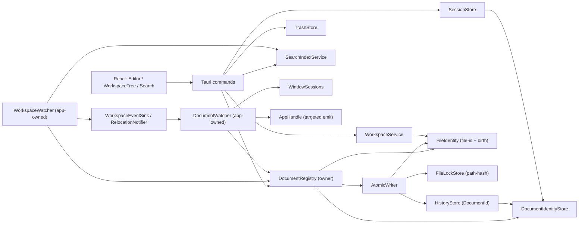
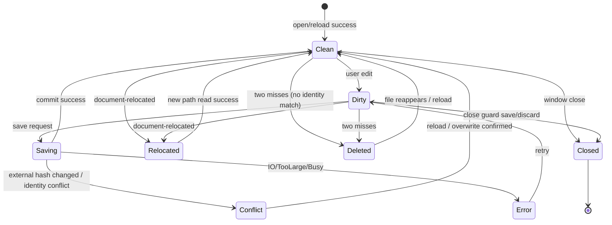

# P0/P1 收尾与可信基础加固 — 设计方案

> **文档用途：** 面向技术评审、开发、测试和运维人员的设计说明
> **功能 ID：** `p0-p1-closure`
> **对应需求：** R-001 ~ R-008
> **对应实施计划：** [`01-实施计划.md`](01-实施计划.md)
> **代码基线：** `feat/p0-p1-closure@a23d736`
> **设计版本：** `v1.9`（Q-001 ~ Q-008 已批准；R5/R6/R7 复审修订；R8~R13 定向复审已修复；R14 复核）
> **日期：** 2026-11-09
> **状态：** 已批准（已通过 R14，可进入 T-001）

---

## 1. 摘要

Qingmo 已经具备可信编辑的核心闭环：单一 CodeMirror 6 真源、原子写、base hash 冲突检测、历史、回收站、工作区 jail、SQLite/FTS5 搜索、窗口恢复和跨进程 sidecar 锁。当前缺口不在“有没有功能”，而在这些能力之间的**身份、边界和所有权不一致**：

1. 文档没有稳定身份。`DocToken` 是每次打开生成的 UUID（`document_registry.rs:12-24`），明确“不是文档身份”；历史、视图状态、锁、搜索索引、`windows.json` 全部按 canonical path 派生键。原子保存会更换 inode，外部 rename 会改变 path，于是“保存后历史换桶”“重命名后历史/视图失联”“旧索引行残留”是同一根因。
2. 文档大小边界不一致。打开 10 MiB、写入 16 MiB（`file_service.rs:11-15`），10 MiB + 1 字符保存成功后无法重新打开；搜索索引仍按 10 MiB，文档 watcher 对 10–16 MiB 不 hash。
3. 路径安全仍是 check-then-use。`canonicalize + starts_with` 后到 `open/rename` 之间没有文件身份复核；`write_atomic`、`reload`、`history_*`、`save_image` 只查 registry，不查窗口归属；`DocumentWatcher` 全局广播带 token 的事件。
4. 工作区树在 10k 单目录下首帧可能创建 10k 个 treeitem；离屏行没有 DOM 时键盘焦点会丢失；当前文档行没有 `aria-current`。

本方案的核心是 **一个权威 DocumentId + 一个 FileIdentity 复核原语 + 一个统一文档上限**：

- `DocumentIdentityStore` 持久化 `DocumentId ↔ path ↔ file identity`；首次打开分配 UUID；原子保存按 path 命中保留 ID；外部 rename 用 `adopt(id, new_path)` 保留原 ID，绝不为 live record 重新分配 ID。
- `FileIdentity` 使用 `file-id` crate 的 `FileId` 三变体（Unix inode、Windows HighRes/LowRes）+ birth time；只用于 rename 配对、TOCTOU 复核，**不作为文档 ID，也不作为锁 key**。
- `MAX_DOCUMENT_BYTES = 16 MiB` 统一打开/保存/索引/watcher；10 MiB + 1 字符保存后可重开。
- `WorkspaceWatcher` 对双边 Rename 执行 registry/index 配对；目录 rename 执行 `rekey_prefix`；单边 Rename 回退 rescan；`DocumentWatcher` 再做一次父目录身份恢复。
- 所有文档命令校验窗口归属；Save As 释放 current + previous token；watcher 事件定向发送；rekey 后通知窗口更新 path/title/asset scope。
- 虚拟树首帧使用默认视口高度；离屏焦点先滚动再聚焦；补齐 `aria-current`、kind 文案、type-ahead。

一句话方案：

> 在保留现有 `DocumentRegistry`、`AtomicWriter`、`FileLockStore`、`HistoryStore`、`SessionStore`、`SearchIndexService` 和 `WorkspaceWatcher` 的前提下，用持久 DocumentId 串起文档生命周期，用 FileIdentity 把路径安全从“检查一次”升级为“打开前后复核”，用统一 16 MiB 边界消除保存/重开裂缝，并用虚拟树焦点/ARIA 修复补上 10k 与 VoiceOver 的可达性。

> **v1.1 关键修正：** 文档身份以 live `DocumentRecord.document_id` 为权威，History/View 存储直接接收该 ID，不再在每次使用时按 path 重新 `observe`；`rekey` 只做 `adopt`，不分配新 ID；文件锁继续使用 path-hash（跨版本稳定），不改为 DocumentId。

---

## 2. 问题定义

### 2.1 业务背景与故障特征

#### 2.1.1 保存后不能重开

```text
用户打开 10 MiB 文档（FileService::read 上限 10 MiB）
  -> 插入 1 个字符
  -> AtomicWriter::write_with_format 允许 16 MiB
  -> 保存成功，文件变为 10 MiB + 1
  -> 关闭/重新打开
  -> FileService::read 返回 FILE_TOO_LARGE
  -> 用户看到“保存成功”但文件打不开
```

证据：`file_service.rs:11-15`（10/16 双上限）、`file_service.rs:86-97`（10 MiB 拒绝）、`atomic_writer.rs:143`（16 MiB 允许）、`document_registry.rs:233-241`（Save As 目标仍按 10 MiB）。同一裂缝还影响搜索与 watcher：`search_index.rs:25`、`document_watcher.rs:174-188` 都按 10 MiB 截断。

#### 2.1.2 重命名后身份漂移

```text
文档 A 打开，DocToken=T1，canonical=/notes/a.md
  -> 历史写入 history/blake3("/notes/a.md")[..32]
  -> 视图状态写入 view-state.json["/notes/a.md"]
  -> sidecar 锁写 locks/blake3("/notes/a.md")[..32]

外部重命名 a.md -> b.md
  -> notify 发送 Modify(Name(Both))，paths=[/notes/a.md, /notes/b.md]
  -> WorkspaceWatcher::handle_events 2-path 落入默认分支
  -> 对 /notes/a.md notify_upsert：文件不存在，upsert_file 返回 false
  -> 对 /notes/b.md notify_upsert：新增行
  -> documents 表同时留下 a.md 旧行 + b.md 新行

DocumentWatcher 仍轮询 /notes/a.md
  -> 两次缺失 -> 发送 Deleted(T1)
  -> 用户保存 -> DocumentRegistry::write_atomic 读 canonical a.md
  -> read_current -> NOT_FOUND
  -> 编辑器内容仍在，但保存失败；历史/视图/窗口仍指 a.md
```

证据：`workspace_watcher.rs:459-484`、`search_index.rs:285-296, 538-555`、`document_watcher.rs:305-315`、`document_registry.rs:357-373`、`history_store.rs:318-323`、`session_store.rs:163-190`、`file_lock.rs:53-56`。

#### 2.1.3 跨窗口 token 与全局事件

```text
窗口 A 拥有 docToken=T1
  -> DocumentWatcher 用 app.emit 广播 DocumentChanged(T1)
  -> 所有窗口都收到，窗口 B 可看到/误用 T1 的事件
窗口 B 通过任意 IPC 调 document_write_atomic(T1)
  -> 只查 DocumentRegistry::get(T1)
  -> 不校验 T1 是否属于窗口 B
  -> 可写入 A 的文档
```

证据：`document_watcher.rs:266-270`、`commands/document.rs:914-949`、`window_sessions.rs:207-217`。`document_activate` 已有归属检查（`commands/document.rs:760-789`），但写入/重载/历史/图片命令没有复用。

#### 2.1.4 10k 首帧与焦点

```text
工作区根目录 10,000 个文件
  -> workspace_list 返回 10,000 项（MAX_LISTED）
  -> flattenWorkspaceRows 生成 10,000 FlatRow
  -> 首次 render 时 viewportHeight=0
  -> range = visibleRange(10000, 0, 0 || 10000*28, 28, 8)
  -> end = 10000
  -> 首次 commit 创建 10,000 个 treeitem
  -> ResizeObserver 之后才收敛到可视窗口
```

证据：`VirtualWorkspaceTree.tsx:172-184`、`virtualRows.ts:16-31`。同时 `focusRow` 只在已渲染 DOM 中查找（`VirtualWorkspaceTree.tsx:223-229`），Home/End/Arrow 移到视口外后没有焦点；当前行只有 `data-workspace-current`，没有 `aria-current`（`VirtualWorkspaceTree.tsx:336-359`）。

### 2.2 当前实现与主要缺口

| 缺口 | 当前行为 | 根因/证据 | 导致的问题 |
|---|---|---|---|
| GAP-001 双上限 | 打开 10 MiB、写入 16 MiB | `file_service.rs:11-15`；`atomic_writer.rs:143` | 保存后不能重开 |
| GAP-002 索引/watcher 10 MiB | >10 MiB 不索引、不 hash | `search_index.rs:25,216,547,1090`；`document_watcher.rs:174-188` | 10–16 MiB 不可搜索、外部变更不可见、旧行残留 |
| GAP-003 无稳定身份 | DocToken 每次打开生成；store 按 path | `document_registry.rs:12-24,187`；`history_store.rs:318-323`；`file_lock.rs:53-56`；`session_store.rs:163-190` | 历史/视图/锁跨 rename/保存失联 |
| GAP-004 双边 rename 未配对 | 逐路径 upsert，旧路径不存在时忽略 | `workspace_watcher.rs:459-484`；`search_index.rs:285-296` | 搜索旧行残留/重复 |
| GAP-005 打开文档 rename 误报删除 | 两次缺失 -> Deleted | `document_watcher.rs:305-315` | 保存 NotFound，窗口恢复旧路径 |
| GAP-006 TOCTOU | canonicalize 后直接 open/rename | `document_registry.rs:160-186`；`atomic_writer.rs:148-154` | symlink/替换窗口 |
| GAP-007 窗口归属 | 只查 registry.get(token) | `commands/document.rs:897-1025` | 跨窗口读写 |
| GAP-008 Save As token 泄漏 | `set_token` 覆盖，不返回 current/previous | `window_sessions.rs:125-133`；`commands/document.rs:880-893` | 旧 registry/watcher 泄漏 |
| GAP-009 全局事件 | `app.emit` 广播 | `document_watcher.rs:266-270` | 事件跨窗口 |
| GAP-010 reload/save-as/history | reload 无锁；save_as 二次无界读；read_raw 不校验 | `document_registry.rs:354-386,231-247,321-352`；`history_store.rs:243-261` | 并发读/内存放大/篡改快照 |
| GAP-011 trash | restore 无 EXDEV；try_recover 无 jail；GC 信任 entry.root | `trash_store.rs:287-376,396-445,472-522` | 跨卷失败/越界写 |
| GAP-012 首帧全量 | viewportHeight=0 回退全量 | `VirtualWorkspaceTree.tsx:172-184` | 10k DOM 卡顿 |
| GAP-013 离屏焦点 | findRow 只查 DOM | `VirtualWorkspaceTree.tsx:223-243` | 键盘不可达 |
| GAP-014 ARIA/type-ahead | 无 aria-current/kind/type-ahead | `VirtualWorkspaceTree.tsx:336-359` | VoiceOver 语义不足 |
| GAP-015 symlink 索引 | walk push target，树显示 link；watcher Create/Modify 无越界检查 | `search_index.rs:1083-1112,273-296` | 链接名搜不到/外部内容入索引 |
| GAP-016 平台/a11y 证据 | Windows compile-only；无 VoiceOver/10k | `.github/workflows/ci.yml:82-229` | 回归不可见 |
| GAP-017 身份持久化/降级 | 无 identity；`disabled` 方案若用伪 ID 会破坏旧数据 | 方案 v1.0 评审 | 回滚/Windows 不可用 |
| GAP-018 目录 rename | 只考虑文件 rename | `workspace_watcher.rs`；`document_registry.rs` | 目录改名后打开文档失效 |

### 2.3 设计目标（可度量）

| R-ID | 目标 | 可度量成功标准 |
|---|---|---|
| R-001 | 10 MiB 边界闭环 | 10 MiB + 1 字符保存后重开成功；16 MiB + 1 在 open/save/index 一致返回 `FILE_TOO_LARGE`；16 MiB bench p95 <= 120 ms（Node）/首屏 <= 1.5 s（M3 Max），Node peak RSS <= 600 MB / Tauri RSS <= 1100 MB |
| R-002 | 稳定文档身份与 rename | 原子保存 10 次后 DocumentId 不变；外部文件/目录 rename 后 history/view 命中同一 ID；索引旧行 0 条 |
| R-003 | 残余 TOCTOU 与所有权 | post-canonicalize swap、parent swap、target replace 负例全部拒绝；跨窗口 write/reload/history/image 全部 `INVALID_PATH` |
| R-004 | 10k 与无障碍 | 10k 单目录首帧 treeitem <= 40；End/Home/Arrow 离屏后焦点可达；VoiceOver 14 项全 PASS 或有 B-ID |
| R-005 | 平台与 symlink | Windows 定向 cargo test 通过或 PARTIAL+B-ID；Linux `--all-targets` 通过；树/索引 symlink 策略一致 |
| R-006 | token 生命周期 | Save As 后 current/previous token 均释放；旧 watcher 停止；事件只到 owning window |
| R-007 | 历史/回收站正确性 | history raw 篡改/截断拒绝；trash 同卷/跨卷恢复均校验 hash；恶意 entry 不能越界 |
| R-008 | 索引事件一致性 | 文件 rename 后 `documents` 无旧 relative path；目录 rename 后打开文档可保存；symlink 外部目标不入索引 |

### 2.4 非目标

- 不实现完整 `openat2(RESOLVE_BENEATH)` / Windows 句柄级 root jail，因为跨平台系统调用与路径层重构超出本批；记录为 `NEXT-001`。
- 不把 DocumentId 写入用户 Markdown 或 sidecar，因为污染用户文件并破坏互操作。
- 不新增用户可调配置项；16 MiB 等阈值是产品安全边界。
- 不新增 SQLite 表或修改搜索索引 schema；索引仍是可重建缓存。
- 不做跨重启按 FileIdentity 全盘扫描恢复 rename 窗口；记录为 `NEXT-003`。
- 不做系统回收站/目录回收站；记录为 `NEXT-004`。

### 2.5 前置假设与约束

| 类型 | 内容 | 验证方式 | 假设失效后的处理 |
|---|---|---|---|
| 业务 | 用户接受 16 MiB 作为唯一文档上限 | Q-001 | 按 Q-001 B/C 降级，更新 R-001/AC-001 |
| 业务 | 同路径删除后重建应获得新 DocumentId（tombstone 生效） | Q-007/Q-002 | 若要求“同路径永久延续”，改为 path 优先并取消 tombstone，记录限制 |
| 技术 | `file-id 0.2.3` 在 macOS/Windows/Linux 可用，网络卷可能返回不稳定 ID | E-003/E-005；T-001 测试 | 网络卷/`ino=0` 禁用 file identity 配对，回退 path |
| 技术 | `atomic-write-file 0.3.1` 的 Unix `directory()` 可提供 dirfd | E-002；T-004 | Windows 无 dirfd，记录残余；Unix 若 API 不可用则回退 path before/after |
| 技术 | 同进程内 `DocumentRegistry` 是文档路径所有权的唯一真源 | 源码 `document_registry.rs` | 若出现第二个 registry，必须先合并 |
| 部署 | 应用按单实例运行；app data 只有一个写入者 | `tauri-plugin-single-instance` | 多实例时 identity/history 可能分叉，记录 L-011/NEXT-011 |
| 部署 | `pnpm ci:tauri` 在 macOS 可运行；Windows/Linux 走 CI 定向测试 | `scripts/ci/test-tauri.sh` | 不可用时记录 B-ID，AC 标记 PARTIAL |

---

## 3. 设计原则与总体设计

### 3.1 设计原则

| 原则 | 含义 | 对实现的约束 |
|---|---|---|
| 单一持久身份 | `DocumentId` 是唯一持久文档身份；`DocToken` 只是 IPC 句柄 | 持久键禁止使用 token；History/View 直接接收 DocumentId |
| live record 权威 | 已打开文档的 ID 由 `DocumentRecord.document_id` 决定 | `observe` 只用于 open/restore/recovery；store 使用中不得重新 `observe(path)` 改绑 |
| 单一写盘 | 所有保存继续走 `AtomicWriter::write_formatted` | 不新增第二条写入路径 |
| 单一读取 | `FileService::read_raw` 是所有文档字节读取的唯一实现 | `read`、`read_current`、save_as、history 校验复用它 |
| 单一 watcher 源 | 工作区 watcher 是目录事件唯一源；DocumentWatcher 只轮询打开文档 | 不新增第三套 watcher |
| 索引是缓存 | 搜索索引可重建；不引入持久身份表或 schema v3 | rename 只做事件迁移 |
| 失败保留唯一副本 | 历史/回收站失败时保留旧数据；原子写失败时保留原文件 | 任何删除前先确认新副本完整 |
| 先负例再实现 | HIGH 符号先写 swap/rename/越界负例 | `open_path_inner`/`list_directory_with_limit`/`scan_root` |
| 向后兼容 | 旧 path-key 数据可读；disabled 时完全使用旧键 | 不生成伪 UUID/伪路径键；lazy 迁移可回滚 |

### 3.2 系统架构



架构说明：

- **入口层：** Tauri 命令接收 webview 请求；`trusted_window`/`authorized_token` 校验窗口与 workspace 所有权。
- **编排层：** `DocumentRegistry` 管理 token→record、路径所有权、open/reload/save/rekey；`WorkspaceWatcher` 管理目录事件；`TrashStore` 管理删除/恢复事务。
- **核心层：** `DocumentIdentityStore` 维护 DocumentId↔path↔file 映射；`AtomicWriter` 是唯一写盘；`FileService::read_raw` 是唯一文档正文读取。
- **依赖层：** app data 下的 history/session/trash/index/identity；用户工作区文件系统；sidecar lock。
- **观测层：** `tracing` 结构化日志 + identity/index/trash 状态计数；不记录正文和完整路径（新日志）。
- **无环约束：** `DocumentRegistry` 不持有 `AppHandle`/watcher；`WorkspaceWatcher` 只通过 `WorkspaceEventSink` 发出重定位通知，不直接依赖 `DocumentWatcher` 类型；`DocumentWatcher` 单向依赖 registry，因此不存在 `DR↔DW` 环。

### 3.3 职责边界

| 模块/层 | 负责 | 不负责 | 依赖 |
|---|---|---|---|
| `DocumentRegistry` | token/record 生命周期、路径所有权、rekey、save/reload | 不解析 workspace segment；不直接写盘 | `DocumentIdentityStore`、`AtomicWriter`、`FileService` |
| `DocumentIdentityStore` | DocumentId 分配/adopt/tombstone/持久化/GC | 不做路径 jail；不存正文；不分配 token | `file-id`、`AtomicWriteFile` |
| `FileIdentity` | 文件实例识别、before/after 比较 | 不作为 DocumentId；不作为锁 key | `file-id`、metadata birth |
| `FileService` | 唯一文档正文读取/解码/16 MiB 上限 | 不做 root jail；不写盘 | `FileIdentity` |
| `AtomicWriter` | 唯一写盘、路径锁、冲突检测、历史捕获 | 不管理 token/窗口；不持有 `io_lock` | `FileLockStore`、`HistoryStore` |
| `WorkspaceWatcher` | 目录事件、索引 fan-out、rename 配对、通过 sink 通知重定位 | 不轮询打开文档；不拥有 registry；不直接依赖 DocumentWatcher 类型 | `DocumentRegistry`、`SearchIndexService`、`WorkspaceEventSink` |
| `DocumentWatcher` | 打开文档轮询、身份恢复、定向事件 | 不递归目录；不全盘扫描；不写盘 | `DocumentRegistry`、`WindowSessions`、`AppHandle` |
| `HistoryStore` | 历史快照、迁移、GC | 不决定 DocumentId | `DocumentIdentityStore` |
| `SessionStore` | view-state/windows/drafts | 不决定 DocumentId；不依赖 registry | `DocumentIdentityStore` |
| `FileLockStore` | 跨进程 path-hash 锁 | 不参与文档身份；只由 AtomicWriter/TrashStore 获取 | 无 |
| `TrashStore` | 删除/恢复/GC、payload 校验 | 不做系统回收站；不持有 registry io_lock | `WorkspaceService`、`FileLockStore` |
| `SearchIndexService` | 可重建索引、rename 迁移 | 不存 DocumentId | SQLite/FTS5 |

### 3.4 当前链路与目标链路

当前（问题链）：

```text
document_open / workspace_open_document
  -> DocumentRegistry::open_path_inner            document_registry.rs:153
     -> canonicalize + starts_with(root)          document_registry.rs:160-177
     -> FileLockStore::acquire(path hash)         file_lock.rs:49-83
     -> FileService::read(canonical)              file_service.rs:53-126
        -> metadata -> File::open -> 10 MiB cap
  -> DocToken::new()                              document_registry.rs:187
  -> DocumentRecord { raw_selected, canonical_target, state }

document_write_atomic
  -> DocumentRegistry::write_atomic               document_registry.rs:303
     -> AtomicWriter::write_with_services         atomic_writer.rs:41
        -> path lock -> DocState lock
        -> read_current (hash/size/mtime)         atomic_writer.rs:168
        -> history.capture(path hash bucket)     history_store.rs:119
        -> write_formatted(temp + rename)        atomic_writer.rs:137

外部 rename
  -> WorkspaceWatcher::handle_events              workspace_watcher.rs:429
     -> Modify(Name) with 2 paths 落入默认分支     workspace_watcher.rs:472-479
     -> 逐路径 notify_upsert；旧路径不存在 -> 旧行残留
  -> DocumentWatcher 按 canonical path 轮询       document_watcher.rs:135
     -> 两次缺失 -> Deleted                       document_watcher.rs:305-315
     -> 后续 save 返回 NotFound
```

目标（最小可信切片）：

```text
document_open
  -> DocumentRegistry::open_path_inner
     -> WorkspaceService::resolve_document_verified (root jail + parent identity snapshot)
     -> FileService::read_raw(MAX_DOCUMENT_BYTES, expected_parent)
     -> DocumentIdentityStore::resolve_open(canonical, observation, live_snapshot)
        -> 返回 DocumentId（新 ID 先写候选 JSON，成功后才 swap 内存）
     -> DocumentRecord { document_id, paths: Mutex<DocumentPaths>, io_lock, active, state }
     -> registry.by_path.insert(PathKey, token)

document_write_atomic
  -> WindowSessions::owns_current_document(label, token)
  -> DocumentRegistry::write_atomic
     -> record.io_lock
     -> paths snapshot + generation check
     -> AtomicWriter::write_with_services       // AtomicWriter 是 FileLock 唯一 owner
        -> FileLockStore::acquire(path)
        -> DocState lock
        -> FileService::read_raw(MAX_DOCUMENT_BYTES, snapshot.parent_identity)
        -> history.capture(record.document_id, bytes)
        -> write_formatted(expected_target, expected_parent)
        -> WriteOutcome { identity, hash, size, mtime }
     -> identity.bind_save(id, path, observation)  // 失败仅 warn，不回滚已提交文件
     -> record.paths.file_identity/parent_identity 更新（不改变 ID）

外部 rename（文件）
  -> WorkspaceWatcher::handle_events
     -> Modify(Name) 2 paths
     -> old_doc = is_document_name(root, old_abs) / new_doc = is_document_name(root, new_abs)
     -> if index: rename_path(root, old_rel, new_rel, prepared) -> Result<RenameResult>
                 或 remove_path_or_prefix(root, rel)（old 端不 stat）
     -> DocumentRegistry::rekey_path(old_abs, new_abs, root) -> Result<RekeyOutcome>
        -> tokens_where_any([raw, canonical]) 快照（不在 map 锁内读 paths）
        -> 按 token 排序获取全部 io_lock
        -> resolve_rekey_paths（link/target rename、FileIdentity 复核、detach/Conflict）
        -> if identity Enabled: adopt_many(Some(DocumentId) changes) 一次持久化
        -> 保留 record.document_id，不调用 observe 分配新 ID
        -> 返回 relocated + requires_rescan
     -> WorkspaceEventSink::relocated(...) -> owner label emit + allow_document_assets + titles
     -> DocumentWatcher::clear_cache/all tokens sharing id

外部 rename（目录）
  -> WorkspaceWatcher
     -> DocumentRegistry::rekey_prefix(old_dir, new_dir, root) -> Result   // 组件级前缀，非字符串 starts_with
     -> SearchIndexService::notify_rescan

工作区树 10k
  -> visibleRange 使用 DEFAULT_VIEWPORT_HEIGHT
  -> focusRow 离屏时先滚动 + restoreTarget，再聚焦
  -> aria-current / aria-posinset / aria-setsize / aria-level 完整
```

关键约束：

1. 不引入第二套文档身份：`DocumentId` 是唯一持久身份，`DocToken` 仍是 IPC 句柄。
2. 不引入第二套写盘路径：所有保存继续走 `AtomicWriter::write_formatted`。
3. 不引入第二套路径解析：workspace jail 继续复用 `workspace_service`；新增的只是身份复核。
4. 搜索索引仍是可重建缓存，不把用户数据或身份表放进 `index.sqlite`。
5. 文件锁继续使用 path-hash：它是跨版本、跨 identity 可用性的稳定 key；rename 后的 save 使用新 path 锁。

---

## 4. 修复方式与修改点

### 4.1 修复方式概述

| 项 | 内容 |
|---|---|
| 根因 | 缺少持久文档身份；open/save/watcher 各自按 path 派生键；边界与所有权不统一 |
| 修复策略 | 在 `DocumentRegistry` 上引入 DocumentId + paths 快照 + io_lock；History/View 直接使用 ID；open/save 使用 verified IO；watcher 配对 rename；trash/树/acl 分别修复 |
| 保持不变 | `DocToken` IPC 语义、`AtomicWriter` temp+rename、`FileLockStore` path-hash、搜索索引 schema、用户 Markdown 格式 |
| 被否决的替代方案 | 纯 inode/file ID 作为 DocumentId；在用户文件写 ID；搜索索引加 document_id；第二套 watcher；完整 openat2（本批） |

### 4.2 修复前调用链

```text
open
  -> canonicalize -> starts_with -> File::open -> read
  -> DocToken::new
  -> history/view/lock 使用 path hash / path key
  -> 【失败点】原子保存换 inode、外部 rename 改 path 后，所有派生键漂移

rename
  -> notify 2 paths -> 逐路径 upsert
  -> 【失败点】旧路径不存在，旧行不删；registry 仍指旧 path
  -> DocumentWatcher 两次缺失 -> Deleted
  -> 保存 NotFound

save
  -> path lock -> DocState -> read_current -> history(path) -> write
  -> 【失败点】read_current 后文件可被替换；commit 失败可能已 rename
```

### 4.3 修复后调用链

```text
open
  -> resolve root jail
  -> verified read（fstat before/after，返回 identity+format）
  -> identity.resolve_open(path, identity)（新 ID 同步落盘）
  -> record { id, paths, io_lock, state }
  -> history/view 使用 id

save
  -> record.io_lock -> snapshot/generation -> path lock -> DocState
  -> verified read -> history.capture(id) -> verified write
  -> commit 后 fstat -> identity.bind_save(id, new identity)（ID 不变）
  -> 失败时原文件/temp 状态明确

rename
  -> 2-path file: index.rename_path + registry.rekey_path（adopt 原 ID）
  -> directory: registry.rekey_prefix + index rescan
  -> watcher 从 registry 读新 path；父目录身份恢复有界
```

### 4.4 修改点清单

| MP-ID | 修改点 | 文件/符号 | 对应任务 |
|---|---|---|---|
| MP-001 | FileIdentity 原语 | 新增 `services/file_identity.rs` | T-001 |
| MP-002 | DocumentIdentityStore | 新增 `services/document_identity.rs` | T-002 |
| MP-003 | 统一 16 MiB | `file_service.rs`、`atomic_writer.rs`、`document_watcher.rs`、`search_index.rs`、`document_registry.rs` | T-003 |
| MP-004 | verified read/write | `FileService::read_raw`、`AtomicWriter::read_current/write_formatted` | T-004 |
| MP-005 | registry 身份/路径所有权/rekey | `DocumentRecord`、`DocumentRegistry`、`session_restore.rs` | T-005 |
| MP-006 | history/view 稳定 ID 与迁移 | `history_store.rs`、`session_store.rs`、`commands/session.rs`、`ipc/dto.rs` | T-006 |
| MP-007 | token/归属/定向事件 | `window_sessions.rs`、`commands/document.rs`、`document_watcher.rs` | T-007 |
| MP-008 | rename 配对/索引/symlink | `workspace_watcher.rs`、`search_index.rs`、`workspace_service.rs`、`commands/document.rs` | T-008 |
| MP-009 | trash 恢复/GC/jail | `trash_store.rs`、`workspace_service.rs`、`lib.rs` | T-009 |
| MP-010 | reload/save-as/history raw | `document_registry.rs`、`history_store.rs`、`commands/document.rs` | T-010 |
| MP-011 | 虚拟树 | `VirtualWorkspaceTree.tsx`、`virtualRows.ts` | T-011 |
| MP-012 | 10k/VoiceOver 验收 | `e2e/workspace-10k.spec.ts`、`02` | T-012 |
| MP-013 | Windows/Linux CI | `.github/workflows/ci.yml` | T-013 |
| MP-014 | ADR/文档/回滚工具/最终验证 | `docs/adr/0010-*.md`、`src-tauri/examples/identity_rollback.rs` | T-014,T-015 |

---

## 5. 详细设计

### 5.1 文档身份（DocumentId）

#### 5.1.1 为什么不能只用 inode/file ID

`atomic-write-file` 的工作方式是 temp + rename；每次保存都会创建一个新 inode，然后替换目标。若 `DocumentId = hash(dev, ino)`，则：

```text
open a.md   -> inode 100 -> ID=H(100)
save a.md   -> temp inode 101 -> rename -> a.md 指向 101
下一次 open  -> ID=H(101) != H(100)
```

历史/视图/锁会在每次保存后“换身份”。因此：

- `FileIdentity` 用于**识别当前文件实例**（rename 配对、TOCTOU 复核）。
- `DocumentId` 是**持久 UUID**，由 `DocumentIdentityStore` 维护；原子保存后 path 命中保留 ID，外部 rename 后 `adopt` 保留 ID。
- 文件锁不参与 DocumentId：它继续使用 path-hash，避免跨版本/身份故障时失去互斥。

#### 5.1.2 FileIdentity（精确 API）

`file-id 0.2.3` 的真实 API：

```rust
pub fn get_file_id(path: impl AsRef<Path>) -> io::Result<FileId>;

pub enum FileId {
    Inode { device_id: u64, inode_number: u64 },
    LowRes { volume_serial_number: u32, file_index: u64 },
    HighRes { volume_serial_number: u64, file_id: u128 },
}
```

本方案定义：

```rust
#[derive(Debug, Clone, PartialEq, Eq, Hash, Serialize, Deserialize)]
#[serde(tag = "kind", rename_all = "camelCase", rename_all_fields = "camelCase")]
pub enum FileIdentity {
    Inode { device: u64, inode: u64, birth_ns: u64 },
    WindowsLow { volume: u32, file: u64, birth_ns: u64 },
    WindowsHigh { volume: u64, file_hex: String, birth_ns: u64 },
}

#[derive(Debug, Clone, PartialEq, Eq, Hash)]
pub struct FileKey {
    kind: u8,       // 0=Inode, 1=LowRes, 2=HighRes
    volume: u64,
    file: u128,
}

/// 路径观察结果。`Absent` 与 `Unavailable` 必须区分：
/// - Absent：确认文件不存在（用于 mark_missing）；
/// - Unavailable：文件存在但平台/网络卷无法提供身份（用于 path-only 回退）。
#[derive(Debug, Clone, PartialEq, Eq)]
pub enum FileObservation {
    Present(FileIdentity),
    Unavailable,
    Absent,
}

// 三个原语都必须能表达“文件存在但身份不可用”：
// - file_identity/Ok(None)：平台不支持、网络卷、全零、句柄 API 不可用；
// - identity_from_metadata/Option：Windows 元数据没有 file ID，返回 None；
// - Err 只表示路径不存在/权限/真实 IO 错误，禁止用 Err 表达 Unavailable。
pub fn file_identity(path: &Path) -> Result<Option<FileIdentity>, AppError>;
pub fn identity_from_metadata(meta: &std::fs::Metadata) -> Option<FileIdentity>;
pub fn identity_from_handle(file: &std::fs::File) -> Result<Option<FileIdentity>, AppError>;
pub fn observe_path(path: &Path) -> Result<FileObservation, AppError>;
pub fn same_identity(a: &FileIdentity, b: &FileIdentity) -> bool;
pub fn same_identity_opt(a: Option<&FileIdentity>, b: Option<&FileIdentity>) -> bool;
pub fn same_observation(stored: Option<&FileIdentity>, observed: &FileObservation) -> bool;
pub fn birth_ns_of(identity: Option<&FileIdentity>) -> u64; // None/无 birth -> 0
// 仅 (Some, Present) 用 same_identity；(None, Unavailable)/(None, Absent) 为 true；
// 其他混合（含 Some + Unavailable）一律 false，由调用方用 path 命中回退。
```

规则：

- `observe_path(path)` 使用 `file_identity(path)`（**跟随最终 symlink**），返回文档目标的身份；拒绝 symlink 的检查由 `read_raw`/`write_formatted` 的 `symlink_metadata` 单独完成，不能用 `observe_path` 代替。
- `file_identity` 用 `match` 映射三个变体，禁止直接访问不存在的 `.volume`/`.file` 字段。
- **Unix：** `identity_from_metadata` 用 `MetadataExt` 的 dev/ino；`identity_from_handle` 用 `fstat` 的 dev/ino；`birth_ns` 优先 `statx(STATX_BTIME)`，不可用则 0。
- **Windows：** `identity_from_metadata(std metadata)` 返回 `None`（std 元数据没有 file ID）；`identity_from_handle(&File)` 使用 `windows-sys` 的 `GetFileInformationByHandleEx(FileIdInfo)`（128-bit file ID + volume serial）或 `GetFileInformationByHandle`（64-bit fallback），从已打开句柄取身份；API 不支持/网络重定向器拒绝时返回 `Ok(None)`，其他 OS 错误返回 `Err(Io)`。`file_identity(path)` 只是“open + identity_from_handle + close”的便捷包装，不能替代句柄级复核。
- `windows-sys` 作为 `cfg(windows)` target dependency，feature 只开 `Win32_Storage_FileSystem`；版本选择 `Cargo.lock` 中已有主版本，避免重复 major。`file-id` 仍用于 `file_identity(path)` 的稳定 fallback。
- 全零身份（`device==0 && inode==0`、`volume==0 && file==0`）在三个原语中返回 `None`；只有 `observe_path` 把它映射为 `FileObservation::Unavailable`。
- **birth 语义：** macOS 用 `created()`；Windows 用 `creation_time`；Linux 用 `statx(STATX_BTIME)`，不可用为 0。禁止把 Linux `metadata.created()`（可能是 ctime）当 birth。
- `same_identity`：`FileKey` 必须相同；双方 `birth_ns != 0` 时 birth 也必须相同。若一方 birth 为 0，视为**弱匹配**，只允许用于“旧 path 已消失且同目录”的恢复场景；跨目录/同目录但旧 path 仍存在时不得用弱匹配改绑 ID。
- `by_file` 的 key 使用 `FileKey`（不含 birth），value 是 `BTreeSet<DocumentId>`（多值），entry 内保存完整 `FileIdentity`；查找后必须用 `same_identity` 过滤候选，禁止“key 命中即认为同一文件”。
- JSON 中 `file_hex` 用十六进制字符串保存，避免 u128 精度问题；Rust 内部转 u128。
- **hardlink 策略：** 硬链接是同一 inode 的多个路径，但 DocumentId 是“路径谱系身份”，不按 inode 共享。`path_hit` 优先；只有 `path_hit` 不存在、`by_file` 恰好一个非 live 候选且旧 path 已消失时，才把该候选视为 rename 并复用 ID；否则分配新 ID。这样避免两个 hardlink 打开时串历史。
- **inode 复用：** Linux 无 birth 或 birth=0 时，`by_file` 命中还必须满足“旧 path 不存在 + 同目录 + 唯一非 live 候选”；否则视为新文件。极端的同目录 inode 复用仍可能误配，记录为 L-003（不引入不可实现的 size/mtime 断言）。网络卷 `ino=0` 时 `file_identity/observe_path` 分别返回 `None`/`Unavailable`。

> Windows 的 `volume_serial_number`/`file_index` 在 stable Rust 仍是 nightly-only（E-004），所以路径级 fallback 使用 `file-id` crate，句柄级使用 `windows-sys`。

#### 5.1.3 DocumentIdentityStore

持久文件：`app_local_data_dir/identity/documents.json`

```json
{
  "schemaVersion": 3,
  "entries": {
    "0f7f...uuid": {
      "path": "/Users/me/notes/a.md",
      "legacyPaths": ["/Users/me/notes/old-name.md"],
      "file": { "kind": "inode", "device": 16777220, "inode": 123456, "birthNs": 1760000000000000000 },
      "fileState": "present",
      "lastSeenMs": 1760000000000,
      "state": "active"
    }
  }
}
```

- `schemaVersion=3`：在 v2 上增加 `legacyPaths`、`fileState`。加载 v2 时补默认值并写回 v3；未知版本备份为 `.corrupt-<ts>`。
- `legacyPaths`：该 ID 曾经使用过的路径（最近 8 个，MRU 去重），用于历史/视图迁移和关闭期间 rename 的恢复；不写入用户文件。
- `fileState`：`present | unavailable | absent`，分别对应 `FileObservation` 三态；`file` 仅在 `present` 时非空，但 `absent/unavailable` 不得清空 `legacyPaths`。

内存索引：

```rust
#[derive(Debug, Clone, Copy, PartialEq, Eq, Hash, PartialOrd, Ord, Serialize, Deserialize)]
pub struct DocumentId(Uuid);

struct IdentityState {
    by_id: HashMap<DocumentId, IdentityEntry>,
    by_path: HashMap<PathKey, DocumentId>,          // 仅 active/missing；tombstone 不占 path
    by_file: HashMap<FileKey, BTreeSet<DocumentId>>, // 多值；查询后按 same_identity 过滤
    dirty_file_identity: BTreeSet<DocumentId>,
    dirty_mapping: bool,
}
```

**Live 快照（打破 identity → registry 反向依赖）：**

```rust
#[derive(Debug, Default, Clone)]
pub struct LiveDocuments {
    pub ids: HashSet<DocumentId>,
    pub paths: HashMap<PathKey, BTreeSet<DocumentId>>, // 多窗口同 path
}

impl DocumentRegistry {
    pub fn snapshot_live(&self) -> LiveDocuments; // map 锁内只克隆 Arc/token，释放后读 paths 构建 raw/canonical
}
```

registry 在调用 identity 前构建 `LiveDocuments`，identity 不回调 registry、不持有 registry 锁。`snapshot_live` 对每个 record 的 `raw_key` 和 `canonical_key` 都建映射（同 ID 多窗口用 BTreeSet）；`resolve_open_batch` 在启动期使用 `LiveDocuments::default()`。

**API（唯一入口）：**

```rust
pub enum ResolveOutcome {
    Existing { id: DocumentId, path_changed: bool },
    Created { id: DocumentId },
    Unmanaged, // DegradedReadOnly：新文件不产生 UUID；调用方走 legacy path
}

pub enum IdentityStatus {
    Enabled,
    DegradedReadOnly, // 主索引损坏但可从 history/view 只读重建
}
// “完全不可用”不构造 store：应用层持有 Option<DocumentIdentityStore> = None，
// 所有调用方走 legacy path；status() 因此只有 Enabled/DegradedReadOnly 两态。

#[derive(Debug, Clone, Copy, PartialEq, Eq, Serialize, Deserialize)]
#[serde(rename_all = "lowercase")]
pub enum FileState { Present, Unavailable, Absent }

#[derive(Debug, Clone, Copy, PartialEq, Eq, Serialize, Deserialize)]
#[serde(rename_all = "lowercase")]
pub enum EntryState { Active, Missing, Tombstone }
pub struct PathRecord {
    pub path: PathBuf,
    pub entry_state: EntryState,
    pub file_state: FileState,
    pub file: Option<FileIdentity>,   // Missing 时保留最后已知身份供恢复
    pub legacy_paths: Vec<PathBuf>,
}
pub enum TombstoneOutcome { Tombstoned, RefusedLive, NotFound }
pub struct GcReport { pub removed: usize, pub retained: usize, pub tombstoned: usize }

pub fn resolve_open(
    &self,
    path: &Path,
    observation: FileObservation,
    live: &LiveDocuments,
) -> Result<ResolveOutcome, AppError>;
pub fn resolve_open_batch(
    &self,
    items: &[(PathBuf, FileObservation)],
    live: &LiveDocuments,
) -> Result<Vec<DocumentId>, AppError>;
pub fn resolve_open_new(
    &self,
    path: &Path,
    observation: FileObservation,
    live: &LiveDocuments,
) -> Result<DocumentId, AppError>;
pub fn adopt(&self, id: &DocumentId, path: &Path, observation: FileObservation) -> Result<(), AppError>;
pub fn adopt_many(&self, changes: &[(DocumentId, PathBuf, FileObservation)]) -> Result<(), AppError>;
pub fn bind_save(&self, id: &DocumentId, path: &Path, observation: FileObservation) -> Result<(), AppError>;
pub fn tombstone(&self, id: &DocumentId, live: &LiveDocuments) -> Result<TombstoneOutcome, AppError>;
pub fn mark_missing(&self, id: &DocumentId) -> Result<(), AppError>;
pub fn mark_recovered(&self, id: &DocumentId, path: &Path) -> Result<(), AppError>;
pub fn resolve_path(&self, id: &DocumentId) -> Option<PathRecord>;
pub fn legacy_paths(&self, id: &DocumentId) -> Vec<PathBuf>;
pub fn status(&self) -> IdentityStatus;
pub fn flush(&self) -> Result<(), AppError>;
pub fn gc(&self, now_ms: i64, live: &LiveDocuments) -> GcReport;
```

**降级写 API：** `resolve_open_batch`/`resolve_open_new`/`adopt`/`adopt_many`/`bind_save` 在 `status != Enabled` 时返回 `Err(IDENTITY_DEGRADED)`，绝不静默写半个映射。`AppErrorCode` 增加 `IdentityDegraded`（wire `IDENTITY_DEGRADED`）；这是内部降级码，前端按通用存储错误处理。`SessionStore` 在调用 `resolve_open_batch` 前先检查 `status()`，`DegradedReadOnly` 直接保留 `pending_v1`，因此正常启动不会看到该错误。

**`resolve_open` 决策表（仅在 open/restore/recovery 调用）：**

| 条件 | 动作 | 场景 |
|---|---|---|
| `Present(f)` 且 `by_path[p] == by_file[f]` 唯一 | 更新 `lastSeen`，返回现有 ID | 普通重开 |
| `Present(f)` 且 path_hit 存在、file_hit 为空或只含该 path_hit | 保留 path_hit 的 ID；更新 `entry.file`/`fileState`；只删除属于该 ID 的旧 `by_file` | 原子保存后 inode 变；外部替换 |
| `Present(f)` 且只有 file_hit | 候选先用 `same_identity` 过滤；恰好 1 个且其旧 path 已消失、不是 live 于其他 path → `adopt` 原 ID，旧 path 加入 `legacyPaths`；否则新 ID | 外部 rename；hardlink；inode 复用 |
| `Present(f)` 且 path_hit 与 file_hit 不同 | path_hit live 于该 path → `Conflict`；path 条目陈旧 → `Conflict`，仅 `resolve_open_new` 可显式复用 | 另一文档移动到当前 path / 路径复用 |
| `Unavailable` 且 path_hit | 保留 path_hit；`fileState=unavailable`；清空该 ID 的 `by_file` 反向键（旧 file hint 已失效） | 网络卷/Windows 句柄 ID 失败 |
| `Unavailable` 且无 path_hit | 分配新 UUID；`fileState=unavailable`；不写 `by_file` | 首次打开但身份不可用 |
| `Absent` | 返回 `NotFound`；调用方不得用 absent 解析身份 | 文件已删除/卸载 |
| 都无 | 分配新 UUID；候选状态持久化成功后才返回 Created | 首次打开 |
| `status == DegradedReadOnly` | 已有 path_hit 返回 Existing；无命中返回 `Unmanaged`，不产生新 UUID | 主索引损坏只读重建 |
| 当前文件缺失 | 不调用 `resolve_open`；`mark_missing` 只移除 `by_path`，保留 `lastPath`/`file`/`legacyPaths` | 历史列表/锁/查找 |

`resolve_open_new(path, observation, live)` 只用于“调用方已确认 path 被另一个文件复用”的场景（窗口恢复、同源 hardlink Save As）：若 path_hit 存在，先检查它是否 live；live → `Conflict`；非 live → `tombstone` 旧 ID 后分配新 UUID。普通 `document_open` 不使用它，避免把网络卷 ID 抖动误判为新文档。

`resolve_open_batch(items, live)` 用于 view-state v1 迁移：先在内存中解析到暂存结果，全部成功后用 **一次** `adopt_many`/候选快照持久化；任一项冲突则整体返回 `Conflict`，不写入部分映射。重复 `FileKey` 按 PathKey 去重，避免同一文件被 batch 内重复分配。

**关键修正：**

- **live ID 不可重绑。** 任何 `file_hit` 若其 ID 已 live 在另一个 path，绝不改绑；只能返回 `Conflict` 或分配新 ID。`LiveDocuments` 由 registry 在 identity 锁外构建。
- **`by_file` 是多值。** `FileKey` 只用于候选集；必须用 `same_identity`（含 birth）过滤。hardlink 默认新 ID；只有“旧 path 消失 + 唯一候选 + 非 live”才视为 rename。
- **`bind` 只删自己的反向键。** `by_path.remove(old)` 仅当 `by_path.get(old)==Some(id)`；`by_file[key]` 只移除 `id`，集合为空才删除 key。禁止按 entry 旧值无条件删除（可能删掉其他 live ID 的映射）。
- **`tombstone(id, live)` 拒绝 live。** 若 `live.ids.contains(id)` 返回 `TombstoneOutcome::RefusedLive`，不删除任何映射；仅 registry 在“最后一个 token 释放且仍 missing”时调用。
- **`mark_missing` 保留身份线索。** 置 `state=missing`、`lastPath=path`、移除 `by_path`（允许同路径新文件获得新 ID），但保留 `by_file`/`file`/`legacyPaths` 供 rename 恢复；`mark_recovered` 只有在 path 未被其他 ID 占用时才恢复 `by_path`。
- **`adopt`/`bind_save` 的 `Unavailable` 清空旧 file hint。** 外部 rename 后新路径身份不可用时，旧 inode 已不能代表当前文件，必须清 `by_file`；`Absent` 不清（缺失不是新身份）。
- **新 ID 候选优先（candidate-first）。** `resolve_open` 先构造只含受影响的 `IdentityEntry` 的候选快照，原子写 `documents.json`；写成功后才在锁内 swap 内存。写失败则丢弃候选、返回错误，调用方降级 legacy path；禁止“先 bind 内存再 persist”。
- **`adopt_many` 一次持久化。** 目录 rename/rekey 的 N 个记录合并为一次 JSON 写，避免 O(N) 写放大和部分失败。
- **`legacyPaths` 有界。** 最多 8 个，MRU 去重；只在 path 真正变化时追加；不因 `mark_missing` 改变。
- **`Unmanaged` 的调用方语义。** `open_path_inner` 收到 `ResolveOutcome::Unmanaged` 时不创建 `DocumentId`，record 的 `document_id=None`，History/View 走 legacy path；`resolve_open_batch` 在 `DegradedReadOnly` 返回 `Err(IDENTITY_DEGRADED)`，SessionStore 保留 `pending_v1` + legacy 键，不写 v2。`resolve_open_new`/`adopt`/`adopt_many` 在 `DegradedReadOnly` 同样返回 `Err(IDENTITY_DEGRADED)`，不写新 UUID；完全不可用时 `Option<DocumentIdentityStore>` 为 `None`，调用方走 legacy。

**持久化规则（防数据丢失）：**

| 变更 | 持久化时机 | 原因 |
|---|---|---|
| 新 ID 分配 | 候选 JSON 原子写成功后才 swap 内存并返回 Created | 历史/视图马上会用该 ID；写失败不能留下“内存有、磁盘无”的 ID |
| path 变化（rename/adopt/adopt_many） | 候选 JSON（含全部变更）一次原子写成功后 swap | 避免 N 次写放大和部分成功 |
| 仅 file identity 变化（每次保存） | 内存更新 + 5s debounce + 退出 flush；失败保留 dirty 并重试 | 避免每次保存重写 4–8 MiB JSON；path 映射仍在，ID 不丢 |
| tombstone/GC | 候选 JSON 原子写 + 校验 live 后 swap | 删除/重建语义必须稳定 |

- 写盘使用 `AtomicWriteFile`，写前 `0600`；目录 `0700`；文件上限 8 MiB；条目上限 20k；TTL 180 天。
- **候选状态**是 `BTreeMap<DocumentId, IdentityEntry>` 的受影响子集 + 重建后的 `by_path/by_file`；不需要深拷贝全部 20k 条目。序列化时按 `by_id` 迭代并用候选覆盖受影响条目，O(n) 写但内存增量 O(k)。
- 启动加载时校验：schema、UUID 格式、path 绝对、FileKey 非零；损坏文件备份 `.corrupt-<ts>`，从 `history/<uuid>/entries.json` 的目录名与 `path`、以及 legacy view-state path key 重建缺失映射。
- **分级降级：**
  - 重建成功或部分成功 → `IdentityStatus::DegradedReadOnly`：已有 UUID 桶通过一次性 `PathBucketIndex`（path → bucket，最多 20k 桶）只读可见；新打开/保存只写 legacy path 键，不产生新 UUID；修复后可重新启用。
  - 完全无法读取且无法重建 → 不构造 store（`None`）；调用方使用 legacy path。
  - 禁止“文件一损坏就把已有 UUID 历史全部判为不可见”。
- 退出顺序：先 `identity.flush()`，再写 `windows.json`。
- GC：淘汰“非 live、非 tombstone、最久未见”的条目；`gc(now, live)` 的 live 快照在 identity 锁外构建；tombstone 保留 7 天；超过 20k/8MiB 先淘汰最久未见，日志记录数量，不记录路径。

**完全不可用（`None`）/ `DegradedReadOnly`（Q-002 已批准 A；保留回滚路径）：**

- `None`：不创建 `DocumentIdentityStore`；`DocumentRegistry` 的 `document_id: Option<DocumentId>` 为 `None`。History 使用现有 `blake3(path)[..32]` 桶；View 使用 raw path key；FileLock 继续 path-hash。
- `DegradedReadOnly`：`document_id` 仍可为 `Some`（只读已有 ID），但 `resolve_open` 只返回已有映射；新文件返回 `None`，History/View 写 legacy path。`HistoryStore` 用 `PathBucketIndex` 读已有 UUID 桶；不删除、不迁移、不生成伪 ID。
- 不生成 `p:<hex>` 伪 ID；不改变旧数据目录；行为与现状兼容，回滚/Windows 均安全。

#### 5.1.4 DocumentId 的使用范围

| 存储 | 键 | 本批变更 |
|---|---|---|
| `DocumentRegistry` | `DocToken -> DocumentRecord` | record 增加不可变 `document_id: Option<DocumentId>`、`paths`、`io_lock`、`active` |
| `HistoryStore` | `history/<document_id>/entries.json` | path hash -> DocumentId；disabled/degraded 用 path hash 或只读 index |
| `SessionStore.view-state` | `entries[document_id]` + `legacy[path]` | path key -> DocumentId；disabled 用 path |
| `FileLockStore` | `locks/<blake3(path)>.lock` | **不变**（path-hash，跨版本稳定） |
| `SessionStore.windows.json` | `WindowIntent.document_id` | 新增可选字段 |
| `SearchIndexService` | `(workspace_key, path)` | **不改 schema**；rename 事件迁移 |
| `TrashStore` | `trash/<workspace_key>/<entry_id>` | 不改；entry 内已有 path/hash |

#### 5.1.5 路径规范化（PathKey）

- `PathKey` 用于 identity 的 `by_path`、registry 的 `by_path`、`is_path_open` 和前缀判断：
  - Unix/Linux：以 `canonicalize` 后的绝对路径为准；大小写敏感。
  - macOS：先 `canonicalize`；用 `pathconf(_PC_CASE_SENSITIVE)` 检测卷是否大小写敏感，不敏感时 case-fold 比较，敏感时保留大小写。检测失败按大小写敏感处理并记录一次 warn（残余）。
  - Windows：去掉 `\\?\`/`\\.\` 前缀、统一 `\`、case-fold 到小写用于**比较**；展示/索引仍用原始 spelling。
- `PathKey::is_prefix_of(&self, child)` 必须按**路径组件**判断，禁止 `str::starts_with`（否则 `docs2` 会被误判为 `docs` 的子项）。
- `strip_prefix_key(root, path)`：用组件级前缀，返回原始大小写的 suffix；索引 relative path 不使用 lower-case 结果。
- `DocumentPaths::{raw_key, canonical_key}` 返回 `PathKey`；`DocumentRegistry::is_path_open` 使用 PathKey，不再用精确 `PathBuf` 比较。
- **symlink 双键：** `DocumentRegistry.by_path` 对 `raw_key` 与 `canonical_key` 各插入一次（相同只插一次）；release/rekey 同时移动/删除两个键；`tokens_where_any([raw_key, canonical_key])` 查询两个键的并集。这样 link 自身 rename 和 target rename 都能找到同一 token。
- `WorkspaceWatcher` 的事件路径先 `normalize_event_path`（去 verbatim、绝对化），再 `canonicalize`（存在时）；`rekey` 用规范化后的绝对路径比较，不对已消失的 old 再次 canonicalize。
- 新增单测：Windows 大小写重命名、`\\?\` 前缀、macOS 大小写不敏感卷、`docs`/`docs2` 前缀、网络卷 `ino=0`。

### 5.2 统一文档大小边界

#### 5.2.1 常量

```rust
// file_service.rs
pub const MAX_DOCUMENT_BYTES: u64 = 16 * 1024 * 1024;
// 兼容别名，全部指向同一值，避免一次性删除造成编译失败
pub const MAX_OPEN_BYTES: u64 = MAX_DOCUMENT_BYTES;
pub const MAX_WRITE_BYTES: u64 = MAX_DOCUMENT_BYTES;
pub const MAX_FILE_BYTES: u64 = MAX_DOCUMENT_BYTES;
```

- `FileService::read_raw`：`limit = MAX_DOCUMENT_BYTES`。
- `AtomicWriter::read_current`：`limit = MAX_DOCUMENT_BYTES`。
- `encoded_len` / `encode` / `write_formatted`：`MAX_DOCUMENT_BYTES`。
- `SearchIndexService::INDEX_MAX_FILE_BYTES`：`= MAX_DOCUMENT_BYTES`。
- `DocumentWatcher`：`MAX_DOCUMENT_BYTES`。
- `document_registry.rs` 的 `MAX_OPEN_BYTES` 导入保持可用（别名），T-003 同步改为 `MAX_DOCUMENT_BYTES`。
- **测试常量：** 现有“10 MiB + 1 字符保存/重开”用例必须改用局部 `const TEN_MIB: u64 = 10 * 1024 * 1024`，不能再用 `MAX_OPEN_BYTES`（v1.5 后它等于 16 MiB，会把测试变成 16 MiB+1 并失败）。只有“统一上限拒绝”用例才用 `MAX_DOCUMENT_BYTES`/`MAX_WRITE_BYTES`。
- `FakeIpc::FAKE_MAX_FILE_BYTES`：16 MiB（测试与真实一致）。

#### 5.2.2 边界时序

```text
文件 10 MiB
  -> open: read_raw 读取 10 MiB，hash H0，DocState.base_hash=H0
  -> 插入 1 字符
  -> save: read_current 读取 10 MiB，hash H0 == base_hash
  -> validate_text: LF/NUL 通过
  -> encoded_len = 10 MiB + 1 <= 16 MiB
  -> write_formatted temp + rename
  -> 文件 10 MiB + 1
  -> close/reopen: read_raw 10 MiB + 1 <= 16 MiB -> 成功
```

拒绝边界：

```text
encoded_len > 16 MiB -> FILE_TOO_LARGE { operation: "save", limitBytes: 16777216 }
read_raw len > 16 MiB -> FILE_TOO_LARGE { operation: "open", limitBytes: 16777216 }
index len > 16 MiB -> 跳过索引 + truncated=true
watcher size > 16 MiB -> 跳过 hash + debug 日志（不记录完整路径）
```

所有读取（history raw、search、watcher）必须使用 `take(limit+1)` 或先检查 metadata 再流式读取，禁止先 `fs::read` 再检查大小。

#### 5.2.3 回滚兼容

- 若发布后已产生 10–16 MiB 文件，回滚版本必须保留 16 MiB **读取**能力；不能简单恢复 10 MiB 打开上限。
- 回滚方案：发布 hotfix，保留 `MAX_DOCUMENT_BYTES=16MiB` 读取，仅对“保存增长 >10MiB”给出提示/阻断；或在回滚前扫描并转换文件。
- 增加“回滚配置下打开 10–16 MiB 文件”的测试；否则回滚会造成用户文件不可访问。

### 5.3 TOCTOU 与路径安全

#### 5.3.1 威胁模型

默认（Q-003 B）：

- 防护目标：**同机同用户恶意进程/脚本**在文档目录或 app data 有写权限时，不能通过 symlink/rename 替换把 Qingmo 的读/写重定向到 root 外，也不能把保存写到 `read_current` 读到的另一个文件。
- 不防护：root/内核级攻击、同一进程内代码注入、网络卷服务器主动伪造 file ID。
- **读取：** Unix 使用 `O_NOFOLLOW|O_NONBLOCK|O_CLOEXEC` + `fstat` 句柄身份；Windows 用 `windows-sys` 从已打开句柄取 `FileIdInfo`，不能退回纯 path 比较。
- **写入：** 调用方必须传入 `read_current`/`read_raw` 得到的 `ExpectedTarget`（存在文件身份或 Absent）和打开时记录的 `parent_identity`；`write_formatted` 在 open 前、commit 前分别复核。
- **父目录：** `workspace_service::resolve_document_verified` 返回 `ResolvedDocument { raw, canonical, parent_identity }`；`DocumentPaths` 保存 `parent_identity`，保存时与 `AtomicWriteFile::directory()` 的 dirfd `fstat` 比较。这挡住“父目录在 canonicalize 后被替换成另一个目录，parent_before 与 dirfd 都指向新目录”的绕过。
- Unix flags 通过 `OpenOptionsExt::custom_flags(libc::O_NOFOLLOW | libc::O_NONBLOCK | libc::O_CLOEXEC)` 设置；`libc = "0.2"` 已由 T-001 作为直接依赖加入（`Cargo.lock` 同步），T-004 只使用，不再改 manifest。
- Windows 句柄身份通过 `windows-sys` target dependency 实现；T-001 更新 `Cargo.lock`，T-004 只使用。若 CI 平台不支持 `FileIdInfo`，回退 `GetFileInformationByHandle` 的 64-bit ID，并记录 `fileState=unavailable` 而不是假装强身份。

#### 5.3.2 verified read

```text
FileService::read_raw(path, limit, expected_parent: Option<&FileIdentity>) -> RawFile
  -> parent_obs = observe_path(path.parent)?
       expected_parent Some && !same_observation(Some(expected), &parent_obs)
         -> Conflict "parent changed while opening"
  -> link = symlink_metadata(path) match
       Err(NotFound) -> NotFound
       Err(other) -> Io(other)
       Ok(meta) if meta.is_symlink() -> InvalidPath
       Ok(meta) if !meta.is_file() -> NotAFile
       Ok(meta) -> meta
  -> open:
       Unix: OpenOptions read + O_NOFOLLOW|O_NONBLOCK|O_CLOEXEC
       Windows: File::open
  -> handle_meta = file.metadata()                 // fstat
       handle_meta.is_file() == false -> NotAFile
  -> handle_identity = identity_from_handle(&file)? // Option；Unix fstat，Windows GetFileInformationByHandleEx
       None -> fileState=unavailable，warn，走 path 回退（不是错误）
  -> before_identity = identity_from_metadata(link)  // Option；Unix：不跟随链接
       handle_identity Some && before_identity Some && !same_identity
         -> Conflict "file changed while opening"
  -> Windows: path_after = file_identity(path)?       // Option；句柄身份 vs 路径当前身份
       handle_identity Some && path_after Some && !same_identity -> Conflict "path changed while opening"
  -> len = handle_meta.len()
       len > limit -> FileTooLarge { operation: "open" }
  -> read exactly len bytes (take(limit+1)); short read -> Conflict/重试
  -> after = file.metadata()
       after.len() != len
       || after.modified() != handle_meta.modified()
       || (Unix && (after.ctime(), after.ctime_nsec()) != (handle_meta.ctime(), handle_meta.ctime_nsec()))
         -> Conflict "file changed while reading"（最多重试 1 次；仍不稳定 -> Conflict）
  -> hash = blake3(bytes)
  -> decode -> format
  -> return RawFile { bytes, format, hash, size, mtime_ms, identity: handle_identity, parent_identity }
```

为什么能挡住 swap：

- `expected_parent` 来自打开/上次 rekey 时记录的父目录身份；父目录在两步之间被替换时，`symlink_metadata(parent)` 的身份立即不匹配。这是对“parent_before 和 dirfd 都是替换后目录”的必要补充。
- 先 `symlink_metadata` 拒绝最终组件为 symlink；Unix 的 `before` 直接取该 metadata 的 dev/ino，不跟随链接。
- `O_NOFOLLOW` 下 `open` 不会跟随最终组件的 symlink；如果路径在 `symlink_metadata` 后被换成 symlink，`open` 返回 `ELOOP`。
- **Windows 不再接受纯 path before/after：** `identity_from_handle(&file)` 从已打开句柄取 `FileIdInfo`；open 后再次 `file_identity(path)` 比较，确认 path 仍指向同一文件。这样不会把“path 在 open 前后被替换”误判为安全。
- `O_NONBLOCK` 防止 FIFO 挂起；`!is_file()` 拒绝 FIFO/目录。
- 读取前后比较 size/mtime（Unix 加 ctime），挡住 in-place 撕裂读；`utimensat` 可恢复 mtime，但改不了 ctime；不稳定则重试/返回 Conflict。
- `RawFile.identity` 是 `Option<FileIdentity>`：身份不可用时返回 `None`，调用方走 path 优先，不阻塞普通打开；记录 warn（不记录完整路径）。
- `RawFile` 必须包含 `format`，供 `save_as` 复用，避免二次读取。
- `read_raw` 是**文档正文**唯一读取实现；History/Trash/Search/Watcher 各自的有界读取不是文档打开路径，但都必须 `take(limit+1)`。

Windows 残余：`read_dir` 级目录锚定仍无 fd（NEXT-001）；`GetFileInformationByHandleEx` 在极老文件系统/网络重定向器可能返回不支持，此时 `fileState=unavailable` 并回退 path，不声称强身份（L-009）。

#### 5.3.3 verified write

```rust
pub enum ExpectedTarget {
    Existing {
        identity: Option<FileIdentity>, // None = 网络卷/平台不可用，用 hash/size 复核
        hash: String,
        size: u64,
        mtime_ms: i64,
    },
    Absent,                              // Save As 新文件
}

pub struct WriteOutcome {
    pub hash: String,
    pub size: u64,
    pub mtime_ms: i64,
    pub identity: Option<FileIdentity>, // 来自临时文件句柄；rename 后仍是目标 inode
}
```

```text
write_formatted(path, format, text, expected, expected_parent) -> WriteOutcome
  -> validate_text + encoded_len <= MAX_WRITE_BYTES
  -> parent_before = observe_path(parent)?
       expected_parent Some && !same_observation(Some(expected_parent), &parent_before) -> Conflict
  -> target_link = symlink_metadata(path) match:
       Err(NotFound) -> target_before = Absent
       Err(other) -> Io(other)                     // 权限/IO 错误不能当成 Absent
       Ok(meta) if meta.is_symlink() -> InvalidPath（调用方必须先 canonicalize；见 §5.11）
       Ok(meta) if !meta.is_file() -> NotAFile
       Ok(_) -> target_before = observe_path(path)?
  -> match expected:
       Existing { .. } if target_before == Absent ->
           Conflict（read 后目标被删除；禁止把 Existing 写成“重建缺失文件”）
       Existing { identity: Some(e), hash, size, .. } ->
           target_before == Unavailable -> 流式 hash/size 复核（身份降级不等于同一文件）
           target_before == Present(t) && !same_identity(&t, &e) -> Conflict
       Existing { identity: None, hash, size, .. } ->
           target_before == Absent -> Conflict（同上，双保险）
           // 身份不可用：流式重读目标并比对 hash/size（只在 degraded 路径发生）
           let disk = match hash_file_stream(path, MAX_DOCUMENT_BYTES) {
               Ok(disk) => disk,
               Err(NotFound) => return Conflict,   // 复核期间被删除，不重建
               Err(error) => return Err(error),
           };
           disk.len != size || disk.hash != hash -> Conflict
       Absent ->
           target_before != Absent -> Conflict（防止覆盖新出现文件）
           // target_changed 的 Absent 臂同样要求 target_after_open == Absent
  -> temp_names_before = list_temp_names(parent, file_name)   // 仅用于失败清理，不删旧文件
  -> atomic = AtomicWriteFile::open(path)                     // temp 在 parent 内创建
  -> Unix: dirfd = atomic.directory(); dir_identity = fstat(dirfd)
       !same_identity(&dir_identity, expected_parent) -> Conflict
     Windows: directory() = None；file_identity(parent) 再比较（best-effort，记录残余）
  -> target_after_open = observe_path(path)?
       target_changed(target_before, target_after_open, expected) -> Conflict
       // target_changed：
       // - Existing.identity=Some(e)：after 必须是 Present 且 same_identity(e)，否则 true；
       // - Existing.identity=None：只比较 Present/Unavailable/Absent 形态，内容 hash 已在写前流式比对；
       // - Absent：after 必须仍是 Absent，否则 true（open 后出现同名文件，禁止覆盖）。
  -> write_all(encoded)
  -> temp_handle = atomic.as_file()
     temp_identity = identity_from_handle(temp_handle)        // 目标 inode 的身份
     temp_mtime = mtime_ms(&temp_handle.metadata())
  -> temp_handle.sync_all()
  -> recheck dirfd/parent + target_before（commit 前最后一次）
  -> atomic.commit()
       Ok -> return WriteOutcome { hash, size, mtime_ms: temp_mtime, identity: temp_identity }
       Err -> re-read path（read_raw，带 expected_parent）：
              hash/size == encoded -> 视为“已提交但持久化未确认”，
                  warn，返回 WriteOutcome（identity 用 temp_identity）
              否则 -> cleanup_temp_best_effort(temp_names_before, parent, file_name)
                      返回错误；不删除原文件
```

关键点：

- **`ExpectedTarget` 锚定 `read_current`。** 正常保存先 `read_current` 得到 hash/size/identity，再把 `Existing` 传给 `write_formatted`；目标在 read 与 write 之间被替换时，`target_before` 的身份不匹配，直接 `CONFLICT`，不会静默覆盖。**身份不可用时**（网络卷/Windows `unavailable`）`Existing.identity=None`，`write_formatted` 在写前流式重读目标并比对 hash/size；这是只在降级路径发生的额外读取，仍拒绝写入未知内容。**expected 有 identity 但当前观察降级为 `Unavailable`** 时同样走 hash/size 复核，不能把“身份读不到”当成“同一文件”。
- **父目录身份双锚定。** `expected_parent` 来自 `DocumentPaths.parent_identity`；`AtomicWriteFile::directory()` 的 dirfd 是**实际写入目录**的锚点。必须用 `fstat(dirfd)` 与 `expected_parent` 比较，而不是第二次按 path 解析父目录。`directory()` 只提供 `AsFd`，实现用 `BorrowedFd::try_clone_to_owned()` + `File::from` + `metadata()` 取目录 fstat。
- **新文件身份从临时句柄取。** `atomic.as_file().metadata()` 得到即将 rename 的 inode；rename 不改变 inode，所以 commit 后不需要再按 path 读取/猜测。`mtime_ms` 也用临时文件 metadata，避免 commit 后 path 被替换。
- **commit Err 不再假设 drop 清理。** `atomic-write-file 0.3.1` 的 `_commit` 在 `sync_all`/`rename_file` 失败前已把 `finalized=true`，Drop 不会删除 temp。失败时只删除“本次 open 前后新出现、且匹配 `.{file_name}.*` 的普通文件”；不删除旧 temp/用户文件。崩溃遗留的 temp 记录为 L-015，由下次保存/启动的**同路径锁内**有界清理（>24h）兜底；不做全盘删除。
- **Windows 无 dirfd。** `directory()` 返回 None 时退回 `file_identity(parent)` 前后比较，明确记录残余；句柄级文件身份仍由 `identity_from_handle` 提供。
- Unix 权限/owner：crate 保留 mode/owner；Windows ACL/xattr 不保留，文档化。
- temp 文件名是 `.name.XXXXXX`；Unix 用 `pathconf(_PC_NAME_MAX)` 检查，Windows 用 UTF-16 code units（含后缀 <=255）检查；超长返回 `INVALID_PATH`，避免 `ENAMETOOLONG`。
- `write_formatted` 是唯一写盘入口；Save As/history restore 都必须传 `ExpectedTarget`，禁止“只按 path 覆盖”。

#### 5.3.4 workspace jail 复核

`workspace_service::canonical_child` 仍负责：

1. `validate_segments`（无 `..`、分隔符、控制字符、Windows 保留名）。
2. 逐段 join + `canonicalize`。
3. `starts_with(root)`。
4. 目标类型检查。

本批增加：

- **保留兼容签名** `resolve_document(root, segments) -> PathBuf`（现有 `commands/workspace.rs`、`commands/trash.rs` 继续使用）；新增 `resolve_document_verified(root, segments) -> ResolvedDocument`，只由 document open/save 路径使用。这样 T-004 不需要改所有调用方，也不会让 C-004 编译整个 lib 时失败。

```rust
pub struct ResolvedDocument {
    pub raw_path: PathBuf,                   // 用户段路径；symlink 行不展开
    pub canonical_target: PathBuf,           // 实际读写目标
    pub parent_identity: Option<FileIdentity>, // canonical 父目录；不可用为 None
}
```
- `resolve_document_verified` 在 canonicalize 后检查最终组件；真正的 no-symlink 保证来自 `read_raw` 的 O_NOFOLLOW 和 `write_formatted` 的父目录身份复核。
- `list_directory_with_limit` 的目录身份复核：std `ReadDir` 不暴露 fd，无法做 dirfd 锚定；方案明确记录为残余，不做无效的 “canonicalize 后 symlink_metadata” 检查。若需真正防护，后续使用 `openat(O_DIRECTORY|O_NOFOLLOW)` + `fdopendir`（NEXT-001）。
- `document_save_image` 复用父目录身份，并且必须锚定 `assets` 子目录本身（R10-C03）：
  - **兼容入口：** 保留现有 4 参 `save_image(canonical_target, file_name, mime, data)`，内部转调 `save_image_verified(..., None)`；这样 T-004 不修改 `commands/document.rs` 也能编译，现有测试/调用点不动。
  - **verified 入口：** `save_image_verified(canonical_target, file_name, mime, data, expected_parent: Option<&FileIdentity>)` 执行以下步骤；T-005 把命令切到 verified 并传 `DocumentPaths.parent_identity`，T-007 再补窗口归属。
  1. `parent = canonical_target.parent()`；Unix 用 `open(parent, O_DIRECTORY|O_NOFOLLOW|O_CLOEXEC)` 得到 `parent_fd`，`fstat(parent_fd)` 与 `expected_parent` 比较，不匹配 -> `CONFLICT`。Windows 无 dirfd，退回 `file_identity(parent)` 前后比较，记录 L-009。
  2. `assets = parent.join("assets")`：已存在时 `symlink_metadata` 必须是目录且 `!is_symlink()`，否则 `INVALID_PATH`；不存在时只 `create_dir_all(assets)`，随后 `openat(parent_fd, "assets", O_DIRECTORY|O_NOFOLLOW|O_CLOEXEC)` 并 `fstat` 必须是目录。**任何情况下 `assets` 是 symlink 都拒绝**，绝不跟随到 root 外。
  3. 在 `assets_fd` 内用 `openat(..., O_CREAT|O_EXCL|O_WRONLY|O_NOFOLLOW)` 预留最终名；tmp 同样用 `O_CREAT|O_EXCL|O_WRONLY|O_NOFOLLOW`（或 `create_new`），再写入；`write_all` + `sync_all` 后 `renameat(assets_fd, tmp, assets_fd, final)`（final 是刚预留的空文件；rename 不跟随 symlink）。
  4. 写后再次 `fstat(parent_fd)` 与 `expected_parent` 比较、`fstat(assets_fd)` 确认目录未变；不一致 -> best-effort `unlinkat` 本次 final/tmp，返回 `CONFLICT`。
  5. 失败路径用 `unlinkat` 清理 tmp + 预留；不删除旧图片。
  - Windows：无 `openat`；`symlink_metadata(assets)` 拒绝 symlink，`create_new` 预留最终名，同目录 `.tmp` + `rename`；写前/写后 `file_identity(parent/assets)` 复核；残余 L-009。
  - 负例：预置 `assets` 为 symlink、预置同名 tmp symlink、父目录写前替换，均必须拒绝且不写出 root。
  - 这样即使 `assets` 被预置为指向 root 外的 symlink、或父目录在写前被替换，也不会把图片写出 workspace；`allow_document_assets` 仍在命令层调用。任务归 T-004（`image_assets.rs`），窗口归属归 T-007。
- 不改变现有 segment 校验、排序、截断规则。

#### 5.3.5 残余风险

| 风险 | 状态 | 说明 |
|---|---|---|
| Windows 无 dirfd 的父目录锚定 | 残余 | `AtomicWriteFile::directory()` 返回 None；用 parent identity 前后比较 + 句柄文件身份；L-009 |
| read_dir 级目录锚定 | 残余 | std 不暴露 fd；NEXT-001 |
| 网络卷 file ID 不稳定/ino=0 | 残余 | 拒绝全零；失败回退 path；可能误报 Conflict |
| 崩溃遗留 atomic temp | 残余 | crate commit 失败不删 temp；同路径锁内有界清理 >24h；L-015 |
| 最后 commit 覆盖窗口 | 残余 | 可移植层没有 `renameat2(RENAME_EXCHANGE)`/`ReplaceFile` 的 compare-and-rename；target 最后一次复核与 `commit()` 之间仍有极小窗口；ExpectedTarget + parent identity + FileLock 只缩小不消除；L-016 |
| symlink target rename 后 link 悬空 | 已知行为 | watcher 不重写用户 symlink；raw 悬空时 detach 到 canonical，索引 rescan 清旧 link 行；旧 link 可能仍 dangling；L-017/NEXT-013 |
| hardlink 攻击 | 低 | 替换目录项不会修改 hardlink 另一入口；冲突检测基于 hash |
| asset protocol scope | 现有 | 只增不减；本批不收缩（NEXT-009） |

### 5.4 文档 token 生命周期与窗口所有权

#### 5.4.1 Token 语义（权限矩阵）

| Token | 来源 | 可用于 | 不可用于 |
|---|---|---|---|
| current | open/activate/save_as | write/reload/history/image/activate | 无 |
| previous | `document_activate` 保留的回滚 token | 仅 `document_activate` 回滚 | write/reload/history/image |
| 其他窗口 token | 其他 label | 无 | 全部 |

- `DocumentRegistry` 的 `io_lock` 是 save/reload/activate/Save As 的唯一串行点；`document_activate` 必须获取 `io_lock` 并校验 token/generation，不能与 in-flight save 交叉。
- `SaveResult` 增加 `docToken`（以及可选 `generation`）；前端在 `document_write_atomic` 返回后若发现 token 已不是当前 token，必须丢弃结果，避免把旧保存结果写回新会话。
- `owns_current_document(label, token)`：token 等于该窗口 current，且不属于其他窗口。
- `owns_any_document(label, token)`：current 或 previous；只供 `document_activate` 回滚使用。
- 窗口关闭流程：先 `registry.deactivate(token)`（等 in-flight save 结束），**guard 释放后**再 `release`/`unwatch`；禁止先 release 再 deactivate，也禁止持有 `io_lock` 去等 `rekey_lock`。

```text
release_window_state(label):
  released = sessions.release(label)             // 先摘掉窗口 current/previous 所有权
  tokens = [released.doc_token, released.previous_doc_token].flatten()
  for token in tokens: registry.deactivate(token)   // 取 io_lock -> active=false -> guard drop
  for token in tokens: registry.release(token)      // 取 rekey_lock -> 删除 raw/canonical 双键
  for token in tokens: watcher.unwatch(token)
  workspace release / sync watchers
```

`commands/close.rs::release_window_state` 是唯一关闭入口；`app_close_confirm`/窗口销毁都复用它，T-007 必须包含该文件。

#### 5.4.2 Save As token 交换

```rust
pub struct TokenSwap {
    pub accepted: bool,
    pub current: Option<String>,
    pub previous: Option<String>,
}

pub fn replace_token(&self, label: &str, token: String) -> TokenSwap;
```

`document_save_as`：

```text
payload = registry.save_as(path, text)
swap = sessions.replace_token(label, payload.doc_token)
if !swap.accepted:
    registry.release(payload.doc_token)
    return payload
for old in [swap.current, swap.previous].flatten():
    registry.deactivate(old)     // 获取 old.io_lock，设 active=false，等待 in-flight 完成
    registry.release(old)
    watcher.unwatch(old)
watcher.watch(payload.doc_token, new_path)
allow_document_assets(window.app_handle(), &new_path)   // 现有函数：(&AppHandle, &Path)
apply_window_titles(window.app_handle(), &labels)       // 复用现有标题刷新；T-008 改为 pub(crate)
```

- `replace_token` 在同一把锁内同时清理 `tokens[label]` 和 `previous_tokens[label]`，返回两者；不再只返回 current。
- `registry.deactivate(old)` 获取 old.io_lock 并设置 `active=false`；正在进行的 save 完成后，后续命令在 `write_atomic` 入口/锁内看到 inactive，返回 `INVALID_PATH`。
- 窗口已关闭：释放新 token，不启动 watcher。

#### 5.4.3 命令归属校验

所有文档命令增加 `window: WebviewWindow` 参数（Tauri 注入，前端 payload 不变）：

| 命令 | 校验 |
|---|---|
| `document_reload` | `owns_current_document(label, token)` + record.active |
| `document_write_atomic` | 同上 |
| `document_save_image` | 同上 |
| `document_history_list` | 同上 |
| `document_history_read` | 同上 |
| `document_history_restore` | 同上 |
| `session_view_state_get` | 有 `docToken` -> `owns_current_document(label, token)` 且 `path` 必须等于该 record 的 canonical path；无 token -> legacy，`path` 必须在窗口 workspace root 内或等于该窗口 current record 的 canonical path，否则 `OUTSIDE_SCOPE` |
| `session_view_state_set` | 同上 |

失败统一返回 `INVALID_PATH`（“invalid or expired docToken”），不泄漏 token 是否存在。

- `session_view_state_get/set` 必须注入 `WebviewWindow`、`WindowSessions`、`WorkspaceRegistry`、`DocumentRegistry`（T-007）。有 `docToken` 时先 `owns_current_document`，再用 registry 解析 `DocumentId`；token 属于其他窗口 -> `INVALID_PATH`。
- 无 token 是旧客户端兼容路径：用 `WindowSessions::workspace_for(label)` 取窗口 workspace token，再 `WorkspaceRegistry::get` 得 canonical root；`path` 必须是 root 内路径，或等于该窗口 current record 的 `canonical_target`；其他路径 `OUTSIDE_SCOPE`。**没有 untitled 例外**：当前 `ViewStateRecorder::canWrite()` 对 untitled 直接跳过，不存在合法的 untitled view-state 写入；未来若要支持，必须先有稳定的 untitled identity，另立任务。
- 窗口恢复时前端先 `document_open` 拿到 payload/token，再调用 view get，所以恢复期也走 token 校验；不存在“恢复期无 token 必须放行任意 path”的例外。

#### 5.4.4 定向事件与 rekey 通知

`DocumentWatcher` 增加 `WindowSessions`：

```text
poll_once -> emit(payload)
  -> label = sessions.label_for_current(&payload.doc_token)
  -> label ? app.emit_to(label, EVENT_DOCUMENT_CHANGED, payload) : drop + debug
```

- previous token 不接收事件；它只用于回滚。
- 新增 `EVENT_DOCUMENT_RELOCATED`：`{ docToken, path, name }`，由 `WorkspaceWatcher` 在 `rekey_path`/`rekey_prefix` 返回 relocated 后发出；`DocumentWatcher` 父目录恢复时由自身发出。前端更新 `EditorSession` 的 path/title、workspace `currentKey`。Rust 在 watcher 侧复用现有 `commands::document::allow_document_assets(&app, &new_path)` 与 `lib.rs::apply_window_titles`（改为 `pub(crate)`），不新增第二套 scope/title 逻辑。
- 事件名/payload 向前兼容；旧前端忽略未知事件。

### 5.5 外部 rename 配对

#### 5.5.1 文件 rename（双边）

`notify-debouncer-full 0.7` 通常把 From/To 合成 `Modify(Name(Both))`，`paths=[from,to]`；平台可能只给单边。

**两个谓词必须分开：**

```text
is_document_name(root, abs_path) -> bool    // 纯路径，不 stat；内部 strip_prefix
  - abs_path 在 root 内、非 ignored
  - extension in {md, markdown, mdx}（大小写不敏感）

is_indexable_current(root, abs_path) -> bool // 需要 stat
  - symlink_metadata(abs_path) 成功
  - 最终组件是普通文件（目录 foo.md 不算）
  - link 名是 document name；symlink 时 target 也必须是 root 内普通文件且 target 名可索引
  - size <= MAX_DOCUMENT_BYTES
```

`is_document_name` 用于 rename 的 **old/new 名称判断**；`Remove` 不调用它（目录删除必须无条件删子树）。`is_indexable_current` 只用于 new/Create/Modify/upsert。混用会让 `(old=true,new=true)` 分支变成死代码，旧索引永远不删。

```rust
EventKind::Modify(ModifyKind::Name(_)) if event.paths.len() >= 2 => {
    let old = normalize_event_path(&event.paths[0]);
    let new = normalize_event_path(&event.paths[1]);
    let old_rel = strip_prefix_original(root, &old);
    let new_rel = strip_prefix_original(root, &new);
    let old_doc = is_document_name(root, &old);       // 绝对路径；内部 strip_prefix
    let new_doc = is_document_name(root, &new);
    let new_current = is_indexable_current(root, &new);
    let new_in_root = new_rel.is_some();
    let new_is_dir = new_in_root
        && symlink_metadata(&new).map(|m| m.is_dir()).unwrap_or(false);
    let old_is_dir = old_rel.is_some()
        && symlink_metadata(&old).map(|m| m.is_dir()).unwrap_or(false); // old 可能已消失
    let old_is_open_file = documents.is_path_open_exact(&old); // 打开的就是 old 本身
    let old_has_child_open = documents.has_child_prefix(&old);  // 打开文档在 old 目录下
    let index = index.read().ok().and_then(|index| index.clone()); // disabled 时为 None
    let mut rescan = false;

    if new_in_root && (new_is_dir || old_is_dir || old_has_child_open) {
        // 目录 rename（包括名字以 .md 结尾的目录）；不要求 new 已可见
        if old_has_child_open {
            match documents.rekey_prefix(&old, &new, root) {
                Ok(outcome) => { rescan |= outcome.requires_rescan; log_conflicts(outcome.conflicts); }
                Err(error) => { warn!(%error, "rekey_prefix failed"); rescan = true; }
            }
        }
        rescan = true; // 目录 rename 索引统一 rescan
    } else if !new_in_root && old_rel.is_some() {
        // 目录/文件移出工作区：不 rekey，保留旧 record；DocumentWatcher 报 missing/Deleted
        if let Some(index) = &index { index.remove_path_or_prefix(root, old_rel.unwrap()); }
    } else {
        // 文件 rename：old/new 都用绝对路径谓词；md->txt 也 rekey
        if old_doc && new_doc {
            let prepared = new_current.then(|| index.as_ref().and_then(|i| i.prepare_upsert(root, &new)));
            if let Some(index) = &index {
                match index.rename_path(root, old_rel.unwrap(), new_rel.unwrap(), prepared) {
                    Ok(outcome) if outcome.prepared_none => rescan = true,
                    Ok(_) => {}
                    Err(error) => { warn!(%error, "index rename failed"); rescan = true; }
                }
            }
        } else if old_doc {
            if let Some(index) = &index { index.remove_path_or_prefix(root, old_rel.unwrap()); }
        } else if new_doc && new_current {
            if let Some(index) = &index {
                match index.prepare_upsert(root, &new) {
                    Some(row) => { if index.upsert_prepared(root, new_rel.unwrap(), &row).is_err() { rescan = true; } }
                    None => rescan = true,
                }
            }
        } else if new_doc {
            if let Some(index) = &index { index.remove_path(root, &new); }
        }
        if new_in_root && (old_doc || new_doc || old_is_open_file) {
            match documents.rekey_path(&old, &new, root) {   // md->txt 且打开的是 old 本身
                Ok(outcome) => { rescan |= outcome.requires_rescan; log_conflicts(outcome.conflicts); }
                Err(error) => { warn!(%error, "rekey_path failed"); rescan = true; }
            }
        } else if !old_doc && !new_doc {
            rescan = true; // 非文档文件 rename：索引兜底
        }
        if new_in_root && old_doc && !new_current {
            rescan = true; // old 是 .md 目录改名 / new 暂不可见：索引兜底
        }
    }
    if rescan {
        if let Some(index) = &index { index.notify_rescan(root.to_path_buf()); }
    }
    // relocated 事件在 registry rekey 返回后逐条发送；与 index 是否存在无关
}
```

- 谓词签名统一为 `(root, absolute_path)`；`is_document_name` 内部 `strip_prefix`，不做 stat；`is_indexable_current` 内部 stat。禁止把 `old_rel/new_rel` 传给需要 stat 的谓词（CWD≠root 时会恒 false）。
- **目录优先但只用“子路径打开”判断：** `new_in_root && (new_is_dir || old_has_child_open)` 时走 `rekey_prefix` + rescan；`old_is_open_file`（打开的是 old 本身）走文件 rekey，即使 `new_doc=false`（md→txt）也不能进目录分支。移出工作区（`new_in_root=false`）**绝不 rekey**，只删索引并让 DocumentWatcher 报 missing/Deleted。
- 文件 rename：`old_doc` 为 true 时即使 `new_doc=false`（md→txt）也必须 `rekey_path`；`txt→md` 同理。
- `rename_path` 返回 `prepared_none`；`prepare_upsert` 失败时调用方必须 `notify_rescan`，不能只删旧行不插新行。
- `new_in_root` 为 false（移出工作区）时**不 rekey**；DocumentWatcher 报 missing/Deleted，用户可 Save As。
- **Remove 事件（不在上面的 rename 分支）：** 只要 `old_rel` 在 root 内就调用 `index.remove_path_or_prefix(root, old_rel)`；不要求 `is_document_name`，因为目录 `notes` 的子树也必须删除。registry 由 DocumentWatcher 的 `mark_missing` 处理。
- **移出工作区用例：** `old_is_open_file` 或 `old_has_child_open` 为 true 但 `new_in_root=false` 时不得 `rekey_prefix`/`rekey_path`；T-008 增加“移动到工作区外→保存返回 `NOT_FOUND`（旧 canonical path 已不存在；若旧 path 出现新文件则 `CONFLICT`）→ Save As 可恢复”负例。`write_formatted` 不做 root 检查，错误由 `read_current` 的 NotFound/hash 复核给出。
- 单边 `Modify(Name)`（`paths.len() < 2`）保持 `notify_rescan`；`handled` 改为**逐事件**结果，最后一个需要 rescan 的事件只触发一次 rescan，不能用批次级 `handled` 掩盖其他事件。

#### 5.5.2 DocumentRegistry rekey

```rust
pub struct RekeyOutcome {
    pub relocated: Vec<(DocToken, PathBuf)>, // 事件/前端使用的 canonical path
    pub conflicts: Vec<(DocToken, AppError)>,
    pub changed: bool,
    pub requires_rescan: bool,               // raw 是/曾是 symlink，或发生 detach；索引必须 rescan
}
```

```text
rekey_path(old_abs, new_abs, root) -> Result<RekeyOutcome, AppError>:
  _rekey = registry.rekey_lock.lock()            // 与 open/rekey_token 串行；最外层
  old_canonical = canonicalize(old_abs).unwrap_or_else(|_| old_abs.clone())
  old_keys = dedup([PathKey(old_abs), PathKey(old_canonical)])
  targets = registry.tokens_where_any(&old_keys) // raw 或 canonical 命中；map 锁内克隆 token/Arc
  if targets.is_empty(): return Ok(RekeyOutcome { relocated: vec![], conflicts: vec![], changed: false, requires_rescan: false })
  sort targets by token (UUID)                   // 全局锁顺序，防 ABBA
  guards = targets.map(|r| r.io_lock.lock())     // 全部 io_lock，按 token 排序
  plans = []
  conflicts = []
  for r in targets:
      let old_paths = r.paths()
      let rewrite = match resolve_rekey_paths(old_paths, old_abs, new_abs, root) {
          Ok(rewrite) => rewrite,
          Err(error) => { conflicts.push((r.token, error)); continue; } // 单条失败不中止其他记录
      }
      // map 锁内重查：destination 不能被非 targets 的 live record 占用
      if registry.is_path_owned_by_other(&rewrite.raw, r.token)
         || registry.is_path_owned_by_other(&rewrite.canonical, r.token) {
          conflicts.push((r.token, Conflict("destination is open in another window"))); continue
      }
      let file = match observe_path(&rewrite.canonical)? {
          FileObservation::Absent => FileObservation::Unavailable, // rename 事件已确认 new 是目标；暂不可见时保留 ID，待下一 tick 观察
          other => other,
      };
      let parent = match observe_path(rewrite.canonical.parent())? {
          FileObservation::Present(f) => Some(f),
          _ => None,                                  // 目录暂不可见/身份不可用：下一次 save/reload 重新观察
      };
      plans.push((r, old_paths, rewrite, file, parent))
  if plans.is_empty(): return Ok(RekeyOutcome { relocated: vec![], conflicts, changed: false, requires_rescan: false })
  // 只对 Enabled 且有 DocumentId 的记录持久化；DegradedReadOnly 只更新 paths/by_path
  if identity.status() == Enabled:
      let changes = dedup_by_id(plans.iter().filter_map(|(r, _, rewrite, file, _)| {
          r.document_id.map(|id| (id, rewrite.canonical.clone(), file.clone()))
      }))
      if !changes.is_empty() {
          identity.adopt_many(&changes)?           // 一次 JSON 原子写 + swap；失败则不改 paths
      }
  let mut requires_rescan = false;
  let mut key_plans = [];
  for (record, old_paths, rewrite, file, parent) in plans:
      requires_rescan |= rewrite.detached
          || old_paths.raw_selected != old_paths.canonical_target
          || rewrite.raw != rewrite.canonical;
      let old_raw_key = PathKey(old_paths.raw_selected.clone());
      let old_canonical_key = PathKey(old_paths.canonical_target.clone());
      record.set_paths(rewrite_paths(old_paths, &rewrite, &file, parent.as_ref()))
      relocated.push((record.token.clone(), rewrite.canonical.clone()));
      key_plans.push((record.token, old_raw_key, old_canonical_key,
                      PathKey(rewrite.raw), PathKey(rewrite.canonical)));
  registry.with_map_lock:
      for (token, old_raw, old_canonical, ..) in &key_plans {
          by_path.remove(old_raw, token); by_path.remove(old_canonical, token);
      }
      for (token, _, _, raw_key, canonical_key) in &key_plans:
          by_path.insert(*raw_key, token); by_path.insert(*canonical_key, token);
  return Ok(RekeyOutcome { relocated, conflicts, changed: true, requires_rescan })
```

```text
resolve_rekey_paths(paths, old_abs, new_abs, root) -> Result<PathRewrite, AppError>:
  old_key = PathKey(old_abs); new_key = PathKey(new_abs)
  raw = paths.raw_selected; canonical = paths.canonical_target
  raw' = if PathKey(raw) == old_key { new_abs.clone() } else { raw }
  canonical' = if PathKey(canonical) == old_key { new_abs } else { canonical }
  // link rename / target rename 分别处理：raw 与 canonical 各自判断，绝不共用 suffix
  return finish_rewrite(raw', canonical', root, paths.file_identity.as_ref())

// raw' 与 canonical' 不同说明还挂着 symlink；只有能证明 raw' 仍指向同一个文件时才跟随。
// old_file 是 rekey 前的 FileIdentity 快照；身份不可用时只接受 path 完全相等，否则 detach。
finish_rewrite(raw, canonical, root, old_file: Option<&FileIdentity>) -> Result<PathRewrite, AppError>:
  detached = false
  // canonical' 是 rekey 后的真实目标：若它已被换成别的文件，保留旧 ID 会串历史，直接 Conflict。
  if let (FileObservation::Present(now), Some(old)) = (observe_path(&canonical)?, old_file) {
      if !same_identity(old, &now) {
          return Err(Conflict("target path now refers to a different file"));
      }
  }
  if PathKey(raw) != PathKey(canonical):
      match canonicalize(&raw):
          Ok(target) if !target.starts_with(root) => return Err(OutsideScope)
          Ok(target) if target_is_same_file(&target, &canonical, old_file) => canonical = target
          Ok(_) => { raw = canonical.clone(); detached = true }  // link 指向别的文件：不跟随，保留 rename 后的真实目标
          Err(NotFound) => { raw = canonical.clone(); detached = true } // 链接悬空：detach，不重写用户 symlink
          Err(error) => return Err(AppError::from_io(&error))
  if !canonical.starts_with(root): return Err(OutsideScope)
  return PathRewrite { raw, canonical, detached }

target_is_same_file(target, canonical, old_file) -> bool:
  if PathKey(target) == PathKey(canonical) { return true }
  if let Some(old) = old_file:
      match observe_path(target) {
          Ok(FileObservation::Present(now)) => return same_identity(old, &now),
          _ => return false,
      }
  return false   // 身份不可用：只有 path 完全相等才算同一文件
```

- **`tokens_where_any(&[PathKey])`：** 对 raw/canonical 两个键取 token 并集并去重；`rekey_path` 必须用它，不能只查事件路径（symlink 的 raw 与 canonical 不同）。
- **`tokens_where_prefix_any(&[PathKey])`：** 目录 rename 对 raw 与 canonical 两个前缀取 token 并集并去重；`rekey_prefix` 必须用它，否则 symlink canonical 在 old_dir 下、raw 在外面的记录会漏 rekey。
- **`release` 必须持 `rekey_lock`。** `release(token)` 在 `rekey_lock` 内删除 token 及 raw/canonical 双键；否则 rekey 已克隆 Arc、release 已删记录，rekey 随后又把 stale token 插回 `by_path`。`release` 不再获取 `io_lock`。
- **`deactivate` 的 guard 必须先释放。** `deactivate` 只取 `io_lock` 并置 `active=false`；返回（guard drop）后才能调用 `release`。禁止 close 持有 `io_lock` 等待 `rekey_lock`，与 rekey 的 `rekey_lock → io_lock` 形成 ABBA。
- **`release`/`deactivate` 双键清理：** 移除 token 时必须同时处理 `raw_key` 与 `canonical_key`；只删一个会留下 stale 占用，导致后续 open/rekey 误报 Conflict。
- **不在 map 锁内读 paths。** `tokens_where_any` 只克隆 token/Arc；`paths()` 在所有 `io_lock` 获取后读取。
- **一次 `adopt_many`。** 目录 rename 不得对每个 record 调用 `adopt`（N 次 JSON 写、部分失败不可回滚）；所有变更合并一次持久化。
- **冲突逐记录收集。** 目标 path 被其他 live record 占用时，该记录进入 `conflicts`，其他记录继续；禁止 `?` 中止整个 rekey。
- **`rekey_lock` 与 open 串行。** `open_path_inner` 在 `resolve_open` 前获取同一个 `rekey_lock`，直到 `by_path` 插入完成；避免 open 在 identity 已改、by_path 未改的窗口里读到旧/新混合状态。rekey 持锁做一次 JSON 写，rename 不频繁，可接受。
- **new path 暂不可见：** rename 事件是权威的；`observe_path(new)` 返回 `Absent` 时映射为 `Unavailable`，`adopt_many` 仍更新 path/ID，`fileState=unavailable`；下一次 save/reload 的 `read_raw` 会重新观察并写回 `Present`。禁止因为 new 暂不可见就保留旧 path 或让索引只删不插。
- **identity 降级时 rekey 仍可用。** `status != Enabled` 时跳过 `adopt_many`，只更新 `DocumentPaths`/`by_path`；不因 identity 故障阻塞 rename；record 的 `document_id` 保持原值（可能 `Some`），History/View 按现有 ID/legacy 继续读取，不新分配 UUID。
- **`rewrite_paths(old_paths, &PathRewrite, &FileObservation, Option<&FileIdentity>) -> DocumentPaths`：** 用 `PathRewrite.raw/canonical` 覆盖 `raw_selected/canonical_target`，同时更新 `file_identity`、`parent_identity`、`generation`；函数无 IO，不自行 canonicalize。
- **`requires_rescan`：** 只要 rekey 前/后 `raw_selected != canonical_target`，或发生 `detached`，就置 true；调用方在索引 rename 之后追加一次 `notify_rescan`，清掉旧 link 行/补新行。普通文件 rename 不需要额外 rescan。
- **父目录身份必须随 rekey 更新。** `rewrite_paths` 从 `PathRewrite.canonical` / `Option<FileIdentity> parent` 写入 `DocumentPaths.canonical_target/parent_identity`；跨目录 rename 后下一次 save 不会拿旧父目录身份去比对。T-005/T-008 增加“移动到不同目录后保存成功”用例。
- **symlink 语义固定（raw/canonical 不混用）：**
  - `raw_selected` 是树/对话框路径，只用于 symlink 判定与**索引别名**；`canonical_target` 是正文读写、History/View/FileLock、payload path 与图片资产的唯一路径。`save_image` 继续用 canonical parent：正文写在 target 所在目录，相对图片路径必须相对 target 才成立。
  - **link rename：** `raw' = new_abs`；`canonical'` 先保持原 target。`finish_rewrite` 只有在新 link 仍指向原 target（path 相等或 `FileIdentity` 匹配）时才跟随；否则 detach。
  - **target rename：** `canonical' = new_abs`；先验证 `canonical'` 仍是旧 `FileIdentity`（不匹配 -> `CONFLICT`，绝不改绑）；`raw` 若已悬空、或旧 target 路径被新文件重建导致 link 身份不匹配，则 `raw' = canonical'` 并置 `detached=true`。**不重写用户 symlink**（watcher 不做用户文件系统修复），旧 link 可能悬空；记录 L-017/NEXT-013。
  - **link 被重定向：** `canonicalize(raw')` 成功、仍在 root 内且与旧 `FileIdentity` 匹配 -> `canonical'` 跟随新目标；身份不匹配或无法验证 -> detach；指向 root 外 -> `OUTSIDE_SCOPE`，不 rekey。
  - identity `adopt_many` 一律用 canonical path；`requires_rescan` 由调用方清理 raw link 的旧索引行。
- **`rekey_token(token, new_abs, root) -> Result<RekeyOutcome, AppError>`：** DocumentWatcher 父目录恢复用；内部走 `rekey_one`，同样获取 `rekey_lock`/`io_lock`，但只处理一个 token。
- **`rekey_document(id, new_abs, root) -> Result<RekeyOutcome, AppError>`：** 同一 DocumentId 的多个窗口 token 全部更新（不是只 rekey 第一个）；用于恢复多窗口同一文件。
- **`is_path_open_exact(path)`：** 组件级精确匹配，判断打开文档是否就是该文件。
- **`has_child_prefix(path)`：** 组件级严格前缀（至少多一个组件），判断是否有 live record 在该目录下；目录 rename 只用它，不能用 `has_prefix`（会把“打开文件本身”误当目录）。
- **`is_path_owned_by_other(path, token)`：** 组件级精确匹配；该 path 有 live record 且 token 不在其中时返回 true；DocumentWatcher 恢复候选去重用。
- **目录 rename：**

```text
rekey_prefix(old_dir, new_dir, root) -> Result<RekeyOutcome, AppError>:
  _rekey = registry.rekey_lock.lock()
  old_canonical_dir = canonicalize(old_dir).unwrap_or_else(|_| old_dir.clone())
  targets = registry.tokens_where_prefix_any([PathKey(old_dir), PathKey(old_canonical_dir)]) // raw/canonical 双前缀
  sort/acquire all io_locks
  plans = []
  conflicts = []
  for r in targets:
      let old_paths = r.paths()
      let rewrite = match resolve_prefix_paths(old_paths, old_dir, new_dir, root) {
          Ok(rewrite) => rewrite,
          Err(error) => { conflicts.push((r.token, error)); continue; }
      }
      if registry.is_path_owned_by_other(&rewrite.raw, r.token)
         || registry.is_path_owned_by_other(&rewrite.canonical, r.token) {
          conflicts.push((r.token, Conflict("destination is open in another window"))); continue
      }
      let file = match observe_path(&rewrite.canonical)? { Absent => Unavailable, other => other }
      let parent = match observe_path(rewrite.canonical.parent())? { Present(f) => Some(f), _ => None }
      plans.push((r, old_paths, rewrite, file, parent))
  if plans.is_empty(): return Ok(RekeyOutcome { relocated: vec![], conflicts, changed: false, requires_rescan: false })
  // 降级时只更新 paths/by_path；不写 identity
  if identity.status() == Enabled:
      let changes = dedup_by_id(plans.iter().filter_map(|(r, _, rewrite, file, _)| {
          r.document_id.map(|id| (id, rewrite.canonical.clone(), file.clone()))
      }))
      if !changes.is_empty() { identity.adopt_many(&changes)?; }
  let mut requires_rescan = false;
  let mut key_plans = [];
  for (r, old_paths, rewrite, file, parent) in plans:
      requires_rescan |= rewrite.detached
          || old_paths.raw_selected != old_paths.canonical_target
          || rewrite.raw != rewrite.canonical;
      // 先取旧键，再 move old_paths 给 set_paths
      let old_raw_key = PathKey(old_paths.raw_selected.clone());
      let old_canonical_key = PathKey(old_paths.canonical_target.clone());
      r.set_paths(rewrite_paths(old_paths, &rewrite, &file, parent.as_ref()))
      relocated.push((r.token.clone(), rewrite.canonical.clone()))
      key_plans.push((r.token, old_raw_key, old_canonical_key,
                      PathKey(rewrite.raw), PathKey(rewrite.canonical)))
  registry.with_map_lock:
      for (token, old_raw, old_canonical, ..) in &key_plans {
          by_path.remove(old_raw, token); by_path.remove(old_canonical, token);
      }
      for (token, _, _, raw_key, canonical_key) in &key_plans:
          by_path.insert(*raw_key, token); by_path.insert(*canonical_key, token);
  return Ok(RekeyOutcome { relocated, conflicts, changed: !key_plans.is_empty(), requires_rescan })
```

```text
// raw/canonical 分别按目录前缀计算，禁止只从 canonical 取 suffix
resolve_prefix_paths(paths, old_dir, new_dir, root) -> Result<PathRewrite, AppError>:
  raw' = if component_prefix(old_dir, paths.raw_selected)
         { new_dir.join(strip_prefix_original(old_dir, paths.raw_selected)) }
         else { paths.raw_selected }
  canonical' = if component_prefix(old_dir, paths.canonical_target)
               { new_dir.join(strip_prefix_original(old_dir, paths.canonical_target)) }
               else { paths.canonical_target }
  return finish_rewrite(raw', canonical', root, paths.file_identity.as_ref())
```

- 目录 rename 不要求 `is_indexable`；索引走一次 rescan。
- 目标 path 被其他 live record 占用：逐记录进 `conflicts`，**不进入 `changes`/`adopt_many`/`by_path move`**；索引仍更新；由 sink 发 `workspace-changed`，DocumentWatcher 继续报 Deleted。

#### 5.5.3 保存与 rekey 并发

- `DocumentRecord.io_lock` 是路径变更的**唯一进程内 owner**：
  - save：`io_lock` → paths snapshot → `AtomicWriter`（内部 FileLock → DocState → History）→ identity.bind_save。
  - reload：`io_lock` → paths snapshot → `AtomicWriter::with_read_lock` → DocState → identity.bind_save。
  - rekey：`rekey_lock` → 排序后的全部 `io_lock` → `adopt_many` → paths/map。
- `FileLockStore` 只由 `AtomicWriter`（保存 `write_with_services`/`write_new`、重读 `with_read_lock`）和 `TrashStore`（恢复目标）获取；`DocumentRegistry` 不直接获取 path lock，避免双 owner/ABBA。Save As 的 `write_new` 在内部获取一次，外层不再 acquire。
- Save As 在 `rekey_lock` 内做“目标 live 检查 + 写盘 + 新 token/by_path 插入”；防止并发 open/rekey 在检查与写入之间抢占目标。
- `generation` 仅用于诊断/断言：save 结束后若 generation 变化（不应发生，因为 io_lock），返回 `CONFLICT` 并记录；不作为正确性依赖。
- Save As 的 `deactivate(old)` 也获取 `io_lock`，等待 in-flight save 完成；之后旧 token 不再接受写。`document_activate` 同样获取 `io_lock`，并用 `SaveResult.docToken/generation` 校验结果归属。

#### 5.5.4 DocumentWatcher 父目录恢复

用于漏事件、非工作区文档、平台只给单边事件：

```text
poll_once:
  let record = match registry.get(token) {
      Ok(record) => record,
      Err(error) => { warn!(%error, "registry.get failed"); entry.forget(); return; } // 记录已释放：移除 watch entry
  };
  let snapshot = record.paths();                          // 每 tick 从 registry 读，不缓存旧 path
  let path = snapshot.canonical_target.clone();
  let identity_pending = record.document_id().is_some() && !entry.identity_scan_done;
  stat = stat_of(path)
  if stat None && parent_available(path.parent) {
      if let Some(id) = record.document_id() {             // store=None/legacy：只跳过身份恢复，不跳过缺失检测
          if entry.scan_candidates.is_none() {
              entry.scan_candidates = read_dir(parent)
                  .map(|entries| entries.filter_map(Result::ok).map(|e| e.path()).collect())
                  .unwrap_or_default();
              entry.scan_offset = 0;
          }
          let end = min(entry.scan_offset + 256, entry.scan_candidates.len());
          for candidate in entry.scan_candidates[entry.scan_offset..end] {
              if symlink_metadata(&candidate).is_file() == false { continue }
              let c = match canonicalize(&candidate) {
                  Ok(c) => c,
                  Err(error) => { warn!(%error, "candidate canonicalize failed"); continue; }
              };
              if registry.is_path_owned_by_other(&c, token) { continue }
              let c_file = match observe_path(&c) {
                  Ok(observation) => observation,
                  Err(error) => { warn!(%error, "candidate observe failed"); continue; }
              };
              if matches!(c_file, FileObservation::Present(ref cf) if same_identity_opt(Some(cf), snapshot.file_identity.as_ref())) {
                  match registry.rekey_document(&id, &c, root) {   // 更新同 ID 的所有 token
                      Ok(outcome) => {
                          emit_document_relocated(outcome.relocated);
                          if outcome.requires_rescan {
                              warn!("rekey_document requires_rescan; workspace watcher will rescan");
                          }
                          log_conflicts(outcome.conflicts);
                          apply_window_titles(...);
                          entry.reset_cache();
                          break;
                      }
                      Err(error) => { warn!(%error, "rekey_document failed"); continue; }
                  }
              }
          }
          entry.scan_offset = end;
          if end == entry.scan_candidates.len() {
              entry.identity_scan_done = true;
          }
      }
  }
  if stat Some && entry.missing:
      registry.mark_recovered(token, path)
      entry.reset_cache()
  if stat None && !parent_available:
      // 卷卸载/父目录不可访问：不推进 misses，不报 Deleted
      entry.reset_cache(); return
  if stat None && parent_available(path.parent) && identity_pending {
      // 身份恢复扫描未完成：本轮不推进 misses；保留 scan_candidates/offset
      return
  }
  ...
```

- 只接受普通文件（`symlink_metadata.is_file()`），拒绝 symlink/FIFO/目录。
- `document_id=None`（store=None、`DegradedReadOnly` 新文档、`Unmanaged`）只跳过**身份恢复候选扫描**；`stat_of`/`mark_recovered`/缺失计数/Deleted 仍在同一轮执行。T-008 增加“legacy/degraded 下外部删除仍发 Deleted、重现仍 `mark_recovered`”用例。
- `registry.get` 返回 `Err` 说明 token 已释放：`entry.forget()` 移除 watch entry，避免对已关闭文档继续轮询。
- `rekey_document(&id, &c, root)` 返回 `Result<RekeyOutcome>`；更新同一 DocumentId 的所有 token，处理 conflicts/requires_rescan；`clear_cache` 对全部 relocated token 执行，不能只清一个。失败只跳过本候选，不推进 Deleted。
- 候选 canonicalize 后再比较 FileIdentity；避免 rekey 到 symlink。
- 每 tick 最多 256 个候选，候选快照一次后按 offset 分块；`identity_scan_done` 在文件重现/rekey 后重置。
- 单个候选 `canonicalize`/`observe_path` 失败只跳过该候选，不中止整个 poll。
- `entry.reset_cache()` 必须同时清空 `scan_candidates`/`scan_offset`/`identity_scan_done`，避免下次缺失复用旧目录快照。
- **只有 `identity_pending` 时不推进 `misses`。** 定义 `identity_pending = record.document_id().is_some() && !entry.identity_scan_done`；`document_id=None`（store None/DegradedReadOnly/Unmanaged）时 `identity_pending=false`，直接按缺失语义推进，避免 legacy watcher 永不报 Deleted。扫描完成且仍缺失才按两次缺失语义报 Deleted；身份扫描未完成时保留 `scan_candidates/offset`，不 `reset_cache`。
- 无 birth time 时，FileIdentity 匹配只允许在“旧 path 已消失 + 同目录”场景；跨目录不做纯 file ID 匹配，避免 inode 复用误认。
- 父目录不可访问（卸载卷/权限丢失）时不推进 `misses`，避免把“暂时不可用”当删除。
- `read_version` 用 `take(MAX_DOCUMENT_BYTES+1)`；`DocState` 锁忙时本轮跳过，不阻塞整个轮询线程。

### 5.6 历史与视图状态

#### 5.6.1 HistoryStore（DocumentId + legacy 兼容）

`HistoryStore::open(root)` 保持不变；新增 `configure_identity(Option<Arc<DocumentIdentityStore>>)`。未配置 identity 时完全走 legacy path-hash 分支，现有测试/调用点不需要改构造器。

当前：`doc_dir(path) = root / blake3(path)[..32]`。

改为：

```text
doc_dir(path, document_id: Option<&DocumentId>) -> PathBuf:
  if let Some(id) = document_id:
      target = root / id
      // 迁移当前 path + 该 ID 的所有历史别名（关闭期间 rename 的关键）
      for legacy_path in identity.legacy_paths(id) + [path]:
          legacy = root / blake3(legacy_path)[..32]
          if legacy.exists() && migration_marker(target, legacy).is_none():
              migrate_legacy(legacy, target)
      return target
  else:
      return root / blake3(path)[..32]      // disabled/degraded
```

`migrate_legacy(legacy, target)`：

1. 读取 legacy `entries.json`；逐条 `validate_entry_id`。
2. 读取/创建 target `entries.json`；按 `entry.id` 去重合并（同 id 以 target 为准，保留较早 created_at）。
3. 对每个 legacy `.bin`：`symlink_metadata` 必须是普通文件；若 target 不存在，`create_new` 复制；大小/hash 校验；失败则保留 legacy 并返回错误。
4. 写 target `entries.json` 原子；先写 `migration.json` `{legacyKey, migratedAtMs, state:"pending"}`，成功后改为 `state:"done"`。
5. 成功后可删除 legacy（默认保留 30 天，由 GC 清理；回滚脚本可读）。
6. 迁移失败：保留 legacy，target 只读/可继续 capture；每次 `doc_dir` 重试；GC 跳过有 `migration.json state:"pending"` 的 legacy 桶。

- **`legacyPaths` 必须参与迁移。** 关闭应用期间 rename（identity 仍记旧 path，用户重开新 path 时通过 file identity 命中旧 ID）时，旧 path 的 history 桶只有通过 `legacy_paths(id)` 才能找到；只迁移“当前 path”会让 AC-003 永远失败。
- `EntriesFile.path` 在 `doc_dir` 发现与当前 path 不同时更新（幂等；只在变化时写）。
- `gc`：不合成 `EntriesFile::new(bucket_path)`；未知/损坏目录不写回 path；逐条 `validate_entry_id`；清理过期 `.corrupt-*`；Pending migration 桶跳过。
- `read`/`read_raw` 共用 `read_entry_bytes`：先 `metadata.len() == entry.size` 预检，`take(min(entry.size, MAX_DOCUMENT_BYTES)+1)` 读取，size/BLAKE3 校验，再 decode；`entry.size` 超过 `MAX_DOCUMENT_BYTES` 直接拒绝，不按被篡改的 size 分配内存。
- `capture/list/read/read_raw` 全部接收 `DocumentId`（或 `Option<&DocumentId>`）；`capture` 在 `AtomicWriter` 持锁时调用，锁顺序见 §6.3。
- `DegradedReadOnly`：`PathBucketIndex` 在启动时扫描 `history/*/entries.json` 的 `path` 字段，建立 path→bucket；`list/read` 只读已有 UUID 桶；不写新桶、不迁移、不删除。

#### 5.6.2 SessionStore view-state

`SessionStore::open(root)` 保持不变；新增 `configure_identity(Option<Arc<DocumentIdentityStore>>)`。未配置 identity 时 `view_get/set` 使用 legacy path key，行为与现状一致。

**构造/迁移时序（修正 R8-C03）：** `open(root)` 只解析文件并校验版本，不执行需要 identity 的迁移；v1 内容保存在 `pending_v1: Option<ViewStateV1>`。`configure_identity(Some(identity))` 在 `open` 返回后由 `lib.rs` 调用，执行“copy 备份 → `resolve_open_batch` → 写 v2”；`DegradedReadOnly` 直接返回并保留 v1 + legacy（不能把 `IDENTITY_DEGRADED` 冒泡成启动失败）；`configure_identity(None)` 同样保留 v1 + legacy dual-read。`load_view` 不再在 `open` 内调用 identity。

当前 `views: BTreeMap<String, EditorViewState>` 的 key 是 path；`load_view` 只接受 `schema_version == 1`，版本不匹配会备份为空。

改为：

```text
SessionStore::open(root):
  parse JSON
  v1 -> backup("view-state.json.v1-backup-<ts>") + pending_v1 = Some(file)
        // 不写 v2，不调用 identity
  v2 -> 直接加载
  未知/损坏 -> backup .corrupt，空 store（现有行为）

SessionStore::configure_identity(Some(identity)):
  if identity.status() == DegradedReadOnly:
      return                                     // 保留 pending_v1/legacy，不调用 resolve_open_batch
  if let Some(v1) = pending_v1.take():
      收集所有“key 是绝对路径且文件存在”的 (path, observe_path)
      ids = identity.resolve_open_batch(items, LiveDocuments::default())
      对每个 (path, id): entries[id] = v1.entries[path]; 保留 legacy[path]（dual-write）
      其余缺失文件保留 legacy[path]
      写 v2：{ schemaVersion:2, entries, legacy }
  // 已 v2 的 store 只注入 identity，不重写

SessionStore::configure_identity(None):
  // 保持 pending_v1/legacy；view_get/set 走 path
```

lib.rs 启动顺序（迁移时序）：

```text
session = SessionStore::open(data_dir)          // 只解析 + copy 备份；v1 -> pending_v1
identity = DocumentIdentityStore::open(app_data) // 失败 -> None / DegradedReadOnly
session.configure_identity(identity.as_ref())    // Some: resolve_open_batch -> 写 v2
                                                 // None: 保留 pending_v1 + legacy
app.manage(session)
```

- `view_get(path, document_id: Option<&DocumentId>)`：**不接收 docToken**，由命令层解析 ID；`SessionStore` 不依赖 registry。
  - `pending_v1` 存在且无 ID：读 `pending_v1.entries[path]`（v1 原始条目），再回退 `legacy[path]`。
  - `view_set(path, None)`：更新 `pending_v1.entries[path]` 并原子写回 **v1 schema**（identity disabled/degraded 期间保持旧客户端可读）；不能静默丢写。
  - 有 ID → `entries[id]`；找不到再按该 ID 的 `legacy_paths(id)` + 当前 path 查 `legacy[...]`。
  - 无 ID（untitled/draft）→ `legacy[path]`。
- `view_set(path, document_id: Option<&DocumentId>, input)`：
  - 有 ID → 同时写 `entries[id]` 和 `legacy[path]`（dual-write）；无 ID → 只写 `legacy[path]`。
  - 不删除 legacy path key；identity disabled/回滚时直接读 legacy path。
- **懒迁移：** `view_adopt(id, current_path)` 在打开/恢复时把该 ID 的 `legacy_paths(id)` 和当前 path 的 legacy 条目复制到 `entries[id]`；这样关闭期间 rename 后，旧 path 的光标仍能命中。迁移只在 open/显式 GC 执行，不在 `view_get` 产生写副作用（read 可以先读 alias，但不写盘）。
- **v2 的 UUID 条目不是唯一副本：** 每个已迁移 path 都保留 legacy path 键，保证删除 identity 后仍可读；代价是视图文件条目最多约 2×，仍受 1MiB 限制。
- `gc` 对 `entries.len() + legacy.len()` 合计计数，上限 200；同一 ID 的 entries + 所有 `legacy_paths` + 当前 path 作为一组淘汰，避免留下单边旧光标。
- IPC `session_view_state_get/set` 增加可选 `docToken`；命令层 `registry.get(token).document_id` 后把 `Option<&DocumentId>` 传给 store；旧客户端不传时走 legacy path，行为兼容。
- 迁移失败：保留 v1 文件 + legacy path keys，继续 dual-read，日志 warn；不把 v1 当损坏。
- `VIEW_STATE_SCHEMA_VERSION = 2`；`load_view` 显式 match `1|2`，未知才备份。
- `windows.json` 的 `WindowIntent` 增加 `document_id`（serde default）；capture 前先 `identity.flush()`；restore 逻辑见 §5.10。

#### 5.6.3 FileLockStore（不变）

- 继续 `blake3(path)[..32]`，跨版本稳定；rename 后 save 使用新 path 锁。
- 不注入 identity；不改锁 key；不清理旧锁文件（0 字节，无进程时安全）。
- 这样可以避免“文件存在/不存在 key 切换”“新旧版本互不排斥”“disabled 时锁失效”三类问题。

### 5.7 回收站恢复

#### 5.7.1 目标路径解析

新增 `workspace_service::resolve_relative_target(root, relative)`：

```text
segments = relative.split('/')
if segments.is_empty() || segments.len() > MAX_SEGMENTS -> InvalidPath
for segment: validate_segment(segment)?          // 拒绝 .. / 分隔符 / 控制字符 / Windows 保留名
full = root; for segment: full.push(segment)
candidate = root
last_existing = root
for (i, segment) in segments.enumerate():
    candidate.push(segment)
    match symlink_metadata(&candidate):
        Ok(meta) if meta.file_type().is_symlink() -> OutsideScope
        Ok(meta) if !meta.is_dir() && i + 1 < segments.len() -> OutsideScope
        Ok(_) -> last_existing = candidate
        Err(NotFound) -> break
        Err(error) -> Io(error)
canonical_existing = canonicalize(last_existing)?
if !canonical_existing.starts_with(root) -> OutsideScope
return candidate
```

- `root` 必须是 canonical 目录；`entry.root` 必须 canonicalize 后等于 trusted root。
- **逐段拒绝已存在的 symlink 组件**（包括父目录），不只检查最终组件；否则 symlink 父目录可把恢复写到 root 外。
- 不存在的尾部组件无法预先检查，由 `hard_link`/`create_new` 的 no-clobber 与最近存在祖先的 canonical 校验保护；彻底消除父目录 race 需要 `openat2`/dirfd（L-001）。
- Original 和 Copy 模式都必须先解析 original；Copy 的候选名从 resolved original 派生，不允许 `root.join(relative)`。
- `reserve_copy` 用 `symlink_metadata` 检查存在性（broken symlink 也算存在），再次校验 parent canonical starts_with(root)。

#### 5.7.2 restore / delete 时序（跨平台 no-clobber）

```text
restore(root, entry_id, mode):
  _guard = self.lock()                             // TrashStore 互斥，最外层
  validate entry id / load entry / entry.root == trusted root
  payload_meta = symlink_metadata(payload)
  original = resolve_relative_target(root, entry.relative_path)
  target = Original ? original : reserve_copy(original)
  lock = locks.acquire_target(target)
  if registry.is_path_open(target) -> Busy
  if symlink_metadata(target).is_ok() -> Conflict     // broken symlink 也算已存在

  match entry.kind:                                  // 唯一取值：file | symlink
    "symlink":
       payload_meta.file_type().is_symlink() == false -> Corrupt
       let link_target = fs::read_link(payload)?     // payload 本身必须是 link
       let link_hash = blake3(link_target.as_os_str().as_encoded_bytes()) // 跨平台稳定编码
       link_hash != entry.hash -> Corrupt，保留 payload
       symlink(link_target, target)?                 // no-clobber
       fsync_dir(target.parent())
       remove_file(payload)
    "file":
       payload_meta.is_file() == false -> Corrupt
       verify hash_file_stream(payload) == entry.hash   // 同卷/EXDEV 都校验
       match rename_or_link(payload, target):
         same volume:
            hard_link(payload, target)              // 原子 no-clobber
            fsync_dir(target.parent())
            remove_file(payload)
         EXDEV:
            staging = target.parent/.restore-<uuid>
            copy_stream(payload -> staging, create_new)
            fsync(staging); verify hash_file_stream(staging) == entry.hash
            hard_link(staging, target)              // 原子 no-clobber
            fsync_dir(target.parent())
            remove_file(staging); remove_file(payload)
         hard_link unsupported:
            rename(payload, target) only if target absent; recheck before rename
            document residual race
    _ -> Corrupt
  remove entry_dir
```
- **同卷也校验 hash。** `hard_link` 只保证 inode 相同，不保证 payload 内容没被篡改；`entry.hash` 必须在 link/rename 前流式校验。失败返回 `CONFLICT`/`CORRUPT`，保留 payload。
- 目标父目录必须已存在（与现有行为一致）；不自动 `create_dir_all`。父目录缺失返回 `NOT_FOUND`。
- 存在性判断用 `symlink_metadata(target).is_ok()`；`Path::exists()` 跟随链接，broken symlink 会被误判为不存在。
- EXDEV `staging` 校验 hash 后再 `hard_link`；失败保留 payload 和 staging，删除 target 只在确认是本次创建时。
- `fsync` 父目录在删除 payload 前完成；Windows 无目录 fsync，记录残余。
- 失败清理：只删除自己创建的 staging/placeholder；用 `symlink_metadata`/inode 校验，不无条件 `remove_file(target)`。
- **`delete`：**
  - `workspace_delete` 必须区分 raw link 与 canonical target：`ResolvedDelete { raw, canonical, kind }`。
  - `kind=file`：`rename(raw, payload)`；EXDEV 才流式 copy + hash；不 `read_to_end`。
  - `kind=symlink`：`symlink_metadata(source)` 判定类型（不能 `metadata`，否则跟随 target）；`size_bytes` 取 link 文本长度；移动 **link 本身**到 payload，`entry.kind="symlink"`，`entry.hash` 是 link target 字符串的 BLAKE3；索引删除 link path。不得先 canonicalize 后删除 target（否则用户删链接会删到目标）。EXDEV 时 `read_link(source)` + `symlink(link_target, staging)`，不复制 target 内容；校验 link 文本后 rename 到 payload。
  - 同卷 rename 后流式计算 payload hash 并写 entry；不覆盖 source。
  - EXDEV copy 完成后再次流式 hash source；与 entry.hash 不一致则保留 source、标记 Orphaned，不删除 source。
  - `mark_active` 失败：若 source 已存在，标 Orphaned，保留 payload，不覆盖新文件。
- **`try_recover(trusted_roots, entry_dir, entry)`：**
  - `entry.root` 必须等于某个 trusted canonical root；`roots=[]` 时不做恢复。
  - target 用 `resolve_relative_target`；target 已存在：hash 相同 -> 认为已恢复，删除 payload/entry；hash 不同 -> 标 Orphaned，保留 payload。
  - target hash 用 `hash_file_stream`，不整文件读入内存。
  - symlink entry：target 已存在时比较 `blake3(read_link(target).as_encoded_bytes())` 与 `entry.hash`，不调用 `hash_file_stream`；恢复用 `symlink(link_target, target)` + no-clobber；不 hard_link（硬链接 symlink 行为跨平台不一致）。
- **`recover_for_root(root, locks: Option<&FileLockStore>)`：** 工作区打开/注册成功后由 `commands/workspace.rs` 在 `set_workspace` 之后调用，传 `vec![canonical_root]`；这是 Pending 恢复的唯一**外部**入口。它自己获取 `TrashStore` 内部 Mutex，然后调用无锁的 `try_recover_locked`；`list/gc` 内部也调用 `try_recover_locked`，不得再次获取同一把锁（避免自锁）。恢复失败（payload 损坏/权限/目标 busy）只记录 `Orphaned`/`lastError` 并返回报告，**不阻塞工作区打开**；下次打开/GC 重试。启动时 `roots=[]` 只做 TTL/容量清理，不做 Pending 恢复。
- **`gc(roots: &[PathBuf], locks: Option<&FileLockStore>)`：** 与现有 `storage_gc` 调用签名一致；`storage_gc` 只做 TTL/容量，不承担 workspace open 的 Pending 恢复。
  - 只有 `roots` 中可信 root 才允许 Pending 恢复；`roots=[]` 时 Pending **不按 TTL 删除**，只清理 staging/placeholder 与 Orphaned 过期项。
  - Pending/Orphaned 计入容量，避免永久占用；Active 按 TTL/容量清理。
  - 清理 staging/placeholder 残留（仅自己命名模式）；未知 entries 不写回 path；`gc` 内部调用 `try_recover_locked`，不重复加锁。
- **Windows：** 用 `ErrorKind::CrossesDevices`；stable 不可用时用 `cfg(unix)` 的 `EXDEV=18` / `cfg(windows)` 的 `ERROR_NOT_SAME_DEVICE=17`，禁止无 cfg 的硬编码 18。

#### 5.7.3 锁与并发

- **唯一锁序：** `TrashStore` 内部 `Mutex` 是**最外层**；在它内部可以获取 `FileLockStore::acquire_target`（目标路径）和 `registry.is_path_open`（registry map 短锁）。禁止任何代码先持有 FileLock/registry map 锁再进入 TrashStore（ABBA）。
- `restore/purge/list/gc/delete` 全部获取 `TrashStore` 内部 `Mutex`；`recover_for_root` 由 workspace open 调用，不与 GC 并发。
- `FileLockStore::acquire_target` 仍用于目标路径；`registry.is_path_open` 防打开文档。
- `delete` 不持有 registry io_lock；删除打开中的文档由 `is_path_open` 返回 Busy，不做“先 release 再删”。

### 5.8 虚拟树 10k、焦点与 ARIA

#### 5.8.1 首帧窗口

```ts
const range = active
  ? visibleRange(rows.length, scrollTop, viewportHeight || DEFAULT_VIEWPORT_HEIGHT, ROW_HEIGHT, OVERSCAN)
  : { start: 0, end: 0 };
```

- `DEFAULT_VIEWPORT_HEIGHT = 560`（20 行）；首帧最多约 20 + 2*8 = 36 行；断言 <= 40。
- ResizeObserver 测到真实高度后替换；隐藏面板 `active=false` 渲染 0 行。
- 10k rows 的绝对定位容器高度仍为 280,000px，但 DOM 行有界。

#### 5.8.2 离屏焦点

```ts
const focusRow = (key: string) => {
  onFocusKey(key);
  const element = findRow(scrollRef.current, key);
  if (element) { element.focus({ preventScroll: true }); return; }
  const index = rows.findIndex(r => r.key === key);
  if (index < 0) return;
  const container = scrollRef.current;
  const height = viewportHeight || DEFAULT_VIEWPORT_HEIGHT;
  const nextTop = Math.max(0, index * ROW_HEIGHT - height / 2);
  if (container) container.scrollTop = nextTop;
  setScrollTop(nextTop);
  setRestoreTarget(key);
};
```

- `restoreTarget` 的 layout effect 在下一帧查找并聚焦；找不到则继续居中。
- Home/End/Arrow 都走 `moveFocus -> focusRow`，因此离屏也生效。
- `currentKey` reveal 使用同样 index-based 滚动，不再只查 DOM。

#### 5.8.3 ARIA 与 type-ahead

- 行：`role="treeitem"`、`aria-level`、`aria-posinset`、`aria-setsize`、`aria-expanded`（仅目录）、`aria-selected`、`aria-busy`、`aria-current={isCurrent ? "true" : undefined}`。
- `aria-label`：`${row.name}, ${kindLabel}`；kindLabel 来自 i18n：目录/文件/链接目录/链接文件。
- tree 容器：`aria-multiselectable="false"`。
- type-ahead：可打印字符（忽略 `isComposing`/Alt/Ctrl/Meta）缓冲 500ms；从当前 index+1 循环查找 `name.toLowerCase().startsWith(buffer)`；找到则 `focusRow`。不改变展开/选中。
- 保留 `aria-level/posinset/setsize`，因为虚拟化只渲染窗口内节点（APG 要求）。

### 5.9 搜索索引 symlink 与 rename

#### 5.9.1 两个谓词（唯一策略）

```text
is_document_name(root, abs_path) -> bool:
  - abs_path 在 root 内（组件级 prefix）、非 ignored
  - extension in {md, markdown, mdx}（大小写不敏感）
  - 不 stat；内部 strip_prefix，不依赖 CWD
  - 用于 rename old/new 名称判断与 upsert 过滤；Remove 不调用（目录删除必须无条件删子树）

is_indexable_current(root, abs_path) -> bool:
  link = symlink_metadata(abs_path)
  if link.is_symlink():
      target = canonicalize(abs_path) else false
      if !target.starts_with(root) -> false
      if !target.is_file() -> false
      if !is_document_name(root, abs_path) -> false   // link 名
      if !is_document_name(root, &target) -> false    // target 名；与 open 的扩展名检查一致
      if metadata(target).len() > MAX_DOCUMENT_BYTES -> false
      return true
  if !link.is_file() -> false
  if !is_document_name(root, abs_path) -> false
  if metadata(abs_path).len() > MAX_DOCUMENT_BYTES -> false
  return true
```

- **签名统一为绝对路径**：`is_document_name(root, abs_path)` / `is_indexable_current(root, abs_path)`；函数内部 `strip_prefix`。禁止把 `old_rel/new_rel` 传给内层直接 `symlink_metadata` 的实现，否则 CWD≠root 时恒 false。
- 目录名 `foo.md` 不会被当作文件（`is_file()` 检查）；目录 rename 由 §5.5.1 的 `new_is_dir`/`old_has_child_open` 分支处理，不靠扩展名。
- symlink 目录不展开；symlink 文件仅 root 内、link 名与 target 名都是文档名、target 是普通文件时索引。这与 open/tree 的 `ensure_supported_extension(canonical)` 一致。
- link 与 target 同时存在时索引两行（两个可搜索名称），预期行为。
- **old 端/Remove 绝不调用 `is_indexable_current`**；路径已消失时它会返回 false，导致旧行永远不删。**Remove 也不要求 `is_document_name`**：`notes` 目录没有 `.md` 后缀，但它的子树必须删除。

#### 5.9.2 `walk`

- 增加 `workspace_root` 参数，越界判断始终使用 workspace 根，而不是递归子目录。
- symlink 文件 `push_file(files, workspace_root, link_path, target_size, ...)`，**push link path**，不 push target。
- 越界/broken 跳过；link 名或 target 名不是文档名都跳过（与 `is_indexable_current` 一致）；symlink 目录不递归。
- `walk` 返回 `truncated: bool`（文件数/字节/超时预算）；`scan_root` 只有 `!truncated` 时才执行 `remove_stale`，截断时保留旧行并记录 `truncated`，避免删掉尚未扫描到的索引行。

#### 5.9.3 `rename_path`（单事务 + 事务外准备）

- 抽出 `delete_document_locked(&Connection, ...)`、`upsert_prepared_locked(&Connection, ...)`：不 `BEGIN`、不自行加锁、不做 IO。
- `prepare_upsert(root, new_abs) -> Option<PreparedRow>` 在事务外读取文件（`take(MAX_DOCUMENT_BYTES+1)`）、decode、算 hash；**入参必须是绝对路径**（内部 `strip_prefix(root)` 得到 relative），与 `upsert_path` 一致；失败返回 `None`，由调用方 rescan。
- `rename_path(root, old_rel, new_rel, prepared) -> Result<RenameResult, AppError>`：

```rust
pub struct RenameResult {
    pub prepared_none: bool, // true 表示 prepare_upsert 返回 None，调用方必须 rescan
}
```

```text
let write = ready.write.lock();
write.execute("BEGIN IMMEDIATE").map_err(index_error)?;
let result = delete_document_locked(&write, workspace_key, old_rel)
    .and_then(|_| match &prepared {
        Some(row) => upsert_prepared_locked(&write, workspace_key, new_rel, row),
        None => Ok(()),
    })
    .and_then(|_| write.execute("COMMIT"));
if let Err(error) = result {
    let _ = write.execute("ROLLBACK");
    return Err(index_error(error));
}
Ok(RenameResult { prepared_none: prepared.is_none() })
```

- 失败 ROLLBACK；调用方在 `prepared_none` 或错误时 `notify_rescan` 兜底，不能只删旧行不插新行。
- `upsert_prepared` 只接受**已准备**的 `PreparedRow`（`&PreparedRow`），不接受 `Option`；None 分支只能由调用方 rescan。
- **事务内不 stat/不读文件**：避免长事务占用写锁，也避免“准备阶段与提交阶段看到不同文件”。
- `remove_path_or_prefix(root, rel)`：删除 `path = rel` 或 `path LIKE rel || '/%' ESCAPE '\'`（组件边界）；`rel` 先经 `escape_like` 把 `%`/`_`/`\` 转义，避免目录名含 `%`/`_` 时误删其他行。用于文件/目录 Remove；目录 `foo.md` 不会被误当文件，但其子树需要删除。
- **`upsert_path(root, abs) -> Result<(), AppError>` 先走 `is_indexable_current(root, abs)`**：false（非文档名、目录、越界/悬空 symlink、超大、非普通文件）时调用 `remove_path_or_prefix(root, rel)` 并返回 `Ok(())`，绝不插入非文档行。watcher 的 Create/Modify、保存后的 `notify_upsert`、rename 新端都复用这一入口；`prepare_upsert` 只做“已通过谓词”的读取。
- watcher 的 Create/Modify 不在 root 内/非普通文件/超大 -> `remove_path_or_prefix`（若存在旧行），不读取内容。
- `SearchIndexService` 不存 DocumentId；DocumentId 只影响 history/view/lock，不影响索引 schema。

### 5.10 窗口恢复

`WindowIntent` 增加：

```rust
pub document_id: Option<String>, // serde(default)
```

capture：

```text
token -> registry.get -> record.document_id
identity.flush()  // 先持久化身份，再写 windows.json
```

restore（窗口创建前，NULL live；不启动全盘扫描）：

```text
path = intent.document_path
if path exists:
    current = observe_path(&path)?
    id: Option<DocumentId> = None
    if let Some(intent_id) = intent.document_id:
        match identity.resolve_path(&intent_id) {
            Some(record) if window_path_match(&record, path, &current):
                id = Some(intent_id)
            Some(record) if same_observation(record.file.as_ref(), &current):
                // 外部 rename，保留 ID + 旧 path 进 legacyPaths；降级/冲突不能阻塞启动
                match identity.adopt(&intent_id, path, current.clone()) {
                    Ok(()) => id = Some(intent_id),
                    Err(error) if error.code == AppErrorCode::IdentityDegraded
                               || error.code == AppErrorCode::Conflict => {
                        warn!(%error, "adopt during restore skipped; using legacy");
                        id = None;
                    }
                    Err(error) => return Err(error),
                }
            _:
                match identity.resolve_open_new(path, current, &LiveDocuments::default()) {
                    Ok(new_id) => id = Some(new_id),
                    Err(IDENTITY_DEGRADED) => id = None,      // 降级：legacy path，不加载旧 view
                    Err(error) => return Err(error),
                }
        }
    else:
        match identity.resolve_open(path, current, &LiveDocuments::default()) {
            ResolveOutcome::Existing { id: id0, .. } | ResolveOutcome::Created { id: id0 } => id = Some(id0),
            ResolveOutcome::Unmanaged => id = None,                // 降级：legacy path
        }
    open path with id; do not apply old view when id changed/None
else if let Some(id) = intent.document_id:
    resolved = identity.resolve_path(id)
    if let Some(record) = resolved:
        current = observe_path(&record.path)?
        if record.path == path || same_observation(record.file.as_ref(), &current):
            canonical = canonicalize(&record.path)
            if canonical.starts_with(workspace_root):
                open canonical with id
    untitled fallback
```

- `resolve_path(id)` 只返回持久映射（`PathRecord { path, entry_state, file_state, file, legacy_paths }`）；当前文件身份由 `SessionRestore` 用 `observe_path` 读取并比较，不在 identity 锁内做 IO。
- `window_path_match(record, path, current)`：path 必须相等；`(Some, Present)` 用 `same_identity`；`current == Unavailable` 或 `record.file == None` 允许 path 回退；`Present` 但身份不同返回 false（同路径已被新文件替换 -> 新 ID，不继承旧视图）。
- `same_identity_opt`：双方都有 `Present` 时才比较 `FileKey`/birth；任一方 `Unavailable`/`Absent` 返回 false，由 `record.path == path` 做 path-only 命中。`ResolveOutcome::Unmanaged` / `IDENTITY_DEGRADED` 时窗口以 `document_id=None` 打开，History/View 走 legacy，不加载旧 ID 的视图。
- **关闭期间 rename 的恢复路径：** 应用关闭时文件被 rename，identity 仍记旧 path + 旧 file identity。用户下次手动打开新 path 时，`resolve_open` 的 file_hit 命中旧 ID（旧 path 已消失），`adopt` 把旧 path 加入 `legacyPaths`；History/View 通过 `legacy_paths` 迁移旧桶。窗口恢复本身不做全盘扫描（Q-008 B）。
- `entry_path == path` 视为 path 命中；`entry_file` 与当前文件一致但 path 不同视为外部 rename，用 `adopt` 保留 ID。
- 解析出的路径必须 `canonicalize` 并 `starts_with(workspace_root)`；不满足回退 untitled。
- `document_id` 校验 UUID 格式；非法忽略。
- `LiveDocuments::default()` 是安全的：窗口创建前没有 live record；若 restore 与用户打开并发，registry 的 `rekey_lock`/map 检查会拒绝重复占用。
- 不在本批做全盘扫描（Q-008 B）；旧 path 缺失且身份不可用时回落 untitled，不猜测。

### 5.11 Save As、reload 与历史 raw

#### 5.11.1 Save As

- 目标路径先 `canonicalize` 所在父目录（文件不存在时 canonicalize 父目录 + 文件名）；若目标是 symlink，按 Q-005 A **写穿目标**：canonicalize 目标（跟随到最终文件），把 canonical path 传给 `write_formatted`。`write_formatted` 本身拒绝 symlink，因此 Save As 必须在调用前解析。
- **raw/canonical 分离：** `raw_selected = 用户选择/对话框返回的原始路径`（symlink 时保留 link 名）；`canonical_target = canonicalize(raw_selected)`（写穿后目标）。`resolve_open_new`、`read_raw`、`WriteOutcome.identity`、History/View/FileLock、图片资产都用 `canonical_target`；`record.paths.raw_selected` 保存原始 path，索引优先用 raw link path。禁止把两者合并成一个字段。
- 目标存在时：用 `FileService::read_raw` 读取一次，获得 `bytes/format/hash/identity/parent_identity`；不再次 `fs::read`。`write_formatted` 的 `ExpectedTarget::Existing { identity, hash, size, mtime_ms }` 来自这次读取（identity 不可用时为 `None`，由 hash/size 复核）。
- **写前保留旧目标历史：** 目标已存在且 `history` 可用时，先 `history.capture(&canonical_target, &bytes, &hash, false)`；capture 失败只 `warn`，不阻塞写入。这是 Save As 覆盖前保留旧内容的唯一机制，T-010 必须保留并测试（覆盖后 history 能读回旧版本）。
- 目标不存在：`ExpectedTarget::Absent`；使用 UTF-8/LF 默认；`write_formatted` 创建。
- 目标已映射到另一个 live document（raw/canonical 两个 PathKey 或 FileKey 属于 live record）：返回 `BUSY`/`CONFLICT`，不覆盖打开中的文档。
- 成功后：
  1. `WriteOutcome.identity` 来自临时文件句柄（rename 后仍是目标 inode）。
  2. 目标 path 若已有非 live 的旧 ID，先 `tombstone`（不继承旧历史）；然后 `resolve_open_new(target, observation, live)` 分配新 ID。**不因为 Save As 前是 hardlink 就复用源 ID**：原子写已经把目标 path 换成新 inode，旧 hardlink 关系不再代表目标内容。`resolve_open_new` 返回 `Err(IDENTITY_DEGRADED)` 或 store 为 `None` 时不分配 ID，record 使用 legacy path；其他错误原样返回。
  3. `registry` 创建新 token；`sessions.replace_token` 释放旧 current/previous；`watcher.watch` 新路径；`index.notify_upsert`（索引在写成功后更新）。若目标是 root 内的 symlink，索引使用**raw link path**（用户可见/可搜索名），不是 canonical target；canonical target 只作为写入位置。
- `save_as` 读取受 `MAX_DOCUMENT_BYTES` 限制；二次读取删除。
- **索引路径：** 保存后 `index.notify_upsert(root, index_path)`，`index_path = raw_selected`（当 `is_indexable_current(root, raw_selected)`）否则 `canonical_target`；`upsert_path` 内部再校验一次，不满足则删旧行。正文写盘、History/View/FileLock、payload path、图片资产仍用 canonical（Q-005 写穿 symlink）；raw 只做索引别名/树路径，避免“link 指向老 target”的 stale 行。
- **锁与串行化：** `AtomicWriter::write_new(target, format, text, expected, parent)` 内部获取 `FileLockStore` 并调用 `write_formatted`（Save As 不再自己 `acquire_target`，避免二次锁自 BUSY）。`DocumentRegistry::save_as` 在 `rekey_lock` 临界区内完成“目标 live 检查 + 写盘 + 新 token/by_path 插入”，防止并发 open/rekey 在检查与写入之间抢占目标。`write_new` 是 `write_formatted` 的跨进程锁 owner。
- 失败：目标未变（commit 前）或 re-read 判断（commit 后），不删除源文档；临时 token 不泄漏。

#### 5.11.2 reload

```text
reload(token):
  record.io_lock
  snapshot = paths
  raw = FileService::read_raw(snapshot.canonical_target, MAX_DOCUMENT_BYTES, Some(snapshot.parent_identity))
     // AtomicWriter::with_read_lock 在内部获取 FileLock，读期间不被跨进程写打断
  if raw.parent_identity != snapshot.parent_identity -> OutsideScope/Conflict
  state = record.state.lock
  current = canonicalize(snapshot.raw_selected)
  if current != snapshot.canonical_target -> Conflict/OutsideScope（统一错误码）
  state.format/read_only/base_hash/disk_size/mtime = raw
  record.paths.file_identity = raw.identity
  record.paths.parent_identity = raw.parent_identity
  observation = match raw.identity {
      Some(identity) => FileObservation::Present(identity),
      None => FileObservation::Unavailable,
  }
  if let Some(id) = record.document_id {
      identity.bind_save(&id, current, observation).unwrap_or_warn()  // 失败（含 IDENTITY_DEGRADED）不阻塞 reload
  }
  return payload
```

- **reload 不校验扩展名。** 扩展名只在 open/save_as 入口校验；`md→txt` 后已打开的 record 仍必须能 reload。`read_raw` 的 `symlink_metadata`/`is_file` 已经拒绝目录/FIFO，不能用 `ensure_supported_extension(raw_selected)` 把合法文档挡回去。
- `io_lock` 保证 reload 与 save/rekey 串行；FileLock 保证跨进程。
- 读取期间路径变化：`read_raw` 的 before/after/父目录身份返回 Conflict；reload 返回 Conflict，不更新 state。
- identity 为 None（disabled/degraded）时保留旧值，不清空 `record.document_id`。
- 错误码统一：路径越界用 `OUTSIDE_SCOPE`，文件被替换/身份变化用 `CONFLICT`；不混用。

#### 5.11.3 历史 raw

- `HistoryStore::read_raw` 与 `read` 共用 `read_entry_bytes`；校验 size/hash/decode；失败不写文档。
- `restore_history` 在 `write_formatted` 前再次确认 `record.io_lock` 和 `active`；恢复的 format 来自 snapshot。
- `write_formatted` 接收 `ExpectedTarget::Existing { identity: current_identity, hash, size, mtime_ms }`（来自 `read_current`）和 `expected_parent`；不允许“按 path 直接覆盖”。
- 失败保留当前文档内容；不更新 base hash。
- 成功后 `WriteOutcome.identity` 用于 `identity.bind_save`；失败仅 warn。

---

## 6. 数据模型、算法与一致性

### 6.1 数据模型

| 对象 | 字段 | 存储 | 生命周期 |
|---|---|---|---|
| `DocumentId` | UUID v4 字符串 | identity JSON / record | 首次打开到 GC/tombstone |
| `FileIdentity` | kind/device/inode 或 volume/file + birth | identity JSON / record | 当前文件实例 |
| `DocumentRecord` | token, document_id, paths, io_lock, active, state | 内存 | 窗口打开到释放 |
| `DocumentPaths` | raw_selected, canonical_target, parent_identity: Option<FileIdentity>, file_identity: Option<FileIdentity>, generation | 内存快照 | rekey/save 更新 |
| `DocState` | format/read_only/base_hash/disk_size/mtime | 内存 | 保存/重载更新 |
| `IdentityEntry` | path, legacyPaths, file?: FileIdentity, fileState, lastSeen, state | JSON | TTL/上限/tombstone |
| `History bucket` | entries.json + `<id>.bin` | app data | 50/30d/64MiB/512MiB |
| `ViewState` | entries[DocumentId] + legacy[path] | `view-state.json` | 200/30d/1MiB |
| `WindowIntent` | bounds/workspace/document/documentId | `windows.json` | 20/256KiB |
| `TrashEntry` | id/root/relative/size/hash/state | `trash/` | 200/30d/512MiB |

### 6.2 算法

#### 6.2.1 `resolve_open`（唯一身份决策）

```text
resolve_open(path, observation, live):
  p = PathKey(path)
  lock state
  path_id = by_path[p]
  candidates = []
  if observation == Present(f):
      candidates = by_file[FileKey(f)]
          .filter(|id| same_identity_opt(by_id[id].file.as_ref(), Some(&f)))
          .filter(|id| !live.ids.contains(id) || live.paths.get(&p).is_some_and(|ids| ids.contains(id)))
  if observation == Absent:
      return NotFound
  if observation == Unavailable:
      if let Some(id) = path_id:
          clear_by_file_membership(id)       // 旧 file hint 失效
          entry.file_state = unavailable; touch(id); return Existing(id, false)
      if status == DegradedReadOnly: return Unmanaged
      return create_candidate(path, unavailable, live)
  if let Some(id) = path_id:
      // path 命中但 file_hit 指向另一个 ID：不能覆盖 entry.file，否则会把旧 ID 改绑到别人的文件
      if candidates.iter().any(|other| *other != id): return Conflict
      // 同一 path 已被另一个 live ID 占用 -> Conflict
      if live.paths.get(&p).is_some_and(|ids| ids.iter().any(|other| other != id)): return Conflict
      update_file(id, observation)          // 只删该 ID 的 by_file 成员
      return Existing(id, false)
  if candidates.len() == 1:
      let id = candidates[0]
      let old = by_id[id]
      let old_absent = matches!(observe_path(&old.path), Ok(FileObservation::Absent))
      let weak = birth_ns_of(old.file.as_ref()) == 0 || birth_ns_of(Some(&f)) == 0
      if old_absent
         && !live.ids.contains(id)
         && (!weak || same_parent_dir(old.path, path)) {
          append_legacy_path(id, old.path)
          adopt_existing(id, path, observation)   // 保留 ID；一次候选写
          return Existing(id, true)
      }
      // hardlink / 旧 path 仍在 / 弱匹配跨目录 -> 新 ID，避免串历史
  if candidates.len() > 1:
      // 多个 hardlink/inode 复用候选：不猜，分配新 ID
  if status == DegradedReadOnly: return Unmanaged   // 降级态不产生新 UUID
  return create_candidate(path, observation, live)    // 候选 JSON 成功后才 swap

create_candidate(path, observation, live):
  p = PathKey(path)
  if live.paths.get(&p).is_some_and(|owners| !owners.is_empty()) -> Conflict
  if let Some(existing) = by_path.get(&p):
      // 调用方已处理 path_hit；走到这里说明是显式复用/异常，只有非 live 才允许
      if live.ids.contains(existing) -> Conflict
      // 非 live 旧 ID 必须由 resolve_open_new 先 tombstone；create_candidate 不静默抢 path
      return Conflict
  build candidate entry + reverse keys
  persist_candidate(candidate)?; swap(candidate)
  return Created { id }

bind(id, path, observation):
  entry = by_id[id]
  if let Some(current) = by_path.get(path) && *current != id: return Conflict
  if by_path.get(entry.path) == Some(id): by_path.remove(entry.path)
  remove only id from by_file[entry.file]
  entry.path = path; entry.last_seen = now
  by_path[path] = id
  if let Present(file) = observation:
      entry.file = Some(file); entry.file_state = present
      by_file[FileKey(file)].insert(id)
  else if Unavailable:
      entry.file = None; entry.file_state = unavailable
  // Absent 不调用 bind；由 mark_missing 处理
```

- `create_candidate` 构造候选条目 + 新反向键，`persist_candidate` 成功后 `swap`；失败返回 `Io`，不留下半绑定。
- `update_file` 仅用于 path 命中/原子保存换 inode：只删除该 ID 的旧 `by_file` 成员，不动其他 ID。
- `candidates` 已过滤 live：同 ID 在多个窗口同一 path 是合法的；同 ID 在另一个 path 是 live 则不能改绑。
- 复杂度 O(1) 平均；`candidates` 是 hardlink 集合，通常 1。

#### 6.2.2 `adopt` / `adopt_many` / `tombstone`（rekey/recovery）

```text
adopt(id, path, observation):
  lock state
  if !by_id.contains(id): return NotFound
  if by_path[path] exists && by_path[path] != id: return Conflict
  if observation == Absent: return InvalidPath
  append_legacy_path(id, by_id[id].path) if path changed
  candidate = bind_plan(id, path, observation)
  persist_candidate(candidate)?; swap(candidate)

adopt_many(changes):
  dedup by DocumentId (同一 ID 多窗口只保留一个 path)
  lock state
  for each change: validate path ownership/conflicts; build one candidate map
  persist_candidate(all)?; swap(all)      // 一次 JSON 原子写
  // 任一冲突：不做部分 swap；调用方收到按记录的 Conflict 列表
  // 实现上先分离 changes/conflicts，只对 changes 持久化一次；冲突记录保持旧 path/ID，不进入 changes

tombstone(id, live):
  lock state
  if live.ids.contains(id): return RefusedLive
  if by_path.get(entry.path) == Some(id): by_path.remove(entry.path)
  remove id from by_file[entry.file]
  entry.state = tombstone; entry.tombstoned_at = now
  persist_candidate(entry)?; swap
  return Tombstoned
```

- `adopt` 用于 rekey/recovery：保留传入 ID，只更新 path/file；不分配新 ID。
- `adopt_many` 是目录 rename 的唯一入口；禁止循环调用 `adopt`。它只接收已通过冲突检查的记录集合，**一次持久化、一次 swap**；有冲突的记录留在 `conflicts`，不进入 `changes`，因此不存在“部分写同一记录”的状态。
- `tombstone` 不删除 entry（保留 7 天供回滚），只删反向键；live ID 拒绝。
- `mark_missing(id)`：`state=missing`，保留 `path/lastPath/file/legacyPaths`，仅移除 `by_path`；`mark_recovered(id,path)`：path 未被其他 ID 占用时恢复 `by_path` 和 `state=active`。
- `release` 的正常关闭不 tombstone；只有“最后一个 token 释放且 entry.state==missing”才 tombstone。

#### 6.2.3 rename 配对

```text
handle_events(rename old->new):
  old_abs/new_abs normalize
  old_rel/new_rel strip root (original case)
  old_doc = is_document_name(root, old_abs)       // 绝对路径；不 stat
  new_doc = is_document_name(root, new_abs)
  new_current = is_indexable_current(root, new_abs)
  new_in_root = new_rel.is_some()
  new_is_dir = new_in_root && symlink_metadata(new_abs).is_dir()
  old_is_dir = old_rel.is_some() && symlink_metadata(old_abs).is_dir()   // old 可能已消失
  old_is_open_file = documents.is_path_open_exact(old_abs)
  old_has_child_open = documents.has_child_prefix(old_abs)
  index = index.read().cloned()                   // Option；disabled 时为 None
  rescan = false

  if new_in_root && (new_is_dir || old_is_dir || old_has_child_open):
      if old_has_child_open {
          match documents.rekey_prefix(old_abs, new_abs, root) {
              Ok(o) => { rescan |= o.requires_rescan; log_conflicts(o.conflicts); }
              Err(e) => { warn(e); rescan = true; }
          }
      }
      rescan = true
  else if !new_in_root && old_rel.is_some():
      if let Some(index) = index { index.remove_path_or_prefix(root, old_rel.unwrap()); }
      // 不 rekey：DocumentWatcher 报 missing/Deleted
  else:
      if old_doc && new_doc:
          prepared = new_current ? index.and_then(|i| i.prepare_upsert(root, new_abs)) : None
          if let Some(index) = index {
              match index.rename_path(root, old_rel.unwrap(), new_rel.unwrap(), prepared) {
                  Ok(r) if r.prepared_none => rescan = true,
                  Ok(_) => {}
                  Err(e) => { warn(e); rescan = true; }
              }
          }
      else if old_doc:
          if let Some(index) = index { index.remove_path_or_prefix(root, old_rel.unwrap()); }
      else if new_doc && new_current:
          if let Some(index) = index {
              match index.prepare_upsert(root, new_abs) {
                  Some(row) => match index.upsert_prepared(root, new_rel.unwrap(), &row) {
                      Ok(_) => {}
                      Err(e) => { warn(e); rescan = true; }
                  },
                  None => rescan = true,
              }
          }
      else if new_doc:
          if let Some(index) = index { index.remove_path(root, new_abs); }
      if new_in_root && (old_doc || new_doc || old_is_open_file):
          match documents.rekey_path(old_abs, new_abs, root) {   // md->txt 且打开的是 old 本身
              Ok(o) => { rescan |= o.requires_rescan; log_conflicts(o.conflicts); }
              Err(e) => { warn(e); rescan = true; }
          }
      else if !old_doc && !new_doc:
          rescan = true                                  // 非文档文件 rename：索引兜底
      if new_in_root && old_doc && !new_current:
          rescan = true                                  // old 是 .md 目录改名 / new 暂不可见
  if rescan && index.is_some(): index.notify_rescan(root)
  emit relocated(outcome.relocated)                 // 与 index 是否存在无关
```

- `Remove`：**不要求 `is_document_name`**；只要 `old_rel` 在 root 内就调用 `index.remove_path_or_prefix(root, old_rel)`，目录 `notes` 的整个子树都要删。`is_document_name` 只用于 rename 的 old/new 名称判断。
- 单边 rename：`notify_rescan`，但若 `old_is_open_file || old_has_child_open` 且能确定 new path，仍可 `rekey_path`/`rekey_prefix`（平台单边事件路径有两个时按双边处理）。
- `handled` 逐事件；`rescan` 每个批次最多一次。
- **index 未 attach/disabled 时 registry rekey 仍执行**；`document-relocated` 也照常发送。索引只是缓存，不能决定 DocumentId/history/view 是否 rekey。

#### 6.2.4 10k 首帧

```text
rows = flattenWorkspaceRows(state)          // O(n)
range = visibleRange(n, scrollTop, max(viewportHeight, DEFAULT), 28, 8)
DOM rows = range.end - range.start          // O(viewport) <= 40
```

### 6.3 数据一致性与并发

- **一致性模型：**
  - 文档保存：强一致（base hash + expected identity + 原子 rename + verified write）。
  - 搜索索引：最终一致（事件/后台 rescan）。
  - 历史/视图：请求内一致；迁移 lazy/dual-read。
  - 身份索引：单实例内强一致（Mutex + 候选 JSON + swap）；跨实例记录为 L-011。
- **锁域（不是一条全局全序，而是六条无环路径）：**

```text
A. 文档 IO（保存/重载/历史恢复）
   DocumentRecord.io_lock
     -> AtomicWriter: FileLockStore path lock
       -> DocState
         -> HistoryStore 内部锁
           -> DocumentIdentityStore 内部锁（叶子）

B. 打开/重命名（rekey）
   DocumentRegistry.rekey_lock
     -> DocumentRecord.io_lock（按 token 排序，可多个）
       -> DocumentIdentityStore 内部锁（adopt_many 一次写）
         -> DocumentRegistry.by_path map 锁（只移动 HashSet，短临界区）

C. 回收站
   TrashStore 内部 Mutex（最外层）
     -> FileLockStore acquire_target
       -> DocumentRegistry map 锁（is_path_open，短临界区）

D. 身份
   DocumentIdentityStore 内部锁是叶子：不回调 registry、不获取 FileLock、不写 History/Session

E. 视图/会话
   SessionStore.state 内部锁
     -> DocumentIdentityStore 内部锁（configure_identity resolve_open_batch / view_get legacy_paths）

F. 关闭
   WindowSessions -> deactivate(io_lock) -> guard drop -> release(rekey_lock -> by_path map)
   // release 不再获取 io_lock；禁止 close 持 io_lock 等 rekey_lock
```

- **禁止的反向边：**
  - 持 `by_path` map 锁时获取 `io_lock`/`FileLock`/identity 锁；`tokens_where` 在 map 锁内只克隆 token/Arc，释放后再读 `paths()`。
  - 持 `io_lock` 时进入 `TrashStore` 锁；首次打开/删除/恢复由命令层串行，不在文档 IO 内嵌套。
  - 持 `FileLock` 时进入 `TrashStore` 锁；Trash 的 FileLock 只在自己的 Mutex 内获取，且没有反向路径。
  - 持 History/Session/Identity 锁时回调 registry 或获取 path lock。
- **`rekey_lock` 的作用：** 串行 open/rekey/rekey_token，保证 `identity.adopt_many` 与 `by_path` 移动之间没有新的 open 插入；rename 不频繁，持锁做一次 JSON 写可接受。`save/reload` 不获取 `rekey_lock`，只获取自己的 `io_lock`；rekey 获取目标记录的 `io_lock` 后等待 in-flight save 完成。
- **`paths` 快照：** `record.paths()` 返回 owned snapshot，guard 在返回前释放；save/rekey 更新 paths 时不得持有 DocState。
- **多窗口同 path：** `by_path: HashMap<PathKey, HashSet<DocToken>>`；同一 DocumentId 可对应多个 token。`tombstone` 只在该 ID 没有 live token 时执行。
- **多实例：** 应用单实例假设；`FileLockStore` 只保护保存，不保护 identity/history 的跨进程读改写；L-011/NEXT-011。
- **重入/毒化：** 所有 `Mutex` 用 `unwrap_or_else(|poisoned| poisoned.into_inner())` 或显式 `AppError::Io`；禁止在锁内 panic。

### 6.4 API / 事件 / 外部接口

| 接口 | 输入 | 输出 | 兼容性 | 权限/安全 |
|---|---|---|---|---|
| `document_reload` | `docToken` | `FilePayload` | 前端无感；增加 window 校验 | owns_current + active |
| `document_write_atomic` | `docToken,text,expectedHash?` | `SaveResult { docToken, generation?, hash, size, mtime }` | 前端无感；新增 docToken 供 stale 结果丢弃 | owns_current + path lock |
| `document_save_as` | `text` | `FilePayload` | 前端无感 | 释放 current+previous |
| `document_save_image` | `docToken,fileName,mime,dataBase64` | `ImageSaveResult` | 前端无感 | owns_current |
| `document_history_list/read/restore` | `docToken,entryId` | `HistoryEntry/Record/FilePayload` | 前端无感 | owns_current + raw hash |
| `session_view_state_get/set` | `path,docToken?,state` | `EditorViewState` | 新增可选 docToken | registry 解析 ID |
| `WindowIntent` | JSON | JSON | 新增可选 `documentId` | 本地 app data |
| `app://document-changed` | payload | event | 事件名/payload 不变 | 只发 owning window |
| `app://document-relocated` | `{docToken,path,name}` | event | 新增事件 | 只发 owning window |

---

## 7. 状态机与决策策略

### 7.1 前端编辑器状态机（后端 `DocState` 不含 UI 状态）



后端状态仅 `DocState`（format/read_only/hash/size/mtime）+ `DocumentPaths`（path/file/generation）+ `active`；`Relocated/Deleted` 是前端由事件/命令推导，不持久化。

| 状态 | 含义 | 允许动作 | 退出条件 |
|---|---|---|---|
| `Clean` | 基线一致 | 编辑、重载、关闭 | 编辑/外部变更 |
| `Dirty` | 有未保存修改 | 保存、关闭守卫 | 保存成功/丢弃 |
| `Saving` | 保存中 | 等待 | commit/错误 |
| `Conflict` | 磁盘 hash/身份变化 | reload/overwrite | 用户确认 |
| `Relocated` | 外部 rename 已配对 | 保存/重载 | 新路径读取成功 |
| `Deleted` | 两次缺失且无身份匹配 | reload/关闭 | 文件重现/关闭 |
| `Error` | 可重试失败 | 重试 | 成功/关闭 |

### 7.2 rename 决策优先级

| 优先级 | 条件 | 动作 | 原因 |
|---|---|---|---|
| P0 | 路径越界/symlink 逃逸 | 拒绝 `OUTSIDE_SCOPE` | 安全 |
| P0 | 写入期间文件身份变化 | 拒绝 `CONFLICT` | 不覆盖未知内容 |
| P0 | 目标 path 被其他 live record 占用 | `CONFLICT`，不抢 path | 防身份串桶 |
| P1 | 文件双边 Rename 且两端 indexable | index rename + registry rekey | 保留索引/ID |
| P1 | 文件 rename 一端 indexable | 删除/新增索引 + registry rekey | md→txt 等 |
| P2 | 目录 Rename | registry rekey_prefix + rescan | 保留打开文档 |
| P2 | 打开文档缺失且同目录有同身份普通文件 | adopt 原 ID | 漏事件恢复 |
| P3 | 两次缺失无匹配 | Deleted | 现有语义 |
| P4 | 非 md/目录 rename | refresh/rescan | 树可见性 |

### 7.3 大小决策优先级

| 优先级 | 条件 | 动作 |
|---|---|---|
| P0 | 编码后 >16 MiB | `FILE_TOO_LARGE`，不写 |
| P1 | 读取 >16 MiB | `FILE_TOO_LARGE`，不打开 |
| P1 | 索引 >16 MiB | 跳过 + truncated |
| P2 | watcher >16 MiB | 跳过 hash |
| P3 | UTF-16 无 BOM | `UNSUPPORTED_ENCODING` |

---

## 8. 异常与降级

### 8.1 错误码映射

| 场景 | 错误码 | 前端行为 | 恢复 |
|---|---|---|---|
| 文件不存在 | `NOT_FOUND` | 提示已移动/删除 | reload/关闭 |
| 路径越界/symlink | `OUTSIDE_SCOPE` | 提示重新打开工作区 | 重新选择 |
| 目标不是普通文件 | `NOT_A_FILE` | 提示 | 选择文件 |
| 大小超限 | `FILE_TOO_LARGE` | 显示 16 MiB 上限 | 另存/裁剪 |
| 编码不支持 | `UNSUPPORTED_ENCODING` | 只读提示 | 转码 |
| 保存冲突 | `CONFLICT` + details | 冲突面板 | reload/overwrite |
| 文件替换/身份变化 | `CONFLICT` | 冲突/重试 | reload |
| 锁忙 | `BUSY` | 提示稍后 | 重试 |
| 只读 | `READ_ONLY` | 只读状态 | 另存 |
| 身份 store 失败 | 内部 warn + legacy path | 无感 | 重启/修复 app data |
| 降级态写身份（正常启动不出现） | `IDENTITY_DEGRADED` | 通用存储错误；`SessionStore` 已预检 | 保留 `pending_v1`/legacy |
| 历史 capture 失败 | warn，不阻塞保存 | 无感 | 下次保存 |
| 索引失败 | warn/状态 | 搜索状态 | 重建 |

### 8.2 降级策略

- `DocumentIdentityStore` 为 `None`（完全不可用）：record.document_id=None；History 用 path hash、View 用 path、Lock 用 path；不迁移、不改旧数据。
- `FileLockStore::disabled()`：无跨进程锁；单实例内仍串行。
- `HistoryStore::disabled()`：保存不捕获历史；不阻塞。
- `SearchIndexService::disabled()`：搜索不可用；编辑器正常。
- `TrashStore::disabled()`：删除命令返回 IO；不误删。
- Watcher 构建失败：记录 failed root；树仍可手动刷新。
- VoiceOver/10k 测试失败：功能不降级，记录 B-ID。

### 8.3 失败恢复

- 保存失败：rename 前失败原文件不变；commit Err 用 re-read hash/size 判断；无法判断时保留原文件/temp，报错；temp 清理见 §5.3.3。
- 历史失败：保存继续；旧历史仍在。
- trash delete 失败：源文件保留；payload 保留/标记 Orphaned；symlink 删除只动 link。
- trash restore 失败：payload 保留；staging 清理；不覆盖用户新文件；同卷/跨卷都先校验 hash。
- rename 迁移失败：index 回退 rescan；registry 保持旧 path，DocumentWatcher 继续报 Deleted；`adopt_many` 失败不部分写。
- identity 写盘失败：新 ID/path 变更返回错误，调用方回退 legacy path；不假装成功；已有 ID 保留。
- view-state 迁移失败：保留 v1 + legacy path；dual-read；不备份为损坏。
- watcher 父目录不可访问：不推进 misses，不报 Deleted；卷恢复后继续。
- `DegradedReadOnly`：已有 UUID 历史通过 `PathBucketIndex` 只读可见；新写走 legacy，不产生新 UUID。

---

## 9. 兼容性与迁移

### 9.1 数据迁移

| 数据 | v1 | v2 | 迁移方式 | 回滚 |
|---|---|---|---|---|
| `history/<hash>/` | path hash | `history/<uuid>/` + `legacyPaths` 迁移 | 复制/合并所有 alias 桶 + `migration.json`（pending→done）；失败重试 | 先运行 T-014 脚本并校验报告，再停用 identity；不直接删除 |
| `view-state.json` | `entries[path]` | `entries[documentId] + legacy[path]` | open 时 copy 备份 v1，迁移存在文件；所有路径保留 legacy（dual-write）；`view_adopt` 处理 alias | 恢复 `.v1-backup-*`；dual-read |
| `windows.json` | 无 documentId | 可选 documentId | serde default；旧文件可读 | 删除字段 |
| `identity/documents.json` | v2 | schema 3（`legacyPaths`/`fileState`） | 首次创建/加载 v2 补默认；损坏备份 + 从 history/view 重建 | **先运行 T-014 回滚脚本 → 校验 `rollback-report.json` → 人工确认 → 再删除 identity** |
| `index.sqlite` | schema 2 | schema 2 | 不变 | 删除重建 |
| `trash/` | schema 1 | schema 1（新增 `kind=symlink`） | 兼容旧 entry；symlink 按 link 文本恢复 | 无 |

### 9.2 行为兼容

- 打开/保存/搜索/树默认路径不变；唯一用户可见变化是 16 MiB 上限（Q-001）。
- Save As 仍写穿 symlink 目标（Q-005 A）；`write_formatted` 拒绝 symlink，Save As 先 canonicalize。
- symlink 目录仍不展开；symlink 文件仍只 root 内可打开；索引按 link path。
- 窗口恢复优先 path；`documentId` 只作为 path 缺失/身份匹配时的提示。
- 不新增用户配置；不要求用户迁移 Markdown。
- store 为 `None` 时完全使用旧键，不生成伪 ID；回滚/Windows 安全。

### 9.3 API 兼容

- 前端 IPC 参数基本不变；命令新增 `WebviewWindow` 由 Tauri 注入；`session_view_state_*` 新增可选 `docToken`。
- `WindowIntent` 新增可选字段；旧 JSON 可读。
- 事件名/payload 不变；新增 `document-relocated`。
- `DocumentId` 不出现在前端 payload（本批不需要）；如果未来需要，另加可选字段。

---

## 10. 安全与威胁模型

### 10.1 资产

- 用户 Markdown 内容（最高）。
- 历史快照/回收站 payload（含正文）。
- 搜索索引（含正文）。
- 文档身份索引（路径/时间戳，不含正文）。
- 锁文件（0 字节）。

### 10.2 威胁

| 威胁 | 现有防护 | 本批改进 | 残余 |
|---|---|---|---|
| symlink 逃逸 | canonicalize + starts_with | O_NOFOLLOW + fstat 句柄身份 | Windows 句柄级 |
| 保存写到错误目录 | atomic-write-file dirfd | `directory()` fstat + parent/target 复核 | Windows 无 dirfd |
| 外部文件替换覆盖 | base hash | target before/after/commit + re-read | 极端网络卷 |
| 跨窗口 token | document_activate | owns_current 所有命令 + deactivate | 同窗口 XSS（不在范围） |
| app data 篡改 | 0700/0600 | trash trusted roots + history hash + identity 校验 | 同用户可读 |
| 历史快照篡改 | read hash | read_raw hash + size | 同用户可写 app data |
| 索引路径注入 | workspace_key/path | is_indexable + watcher 越界检查 | 无 |
| 10k DoS | MAX_LISTED/SCANNED | 首帧 DOM 有界 | 列表仍 10k |
| 文件名 bidi/控制字符 | is_unsafe_name | 不变 | 无 |

### 10.3 信任边界

- 前端 webview：不可信输入（路径不直接传入 Rust；dialog 产生路径；树 segment 校验）。
- Rust IPC：可信但校验 token/workspace ownership。
- app data：同用户可写；trash trusted roots/history hash/identity UUID 校验；不加密（NEXT-007）。
- 文件系统：同用户可写；TOCTOU 用句柄身份；不承诺对抗 root。
- 网络卷：file ID 可能不稳定；失败回退 path，记录风险。

### 10.4 隐私

- identity store 只存路径、文件 ID、时间戳，不存正文/查询词。
- 新增 identity/trash/index 日志不记录完整路径或正文；现有 watcher 日志若保留 path，需在 T-007/T-008 中改为 `file_name`/path hash，并在文档中如实说明。
- 新增文件权限 0700/0600；不写入用户工作区。

---

## 11. 性能

### 11.1 16 MiB

现有基线（`bench/results/2026-10-26.md`，历史基线 `8b2f905`）：large 10 MiB open p50/p95 = 25.9/70.2 ms，Node peak RSS 370.8 MB，真实 Tauri open 853.2 ms；Tauri manual large RSS 900 MB。

预期：

- 16 MiB EditorState 创建 ~1.6× 10 MiB；仍 `previewTier=source`，不装饰。
- IPC 复制与内存 ~1.6×；Node peak RSS 预计 500–600 MB，Tauri RSS 预计 1000–1100 MB。
- **验收门槛（M3 Max，记录实际值，不硬编码 CI）：**
  - 16 MiB ASCII open session p95 <= 120 ms（Node/jsdom）。
  - 真实 Tauri 首屏 <= 1.5 s。
  - Node peak RSS <= 600 MB；相对 10 MiB 基线增量 <= 250 MB。
  - 真实 Tauri RSS <= 1100 MB。
  - 不采用“RSS <= 4× 文件大小”：10 MiB 基线已 370.8 MB，4× 仅 40 MiB，物理上不可达。
- T-003 在 `bench/generate-fixtures.mjs` 增加 `xlarge`（16 MiB，运行时生成、不入库），并同步 **四处接线**（缺一不可）：
  1. `bench/run.mjs` 的 `SIZES` 增加 `xlarge`、`SAVE_ITERATIONS.xlarge` 给 2–3 次；
  2. `bench/lib/fixtures.ts` 的 `FIXTURE_NAMES`/`FixtureName` 增加 `xlarge`，`iterationsFor` 三档补齐（open 2 / key 8 / save 2）；
  3. `bench/open.bench.ts` 的 source 断言改为 `name === "large" || name === "xlarge"`；
  4. `bench/README.md` 说明 xlarge 运行时生成、不入库。
  C-019 记录 `pnpm bench` 的 16 MiB Node 结果；`BENCH_FIXTURE=xlarge pnpm bench` 作为快速回归。C-021 记录真实 Tauri 首屏/RSS（`bench/results/tauri-manual.json` 的 `fixtures.xlarge`）。
- 需在 `a23d736` 上重跑 bench；旧基线只作参考。

### 11.2 10k 树

- `list_directory_with_limit`：10k 排序 O(n log n)，50k 扫描上限；后端无分页。
- `flattenWorkspaceRows`：O(n) 10k，数组 ~几 MB。
- 首帧 DOM：从 10k 降到 <= 40（560/28 + overscan）。
- 目标：10k 首屏 <= 200 ms（本地 M3 Max）；CI 断言 DOM 数，不硬卡 200 ms。
- 滚动：每次 scroll 重算 range + slice，O(viewport)；React 只更新窗口行。

### 11.3 rename/index

- 文件 rename：O(1) 事件 + 单文件索引 delete/upsert；不扫描目录。
- 目录 rename：O(打开文档数) rekey + 一次 rescan；打开文档通常 <20。
- 单边 rename：全量 rescan（现有），10k 约 6.7 s；记录为平台回退成本。
- DocumentWatcher 父目录恢复：每 tick <=256 次 stat；最多多 tick；不递归。

### 11.4 identity store

- `resolve_open` O(1)；新 ID/path 变化同步写 JSON；20k entries ~4–8 MB，几十 ms；只在打开/rename，不在每次按键。
- 每次保存只更新 file identity，debounce 5s 写盘；避免写放大。
- 若实测 rename 写放大明显，改为 append-only journal（Q-002 重新批准）或缩短 JSON（只存必要字段）。

---

## 12. 可观测性

### 12.1 状态

启动/退出/错误时记录结构化状态（不记录路径/正文）：

```json
{
  "identity": { "enabled": true, "entries": 1234, "dirty": false, "lastError": null },
  "migration": { "pending": 0, "failed": 0 },
  "index": { "state": "ready", "renameFailures": 0 },
  "trash": { "pending": 0, "orphaned": 0 }
}
```

- 不新增公开 IPC 命令，避免 API 扩张；通过 `tracing` 字段输出，T-015 可加 `identity_status` 诊断命令（可选）。

### 12.2 日志

- 统一前缀：`identity.`、`workspace.rename.`、`trash.recover.`、`index.rename.`。
- info：启动/退出 flush、迁移完成、rename 配对成功（只记 old/new 文件名或 hash）。
- warning/error：迁移失败、identity 写失败、trash 恢复失败、index rename 回滚。
- debug：高频 stat/hash 跳过（只记计数/大小）。
- 不记录正文；新日志不记录完整路径；现有 watcher 日志在 T-007/T-008 改为 `file_name` 或 path hash。

### 12.3 指标（无外部 metrics 基础设施）

- 使用日志计数：`identity_entries`、`identity_flush_failures`、`history_migration_pending`、`index_rename_failures`、`trash_pending/orphaned`。
- 无告警系统；发布检查清单以日志/测试为准。

---

## 13. 验证方案

### 13.1 单元测试

1. FileIdentity：三变体映射、全零拒绝、birth 可用/不可用、Windows handle ID、same_identity 强弱匹配。
2. IdentityStore：新 ID、path hit、file hit、冲突、adopt/adopt_many 保留 ID、bind_save、tombstone 拒绝 live、mark_missing/recovered、GC、损坏分级降级、disabled legacy、并发 resolve、hardlink/inode 复用、legacyPaths。
3. verified read/write：O_NOFOLLOW、fstat 句柄身份、before/after swap、parent identity swap、target appeared、ExpectedTarget 不匹配、commit Err re-read、FIFO、torn read、temp 清理。
4. rename：文件双边/单边、md→txt、目录前缀、Windows 大小写、目标被其他 token 占用、rekey 与 save 并发、多 token 同 ID、`docs`/`docs2` 前缀。
5. history：迁移合并、legacyPaths alias、目标已存在、失败重试、raw 篡改/截断、GC 不合成 path、entry id 校验、size 上限。
6. view-state：v1→v2 copy 备份/迁移、dual-write、`view_adopt` alias、identity disabled/degraded 后 legacy 可读、未知版本、`Option<&DocumentId>` 读写。
7. trash：同卷 hard_link + hash、EXDEV copy、payload 篡改、trusted root、恶意 `..`/symlink 父目录、GC roots=[]、Windows replace、symlink 删除 link 本身。
8. search：`is_document_name`/`is_indexable_current`、目录/链接/越界、walk workspace_root、truncated 不 remove_stale、rename_path 事务外准备、remove_path_or_prefix。
9. 前端：10k 首帧、End/Home、aria-current、type-ahead、焦点恢复。

### 13.2 集成测试

1. open→save（inode 变）→ID 不变→history/view 同桶。
2. 外部文件 rename→save/reload 新路径→history/view 仍可读。
3. 目录 rename→打开文档可保存→索引无旧行。
4. **关闭期间 rename**：保存→关闭→外部 rename→重启→手动打开新路径→ID/history/view 命中（legacyPaths）。
5. Save As→旧 current/previous token 释放→跨窗口命令拒绝。
6. reload 与 save 并发→锁串行→无 torn read。
7. trash 同卷/跨卷恢复→hash 校验→失败保留 payload；symlink 删除/恢复只动 link。
8. 10k 树→首帧 DOM<=40→End/Home→VoiceOver 清单。
9. Windows/Linux 定向测试；hardlink/inode 复用例。

### 13.3 验收映射

| AC-ID | 验收项 | 覆盖需求 | 测试/命令 | 证据位置 |
|---|---|---|---|---|
| AC-001 | 10MiB+1 保存/重开；16MiB+1 拒绝 | R-001 | C-003,C-019,C-021 | 02 |
| AC-002 | 保存/文件 rename/目录 rename 后 ID/history/view 稳定；index 未 attach 时同样成立 | R-002 | C-005,C-006,C-008 | 02 |
| AC-003 | 关闭期间 rename 后重开命中（file identity + legacyPaths） | R-002 | C-005,C-006 | 02 |
| AC-004 | 文件/目录 rename 索引无旧行；symlink link/target rename 与 detach 后无 stale raw 行 | R-008 | C-008 | 02 |
| AC-005 | Save As token/跨窗口命令+view-state/事件 | R-006 | C-007 | 02 |
| AC-006 | reload/history/trash 安全 | R-007 | C-009,C-010 | 02 |
| AC-007 | 10k 首帧<=40、焦点、ARIA、VoiceOver | R-004 | C-011,C-012 | 02 |
| AC-008 | Windows/Linux 定向测试 | R-005 | C-013 | 02 |
| AC-009 | ci:local/ci:tauri 或 PARTIAL+B-ID | R-001~R-008 | C-015,C-016 | 02 |
| AC-010 | 无新增配置/SQL；identity 已批准；无第二套写盘/watcher/身份/路径解析 | R-001,R-002,R-003,R-004,R-008 | C-020（退出码 0 + 人工审计） | 02 |

### 13.4 最终验收

最终验收不得只观察单一指标；至少同时验证功能正确性、终态/数据一致性、错误处理、资源释放和回归影响。

---

## 14. 风险与缓解

| RK-ID | 风险 | 级别 | 触发信号 | 缓解措施 | 回滚/应急动作 |
|---|---|---|---|---|---|
| RK-001 | 16MiB 内存/首帧退化 | 中 | bench p95/RSS 超阈值 | 16MiB bench；超限回退 Q-001 B/C | 保留 16MiB 读取，仅阻断增长；见 §5.2.3 |
| RK-002 | 身份迁移导致历史/视图不可见 | 高 | 迁移 pending/failed、用户报告空历史 | 同步新 ID、copy+merge、dual-read、备份、脚本 | 停用 identity → legacy；运行 rollback 脚本；恢复备份 |
| RK-003 | rename 平台差异 | 高 | index 旧行、Deleted 事件 | 双边+单边 rescan+目录前缀+父目录恢复 | 关闭配对回退 rescan；保留负例 |
| RK-004 | 网络卷 file ID 不稳定 | 中 | Conflict 增多、rename 不命中 | 拒绝全零；失败回退 path；同目录限制 | 禁用 file identity 配对 |
| RK-005 | view-state 迁移丢条目 | 中 | 迁移失败/空光标 | 备份 v1、dual-read、失败保留 | 恢复 `.v1-backup-*` |
| RK-006 | 虚拟树焦点/滚动回归 | 中 | Vitest/E2E 失败 | 10k + 手工 | 回退 viewport fallback，保留 aria |
| RK-007 | Windows CI 失败 | 中 | job 红 | compile-only 降级 + B-ID；AC PARTIAL | 不声称 PASS |
| RK-008 | 索引 rename 失败 | 低 | renameFailures >0 | 事务+rescan | 删除 index 重建 |
| RK-009 | 锁 key 变化 | 低 | 旧锁残留 | **不改变锁 key** | 无 |
| RK-010 | identity 隐私 | 低 | 路径进入日志 | 0700/0600、不存正文、日志脱敏 | 删除 identity 并回滚 |
| RK-011 | 多实例 identity 分叉 | 中 | 两实例历史不一致 | 单实例假设；文档化 | 后续 app-data 进程锁（NEXT-011） |
| RK-012 | 同路径新文件继承旧 ID | 中 | 删除/替换后历史串桶 | `mark_missing` 移除 `by_path`；`resolve_open_new`；tombstone live 拒绝 | 关闭 path 优先，按 file identity 新建 |
| RK-013 | hardlink 共享 ID/历史 | 中 | 两个路径同一 ID | `by_file` 多值 + hardlink 默认新 ID；只有旧 path 消失才 adopt | 禁用 hardlink 配对，按 path 新建 |
| RK-014 | atomic temp 遗留 | 低 | 目录出现 `.name.*` | commit Err best-effort 清理；同路径锁内 >24h 有界清理 | 手工删除匹配 temp，保留原文件 |
| RK-015 | 关闭期间 rename 历史不可见 | 中 | 重开新路径后历史为空 | file identity + legacyPaths alias 迁移 | 运行 T-014 工具/恢复备份 |
| RK-016 | 最后 commit 覆盖窗口 | 中 | 极小概率覆盖刚出现的同名文件 | ExpectedTarget + parent identity + FileLock 缩小窗口；L-016 | 保留原文件/临时副本，人工恢复 |
| RK-017 | symlink target rename 后 link 悬空 | 中 | 旧 link 打不开；本批不自动修复 | raw detach 到 canonical + 索引 rescan；L-017/NEXT-013 | 手工重建 link 或 Save As |

---

## 15. 方案对比与决策记录

| 方案 | 优点 | 缺点/风险 | 适用条件 | 结论 |
|---|---|---|---|---|
| 持久 DocumentId + FileIdentity 复核 | 跨保存/rename/重启稳定；可回滚 | 新增 JSON/迁移复杂度 | 本批 | 推荐 |
| 纯 inode/file ID 作为 DocumentId | 无持久文件 | 原子保存换 inode；ID 复用 | 不适用 | 拒绝 |
| 纯 path hash + rename rekey | 无新增存储 | 关闭期间 rename 丢身份；保存后 path 不变但无法跨重启配对 | Q-002 B 备选 | 备选 |
| 在 Markdown 写 ID | 无需 sidecar | 污染用户文件 | 不适用 | 拒绝 |
| 搜索索引加 document_id | 查询可直接按 ID | schema v3 + 全量 observe；索引是缓存 | 不适用 | 拒绝 |
| 完整 openat2/句柄 jail | 最强安全 | 跨平台成本高 | P2 | NEXT-001 |
| 文件锁改 DocumentId | 身份一致 | 新旧版本不互斥；disabled 失效 | 不适用 | 拒绝（保持 path-hash） |

关键决策：

| D-ID | 决策 | 理由 | 代价 | 重新评估条件 |
|---|---|---|---|---|
| D-001 | 统一 16 MiB | 消除保存/重开裂缝 | 内存/首帧 | bench 超阈值 |
| D-002 | 持久 DocumentId（UUID） | 原子保存换 inode | 新增 JSON/迁移 | Q-002 拒绝则退 B |
| D-003 | live record ID 权威；History/View 直接接收 ID | 防止 use-time observe 抢 ID | API 改动 | 无 |
| D-004 | rekey 用 adopt，不 observe 新 ID | 保留历史/视图 | 需要 registry 注入 watcher | 无 |
| D-005 | 文件锁保持 path-hash | 跨版本/身份故障稳定 | rename 后锁换 path | 无 |
| D-006 | verified read 用 fstat/O_NOFOLLOW；write 用 dirfd fstat | 真正缩 TOCTOU | 平台分支 | Windows 句柄 API 后续 |
| D-007 | Save As 释放 current+previous；mutating 只认 current | 关闭 token 泄漏 | 前端/命令改动 | 无 |
| D-008 | rename 文件/目录都 rekey；目录前缀 | 覆盖真实场景 | O(records) | 无 |
| D-009 | symlink 文件按 link path 索引，仅 root 内 | 树/索引一致 | 链接名扩展名限制 | Q-004 |
| D-010 | trash hard_link/copy + trusted roots + 流式 | 跨卷/防越界/防 OOM | 实现复杂度 | 无 |
| D-011 | 不新增用户配置/SQL；唯一新增 identity 文件（Q-002） | 满足人工同意约束 | 迁移成本 | Q-002 |
| D-012 | windows.json 可选 documentId + 身份校验 | 运行期/重启恢复 | 迁移 | Q-008 |
| D-013 | Windows/Linux 定向测试 + 手工清单 | 成本可控 | 平台证据有限 | Q-006 |
| D-014 | identity store 为 `None` 时完全使用 legacy 键，不生成伪 ID | Windows/回滚安全 | 无 | 无 |
| D-015 | 虚拟树首帧 560px + 离屏 focusRow + aria-current/type-ahead | 10k 首帧 DOM 有界、键盘/VoiceOver 可达 | 全量渲染 10k 行 | T-011/T-012 验收失败 |
| D-016 | IdentityStore 用 live 快照 + 多值 by_file + legacyPaths + candidate-first；degraded 写 API 返回 `IDENTITY_DEGRADED` | 防 live ID 重绑、hardlink 串桶、先 bind 后 persist；降级不写半映射 | 单值 by_file、先内存后落盘 | T-002/T-005 测试失败 |
| D-017 | `write_formatted` 接收 `ExpectedTarget`（identity 可空）+ `parent_identity`，返回 `WriteOutcome` | 锚定 `read_current` 身份；temp 句柄提供 commit 后身份 | 只按 path 覆盖 | T-004/T-010 |
| D-018 | `WorkspaceWatcher` 通过 `WorkspaceEventSink` 通知，不直接依赖 `DocumentWatcher` | 打破 DR↔DW 环；保留 targeted emit/assets/titles | watcher 直接持有另一 watcher | T-008 |
| D-019 | trash trusted roots 只在 workspace open 时恢复；同卷/EXDEV 都 hash；symlink 删除 link 本身 | 防 roots=[] 被 is_dir 兜底；完整性；symlink 语义 | 同卷不校验、删除 target | T-009 |
| D-020 | symlink raw/canonical 分离：raw 只做索引别名，canonical 做正文/History/Lock/资产；target rename 后 raw 悬空或指向别的文件（身份不匹配）则 detach，不重写用户 symlink | 避免 watcher 修改用户文件系统；防旧 target 路径被重建后静默改绑 ID；索引/内容路径一致；L-017/NEXT-013 | 自动修复 link 的用户体验 | 未来要求自动跟随/修复 link（NEXT-013） |
| D-021 | `release` 持 `rekey_lock`；close 先 deactivate（drop io_lock）再 release | 防 release/rekey 并发留下 stale `by_path`；避免 ABBA | 关闭多一次短锁 | T-005/T-007 |

---

## 16. 评审结论

- **评审结论：** 有条件通过（Q-001 ~ Q-008 已批准：A/A/B/A/A/A/A/B；v1.3 修正 R5/R6/R7 的 21 项 Critical；v1.4 修正 R8 的 5C/15M/4m；v1.5 修正 R9 的 4C/11M/5m；v1.6 修正 R10 的 3C/7M/6m；v1.7 修正 R11 的 1C/2M/8m；v1.8 修正 R12 的 1M/4m；v1.9 修正 R13 的 1M/1m；R14 窄复核已通过，可进入 T-001）。
- **未决事项：** 无；Q-001 ~ Q-008 已全部批准，R5/R6/R7/R8 复审记录见 `05-多轮评审记录.md`。
- **实施前必须完成：** 按 T-001 Pre-Implementation Check 重新校准源码；确认 `file-id`/`atomic-write-file`/`windows-sys`/`libc` API 在目标平台编译；确认 16 MiB bench `xlarge` fixture 与 C-019 阈值；确认 `identity/documents.json` schema 3 迁移样例。

---

## 17. 附录：当前/目标调用链拓扑

### 17.1 打开

```text
[UI] document_open / workspace_open_document
  -> commands/document.rs:124 document_open
     -> dialog pick_document
     -> open_path_with_document_workspace (commands/document.rs:425)
        -> open_path_in_new_window_with_workspace (476)
           -> open_path_in_window_with_label (490)
              -> DocumentRegistry::open_path / open_path_with_root (136/145)
                 -> open_path_inner (153)
                    -> ensure_supported_extension (481)
                    -> canonicalize (160)
                    -> starts_with(root) (170)
                    -> FileLockStore::acquire (184)      // 现状；目标移到 AtomicWriter
                    -> FileService::read (186)
                    -> DocToken::new (187)
                    -> DocumentRecord (188)
                    -> docs.insert (199)
                    -> ParsedFile::into_payload (201)
              -> sessions.stage (566)
              -> sessions.set_workspace (577)
              -> create_document_window (598)
  -> document_take_pending (704)
     -> sessions.take_pending (710)
     -> DocumentWatcher::watch (725)
```

目标：

```text
document_open
  -> registry.rekey_lock                              // open 与 rekey 串行
  -> WorkspaceService::resolve_document_verified (root jail + parent_identity)
  -> FileService::read_raw (verified, 16MiB, format+identity+parent)
  -> registry.snapshot_live()
  -> DocumentIdentityStore::resolve_open(path, observation, live)
       -> 新 ID 候选 JSON 成功后返回
  -> DocumentRecord { id, paths, io_lock, active, state }
  -> registry.by_path.insert(PathKey, HashSet<token>)
  -> sessions.stage -> create window
  -> document_take_pending -> DocumentWatcher::watch(token)
```

### 17.2 保存

```text
[UI] SaveCoordinator::saveOnce (SaveCoordinator.ts:492)
  -> document_write_atomic (commands/document.rs:914)
     -> sessions.owns_current_document
     -> DocumentRegistry::write_atomic (303)
        -> record.io_lock
        -> paths snapshot
        -> AtomicWriter::write_with_services (41)
           -> FileLockStore::acquire(path) (72)      // AtomicWriter 是唯一 owner
           -> DocState lock (75)
           -> read_current (84/168) -> FileService::read_raw(expected_parent)
           -> hash != base_hash -> CONFLICT (85-90)
           -> validate_text (92/234)
           -> encode (94/276)
           -> history.capture(document_id) (111/119)
           -> write_formatted(expected_target, expected_parent) (123/137)
              -> parent identity + target identity
              -> AtomicWriteFile::open (148)
              -> dirfd fstat vs expected_parent
              -> write_all (151)
              -> temp handle identity/mtime
              -> sync_all + recheck + commit (154)
           -> WriteOutcome { identity, hash, size, mtime }
        -> identity.bind_save(id, observation)        // 失败仅 warn
        -> record.paths.file_identity/parent_identity 更新
     -> index.notify_upsert (943-946)
```

### 17.3 rename

```text
[notify] DebouncedEvent Modify(Name)
  -> WorkspaceWatcher::handle_events (429)
     -> generation check (444-455)
     -> is_document_name(root, old_abs) / is_indexable_current(root, new_abs)   // 旧端不 stat
     -> index = RwLock<Option<SearchIndexService>>.clone()   // disabled 时 None
     -> file rename:
        -> if index: SearchIndexService::prepare_upsert(root, new_abs) (事务外读)
        -> if index: rename_path(root, old_rel, new_rel, prepared) -> Result<RenameResult>
        -> DocumentRegistry::rekey_path(old_abs, new_abs, root) -> Result<RekeyOutcome>
           -> rekey_lock
           -> tokens_where_any([raw, canonical]) 快照（不在 map 锁内读 paths）
           -> 排序获取全部 io_lock
           -> resolve_rekey_paths：link rename / target rename / FileIdentity 复核 / detach
           -> if identity Enabled: adopt_many(Some(DocumentId) changes)（一次持久化）
           -> paths update + by_path move + requires_rescan
        -> if requires_rescan: SearchIndexService::notify_rescan
        -> WorkspaceEventSink::relocated（index None 也发送）
           -> owner emit + allow_document_assets + apply_window_titles
           -> DocumentWatcher::clear_cache(all tokens sharing id)
     -> directory rename:
        -> DocumentRegistry::rekey_prefix(old, new, root) -> Result
        -> SearchIndexService::notify_rescan
     -> Remove: remove_path_or_prefix(root, rel)（不要求 is_document_name）
     -> 单边/其他: rescan/upsert/remove（逐事件 handled）
     -> should_refresh (486/549)
        -> emit_to_root (519)
```

### 17.4 历史/视图

```text
[UI] document_history_list (commands/document.rs:968)
  -> sessions.owns_current_document
  -> registry.get(token).document_id
  -> HistoryStore::list(document_id, path)
     -> doc_dir(path, Some(id))
        -> identity.legacy_paths(id) + current path
        -> migrate_legacy（每个 alias 桶；一次 target 合并）
     -> load_entries/read_entry_bytes
     -> size/hash check（size 上限 MAX_DOCUMENT_BYTES）

[UI] session_view_state_get (commands/session.rs:23)
  -> path + optional docToken
  -> registry.get(token).document_id
  -> SessionStore::view_get(path, Option<&DocumentId>)   // store 不依赖 registry
     -> entries[id] 或 legacy[id aliases/path]
```

### 17.5 工作区树

```text
[UI] WorkspaceLayout (WorkspaceLayout.tsx:59)
  -> useWorkspaceNavigation (118)
     -> workspaceCurrent (437)
     -> loadDirectory (172)
        -> ipc.workspaceList (191)
           -> commands/workspace.rs:240 workspace_list
              -> authorized_token (251)
              -> workspace_service::list_directory_with_limit (263/285)
                 -> resolve_directory (234)
                 -> read_dir/sort/truncate
     -> flattenWorkspaceRows (workspaceTree.ts:309)
     -> VirtualWorkspaceTree (45)
        -> visibleRange (virtualRows.ts:16)
        -> focusRow (223)
        -> handleKeyDown (245)
        -> rows.slice(range).map (332)
```

### 17.6 目标拓扑

```text
DocumentRegistry (owner)
  ├─ DocumentIdentityStore (leaf)
  ├─ AtomicWriter
  │   ├─ FileService::read_raw
  │   ├─ FileIdentity (file-id + windows-sys handle)
  │   ├─ FileLockStore (path-hash)
  │   └─ HistoryStore (DocumentId + legacyPaths)
  └─ DocumentRecord { id (immutable), paths, io_lock, active, state }

DocumentWatcher (app-owned; not owned by registry)
  ├─ DocumentRegistry (read path/rekey_document)
  ├─ WindowSessions (ownership + emit_to)
  └─ AppHandle (targeted emit)

WorkspaceWatcher (app-owned)
  ├─ SearchIndexService::rename_path/remove_path_or_prefix
  ├─ DocumentRegistry::rekey_path/rekey_prefix
  └─ WorkspaceEventSink::relocated
        └─ Production sink -> DocumentWatcher::clear_cache + titles/assets

SessionStore
  ├─ view-state entries[DocumentId] + legacy[path] + legacyPaths aliases
  └─ windows.json documentId (optional)

TrashStore (outermost mutex)
  ├─ workspace_service::resolve_relative_target
  ├─ FileLockStore::acquire_target
  └─ hard_link/copy_verified + trusted roots + link kind
```

### 17.7 关键文件行号索引（基线）

| 符号 | 位置 |
|---|---|
| `DocToken` | `src-tauri/src/state/document_registry.rs:12-24` |
| `DocumentRecord` | `src-tauri/src/state/document_registry.rs:53-61` |
| `open_path_inner` | `src-tauri/src/state/document_registry.rs:153-202` |
| `save_as` | `src-tauri/src/state/document_registry.rs:211-301` |
| `write_atomic` | `src-tauri/src/state/document_registry.rs:303-319` |
| `restore_history` | `src-tauri/src/state/document_registry.rs:321-352` |
| `reload` | `src-tauri/src/state/document_registry.rs:354-386` |
| `write_with_format` | `src-tauri/src/services/atomic_writer.rs:61-129` |
| `write_formatted` | `src-tauri/src/services/atomic_writer.rs:137-166` |
| `read_current` | `src-tauri/src/services/atomic_writer.rs:168-232` |
| `MAX_OPEN/MAX_WRITE` | `src-tauri/src/services/file_service.rs:11-15` |
| `FileService::read` | `src-tauri/src/services/file_service.rs:53-126` |
| `validate_segment` | `src-tauri/src/services/workspace_service.rs:107-136` |
| `canonical_child` | `src-tauri/src/services/workspace_service.rs:219-231` |
| `resolve_document` | `src-tauri/src/services/workspace_service.rs:247-255` |
| `list_directory_with_limit` | `src-tauri/src/services/workspace_service.rs:285-371` |
| `handle_events` | `src-tauri/src/state/workspace_watcher.rs:429-515` |
| `SearchIndex::scan_root` | `src-tauri/src/services/search_index.rs:167-258` |
| `SearchIndex::upsert_path` | `src-tauri/src/services/search_index.rs:285-296` |
| `SearchIndex::upsert_file` | `src-tauri/src/services/search_index.rs:538-644` |
| `SearchIndex::remove_stale` | `src-tauri/src/services/search_index.rs:646-671` |
| `SearchIndex::walk` | `src-tauri/src/services/search_index.rs:1062-1115` |
| `HistoryStore::doc_dir` | `src-tauri/src/services/history_store.rs:318-323` |
| `HistoryStore::read_raw` | `src-tauri/src/services/history_store.rs:243-261` |
| `TrashStore::restore` | `src-tauri/src/services/trash_store.rs:287-376` |
| `TrashStore::try_recover` | `src-tauri/src/services/trash_store.rs:472-522` |
| `FileLockStore::acquire` | `src-tauri/src/services/file_lock.rs:49-83` |
| `DocumentWatcher::poll_once` | `src-tauri/src/state/document_watcher.rs:135-264` |
| `DocumentWatcher::detect` | `src-tauri/src/state/document_watcher.rs:283-317` |
| `WindowSessions::set_token` | `src-tauri/src/state/window_sessions.rs:125-133` |
| `WindowSessions::activate_document` | `src-tauri/src/state/window_sessions.rs:142-187` |
| `SessionStore::view_get/set` | `src-tauri/src/services/session_store.rs:163-190` |
| `SessionStore::load_view` | `src-tauri/src/services/session_store.rs:747-769` |
| `VirtualWorkspaceTree` range | `apps/desktop/src/features/workspace/VirtualWorkspaceTree.tsx:172-184` |
| `VirtualWorkspaceTree` focus | `apps/desktop/src/features/workspace/VirtualWorkspaceTree.tsx:223-243` |
| `VirtualWorkspaceTree` ARIA | `apps/desktop/src/features/workspace/VirtualWorkspaceTree.tsx:336-359` |
| `visibleRange` | `apps/desktop/src/features/workspace/virtualRows.ts:16-31` |
| `flattenWorkspaceRows` | `apps/desktop/src/features/workspace/workspaceTree.ts:309-356` |
| `useWorkspaceNavigation` watcher | `apps/desktop/src/features/workspace/useWorkspaceNavigation.ts:419-431` |

---

## 18. 变更日志

| 版本 | 时间 | 变更 | 证据 |
|---|---|---|---|
| v1.0 | 2026-11-09 | 初版设计 | 01/README |
| v1.1 | 2026-11-09 | 修正身份权威/adopt/锁顺序/dirfd/trash jail/索引事务/目录 rename/Windows 路径；新增可度量目标、假设、可观测性、评审结论 | `05-多轮评审记录.md` |
| v1.2 | 2026-11-09 | Q-001~Q-008 批准；R5/R6 复审；Option identity、view dual-write、watcher 分块恢复、rekey workspace 边界、trash 父目录 symlink 检查 | `05-多轮评审记录.md` |
| v1.3 | 2026-11-09 | R5/R6/R7 复审修订：live-ID/多值 by_file/legacyPaths、rename 双谓词、rekey_lock/adopt_many、verified write expected identity+parent、Windows 句柄身份、trash hash/trusted roots/link 删除、索引事务外准备、AC/C-ID 重映射 | `05-多轮评审记录.md` |
| v1.4 | 2026-11-09 | R8 定向复审修复：绝对路径谓词、resolve_document 兼容入口、SessionStore 迁移时序、recover_for_root 调用点/try_recover_locked、ExpectedTarget identity 不可用、rekey parent_identity/new 暂不可见、Save As write_new+rekey_lock、trash link kind、symlink target 名、目录 rename、prepare None rescan、ResolveOutcome::Unmanaged、create_candidate live 检查、SaveResult.docToken、T-014 回滚路径、C-020/C-021、L-016 | `05-多轮评审记录.md` |
| v1.5 | 2026-11-09 | R9 定向复核修复：FileIdentity Option 三态 + IDENTITY_DEGRADED、resolve_open path/file 冲突、rekey/rename Result+Option ID+降级保护、close deactivate→release、reload 扩展名、Remove 规则、symlink raw/canonical + detach + requires_rescan、release rekey_lock、image_assets、Save As history、bench xlarge、10 MiB 测试常量、docToken 测试、view-state 归属、Existing+Absent、L-017 | `05-多轮评审记录.md` |
| v1.6 | 2026-11-09 | R10 定向复核修复：T-001 libc/statx、target rename file identity 复核（旧 target 重建不跟随）、assets dirfd/O_NOFOLLOW、restore adopt 降级、rekey_document Result、resolve_open/伪代码自洽、Absent target_changed、view-state workspace root、10 MiB 测试覆盖、AC-010 映射 | `05-多轮评审记录.md` |
| v1.7 | 2026-11-09 | R11 定向复核修复：save_image 4 参 wrapper + verified API、i18n/错误码测试、poll_once 逐候选 match/continue+snapshot/id、observe_path/birth 统一、libc/macOS statx 文案、README schema v3、tmp flags、document_open 测试、§16 结论 | `05-多轮评审记录.md` |
| v1.8 | 2026-11-09 | R12 短复核修复：poll_once `document_id=None` 只跳过身份扫描、registry Err forget、read_dir filter_map、T-005 快照借用、T-004 tmp symlink 负例、C-003 document_open、口径/AC-010/D-020 | `05-多轮评审记录.md` |
| v1.9 | 2026-11-09 | R13 短复核修复：`identity_pending` 区分身份扫描与 legacy 缺失检测，`document_id=None` 仍推进 Deleted/mark_recovered；状态口径 | `05-多轮评审记录.md` |
