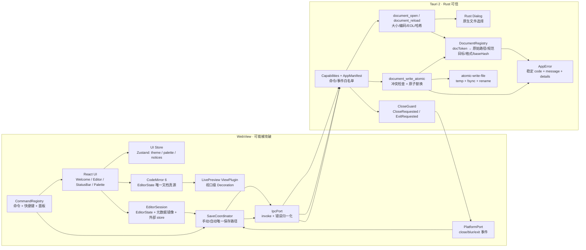
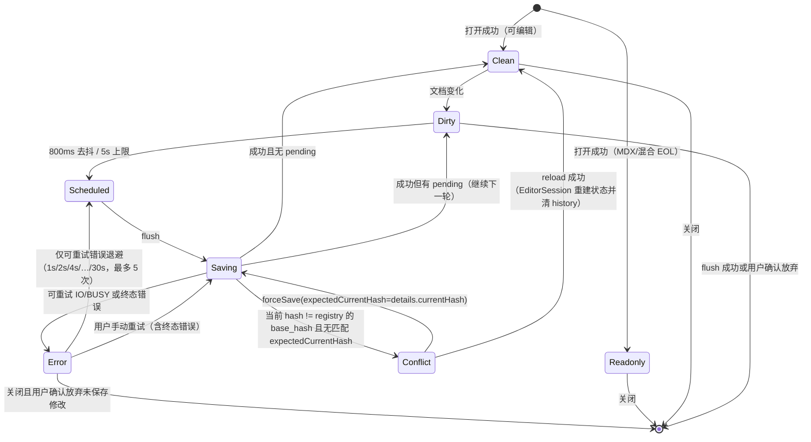
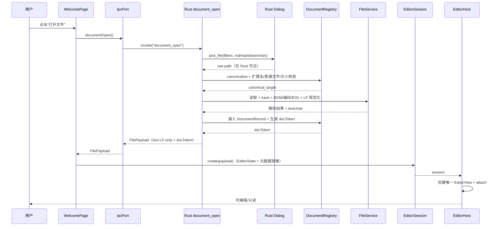
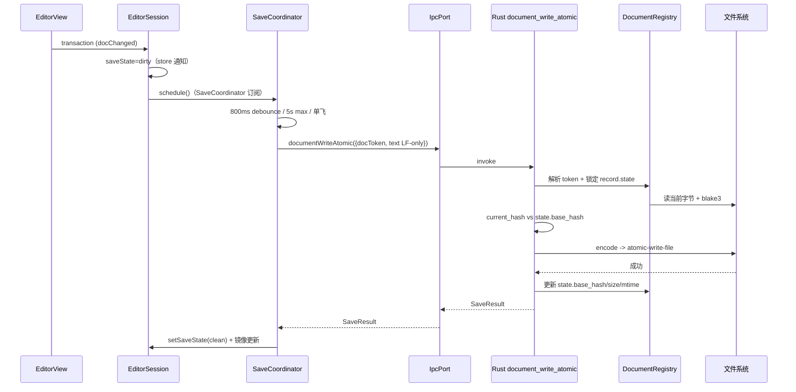
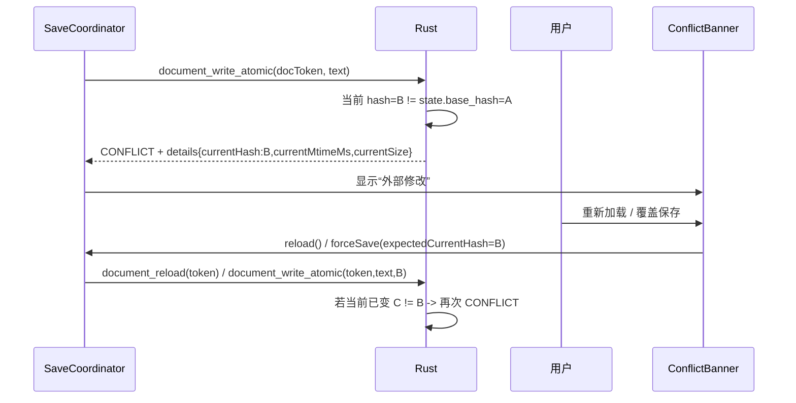

# P0–P1 编辑器 MVP 骨架设计方案

> **文档用途：** 面向技术评审、开发、测试和交接人员的设计说明
> **功能 ID：** `p0-p1-editor-mvp`
> **对应需求：** `R-001 ~ R-015`（见 `README.md` §2）
> **对应实施计划：** [`01-实施计划.md`](01-实施计划.md)
> **代码基线：** T-001 前 `Qingmo` 不是 Git 仓库且仅含文档；T-001 已建立骨架与 `p1-baseline`。基线文件 SHA-256 见 §20.1
> **设计版本：** `v1.1`（已吸收 R1/R2/R3 复审）
> **日期：** 2026-10-26
> **状态：** 已复审；Q-001~Q-015 已于 2026-10-26 全部按推荐确认；T-001 已完成，实施进行中
> **2026-10-27 实现更新：** Live Preview 已扩展到 CommonMark + GFM 全量语法，并新增内联 Widget 与 `atomicRanges`；表格/代码块仍保留源码行样式化，不跨行替换。实际实现以 `packages/editor-core/src/live-preview/` 为准，本文相关规则已同步。

---

## 1. 摘要

方案设计时，Qingmo 只有蓝图、调研和拓扑文档，没有任何可执行代码，也不是 Git 仓库；T-001 已补上可运行骨架。因此本方案不是对既有业务的改造，而是**从零建立第一条可运行、可验证、可回滚的垂直切片**：在 Tauri 2 外壳中打开一个 Markdown 文件，用 CodeMirror 6 编辑，提供最小 Live Preview，通过唯一的原子保存通道落盘，并具备手动保存、自动保存、冲突检测、主题切换和命令面板。

本方案覆盖蓝图 P0（工程骨架）与 P1（编辑器 MVP）中**足以证明架构成立**的部分，不覆盖 P2 的工作区/搜索/监听/恢复，也不覆盖 P3 的插件宿主。这样做的目的不是缩小产品目标，而是先用最小闭环验证四个高风险假设：CM6 作为唯一文档状态、Tauri 自定义命令作为唯一文件通道、原子写与冲突检测不丢字、视口级装饰在 1MB/10MiB 文档上可退化。

一句话方案：

> 在保留蓝图“文件为源、CM6 为唯一文档状态、插件默认隔离”的前提下，用**单一保存协调器、单一原子写实现、单一路径策略、单一 IPC 契约**建立 P0–P1 垂直切片；所有 P2+ 能力只允许接入这些既有接口，不得另起一套保存、路径、配置或解析逻辑。

**本方案明确不新增数据表、不新增用户配置项。** 唯一新增的持久化键是 UI 主题偏好 `qingmo.ui.theme`（localStorage，Q-005 已确认）；唯一新增的工程常量是编辑器阈值（Q-006 已确认）。

---

## 2. 问题定义

### 2.1 业务背景与当前状态

当前仓库只有文档：

```text
README.md
docs/BLUEPRINT.md
docs/RESEARCH.md
docs/TOPOLOGY.md
docs/qingmo-topology.drawio(.png/.svg)
docs/topology-gen.js
```

T-001 前 `README.md` 写明“当前处于蓝图阶段，尚未开始编码”；`git rev-parse HEAD` 返回“not a git repository”。T-001 已改变这一基线。这意味着（方案设计时）：

1. 没有可索引的代码，GitNexus 无法为 Qingmo 建立代码图；
2. 没有既有函数、模块、配置、数据表可供“复用”；
3. 唯一可校准的“现有实现”是文档中的约束、ADR、数据模型和路线图；
4. 任何“现有实现已支持”的断言都不成立，必须改写为“蓝图约定”或“待实现”。

### 2.2 蓝图内部需要先解决的冲突

| 缺口 | 蓝图当前写法 | 根因/证据 | 若不解决的后果 |
|---|---|---|---|
| 两套文件 IO | §9.3 capability 授予 `fs:allow-read-text-file` / `fs:allow-write-text-file`，§9.2 又说“文件读写优先走自定义命令” | `docs/BLUEPRINT.md` §9.2/§9.3 | 插件或前端可绕过路径校验；两套错误/冲突/编码逻辑并存 |
| 两个文档身份 | `documents.id TEXT PRIMARY KEY` 与 `documents.path TEXT UNIQUE` | §7.2 schema | P2 建库时无法确定外键、重命名、链接目标使用哪一个 |
| 两套保存路径 | P1 手动保存、P2 自动保存/恢复/备份分别描述 | §7.3、§13 | 手动保存与自动保存出现两套状态机，冲突检测遗漏 |
| 两套设置存储 | `settings.json`、Zustand persist、SQLite `plugins` 表 | §7.2、§8.2、§9.1 | 同一个主题/插件开关出现多个真源 |
| Live Preview 用错扩展类型 | §5.3 目标写 `StateField + Decoration`，但装饰依赖视口和选区 | `docs/RESEARCH.md` §2.2、CM6 decoration 文档 | 每次视口变化都要 dispatch，或装饰不随视口更新 |
| FTS5 外部内容表字段不匹配 | `documents` 只有 `id/path/title/mtime/size/hash/indexed_at`，FTS5 却声明 `title, body, tags` + `content='documents'` | §7.2 SQL | P2 建表即失败，或 `body/tags` 永远为空 |
| 大文件 IPC 形态 | `file_read` 返回 `FilePayload` 字符串，§5.5 又说“流式写入/分块” | §9.1、§5.5 | 10MiB 字符串跨 IPC 复制，内存峰值不可控 |
| 预览解析器双轨 | CM6 Lezer + markdown-it + 插件 fence renderer | §5.4 | 同一段 Markdown 两套渲染结果，插件贡献点归属不清 |
| 资产协议范围过宽 | `assetProtocol.scope` 含 `$APPDATA/**`、`$APPLOCALDATA/**` | §9.3 | WebView 可读插件数据/设置；P3 插件资产边界失效 |
| 路径边界依赖前端自证 | 若 dialog 在前端、Rust 只接收 `path`，则“会话允许列表”可被任意前端代码自服务 | §9.2；R2 F-R2-01 | “路径 jail”不是安全边界；任意可读文件可被读入并随后写回 |

> 以上不是“代码缺陷”，而是**设计冲突/边界缺口**。本表列出与蓝图直接相关的 10 类；完整修改点共 13 项（MP-001~MP-013），另外 MP-005（契约测试）、MP-006（CSP）、MP-013（CloseGuard）属于实施边界补充。P1 处理 MP-001~MP-008、MP-010~MP-013（共 12 项），MP-009（FTS5 schema）登记为 P2 建库前置。

### 2.3 设计目标

| R-ID | 目标 | 可度量成功标准 |
|---|---|---|
| R-001 | 建立可启动的 Tauri 2 + React + Vite + CM6 工程 | `pnpm tauri dev` 启动；空窗口可交互；三平台 `cargo check` 通过 |
| R-002 | 打开 `.md/.markdown`，`.mdx` 只读 | Rust 侧原生对话框选择文件；返回不透明 `docToken`；文件名/只读状态正确显示 |
| R-003 | CM6 `EditorState` 是唯一文档真源 | React/Zustand 中不存在正文；代码审查 + store 形状测试 |
| R-004 | 最小 Live Preview | 标题/强调/行内代码/链接/引用/列表标记按光标行/选区显隐；1MB 文档可交互 |
| R-005 | 唯一原子保存通道 | 手动/自动保存共用 `SaveCoordinator`；断电模拟下旧文件或新文件完整，无半写 |
| R-006 | 自动保存 | 800ms 去抖、5s 最大延迟、单飞、`flush` 循环保存 pending、失焦/关闭 flush、可重试错误指数退避 |
| R-007 | 冲突检测 | 外部修改后保存触发 `CONFLICT`；重载/按精确 `expectedCurrentHash` 覆盖；不静默覆盖 |
| R-008 | 大文件可退化 | 10MiB 文件可打开编辑；`doc.length > 2M` UTF-16 单元关闭 Live Preview；>10MiB 明确拒绝（读写两侧） |
| R-009 | 命令注册表 + 命令面板 | 打开/保存/主题/Live Preview 四个命令同表注册；快捷键无第二套监听 |
| R-010 | 主题 | light/dark/system 切换不重建 EditorView；撤销历史保留 |
| R-011 | 国际化 | zh-CN 默认、en 回退；错误码有对应文案；无硬编码 UI 文案 |
| R-012 | 安全默认值 | 无 fs/shell/http/store/sql 插件；CSP 显式；`withGlobalTauri=false`；Rust 侧 dialog + 不透明 token，前端不持有可写路径 |
| R-013 | 契约完整性 | 命令名/事件名/能力白名单/TS 表由测试锁定；DTO 由 `ts-rs` 生成并校验 |
| R-014 | 可验证 | Rust 单元/集成、TS 单元/组件、浏览器 E2E（fake IPC/Platform）、Tauri 冒烟 |
| R-015 | 性能基线 | 10KB/1MB/10MiB 固定 fixtures 记录打开、装饰、按键 p95、保存；不宣称未实测指标 |

### 2.4 非目标

- 不实现工作区根目录、文件树、拖拽打开、最近文件；留给 P2。
- 不实现 SQLite、全文搜索、反链、标签；P1 不建库、不建表。
- 不实现 `notify` watcher、崩溃恢复、备份、版本历史；留给 P2。
- 不实现插件 SDK、Plugin Worker/iframe、市场、签名、权限 UI；留给 P3。
- 不实现完整 Preview 面板、图片/表格/Mermaid/KaTeX/Shiki；P1 只做 Lean Live Preview。
- 不实现设置页、`settings.json`、窗口状态持久化、多标签、分屏、Save As。
- 不实现原生菜单、托盘、单实例、深链接、更新器、移动端。
- 不实现协作/CRDT/OT；Eg-walker 仅作为 P6 评估项。
- 不引入 `tauri-plugin-fs`、`tauri-plugin-http`、`tauri-plugin-store`、`tauri-plugin-sql`。

### 2.5 前置假设与约束

| 类型 | 内容 | 验证方式 | 假设失效后的处理 |
|---|---|---|---|
| 业务 | P0–P1 的最小闭环优先于 P2 功能 | 蓝图 §13 路线图 | 若业务要求先做工作区，则调整 T-001 起的任务顺序，但保留单一保存/路径接口 |
| 技术 | CM6 视口渲染 + Lezer 增量解析足以支撑 10MiB 可编辑 | MarkEdit 宣称 10MiB；Qingmo 未实测 | 若 10MiB 不达标，降低 P1 上限并在 P2 引入分块/Worker；不改文档模型 |
| 技术 | Tauri 2 自定义命令 + `AppManifest::commands` 能收紧 ACL | 官方文档 + 本地参考项目契约测试 | 若 ACL 行为不符，退回 capability 白名单 + 负例测试，仍不启用 fs 插件 |
| 技术 | `atomic-write-file` 在 macOS/Windows/Linux 提供原子替换 | crate 文档声明支持三平台 | 若某平台失败，T-006 改用 `tempfile + fs::rename + fsync` 并补平台测试 |
| 技术 | `ts-rs` 12 能表达 serde DTO（含 `serde_json::Value`） | 官方文档 + T-003 实测；启用 `serde-json-impl` feature | 若字段映射不满足，退回手写 TS 类型 + JSON fixture 契约测试，不引入 RC 依赖 |
| 技术 | Tauri dialog 插件可在 Rust 异步命令中打开原生对话框 | 官方文档 + T-005 实测；使用异步回调/oneshot，不在主线程 blocking | 若不可行，退回前端 dialog + 明确降级为“防误操作”，并保存 raw/canonical 双路径 |
| 技术 | Tauri `WindowEvent::CloseRequested` + `RunEvent::ExitRequested` 可在 Rust 侧统一拦截关闭/Cmd+Q | 官方文档 + T-012 实测 | 若行为不符，退回 JS `onCloseRequested` + `core:window:allow-destroy`，并记录 Cmd+Q 限制 |
| 技术 | 10MiB 读写可通过单次 IPC 字符串完成且内存可接受 | P1 真机 bench；R-015 记录 RSS/耗时 | 若不可接受，P1 降低上限到 5MB，P2 引入分块/流式 |
| 部署 | P1 只做本地桌面应用，无服务端 | 蓝图非目标 | 无服务端回滚问题 |

---

## 3. 总体设计

### 3.1 设计原则

| 原则 | 含义 | 对实现的约束 |
|---|---|---|
| 单一真源 | 每个事实只有一个权威位置 | 文档只在 `EditorState`；命令名只在 Rust `COMMANDS`；保存格式/baseHash 只在 Rust `DocumentRegistry`；保存只经 `SaveCoordinator` |
| 单一通道 | 每类副作用只有一个入口 | 文件读写只走自定义命令；关闭只走一个 `app://close-requested` 事件 + 一个确认命令；主题只走 CSS 变量 + Compartment；错误只走 `AppError` |
| 视口优先 | 大文档只处理可见区域 | Live Preview 只遍历 `visibleRanges`；单次 `ensureSyntaxTree` 总预算 5–10ms；超过阈值直接关闭 |
| 失败可恢复 | 失败不破坏旧状态 | 原子写失败保留旧文件；保存失败保留内存内容；冲突暂停自动保存 |
| 默认拒绝 | 未授权能力不可用 | 无 fs/shell/http 插件；命令 ACL 白名单；写命令只接受不透明 token，不接受前端路径 |
| 可验证 | 结论必须有命令或证据 | 每个 T 有 Verification；性能只记录实测；GitNexus 结论标注 epistemic |
| YAGNI | 不为未出现的消费者造抽象 | P1 只建 `shared/editor-core/ui` 三个包；不建 plugin-sdk/host；P1 不抽 `PathPolicy` trait，P2 再提取 |

### 3.2 系统架构



架构说明：

- **入口层**：`WelcomePage` 只触发 `document_open`（Rust 侧弹原生对话框）；`EditorPage` 只挂载编辑器与状态栏。入口不直接 `invoke`，统一经 `IpcPort`。
- **编排层**：`SaveCoordinator` 拥有保存状态机；`CommandRegistry` 拥有命令与快捷键（各 feature 注册自己的命令）；`EditorSession` 拥有 `EditorState`、元数据镜像和派生状态订阅。`EditorView` 只由 `EditorHost` 创建一次。
- **核心层**：`EditorState` 持有文档；`LivePreview` 只读 `EditorState` 并在视口内生成装饰；Rust `DocumentRegistry` 是保存格式/baseHash/token 的唯一权威。
- **依赖层**：Tauri 命令/对话框、`atomic-write-file`、`encoding_rs`（仅 UTF-8 解码）、`blake3`；不直接暴露给 UI。
- **关闭层**：Rust `CloseGuard` 拦截窗口关闭与 Cmd+Q，发 `app://close-requested`；前端 flush 后调 `app_close_confirm`；Rust 才 destroy/exit。
- **观测层**：状态栏展示保存状态/光标/编码/EOL/大小；Rust `tracing` 记录命令与错误；错误码映射 i18n。

### 3.3 职责边界

| 模块/层 | 负责 | 不负责 | 依赖 |
|---|---|---|---|
| `apps/desktop` | 路由、页面、状态栏、命令面板、i18n、主题、`IpcPort`/`PlatformPort` | 文档正文、文件 IO、原子写、路径裁决 | `editor-core`、`shared`、`ui` |
| `packages/editor-core` | CM6 扩展组合、Live Preview、文本格式应用、编辑器工厂 | React、Tauri、文件 IO | `shared`、CM6 |
| `packages/shared` | `ts-rs` 生成的 IPC DTO、`TextFormat`/`DocumentKey`/错误码、纯函数常量 | 业务状态、DOM、Tauri | 无 |
| `packages/ui` | 设计 token、实际用到的按钮/横幅等无业务原语 | 文档、IPC、路由 | React |
| `src-tauri/commands` | 命令参数反序列化、调用 service、错误映射 | UI 状态、装饰算法 | `services`、`state` |
| `src-tauri/services` | 编码/BOM/EOL、大小检测、原子写、哈希、冲突 | token/路径策略、命令注册、窗口 | crates |
| `src-tauri/state` | `DocumentRegistry`：token→原始/规范路径、扩展名/路径策略、格式、baseHash；`CloseGuard` | UI 状态、装饰、编码实现 | std/Tauri |
| `src-tauri/ipc` | DTO、命令名/事件名常量、错误类型 | 业务逻辑 | serde/ts-rs |
| `Capability/AppManifest` | 命令/事件级 ACL、窗口权限（最小 core 集） | 业务逻辑 | Tauri |

### 3.4 当前链路与目标链路

T-001 前的当前链路（只有文档，无运行时）：

```text
用户打开 README/BLUEPRINT
  -> 阅读架构与路线图
  -> 无代码可执行
  -> 无法验证 10MiB、原子写、权限、Live Preview
```

T-001 后：`pnpm tauri dev` 可拉起空壳窗口（Vite/React → Tauri WebView → Rust `run`），但打开/编辑/保存链路尚未建立。

目标链路（P1）：

```text
用户点击“打开文件”
  -> IpcPort.documentOpen()
  -> Rust document_open
  -> Rust Dialog 选择文件（前端拿不到任意路径入口）
  -> DocumentRegistry: 校验扩展名/普通文件/大小 -> canonicalize
  -> 读取字节（open handle + 限长）-> blake3
  -> BOM/编码 -> 严格解码 -> EOL 计数 -> 内存统一 LF
  -> 生成 docToken，登记 {rawPath, canonicalTarget, format, baseHash, size}
  -> FilePayload（text LF-only + docToken + textUnits）
  -> EditorSession 创建 EditorState（doc + readOnly facet）
  -> EditorHost 创建唯一 EditorView + LivePreview ViewPlugin
  -> 用户输入 transaction
  -> EditorState 更新 + session 派生 dirty
  -> SaveCoordinator 去抖/单飞
  -> IpcPort.documentWriteAtomic({docToken, text(LF-only), expectedCurrentHash?})
  -> Rust: 读当前字节 -> blake3 -> 与 registry.baseHash/expectedCurrentHash 比较
  -> 冲突则 CONFLICT（返回 currentHash）；确认后 expectedCurrentHash 精确匹配才写
  -> encode（UTF-8 或手写 UTF-16LE/BE）+ EOL 一次性转换
  -> atomic-write-file
  -> SaveResult -> DocumentRegistry 更新 baseHash/mtime/size
  -> 前端镜像更新 -> clean
```

> 关键变化：前端不再传 `path`、`encoding`、`hasBom`、`eol` 或 `force`。这些由 Rust `DocumentRegistry` 持有并校验；前端只持有展示镜像和 `docToken`。这使“路径 jail”与“格式不被前端篡改”成为真实边界。

---

## 4. 修复方式与修改点

> 本章不是修 Bug，而是修正蓝图内部会导致“多套逻辑并存”的设计冲突。每个 `MP-ID` 对应一个 T 任务。

### 4.1 修复方式概述

| 项 | 内容 |
|---|---|
| 根因 | 蓝图同时描述了“自定义命令 IO”和“fs 插件 IO”、“手动保存”和“自动保存”、“settings.json”和“SQLite/Zustand”等多条通道，且没有指定唯一所有者 |
| 修复策略 | 在 P1 先冻结唯一通道：自定义命令、`SaveCoordinator`、`DocumentRegistry`/token、`AppError`、CSS 变量主题、Rust 命令名契约；P2+ 只能接入这些接口 |
| 保持不变 | 文件为源、CM6 为唯一文档状态、插件默认隔离、SQLite 只做可重建索引、Live Preview 不引入第二文档模型 |
| 被否决的替代方案 | 启用 fs 插件（路径校验分散）、tauri-specta RC（版本风险）、StateField 做视口装饰（更新时机错误）、P1 建 SQLite（范围蔓延） |

### 4.2 修复前调用链（设计冲突如何发生）

```text
打开文件
  -> 前端可直接 @tauri-apps/plugin-fs readTextFile
  -> 或自定义 file_read(path)
  -> 两套路径校验/编码/错误
  -> 保存时 writeTextFile 与 file_write_atomic(path, format, force) 并存
  -> 冲突检测只覆盖其中一条
  -> 外部修改可能被静默覆盖；前端可伪造 format/force
```

### 4.3 修复后调用链

```text
打开文件
  -> 只允许 IpcPort.documentOpen()
  -> 只允许 Rust document_open（Rust 侧 dialog）
  -> DocumentRegistry 校验并生成 docToken
  -> 保存只允许 SaveCoordinator
  -> 只允许 IpcPort.documentWriteAtomic({docToken, text, expectedCurrentHash})
  -> 只允许 Rust document_write_atomic 读当前字节/hash/encode
  -> 只允许 atomic-write-file 落盘
```

### 4.4 修改点清单

| MP-ID | 文件/符号 | 修改类型 | 修改内容 | 影响的调用链节点 | 关联决策/任务 | 风险 |
|---|---|---|---|---|---|---|
| MP-001 | `src-tauri/capabilities/default.json` | 新增 | 删除 `fs:*`/`shell:*`/`http:*`；只保留最小 core 事件权限 + 4 条命令白名单；不授予前端 dialog/window destroy | ACL | D-007 / T-003 | 低 |
| MP-002 | `packages/editor-core/src/live-preview/plugin.ts` | 新增 | 内联视口装饰用 `ViewPlugin`；表格 block widget 用 `StateField` | Editor -> LivePreview | D-003 / T-013 | 中 |
| MP-003 | `packages/editor-core/src/markdown/` | 新增 | P1 只用 Lezer/CM6；markdown-it 预览管线延后 | 解析 | D-001 / T-009 | 低 |
| MP-004 | `apps/desktop/src/stores/uiStore.ts` | 新增 | 只持久化 UI 主题 slice；不建 settings.json；不另建 themeStore | 主题 | D-012 / T-016 | 低 |
| MP-005 | `src-tauri/src/ipc/contract.rs` | 新增 | Rust `COMMANDS`/`EVENTS` + TS 镜像 + 契约测试；不用 tauri-specta RC | IPC | D-008 / T-003 | 中 |
| MP-006 | `src-tauri/tauri.conf.json` | 新增 | 显式 CSP；真实构建验证 `connect-src`/style nonce；生产/开发分离 | ACL/CSP | D-007 / T-002 | 中 |
| MP-007 | `src-tauri/src/ipc/dto.rs` | 新增 | `FilePayload` 增加 `docToken`/`textUnits`；`SaveRequest` 改为 token + LF-only text + `expectedCurrentHash`；格式由 Rust 持有 | document_open/write | D-009/D-021 / T-003/T-005/T-006 | 中 |
| MP-008 | `src-tauri/src/state/document_registry.rs` | 新增 | Rust 侧 dialog + 不透明 token + 原始/规范双路径；P2 再引入 workspace root | DocumentRegistry | D-006/D-021 / T-005 | 中 |
| MP-009 | `docs/BLUEPRINT.md` §7.2 | 修改（P2 前） | 修正 FTS5 外部内容表字段：`documents` 增加 `body/tags` 或改用 contentless FTS | P2 索引 | Q-011 / NEXT-002 | 中 |
| MP-010 | `src-tauri/tauri.conf.json` | 新增 | P1 关闭 asset protocol；P3 只对 workspace/plugin assets 开 scope | ACL | D-007 / T-002 | 低 |
| MP-011 | `apps/desktop/src/features/editor/save/SaveCoordinator.ts` | 新增 | 手动+自动唯一保存状态机；`flush` 循环处理 pending；P2 只加 watcher/recovery | 保存 | D-005 / T-011 | 高 |
| MP-012 | `packages/shared/src/document-key.ts` | 新增 | P1 文档身份=规范路径（`docToken` 只是 IPC 句柄）；P2 建库前决定 ID 语义 | 路径/身份 | D-017 / T-003/T-008 | 中 |
| MP-013 | `src-tauri/src/state/close_guard.rs` + `ipc/contract.rs` | 新增 | Rust 拦截 CloseRequested/ExitRequested；一个 `app://close-requested` 事件 + `app_close_confirm` 命令 | 关闭 | D-022 / T-003/T-012 | 中 |

---

## 5. 核心组件

### 5.1 `DocumentRegistry`（Rust，文档句柄与路径校验）

职责：把“Rust 侧 dialog 选中的文件”变成“本次会话唯一可读写的文档句柄”；前端只拿到不透明 `docToken`，不能提交任意路径。

| 项 | 设计 |
|---|---|
| 输入 | `document_open()` 无路径参数（Rust 弹 dialog）；`document_reload(token)`；`document_write_atomic({docToken,...})` |
| 输出 | `FilePayload`（含 `docToken`）或 `AppError` |
| 依赖 | Tauri dialog 插件（Rust API）、`std::fs::canonicalize`、`metadata` |
| 状态 | `DocumentRegistry`：`HashMap<DocToken, DocumentRecord>`；P1 单窗口只保留 1 个活动 token，open 时替换旧 token |
| 并发 | token 表用 `RwLock`；每个 `DocumentRecord` 内含 `state: Mutex<DocState>`，同一把锁既串行化保存，也原子更新 baseHash/mtime/size；锁不跨 dialog/await |
| 测试 | 扩展名白名单、目录、不存在、无权限、符号链接、相对路径、大小写、Unicode、token 伪造/过期、原始链接被替换 |

```rust
pub struct DocToken(String); // 不透明 UUID；仅 IPC 句柄，不是文档身份

pub struct DocumentRecord {
    pub raw_selected: PathBuf,       // dialog 返回的原始路径（可能是符号链接）
    pub canonical_target: PathBuf,   // 实际读写目标；P1 文档身份
    pub state: std::sync::Mutex<DocState>, // 保存串行 + 元数据原子更新；在 spawn_blocking 内获取
}

pub struct DocState {
    pub format: TextFormat,          // encoding/hasBom/eol；Rust 唯一权威
    pub read_only: Option<ReadOnlyReason>,
    pub base_hash: String,           // 上次成功读/写的磁盘字节 blake3
    pub disk_size: u64,
    pub mtime_ms: i64,
}

pub struct DocumentRegistry {
    docs: std::sync::RwLock<HashMap<DocToken, Arc<DocumentRecord>>>,
}
```

规则：

1. `document_open` 是唯一能新增 token 的入口，且 **dialog 在 Rust 侧**；前端没有 `path` 参数可传。这样即使 WebView 被攻破，也不能让 Rust 打开任意路径。
2. 选择后校验：必须是普通文件；扩展名只允许 `.md`/`.markdown`/`.mdx`（ASCII 大小写不敏感）；`.mdx` 只读；大小 ≤ 10MiB；编码可严格解码；混合 EOL 只读。`FileService` 返回 `ParsedFile` 且全部校验成功后才插入 token；失败不留下可写句柄。
3. `document_reload(token)` 重新读取 `raw_selected`：重新 `canonicalize(raw_selected)`，若与 `canonical_target` 不同（符号链接被替换）则拒绝 `OUTSIDE_SCOPE`；成功后在同一 `state` 锁内更新 format/read_only/base_hash/size/mtime，token 不变。
4. `document_write_atomic` 只接受 token；在 `state` 锁内重新读取 `canonical_target` 当前字节并 hash；不再使用 mtime/size 快路径（见 §5.3）。
5. token 生命周期：P1 单文档；`document_open` 成功即替换旧 token，旧 token 立即失效；窗口退出时 registry drop。P2 多标签/多窗口时改为引用计数 + 显式 close。
6. 不做“工作区根”判断；P2 的 `WorkspacePolicy` 负责 root/相对路径/新建文件，届时可把 `DocumentRegistry` 的路径校验提取为 trait，但 P1 不预造 trait。
7. 错误码：`INVALID_PATH`、`OUTSIDE_SCOPE`、`NOT_FOUND`、`NOT_A_FILE`、`UNSUPPORTED_EXTENSION`、`PERMISSION_DENIED`、`FILE_TOO_LARGE`、`UNSUPPORTED_ENCODING`。

> 威胁模型：P1 把 WebView 视为**可能被攻破**（依赖供应链/XSS/调试注入），因此“前端 dialog + 前端 path”不构成 jail。Rust 侧 dialog + token 才是边界；`withGlobalTauri=false` 只是减少入口，不是安全边界。

### 5.2 `FileService`（Rust）

职责：读取、解码、检测格式、计算哈希；不负责保存。**输出给前端的 `text` 永远是 LF-only**；磁盘 EOL 只记录在 `TextFormat.eol`，由保存侧一次性还原。

| 项 | 设计 |
|---|---|
| 输入 | `raw_selected` + `canonical_target`（FileService 不做 token/路径策略） |
| 输出 | `ParsedFile`（text/format/mixedEol/hash/size/textUnits/mtime/readOnly/reason） |
| 依赖 | `encoding_rs`（仅 UTF-8 解码）、`blake3`、`std::fs` |
| 状态 | 无状态；只返回 `ParsedFile`，不写 `DocumentRegistry` |
| 并发 | 每个命令独立；`spawn_blocking` 包裹同步 IO；读取用已打开 handle 的 metadata |
| 失败策略 | 快速失败，返回稳定 `AppError`；不返回部分内容或乱码 |

算法：

```text
1. raw_selected 已 canonicalize 为 canonical_target；File::open(canonical_target) -> metadata
   （同一 handle 取 metadata/size，避免 metadata 与 read 之间被替换；raw_selected 仅用于写前复核链接）
2. 检查普通文件；size <= MAX_FILE_BYTES（10 * 1024 * 1024）
3. take(MAX_FILE_BYTES + 1).read_to_end -> 若 bytes.len() > MAX -> FILE_TOO_LARGE
4. hash = blake3(bytes)（磁盘原始字节，含 BOM/EOL）
5. BOM 检测顺序：
   FF FE 00 00 / 00 00 FE FF -> UNSUPPORTED_ENCODING（UTF-32，P1 不支持）
   EF BB BF -> utf8 + hasBom
   FF FE -> utf16Le + hasBom
   FE FF -> utf16Be + hasBom
   否则 -> utf8, hasBom=false
6. 严格解码：
   utf8 -> std::str::from_utf8（错误 -> UNSUPPORTED_ENCODING）
   utf16Le/Be -> 手写 u16 组装 + String::from_utf16（奇数字节/未配对 surrogate -> 错误）
   无 BOM 且解码结果含 U+0000 -> UNSUPPORTED_ENCODING（防止无 BOM UTF-16/UTF-32 被当 UTF-8）
7. 统计 CRLF / 单独 LF / 单独 CR；多于一类 >0 -> mixed_eol=true, read_only=MixedEol
   否则 eol = 唯一类（默认 LF）
8. 内存文本统一 LF（把 CRLF/CR 替换为 LF）；text_units = text.encode_utf16().count()
9. .mdx -> read_only=Mdx（仍可读，不可写）
10. 返回 ParsedFile { text(LF-only), format{encoding,hasBom,eol},
                      mixedEol, hash, size(disk bytes), textUnits, mtimeMs,
                      readOnly, readOnlyReason }
    // document_open 在 registry 插入成功后才组装 FilePayload（docToken + path + ParsedFile）
```

> `size` 是磁盘字节；`textUnits`/`doc.length` 是 UTF-16 code units。二者不可混用。`MAX_FILE_BYTES` 用 MiB（10 * 1024 * 1024），边界测试用 `MAX-1/MAX/MAX+1`。

### 5.3 `AtomicWriter`（Rust）

职责：唯一写盘实现；不持有文档状态，状态在 `DocumentRegistry`。

| 项 | 设计 |
|---|---|
| 输入 | `DocumentRecord`（token 已解析；format 从 `state` 读取）、LF-only `text`、`expected_current_hash: Option<String>` |
| 输出 | `SaveResult { hash, size, mtime_ms }` |
| 依赖 | `atomic-write-file` 0.3.x、`blake3` |
| 状态 | 无状态；由 `DocumentRecord.state` 串行化同一文档并更新元数据 |
| 失败策略 | 失败保留旧文件；临时文件由 crate 清理；返回 `IO`/`CONFLICT`/`FILE_TOO_LARGE` |

冲突检查顺序（**不做 mtime/size 快路径**）：

```text
1. 在 `record.state` 锁内打开 canonical_target，读取当前字节并计算 current_hash
2. 若 current_hash == state.base_hash -> 正常保存
3. 否则：
   - expected_current_hash == Some(current_hash) -> 允许（用户已确认覆盖该精确版本）
   - 否则 -> CONFLICT，details 返回 { currentHash, currentMtimeMs, currentSize }
4. 校验 text：
   - 不含 '\r'（wire 契约 LF-only）
   - 不含 U+0000
   - utf8 bytes <= MAX_FILE_BYTES
5. encode(format)：
   - 先在字符串层把 '\n' 还原为目标 eol（CRLF/CR/LF）
   - utf8: text_out.as_bytes()
   - utf16Le/Be: text_out.encode_utf16() -> u16s -> 按端序转字节（**不用 encoding_rs 的 encoder**）
   - 若 has_bom 前置 BOM
   - 禁止对 UTF-16 字节序列做 replace（可能跨 code unit 误匹配）
6. 若编码后 bytes.len() > MAX_FILE_BYTES -> FILE_TOO_LARGE
7. atomic-write-file: temp sibling -> write -> fsync -> rename -> (Unix) fsync parent
8. 更新 state.base_hash/disk_size/mtime，返回新 hash(bytes)/size/mtime
```

> **残余窗口**：从 `current_hash` 读取到 `rename` 之间，外部进程仍可能写入；P1 用“保存前总是 hash + 精确 `expected_current_hash`”把窗口压到最小，但不宣称完全消除。P2 watcher/文件锁再消除（RK-004）。
>
> **平台限制**：`atomic-write-file` 在 Unix 保留 mode/owner，但不保留 timestamp/ACL/xattr/SELinux context；Windows 走 `fs::rename`，不保证 write-through/ACL 保留。P1 在 §17/§13 明确记录，并在 T-006 加平台测试；不把“权限保留”写成无条件保证。

### 5.4 `SaveCoordinator`（TypeScript）

职责：手动保存、自动保存、失焦/关闭 flush、冲突/错误状态机的唯一实现。

| 项 | 设计 |
|---|---|
| 输入 | `session.docToken`、`session.readText()`（按需读取 `state.doc` 的 LF-only 文本）、`IpcPort`、定时器抽象 |
| 输出 | 状态迁移 + `SaveResult` |
| 依赖 | `EditorSession`（只读快照）、`IpcPort`、定时器抽象 |
| 状态 | 每个文档一个实例；`clean/dirty/scheduled/saving/conflict/error/readonly` |
| 并发 | 单飞：`saving` 时新请求只置 `pending`，不并发 invoke |
| 失败策略 | `CONFLICT` 暂停自动保存；可重试 `IO/BUSY` 指数退避（1s/2s/4s/…/30s，最多 5 次）；终态错误停止自动保存；关闭时 `flush` 循环直到 clean/冲突/错误/只读 |

`flush(reason)` 契约（必须写进测试）：

```text
async flush(reason):
  cancel debounce/max timer
  closing = (reason == "close")
  loop:
    if state == readonly -> return {ok:true, state}
    if state == conflict -> return {ok:false, reason:"conflict"}
    if state == error && !retryable -> return {ok:false, reason:"error"}
    if inFlight -> await inFlight; continue
    if pending || dirty:
       await saveOnce()   // 成功 -> clean 或再次 dirty；冲突/错误 -> 返回
       continue
    return {ok:true, state:"clean"}
  // 只有 clean/readonly 才 ok；conflict/error 由 UI 决定是否强制关闭
```

规则：

1. 保存请求只发送 `{docToken, text: session.readText()（LF-only）, expectedCurrentHash?}`；不发送 path/format/force。`readText()` 不缓存正文，React store 也不保存正文。
2. 成功：用 `SaveResult` 更新 `session` 的展示镜像（size/mtime）；`base_hash` 只留在 Rust `DocState`。若保存期间 `pending`，继续下一轮；否则 `clean`。
3. 冲突：保存 `ConflictDetails.currentHash`；`forceSave()` 把它作为 `expectedCurrentHash` 再试；若外部又变，仍冲突。
4. 错误分类：`IO/BUSY` 可重试；`PERMISSION_DENIED/NOT_FOUND/READ_ONLY/CONFLICT/INVALID_PATH/OUTSIDE_SCOPE/FILE_TOO_LARGE/UNSUPPORTED_ENCODING` 为终态（`NOT_FOUND` 提示“文件已删除”，P1 不自动重建）。
5. 只读文档仍创建 coordinator，但 `saveState=readonly`、不设定时器、`flush` 直接返回 ok。
6. 关闭：`flush("close")` 成功后由 `PlatformPort` 调 `app_close_confirm({allow:true})`；失败/冲突则 UI 确认，用户可选择允许关闭（明确提示未保存）。

状态机见 §7.1。

### 5.5 `EditorSession`（TypeScript）

职责：持有 `EditorState`、文档元数据镜像和外部 store；**不创建 EditorView**。

| 项 | 设计 |
|---|---|
| 输入 | `FilePayload`（含 `docToken`）、`EditorState` |
| 输出 | `docId`（= canonical path）、`docToken`、`readText(): string`、`dirty/saveState/cursor/selection/readOnly/format` |
| 依赖 | CM6 `EditorState`；不依赖 SaveCoordinator（单向） |
| 状态 | 文档级；正文只在 `EditorState`；不持久化 |
| 并发 | 主线程；所有修改走 `view.dispatch`；store 快照不可变 |
| 测试 | `state.doc` 引用变化、dirty 映射、undo/redo、多选区、`docId === path`、快照无正文 |

规则：

1. `EditorSession` 创建 `EditorState` 时使用 facet：
   `EditorState.create({ doc, extensions: [EditorState.readOnly.of(readOnly), EditorView.editable.of(!readOnly), ...] })`；
   **不再把 `lineSeparator`/`readOnly` 当 `create` 配置项**。内存文本统一 LF，`lineSeparator` 不设置（默认 LF）。
2. `EditorHost` 在 `useEffect` 中创建唯一 `EditorView`，然后 `session.attach(view)`；`EditorSession` 不持有 DOM，也不创建 view。
3. `EditorSession` 维护唯一外部 store（`snapshot` + `version`）；`getSnapshot()` 返回缓存对象，只有值变化才替换。`SaveCoordinator` 通过 `session.setSaveState(state)` 推送保存状态；`dirty` 由 `saveState !== "clean" && saveState !== "readonly"` 派生，不另建 `EditorStatusStore`。
4. `SaveCoordinator` 构造时订阅 session 的 `docChanged`；session 不 import SaveCoordinator。文档切换/关闭由上层 `DocumentController` 调 `flush`，避免双向依赖。
5. React 组件不持有 `content`/`markdown`/`doc` 字符串；`FilePayload.text` 在创建 state 后丢弃。`snapshot()` 只含元数据；保存时由 `readText()` 从 `EditorState` 按需读取，不进入 React store。
6. 切换文档前必须 `await saveCoordinator.flush("switch")`；失败则取消切换。
7. 只读文档仍创建 coordinator，`saveState=readonly`，不设定时器。

### 5.6 `LivePreview`（TypeScript）

职责：在视口内把 Lezer Markdown 节点映射为 CM6 装饰。

| 项 | 设计 |
|---|---|
| 输入 | `EditorView`（只读） |
| 输出 | `DecorationSet` |
| 依赖 | `@codemirror/lang-markdown`、`@lezer/markdown`、CM6 `ViewPlugin` |
| 状态 | 插件内缓存 `DecorationSet` + 上次 key（doc/tree/viewport/选区范围） |
| 并发 | 主线程；同步构建，只处理可见范围；单次 `ensureSyntaxTree` 总预算 5–10ms |
| 失败策略 | `doc.length > LP_MAX_UNITS` 返回 `Decoration.none`；解析不完整时只装饰已解析范围；composition 期间返回源码并 map 旧装饰 |

规则：

1. composition 期间不对组合行做 replace；旧 `DecorationSet` 必须 `map(update.changes)`，不能原样返回。
2. 跨行节点（如可能跨行的 `LinkTitle`）不做 replace，只做 mark/line。
3. 标记级显隐：只有当光标/选区实际触达某个标记时才显示该标记（`rangeIsRevealed`），不再按“当前行整行显示源码”；标题标记连同其后空格一起隐藏。
4. 内联 Widget：列表符号、任务复选框、分隔线、图片、代码语言标签使用 `Decoration.replace({ widget })`，并登记 `EditorView.atomicRanges`，保证方向键/选区不落入 Widget 内部。CM6 禁止 ViewPlugin 提供 block decoration，因此表格改由独立 `StateField` 提供 block widget；光标/选区进入表格时回退源码。代码块仍保留可编辑源码行并做行级样式化。
5. 装饰只遍历 `visibleRanges`，整行扩展用 `doc.lineAt(Math.min(range.to, doc.length))`；超长单行（>10,000 字符）跳过 replace。

算法见 §6.2。

### 5.7 `CommandRegistry`（TypeScript）

职责：第一方命令、快捷键、命令面板的唯一注册表；各 feature 只注册自己的命令，不另建 keydown。

| 项 | 设计 |
|---|---|
| 输入 | `{ id, titleKey, category, keybinding?, when?, run }` |
| 输出 | `Disposable`；`execute(id): Promise<Result<void, AppError>>` |
| 依赖 | 无（P1 不含插件） |
| 状态 | 应用级；注册表不可变快照 + 订阅；核心在 T-004 建立 |
| 并发 | 命令执行返回 `AppError`（含 `Busy`）；保存命令的合并由 `SaveCoordinator.pending` 负责，不由 registry 拒绝 |
| 测试 | 冲突检测、when 条件、重复 id、执行错误、重入、每 feature 注册一次 |

注册归属（避免重复/漏接）：

| 命令 | 注册任务 | 执行实现 |
|---|---|---|
| `file.open` | T-008 | `documentOpen` -> `EditorSession` |
| `file.save` | T-012 | `SaveCoordinator.flush("manual")` |
| `view.toggleTheme` | T-016 | `uiStore` + theme Compartment |
| `view.toggleLivePreview` | T-014 | LP Compartment 开关 |
| `app.close`（可选） | T-012 | close guard，不注册全局 Cmd+Q |

`Result<T,E>` 定义在 `packages/shared/src/result.ts`，是判别联合 `{ok:true,value:T} | {ok:false,error:E}`；不引入 fp-ts 等额外抽象。

P3 的插件命令必须注册到同一表，不允许第二套命令总线。

**T-015 实现落点**：

- `features/commands/CommandPalette.tsx` 通过 `useSyncExternalStore` 订阅 `commandRegistry` 快照，按标题/分类/id/快捷键过滤，`when()` 为假的命令不展示；列表与快捷键提示均来自 registry，不维护第二份命令表。
- `features/commands/keybindings.ts` 是唯一全局 `keydown` 监听：事件发生时读取 registry；`Mod+K` 仅打开面板（UI 入口，不注册业务命令），其余快捷键匹配后 `preventDefault` 并执行；忽略 `repeat`/`isComposing`/`defaultPrevented`；macOS Meta 与非 macOS Ctrl 归一为 `mod`。
- `WorkspaceLayout` 唯一挂载监听与面板；面板打开或关闭确认框出现时禁用全局分发；执行错误复用 toast，`CANCELLED` 静默；面板打开聚焦搜索框、Tab 留在模态内、关闭恢复原焦点。
- 真实 Tauri 验证见 C-101/C-103：4 个命令与 ⌘O/⌘S/⌘⇧L 展示；过滤“保存”回车后“已同步”；`Mod+S` 保存；`Mod+Shift+L` 切 dark 后正文/光标保留且前台 Cmd+Z 可撤销；`Mod+O` 打开原生对话框；Esc 后焦点回到编辑器。

### 5.8 `ThemeService`（TypeScript）

职责：主题切换与 CM6 主题 Compartment。

| 项 | 设计 |
|---|---|
| 输入 | `light/dark/system` |
| 输出 | 根元素 `data-theme` + `Compartment.reconfigure(themeExtension)` |
| 依赖 | CSS 变量、CM6 `Compartment` |
| 状态 | `uiStore` 的 theme slice + localStorage `qingmo.ui.theme`；**不另建 themeStore** |
| 失败策略 | localStorage 不可用则回退 system，不阻塞启动 |

规则：

1. CM6 主题只引用 CSS 变量，不复制颜色常量；切换主题不重建 `EditorView`，撤销历史保留。
2. `view.toggleTheme` 由 T-016 在 `CommandRegistry` 注册；不写第二套快捷键。
3. `system` 模式监听 `matchMedia('(prefers-color-scheme: dark)')`，变化时只重配 Compartment + 根属性。
4. `uiStore` 只持久化 theme；不持久化文档路径/正文。

**T-016 实现落点**：

- `stores/uiStore.ts` 同时导出 `UiStore`（测试用工厂）与 `uiStore` 单例；`initialize()` 在 React 首次渲染前应用根 `data-theme`，`setTheme` 负责持久化、解析 system 与切换 `matchMedia` 订阅；localStorage 读写异常均回退 system。
- `packages/editor-core/src/extensions/theme.ts` 缓存 light/dark 两套 `EditorView.theme`，两者都只含语义 CSS 变量，并统一携带 `syntaxHighlighting(qingmoHighlightStyle)`；`markdownExtensions` 只保留语言支持，避免高亮扩展双份。
- `app/useThemeService.ts` 把 resolvedTheme 交给 `EditorSession.applyTheme`；后者只重配 theme compartment，`view` 身份、正文、选区与 undo 历史不变，`replacePayload` 后重放当前主题。
- `features/commands/themeCommand.ts` 在 `WorkspaceLayout` 唯一注册 `view.toggleTheme`（`Mod+Shift+L`）；全局快捷键分发归 T-015，T-016 只保证命令可执行。验证见 C-097（组件/撤销/dark facet）与 C-099（浏览器 light/dark、刷新持久化、system 跟随）。

### 5.9 `IpcPort` / `PlatformPort`（TypeScript）

职责：唯一 IPC/平台入口、错误归一化、浏览器 fake adapter。

| 项 | 设计 |
|---|---|
| 输入 | 命令名（来自 `COMMANDS`）、参数 |
| 输出 | 生成的 DTO 类型 |
| 依赖 | `@tauri-apps/api/core`、`@tauri-apps/api/event`、`shared` 生成类型 |
| 状态 | 无状态 |
| 失败策略 | 统一抛 `AppError`；未知异常归一为 `IO` |
| 测试 | 与 Rust 契约测试互补；fake adapter 驱动 E2E |

```ts
export interface IpcPort {
  documentOpen(): Promise<FilePayload>;
  documentReload(docToken: string): Promise<FilePayload>;
  documentWriteAtomic(req: SaveRequest): Promise<SaveResult>;
  appCloseConfirm(req: { allow: boolean }): Promise<void>;
}

export interface PlatformPort {
  onCloseRequested(cb: (reason: "window" | "exit") => void): () => void;
  onBlur(cb: () => void): () => void;
  isComposing(): boolean;
  // 浏览器 fake：close 事件由测试触发；Tauri：监听 app://close-requested
}
```

规则：

1. 组件只 import `IpcPort`/`PlatformPort`，不直接 import `@tauri-apps/api/*`；dependency-cruiser 只允许 `lib/ipc/tauri.ts` 与 `lib/platform/tauri.ts` 直接 import Tauri。
2. `documentOpen` 无 path 参数；dialog 在 Rust 侧。前端没有“传任意路径”的 API。
3. 浏览器 fake 覆盖 `documentOpen/Reload/WriteAtomic/CloseConfirm` 与 close/blur 事件，供 Playwright 使用；生产构建通过 `import.meta.env`/Vite alias 排除 fake 分支。
4. `normalizeError` 识别 `{code,message,details}`；字符串/未知异常 -> `IO`；`Busy` 也是 `AppError`。

---

## 6. 数据模型、接口与核心机制

### 6.1 核心数据模型

```rust
/// P1 文档身份 = canonical target path；docToken 只是 IPC 句柄。
pub type DocumentKey = String;

#[derive(Serialize, Deserialize, TS, Clone)]
#[serde(rename_all = "camelCase")]
pub struct TextFormat {
    pub encoding: TextEncoding, // utf8 | utf16Le | utf16Be
    pub has_bom: bool,
    pub eol: LineEnding,        // lf | crlf | cr
}

#[derive(Serialize, Deserialize, TS)]
#[serde(rename_all = "camelCase")]
pub struct FilePayload {
    pub doc_token: String,      // 不透明句柄；后续命令唯一凭据
    pub path: String,           // canonical target；仅展示/身份，不作为写命令参数
    pub text: String,           // 内存文本，永远 LF-only
    pub format: TextFormat,
    pub mixed_eol: bool,
    pub hash: String,           // 磁盘原始字节 blake3（含 BOM/EOL）
    pub size: u64,              // 磁盘字节
    pub text_units: u64,        // UTF-16 code units（= doc.length 期望值）
    pub mtime_ms: i64,
    pub read_only: bool,
    pub read_only_reason: Option<ReadOnlyReason>,
}

#[derive(Serialize, Deserialize, TS)]
#[serde(rename_all = "camelCase")]
pub struct SaveRequest {
    pub doc_token: String,
    pub text: String,           // LF-only；不得含 '\r'
    pub expected_current_hash: Option<String>, // 冲突确认时来自 ConflictDetails.currentHash
}

#[derive(Serialize, Deserialize, TS)]
#[serde(rename_all = "camelCase")]
pub struct SaveResult {
    pub hash: String,
    pub size: u64,
    pub mtime_ms: i64,
}

#[derive(Serialize, Deserialize, TS)]
#[serde(rename_all = "camelCase")]
pub struct ConflictDetails {
    pub current_hash: String,
    pub current_mtime_ms: i64,
    pub current_size: u64,
}
```

字段语义：

| 字段 | 类型 | 来源 | 语义 | 校验/约束 |
|---|---|---|---|---|
| `docToken` | string | Rust 生成 UUID | 不透明 IPC 句柄 | 只接受 registry 中活动 token；伪造/过期 -> `INVALID_PATH` |
| `path` | string | Rust canonicalize | 规范目标路径 | 仅展示/身份；写命令不接受 path |
| `text` | string | 解码后/编辑器 | 文档内容 | **LF-only**；不含 `\r`/U+0000；UTF-8 字节 ≤10MiB |
| `format.encoding` | enum | BOM/检测 | `utf8/utf16Le/utf16Be` | 仅这三种；UTF-32/无 BOM UTF-16 拒绝 |
| `format.hasBom` | bool | BOM 检测 | 保存时是否写 BOM | 由 Rust 持有，前端不改 |
| `format.eol` | enum | 计数 | `lf/crlf/cr` | 混合时 `mixedEol=true` 且只读 |
| `mixedEol` | bool | 计数 | 是否混合换行 | true 时禁用保存 |
| `hash` | string | blake3 磁盘原始字节 | 内容指纹 | 64 hex；no-op 保存必须字节一致 |
| `size` | number | handle metadata | 磁盘字节 | ≤10MiB |
| `textUnits` | number | `encode_utf16().count()` | UTF-16 单元数 | 与 `doc.length` 对照；用于 LP 阈值 |
| `mtimeMs` | number | metadata | 修改时间 | Unix ms；仅展示/诊断 |
| `readOnly` | bool | 规则 | 是否只读 | MDX/混合 EOL |
| `readOnlyReason` | enum? | 规则 | `mdx/mixedEol` | 用于 i18n |
| `expectedCurrentHash` | string? | 冲突横幅 | 精确覆盖目标版本 | 只在用户确认后出现；外部再变则再次 CONFLICT |

`AppError`：

```rust
#[derive(Debug, Serialize, TS, Clone)]
#[serde(rename_all = "camelCase")]
pub struct AppError {
    pub code: AppErrorCode,
    pub message: String,
    pub details: Option<serde_json::Value>,
}

#[derive(Debug, Serialize, TS, Clone, Copy)]
#[serde(rename_all = "SCREAMING_SNAKE_CASE")]
pub enum AppErrorCode {
    InvalidPath,
    OutsideScope,
    NotFound,
    NotAFile,
    UnsupportedExtension,
    FileTooLarge,
    UnsupportedEncoding,
    Conflict,
    PermissionDenied,
    ReadOnly,
    Busy,
    Io,
    Cancelled,
}

#[derive(Debug, Serialize, Deserialize, TS, Clone, Copy)]
#[serde(rename_all = "camelCase")]
pub enum TextEncoding { Utf8, Utf16Le, Utf16Be }

#[derive(Debug, Serialize, Deserialize, TS, Clone, Copy)]
#[serde(rename_all = "camelCase")]
pub enum LineEnding { Lf, Crlf, Cr }

#[derive(Debug, Serialize, Deserialize, TS, Clone, Copy)]
#[serde(rename_all = "camelCase")]
pub enum ReadOnlyReason { Mdx, MixedEol }
```

> `AppError.details` 使用 `serde_json::Value` 时，`ts-rs` 需启用 `serde-json-impl` feature（T-003 预检查）。`Conflict` 的 details 固定为 `ConflictDetails` 结构，TS 侧可类型守卫。

### 6.2 核心算法：Live Preview

```text
build(view):
  if state.doc.length > LP_MAX_UNITS: return none
  tree = syntaxTree(state)
  selectionRanges = state.selection.ranges.map(r => [r.from, r.to])  // 含空光标
  key = (state.doc identity, tree identity, viewport.from, viewport.to,
         selectionRanges.map(r => r.join(":")).join(";"))
  if key == lastKey: return previous

  if view.composing:
    return previous.map(update.changes)   // 不让装饰位置漂移

  ranges = clamp/expand view.visibleRanges to full lines
  specs = []
  upto = min(ranges.last.to, doc.length)
  ensureSyntaxTree(state, upto, 8ms)     // 单次总预算；失败继续用当前部分树
  tree = syntaxTree(state)               // ensure 可能推进语法树，重新取当前树
  for range in ranges:
    tree.iterate(from: range.from, to: range.to):
      line = doc.lineAt(node.from)
      if line.length > MAX_LINE_UNITS: continue   // 超长单行跳过 replace
      revealed = selectionRanges.some(touches marker range)
      - ATXHeading1..6 / SetextHeading1..2: line class cm-md-h1..h6; if !revealed -> replace HeaderMark（ATX 连同空格；Setext 整行下划线）
      - Strong/Emphasis/Strikethrough/Subscript/Superscript/InlineCode: mark content; if !revealed -> replace corresponding marker
      - Link/Autolink: mark link text; if !revealed -> replace LinkMark/URL/LinkTitle/LinkLabel
      - Image: if !revealed -> replace whole node with image widget
      - Blockquote: line class; if !revealed -> replace QuoteMark + following space
      - 列表: line class; 无序 -> bullet widget；任务 -> checkbox widget；有序 -> mark number
      - FencedCode: line class; opening fence -> language widget; closing fence -> replace
      - CodeBlock（缩进）: line class only
      - Table: 光标在表格外 -> StateField block widget 渲染 HTML 表格；光标进入 -> 移除 widget，header/delimiter/row line classes
      - HorizontalRule: rule widget
      - HTMLBlock/HTMLTag: 弱化样式，保留源码；Escape: 隐藏反斜杠；HardBreak: 隐藏断行标记
      - 跨行行内节点（如 LinkTitle）: 只 mark/line，不 replace
  return Decoration.set(specs, true)  // sort=true；同位置多 spec 不保证 startSide，暂不用 builder
```

关键规则：

1. **只处理可见范围**：不遍历全文；整行扩展用 `doc.lineAt(Math.min(range.to, doc.length))`，防止越界。
2. **标记级显隐**：用**所有** `selection.ranges` 对每个标记做区间判断（含空光标、跨行选区），不只 `selection.main`；光标触达标记边界或选区与标记重叠时才显示该标记，多选区任一命中即可。`# 标题` 的光标停在正文时只显示“标题”，移到行首才露出 `# `。
3. **解析预算**：每次 update 只调用一次 `ensureSyntaxTree`，总预算 5–10ms（不是每个 range 50ms）；超时/失败用当前部分树，不每帧重试；语法树对象变化（懒加载语言/后台解析）也触发重建。
4. **替换标记不替换内容**：`Decoration.replace({})` 只覆盖标记节点，不覆盖内容节点；跨行节点不 replace。
5. **Widget 与 `atomicRanges`**：列表符号、任务复选框、分隔线、图片、代码语言标签是内联 Widget；表格是 `StateField` 提供的 block widget。每个 Widget 实现 `eq`，原子替换登记到 `EditorView.atomicRanges`。CM6 只禁止 ViewPlugin 提供 block decoration，`StateField` 不受此限制；光标/选区进入表格时移除 block widget、显示源码。超过 200k UTF-16 单元时关闭表格 block widget，回退源码样式以控制逐键扫描成本。
6. **IME**：`view.composing` 时不重建，但旧 `DecorationSet` 必须 `map(update.changes)`；组合结束后（`compositionend`/下一次 transaction）强制重建一次。`flush("blur")` 在 composition 中延后。
7. **缓存 key**：`state.doc` 对象身份 + `syntaxTree` 对象身份 + `viewport.from/to` + 所有选区范围（按 from/to 值比较，不用数组身份）；不引入自增版本号。
8. **排序**：`Decoration.set(specs, true)` 排序；若基准显示排序成为瓶颈，再改为 `RangeSetBuilder` 并保证 `from`+`startSide` 顺序，不能只保证 `from`。
9. **不使用 rAF 合并**：ViewPlugin 在 CM6 更新周期内同步构建；若基准显示 >16ms，再评估 requestIdleCallback/分片，不提前加延迟。

**T-013 实现落点**：

- 规划器在 `live-preview/specs.ts`（`collectDecorationSpecs`），插件在 `live-preview/plugin.ts`；样式用 `live-preview/theme.ts` 的 `EditorView.theme`，不新增全局 `styles.css`，所有选择器限定在编辑器 DOM 内。
- 多行引用的续行 `QuoteMark` 父节点是 `Paragraph`，因此不能要求 `Blockquote` 父节点；“跨行不 replace”只对 `StrongEmphasis`/`Emphasis`/`InlineCode`/`Link` 等行内父节点生效，块级 marker 逐行隐藏。
- 参考链接 `[text][ref]` 的 `LinkLabel` 在 `Link` 下隐藏；`LinkReference` 定义行保持可编辑。
- 1MB/40,001 行文档跳到末尾时，8ms 单次解析预算会让可见区域先显示源码，CM6 后台解析推进后约 4s 内收敛；输入不被阻塞。FPS/RSS 与 10MiB 基线已由 T-017 记录（C-105/C-107），大文件策略由 T-014 落地。

### 6.3 核心算法：文本格式检测与编码

检测（Rust，读入后只做一次）：

```text
detect(bytes):
  if bytes starts FF FE 00 00 or 00 00 FE FF -> UNSUPPORTED_ENCODING (UTF-32)
  else if bytes starts EF BB BF -> utf8, hasBom=true, body=bytes[3..]
  else if bytes starts FF FE -> utf16Le, hasBom=true, body=bytes[2..]
  else if bytes starts FE FF -> utf16Be, hasBom=true, body=bytes[2..]
  else -> utf8, hasBom=false
  decode strictly; on error -> UNSUPPORTED_ENCODING
  if decoded text contains U+0000 -> UNSUPPORTED_ENCODING (无 BOM UTF-16/32 防护)
  count CRLF, LF(not preceded by CR), CR(not followed by LF)
  if more than one class > 0 -> mixedEol=true; eol = dominant
  else eol = the only class (default lf)
  text = text.replace("\r\n", "\n").replace("\r", "\n")   // 内存统一 LF
```

保存（Rust，唯一编码点）：

```text
encode(text_lf_only, format):
  assert !text.contains('\r') && !text.contains('\0')
  // 先在字符串层把 LF 还原为目标 EOL，再编码；禁止对 UTF-16 字节做 replace
  text_out = text_lf_only.replace('\n', eol_str(format.eol))  // "\n" / "\r\n" / "\r"
  if encoding == utf8:
     bytes = text_out.as_bytes()
  else: // utf16Le/Be
     units = text_out.encode_utf16().collect::<Vec<u16>>()
     bytes = units.iter().flat_map(|u| match endian {
        Le => u.to_le_bytes(), Be => u.to_be_bytes()
     })
  if hasBom: prepend EF BB BF / FF FE / FE FF
  hash = blake3(bytes)
```

规则：

1. **wire 契约**：`FilePayload.text` 与 `SaveRequest.text` 永远是 LF-only；前端用 `state.doc.toString()`（CM6 固定 `\n`）发送。`EditorState.lineSeparator` 不设置（默认 LF），避免 `sliceDoc()`/`toString()` 两套语义。
2. **编码只做一次**：Rust 是唯一编码点；前端不传 encoding/hasBom/eol，也不做 `\n` 替换。
3. **UTF-16 编码**：`encoding_rs` **不提供 UTF-16 encoder**，禁止对 UTF-16 调用 `.encode()`；必须手写 `encode_utf16` + 端序 + BOM。
4. **no-op 保存字节一致**：未编辑直接保存必须 byte-identical，hash 不变；用 CRLF/CR/LF × UTF-8 BOM/UTF-16LE/BE BOM 矩阵测试。
5. **混合 EOL 只读**：避免静默统一；`readOnlyReason=MixedEol`，写命令在 Rust 侧再次拒绝（不信任前端标志）。
6. **UTF-32/无 BOM UTF-16 拒绝**：不返回带 NUL 的“可解码乱码”。

### 6.4 数据一致性与并发

- **一致性模型**：单文档强一致（内存） + 文件级原子替换；无多副本。
- **事务边界**：CM6 transaction 是内存事务；Rust 命令是文件事务；两者不共享事务。
- **幂等键**：Rust `DocumentRecord.state.base_hash` 是乐观锁；`expectedCurrentHash` 是用户确认后的精确破锁；不再使用布尔 `force`。
- **并发控制**：前端 `SaveCoordinator` 单飞 + Rust `DocumentRecord.state` 锁；同一文档不并发写；P1 不做全局每路径 Mutex。
- **缓存策略**：Live Preview 只缓存当前视口装饰；无跨文档缓存。
- **时间语义**：`mtimeMs` 仅展示/诊断；冲突检测**不依赖 mtime/size**，每次保存都读当前字节并计算 blake3。
- **残余窗口**：hash 读取到 rename 之间仍可能被外部写入；P2 watcher/文件锁消除（RK-004）。
- **格式权威**：encoding/BOM/EOL/baseHash 只在 Rust；前端只有展示镜像，不能通过 IPC 改格式。

### 6.5 API / 命令

| 命令 | 输入 | 输出 | 兼容性 | 权限/安全 |
|---|---|---|---|---|
| `document_open` | 无 | `FilePayload`（含 `docToken`） | 新增 | `allow-document-open`；Rust 侧 dialog；扩展名/大小/编码校验 |
| `document_reload` | `{ docToken }` | `FilePayload` | 新增 | `allow-document-reload`；token 必须活动；链接替换则拒绝 |
| `document_write_atomic` | `SaveRequest` | `SaveResult` | 新增 | `allow-document-write-atomic`；token + 当前 hash 冲突检查；Rust 侧只读/大小校验 |
| `app_close_confirm` | `{ allow: boolean }` | `null` | 新增 | `allow-app-close-confirm`；只在 CloseGuard 已发事件后有效 |

事件：

| 事件 | 负载 | 方向 | 说明 |
|---|---|---|---|
| `app://close-requested` | `{ reason: "window" \| "exit" }` | Rust -> WebView | 窗口关闭或 Cmd+Q 时发出；前端 flush 后调 `app_close_confirm` |

P1 只有这一个自定义事件。`EVENTS = ["app://close-requested"]` 进入契约测试；不再使用前端 `onCloseRequested` 作为主路径，也不授予 `core:window:allow-destroy`。

---

## 7. 状态机与决策策略

### 7.1 保存状态机



| 状态 | 含义 | 允许动作 | 退出条件 |
|---|---|---|---|
| `Clean` | 内存与磁盘一致 | 编辑、关闭、切换 | 文档变化 -> Dirty |
| `Dirty` | 有未保存修改 | 编辑、手动保存、自动调度 | 定时器/手动 -> Scheduled |
| `Scheduled` | 已排队 | 编辑、取消、flush | flush -> Saving |
| `Saving` | 单飞保存中 | 编辑（只置 pending） | 成功/冲突/错误 |
| `Conflict` | 外部修改 | 重载、按精确 hash 覆盖、关闭确认 | 用户选择 |
| `Error` | 保存失败 | 可重试错误重试；终态错误只能手动/关闭确认 | 退避/成功/终态 |
| `Readonly` | 只读文档 | 关闭、另存为（P2） | 不进入保存 |

`flush` 的终止条件（必须由 fake timers 测试）：

```text
flush(reason):
  cancel timers
  while true:
     if readonly -> ok
     if conflict -> not ok (unless close + user confirms)
     if error && !retryable -> not ok
     if inFlight -> await; continue
     if pending || dirty -> await saveOnce(); continue
     return ok(clean)
```

> 关键：`Saving -> Dirty` 不是终点；`flush` 必须继续保存 pending，直到 clean 或终态。关闭/失焦只有在 clean/readonly 或用户明确放弃后才允许。

### 7.2 决策优先级

| 优先级 | 条件 | 动作 | 原因 |
|---|---|---|---|
| P0 | token 伪造/过期 / 符号链接目标变化 | 拒绝，`OUTSIDE_SCOPE`/`INVALID_PATH` | 安全优先 |
| P0 | 当前 hash != registry 的 `base_hash` 且 `expectedCurrentHash` 不匹配 | 进入 Conflict，不写盘 | 不丢用户/外部修改 |
| P0 | MDX / 混合 EOL / 编码不支持 / 超过 10MiB | 拒绝写/读 | Rust 侧再次校验，不信任前端 |
| P1 | `saving` 中又有修改 | 置 pending；flush 循环继续 | 避免交错写、避免关闭丢字 |
| P1 | 关闭/Cmd+Q/失焦 | Rust 发 close-requested；前端 flush 后确认 | 减少未保存窗口，覆盖 Cmd+Q |
| P2 | 可重试 `IO/BUSY` | 指数退避（最多 5 次） | 瞬时故障可恢复 |
| P2 | 终态 `PERMISSION_DENIED/NOT_FOUND/READ_ONLY/...` | 停止自动保存，提示 | 重试无意义，避免风暴 |
| P2 | `doc.length > 2M` UTF-16 单元 | 关闭 Live Preview | 保证可编辑 |
| P3 | 主题/localStorage 不可用 | 回退系统主题 | 不阻塞核心路径 |

### 7.3 阈值、默认值与依据

| 参数 | 初始值 | 单位 | 依据 | 调整方式 |
|---|---:|---|---|---|
| 自动保存去抖 | 800 | ms | 蓝图 §7.3 | 常量；Q-006 确认 |
| 自动保存最大延迟 | 5000 | ms | 蓝图 §7.3 | 常量；Q-006 确认 |
| 保存重试基数/上限/次数 | 1000 / 30000 / 5 | ms / ms / 次 | 工程初值，非标准 | 常量；基准后校准；仅 `IO/BUSY` |
| Live Preview 上限 | 2,000,000 | UTF-16 code units | 工程初值；≈2MB ASCII / ≈6MB 中文 | 常量；T-017 未要求调整 |
| 语法树解析预算 | 5–10（单次 update 总预算） | ms | CM6 `ensureSyntaxTree` 单次调用语义 | 常量；T-017 未要求调整 |
| 单文件上限 | 10 * 1024 * 1024 | bytes（MiB） | 蓝图 P1 目标 | **Rust 唯一权威**；读写两侧；TS 不复制；Q-002 确认 |
| 超长单行跳过 replace | 10,000 | UTF-16 units | 防止单行全量装饰 | 常量 |
| 光标状态栏节流 | 100 | ms | 工程初值；blur/switch/unmount flush | 常量 |

> 这些是**工程常量**，不是用户配置项。P1 不提供设置界面，不允许运行时改值；若需要调整，走代码变更 + 基准复测。
>
> 两个阈值维度不同：`MAX_FILE_BYTES` 决定“能不能打开/保存”，`LP_MAX_UNITS` 决定“开不开 Live Preview”。5MB ASCII（约 5M units）会 LP-off 但仍可编辑；状态栏文案必须区分“LP 已关闭（大文档）”与“文件过大”。蓝图 §5.5 的 2–10MiB 分级退化在 P1 简化为“LP 全关”，登记为 D-023。

**T-014 实现落点**：

- `createEditorState` 对 `normalized.length > LP_MAX_UNITS` 不安装 `livePreview()`，大文档初始即源码模式；插件自身仍保留 `doc.length > LP_MAX_UNITS` 的 no-op 保险。
- `EditorSession.largeFile` 由 `doc.length` 计算，有效模式为 `previewEnabled && !largeFile`；`view.toggleLivePreview` 只 dispatch `setModeEffect` 重配 mode compartment，不重建 `EditorView`，大文档下返回 `BUSY`。
- 状态栏显示“大文档 · 预览关闭”（title 说明 2,000,000 UTF-16 单元）；Rust 的 `MAX_FILE_BYTES` 仍是唯一文件上限，前端不复制，只处理 `FILE_TOO_LARGE`。
- 实测（C-095）：5MB 打开约 2.4s；10MiB 打开约 4.5s（AX 端到端上界），`EditorState` 创建 1.0–1.8s，Markdown 初始化是主要开销；10MiB-1 可编辑并保存为精确 10MiB；10MiB+1 被 Rust 拒绝且磁盘不变。正式 open/decorate/key p95/RSS 基线见 T-017/C-105/C-107（RK-001）。

---

## 8. 数据流与关键时序

### 8.1 打开文件



> 前端没有 `path` 入参；即使 WebView 被攻破，也不能让 Rust 打开任意文件。`docToken` 只用于后续 reload/write，不能当路径使用。

### 8.2 编辑与自动保存



### 8.3 冲突



> “重新加载”会丢弃当前内存修改并清空撤销历史；ConflictBanner 必须二次确认后才调用 `document_reload`，不得自动重载。

横幅只在“重新加载/覆盖保存”动作失败时显示错误码；检测到外部修改本身不再显示为操作失败（否则会把 `CONFLICT` 误报成用户动作失败）。

### 8.4 关闭/失焦（Rust CloseGuard）

```text
用户点红叉 / Cmd+W / Cmd+Q / Dock Quit
  -> Rust WindowEvent::CloseRequested 或 RunEvent::ExitRequested
  -> api.prevent_close()/prevent_exit()
  -> emit "app://close-requested" { reason: "window" | "exit" }
  -> PlatformPort 收到 -> SaveCoordinator.flush("close")
  -> if clean/readonly: IpcPort.appCloseConfirm({allow:true})
  -> if saving: flush 循环等待 pending
  -> if success: allow
  -> if conflict/error/timeout: 前端显示确认
       - 用户“仍要关闭” -> appCloseConfirm({allow:true})（明确未保存）
       - 用户“取消” -> appCloseConfirm({allow:false})，窗口保留
  -> Rust CloseGuard 校验 pending flag 后 destroy/exit

window blur（非关闭）
  -> SaveCoordinator.flush("blur")
  -> composition 中则延后到 compositionend
```

**macOS Cmd+Q 例外**：系统默认 Quit 菜单项直接调用 `NSApplication terminate:`，不会触发 `RunEvent::ExitRequested`（tao 只在 `applicationWillTerminate` 报告，为时已晚）。实现仅替换默认应用菜单的最后 Quit 项为自定义 Cmd+Q 菜单项，菜单事件仍 emit `app://close-requested` 并走同一 CloseGuard；不新增 P2 功能菜单（D-025）。

### 8.5 停止、取消或资源释放顺序

```text
停止接收新编辑（可选：readOnly）
  -> 取消 debounce/max timer
  -> 等待进行中的 save promise
  -> flush pending（如有）
  -> 销毁 EditorView / 移除 listeners
  -> 释放 SaveCoordinator / EditorSession
```

---

## 9. 特殊路径与边界场景

| 场景 | 预期行为 | 不允许的行为 | 验证方式 |
|---|---|---|---|
| 空文件 | 打开空文档，可编辑，保存为 0 字节或 1 个换行（按用户输入） | 误判为损坏 | Rust 单测 |
| 10MiB 文件 | 打开可编辑；`doc.length > 2M` 时 LP 关闭并提示“大文档 · 预览关闭”；10MiB-1 可编辑并保存到精确 10MiB；10MiB+1 写入被拒且磁盘不变 | 全量语法树/装饰；把 10MiB 当 10MiB；静默截断 | C-093/C-095/C-105/C-107 |
| 5MB ASCII（5M units） | 可编辑；LP 关闭；状态栏说明原因 | 误报“文件过大” | Rust/TS 单测 + 手动 |
| >10MiB 读 | `FILE_TOO_LARGE`；最多读 `MAX+1` 字节，不整文件加载 | 静默截断/先分配再判断 | Rust 单测 |
| >10MiB 写 | `FILE_TOO_LARGE`，保留旧文件 | 只检查读不检查写 | Rust 单测 + 组件 |
| UTF-8 BOM | 保留 BOM，保存后仍有 BOM；no-op byte-identical | 静默去 BOM | Rust 单测 |
| UTF-16LE/BE BOM | 正确解码，保存保留编码/BOM；手写 encode_utf16 | 当 UTF-8 处理；用 encoding_rs encoder | Rust 单测（字节级） |
| UTF-32LE/BE BOM | `UNSUPPORTED_ENCODING` | 当 UTF-16LE/BE 解码 | Rust 单测 |
| 无 BOM UTF-16 | 解码结果含 U+0000 -> `UNSUPPORTED_ENCODING` | 当 UTF-8 打开成 NUL 乱码 | Rust 单测 |
| GBK/非 UTF-8 | `UNSUPPORTED_ENCODING`，不返回乱码 | 有损解码 | Rust 单测；Q-003 |
| 混合 EOL | 只读打开，提示；保存禁用；Rust 侧再次拒绝 | 静默统一 | Rust 单测；Q-004 |
| CRLF/CR/LF | 磁盘保留原 EOL；内存 LF；保存一次性还原 | 双重转换（`\r\r\n`）或统一为 LF | Rust + E2E |
| MDX | 只读打开，保存禁用；Rust 侧再次拒绝 | 覆盖 MDX | Rust + 组件测试 |
| 符号链接 | 保存 raw_selected + canonical_target；写前重 canonicalize raw，目标变化则拒绝 | 只存 canonical 目标导致检测不到链接替换 | Rust 单测 |
| token 伪造/过期 | `INVALID_PATH`/`OUTSIDE_SCOPE` | 用任意 path 读写 | Rust 单测 |
| 文件被外部删除 | 保存 `NOT_FOUND`，保留内存，提示；P1 不自动重建 | 静默重建 | Rust + 组件测试 |
| 外部修改同内容 | hash 相同，不冲突，更新 registry hash/mtime | 误报冲突 | Rust 单测 |
| 外部修改不同内容 | `CONFLICT`，暂停自动保存 | 静默覆盖 | Rust + E2E |
| 冲突后再外部修改 | `forceSave(expectedCurrentHash=B)` 遇到 C -> 再次 `CONFLICT` | 用 bool force 覆盖未知版本 | Rust 单测 |
| 磁盘满/只读 | ENOSPC -> `IO` 可退避；EACCES -> `PERMISSION_DENIED` 终态；保留内存 | 丢内容；混淆两类错误 | Rust failpoint + 故障注入 |
| 保存中关闭 | Rust CloseGuard 拦截；flush 循环保存 pending；失败确认 | 直接退出/Cmd+Q 绕过 | 组件/E2E/手动 |
| 保存中继续输入 | 成功后继续保存 pending，直到 clean | 并发写/停在 Dirty | 单测 fake timers |
| IME 组合中 | 旧装饰 map；组合行显示源码；blur flush 延后 | 装饰错位/保存半成品 | 手动 + 单测 |
| 多选区 | 所有选区覆盖行都显示源码 | 只按主选区判断 | 单测 |
| 撤销/重做 | 状态栏 dirty 正确，保存后仍可撤销 | 清空 history | 单测 |
| 主题切换 | 不重建 EditorView，选区/历史保留 | 重建编辑器 | C-097 组件/撤销 + C-099 浏览器视觉/持久化 |
| localStorage 不可用 | 回退 system，不阻塞 | 启动失败 | 组件测试 |

---

## 10. 失效与降级策略

| 异常 | 检测方式 | 处理 | 用户可见结果 | 告警/证据 |
|---|---|---|---|---|
| 文件过大（读/写） | handle metadata + `take(MAX+1)`；写侧编码后长度 | 拒绝 | 错误提示 + 建议 P2 大文件模式 | `tracing::warn` + 错误码 |
| 编码不支持 | UTF-32 BOM / 严格解码失败 / NUL | 拒绝打开 | 错误提示 + 编码标签 | 错误码 details |
| 混合 EOL | 计数 | 只读打开；Rust 写侧再次拒绝 | 横幅“混合换行，只读” | `readOnlyReason` |
| 冲突 | 当前字节 hash vs `base_hash` | 暂停保存，显示横幅 | 重载/按精确 hash 覆盖 | `ConflictDetails` |
| 冲突后再变 | expectedCurrentHash 不匹配 | 再次 CONFLICT | 横幅保持 | `ConflictDetails` |
| 磁盘满（ENOSPC） | 写入/sync 错误 | 保留内存，可重试退避（最多 5 次） | 状态栏红色 + 重试 | `tracing::error` |
| 权限拒绝/文件删除 | EACCES/NOT_FOUND | 保留内存，停止自动保存 | 状态栏红色 + 提示 | 错误码 |
| 语法树超时 | `ensureSyntaxTree` 预算耗尽 | 使用部分树，不每帧重试 | 无明显卡顿 | bench 记录 |
| Live Preview 超阈值 | `doc.length` | 关闭 LP（Compartment/条件） | 状态栏“LP 已关闭（大文档）” | 状态栏 |
| 关闭保存失败 | flush 返回 conflict/error | 确认对话框 | “未保存，仍要关闭？” | 组件/E2E |
| Cmd+Q/红叉 | Rust CloseGuard | 先 flush 再确认 | 无未保存退出 | 手动/组件 |
| localStorage 不可用 | try/catch | 回退 system | 无感 | 控制台 warn |

降级原则：

1. **安全优先**：路径/冲突/编码不确定时拒绝写，不猜。
2. **保留内存**：保存失败绝不清空编辑器内容。
3. **可编辑优先**：大文件关闭装饰，不关闭编辑。
4. **不静默**：任何降级都在状态栏/横幅可见。

---

## 11. 配置设计

### 11.1 核心配置

P1 **不新增应用配置文件**，不新增 `settings.json`，不新增 SQLite 表。唯一持久化 UI 偏好：

```text
localStorage["qingmo.ui.theme"] = "system"
```

存储位置：WebView `localStorage`（单键字符串，不是 JSON 配置文件）。合法值：`light`、`dark`、`system`。默认 `system`。

### 11.2 配置语义与校验

| 配置 | 类型 | 默认值 | 语义 | 合法范围 | 动态生效 |
|---|---|---|---|---|---|
| `qingmo.ui.theme` | string | `system` | UI 主题偏好 | `light/dark/system` | 是 |
| 自动保存去抖 | const | 800 | ms | 固定 | 否 |
| 自动保存最大延迟 | const | 5000 | ms | 固定 | 否 |
| 保存重试 | const | 1000/30000/5 | ms/ms/次 | 固定；仅 IO/BUSY | 否 |
| Live Preview 上限 | const | 2,000,000 | UTF-16 units | 固定 | 否 |
| 语法树预算 | const | 8 | ms/update | 固定 | 否 |
| 超长单行 | const | 10,000 | UTF-16 units | 固定 | 否 |
| 单文件上限 | const | 10 MiB（10 * 1024 * 1024） | bytes | 固定 | 否 |

配置边界：

- **来源优先级**：仅 localStorage；无环境变量/配置文件覆盖。
- **非法值**：回退 `system`，不阻塞启动。
- **热更新**：主题即时生效；常量需重启/发版。
- **敏感值**：无敏感信息；不记录文件路径到 localStorage。
- **迁移**：P2 引入统一 settings 时，读取一次 `qingmo.ui.theme` 后删除，避免双源；Q-005 已确认，迁移在 P2 执行。

---

## 12. 可观测性设计

### 12.1 状态快照

P1 无对外状态接口；状态栏是唯一用户可见快照：

```json
{
  "file": "notes.md",
  "dirty": false,
  "saveState": "clean",
  "cursor": "12:3",
  "encoding": "utf8",
  "eol": "lf",
  "size": 12345,
  "mode": "livePreview"
}
```

### 12.2 日志

- 统一前缀：`qingmo::file`、`qingmo::save`、`qingmo::editor`。
- info：打开成功、保存成功、状态迁移。
- warning：大文件降级、语法树超时、冲突、重试。
- error：IO/编码/权限/原子写失败。
- debug：仅开发模式，记录耗时；不记录正文、不记录完整路径（可用文件名）。
- 限频：保存重试日志按退避周期记录，不每帧打印。

结构化字段：

```text
command, code, durationMs, size, encoding, eol, retryCount, readOnlyReason
```

### 12.3 指标与告警

P1 无服务端指标。基准脚本输出 JSON/Markdown 报告，记录：

| 指标 | 类型 | 用途 | 告警条件 |
|---|---|---|---|
| `open_ms` | 实测 | 打开 10KB/1MB/10MiB | P1 只记录，不设门禁 |
| `decorate_ms` | 实测 | 视口装饰 | 回退 >50% 警告（P2 起） |
| `key_p95_ms` | 实测 | 按键延迟 | P1 只记录 |
| `save_ms` | 实测 | 原子写 | P1 只记录 |
| `ipc_copy_ms` | 实测 | 10MiB 字符串跨 IPC | P1 只记录 |
| `max_rss_mb` | 实测 | 打开/保存峰值内存 | P1 只记录；用于决定是否降上限 |

**T-017 实测落点（2026-10-26，commit `8b2f905`）**：

| Fixture | open p50/p95 (ms) | decorate p50/p95 (ms) | key p95 (ms) | save p50/p95 (ms) | IPC copy p50/p95 (ms) | Tauri open (ms) | Tauri save (ms) | RSS (MB) |
|---|---:|---:|---:|---:|---:|---:|---:|---:|
| 10KiB | 1.103 / 6.821 | 0.326 / 0.577 | 0.960 | 4.900 / 5.439 | 0.034 / 0.077 | 328.3 | 23.4 | 171.1 |
| 1MiB | 2.812 / 6.215 | 0.390 / 0.620 | 1.361 | 5.978 / 6.253 | 1.568 / 1.675 | 304.7 | 112.4 | 175.4 |
| 10MiB | 25.900 / 70.169 | skipped（LP 关闭） | 0.766（state-only） | 20.310 / 20.481 | 17.451 / 94.950 | 853.2 | 449.1 | 250.1 |

口径：Node 的 `open` 是 `createEditorState`，不含原生读盘/IPC/首次渲染；`decorate` 是 80 行视口 + 8ms 语法预算；10MiB key 为 `EditorState.update`（无 view/渲染）；`save` 是 release `AtomicWriter::write`；Tauri open/save 是 AX 轮询上界；`ipc_copy` 是 JSON 往返代理。P1 不设门禁，不据此宣称 16ms/10MiB。报告与原始数据见 `bench/results/2026-10-26.{json,md}`。

---

## 13. 兼容性与安全边界

### 13.1 兼容性

| 边界 | 设计 | 验证 |
|---|---|---|
| 默认行为 | 新应用，无旧行为；P1 不写 DB/配置 | 回归测试 |
| API/协议 | `document_open`/`document_reload`/`document_write_atomic`/`app_close_confirm` + `app://close-requested` 为新增；字段后续只增不改 | 六方契约测试 |
| 数据库/存储 | P1 无数据库；P2 建库前必须解决 MP-009 与 Q-007 | P2 设计评审 |
| 配置 | 仅 localStorage 主题；非法值回退 | 组件测试 |
| 滚动升级 | 不适用（无服务端/无 DB） | 无 |
| 外部依赖 | Tauri 2.12/CM6 6.x/React 19.x；T-001 锁定 | lockfile + CI |

### 13.2 安全边界

| 风险面 | 设计 |
|---|---|
| 威胁模型 | WebView 视为**可能被攻破**；Rust 是可信边界。`withGlobalTauri=false` 只减少入口，不作为安全边界 |
| 认证与鉴权 | 本地单用户；无账号；capability + 命令实现双重校验 |
| 路径隔离 | Rust 侧 dialog + `docToken`；前端没有 path 入参；写命令只接受活动 token；符号链接保存 raw+canonical 双路径 |
| 输入校验 | Rust serde + token/扩展名/大小/编码/EOL/内容校验；不信任前端 format/readOnly/force |
| 敏感信息 | 不记录正文/完整路径；日志只记文件名/大小/错误码 |
| 注入与执行 | 无 SQL/命令/模板执行；Markdown 不渲染 HTML；无 `dangerouslySetInnerHTML` |
| 资源滥用 | 读写两侧 10MiB 上限、LP 阈值、单飞保存、可重试错误最多 5 次 |
| 插件 | P1 无插件；P3 前不开放任何 `invoke` 给第三方 |
| CSP | 显式；无远程脚本；生产 `connect-src ipc: http://ipc.localhost`；CM6 需要 `style-src 'unsafe-inline'`；不在 `index.html` 放 `<style>`，避免 Tauri style nonce 抵消 unsafe-inline |
| 资产协议 | P1 关闭；P3 只对 workspace/plugin assets 开 scope |
| Tauri core 权限 | 不用 `core:default`；只显式授予 `core:event:allow-listen/unlisten` 等实际需要项；不授予 menu/tray/image/webview/devtools |
| 关闭 | Rust CloseGuard 拦截 CloseRequested/ExitRequested；一个事件 + 一个确认命令；不授予 `core:window:allow-destroy` |
| 符号链接 | 写前重新 canonicalize `raw_selected`；目标变化拒绝；不是只比较 canonical target |

---

## 14. 方案对比与决策记录

| 方案 | 优点 | 缺点/风险 | 适用条件 | 结论 |
|---|---|---|---|---|
| 启用 `tauri-plugin-fs` 直接读写 | 开发快、官方插件 | 路径校验分散；与自定义命令两套；scope 易过宽 | 原型 | 拒绝 |
| 前端 dialog + Rust `path` | 实现简单、官方示例多 | 前端可自服务路径；format/force 可伪造 | 原型/可信前端 | 拒绝 |
| Rust dialog + 不透明 `docToken` | 真实路径边界；格式/hash 由 Rust 持有 | 多一个 token 生命周期；Rust 侧 dialog 异步 | 本方案 | **采用** |
| 只用自定义命令 | 路径/编码/冲突/错误集中 | 需要自己写服务与测试 | 本方案 | **采用** |
| `tauri-specta` v2 生成 IPC | 类型安全、少手写 | 2026-10 仍为 RC，需精确锁版本 | 可接受 RC 的项目 | 拒绝（P1） |
| Rust 命令名 + TS 镜像 + 契约测试 | 稳定、透明、可测 | 需要维护两份名字表 | 本方案 | **采用** |
| `ts-rs` 生成 DTO | 单一类型源、稳定 | 需要生成步骤/CI 校验；需 `serde-json-impl` | 本方案 | **采用** |
| `StateField` 做 Live Preview | 与文档状态同构 | 视口/选区变化需 dispatch；易不同步 | 表格 block widget | 仅用于 block decoration |
| `ViewPlugin` 做 Live Preview | 官方推荐、按视口更新 | 需要手动缓存/map | 本方案 | **采用** |
| 手写 temp+fsync+rename | 可控 | 平台差异/边界多 | 需要特殊语义 | 拒绝 |
| `atomic-write-file` | 跨平台、成熟 | 元数据限制；需测试权限 | 本方案 | **采用** |
| mtime/size 快路径 | 少读一次文件 | DTO 需 base metadata；同 mtime/size 会漏冲突 | 大文件/网络盘 | 拒绝（P1 总是 hash） |
| 布尔 `force` | 实现简单 | 冲突后再变会覆盖未知版本 | 单用户脚本 | 拒绝 |
| `expectedCurrentHash` | 精确覆盖用户看到的版本 | 冲突时多一次 hash | 本方案 | **采用** |
| P1 建 SQLite | 一次到位 | 表/迁移/恢复/搜索范围蔓延 | P2 | 拒绝 |
| P1 建 settings.json | 统一配置 | 新配置项需审批；与 localStorage 双源 | P2 | 拒绝 |
| P1 建插件 SDK | 提前布局 | 无消费者、空抽象 | P3 | 拒绝 |

关键决策：

| D-ID | 决策 | 理由 | 代价 | 重新评估条件 |
|---|---|---|---|---|
| D-001 | P0–P1 垂直切片 | 先验证高风险假设 | P2 功能延后 | 业务要求先做工作区 |
| D-002 | CM6 EditorState 唯一真源 | 蓝图 ADR-001/005；避免双状态 | 需要外部 store | 引入富文本模式时 |
| D-003 | ViewPlugin 做视口装饰 | CM6 官方 decoration 示例 | 需自己缓存/map | CM6 API 变更 |
| D-004 | `atomic-write-file` | 跨平台原子替换 | 元数据/ACL 限制 | 某平台测试失败 |
| D-005 | SaveCoordinator 单一保存路径 + `flush` 循环 | 避免手动/自动两套；关闭不丢 pending | P1 复杂度上升 | 无 |
| D-006 | Rust 侧 dialog + token 路径边界 | 前端不可自服务任意路径 | token 生命周期；Rust dialog 异步 | P2 多窗口/工作区 |
| D-007 | AppManifest + capability 白名单 + 最小 core | 官方文档 + 本地参考验证 | 需维护权限表 | Tauri ACL 变更 |
| D-008 | 契约测试 + ts-rs | 避开 RC；类型/名字可测 | 两份名字表；需 `serde-json-impl` | tauri-specta 稳定 |
| D-009 | 保留编码/BOM/EOL，内存 LF | 不丢字；避免双重 EOL 转换 | 增加格式字段/测试 | 产品只支持 UTF-8 |
| D-010 | replace 标记 + 选区行显示源码 | 真正隐藏标记，同时可编辑 | 布局/IME 风险 | 出现光标/IME 缺陷 |
| D-011 | 阈值常量 + 大文件关闭 LP | 保证 10MiB 可编辑 | 大文件无预览 | 基准证明可开 |
| D-012 | CSS 变量 + Compartment 主题 | 不重建编辑器 | 需约束 token | 主题插件化 |
| D-013 | P1 无 DB/配置表 | 避免未审批 schema | P2 补 | P2 设计 |
| D-014 | 只建三个包 | YAGNI | P3 需新建包 | 第二消费者出现 |
| D-015 | IpcPort/PlatformPort + fake adapter | 浏览器 E2E 可跑；组件不直连 Tauri | 需维护 fake 与 parity 测试 | Tauri 驱动成熟；T-018 已验证 13 条 E2E 与生产 tree-shake |
| D-016 | 单一 AppError（含 Busy） | 错误可映射/i18n | Rust/TS 镜像 | 错误域拆分 |
| D-017 | 规范路径作为 P1 身份，token 只是句柄 | 无 DB，简单；不混淆身份与能力 | P2 需决定 ID | P2 建库 |
| D-018 | 从第一天 i18n | 避免硬编码重构 | 初期文件多 | 无 |
| D-019 | 稳定版本集 | 避免新 major 风险 | 不是最新 | 兼容性验证通过 |
| D-020 | P1 不做原生菜单 | 减少系统集成 | macOS 菜单缺失 | P2 |
| D-021 | 保存契约：token + LF-only + `expectedCurrentHash` | 前端不能伪造 path/format/force；避免双重 EOL | Rust 侧持有更多状态 | P2 多文档/协作 |
| D-022 | Rust CloseGuard + 一个事件/确认命令 | 覆盖红叉/Cmd+Q/Dock Quit，避免丢字 | 增加事件与命令契约 | Tauri 关闭 API 变更 |
| D-023 | 大文件 2–10MiB 简化为 LP 全关 | P1 先保证可编辑；避免分级装饰复杂度 | 体验低于蓝图 §5.5 | P2 分级退化 |
| D-024 | 保存前总是读当前字节并 hash | 消除 mtime/size 快路径漏冲突 | 每次保存多读一次 | 10MiB 基准不可接受时 |

---

## 15. 验证方案

### 15.1 单元测试

1. `DocumentRegistry`/token：伪造/过期 token、扩展名、目录、不存在、大小写、Unicode、符号链接替换、open 失败不留下 token。
2. `FileService`：UTF-8/BOM、UTF-16LE/BE BOM、UTF-32LE/BE BOM 拒绝、无 BOM UTF-16 拒绝、NUL 拒绝、CRLF/LF/CR、混合 EOL、10MiB 边界、MDX、`textUnits`。
3. `AtomicWriter`：成功、冲突、`expectedCurrentHash` 精确覆盖、冲突后再变、写侧超限、磁盘满 failpoint、EACCES、临时文件清理、Unix mode/owner、no-op byte-identical。
4. `SaveCoordinator`：去抖、最大延迟、单飞、pending、flush 循环、冲突、可重试/终态错误、只读、关闭/失焦（fake timers）。
5. `LivePreview`：固定 fixture 装饰快照；所有选区行显隐；多选区跨行；IME composition map；语法树变化重建；2M 阈值；超长单行跳过。
6. `CommandRegistry`：重复 id、快捷键冲突、when、执行错误、`Busy`、每 feature 只注册一次。
7. `uiStore`：light/dark/system、非法值、localStorage 不可用。
8. `i18n`：所有错误码有文案；zh-CN/en key 对齐；无硬编码 UI 文案。

### 15.2 集成测试

1. Rust 契约：4 条命令 + 1 个事件 + TS 表 + `invoke_handler` + `AppManifest` + capability 六方一致；错误码集合一致。
2. `document_open -> document_write_atomic -> document_reload` round-trip：内容/编码/BOM/EOL/hash；no-op byte-identical。
3. 冲突：外部修改 -> `CONFLICT` -> `expectedCurrentHash` 覆盖 -> 成功；冲突后再变 -> 再次 `CONFLICT`。
4. 只读：MDX/混合 EOL/超限写入均拒绝；即使前端伪造字段也拒绝。
5. 大文件：10MiB 读取成功；>10MiB 读/写拒绝；5MB ASCII 可编辑但 LP 关闭。
6. IPC/Platform Port + fake adapter：浏览器内打开/保存/冲突/关闭事件。
7. CloseGuard：窗口关闭/Cmd+Q 触发事件；allow=false 保留窗口；allow=true 退出。

### 15.3 端到端与故障注入

| 场景 | 环境/注入方式 | 验证点 | 成功标准 |
|---|---|---|---|
| 基线 | macOS 本机 Tauri | 启动、打开、编辑、保存 | 无崩溃；文件内容正确 |
| 1MB | fixture | 打开/输入/保存 | 可交互；记录长任务 |
| 10MiB | fixture | 打开/输入/保存 | LP 关闭；可编辑；记录长任务/RSS |
| 5MB ASCII | fixture | 打开/输入 | LP 关闭但非“文件过大”；状态栏文案正确 |
| 冲突 | 外部脚本改文件 | 保存 | 横幅；精确覆盖/重载 |
| 冲突后再变 | 外部脚本连续改两次 | forceSave | 第二次仍 CONFLICT |
| 磁盘满 | failpoint ENOSPC + 小容量卷 | 保存 | 错误提示；旧文件不变；内存保留 |
| 只读目录 | EACCES | 保存 | 终态错误；不无限重试 |
| 关闭保存 | 保存中红叉/Cmd+Q/Dock Quit | 关闭 | 等待/确认；不丢内容 |
| 主题切换 | light/dark/system | 选区/撤销 | 不重建；历史保留 |
| 权限负例 | 移除 capability 后重构建 | invoke | 运行时拒绝 |
| CSP | debug 构建 + securitypolicyviolation | 打开/编辑/主题 | 0 违规；CM6 样式正常 |
| IME | macOS/Windows 手动 | 组合/保存/装饰 | 不丢字、不漂移 |

**T-018 落点（2026-10-26，commit `86271ff`）**：浏览器 E2E 13/13 覆盖 open→edit→autosave、取消、MDX 只读、IME 组合失焦延迟 flush、面板保存、冲突重载/二次冲突、主题保留 undo、焦点恢复/刷新持久化、关闭守卫五种路径；Rust 59/59 新增跨格式 open→save→新 registry 重开、10MiB 精确上限、命令级 reload、UTF-16 冲突覆盖与 MDX 只读；真实 Tauri 手动验证 macOS 拼音“你好”、`Mod+Shift+L`、`Cmd+S`、冲突横幅与关闭守卫取消/仍要关闭。E2E 不启动 Tauri，生产构建已确认 tree-shake 掉 e2e bridge。仍未覆盖：ENOSPC 小容量卷、Windows/Linux 真机 IME、完整 Tauri WebDriver。

### 15.4 验收映射

| AC-ID | 验收项 | 覆盖需求 | 测试/命令 | 证据位置 |
|---|---|---|---|---|
| AC-001 | 启动与空窗口 | R-001 | `pnpm tauri dev` + 手动/CI | `02` |
| AC-002 | 打开/编辑/保存 | R-002/003/005 | E2E + Rust 集成 + store 形状测试 | `02` |
| AC-003 | 原子写 | R-005 | Rust 单测/故障注入 | `02` |
| AC-004 | 自动保存状态机 | R-006 | Vitest fake timers | `02` |
| AC-005 | 冲突 | R-007 | Rust + E2E（含二次冲突） | `02` |
| AC-006 | 大文件 | R-008 | bench + 手动（10MiB/5MB ASCII） | `02` |
| AC-007 | Live Preview | R-004 | 单测快照 + 手动（多选区/IME） | `02` |
| AC-008 | 安全边界 | R-012 | 契约测试 + 运行时负例 + CSP | `02` |
| AC-009 | 契约漂移 | R-013 | 六方契约测试 + 生成文件 diff | `02` |
| AC-010 | 主题 | R-010 | 组件测试 | `02` |
| AC-011 | i18n | R-011 | key 对齐 + 硬编码检查 | `02` |
| AC-012 | 浏览器 E2E | R-014 | C-109：4 spec/13 条（fake dialog/IPC/close；生产排除 bridge） | `02` |
| AC-013 | 命令注册表/面板/快捷键 | R-009 | C-101 面板/快捷键 33 条定向测试 + C-103 真实 Tauri + C-109 浏览器面板保存/主题/焦点 | `02` |
| AC-014 | 性能基线 | R-015 | C-105 自动基准（open/decorate/key/save/ipc_copy）+ C-107 真实 Tauri open/save/RSS；10MiB decorate 如实 skipped | `02` |
| AC-015 | 关闭守卫（红叉/Cmd+Q） | R-006/R-007 | CloseGuard 集成 + 手动 | `02` |
| AC-016 | 实施边界可交接 | R-013 | C-120/C-124：4 ADR、链接/ID 一致性、P2 前置 | `02` |

最终验收不得只看单一指标；至少同时验证功能正确性、文件终态、错误处理、资源释放和回归影响。

---

## 16. 灰度与回滚

### 16.1 发布顺序

P1 是本地桌面应用，无服务端灰度。发布顺序：

```text
开发分支
  -> 本地 macOS 冒烟
  -> CI 四 job（Ubuntu web/E2E、Ubuntu contract/generated/negative、macOS fmt/clippy/test/debug build、Windows compile-only）
  -> 首次 push 后复核 GitHub Actions 全绿
  -> 内部试用（1–2 人）
  -> 合并主干（启用分支保护）
```

| 阶段 | 范围 | 重点观察 | 放量条件 | 停止条件 |
|---|---|---|---|---|
| 阶段 0 | 开发机 | 启动/打开/保存/冲突 | 全部 AC 通过 | 任一 P0 缺陷 |
| 阶段 1 | 内部试用 | 10MiB、IME、CRLF、磁盘满 | 无数据丢失 | 出现丢字/崩溃 |
| 阶段 2 | 主干 | 回归 | 无回滚 | 严重性能退化 |

### 16.1.1 CI 落点（T-019，2026-10-26）

`.github/workflows/ci.yml` 固定为 4 个 job，全部使用 `pnpm install --frozen-lockfile`、`.nvmrc` 的 Node、`rust-toolchain.toml` 的 Rust 1.91.1、`Swatinem/rust-cache`（`workspaces: src-tauri -> target`）：

| Job | Runner | 覆盖 | 备注 |
|---|---|---|---|
| `web` | `ubuntu-24.04` | typecheck（unit+e2e）、lint、168 TS 测试、production build、depcruise、format、Playwright E2E | `playwright install --with-deps chromium`；失败上传 `test-results/`、`playwright-report/` |
| `contract` | `ubuntu-24.04` | Linux clippy `-D warnings`、契约 6 + 安全配置 3、ts-rs 生成检查、命令名/capability 负例 | 安装 `libwebkit2gtk-4.1-dev`、`libayatana-appindicator3-dev`、`librsvg2-dev`、`libgtk-3-dev`、`libxdo-dev`、`libssl-dev`、`patchelf` |
| `macos` | `macos-14` | `cargo fmt --check`、clippy、59 Rust 测试、`pnpm tauri build --debug` | 产出 `.app`/`.dmg`；失败上传 artifacts |
| `windows` | `windows-2025` | `cargo check --all-targets`（compile-only） | 按 Q-012 不做真机运行冒烟 |

本地等价入口：`pnpm ci:web`、`pnpm ci:rust`、`pnpm ci:generated`、`pnpm ci:negative`、`pnpm ci:local`。生成文件检查重跑 `export_bindings` 后要求 `git status --porcelain packages/shared/src/generated` 为空；两个负例用 `mktemp` 备份 + `trap` 恢复，分别注入错误命令名和移除 `allow-app-close-confirm`，断言对应测试失败且工作区恢复干净。运行时 invoke 拒绝仍由 T-002/C-026 覆盖，因为 Tauri mock runtime 不执行 ACL。

T-019 本机证据：actionlint、`pnpm ci:local`（E2E 13/13、Rust 59、168 TS、110 modules/293 deps）、Ubuntu 24.04 容器契约/安全配置/generated/负例/Linux clippy、macOS debug bundle（`Qingmo.app` 32.90MiB、dmg 10.34MiB）均通过。**残余风险**：本机无 GitHub remote/runner，GitHub Actions 与 Windows `cargo check` 尚未实际运行；首次 push 后必须复核四 job，并把分支保护列入交接清单，不能把本地等价验证写成远端 CI 已绿。

### 16.2 回滚

首选回滚：T-001 建立两个 tag——`p0-docs-baseline`（仅文档，T-001 失败回滚点）与 `p1-baseline`（骨架通过后，后续任务回滚点）。后续任务用 `git revert <feature-range>` 或 `git reset --hard p1-baseline`；T-001 失败用 `p0-docs-baseline`。不要直接删除非本任务跟踪的目录。

回滚步骤：

1. 停止使用新构建，退回上一可执行版本（P1 之前无版本，直接用基线 commit 构建）。
2. **先停止写入**：关闭自动保存/保存入口（kill-switch 或回退构建）；备份当前用户文件。
3. 不修改用户 Markdown 文件；若已发生错误保存，代码回滚不能撤销文件内容，需用户从备份恢复。
4. 清理 `localStorage` 的 `qingmo.ui.theme`（可选；P2 settings 迁移时处理残留）。
5. 运行 `pnpm install --frozen-lockfile && pnpm test && cargo test` 确认回滚后的工作区干净。

不可逆变更：**无数据库/schema 迁移，但用户文件写入和 localStorage 主题键是持久化变更**。代码回滚不能撤销已写错的文件；因此发布前必须有基线 commit、备份提示和故障注入证据。P1 不建库、不迁移文件、不改系统设置。

---

## 17. 风险与缓解

| RK-ID | 风险 | 级别 | 触发信号 | 缓解措施 | 回滚/应急动作 |
|---|---|---|---|---|---|
| RK-001 | 10MiB 文档仍卡顿 | 高 | 打开/输入长任务 | LP 阈值、无全量解析、bench | 降低上限/关闭 LP |
| RK-002 | WebView/IME 差异 | 高 | 中文输入丢字/装饰错位 | composition map/源码行；三平台手动 | 关闭 LP |
| RK-003 | 原子写元数据丢失 | 中 | 权限/xattr/ACL 变化 | crate + 平台测试 + 已知限制 | 改用手写 writer |
| RK-004 | 冲突残余 TOCTOU | 中 | hash 读取到 rename 之间外部写入 | 总是 hash + `expectedCurrentHash`；P2 watcher/锁 | 强制保存前再 hash |
| RK-005 | 编码误判/丢字 | 高 | 乱码/保存后编码变化 | UTF-8/UTF-16 BOM；UTF-32/NUL 拒绝；字节级 round-trip | 只读打开 |
| RK-006 | capability 配置错误 | 高 | invoke 被拒/过宽 | 最小 core + AppManifest + 契约/负例 | 收紧白名单 |
| RK-007 | React 逐键渲染 | 中 | 输入掉帧 | 外部 store；不可变快照；无正文 state | 移除订阅 |
| RK-008 | 契约漂移 | 中 | 命令 404/类型错 | 六方契约 + ts-rs 校验 | 回退命令表 |
| RK-009 | 自动保存死循环 | 中 | 保存风暴 | 单飞/分类退避/最多 5 次/clean 判断 | 禁用自动保存 |
| RK-010 | 关闭时丢内容 | 高 | 红叉/Cmd+Q 过快 | Rust CloseGuard + flush 循环 + 确认 | 阻止关闭 |
| RK-011 | 版本不兼容 | 中 | 构建失败 | T-001 锁版本 + 冒烟 | 回退版本集 |
| RK-012 | 过早抽象 | 低 | 空包/无用接口 | 只建 3 包；P1 不抽 PathPolicy trait | 删除空包 |
| RK-013 | token 过期/生命周期错误 | 中 | 保存 `INVALID_PATH` | 单文档 token；open 替换；测试伪造/过期 | 重新打开文件 |

---

## 18. 评审重点

R1/R2/R3 已执行，完整发现与处置见 [`05-多轮评审记录.md`](05-多轮评审记录.md)。2026-10-26 用户已确认以下 10 项，结论如下（详细记录见 `01 §12`）：

1. **Q-001 已确认**：采用 P0–P1 垂直切片；不只做 P0 骨架，也不扩到 P2。
2. **Q-014 已确认**：接受 Rust 侧 dialog + 不透明 `docToken`，移除前端 `dialog:allow-open`。
3. **Q-015 已确认**：接受 Rust CloseGuard + `app://close-requested` + `app_close_confirm`，覆盖红叉/Cmd+Q/Dock Quit。
4. **保存契约已确认**：token + LF-only + `expectedCurrentHash`；移除前端 `format/force`，Rust 是格式/hash 权威。
5. **Q-002/Q-006 已确认**：10MiB/2M units/800ms/5s/8ms/10k units 固化；5MB ASCII 会 LP-off 但仍可编辑；蓝图 §5.5 的 2–10MiB 分级退化简化为 LP 全关（D-023）。
6. **Q-003/Q-004 已确认**：仅 UTF-8/UTF-16 BOM；UTF-32/无 BOM UTF-16/GBK 拒绝；混合 EOL 只读。
7. **原子写残余 TOCTOU 已接受**：P1 保存前总是 hash；P2 watcher/锁消除残余窗口。
8. **P1 不建 SQLite/settings 已确认**：FTS schema/文档身份/settings 单源已登记 P2 前置。
9. **Q-012 已确认**：三平台 `cargo check` + macOS debug bundle + Ubuntu E2E；Windows/Linux 真机冒烟后续补。
10. **Q-013 已确认**：允许本地 `git init` + 两个 tag；远端/分支保护按实际仓库配置，不自动推送。

评审结论：`PASS_WITH_FIXES`（R1/R2/R3 发现已回改；R2 原始结论 FAIL 的三项 blocker 已解决：token 路径、UTF-16 编码、CloseGuard）。

已确认事项：`Q-001 ~ Q-015` 全部按推荐项确认（`01 §12`）；剩余实施风险：`RK-001 ~ RK-013`。

---

## 19. 实施与验收关系

| 文档 | 用途 |
|---|---|
| [`README.md`](README.md) | 当前状态、目标、范围、验收、下一步 |
| [`00-使用说明.md`](00-使用说明.md) | LLM 执行协议、状态枚举、证据规范 |
| [`01-实施计划.md`](01-实施计划.md) | `T-001 ~ T-020` 任务、文件范围、依赖、验证 |
| [`02-实施状态与验证.md`](02-实施状态与验证.md) | 执行证据、失败记录、质量门、最终 `VERDICT` |
| [`03-复盘与交接.md`](03-复盘与交接.md) | 决策、回滚、已知限制、维护和交接 |
| [`05-多轮评审记录.md`](05-多轮评审记录.md) | 架构/安全/测试三轮复审发现与处置 |
| [`docs/adr/`](../../adr/README.md) | P1 实施级 ADR：MVP 边界、单一保存、IPC 契约、路径 token/CloseGuard |

一致性要求：

- 本方案 `R/D/MP/T/AC/RK/Q` 必须能在其他文档中追踪。
- 设计变更先记录在 `01 §13` 与 `02 §8`，再改本方案。
- 实施发现假设失效时，先记录证据，再调整；不得静默偏离。

---

## 20. 参考资料

### 20.1 当前系统证据

- `README.md` SHA-256：`9cb00038f3beab06a046be59d5c96fb8790016d004bd32930a212d01b07540f5`
- `docs/BLUEPRINT.md` SHA-256：`2d456366043246c39ed8902a7a0cddbe476b4dff6b500ab7d0351b76f5eb27fc`
- `docs/RESEARCH.md` SHA-256：`dc5bc6ac05fd7cb5486253129205ab94ea8ca4b0b79dbc54974ef765070b3c76`
- `docs/TOPOLOGY.md` SHA-256：`3bfd00083bf85869de011e3fa0190ad783025304578f2bcd3172aa7487b7e0dd`
- `docs/qingmo-topology.drawio` SHA-256：`3daca0a86cadff81ff81d454dc6c9a5d16becac3ee8173f62ab39dc1908da086`
- `docs/qingmo-topology.drawio.svg` SHA-256：`b106d69a9a4118ed7d25682fea7dd25f4a8ff9f6a2485092acac78dcf080a1c3`
- `git rev-parse HEAD`：`not a git repository`（2026-10-26 复核）
- 文件清单：见 §2.1；无 `apps/`、`packages/`、`src-tauri/`。

### 20.2 官方文档与标准

- [Tauri 2 Capabilities](https://v2.tauri.app/security/capabilities/)：capability 定义窗口/WebView 权限；默认所有应用命令对所有窗口开放，需 `AppManifest::commands` 收紧；多 capability 权限合并。访问 2026-10-26。
- [Tauri 2 CSP](https://v2.tauri.app/security/csp/)：CSP 只有显式配置才启用；Tauri 编译期追加 nonce/hash；避免远程内容。页面标注 last updated 2025-04-07。
- [Tauri 2 Calling Rust](https://v2.tauri.app/develop/calling-rust/)：命令参数默认 camelCase；`generate_handler!` 只能调用一次；错误需 `Serialize`；大返回可用 `tauri::ipc::Response`。页面日期 2026-06-08。
- [Tauri 2 Dialog](https://v2.tauri.app/plugin/dialog/)：dialog 插件要求 Rust ≥1.90；桌面返回文件系统路径；Rust 侧可用异步回调。访问 2026-10-26。
- [Tauri 2 Vite](https://v2.tauri.app/start/frontend/vite/)：固定端口 1420、strictPort、HMR、忽略 `src-tauri`。页面日期 2026-09-03。
- [Tauri 2 Core Permissions](https://v2.tauri.app/reference/acl/core-permissions/)：`core:default` 包含 menu/tray/image/webview/devtools 等默认能力，不是最小集；应显式列权限。访问 2026-10-26。
- [Tauri 2 Window API](https://v2.tauri.app/reference/javascript/api/namespacewindow/)：`onCloseRequested` 后默认 `destroy()`；`destroy` 需要单独权限；Cmd+Q/ExitRequested 需 Rust 侧处理。访问 2026-10-26。
- [CodeMirror Decoration Example](https://codemirror.net/examples/decoration/)：mark/widget/replace/line 四类装饰；视口相关装饰用间接提供方式；`WidgetType.eq` 复用 DOM。
- [CodeMirror Reference](https://codemirror.net/docs/ref/)：`EditorState.lineSeparator`；`Compartment.reconfigure`；`ensureSyntaxTree` 超时返回 null；`ViewUpdate.docChanged/viewportChanged/selectionSet/geometryChanged`。
- [CodeMirror composition webtest](https://github.com/codemirror/view/blob/main/test/webtest-composition.ts)：composition 期间需要 `decorations.map(update.changes)`。访问 2026-10-26。
- [atomic-write-file 0.3.1](https://docs.rs/atomic-write-file/latest/atomic_write_file/)：同目录临时文件 + fsync + rename；Unix 保留 mode/owner，不保留 timestamp/ACL/xattr/SELinux context；Windows 走 `fs::rename`。访问 2026-10-26。
- [Rust `std::fs::rename`](https://doc.rust-lang.org/std/fs/fn.rename.html)：替换已存在文件；跨挂载点失败；Windows 10 1607+ 支持 `FileRenameInfoEx`。
- [ts-rs 12.0.1](https://docs.rs/ts-rs/latest/ts_rs/)：serde 兼容的 TS 类型生成；测试中导出；`TS_RS_EXPORT_DIR` 控制路径；`serde_json::Value` 需 `serde-json-impl` feature。
- [encoding_rs 0.8.42](https://docs.rs/encoding_rs/latest/encoding_rs/)：按 Encoding Standard，**不提供 UTF-16LE/BE encoder**；UTF-16 必须手写 `encode_utf16`。访问 2026-10-26。
- [React useSyncExternalStore](https://react.dev/reference/react/useSyncExternalStore)：`getSnapshot` 必须返回缓存值，否则会重复渲染。访问 2026-10-26。
- [tauri-specta v2 docs](https://specta.dev/docs/tauri-specta)：v2 仍为 release candidate，需精确锁版本；P1 不采用。

### 20.3 论文、专利与开源实现

- Kleppmann et al., *Local-first software: you own your data, in spite of the cloud*, Onward! 2019, DOI [10.1145/3359591.3359737](https://doi.org/10.1145/3359591.3359737)：本地副本是主副本；离线可用；协作是可选增强。影响：文件为源、P1 不依赖云/DB。
- Wagner & Graham, *Efficient and flexible incremental parsing*, TOPLAS 1998, DOI [10.1145/293677.293678](https://doi.org/10.1145/293677.293678)：增量解析可在最优时间复用未受影响的语法树。影响：Lezer/CM6 视口解析，不做全量解析。
- Gentle & Kleppmann, *Collaborative Text Editing with Eg-walker*, EuroSys 2025, DOI [10.1145/3689031.3696076](https://doi.org/10.1145/3689031.3696076)（预印本 arXiv:2409.14252；蓝图引用的 2024 Cambridge DOI 为 10.17863/cam.112203）：CRDT 内存/加载开销大，Eg-walker 更省内存/更快合并。影响：P1 不做协作；P6 评估。
- Sun et al., *Real Differences between OT and CRDT...*, CSCW 2020, DOI [10.1145/3392825](https://doi.org/10.1145/3392825)：CRDT 并非天然可交换，存在隐藏复杂度；OT 仍是多数生产协同的选择。影响：不自研协作。
- Johnson et al., *WaVe: a verifiably secure WebAssembly sandboxing runtime*, IEEE S&P 2023, DOI [10.1109/SP46215.2023.10179357](https://doi.org/10.1109/SP46215.2023.10179357)：Wasm 内存隔离强，但宿主/WASI 边界才是安全关键。影响：P3 插件隔离不能只靠“跑在 Wasm 里”。
- [MarkEdit](https://github.com/MarkEdit-app/MarkEdit)：CM6 + Swift 外壳；`CoreEditor/src/core.ts` 初始化；`CoreEditor/src/extensions.ts` Markdown 配置；`CoreEditor/src/styling/matchers/lezer.ts` 的 `createMarkDeco/createLineDeco/createWidgetDeco`；`CoreEditor/src/styling/helper.ts` 的 `createDecoPlugin` 使用 ViewPlugin。DeepWiki 索引访问 2026-10-26。借鉴：ViewPlugin + Lezer matcher；不借鉴：Swift 桥、CSS-only 标记隐藏。
- [NoteGen](https://github.com/codexu/note-gen)：Tauri 2 + Next.js + TipTap；`src-tauri/src/main.rs` 注册插件/命令；保存经 `@tauri-apps/plugin-fs` 的 `writeTextFile`，500ms 去抖。DeepWiki 访问 2026-10-26。借鉴：Tauri 结构；不借鉴：fs 插件直连、Next.js、TipTap。
- [MarkFlowy](https://github.com/drl990114/MarkFlowy)：Tauri 2 + React；`apps/desktop/src-tauri/src/fc.rs` 的 `get_file_content`/`write_file`；`TextEditor.tsx` 的 `saveHandler`；自动保存去抖。DeepWiki 访问 2026-10-26。借鉴：自定义命令文件 IO；不借鉴：无冲突/无编码/无契约测试。
- `wavexzore-ledger`（本地参考 `/Users/wangxc/Code/wavexzore-ledger`，非 Qingmo 代码、非公开仓库）：`src-tauri/src/commands/mod.rs::NAMES`、`src/lib/api/commands.ts::COMMANDS`、`src-tauri/tests/commands_contract.rs`、`src-tauri/capabilities/default.json`、`build.rs` 的 `AppManifest::commands`。GitNexus 索引 HEAD `2a50c0a`；详见 `01 §3`。借鉴：五方契约锁定；不借鉴：`window.__TAURI__` 全局、60 命令单文件。
- [create-tauri-app](https://github.com/tauri-apps/create-tauri-app)：React/Vite 模板结构、端口 1420、忽略 `src-tauri`。DeepWiki 访问 2026-10-26。借鉴：脚手架约定；不借鉴：模板版本滞后（React 18）。
- [Milkdown](https://github.com/Milkdown/milkdown)、[Tiptap](https://github.com/ueberdosis/tiptap)、[Logseq](https://github.com/logseq/logseq)：本切片未采用；原因分别是 ProseMirror 双状态源、构建期扩展非用户插件、iframe 插件模型属 P3。

### 20.4 版本证据

2026-10-26 通过 `npm view` / `cargo info` 查询的候选版本（T-001 锁 lockfile，兼容性以实测为准）：

| 组件 | 候选版本 | 证据 |
|---|---|---|
| Node.js | 22 LTS+（Vite 7 要求 20.19+/22.12+）；T-001 实测 26.12.1 | 官方要求 + 本地 `node --version`；`.nvmrc` 固定 26.12.1 |
| Rust | 1.90+（Tauri 2.12 MSRV） | `rustc --version` 1.91.1；建议 `rust-toolchain.toml` 固定 |
| pnpm | 10.28.0 | 本地 `pnpm --version` |
| TypeScript | 5.9.3 | `npm view typescript@5 version` |
| Vite | 7.3.7 | `npm view vite@7 version` |
| React | 19.3.1（T-001 实测；候选记录曾为 19.2.9） | `npm view react dist-tags.latest` |
| Tauri Rust | 2.12.5 | `cargo info tauri` |
| Tauri CLI/API | 2.12.4 | `npm view @tauri-apps/cli version` / `@tauri-apps/api version` |
| tauri-build | 2.7.4 | `cargo info tauri-build` |
| tauri-plugin-dialog | 2.8.3 | `cargo info tauri-plugin-dialog@2` / npm |
| `@codemirror/view` | 6.43.15 | `npm view` |
| `@codemirror/state` | 6.7.6 | `npm view` |
| `@codemirror/lang-markdown` | 6.5.2 | `npm view` |
| `ts-rs` | 12.0.1 | `cargo search ts-rs` |
| `atomic-write-file` | 0.3.1 | `cargo search atomic-write-file` |
| `encoding_rs` | 0.8.42 | `cargo search encoding_rs` |
| `blake3` | 1.8.7 | `cargo info blake3` |
| `serde` | 1.0.229 | `cargo info serde` |
| `serde_json` | 1.0.154 | `cargo info serde_json` |
| `uuid` | 1.29.0 | `cargo info uuid`；仅用于 `docToken` v4 |
| `tracing` | 0.1.44 | `cargo info tracing` |

> 版本不是架构结论；若 T-001 发现 Vite 7/React 19/Tauri 2.12 组合不兼容，按 `01 §13` 记录实际版本，不回退架构决策。

---

## 21. 变更日志

| 时间 | 版本 | 变更 | 作者/Agent | 证据 |
|---|---|---|---|---|
| 2026-10-26 10:40 +08:00 | v1.0 | 创建设计方案 | OpenCode / DeepSeek V4.1 | 文档基线 SHA-256；DeepWiki/Exa/GitNexus 证据见 `01 §2–3` |
| 2026-10-26 12:30 +08:00 | v1.1 | 吸收 R1/R2/R3：Rust dialog+token、SaveRequest 重构、UTF-16 手写编码、LF wire、flush 循环、CloseGuard、LP 多选区/IME/解析预算、最小 core 权限、CSP 细节、任务依赖与验收修订 | OpenCode / DeepSeek V4.1 | `05-多轮评审记录.md`；R1 F-R1-01~15、R2 F-R2-01~15、R3 F-R3-01~15 |
| 2026-10-26 11:35 +08:00 | v1.1（状态更新） | 用户确认 Q-001~Q-015 全部推荐项；仅更新门禁状态与执行入口，无设计变更 | OpenCode / DeepSeek V4.1 | `01 §12`；`02 E-011/B-005` |
