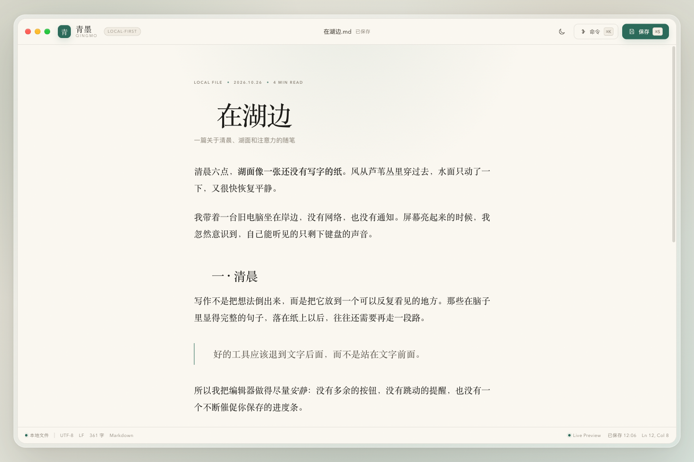
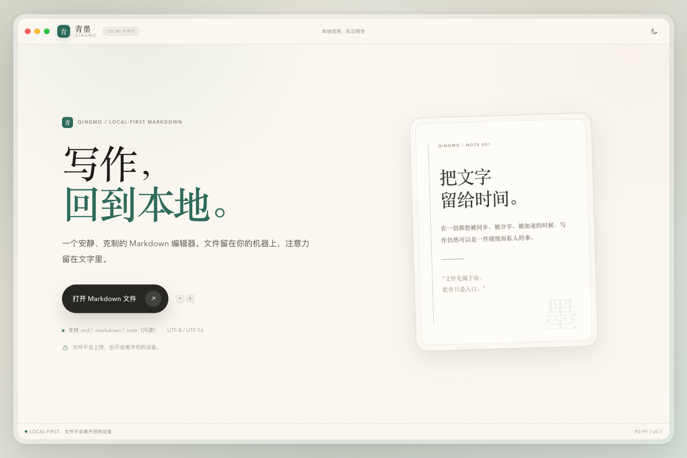
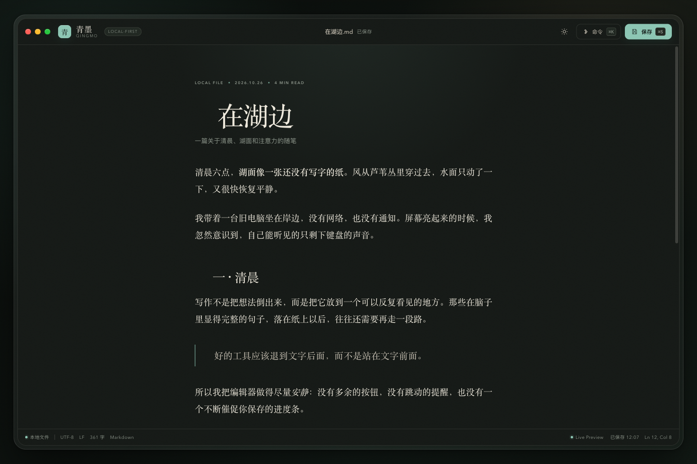
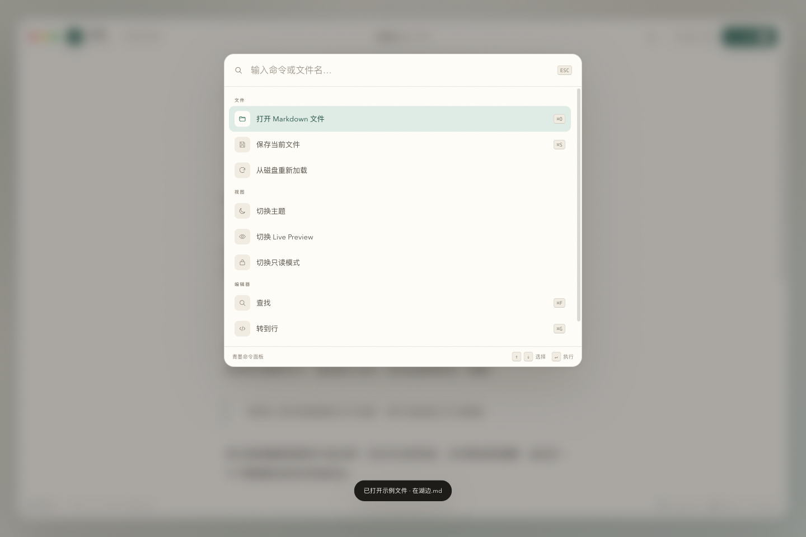
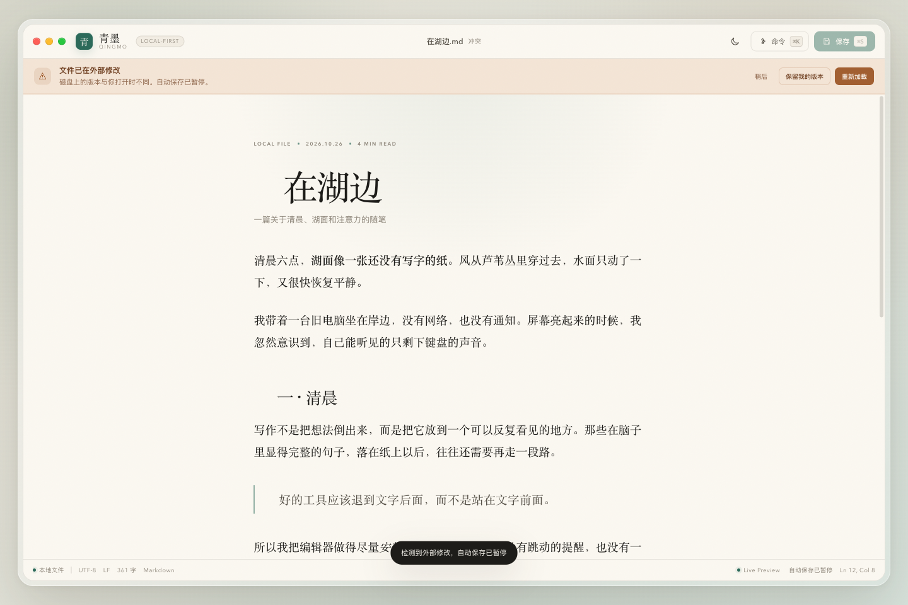
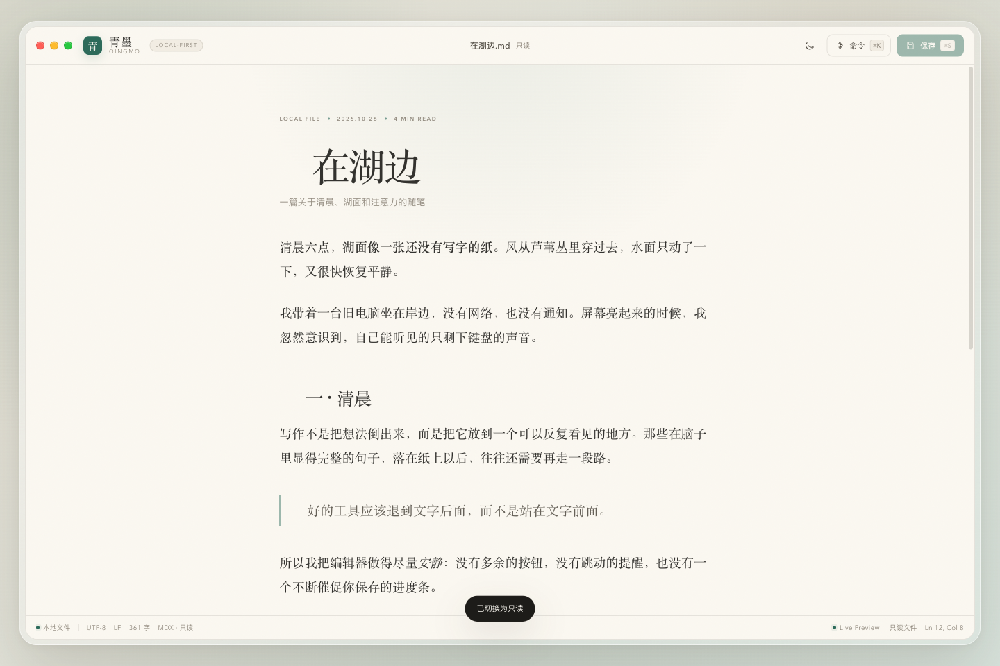
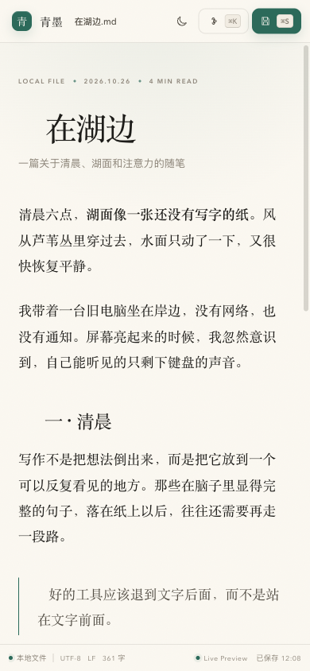

# 青墨 · 高保真 HTML 原型

> 对应功能：`p0-p1-editor-mvp`  
> 原型文件：[`index.html`](index.html)  
> 设计方向：**暖纸、墨色、青玉、编辑性排版、低噪音桌面写作界面**

## 1. 如何打开

直接双击 `index.html` 即可在浏览器中打开。若浏览器限制本地文件，可启动一个只读静态服务器：

```bash
cd docs/todo/p0-p1-editor-mvp/prototype
python3 -m http.server 4173 --bind 127.0.0.1
```

然后访问 `http://127.0.0.1:4173/`。

原型不依赖外部字体、图标库或网络资源，所有样式、SVG 图标和交互都在单个 HTML 文件中。

## 2. 预览

### 编辑器 · 浅色



### 欢迎页 · 浅色



### 编辑器 · 深色



### 命令面板



### 冲突状态



### 只读状态



### 移动端编辑器



## 3. 设计意图

青墨不是“又一个 Markdown 编辑器”，而是一张放在桌面上的安静稿纸。视觉上刻意去掉常见 SaaS 编辑器的高饱和渐变、厚重阴影和多栏仪表盘，改用：

- **暖纸底色 + 墨色正文**：长时间写作不刺眼。
- **青玉色作为唯一强调色**：只用于当前状态、链接、标记符号和主操作。
- **衬线正文 + 无衬线 UI**：正文像稿纸，界面像工具。
- **极细边框与纸面噪点**：保留一点纸张的触感，但不做成拟物皮肤。
- **单栏编辑区 + 底部状态栏**：没有文件树、没有最近文件、没有多余面板，符合 P1 范围。

## 4. 覆盖页面与状态

| 状态 | 查看方式 | 说明 |
|---|---|---|
| 编辑器 · 浅色 | 默认页面 | 标题、正文、引用、列表、行内代码、链接、光标行标记 |
| 欢迎页 · 浅色 | 点击左上角“青墨”或原型控制中的“欢迎页” | 打开文件 CTA、格式说明、本地优先提示、纸张装饰 |
| 编辑器 · 深色 | 右上角主题按钮，或原型控制“深色” | 深墨背景、青玉强调、同一信息层级 |
| 欢迎页 · 深色 | 深色下点击“青墨” | 深色纸张与反转主按钮 |
| 命令面板 | `⌘K` / `Ctrl+K`，或原型控制 | 搜索过滤、分组、键盘上下选择、Enter 执行 |
| 冲突横幅 | 原型控制 → 状态 → “冲突” | 外部修改提示、重新加载、保留我的版本、稍后 |
| 只读状态 | 原型控制 → 状态 → “只读” | 保存禁用、状态栏 `MDX · 只读`、正文不可编辑 |
| Live Preview 关闭 | 点击状态栏 “Live Preview” | 显示 Markdown 源标记（`#`、`##`、`>`、`-`、反引号） |
| 移动端 | 将浏览器缩放到 390px 左右 | 无窗口 chrome、全屏编辑、底部状态栏保留 |

## 5. 可用交互

- `⌘K` / `Ctrl+K`：打开/关闭命令面板。
- `⌘S` / `Ctrl+S`：模拟手动保存。
- `⌘O` / `Ctrl+O`：打开示例文件。
- `Esc`：关闭命令面板/原型控制。
- 直接点击正文可以编辑；输入后约 900ms 模拟自动保存。
- 点击“保存”会先进入“保存中…”，约 520ms 后变为“已保存 HH:mm”。
- 冲突状态下保存按钮禁用；可用“重新加载”或“保留我的版本”解决。
- 主题按钮在浅色/深色之间切换；原型控制里可选“跟随系统”。

> 原型中的文件打开、保存、冲突检测、自动保存都是**前端模拟**，不读写真实文件。真实实现必须走实施方案中的 Rust dialog + `docToken` + `atomic-write-file`。

## 6. 与实施方案的对应关系

| 原型区域 | 对应任务 | 说明 |
|---|---|---|
| 设计 token、窗口、按钮、状态栏 | T-004 | `packages/ui` token + `apps/desktop` shell |
| 欢迎页、打开文件 CTA | T-008 | `WelcomePage` + `openFile` |
| 编辑区、标题/正文/链接/代码样式 | T-009/T-010/T-013 | CM6 扩展组合 + Live Preview |
| 保存状态、冲突横幅、只读状态 | T-011/T-012/T-014 | `SaveCoordinator` + `ConflictBanner` + readOnly |
| 命令面板 | T-015 | `CommandPalette` + `keybindings` |
| 主题切换 | T-016 | `uiStore` + CSS 变量 + CM6 `Compartment` |
| 状态栏编码/EOL/字数 | T-004/T-010 | 只读快照，不把正文放进 React store |

## 7. 明确不覆盖

- 文件树、工作区、最近文件。
- 搜索页、反向链接、标签。
- SQLite、设置页、`settings.json`。
- 原生菜单、托盘、自动更新。
- 插件市场/插件宿主。
- 真实 Markdown 解析与真实文件 IO。
- 大文件性能、IME 真机行为、Windows/Linux 字体差异。

这些都属于 P2/P3 或真实实现阶段的验证项，不应由本原型冒充完成。
